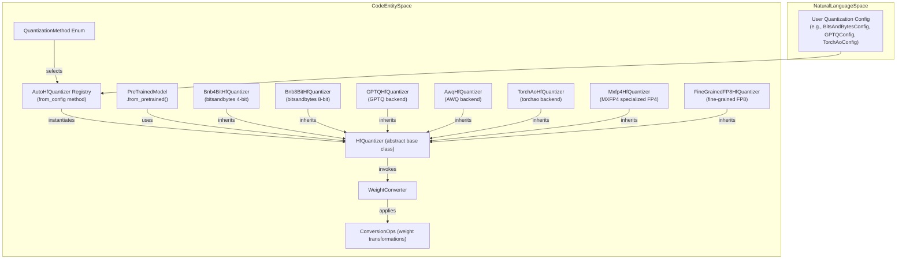
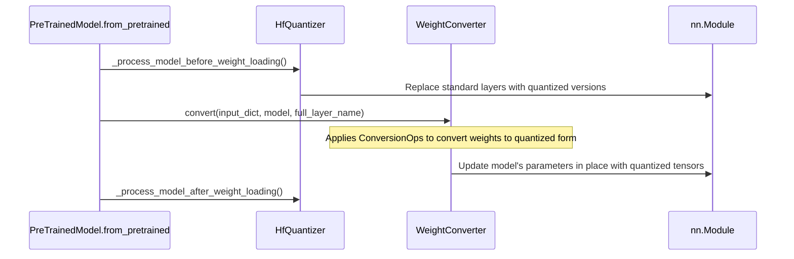

<!-- source: DeepWiki mcp.deepwiki.com · repo huggingface/transformers · page 7 Quantization · fetched 2026-10-26 -->

# Quantization

Relevant source files

The following files were used as context for generating this wiki page:

- [ISSUES.md](ISSUES.md)
- [docs/source/en/models_timeline.md](docs/source/en/models_timeline.md)
- [docs/source/en/pipeline_tutorial.md](docs/source/en/pipeline_tutorial.md)
- [docs/source/en/quantization/aqlm.md](docs/source/en/quantization/aqlm.md)
- [docs/source/en/quantization/awq.md](docs/source/en/quantization/awq.md)
- [docs/source/en/quantization/bitsandbytes.md](docs/source/en/quantization/bitsandbytes.md)
- [docs/source/en/quantization/compressed_tensors.md](docs/source/en/quantization/compressed_tensors.md)
- [docs/source/en/quantization/concept_guide.md](docs/source/en/quantization/concept_guide.md)
- [docs/source/en/quantization/eetq.md](docs/source/en/quantization/eetq.md)
- [docs/source/en/quantization/fbgemm_fp8.md](docs/source/en/quantization/fbgemm_fp8.md)
- [docs/source/en/quantization/hqq.md](docs/source/en/quantization/hqq.md)
- [docs/source/en/quantization/optimum.md](docs/source/en/quantization/optimum.md)
- [docs/source/en/quantization/quanto.md](docs/source/en/quantization/quanto.md)
- [docs/source/en/quantization/selecting.md](docs/source/en/quantization/selecting.md)
- [docs/source/en/quantization/torchao.md](docs/source/en/quantization/torchao.md)
- [docs/source/ko/quantization/optimum.md](docs/source/ko/quantization/optimum.md)
- [src/transformers/integrations/aqlm.py](src/transformers/integrations/aqlm.py)
- [src/transformers/integrations/bitnet.py](src/transformers/integrations/bitnet.py)
- [src/transformers/integrations/bitsandbytes.py](src/transformers/integrations/bitsandbytes.py)
- [src/transformers/integrations/eetq.py](src/transformers/integrations/eetq.py)
- [src/transformers/integrations/fbgemm_fp8.py](src/transformers/integrations/fbgemm_fp8.py)
- [src/transformers/integrations/higgs.py](src/transformers/integrations/higgs.py)
- [src/transformers/integrations/hqq.py](src/transformers/integrations/hqq.py)
- [src/transformers/integrations/mxfp4.py](src/transformers/integrations/mxfp4.py)
- [src/transformers/integrations/quanto.py](src/transformers/integrations/quanto.py)
- [src/transformers/integrations/torchao.py](src/transformers/integrations/torchao.py)
- [src/transformers/quantizers/base.py](src/transformers/quantizers/base.py)
- [src/transformers/quantizers/quantizer_bitnet.py](src/transformers/quantizers/quantizer_bitnet.py)
- [src/transformers/quantizers/quantizer_bnb_4bit.py](src/transformers/quantizers/quantizer_bnb_4bit.py)
- [src/transformers/quantizers/quantizer_bnb_8bit.py](src/transformers/quantizers/quantizer_bnb_8bit.py)
- [src/transformers/quantizers/quantizer_compressed_tensors.py](src/transformers/quantizers/quantizer_compressed_tensors.py)
- [src/transformers/quantizers/quantizer_eetq.py](src/transformers/quantizers/quantizer_eetq.py)
- [src/transformers/quantizers/quantizer_fbgemm_fp8.py](src/transformers/quantizers/quantizer_fbgemm_fp8.py)
- [src/transformers/quantizers/quantizer_higgs.py](src/transformers/quantizers/quantizer_higgs.py)
- [src/transformers/quantizers/quantizer_hqq.py](src/transformers/quantizers/quantizer_hqq.py)
- [src/transformers/quantizers/quantizer_mxfp4.py](src/transformers/quantizers/quantizer_mxfp4.py)
- [src/transformers/quantizers/quantizer_quanto.py](src/transformers/quantizers/quantizer_quanto.py)
- [src/transformers/quantizers/quantizer_torchao.py](src/transformers/quantizers/quantizer_torchao.py)
- [src/transformers/quantizers/quantizers_utils.py](src/transformers/quantizers/quantizers_utils.py)
- [tests/quantization/bitnet_integration/test_bitnet.py](tests/quantization/bitnet_integration/test_bitnet.py)
- [tests/quantization/bnb/test_4bit.py](tests/quantization/bnb/test_4bit.py)
- [tests/quantization/bnb/test_mixed_int8.py](tests/quantization/bnb/test_mixed_int8.py)
- [tests/quantization/compressed_tensors_integration/test_compressed_models.py](tests/quantization/compressed_tensors_integration/test_compressed_models.py)
- [tests/quantization/compressed_tensors_integration/test_compressed_tensors.py](tests/quantization/compressed_tensors_integration/test_compressed_tensors.py)
- [tests/quantization/eetq_integration/test_eetq.py](tests/quantization/eetq_integration/test_eetq.py)
- [tests/quantization/fbgemm_fp8/test_fbgemm_fp8.py](tests/quantization/fbgemm_fp8/test_fbgemm_fp8.py)
- [tests/quantization/fouroversix_integration/test_fouroversix.py](tests/quantization/fouroversix_integration/test_fouroversix.py)
- [tests/quantization/gptq/test_gptq.py](tests/quantization/gptq/test_gptq.py)
- [tests/quantization/higgs/test_higgs.py](tests/quantization/higgs/test_higgs.py)
- [tests/quantization/hqq/test_hqq.py](tests/quantization/hqq/test_hqq.py)
- [tests/quantization/mxfp4/test_mxfp4.py](tests/quantization/mxfp4/test_mxfp4.py)
- [tests/quantization/torchao_integration/test_torchao.py](tests/quantization/torchao_integration/test_torchao.py)
- [tests/sagemaker/README.md](tests/sagemaker/README.md)

The quantization framework in 🤗 Transformers provides a unified interface for loading and running models in reduced precision formats, such as 4-bit, 8-bit, FP8, or MXFP4. It enables significant reductions in memory usage and improvements in inference speed while maintaining high model quality.

Central to the system is the abstract base class [`HfQuantizer`][src/transformers/quantizers/base.py:73-84](), which defines the lifecycle of a quantized model including environment validation, model preprocessing, and weight converters. The system auto-selects the appropriate quantizer subclass based on the user-supplied quantization configuration (`QuantizationConfigMixin`) passed during `from_pretrained` model loading.

Supported backends include popular libraries and custom kernels such as:

- `bitsandbytes` for 4-bit and 8-bit quantization ([`Bnb4BitHfQuantizer`][src/transformers/quantizers/quantizer_bnb_4bit.py:45-52](), [`Bnb8BitHfQuantizer`][src/transformers/quantizers/quantizer_bnb_8bit.py:45-52]())
- `GPTQ` and `AWQ` for optimized static post-training quantization
- `torchao` from PyTorch architecture optimization ([`TorchAoHfQuantizer`][src/transformers/quantizers/quantizer_torchao.py:59-160]())
- Specialized fine-grained FP8 and MXFP4 kernels ([`Mxfp4HfQuantizer`][src/transformers/quantizers/quantizer_mxfp4.py:43-50](), [`FineGrainedFP8HfQuantizer`][src/transformers/quantizers/quantizer_finegrained_fp8.py:18-22]())

This page provides an overview of the architecture and key components, with links to detailed child pages covering each quantization method.

---

## Core Infrastructure

### The `HfQuantizer` Base Class

`HfQuantizer` is an abstract base specifying:

- A reference to the user quantization config (`QuantizationConfigMixin`) defining quantization parameters.
- Whether calibration is required before usage (`requires_calibration`).
- Hooks for environment validation (`validate_environment()`), model preprocessing (`preprocess_model()`), and parameter quantization checks (`param_needs_quantization()`).
- Utilities for adjusting device maps and max memory estimations during auto device placement.
- Methods to integrate with weight loading via `WeightConverter` and conversion operations.

The class plays a pivotal role in the quantized model lifecycle during `from_pretrained()` where it manages module replacement, ensures environment compatibility, and converts weights to quantized representations [src/transformers/quantizers/base.py:73-168]().

Sources: [src/transformers/quantizers/base.py:73-168]()

### Quantization Lifecycle Overview

When a quantization config is passed, the following high-level steps occur:

1.  **Environment Validation**: Checks that necessary libraries and hardware are available (e.g., `bitsandbytes`, `torchao`) and raises informative errors otherwise. For example, [`TorchAoHfQuantizer.validate_environment`][src/transformers/quantizers/quantizer_torchao.py:73-87]() checks for `torchao` availability.

2.  **Model Preprocessing**: Before weights are loaded, the model is initialized on the meta device. Layers such as `nn.Linear` are replaced with quantized variants corresponding to the backend in use (e.g., `bnb.nn.Linear4bit` for bitsandbytes). Some modules (like certain embeddings or LM heads) may be preserved in full precision based on config. This allows for efficient and correct parameter replacement [src/transformers/quantizers/base.py:155-174](), [src/transformers/quantizers/quantizer_bnb_4bit.py:121-144]().

3.  **Weight Loading with Conversion**: During checkpoint loading, `WeightConverter` instances use `ConversionOps` subclasses to transform loaded floating point weights into quantized tensors or encoded forms understood by the backend, making heavy use of module introspection to replace parameters in-place [src/transformers/quantizers/quantizer_torchao.py:88-121](), [src/transformers/quantizers/quantizer_bnb_4bit.py:168-174]().

4.  **Postprocessing Steps**: After weight loading, flags like `is_loaded_in_4bit` or `is_8bit_serializable` are set, and any backend-specific initialization occurs to finalize the quantized model state [src/transformers/quantizers/quantizer_bnb_4bit.py:145-148]().

Sources: [src/transformers/quantizers/base.py:155-174](), [src/transformers/quantizers/quantizer_bnb_4bit.py:121-148](), [src/transformers/quantizers/quantizer_torchao.py:73-121]()

### Quantization Dispatch Flow

This diagram shows how the system maps user configuration inputs to concrete quantizers and underlying kernel operations in the codebase:

Sources: [src/transformers/quantizers/base.py:73-84](), [src/transformers/quantizers/quantizer_bnb_4bit.py:45-52](), [src/transformers/quantizers/quantizer_bnb_8bit.py:45-52](), [src/transformers/quantizers/quantizer_torchao.py:59-160](), [src/transformers/quantizers/quantizer_mxfp4.py:43-50](), [src/transformers/quantizers/quantizer_finegrained_fp8.py:18-22]()

---

## Supported Backends

### BitsAndBytes, GPTQ & AWQ

This family of quantizers is the most commonly used for 4-bit and 8-bit quantization of LLMs:

-   **BitsAndBytes (bnb)**: Supports dynamic and static 4-bit and 8-bit weight quantization using [`Bnb4BitHfQuantizer`][src/transformers/quantizers/quantizer_bnb_4bit.py:45-65]() and [`Bnb8BitHfQuantizer`][src/transformers/quantizers/quantizer_bnb_8bit.py:45-65](). It integrates tightly with the `accelerate` library for efficient device placement and offloading strategies. Modules are replaced with quantized layers during model loading, and weights are converted with backend-specific serialization. The `Bnb4bitQuantize` and `Bnb8bitQuantize` classes handle the conversion of weights to their respective quantized formats [src/transformers/integrations/bitsandbytes.py:30-61](), [src/transformers/integrations/bitsandbytes.py:99-125]().

-   **GPTQ & AWQ**: These are specialized static quantization methods targeting ultra high-throughput inference, usually requiring calibration datasets during quantization. Transformers supports these through specialized configs and integration with `gptqmodel` or other custom implementations, enabling replacement of standard linear layers for optimized execution.

For detailed usage and code insights, see [BitsAndBytes, GPTQ & AWQ](#7.1).

Sources: [src/transformers/quantizers/quantizer_bnb_4bit.py:45-149](), [src/transformers/quantizers/quantizer_bnb_8bit.py:45-160](), [src/transformers/integrations/bitsandbytes.py:30-125]()

### FP8, GGUF/GGML & Other Quantization Backends

Transformers also supports more experimental or specialized quantization backends focused on FP8 and platform-specific formats:

-   **TorchAO (PyTorch Architecture Optimization)**: The [`TorchAoHfQuantizer`][src/transformers/quantizers/quantizer_torchao.py:59-160]() supports several weight only and dynamic quantization schemes including 4-bit and 8-bit int variants, float8 formats, and allows compilation with `torch.compile` for optimized inference. It includes module-level config control and metadata handling for safetensors checkpoints. Support for offloading and fine control of quantized parameter sizes is included [src/transformers/quantizers/quantizer_torchao.py:59-160]().

-   **MXFP4**: Uses FP4 format quantization accelerated with fbgemm and triton kernels via the [`Mxfp4HfQuantizer`][src/transformers/quantizers/quantizer_mxfp4.py:43-161]() class. Supports strict hardware compatibility checks and fallback to dequantization if needed. Kernel loading is lazy and automated. The `Mxfp4Quantize` and `Mxfp4Deserialize` classes handle the conversion and deserialization of MXFP4 weights [src/transformers/integrations/mxfp4.py:49-174]().

-   **Fine-Grained FP8**: Offers detailed control over FP8 quantization across various tensor types with the [`FineGrainedFP8HfQuantizer`][src/transformers/quantizers/quantizer_finegrained_fp8.py:18-22]().

-   **CompressedTensors**: The [`CompressedTensorsHfQuantizer`][src/transformers/quantizers/quantizer_compressed_tensors.py:38-67]() integrates with the `compressed_tensors` library, supporting various quantization schemes including FP8 kernels. It handles environment validation for `compressed-tensors` and hardware compatibility for FP8 matmul kernels [src/transformers/quantizers/quantizer_compressed_tensors.py:68-91]().

-   **GGUF/GGML**: Supports native loading of GGUF quantized models used in popular C++ inference engines, with custom utilities handling weight deserialization.

-   Additional backends include libraries for hybrid quantization like `HQQ`, `EETQ`, `AQLM`, `VPTQ`, and specialized formats for kernel compression and sparsity.

For details, see [FP8, GGUF/GGML & Other Quantization Backends](#7.2).

Sources: [src/transformers/quantizers/quantizer_torchao.py:59-160](), [src/transformers/quantizers/quantizer_mxfp4.py:43-161](), [src/transformers/quantizers/quantizer_finegrained_fp8.py:18-22](), [src/transformers/integrations/mxfp4.py:49-174](), [src/transformers/quantizers/quantizer_compressed_tensors.py:38-91]()

---

## Key Utilities

| Utility                       | Description                                                                                      | Source                              |
|------------------------------|------------------------------------------------------------------------------------------------|-----------------------------------|
| `get_keys_to_not_convert`    | Automatically identifies keys (e.g., tied weights, lm_head, output embeddings) to keep in FP32 | [src/transformers/quantizers/base.py:38-62]()     |
| `validate_quantization_for_training` | Ensures compatibility of quantized models with PEFT/QLoRA training; checks for `is_trainable` quantizers and disallows certain `torch.compile` uses | (internal utils, mentioned in tests)         |
| `WeightConverter`             | Maps checkpoint weight keys to quantized module parameters and applies transformations           | [src/transformers/quantizers/quantizer_torchao.py:34-40]() |
| `ConversionOps`               | Abstract class for weight transformation operations (e.g., serialize/deserialize quantized ops) | [src/transformers/integrations/bitsandbytes.py:30-160](), [src/transformers/integrations/mxfp4.py:49-174]() |

Sources: [src/transformers/quantizers/base.py:38-62](), [src/transformers/quantizers/quantizer_torchao.py:34-40](), [src/transformers/integrations/bitsandbytes.py:30-160](), [src/transformers/integrations/mxfp4.py:49-174]()

### Weight Conversion Flow

Quantized weight loading involves:

This pipeline ensures seamless integration of quantized weights in a ready-to-run model instance.

Sources: [src/transformers/quantizers/base.py:155-174](), [src/transformers/quantizers/quantizer_torchao.py:106-121](), [src/transformers/quantizers/quantizer_bnb_4bit.py:121-148]()

---

## Child Pages for Details

-   **[BitsAndBytes, GPTQ & AWQ](#7.1)** — In-depth coverage of bitsandbytes 4-bit and 8-bit quantizers, GPTQ and AWQ methods, including configuration classes like `BitsAndBytesConfig`, `GPTQConfig`, and `AwqConfig`. Explains how linear layers are dynamically replaced in model loading.

-   **[FP8, GGUF/GGML & Other Quantization Backends](#7.2)** — Detailed exploration of FP8 quantization, MXFP4 kernels, integrations with torchao, HQQ, Quanto, EETQ, AQLM, VPTQ, and efficient GGUF/GGML file loading. Demonstrates the use of `quantizer_finegrained_fp8.py`, `integrations/ggml.py`, and related utilities.

---

This overview positions quantization in Transformers as a flexible, extensible, and backend-agnostic framework, empowering users to leverage state-of-the-art compression and acceleration techniques transparently during model loading and inference.

Sources:
[src/transformers/quantizers/base.py:73-168]()
[src/transformers/quantizers/quantizer_torchao.py:59-160]()
[src/transformers/quantizers/quantizer_bnb_4bit.py:45-149]()
[src/transformers/quantizers/quantizer_bnb_8bit.py:45-160]()
[src/transformers/quantizers/quantizer_mxfp4.py:43-161]()
[src/transformers/quantizers/quantizer_finegrained_fp8.py:18-22]()
[src/transformers/integrations/bitsandbytes.py:30-160]()
[src/transformers/integrations/mxfp4.py:49-174]()
[src/transformers/quantizers/quantizer_compressed_tensors.py:38-91]()

---

