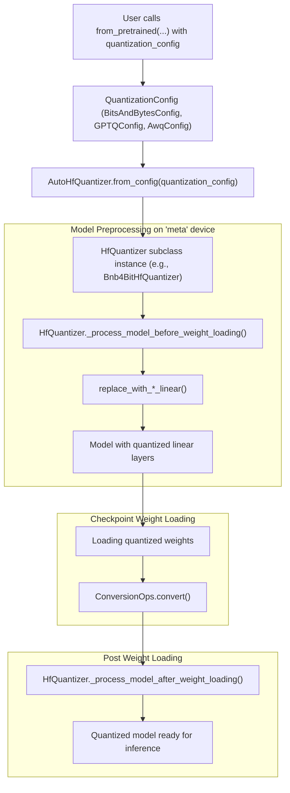
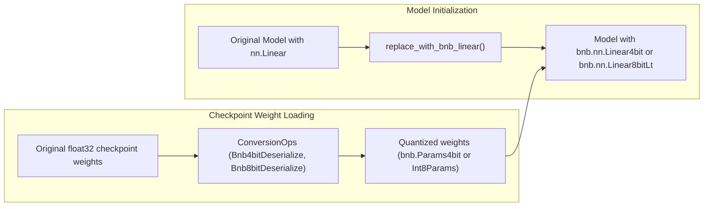
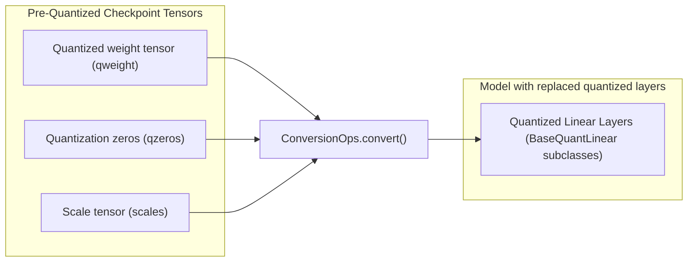

<!-- source: DeepWiki mcp.deepwiki.com · repo huggingface/transformers · page 7.1 BitsAndBytes, GPTQ & AWQ · fetched 2026-10-26 -->

# BitsAndBytes, GPTQ & AWQ

Relevant source files

The following files were used as context for generating this wiki page:

- [ISSUES.md](ISSUES.md)
- [docs/source/en/quantization/torchao.md](docs/source/en/quantization/torchao.md)
- [docs/source/ko/llm_optims.md](docs/source/ko/llm_optims.md)
- [src/transformers/integrations/aqlm.py](src/transformers/integrations/aqlm.py)
- [src/transformers/integrations/awq.py](src/transformers/integrations/awq.py)
- [src/transformers/integrations/bitnet.py](src/transformers/integrations/bitnet.py)
- [src/transformers/integrations/bitsandbytes.py](src/transformers/integrations/bitsandbytes.py)
- [src/transformers/integrations/eetq.py](src/transformers/integrations/eetq.py)
- [src/transformers/integrations/fbgemm_fp8.py](src/transformers/integrations/fbgemm_fp8.py)
- [src/transformers/integrations/higgs.py](src/transformers/integrations/higgs.py)
- [src/transformers/integrations/mxfp4.py](src/transformers/integrations/mxfp4.py)
- [src/transformers/integrations/quanto.py](src/transformers/integrations/quanto.py)
- [src/transformers/integrations/torchao.py](src/transformers/integrations/torchao.py)
- [src/transformers/quantizers/base.py](src/transformers/quantizers/base.py)
- [src/transformers/quantizers/quantizer_aqlm.py](src/transformers/quantizers/quantizer_aqlm.py)
- [src/transformers/quantizers/quantizer_awq.py](src/transformers/quantizers/quantizer_awq.py)
- [src/transformers/quantizers/quantizer_bitnet.py](src/transformers/quantizers/quantizer_bitnet.py)
- [src/transformers/quantizers/quantizer_bnb_4bit.py](src/transformers/quantizers/quantizer_bnb_4bit.py)
- [src/transformers/quantizers/quantizer_bnb_8bit.py](src/transformers/quantizers/quantizer_bnb_8bit.py)
- [src/transformers/quantizers/quantizer_eetq.py](src/transformers/quantizers/quantizer_eetq.py)
- [src/transformers/quantizers/quantizer_fbgemm_fp8.py](src/transformers/quantizers/quantizer_fbgemm_fp8.py)
- [src/transformers/quantizers/quantizer_gptq.py](src/transformers/quantizers/quantizer_gptq.py)
- [src/transformers/quantizers/quantizer_higgs.py](src/transformers/quantizers/quantizer_higgs.py)
- [src/transformers/quantizers/quantizer_mxfp4.py](src/transformers/quantizers/quantizer_mxfp4.py)
- [src/transformers/quantizers/quantizer_quanto.py](src/transformers/quantizers/quantizer_quanto.py)
- [src/transformers/quantizers/quantizer_spqr.py](src/transformers/quantizers/quantizer_spqr.py)
- [src/transformers/quantizers/quantizer_torchao.py](src/transformers/quantizers/quantizer_torchao.py)
- [src/transformers/quantizers/quantizer_vptq.py](src/transformers/quantizers/quantizer_vptq.py)
- [src/transformers/quantizers/quantizers_utils.py](src/transformers/quantizers/quantizers_utils.py)
- [tests/quantization/aqlm_integration/test_aqlm.py](tests/quantization/aqlm_integration/test_aqlm.py)
- [tests/quantization/autoawq/test_awq.py](tests/quantization/autoawq/test_awq.py)
- [tests/quantization/bitnet_integration/test_bitnet.py](tests/quantization/bitnet_integration/test_bitnet.py)
- [tests/quantization/bnb/test_4bit.py](tests/quantization/bnb/test_4bit.py)
- [tests/quantization/bnb/test_mixed_int8.py](tests/quantization/bnb/test_mixed_int8.py)
- [tests/quantization/eetq_integration/test_eetq.py](tests/quantization/eetq_integration/test_eetq.py)
- [tests/quantization/fbgemm_fp8/test_fbgemm_fp8.py](tests/quantization/fbgemm_fp8/test_fbgemm_fp8.py)
- [tests/quantization/gptq/test_gptq.py](tests/quantization/gptq/test_gptq.py)
- [tests/quantization/higgs/test_higgs.py](tests/quantization/higgs/test_higgs.py)
- [tests/quantization/mxfp4/test_mxfp4.py](tests/quantization/mxfp4/test_mxfp4.py)
- [tests/quantization/spqr_integration/test_spqr.py](tests/quantization/spqr_integration/test_spqr.py)
- [tests/quantization/torchao_integration/test_torchao.py](tests/quantization/torchao_integration/test_torchao.py)
- [tests/sagemaker/README.md](tests/sagemaker/README.md)

The `transformers` library provides a comprehensive, extensible quantization framework that supports several prominent quantization backends: **bitsandbytes** (bnb) 4-bit and 8-bit quantizers, **GPTQ** quantizers, and **AWQ** quantizers. These methods enable loading and running large pretrained language models with significantly reduced memory and computational cost by transforming model weights into lower-bit precision representations during or prior to loading.

This page covers the technical implementation details of these quantizers, focusing on the configuration classes (`BitsAndBytesConfig`, `GPTQConfig`, `AwqConfig`), key quantizer classes (`Bnb4BitHfQuantizer`, `Bnb8BitHfQuantizer`, `GptqHfQuantizer`, `AwqHfQuantizer`), and the process of replacing standard `torch.nn.Linear` layers with quantized linear implementations during model loading.

---

## Quantization Framework Architecture

Quantization in `transformers` is anchored around the **`HfQuantizer`** abstract base class. This class defines the lifecycle and interface for loading models with quantized parameters, including:

- Validating environment requirements (e.g., dependencies, device support)
- Preprocessing the model skeleton before weight loading (e.g., replacing linear layers with quantized layers)
- Converting and loading quantized weights from checkpoints
- Postprocessing after weights have been loaded (attaching flags, making attributes available)
- Determining whether a model parameter should be quantized, and reporting the memory size of quantized parameters

The specific quantization backend implementations subclass `HfQuantizer` and provide backend-specific logic. The selection of the proper quantizer is made dynamically via the `AutoHfQuantizer` factory based on the quantization config passed during model loading.

Quantizers also expose **`ConversionOps`** subclasses that are used to convert raw checkpoint tensors (e.g., floating-point weights, quantization scales, zero points) into in-memory quantized weights or specialized parameter classes compatible with quantized modules.

### Model Loading Flow with Quantization

Below is the lifecycle of applying quantization during model loading:

Sources:  
[src/transformers/quantizers/base.py:73-168](),  
[src/transformers/quantizers/quantizer_bnb_4bit.py:45-149](),  
[src/transformers/quantizers/quantizer_bnb_8bit.py:45-124](),  
[src/transformers/integrations/bitsandbytes.py:162-182](),  
[tests/quantization/autoawq/test_awq.py:138-163]()

---

## BitsAndBytes Quantization (4-bit and 8-bit)

BitsAndBytes (`bnb`) quantization leverages the external [bitsandbytes](https://github.com/facebookresearch/bitsandbytes) library optimized for efficient 4-bit and 8-bit quantization of transformer models. `transformers` integrates these capabilities via dedicated quantizer classes and integration utilities.

### BitsAndBytes Quantizer Classes

| Class                | Description                                                         | File Reference                                  |
|----------------------|---------------------------------------------------------------------|------------------------------------------------|
| `Bnb4BitHfQuantizer` | Implements 4-bit weight-only quantization integration               | [src/transformers/quantizers/quantizer_bnb_4bit.py:45-149]()                |
| `Bnb8BitHfQuantizer` | Implements 8-bit weight-only quantization integration               | [src/transformers/quantizers/quantizer_bnb_8bit.py:45-124]()                |

### Key Details for BitsAndBytes Integration

- **Layer replacement**: Calling `_process_model_before_weight_loading` replaces standard `torch.nn.Linear` layers in the model with bitsandbytes quantized equivalents (`bnb.nn.Linear4bit` or `bnb.nn.Linear8bitLt`). This is done via the helper `replace_with_bnb_linear()` [src/transformers/integrations/bitsandbytes.py:162-182]().

- **Modules not to convert**: The quantizer automatically gathers layer names that should be excluded from quantization, such as tied weights, output layers, or modules flagged by user config to remain full precision. [src/transformers/quantizers/bnb_4bit.py:129-131](), [src/transformers/quantizers/bnb_8bit.py:133-135]()

- **Environment validation**: Ensures compatible versions of `bitsandbytes` and `accelerate` are installed, throwing clear import errors if missing. [src/transformers/quantizers/quantizer_bnb_4bit.py:57-68](), [src/transformers/quantizers/quantizer_bnb_8bit.py:57-68]()

- **Device map adjustment**: The quantizer can set or update device mapping, assigning modules to GPU, CPU, or accelerators as needed for offload. [src/transformers/quantizers/quantizer_bnb_4bit.py:102-119](), [src/transformers/quantizers/quantizer_bnb_8bit.py:88-105]()

- **Parameter size accounting**: Quantized parameters are accounted for as occupying fewer bytes (0.5 bytes for 4-bit, 1 byte for 8-bit) enabling accurate memory tracking and device placement heuristics. [src/transformers/quantizers/quantizer_bnb_4bit.py:83-87](), [src/transformers/quantizers/quantizer_bnb_8bit.py:107-111]()

- **Weight conversion operations**: Custom `ConversionOps` deserialize checkpoint float weights and quantization stats into `bnb.nn.Params4bit` or `bnb.nn.Int8Params`, restoring a quantized state compatible with bnb linear layers. [src/transformers/integrations/bitsandbytes.py:64-96](), [src/transformers/integrations/bitsandbytes.py:128-159]()

- **Trainability and serialization**: BitsAndBytes 4-bit and 8-bit quantizers support training (fine-tuning) in quantized mode and provide mechanisms to serialize quantized weights properly. [src/transformers/quantizers/quantizer_bnb_4bit.py:150-155](), [src/transformers/quantizers/quantizer_bnb_8bit.py:149-154]()

---

### Diagram: BitsAndBytes Model Conversion and Weight Loading

Sources:  
[src/transformers/quantizers/quantizer_bnb_4bit.py:45-149](),  
[src/transformers/quantizers/quantizer_bnb_8bit.py:45-124](),  
[src/transformers/integrations/bitsandbytes.py:30-182]()

---

## GPTQ & AWQ Quantizers

GPTQ (Generalized Post-Training Quantization) and AWQ (Activation-aware Weight Quantization) are cutting-edge quantization schemes optimized to load and run pre-quantized checkpoints targeting improved inference efficiency and accuracy over typical quantizers.

These approaches require specialized linear layers and checkpoint metadata beyond simple weight-only quantization.

### GPTQ Quantizer

- Implements `GptqHfQuantizer` class that orchestrates loading GPTQ quantized checkpoints. [src/transformers/quantizers/quantizer_gptq.py]()
- Performs replacement of `torch.nn.Linear` modules with `BaseQuantLinear` or specialized GPTQ linear layers prior to weight loading. [src/transformers/quantizers/quantizer_gptq.py]()
- Uses `ConversionOps` designed to convert checkpoint tensors such as `qweight`, `qzeros`, `scales`, and other quantization metadata into quantized weights and state held by quantized linear modules. [src/transformers/quantizers/quantizer_gptq.py]()
- Supports variants optimized for specific hardware backends such as ExLlama or CUDA kernels. [src/transformers/quantizers/quantizer_gptq.py]()

### AWQ Quantizer

- Implements `AwqHfQuantizer` with `AwqConfig` defining parameters such as bitwidth (`bits=2 or 4`), use of zero point, and backend selection. [src/transformers/quantizers/quantizer_awq.py]()
- Similar to GPTQ, AWQ replaces linear layers with quantized linear modules (`BaseQuantLinear` subclasses) via `replace_with_awq_linear` [src/transformers/integrations/awq.py]() before weight loading. [tests/quantization/autoawq/test_awq.py:158]()
- Provides conversion logic to convert stored checkpoint tensors into quantized weight structures optimized for the AWQ algorithm. [src/transformers/quantizers/quantizer_awq.py]()
- AWQ extends GPTQ concepts by including activation-awareness in quantization to protect sensitive weight channels while retaining compression. [src/transformers/quantizers/quantizer_awq.py]()

---

### Diagram: GPTQ and AWQ Weight Conversion Operations

Sources:  
[src/transformers/quantizers/quantizer_gptq.py](),  
[src/transformers/quantizers/quantizer_awq.py](),  
[src/transformers/integrations/awq.py](),  
[tests/quantization/autoawq/test_awq.py:138-163]()

---

## Summary of Key Classes and Modules

| Class/Module                    | Description                                      | File Reference                                   |
|--------------------------------|-------------------------------------------------|-------------------------------------------------|
| `HfQuantizer`                  | Abstract base class for quantizers               | [src/transformers/quantizers/base.py:73-168]()                    |
| `BitsAndBytesConfig`           | Config class for bitsandbytes quantization       | [src/transformers/utils/quantization_config.py]()                  |
| `Bnb4BitHfQuantizer`           | 4-bit bitsandbytes quantizer implementation      | [src/transformers/quantizers/quantizer_bnb_4bit.py:45-149]()      |
| `Bnb8BitHfQuantizer`           | 8-bit bitsandbytes quantizer implementation      | [src/transformers/quantizers/quantizer_bnb_8bit.py:45-124]()      |
| `replace_with_bnb_linear`      | Replaces linear layers with bnb quantized layers | [src/transformers/integrations/bitsandbytes.py:162-182]()         |
| `GPTQConfig`                   | Configuration for GPTQ quantization               | [src/transformers/utils/quantization_config.py]()                  |
| `GptqHfQuantizer`              | GPTQ quantizer implementation                     | [src/transformers/quantizers/quantizer_gptq.py]()                  |
| `AwqConfig`                   | Configuration for AWQ quantization                | [src/transformers/utils/quantization_config.py]()                  |
| `AwqHfQuantizer`               | AWQ quantizer implementation                      | [src/transformers/quantizers/quantizer_awq.py]()                   |
| `replace_with_awq_linear`      | Replaces linear layers with AWQ quantized layers | [src/transformers/integrations/awq.py]()                            |
| `ConversionOps` subclasses     | Convert checkpoint data to quantized weights      | Various quantizer and integration files           |

---

## Training and Serialization Notes

- BitsAndBytes 4-bit and 8-bit quantizers both support trainability (fine-tuning quantized models) and serialization for checkpoint saving. [src/transformers/quantizers/quantizer_bnb_4bit.py:150-155](), [src/transformers/quantizers/quantizer_bnb_8bit.py:149-154]()
- GPTQ and AWQ focus on inference with pre-quantized checkpoints; serialization mechanisms focus on loading and deserializing specialized weight tensors. [src/transformers/quantizers/quantizer_gptq.py](), [src/transformers/quantizers/quantizer_awq.py]()
- Quantizers report their trainability and serializability via flags and properties to coordinate with the rest of the framework. [src/transformers/quantizers/base.py:149-151]()

---

# Appendix: Common HfQuantizer Methods

| Method                                 | Description                                                                                      |
|--------------------------------------|------------------------------------------------------------------------------------------------|
| `validate_environment()`              | Check for required packages/hardware before model loading                                       |
| `_process_model_before_weight_loading()` | Replace linear layers, set attributes, mark modules to skip for conversion                      |
| `_process_model_after_weight_loading()`  | Post loading, e.g. set flags (`is_loaded_in_4bit`), finalize setup                              |
| `param_needs_quantization()`          | Return if a parameter should be quantized                                                      |
| `param_element_size()`                | Return size in bytes of quantized parameter                                                    |
| `update_device_map()`                 | Adjust or create device map for module placement on CPU/GPU/accelerator                         |

Sources:  
[src/transformers/quantizers/base.py:73-168]()

---

This completes the detailed exposition of the BitsAndBytes, GPTQ, and AWQ quantization mechanisms within the Hugging Face Transformers framework. This infrastructure facilitates effective quantization-aware model loading, enabling large-scale models to be deployed efficiently on constrained hardware.

---

