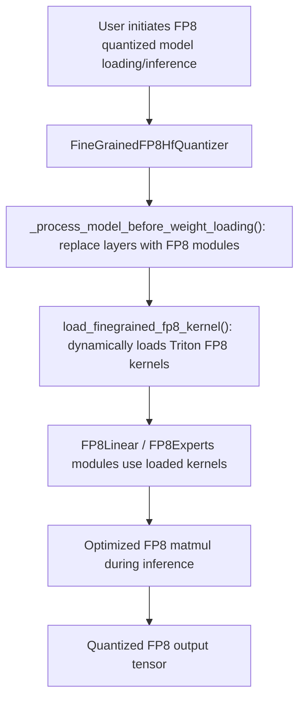
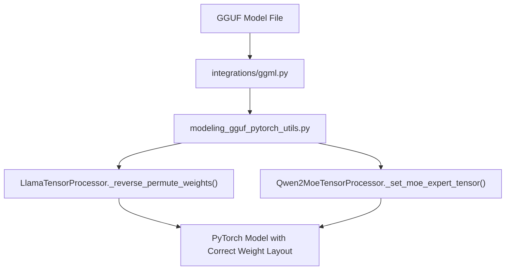
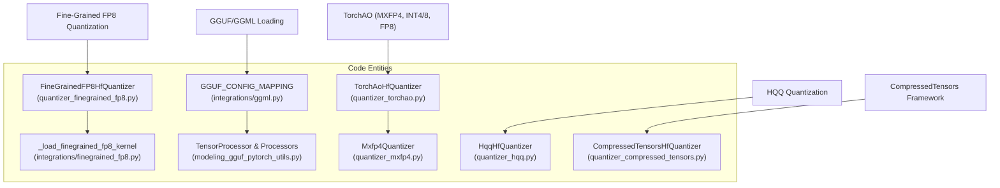

<!-- source: DeepWiki mcp.deepwiki.com · repo huggingface/transformers · page 7.2 FP8, GGUF/GGML & Other Quantization Backends · fetched 2026-10-26 -->

# FP8, GGUF/GGML & Other Quantization Backends

Relevant source files

The following files were used as context for generating this wiki page:

- [docs/source/en/models_timeline.md](docs/source/en/models_timeline.md)
- [docs/source/en/pipeline_tutorial.md](docs/source/en/pipeline_tutorial.md)
- [docs/source/en/quantization/aqlm.md](docs/source/en/quantization/aqlm.md)
- [docs/source/en/quantization/awq.md](docs/source/en/quantization/awq.md)
- [docs/source/en/quantization/bitsandbytes.md](docs/source/en/quantization/bitsandbytes.md)
- [docs/source/en/quantization/compressed_tensors.md](docs/source/en/quantization/compressed_tensors.md)
- [docs/source/en/quantization/concept_guide.md](docs/source/en/quantization/concept_guide.md)
- [docs/source/en/quantization/eetq.md](docs/source/en/quantization/eetq.md)
- [docs/source/en/quantization/fbgemm_fp8.md](docs/source/en/quantization/fbgemm_fp8.md)
- [docs/source/en/quantization/gguf.md](docs/source/en/quantization/gguf.md)
- [docs/source/en/quantization/hqq.md](docs/source/en/quantization/hqq.md)
- [docs/source/en/quantization/optimum.md](docs/source/en/quantization/optimum.md)
- [docs/source/en/quantization/quanto.md](docs/source/en/quantization/quanto.md)
- [docs/source/en/quantization/selecting.md](docs/source/en/quantization/selecting.md)
- [docs/source/ko/quantization/optimum.md](docs/source/ko/quantization/optimum.md)
- [src/transformers/cli/serving/model_manager.py](src/transformers/cli/serving/model_manager.py)
- [src/transformers/convert_slow_tokenizer.py](src/transformers/convert_slow_tokenizer.py)
- [src/transformers/integrations/compressed_tensors.py](src/transformers/integrations/compressed_tensors.py)
- [src/transformers/integrations/deepgemm.py](src/transformers/integrations/deepgemm.py)
- [src/transformers/integrations/finegrained_fp8.py](src/transformers/integrations/finegrained_fp8.py)
- [src/transformers/integrations/ggml.py](src/transformers/integrations/ggml.py)
- [src/transformers/integrations/gguf/__init__.py](src/transformers/integrations/gguf/__init__.py)
- [src/transformers/integrations/gguf/dequant.py](src/transformers/integrations/gguf/dequant.py)
- [src/transformers/integrations/gguf/gguf_config_mapping.py](src/transformers/integrations/gguf/gguf_config_mapping.py)
- [src/transformers/integrations/gguf/gguf_conversion_mapping.py](src/transformers/integrations/gguf/gguf_conversion_mapping.py)
- [src/transformers/integrations/gguf/gguf_tokenizer_mapping.py](src/transformers/integrations/gguf/gguf_tokenizer_mapping.py)
- [src/transformers/integrations/gguf/kernels.py](src/transformers/integrations/gguf/kernels.py)
- [src/transformers/integrations/gguf/reader.py](src/transformers/integrations/gguf/reader.py)
- [src/transformers/integrations/gguf/utils.py](src/transformers/integrations/gguf/utils.py)
- [src/transformers/integrations/hqq.py](src/transformers/integrations/hqq.py)
- [src/transformers/integrations/moe.py](src/transformers/integrations/moe.py)
- [src/transformers/integrations/sonicmoe.py](src/transformers/integrations/sonicmoe.py)
- [src/transformers/modeling_gguf_pytorch_utils.py](src/transformers/modeling_gguf_pytorch_utils.py)
- [src/transformers/quantizers/quantizer_compressed_tensors.py](src/transformers/quantizers/quantizer_compressed_tensors.py)
- [src/transformers/quantizers/quantizer_finegrained_fp8.py](src/transformers/quantizers/quantizer_finegrained_fp8.py)
- [src/transformers/quantizers/quantizer_gguf.py](src/transformers/quantizers/quantizer_gguf.py)
- [src/transformers/quantizers/quantizer_hqq.py](src/transformers/quantizers/quantizer_hqq.py)
- [tests/integrations/test_moe.py](tests/integrations/test_moe.py)
- [tests/kernels/test_deepgemm.py](tests/kernels/test_deepgemm.py)
- [tests/kernels/test_finegrained_fp8.py](tests/kernels/test_finegrained_fp8.py)
- [tests/kernels/test_sonicmoe.py](tests/kernels/test_sonicmoe.py)
- [tests/kernels/test_utils.py](tests/kernels/test_utils.py)
- [tests/quantization/compressed_tensors_integration/test_compressed_models.py](tests/quantization/compressed_tensors_integration/test_compressed_models.py)
- [tests/quantization/compressed_tensors_integration/test_compressed_tensors.py](tests/quantization/compressed_tensors_integration/test_compressed_tensors.py)
- [tests/quantization/finegrained_fp8/test_fp8.py](tests/quantization/finegrained_fp8/test_fp8.py)
- [tests/quantization/fouroversix_integration/test_fouroversix.py](tests/quantization/fouroversix_integration/test_fouroversix.py)
- [tests/quantization/ggml/test_ggml.py](tests/quantization/ggml/test_ggml.py)
- [tests/quantization/ggml/test_gguf_integration.py](tests/quantization/ggml/test_gguf_integration.py)
- [tests/quantization/hqq/test_hqq.py](tests/quantization/hqq/test_hqq.py)
- [tests/quantization/quanto_integration/test_quanto.py](tests/quantization/quanto_integration/test_quanto.py)

## Purpose and Scope
This page covers advanced and emerging quantization backends within the Hugging Face Transformers library. These backends enable fine-grained precision quantization such as FP8 and MXFP4; provide hardware-optimized execution backends like FBGEMM-FP8 and TorchAO; enable interoperable loading of GGUF/GGML formats widely employed in external ecosystems; and integrate other specialized quantizers including HQQ, Quanto, EETQ, AQLM, CompressedTensors, VPTQ, and SpQR.

The files primarily discussed are:
- `quantizer_finegrained_fp8.py`
- `integrations/ggml.py`
- `modeling_gguf_pytorch_utils.py`

Sources: [src/transformers/quantizers/quantizer_finegrained_fp8.py:1-152](), [src/transformers/integrations/ggml.py:28-173](), [src/transformers/modeling_gguf_pytorch_utils.py:39-173]()

---

## Fine-Grained FP8 & FBGEMM-FP8 Quantization

Fine-grained FP8 quantization targets sub-tensor granularity (e.g., per-block or per-row scales) using `torch.float8_e4m3fn` datatype to compress model weights and activations. It provides a careful tradeoff between precision and compression, maintaining accuracy for large-scale models such as DeepSeek-V3 and Llama-3.2. Meta's FBGEMM-FP8 kernels also provide a backend optimized for FP8 operations.

### Key Implementation Concepts

- **FineGrainedFP8HfQuantizer**: This is the primary class managing FP8 quantization in Transformers, found in `quantizer_finegrained_fp8.py` [src/transformers/quantizers/quantizer_finegrained_fp8.py:18-152](). It:
  - Validates environment constraints — requiring NVIDIA GPUs with compute capability ≥ 8.9 (e.g., RTX 4090, H100) or compatible XPU devices [src/transformers/quantizers/quantizer_finegrained_fp8.py:37-58]().
  - Switches to dequantization fallback if hardware constraints are not met or if requested [src/transformers/quantizers/quantizer_finegrained_fp8.py:34-44]().
  - Controls module replacement, substituting standard linear layers and embeddings with FP8-specific wrappers [src/transformers/quantizers/quantizer_finegrained_fp8.py:123-139]().
  - Post-load processes parameters to cast scale tensors to the correct FP8 `ue8m0` format as needed [src/transformers/quantizers/quantizer_finegrained_fp8.py:141-152]().

- **FP8 Dtypes Support**: In `integrations/finegrained_fp8.py`, the function `_get_ue8m0_dtype()` ensures the appropriate FP8 scaling tensor dtype (`torch.float8_e8m0fnu`) is available, otherwise an error is raised instructing to upgrade PyTorch to >= 2.7 [src/transformers/integrations/finegrained_fp8.py:49-61]().

- **Triton Kernels Loading**: The FP8 kernels from the `kernels-community/finegrained-fp8` repository are dynamically loaded by `_load_finegrained_fp8_kernel()`, which exposes optimized matrix multiplication functions (`matmul_2d`, `matmul_batched`, `matmul_grouped`) wrapped in a singleton object for reuse [src/transformers/integrations/finegrained_fp8.py:86-144]().

- **DeepGEMM-FP8 Integration**: For Nvidia Blackwell (SM100) GPUs, the DeepGEMM library is leveraged to dispatch optimized FP8/FP4 fused kernels automatically [src/transformers/integrations/deepgemm.py:30-36]().

### Core Data Flow Diagram: Fine-Grained FP8 Quantization

Sources: [src/transformers/quantizers/quantizer_finegrained_fp8.py:18-152](), [src/transformers/integrations/finegrained_fp8.py:49-144](), [src/transformers/integrations/deepgemm.py:30-36]()

---

## GGUF & GGML Interoperability

The Transformers library supports native loading of GGUF format models, a unified checkpoint format designed primarily for the GGML ecosystem (`llama.cpp` and derivatives). This improves interoperability, enabling seamless usage of GGUF-encoded weights and tokenizer configurations with PyTorch model classes.

### Configuration & Architecture Metadata Mapping

- **GGUF_CONFIG_MAPPING** in `integrations/ggml.py` provides a dictionary mapping GGUF keys (e.g., `context_length`, `block_count`, `feed_forward_length`) to Hugging Face config attributes such as `max_position_embeddings` and `num_hidden_layers`. This allows generic parsing of checkpoint metadata for models like LLaMA, Mistral, Qwen2, Falcon, and their MoE variants [src/transformers/integrations/ggml.py:28-173]().

- **Tokenizer Meta Mapping**: Also present is a section mapping GGUF tokenizer IDs to HF tokenizer configs, ensuring consistent tokenization behavior [src/transformers/integrations/ggml.py:152-157]().

### Tensor Processing Classes

To convert GGUF tensors to HF tensor formats and shapes, the codebase uses subclassed tensor processors defined in `modeling_gguf_pytorch_utils.py`:

- **TensorProcessor**: Base class enabling preprocessing and fallback mapping of tensor names [src/transformers/modeling_gguf_pytorch_utils.py:62-87]().

- **LlamaTensorProcessor**: Specifically handles reversing permutations applied to key and query weight tensors (e.g., `.attn_k.`, `.attn_q.` layers) in LLaMA architectures to align with HF expected layouts through `_reverse_permute_weights()` [src/transformers/modeling_gguf_pytorch_utils.py:88-116]().

- **Qwen2MoeTensorProcessor**: Handles naming and merging peculiarities of Mixture-of-Experts models, notably merging `gate_up_proj` tensors from two expert components and reshaping accordingly [src/transformers/modeling_gguf_pytorch_utils.py:118-173]().

### Typical GGUF Model Loading Flow

This sequence ensures GGUF checkpoint weights and metadata convert faithfully to PyTorch models with correct tensor shapes and data formats.

Sources: [src/transformers/integrations/ggml.py:28-173](), [src/transformers/modeling_gguf_pytorch_utils.py:62-173](), [tests/quantization/ggml/test_ggml.py:44-78]()

---

## TorchAO Backend & MXFP4

TorchAO is a native PyTorch quantization and sparsity library integrated through the `TorchAoHfQuantizer` class (found in `quantizers/quantizer_torchao.py`). It supports various formats:

- `Int4WeightOnlyConfig`
- `Int8WeightOnlyConfig`
- `Float8WeightOnlyConfig`
- MXFP4 microscaling formats such as `NVFP4DynamicActivationNVFP4WeightConfig` from the Open Compute Project (OCP).

TorchAO quantizers utilize `torch.compile` with `cache_implementation="static"` to enable ahead-of-time kernel compilation acceleration during inference.

### Additional Features

- State dict serialization with `flatten_tensor_state_dict` preserves custom tensor subclass types seamlessly during loading/saving safetensors.

- MXFP4 backend integration (microscaling FP4 formats) is supported via `quantizer_mxfp4.py` and `integrations/mxfp4.py`.

Sources: [src/transformers/quantizers/quantizer_torchao.py:41-92](), [tests/quantization/torchao_integration/test_torchao.py:39-52]()

---

## Other Quantization Backends

| Backend | Primary Quantizer Class | Description |
|---|---|---|
| **HQQ** | `HqqHfQuantizer` (`quantizer_hqq.py`) | High-quality 4-bit quantizer, defines compatibility patch for `HQQLinear.weight` property [src/transformers/quantizers/quantizer_hqq.py:31-60]() |
| **CompressedTensors** | `CompressedTensorsHfQuantizer` (`quantizer_compressed_tensors.py`) | Unified compressed formats with optional optimized FP8 kernel inference and on-demand decompression [src/transformers/quantizers/quantizer_compressed_tensors.py:38-129]() |
| **MXFP4** | `Mxfp4Quantizer` (`quantizer_mxfp4.py`) | Microscaling FP4 quantization based on OCP standards, integrated with TorchAO |
| **Quanto** | `QuantoQuantizer` (`quantizer_quanto.py`) | General-purpose PyTorch-native quantizer supporting INT4/8 and FP8 |
| **EETQ** | `EetqQuantizer` (`quantizer_eetq.py`) | Efficient INT8 weight-only quantization optimized for GPUs |
| **AQLM** | `AqlmQuantizer` (`quantizer_aqlm.py`) | Additive Quantization tailored for language models with low bitrate |
| **VPTQ** | `VptqQuantizer` (`quantizer_vptq.py`) | Vector Post-Training Quantization with high compression |
| **SpQR** | `SpqrQuantizer` (`quantizer_spqr.py`) | Sparse quantization technique for accurate low-bit quantization |

### CompressedTensors Quantization Integration

The `CompressedTensorsHfQuantizer` class handles loading models stored using the `compressed-tensors` library. Its workflow includes:

- Initialization of compressor with checkpoint config [src/transformers/quantizers/quantizer_compressed_tensors.py:64-66]().

- In `_process_model_before_weight_loading`, it identifies FP8 schemes and wraps corresponding layers in `CompressedTensorsFP8Linear` for optimal FP8 inference [src/transformers/quantizers/quantizer_compressed_tensors.py:96-111]().

- For other config groups, applies quantization configurations and triggers compression hooks [src/transformers/quantizers/quantizer_compressed_tensors.py:113-123]().

- Conditionally performs decompression after weight loading if configured to `dequantize=True` [src/transformers/quantizers/quantizer_compressed_tensors.py:125-132]().

Sources: [src/transformers/quantizers/quantizer_hqq.py:31-60](), [src/transformers/quantizers/quantizer_compressed_tensors.py:38-129]()

---

# Summary Diagram: Quantization Methods — Natural Language To Code Entity Mapping

Sources: Aggregate of all cited files above.

---

This page completes section 7.2: an in-depth technical overview of the fine-grained FP8 quantizer, the GGUF/GGML interoperable backend, TorchAO and MXFP4 integration, and other specialized quantization frameworks supported by Hugging Face Transformers. The implementations blend hardware-aware kernels, Triton/JIT accelerations, and ecosystem interoperability to enable performant and versatile quantized inference.

---

