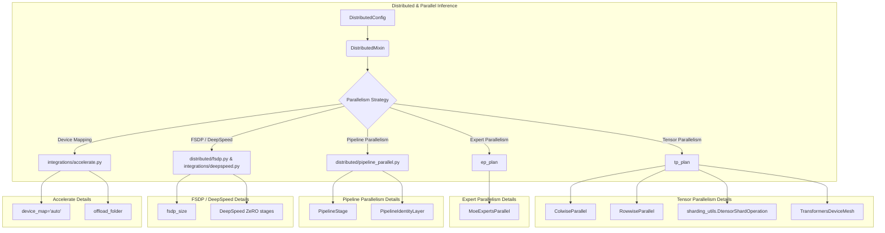

<!-- source: DeepWiki mcp.deepwiki.com · repo huggingface/transformers · page 8 Distributed & Parallel Inference · fetched 2026-10-26 -->

# Distributed & Parallel Inference

Relevant source files

The following files were used as context for generating this wiki page:

- [docs/source/en/expert_parallelism.md](docs/source/en/expert_parallelism.md)
- [docs/source/en/experts_interface.md](docs/source/en/experts_interface.md)
- [docs/source/en/fsdp.md](docs/source/en/fsdp.md)
- [docs/source/en/main_classes/peft.md](docs/source/en/main_classes/peft.md)
- [docs/source/en/model_doc/hy_v4.md](docs/source/en/model_doc/hy_v4.md)
- [docs/source/en/model_doc/kimi_k25.md](docs/source/en/model_doc/kimi_k25.md)
- [docs/source/en/model_doc/mellum.md](docs/source/en/model_doc/mellum.md)
- [docs/source/en/model_doc/minimax_m3_vl.md](docs/source/en/model_doc/minimax_m3_vl.md)
- [docs/source/en/peft.md](docs/source/en/peft.md)
- [docs/source/en/perf_infer_gpu_multi.md](docs/source/en/perf_infer_gpu_multi.md)
- [docs/source/en/tensor_parallelism.md](docs/source/en/tensor_parallelism.md)
- [docs/source/zh/perf_infer_gpu_multi.md](docs/source/zh/perf_infer_gpu_multi.md)
- [src/transformers/conversion_mapping.py](src/transformers/conversion_mapping.py)
- [src/transformers/core_model_loading.py](src/transformers/core_model_loading.py)
- [src/transformers/distributed/__init__.py](src/transformers/distributed/__init__.py)
- [src/transformers/distributed/configuration_utils.py](src/transformers/distributed/configuration_utils.py)
- [src/transformers/distributed/fsdp.py](src/transformers/distributed/fsdp.py)
- [src/transformers/distributed/mixin.py](src/transformers/distributed/mixin.py)
- [src/transformers/distributed/pipeline_parallel.py](src/transformers/distributed/pipeline_parallel.py)
- [src/transformers/distributed/tensor_parallel.py](src/transformers/distributed/tensor_parallel.py)
- [src/transformers/distributed/utils.py](src/transformers/distributed/utils.py)
- [src/transformers/integrations/accelerate.py](src/transformers/integrations/accelerate.py)
- [src/transformers/integrations/hub_kernels.py](src/transformers/integrations/hub_kernels.py)
- [src/transformers/integrations/npu_flash_attention.py](src/transformers/integrations/npu_flash_attention.py)
- [src/transformers/integrations/peft.py](src/transformers/integrations/peft.py)
- [src/transformers/integrations/tensor_parallel.py](src/transformers/integrations/tensor_parallel.py)
- [src/transformers/modeling_flash_attention_utils.py](src/transformers/modeling_flash_attention_utils.py)
- [src/transformers/modeling_utils.py](src/transformers/modeling_utils.py)
- [src/transformers/models/mellum/__init__.py](src/transformers/models/mellum/__init__.py)
- [src/transformers/models/mellum/configuration_mellum.py](src/transformers/models/mellum/configuration_mellum.py)
- [src/transformers/models/mellum/modular_mellum.py](src/transformers/models/mellum/modular_mellum.py)
- [src/transformers/models/qwen3/configuration_qwen3.py](src/transformers/models/qwen3/configuration_qwen3.py)
- [src/transformers/models/qwen3_moe/configuration_qwen3_moe.py](src/transformers/models/qwen3_moe/configuration_qwen3_moe.py)
- [src/transformers/utils/generic.py](src/transformers/utils/generic.py)
- [src/transformers/utils/kernel_config.py](src/transformers/utils/kernel_config.py)
- [src/transformers/utils/loading_report.py](src/transformers/utils/loading_report.py)
- [tests/kernels/test_kernels.py](tests/kernels/test_kernels.py)
- [tests/models/deepseek_v4/test_modeling_deepseek_v4.py](tests/models/deepseek_v4/test_modeling_deepseek_v4.py)
- [tests/models/mellum/__init__.py](tests/models/mellum/__init__.py)
- [tests/peft_integration/test_peft_integration.py](tests/peft_integration/test_peft_integration.py)
- [tests/pipeline_parallel/test_pipeline_parallel.py](tests/pipeline_parallel/test_pipeline_parallel.py)
- [tests/tensor_parallel/test_tensor_parallel.py](tests/tensor_parallel/test_tensor_parallel.py)
- [tests/test_fsdp_mixin.py](tests/test_fsdp_mixin.py)
- [tests/test_modeling_common.py](tests/test_modeling_common.py)
- [tests/test_tensor_parallel_mixin.py](tests/test_tensor_parallel_mixin.py)
- [tests/utils/test_core_model_loading.py](tests/utils/test_core_model_loading.py)
- [tests/utils/test_generic.py](tests/utils/test_generic.py)
- [tests/utils/test_modeling_utils.py](tests/utils/test_modeling_utils.py)

Distributed execution in Transformers enables scaling models across multiple GPUs and nodes by partitioning computation and memory. The library supports several paradigms for high-performance inference and training, from automated device mapping for simple setups to advanced tensor, expert, pipeline parallelism, and Fully Sharded Data Parallelism (FSDP) for large-scale clusters.

## High-Level Parallelism Overview

Transformers leverages PyTorch’s `torch.distributed` features, the DTensor abstraction, and the `accelerate` library to provide core distribution strategies. These strategies are configured using the `DistributedConfig` dataclass [src/transformers/distributed/configuration_utils.py:21-99]() and orchestrated via the `DistributedMixin` class [src/transformers/modeling_utils.py:58](), [src/transformers/distributed/mixin.py:48-130]().

| Strategy | Key Code Entities | Primary Use Case |
| :----------------------- | :------------------------------------------------------------------------------------------------------------------------------------------------------------------------------------------------------------------------------------------------------------------------------------------------------------------------------------------------------------------------------------------------------------------------------------------------------------------------------------------------------------------------------------------------------------------------------------------------------------------------------------------------------------------------------------------------------------------------------------------------------------------------------------------------------------------------------------------------------------------------------------------------------------------------------------------------------------------------------------------------------------------------------------------------------------------------------------------------------------------------------------------------------------------------------------------------------------------------------------------------------------------------------------------------------------------------------------------------------------------------------------------------------------------------------------------------------------------------------------------------------------------------------------------------------------------------------------------------------------------------------------------------------------------------------------------------------------------------------------------------------------------------------------------------------------------------------------------------------------------------------------------------------------------------------------------------------------------------------------------------------------------------------------------------------------------------------------------------------------------------------------------------------------------------------------------------------------------------------------------------------------------------------------------------------------------------------------------------------------------------------------------------------------------------------------------------------------------------------------------------------------------------------------------------------------------------------------------------------------------------------------------------------------------------------------------------------------------------------------------------------------------------------------------------------------------------------------------------------------------------------------------------------------------------------------------------------------------------------------------------------------------------------------------------------------------------------------------------------------------------------------------------------------------------------------------------------------------------------------------------------------------------------------------------------------------------------------------------------------------------------------------------------------------------------------------------------------------------------------------------------------------------------------------------------------------------------------------------------------------------------------------------------------------------------------------------------------------------------------------------------------------------------------------------------------------------------------------------------------------------------------------------------------------------------------------------------------------------------------------------------------------------------------------------------------------------------------------------------------------------------------------------------------------------------------------------------------------------------------------------------------------------------------------------------------------------------------------------------------------------------------------------------------------------------------------------------------------------------------------------------------------------------------------------------------------------------------------------------------------------------------------------------------------------------------------------------------------------------------------------------------------------------------------------------------------------------------------------------------------------------------------------------------------------------------------------------------------------------------------------------------------------------------------------------------------------------------------------------------------------------------------------------------------------------------------------------------------------------------------------------------------------------------------------------------------------------------------------------------------------------------------------------------------------------------------------------------------------------------------------------------------------------------------------------------------------------------------------------------------------------------------------------------------------------------------------------------------------------------------------------------------------------------------------------------------------------------------------------------------------------------------------------------------------------------------------------------------------------------------------------------------------------------------------------------------------------------------------------------------------------------------------------------------------------------------------------------------------------------------------------------------------------------------------------------------------------------------------------------------------------------------------------------------------------------------------------------------------------------------------------------------------------------------------------------------------------------------------------------------------------------------------------------------------------------------------------------------------------------------------------------------------------------------------------------------------------------------------------------------------------------------------------------------------------------------------------------------------------------------------------------------------------------------------------------------------------------------------------------------------------------------------------------------------------------------------------------------------------------------------------------------------------------------------------------------------------------------------------------------------------------------------------------------------------------------------------------------------------------------------------------------------------------------------------------------------------------------------------------------------------------------------------------------------------------------------------------------------------------------------------------------------------------------------------------------------------------------------------------------------------------------------------------------------------------------------------------------------------------------------------------------------------------------------------------------------------------------------------------------------------------------------------------------------------------------------------------------------------------------------------------------------------------------------------------------------------------------------------------------------------------------------------------------------------------------------------------------------------------------------------------------------------------------------------------------------------------------------------------------------------------------------------------------------------------------------------------------------------------------------------------------------------------------------------------------------------------------------------------------------------------------------------------------------------------------------------------------------------------------------------------------------------------------------------------------------------------------------------------------------------------------------------------------------------------------------------------------------------------------------------------------------------------------------------------------------------------------------------------------------------------------------------------------------------------------------------------------------------------------------------------------------------------------------------------------------------------------------------------------------------------------------------------------------------------------------------------------------------------------------------------------------------------------------------------------------------------------------------------------------------------------------------------------------------------------------------------------------------------------------------------------------------------------------------------------------------------------------------------------------------------------------------------------------------------------------------------------------------------------------------------------------------------------------------------------------------------------------------------------------------------------------------------------------------------------------------------------------------------------------------------------------------------------------------------------------------------------------------------------------------------------------------------------------------------------------------------------------------------------------------------------------------------------------------------------------------------------------------------------------------------------------------------------------------------------------------------------------------------------------------------------------------------------------------------------------------------------------------------------------------------------------------------------------------------------------------------------------------------------------------------------------------------------------------------------------------------------------------------------------------------------------------------------------------------------------------------------------------------------------------------------------------------------------------------------------------------------------------------------------------------------------------------------------------------------------------------------------------------------------------------------------------------------------------------------------------------------------------------------------------------------------------------------------------------------------------------------------------------------------------------------------------------------------------------------------------------------------------------------------------------------------------------------------------------------------------------------------------------------------------------------------------------------------------------------------------------------------------------------------------------------------------------------------------------------------------------------------------------------------------------------------------------------------------------------------------------------------------------------------------------------------------------------------------------------------------------------------------------------------------------------------------------------------------------------------------------------------------------------------------------------------------------------------------------------------------------------------------------------------------------------------------------------------------------------------------------------------------------------------------------------------------------------------------------------------------------------------------------------------------------------------------------------------------------------------------------------------------------------------------------------------------------------------------------------------------------------------------------------------------------------------------------------------------------------------------------------------------------------------------------------------------------------------------------------------------------------------------------------------------------------------------------------------------------------------------------------------------------------------------------------------------------------------------------------------------------------------------------------------------------------------------------------------------------------------------------------------------------------------------------------------------------------------------------------------------------------------------------------------------------------------------------------------------------------------------------------------------------------------------------------------------------------------------------------------------------------------------------------------------------------------------------------------------------------------------------------------------------------------------------------------------------------------------------------------------------------------------------------------------------------------------------------------------------------------------------------------------------------------------------------------------------------------------------------------------------------------------------------------------------------------------------------------------------------------------------------------------------------------------------------------------------------------------------------------------------------------------------------------------------------------------------------------------------------------------------------------------------------------------------------------------------------------------------------------------------------------------------------------------------------------------------------------------------------------------------------------------------------------------------------------------------------------------------------------------------------------------------------------------------------------------------------------------------------------------------------------------------------------------------------------------------------------------------------------------------------------------------------------------------------------------------------------------------------------------------------------------------------------------------------------------------------------------------------------------------------------------------------------------------------------------------------------------------------------------------------------------------------------------------------------------------------------------------------------------------------------------------------------------------------------------------------------------------------------------------------------------------------------------------------------------------------------------------------------------------------------------------------------------------------------------------------------------------------------------------------------------------------------------------------------------------------------------------------------------------------------------------------------------------------------------------------------------------------------------------------------------------------------------------------------------------------------------------------------------------------------------------------------------------------------------------------------------------------------------------------------------------------------------------------------------------------------------------------------------------------------------------------------------------------------------------------------------------------------------------------------------------------------------------------------------------------------------------------------------------------------------------------------------------------------------------------------------------------------------------------------------------------------------------------------------------------------------------------------------------------------------------------------------------------------------------------------------------------------------------------------------------------------------------------------------------------------------------------------------------------------------------------------------------------------------------------------------------------------------------------------------------------------------------------------------------------------------------------------------------------------------------------------------------------------------------------------------------------------------------------------------------------------------------------------------------------------------------------------------------------------------------------------------------------------------------------------------------------------------------------------------------------------------------------------------------------------------------------------------------------------------------------------------------------------------------------------------------------------------------------------------------------------------------------------------------------------------------------------------------------------------------------------------------------------------------------------------------------------------------------------------------------------------------------------------------------------------------------------------------------------------------------------------------------------------------------------------------------------------------------------------------------------------------------------------------------------------------------------------------------------------------------------------------------------------------------------------------------------------------------------------------------------------------------------------------------------------------------------------------------------------------------------------------------------------------------------------------------------------------------------------------------------------------------------------------------------------------------------------------------------------------------------------------------------------------------------------------------------------------------------------------------------------------------------------------------------------------------------------------------------------------------------------------------------------------------------------------------------------------------------------------------------------------------------------------------------------------------------------------------------------------------------------------------------------------------------------------------------------------------------------------------------------------------------------------------------------------------------------------------------------------------------------------------------------------------------------------------------------------------------------------------------------------------------------------------------------------------------------------------------------------------------------------------------------------------------------------------------------------------------------------------------------------------------------------------------------------------------------------------------------------------------------------------------------------------------------------------------------------------------------------------------------------------------------------------------------------------------------------------------------------------------------------------------------------------------------------------------------------------------------------------------------------------------------------------------------------------------------------------------------------------------------------------------------------------------------------------------------------------------------------------------------------------------------------------------------------------------------------------------------------------------------------------------------------------------------------------------------------------------------------------------------------------------------------------------------------------------------------------------------------------------------------------------------------------------------------------------------------------------------------------------------------------------------------------------------------------------------------------------------------------------------------------------------------------------------------------------------------------------------------------------------------------------------------------------------------------------------------------------------------------------------------------------------------------------------------------------------------------------------------------------------------------------------------------------------------------------------------------------------------------------------------------------------------------------------------------------------------------------------------------------------------------------------------------------------------------------------------------------------------------------------------------------------------------------------------------------------------------------------------------------------------------------------------------------------------------------------------------------------------------------------------------------------------------------------------------------------------------------------------------------------------------------------------------------------------------------------------------------------------------------------------------------------------------------------------------------------------------------------------------------------------------------------------------------------------------------------------------------------------------------------------------------------------------------------------------------------------------------------------------------------------------------------------------------------------------------------------------------------------------------------------------------------------------------------------------------------------------------------------------------------------------------------------------------------------------------------------------------------------------------------------------------------------------------------------------------------------------------------------------------------------------------------------------------------------------------------------------------------------------------------------------------------------------------------------------------------------------------------------------------------------------------------------------------------------------------------------------------------------------------------------------------------------------------------------------------------------------------------------------------------------------------------------------------------------------------------------------------------------------------------------------------------------------------------------------------------------------------------------------------------------------------------------------------------------------------------------------------------------------------------------------------------------------------------------------------------------------------------------------------------------------------------------------------------------------------------------------------------------------------------------------------------------------------------------------------------------------------------------------------------------------------------------------------------------------------------------------------------------------------------------------------------------------------------------------------------------------------------------------------------------------------------------------------------------------------------------------------------------------------------------------------------------------------------------------------------------------------------------------------------------------------------------------------------------------------------------------------------------------------------------------------------------------------------------------------------------------------------------------------------------------------------------------------------------------------------------------------------------------------------------------------------------------------------------------------------------------------------------------------------------------------------------------------------------------------------------------------------------------------------------------------------------------------------------------------------------------------------------------------------------------------------------------------------------------------------------------------------------------------------------------------------------------------------------------------------------------------------------------------------------------------------------------------------------------------------------------------------------------------------------------------------------------------------------------------------------------------------------------------------------------------------------------------------------------------------------------------------------------------------------------------------------------------------------------------------------------------------------------------------------------------------------------------------------------------------------------------------------------------------------------------------------------------------------------------------------------------------------------------------------------------------------------------------------------------------------------------------------------------------------------------------------------------------------------------------------------------------------------------------------------------------------------------------------------------------------------------------------------------------------------------------------------------------------------------------------------------------------------------------------------------------------------------------------------------------------------------------------------------------------------------------------------------------------------------------------------------------------------------------------------------------------------------------------------------------------------------------------------------------------------------------------------------------------------------------------------------------------------------------------------------------------------------------------------------------------------------------------------------------------------------------------------------------------------------------------------------------------------------------------------------------------------------------------------------------------------------------------------------------------------------------------------------------------------------------------------------------------------------------------------------------------------------------------------------------------------------------------------------------------------------------------------------------------------------------------------------------------------------------------------------------------------------------------------------------------------------------------------------------------------------------------------------------------------------------------------------------------------------------------------------------------------------------------------------------------------------------------------------------------------------------------------------------------------------------------------------------------------------------------------------------------------------------------------------------------------------------------------------------------------------------------------------------------------------------------------------------------------------------------------------------------------------------------------------------------------------------------------------------------------------------------------------------------------------------------------------------------------------------------------------------------------------------------------------------------------------------------------------------------------------------------------------------------------------------------------------------------------------------------------------------------------------------------------------------------------------------------------------------------------------------------------------------------------------------------------------------------------------------------------------------------------------------------------------------------------------------------------------------------------------------------------------------------------------------------------------------------------------------------------------------------------------------------------------------------------------------------------------
# Distributed & Parallel Inference

This page provides a high-level overview of the distributed and parallel inference strategies supported by the Hugging Face Transformers library. These strategies are crucial for handling the increasing size and complexity of modern deep learning models, enabling efficient execution across multiple GPUs or even multiple machines.

## Tensor & Expert Parallelism

Tensor Parallelism (TP) involves sharding individual model layers (specifically their weight matrices) across multiple devices. This allows for the processing of larger models that might not fit into the memory of a single GPU. Transformers implements TP by defining how different parts of a layer's weight matrix are distributed and how computations are coordinated. Key components include:
- `DistributedMixin` [src/transformers/distributed/mixin.py:48-130](): A mixin class that provides common distributed functionalities to `PreTrainedModel` [src/transformers/modeling_utils.py:58]().
- `DistributedConfig` [src/transformers/distributed/configuration_utils.py:21-99](): A dataclass used to configure distributed training and inference settings, including `tp_size` and `tp_plan`.
- `tp_plan`: A dictionary that specifies how different parameters of a model should be sharded for tensor parallelism.
- `sharding_utils.DtensorShardOperation` [src/transformers/core_model_loading.py:33](): Utilizes PyTorch's DTensor for sharding operations, particularly for "shard-on-read" scenarios.
- `TransformersDeviceMesh` [src/transformers/distributed/tensor_parallel.py:100-101](): An abstraction for managing the device topology for distributed operations.
- `ColwiseParallel` and `RowwiseParallel` [src/transformers/integrations/tensor_parallel.py:25-26](): Specific sharding styles for linear layers.

Expert Parallelism (EP) is a specialized form of parallelism designed for Mixture-of-Experts (MoE) models. It distributes the individual "experts" of an MoE layer across different devices. This allows MoE models, which can have a very large number of parameters due to many experts, to scale effectively.
- `ep_size`: Configures the number of devices used for expert parallelism.
- `ep_plan`: Similar to `tp_plan`, but specifically for configuring expert sharding.
- `MoeExpertsParallel` [src/transformers/integrations/tensor_parallel.py:29](): A parallel style for distributing MoE experts.

For details, see [Tensor Parallelism & Expert Parallelism](#8.1).

Sources: [src/transformers/distributed/mixin.py:48-130](), [src/transformers/distributed/configuration_utils.py:21-99](), [src/transformers/core_model_loading.py:33](), [src/transformers/distributed/tensor_parallel.py:100-101](), [src/transformers/integrations/tensor_parallel.py:25-26](), [src/transformers/integrations/tensor_parallel.py:29]()

## DeepSpeed & FSDP Integration

Transformers provides robust integration with DeepSpeed and PyTorch's Fully Sharded Data Parallelism (FSDP) for memory-efficient training and inference. These techniques shard model states (parameters, gradients, optimizer states) across devices, enabling the training and deployment of models that would otherwise exceed single-device memory limits.

- **DeepSpeed ZeRO**: Supports ZeRO stages 1, 2, and 3, which progressively shard more components of the model state. DeepSpeed-Inference is also supported for efficient deployment. The integration is handled in `integrations/deepspeed.py`.
- **PyTorch FSDP**: FSDP shards model parameters, gradients, and optimizer states. It is integrated with the `Trainer` class and can be used with `DistributedMixin`. Key files include `integrations/fsdp.py` and `distributed/fsdp.py` [src/transformers/distributed/fsdp.py:1-90]().
- `DistributedConfig` [src/transformers/distributed/configuration_utils.py:21-99](): Used to configure FSDP settings, including `fsdp_size`.

For details, see [DeepSpeed & FSDP Integration](#8.2).

Sources: [src/transformers/distributed/fsdp.py:1-90](), [src/transformers/distributed/configuration_utils.py:21-99]()

## Accelerate & Device Mapping

The `accelerate` library is used within Transformers for automatic device placement, balanced memory allocation, and offloading to disk or CPU. This is particularly useful for models that are too large to fit on a single GPU but do not require the full complexity of tensor or pipeline parallelism.

- `integrations/accelerate.py` [src/transformers/integrations/accelerate.py:1-1023](): Contains utilities for integrating Accelerate functionalities.
- `device_map='auto'` [src/transformers/integrations/accelerate.py:113](): Automatically determines the optimal placement of model layers across available devices (GPUs, CPU, disk).
- `offload_folder`: Specifies a directory for offloading model parts to disk to save GPU memory.
- `utils/loading_report.py`: Provides reporting on how model layers are loaded and placed.

For details, see [Accelerate & Device Mapping](#8.3).

Sources: [src/transformers/integrations/accelerate.py:1-1023](), [src/transformers/integrations/accelerate.py:113]()

## Pipeline Parallelism

Pipeline Parallelism (PP) divides a model into sequential stages, with each stage executed on a different device. This allows for larger models to be run by distributing the layers across multiple GPUs.

- `distributed/pipeline_parallel.py` [src/transformers/distributed/pipeline_parallel.py:1-40](): Implements the core logic for pipeline parallelism.
- `PipelineStage`: Represents a segment of the model executed on a specific device.
- Stage communication: Mechanisms for passing activations between different pipeline stages.
- `PipelineIdentityLayer`: Stub layers used to mark boundaries between pipeline stages.
- Logits broadcast: Ensures that outputs (e.g., logits for generation) are correctly aggregated or broadcast across stages.
- Tests for pipeline parallelism are located under `tests/pipeline_parallel/`.

For details, see [Pipeline Parallelism](#8.4).

Sources: [src/transformers/distributed/pipeline_parallel.py:1-40]()

## Distributed Execution Strategies

The following diagram illustrates the relationship between the different distributed execution strategies and their corresponding code entities within the Transformers library.

Sources: [src/transformers/distributed/configuration_utils.py:21-99](), [src/transformers/distributed/mixin.py:48-130](), [src/transformers/distributed/tensor_parallel.py](), [src/transformers/distributed/pipeline_parallel.py:1-40](), [src/transformers/distributed/fsdp.py:1-90](), [src/transformers/integrations/deepspeed.py](), [src/transformers/integrations/accelerate.py:1-1023](), [src/transformers/core_model_loading.py:33]()

This page serves as a high-level overview of the rich parallel and distributed inference and training infrastructure in Transformers. For deeper technical details, code examples, and configuration guidelines, please refer to the respective child pages:

- [Tensor Parallelism & Expert Parallelism](#8.1)
- [DeepSpeed & FSDP Integration](#8.2)
- [Accelerate & Device Mapping](#8.3)
- [Pipeline Parallelism](#8.4)

---

