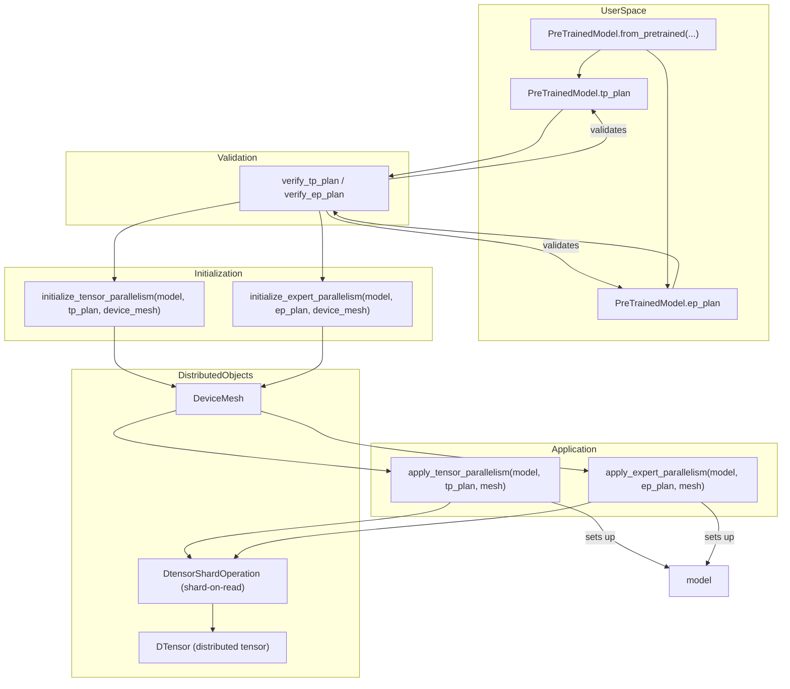
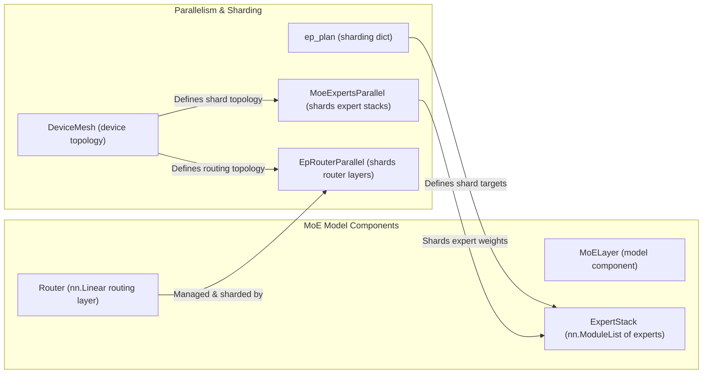

<!-- source: DeepWiki mcp.deepwiki.com · repo huggingface/transformers · page 8.1 Tensor Parallelism & Expert Parallelism · fetched 2026-10-26 -->

# Tensor Parallelism & Expert Parallelism

Relevant source files

The following files were used as context for generating this wiki page:

- [docs/source/en/expert_parallelism.md](docs/source/en/expert_parallelism.md)
- [docs/source/en/experts_interface.md](docs/source/en/experts_interface.md)
- [docs/source/en/fsdp.md](docs/source/en/fsdp.md)
- [docs/source/en/main_classes/peft.md](docs/source/en/main_classes/peft.md)
- [docs/source/en/model_doc/hy_v4.md](docs/source/en/model_doc/hy_v4.md)
- [docs/source/en/model_doc/kimi_k25.md](docs/source/en/model_doc/kimi_k25.md)
- [docs/source/en/model_doc/mellum.md](docs/source/en/model_doc/mellum.md)
- [docs/source/en/model_doc/minimax_m3_vl.md](docs/source/en/model_doc/minimax_m3_vl.md)
- [docs/source/en/peft.md](docs/source/en/peft.md)
- [docs/source/en/perf_infer_gpu_multi.md](docs/source/en/perf_infer_gpu_multi.md)
- [docs/source/en/tensor_parallelism.md](docs/source/en/tensor_parallelism.md)
- [docs/source/zh/perf_infer_gpu_multi.md](docs/source/zh/perf_infer_gpu_multi.md)
- [src/transformers/conversion_mapping.py](src/transformers/conversion_mapping.py)
- [src/transformers/core_model_loading.py](src/transformers/core_model_loading.py)
- [src/transformers/distributed/__init__.py](src/transformers/distributed/__init__.py)
- [src/transformers/distributed/configuration_utils.py](src/transformers/distributed/configuration_utils.py)
- [src/transformers/distributed/fsdp.py](src/transformers/distributed/fsdp.py)
- [src/transformers/distributed/mixin.py](src/transformers/distributed/mixin.py)
- [src/transformers/distributed/pipeline_parallel.py](src/transformers/distributed/pipeline_parallel.py)
- [src/transformers/distributed/tensor_parallel.py](src/transformers/distributed/tensor_parallel.py)
- [src/transformers/distributed/utils.py](src/transformers/distributed/utils.py)
- [src/transformers/integrations/accelerate.py](src/transformers/integrations/accelerate.py)
- [src/transformers/integrations/hub_kernels.py](src/transformers/integrations/hub_kernels.py)
- [src/transformers/integrations/npu_flash_attention.py](src/transformers/integrations/npu_flash_attention.py)
- [src/transformers/integrations/peft.py](src/transformers/integrations/peft.py)
- [src/transformers/integrations/tensor_parallel.py](src/transformers/integrations/tensor_parallel.py)
- [src/transformers/modeling_flash_attention_utils.py](src/transformers/modeling_flash_attention_utils.py)
- [src/transformers/modeling_utils.py](src/transformers/modeling_utils.py)
- [src/transformers/models/mellum/__init__.py](src/transformers/models/mellum/__init__.py)
- [src/transformers/models/mellum/configuration_mellum.py](src/transformers/models/mellum/configuration_mellum.py)
- [src/transformers/models/mellum/modular_mellum.py](src/transformers/models/mellum/modular_mellum.py)
- [src/transformers/models/qwen3/configuration_qwen3.py](src/transformers/models/qwen3/configuration_qwen3.py)
- [src/transformers/models/qwen3_moe/configuration_qwen3_moe.py](src/transformers/models/qwen3_moe/configuration_qwen3_moe.py)
- [src/transformers/utils/generic.py](src/transformers/utils/generic.py)
- [src/transformers/utils/kernel_config.py](src/transformers/utils/kernel_config.py)
- [src/transformers/utils/loading_report.py](src/transformers/utils/loading_report.py)
- [tests/kernels/test_kernels.py](tests/kernels/test_kernels.py)
- [tests/models/deepseek_v4/test_modeling_deepseek_v4.py](tests/models/deepseek_v4/test_modeling_deepseek_v4.py)
- [tests/models/mellum/__init__.py](tests/models/mellum/__init__.py)
- [tests/peft_integration/test_peft_integration.py](tests/peft_integration/test_peft_integration.py)
- [tests/pipeline_parallel/test_pipeline_parallel.py](tests/pipeline_parallel/test_pipeline_parallel.py)
- [tests/tensor_parallel/test_tensor_parallel.py](tests/tensor_parallel/test_tensor_parallel.py)
- [tests/test_fsdp_mixin.py](tests/test_fsdp_mixin.py)
- [tests/test_modeling_common.py](tests/test_modeling_common.py)
- [tests/test_tensor_parallel_mixin.py](tests/test_tensor_parallel_mixin.py)
- [tests/utils/test_core_model_loading.py](tests/utils/test_core_model_loading.py)
- [tests/utils/test_generic.py](tests/utils/test_generic.py)
- [tests/utils/test_modeling_utils.py](tests/utils/test_modeling_utils.py)

This section details the distributed inference and training infrastructure within Hugging Face Transformers that enables scaling large language models and Mixture-of-Experts (MoE) architectures efficiently across multiple accelerators. The implementation focuses on Tensor Parallelism (TP) and Expert Parallelism (EP).

The system leverages PyTorch abstractions like `DTensor` and `DeviceMesh`, allowing a declarative, plan-driven approach to distribute model parameters and computations. Key components include the `DistributedMixin` for plan management, `tp_plan` and `ep_plan` dictionaries for specifying shard layouts, and a shard-on-read mechanism that materializes distributed tensor shards lazily during checkpoint loading and runtime.

---

## Overview & Design Philosophy

### DistributedMixin

At the core is the `DistributedMixin` class, which can be mixed into model classes to support parallelism plans declaratively. It maintains dictionaries:

- **tp_plan**: Tensor parallelism plan specifying how individual layers or submodules' parameters are sharded (e.g., column-wise, row-wise).
- **ep_plan**: Expert parallelism plan governing Mixture-of-Experts (MoE) expert partitions.
- **fsdp_plan**: Fully-Sharded Data Parallel plan utilized with FSDP integration.

Rather than eagerly slicing parameters, these plans inform the framework on how to orchestrate distributed tensor views using lazy shard-on-read operations. This enables efficient state dict loading and execution without duplicating tensors upfront.
Sources: [src/transformers/distributed/mixin.py:1-40]()

### DeviceMesh & DTensor

- **DeviceMesh**: This is a PyTorch distributed abstraction that defines the physical device topology — it might be a 1D mesh for tensor parallelism or higher-dimensional meshes for combining TP and data parallelism.
- **DTensor**: A logical distributed tensor spanning multiple devices across the mesh. Weights are loaded as `DTensor` objects from local shards, making the overall tensor abstraction transparent to downstream code.
Sources: [src/transformers/modeling_utils.py:46-46](), [src/transformers/distributed/sharding_utils.py:20-60]()

### Parallel Styles

The system supports various parallel styles that describe how layers are sharded based on the `tp_plan` or `ep_plan` entries:

- **ColwiseParallel**: Columns of weight matrices and corresponding biases are partitioned across devices.
- **RowwiseParallel**: Rows of weight matrices are partitioned, typically requiring gradient synchronization via all-reduce.
- **PackedColwiseParallel**: Supports special fused layouts (e.g., fused gate-up projections).
- **PackedRowwiseParallel**: Rowwise partitioning for packed fused weights.
- **SequenceParallel**: Enables sequence-level partitioning, sharding normalization and activation dimensions.
- **ReplicatedWithGradAllReduce**: Replicates module parameters and synchronizes gradients.

Expert parallelism styles include:

- **MoeExpertsParallel**: Parallelizes Mixture-of-Experts by sharding expert stacks across devices.
- **EpRouterParallel**: Specialized parallelism for router layers that dispatch tokens to local experts.

These styles are implemented as classes registered in parallel style registries and applied based on the user-provided plans.
Sources: [src/transformers/distributed/tensor_parallel.py:24-39](), [src/transformers/integrations/tensor_parallel.py:24-39]()

---

## System Architecture: Plan-driven Distributed Execution

The diagram below bridges the conceptual user interaction and configuration to the concrete code entities and runtime components involved in model parallelism.

### Tensor Parallelism Execution Flow

Sources: [src/transformers/distributed/mixin.py:1-40](), [src/transformers/distributed/utils.py:134-174](), [src/transformers/distributed/tensor_parallel.py:41-45](), [src/transformers/distributed/sharding_utils.py:20-60]()

This flow shows that when `from_pretrained()` is called, user plans (`tp_plan` & `ep_plan`) are validated and then used to initialize tensor and expert parallelism on the model. The parallelism is realized through applying shard operations that create lazy distributed tensor views backed by `DTensor`s across the defined `DeviceMesh`.

---

## Tensor Parallelism (TP) Details

Tensor Parallelism distributes individual tensors such as weight matrices across devices using pre-defined strategies.

### Supported Parallel Styles

| Parallel Style            | Description                                                  | Implementation Class         |
|---------------------------|--------------------------------------------------------------|-----------------------------|
| `colwise`                 | Splits columns and corresponding bias parameters            | `ColwiseParallel`            |
| `rowwise`                 | Splits rows, requires gradient all-reduce for consistency    | `RowwiseParallel`            |
| `packed_colwise`          | Specialized for packed/fused weights (e.g., fused gate+up)  | `PackedColwiseParallel`      |
| `packed_rowwise`          | Rowwise partitioning for packed fused weights                | `PackedRowwiseParallel`      |
| `sequence_parallel`       | Partitions sequences and normalization for efficient scaling | `SequenceParallel`           |
| `replicate`               | Replicates weights and performs gradient synchronization     | `ReplicatedWithGradAllReduce`|

These are organized in registries and applied automatically based on `tp_plan` entries. Validation ensures user plans only specify supported styles.
Sources: [src/transformers/distributed/tensor_parallel.py:24-39](), [src/transformers/integrations/tensor_parallel.py:24-39]()

### Shard-on-Read Operations

Weight loading uses lazy shard-on-read implemented by `DtensorShardOperation`. During checkpoint loading, the full tensors are intercepted, locally sliced according to the plan and device mesh, and wrapped as `DTensor` objects. This avoids eagerly replicating full tensors on each device, saving memory and bandwidth.

The helper `_dtensor_from_local_like` builds a `DTensor` from local shards matching the original unsharded tensor layout.
Sources: [src/transformers/distributed/sharding_utils.py:20-60](), [src/transformers/core_model_loading.py:30-45](), [src/transformers/modeling_utils.py:59-59]()

---

## Expert Parallelism (EP) & Mixture-of-Experts (MoE)

Expert Parallelism is tailored for MoE architectures where multiple feed-forward experts are partitioned across devices.

### MoE Expert Parallelism

MoE layers typically have a stack of expert submodules (feed-forward networks), which are sharded by the `MoeExpertsParallel` style across the `DeviceMesh`. Each shard hosts a subset of the experts.

Router layers, implemented as linear modules for token dispatch, use the `EpRouterParallel` style to coordinate token routing to local expert shards.
Sources: [src/transformers/distributed/tensor_parallel.py:27-32](), [src/transformers/integrations/tensor_parallel.py:27-32]()

### Integration of MoE Parallelism

- **ep_plan**: Specifies which modules should be sharded as experts.
- **DeviceMesh**: Defines expert parallelism dimensions.
- **MoeExpertsParallel**: Handles the expert weight sharding.
- **EpRouterParallel**: Manages router sharding and communication.

### Code Entity Association for MoE Parallelism

Sources: [src/transformers/distributed/mixin.py:1-40](), [src/transformers/distributed/tensor_parallel.py:27-32](), [src/transformers/integrations/tensor_parallel.py:27-32]()

---

## Core Implementation Components

### DistributedMixin: Managing Parallel Plans and Validation

The `DistributedMixin` class manages the `tp_plan`, `ep_plan`, and `fsdp_plan` dictionaries. Setting these plans triggers validation to ensure:

- The specified parameter or module patterns exist in the model.
- The parallel styles used are supported.
- Warnings are issued for patterns that do not match any model parameter.

This ensures user plans are consistent and prevent runtime errors due to invalid configurations.
Sources: [src/transformers/distributed/mixin.py:1-40]()

### Plan Verification (`verify_tp_plan`)

The helper function `verify_tp_plan` scans user-provided plans against the model's parameter paths. It checks the presence and correctness of parallel style specifications, raising informative errors if any styles are unsupported or patterns miss all parameters.
Sources: [src/transformers/distributed/tensor_parallel.py:44-44](), [src/transformers/integrations/tensor_parallel.py:44-44]()

### Conversion Operations for Tensor Manipulation

Tensor reshaping and transformations, especially for loading checkpoints and exporting weights, are handled via `ConversionOps` classes:

- **Chunk**: Splits a tensor along a specified dimension, e.g., dividing fused weights into expert shards.
- **Concatenate**: Reverses chunk operations by concatenating split tensors.

These allow the system to handle complex weight layouts and their distributed slicing efficiently.
Sources: [src/transformers/core_model_loading.py:81-181]()

---

## Summary Table: Key Classes & Concepts

| Concept / Class               | Role                                                         | Location                                    |
|-----------------------------|--------------------------------------------------------------|---------------------------------------------|
| DistributedMixin             | Base mixin to add tp_plan, ep_plan, fsdp_plan with validation| `src/transformers/distributed/mixin.py`    |
| tp_plan / ep_plan / fsdp_plan| Dictionaries specifying parallel plans                       | `src/transformers/distributed/mixin.py`    |
| DeviceMesh                   | Represents device topology for distributed tensor placement  | `src/transformers/distributed/utils.py`    |
| DTensor                      | Logical distributed tensor abstraction                        | PyTorch DTensor + `src/transformers/distributed/sharding_utils.py` |
| DtensorShardOperation        | Implements lazy shard-on-read during weight loading          | `src/transformers/distributed/sharding_utils.py` |
| verify_tp_plan               | Validates tensor parallel plans                              | `src/transformers/distributed/tensor_parallel.py:44-44` |
| ColwiseParallel, RowwiseParallel | Parallel styles for TP sharding                             | `src/transformers/distributed/tensor_parallel.py:24-39` |
| MoeExpertsParallel, EpRouterParallel | Parallel styles for MoE expert and router sharding       | `src/transformers/distributed/tensor_parallel.py` |
| ConversionOps (Chunk, Concatenate) | Tensor weight transformations during loading/export        | `src/transformers/core_model_loading.py:81-181` |

---

## References and Sources

- `src/transformers/modeling_utils.py:46-46`
- `src/transformers/modeling_utils.py:59-59`
- `src/transformers/distributed/mixin.py:1-40`
- `src/transformers/distributed/utils.py:134-174`
- `src/transformers/distributed/sharding_utils.py:20-60`
- `src/transformers/distributed/tensor_parallel.py:24-45`
- `src/transformers/integrations/tensor_parallel.py:24-39`
- `src/transformers/integrations/tensor_parallel.py:44-44`
- `src/transformers/core_model_loading.py:30-45`
- `src/transformers/core_model_loading.py:81-181`

---

