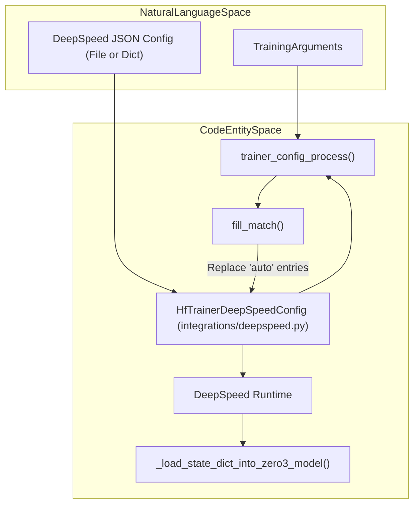
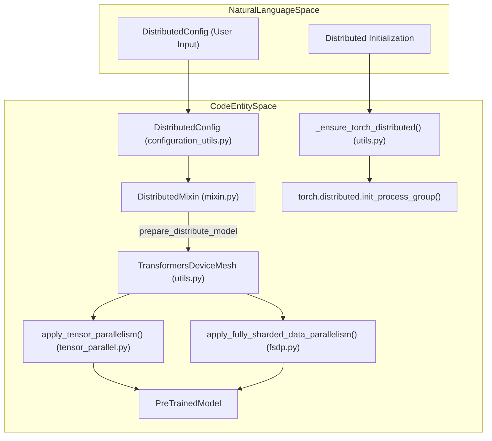

<!-- source: DeepWiki mcp.deepwiki.com · repo huggingface/transformers · page 8.2 DeepSpeed & FSDP Integration · fetched 2026-10-26 -->

# DeepSpeed & FSDP Integration

Relevant source files

The following files were used as context for generating this wiki page:

- [docs/source/en/accelerate.md](docs/source/en/accelerate.md)
- [docs/source/en/accelerator_selection.md](docs/source/en/accelerator_selection.md)
- [docs/source/en/community.md](docs/source/en/community.md)
- [docs/source/en/ddp.md](docs/source/en/ddp.md)
- [docs/source/en/debugging.md](docs/source/en/debugging.md)
- [docs/source/en/deepspeed.md](docs/source/en/deepspeed.md)
- [docs/source/en/deepspeed_alst.md](docs/source/en/deepspeed_alst.md)
- [docs/source/en/expert_parallelism.md](docs/source/en/expert_parallelism.md)
- [docs/source/en/experts_interface.md](docs/source/en/experts_interface.md)
- [docs/source/en/fsdp.md](docs/source/en/fsdp.md)
- [docs/source/en/main_classes/deepspeed.md](docs/source/en/main_classes/deepspeed.md)
- [docs/source/en/main_classes/trainer.md](docs/source/en/main_classes/trainer.md)
- [docs/source/en/model_doc/clvp.md](docs/source/en/model_doc/clvp.md)
- [docs/source/en/model_doc/ctrl.md](docs/source/en/model_doc/ctrl.md)
- [docs/source/en/model_doc/hy_v4.md](docs/source/en/model_doc/hy_v4.md)
- [docs/source/en/model_doc/kimi_k25.md](docs/source/en/model_doc/kimi_k25.md)
- [docs/source/en/model_doc/mellum.md](docs/source/en/model_doc/mellum.md)
- [docs/source/en/model_doc/minimax_m3_vl.md](docs/source/en/model_doc/minimax_m3_vl.md)
- [docs/source/en/perf_hardware.md](docs/source/en/perf_hardware.md)
- [docs/source/en/perf_train_cpu.md](docs/source/en/perf_train_cpu.md)
- [docs/source/en/perf_train_gaudi.md](docs/source/en/perf_train_gaudi.md)
- [docs/source/en/perf_train_gpu_many.md](docs/source/en/perf_train_gpu_many.md)
- [docs/source/en/perf_train_special.md](docs/source/en/perf_train_special.md)
- [docs/source/ja/main_classes/deepspeed.md](docs/source/ja/main_classes/deepspeed.md)
- [docs/source/ja/main_classes/trainer.md](docs/source/ja/main_classes/trainer.md)
- [docs/source/ja/perf_train_gpu_many.md](docs/source/ja/perf_train_gpu_many.md)
- [docs/source/ko/deepspeed.md](docs/source/ko/deepspeed.md)
- [docs/source/ko/perf_train_gpu_many.md](docs/source/ko/perf_train_gpu_many.md)
- [docs/source/zh/main_classes/deepspeed.md](docs/source/zh/main_classes/deepspeed.md)
- [docs/source/zh/main_classes/trainer.md](docs/source/zh/main_classes/trainer.md)
- [src/transformers/distributed/__init__.py](src/transformers/distributed/__init__.py)
- [src/transformers/distributed/configuration_utils.py](src/transformers/distributed/configuration_utils.py)
- [src/transformers/distributed/fsdp.py](src/transformers/distributed/fsdp.py)
- [src/transformers/distributed/mixin.py](src/transformers/distributed/mixin.py)
- [src/transformers/distributed/pipeline_parallel.py](src/transformers/distributed/pipeline_parallel.py)
- [src/transformers/distributed/tensor_parallel.py](src/transformers/distributed/tensor_parallel.py)
- [src/transformers/distributed/utils.py](src/transformers/distributed/utils.py)
- [src/transformers/integrations/deepspeed.py](src/transformers/integrations/deepspeed.py)
- [src/transformers/models/mellum/__init__.py](src/transformers/models/mellum/__init__.py)
- [src/transformers/models/mellum/configuration_mellum.py](src/transformers/models/mellum/configuration_mellum.py)
- [src/transformers/models/mellum/modular_mellum.py](src/transformers/models/mellum/modular_mellum.py)
- [src/transformers/models/qwen3/configuration_qwen3.py](src/transformers/models/qwen3/configuration_qwen3.py)
- [src/transformers/models/qwen3_moe/configuration_qwen3_moe.py](src/transformers/models/qwen3_moe/configuration_qwen3_moe.py)
- [src/transformers/utils/loading_report.py](src/transformers/utils/loading_report.py)
- [tests/models/deepseek_v4/test_modeling_deepseek_v4.py](tests/models/deepseek_v4/test_modeling_deepseek_v4.py)
- [tests/models/mellum/__init__.py](tests/models/mellum/__init__.py)
- [tests/pipeline_parallel/test_pipeline_parallel.py](tests/pipeline_parallel/test_pipeline_parallel.py)
- [tests/test_fsdp_mixin.py](tests/test_fsdp_mixin.py)
- [tests/test_tensor_parallel_mixin.py](tests/test_tensor_parallel_mixin.py)

The Hugging Face Transformers library offers comprehensive integration with DeepSpeed and PyTorch Fully Sharded Data Parallel (FSDP) to enable efficient training and inference of large-scale models on multiple GPUs. This includes support for DeepSpeed ZeRO optimizations (stages 1, 2, and 3), DeepSpeed-Inference acceleration, and FSDP’s advanced sharding capabilities. The integration is tightly coupled with the `Trainer` class and implemented under the `integrations/deepspeed.py`, `distributed/fsdp.py`, and related distributed utilities.

---

## 1. DeepSpeed Integration

DeepSpeed integration enables memory- and compute-efficient training for large models via ZeRO optimizations. Transformers supports all ZeRO stages 1, 2, and 3, and also supports the DeepSpeed-Inference engine.

### Key Components and Configuration

- **`HfDeepSpeedConfig` and `HfTrainerDeepSpeedConfig`**: These classes bridge Hugging Face `TrainingArguments` and DeepSpeed’s JSON configuration. `HfTrainerDeepSpeedConfig`, instantiated alongside training, automatically fills `"auto"` values in the DeepSpeed config using values from `TrainingArguments` such as batch size, gradient accumulation, learning rate, and optimizer parameters. This synchronization is done in the method `trainer_config_process()` which calls `fill_match()` to replace `"auto"` placeholders with actual argument values. It also detects mismatches for correctness [src/transformers/integrations/deepspeed.py:57-132]().

- **Global Weak Reference**: A weak reference to the active DeepSpeed config class instance is globally stored to allow other parts of the codebase (e.g., model loading code) to query whether DeepSpeed ZeRO-3 is enabled and adjust loading behavior accordingly [src/transformers/integrations/deepspeed.py:61-67]().

- **ZeRO-3 Model Loading**: When ZeRO stage 3 is activated, model weights are not loaded into a unified state dict on a single process but instead streamed and sharded into partitioned model parameters using `_load_state_dict_into_zero3_model()` method, preventing memory blowup [src/transformers/integrations/deepspeed.py:230-260]().

- **DeepSpeed-Inference Support**: Transformers supports replacing model forward passes with DeepSpeed-Inference kernels for faster autoregressive token generation leveraging DeepSpeed’s inference optimizations.

### DeepSpeed Configuration Data Flow

This diagram shows the flow from the user's `TrainingArguments` and DeepSpeed JSON config into the synchronized `HfTrainerDeepSpeedConfig`. This config is then used by DeepSpeed at runtime, with the special support for ZeRO-3 checkpoint loading through `_load_state_dict_into_zero3_model()`.

Sources: [src/transformers/integrations/deepspeed.py:57-132](), [src/transformers/integrations/deepspeed.py:133-180](), [src/transformers/integrations/deepspeed.py:230-260]()

---

## 2. PyTorch Fully Sharded Data Parallel (FSDP) Integration

Transformers incorporates PyTorch FSDP for advanced memory-efficient model training through sharding of model parameters, gradients, and optimizer states.

### Core Implementation (`distributed/fsdp.py`)

- **FSDP Enablement & Utilities**: The integration provides utility methods like `is_fsdp_enabled()` to detect if the training environment is using FSDP (based on environment variables or config flags), and `is_fsdp_managed_module()` to determine if a module is under FSDP ownership [src/transformers/distributed/fsdp.py:43-62]().

- **FSDP2 Integration**: The `apply_fully_sharded_data_parallelism` function in `distributed/fsdp.py` applies FSDP2 to a model. It takes a `DistributedConfig` and a `MeshManager` to orchestrate the sharding. It uses `fully_shard` from `torch.distributed._composable.fsdp` and can configure `CPUOffloadPolicy` and `MixedPrecisionPolicy` based on the `DistributedConfig` [src/transformers/distributed/fsdp.py:200-292]().

- **FSDP Policy Keyword Arguments**: The `_get_fsdp_policy_kwargs` function builds policy arguments for `fully_shard` based on `DistributedConfig` settings, such as `fsdp_cpu_offload` and `fsdp_mixed_precision` [src/transformers/distributed/fsdp.py:65-79]().

- **Tied Embeddings and LM Head Handling**: The `_resolve_tied_embed_lm_head_plan` function rewrites the FSDP plan to ensure tied embedding and language model head weights are wrapped only once, preventing redundant sharding [src/transformers/distributed/fsdp.py:108-143]().

- **FSDP Plan Expansion and Verification**: `expand_fsdp_plan` expands plan keys into lists of modules to be reshared or not reshared, and `verify_fsdp_plan` validates the FSDP plan, logging warnings for unused rules or invalid strategies [src/transformers/distributed/fsdp.py:146-182]().

### Requirements and Checkpoints

- PyTorch versions supporting FSDP distributed checkpointing methods (via storage writers and DCP - Distributed Checkpoint) are recommended for fully consistent save/load behavior [src/transformers/distributed/utils.py:160-170]().

- Transformers rely on FSDP integration for large model checkpoint management including sharded state dict saving/loading.

Sources: [src/transformers/distributed/fsdp.py:43-62](), [src/transformers/distributed/fsdp.py:65-79](), [src/transformers/distributed/fsdp.py:108-143](), [src/transformers/distributed/fsdp.py:146-182](), [src/transformers/distributed/fsdp.py:200-292](), [src/transformers/distributed/utils.py:160-170]()

---

## 3. Multi-GPU Training Initialization and Backend Setup

Transformers include utility functions to initialize distributed training across various device backends (CUDA, XPU, HPU, CPU) seamlessly, supporting DeepSpeed and FSDP.

### Initialization Workflow (`distributed/utils.py`)

1. **Detect Accelerator & Device Type**: Helpers detect the available device accelerator type (e.g., CUDA, XPU) to determine the appropriate backend [src/transformers/distributed/utils.py:89-90]().

2. **Initialize Process Group**: Depending on the device type, the proper distributed backend is selected (`nccl`, `gloo`, `xccl`, `hccl`, `neuron`, `tpu_dist`) and the process group is initialized accordingly using `torch.distributed.init_process_group` [src/transformers/distributed/utils.py:68-120]().

3. **Barrier Synchronization**: Calls to synchronize ranks with `torch.distributed.barrier()` ensure all processes wait at key stages such as weight loading or evaluation start [src/transformers/distributed/utils.py:128-141]().

### Conversion and Sharding Handling

Loading into distributed training uses conversion operations to handle renaming, reshaping, and sharding of weights:

- **Conversion Ops**: Classes like `Chunk` and `Concatenate` perform splitting and combining of tensors along designated dimensions during checkpoint load/save cycles to handle sharded states [src/transformers/distributed/tensor_parallel.py]().

- **DTensor Sharding**: `DtensorShardOperation` permits sharding tensors on-load using PyTorch distributed constructs, avoiding full CPU memory loading of huge tensors, enhancing memory efficiency [src/transformers/distributed/tensor_parallel.py]().

- **`DistributedConfig`**: This dataclass defines the configuration for native distributed inference and training, including `tp_size`, `fsdp_size`, `pp_size`, and `ep_size`. It handles the resolution of parallelism sizes and validates mesh configurations [src/transformers/distributed/configuration_utils.py:26-142]().

- **`DistributedMixin`**: This mixin provides distributed orchestration and save/load hooks for `PreTrainedModel`. It manages `_device_mesh`, `_tp_plan`, `_ep_plan`, `_pp_plan`, and `_fsdp_plan`, and includes methods like `init_parallel_plans` and `prepare_distribute_model` [src/transformers/distributed/mixin.py:51-175]().

**Multi-GPU Initialization & Sharding Architecture**

This diagram represents the initialization flow where distributed configuration triggers tensor parallelism and FSDP setups, which create the device mesh. The device mesh manages sharding operations, which utilize conversion ops during checkpoint loading, enabling the `PreTrainedModel` to be loaded efficiently in distributed and sharded formats.

Sources: [src/transformers/distributed/utils.py:68-141](), [src/transformers/distributed/configuration_utils.py:26-142](), [src/transformers/distributed/mixin.py:51-175](), [src/transformers/distributed/tensor_parallel.py](), [src/transformers/distributed/fsdp.py]()

---

## 4. Specialized Weight Loading for DeepSpeed ZeRO-3 and FSDP

To avoid out-of-memory (OOM) errors during loading and enable zero-copy sharding, Transformers utilize specialized techniques:

- **Sharding on Read**: Weights are sharded directly as they are loaded from checkpoint files rather than loading the entire tensor into a single CPU process. This uses `DtensorShardOperation` with PyTorch’s distributed tensor sharding APIs [src/transformers/distributed/tensor_parallel.py]().

- **Regex-Based Glob Matching**: The code creates comprehensive regex patterns from layer matching globs to identify and map weight names to shards or partitions [src/transformers/distributed/tensor_parallel.py]().

- **Renaming and Weight Conversion**: Several utilities handle weight renaming and conversion mapping to adapt checkpoints from legacy formats or different architecture naming schemes [src/transformers/distributed/tensor_parallel.py]().

- **Loading State Dict in DeepSpeed ZeRO-3**: The integration calls `_load_state_dict_into_zero3_model()` that uses the sharded loading approach tailored for ZeRO-3 parameters partitioned across GPUs [src/transformers/integrations/deepspeed.py:230-260]().

These strategies enable efficient loading and memory usage when working with large-scale sharded model checkpoints.

Sources: [src/transformers/distributed/tensor_parallel.py](), [src/transformers/integrations/deepspeed.py:230-260]()

---

## 5. Distributed Training and Inference Testing Suite

Transformers maintain comprehensive test coverage for these integrations.

- **DeepSpeed Tests**: Located at `tests/trainer/distributed/test_trainer_distributed_deepspeed.py`, these tests verify correct trainer behavior under ZeRO 1/2/3, multi-GPU training scripts, checkpointing, and ZeRO3 load/save mechanisms.

- **FSDP Tests**: Found in `tests/test_fsdp_mixin.py`, these tests ensure FSDP executions, checkpoint save/load consistency, and sharded model behavior correctness. The `_fsdp_global_wrapper` function sets up the distributed environment for FSDP tests, including `WORLD_SIZE`, `RANK`, `LOCAL_RANK`, `MASTER_ADDR`, and `MASTER_PORT` [tests/test_fsdp_mixin.py:157-168]().

- **Tensor Parallelism Tests**: Located at `tests/test_tensor_parallel_mixin.py`, these tests cover tensor parallelism, including the `_init_distributed` decorator for setting up the distributed environment and `_load_tp_and_reference_models` for comparing TP and non-TP models [tests/test_tensor_parallel_mixin.py:131-173]().

Both test suites exercise realistic training scenarios to validate the correctness, safety, and performance of the distributed training integrations.

Sources: [tests/trainer/distributed/test_trainer_distributed_deepspeed.py](), [tests/test_fsdp_mixin.py:157-168](), [tests/test_tensor_parallel_mixin.py:131-173]()

---

# Summary Table of Key Files and Functionalities

| File Path | Purpose | Key Classes / Functions |
|---|---|---|
| `integrations/deepspeed.py` | DeepSpeed integration and config bridging | `HfDeepSpeedConfig`, `HfTrainerDeepSpeedConfig`, `_load_state_dict_into_zero3_model()` |
| `distributed/fsdp.py` | PyTorch FSDP integration utilities and detection | `is_fsdp_enabled()`, `is_fsdp_managed_module()`, `apply_fully_sharded_data_parallelism()` |
| `distributed/utils.py` | Distributed backend initialization and management | `_ensure_torch_distributed()`, `TransformersDeviceMesh` |
| `distributed/configuration_utils.py` | Configuration for distributed parallelism | `DistributedConfig` |
| `distributed/mixin.py` | Distributed orchestration and save/load hooks for `PreTrainedModel` | `DistributedMixin`, `init_parallel_plans`, `prepare_distribute_model` |
| `distributed/tensor_parallel.py` | Core checkpoint weight transformation and sharding utility ops | `DtensorShardOperation`, `Chunk`, `Concatenate`, `apply_tensor_parallelism()` |
| `tests/trainer/distributed/` | Integration test suites for DeepSpeed and FSDP | DeepSpeed and FSDP distributed training tests |
| `tests/test_fsdp_mixin.py` | FSDP specific test utilities | `_fsdp_global_wrapper` |
| `tests/test_tensor_parallel_mixin.py` | Tensor Parallelism specific test utilities | `_init_distributed`, `_load_tp_and_reference_models` |

---

This page has outlined the core integration mechanisms for DeepSpeed and PyTorch FSDP within the Transformers Trainer ecosystem, detailing configuration synchronization, distributed initialization, sharded loading flows, and testing validation.

Sources:
[src/transformers/integrations/deepspeed.py:57-180](),
[src/transformers/integrations/deepspeed.py:230-260](),
[src/transformers/distributed/fsdp.py:43-62](),
[src/transformers/distributed/fsdp.py:65-79](),
[src/transformers/distributed/fsdp.py:108-143](),
[src/transformers/distributed/fsdp.py:146-182](),
[src/transformers/distributed/fsdp.py:200-292](),
[src/transformers/distributed/utils.py:68-141](),
[src/transformers/distributed/configuration_utils.py:26-142](),
[src/transformers/distributed/mixin.py:51-175](),
[src/transformers/distributed/tensor_parallel.py](),
[tests/trainer/distributed/test_trainer_distributed_deepspeed.py](),
[tests/test_fsdp_mixin.py:157-168](),
[tests/test_tensor_parallel_mixin.py:131-173]()

---

