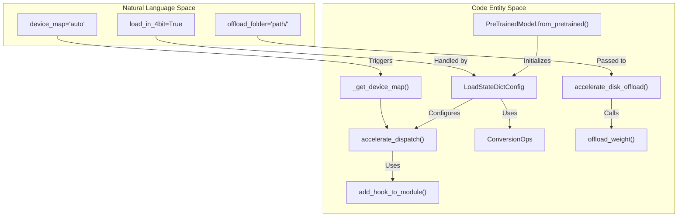
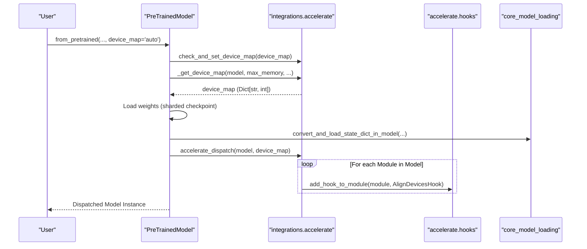

<!-- source: DeepWiki mcp.deepwiki.com · repo huggingface/transformers · page 8.3 Accelerate & Device Mapping · fetched 2026-10-26 -->

# Accelerate & Device Mapping

Relevant source files

The following files were used as context for generating this wiki page:

- [docs/source/en/accelerate.md](docs/source/en/accelerate.md)
- [docs/source/en/accelerator_selection.md](docs/source/en/accelerator_selection.md)
- [docs/source/en/community.md](docs/source/en/community.md)
- [docs/source/en/ddp.md](docs/source/en/ddp.md)
- [docs/source/en/debugging.md](docs/source/en/debugging.md)
- [docs/source/en/deepspeed.md](docs/source/en/deepspeed.md)
- [docs/source/en/deepspeed_alst.md](docs/source/en/deepspeed_alst.md)
- [docs/source/en/main_classes/deepspeed.md](docs/source/en/main_classes/deepspeed.md)
- [docs/source/en/main_classes/peft.md](docs/source/en/main_classes/peft.md)
- [docs/source/en/main_classes/trainer.md](docs/source/en/main_classes/trainer.md)
- [docs/source/en/model_doc/clvp.md](docs/source/en/model_doc/clvp.md)
- [docs/source/en/model_doc/ctrl.md](docs/source/en/model_doc/ctrl.md)
- [docs/source/en/peft.md](docs/source/en/peft.md)
- [docs/source/en/perf_hardware.md](docs/source/en/perf_hardware.md)
- [docs/source/en/perf_infer_gpu_multi.md](docs/source/en/perf_infer_gpu_multi.md)
- [docs/source/en/perf_train_cpu.md](docs/source/en/perf_train_cpu.md)
- [docs/source/en/perf_train_gaudi.md](docs/source/en/perf_train_gaudi.md)
- [docs/source/en/perf_train_gpu_many.md](docs/source/en/perf_train_gpu_many.md)
- [docs/source/en/perf_train_special.md](docs/source/en/perf_train_special.md)
- [docs/source/en/tensor_parallelism.md](docs/source/en/tensor_parallelism.md)
- [docs/source/ja/main_classes/deepspeed.md](docs/source/ja/main_classes/deepspeed.md)
- [docs/source/ja/main_classes/trainer.md](docs/source/ja/main_classes/trainer.md)
- [docs/source/ja/perf_train_gpu_many.md](docs/source/ja/perf_train_gpu_many.md)
- [docs/source/ko/deepspeed.md](docs/source/ko/deepspeed.md)
- [docs/source/ko/perf_train_gpu_many.md](docs/source/ko/perf_train_gpu_many.md)
- [docs/source/zh/main_classes/deepspeed.md](docs/source/zh/main_classes/deepspeed.md)
- [docs/source/zh/main_classes/trainer.md](docs/source/zh/main_classes/trainer.md)
- [docs/source/zh/perf_infer_gpu_multi.md](docs/source/zh/perf_infer_gpu_multi.md)
- [src/transformers/conversion_mapping.py](src/transformers/conversion_mapping.py)
- [src/transformers/core_model_loading.py](src/transformers/core_model_loading.py)
- [src/transformers/integrations/accelerate.py](src/transformers/integrations/accelerate.py)
- [src/transformers/integrations/deepspeed.py](src/transformers/integrations/deepspeed.py)
- [src/transformers/integrations/hub_kernels.py](src/transformers/integrations/hub_kernels.py)
- [src/transformers/integrations/npu_flash_attention.py](src/transformers/integrations/npu_flash_attention.py)
- [src/transformers/integrations/peft.py](src/transformers/integrations/peft.py)
- [src/transformers/integrations/tensor_parallel.py](src/transformers/integrations/tensor_parallel.py)
- [src/transformers/modeling_flash_attention_utils.py](src/transformers/modeling_flash_attention_utils.py)
- [src/transformers/modeling_utils.py](src/transformers/modeling_utils.py)
- [src/transformers/utils/generic.py](src/transformers/utils/generic.py)
- [src/transformers/utils/kernel_config.py](src/transformers/utils/kernel_config.py)
- [tests/kernels/test_kernels.py](tests/kernels/test_kernels.py)
- [tests/peft_integration/test_peft_integration.py](tests/peft_integration/test_peft_integration.py)
- [tests/tensor_parallel/test_tensor_parallel.py](tests/tensor_parallel/test_tensor_parallel.py)
- [tests/test_modeling_common.py](tests/test_modeling_common.py)
- [tests/utils/test_core_model_loading.py](tests/utils/test_core_model_loading.py)
- [tests/utils/test_generic.py](tests/utils/test_generic.py)
- [tests/utils/test_modeling_utils.py](tests/utils/test_modeling_utils.py)

The Transformers library integrates deeply with the **Accelerate** library to provide advanced device dispatch, balanced memory distribution, and parameter offloading capabilities when loading large models. This feature is essential for loading models that cannot fit into a single GPU’s memory, enabling multi-GPU, CPU, and even disk-based model partitioning seamlessly.

---

## 1. Overview of Device Mapping

When a model is loaded via `PreTrainedModel.from_pretrained()`, the argument `device_map` can trigger Accelerate-based device dispatching. This logic shards the model's submodules across multiple devices (GPUs, CPUs, or disk) according to their memory footprint and device constraints.

Key features include:

- **Balanced Layer Allocation:** The system automatically computes an allocation to distribute model layers to devices while balancing their memory utilization.
- **Disk and CPU Offloading:** When GPU memory is insufficient, parameters can offload to CPU RAM or local disk using optimized mechanisms.
- **Execution Hooks:** PyTorch forward hooks (`AlignDevicesHook`) move parameters dynamically to the device during computation and offload after execution to minimize peak memory usage.

This approach facilitates efficient inference and training workflows on heterogeneous hardware configurations with minimal user intervention.

Sources: [src/transformers/modeling_utils.py:181-182]()

---

## 2. Implementation Architecture & Configuration

The core implementation of Accelerate integration for device mapping is split principally between two files:

- `src/transformers/integrations/accelerate.py`
- `src/transformers/modeling_utils.py`

### Configuration Container: `LoadStateDictConfig`

`LoadStateDictConfig` is a frozen dataclass encapsulating user options around model loading, device mapping, offloading, and dtype. It supplies parameters such as:

- `device_map`: Dict specifying mapping of module names to devices or the string `"auto"` for automatic dispatch
- `disk_offload_folder`: Path to store tensors offloaded to disk
- `offload_buffers`: Boolean to offload non-parameter buffers
- `dtype`: Target datatype for model weights
- Additional flags for quantization and sharding options

This struct is passed during model loading to coordinate all device and memory management decisions.

### Core Functions & Classes

- `_get_device_map()`: Computes an ordered mapping of model submodule names to device assignments based on available memory and user specifications. [src/transformers/modeling_utils.py:70]()
- `check_and_set_device_map()`: Validates and normalizes the user input `device_map` argument, supporting string aliases and dicts. [src/transformers/modeling_utils.py:72]()
- `accelerate_dispatch()`: Applies the mapped allocation, moves model weights to the assigned devices, and attaches hooks for lazy offloading/reloading. [src/transformers/modeling_utils.py:71]()
- `accelerate_disk_offload()`: Prepares disk offload directories and indexes for parameters that reside on disk. [src/transformers/modeling_utils.py:71]()
- `load_offloaded_parameter()`: Dynamically loads parameters from disk during forward execution. [src/transformers/modeling_utils.py:76]()
- Execution hooks integrated via `add_hook_to_module` (from Accelerate) manage runtime parameter transitions. [src/transformers/modeling_utils.py:143]()

### Natural Language → Code Entity Mapping

Sources: [src/transformers/modeling_utils.py:69-77](), [src/transformers/modeling_utils.py:171-184](), [src/transformers/core_model_loading.py:35-81]()

---

## 3. Automatic Device Dispatch & Memory Allocation

The automatic device mapping occurs when `device_map` is set to `"auto"`, `"balanced"`, or other predefined strategies.

### Device Map Validation & Generation

- `check_and_set_device_map()` processes the input, supporting scalars (like `"cuda"`), strings (`"auto"`), or explicit dictionaries mapping submodule names to devices. It ensures the user input aligns with model expectations and environment availability. [src/transformers/modeling_utils.py:72]()
- `compute_module_sizes()` estimates the VRAM requirement of each module by traversing the model’s layers and leaf parameters. This enables precise memory budgeting. [tests/test_modeling_common.py:141]()
- `_get_device_map()` generates a layer-to-device mapping that balances memory load across devices, respecting CPU/disk offload if specified. [src/transformers/modeling_utils.py:70]()

### Dispatching Model Parameters

- After the device map is computed, `accelerate_dispatch()` moves the model weights to their appropriate devices. This call also hooks modules meant for offloaded devices with execution hooks (`AlignDevicesHook`) that transfer parameters dynamically during forward passes. [src/transformers/modeling_utils.py:71](), [src/transformers/modeling_utils.py:143-145]()

The following sequence diagram details the flow involved in multi-device model loading and execution dispatch:

Sources: [src/transformers/modeling_utils.py:69-77](), [src/transformers/modeling_utils.py:143-145](), [tests/test_modeling_common.py:141]()

---

## 4. Offloading and Conversion Mechanisms

### CPU and Disk Offloading

When GPU memory capacity is exceeded:

- Tensors can be offloaded to CPU memory or disk, controlled by `offload_folder` and `offload_buffers` options in `LoadStateDictConfig`. [src/transformers/modeling_utils.py:182-183]()
- `accelerate_disk_offload()` sets up folder structures and metadata indices, organizing tensors saved on disk for lazy loading. [src/transformers/modeling_utils.py:71]()
- `offload_weight()` serializes tensors to the designated offload destination (memory or SSD). [src/transformers/core_model_loading.py:35]()
- `load_offloaded_parameter()` dynamically reloads parameters on demand during computation. [src/transformers/modeling_utils.py:76]()

This layered offloading strategy enables ultra-large models to run on machines with limited GPU VRAM by transparently spilling tensors to slower storage.

### ConversionOps Framework

Weight conversion and transformation operations are orchestrated by the `ConversionOps` system in `core_model_loading.py`. This supports operations such as:

- **Chunk/Concatenate:** Splitting tensors into shards or merging them to reconcile different checkpoint layouts. [src/transformers/core_model_loading.py:112-148]()
- **Transpose/PermuteForRope:** Reordering tensor dimensions when loading from heterogeneous formats. [src/transformers/core_model_loading.py:30-31]()
- **WeightRenaming:** Regex-based pattern transformations for parameter names for compatibility. [src/transformers/core_model_loading.py:33]()

During device mapping, these conversion operations help unify diverse checkpoint formats into a consistent device distribution.

Sources: [src/transformers/modeling_utils.py:182-183](), [src/transformers/modeling_utils.py:71](), [src/transformers/modeling_utils.py:76](), [src/transformers/core_model_loading.py:30-33](), [src/transformers/core_model_loading.py:35](), [src/transformers/core_model_loading.py:112-148]()

---

## 5. Technical Reference: Key Functions & Classes

| Symbol / Class | File Location | Description |
|---|---|---|
| `_get_device_map()` | `src/transformers/integrations/accelerate.py` | Computes device assignment for all submodules based on memory profiling and user constraints. |
| `check_and_set_device_map()` | `src/transformers/integrations/accelerate.py` | Validates and normalizes user `device_map` input including "auto", dict, and string specifications. |
| `accelerate_dispatch()` | `src/transformers/integrations/accelerate.py` | Dispatches model parameters to the devices and attaches execution hooks for offloading control. |
| `compute_module_sizes()` | `src/transformers/integrations/accelerate.py` | Estimates the VRAM impact of each model submodule for balanced allocation planning. |
| `LoadStateDictConfig` | `src/transformers/modeling_utils.py` | Dataclass bundling device mapping, offload folder, weight dtype, and more for loading configurations. |
| `accelerate_disk_offload()` | `src/transformers/modeling_utils.py` | Manages disk offload folders and serialization/indexing of disk-offloaded weights. |
| `load_offloaded_parameter()` | `src/transformers/modeling_utils.py` | Loads parameters from disk offload storage during execution forward passes. |
| `ConversionOps` | `src/transformers/core_model_loading.py` | Base class for modular transformations applied to checkpoint weights during loading (chunking, transposing). |
| `offload_weight()` | `src/transformers/core_model_loading.py` | Utility for moving individual weights to offload devices such as CPU or disk. |

Sources: [src/transformers/modeling_utils.py:171-184](), [src/transformers/modeling_utils.py:70-77](), [src/transformers/core_model_loading.py:35-95]()

---

## 6. Integration with Trainer and Accelerate

The Transformers `Trainer` class further leverages Accelerate infrastructure for orchestration of distributed training and multi-GPU management:

- **Accelerator Initialization:** `Trainer` translates `TrainingArguments` into configurations used to initialize `Accelerator` instances, controlling device placement and mixed precision.
- **DDP Configuration:** Arguments like `ddp_find_unused_parameters` control `DistributedDataParallel` wrappers for efficient inter-GPU communication.
- **Memory Hygiene:** The Trainer calls Accelerate APIs such as `clear_device_cache` to manage GPU memory and reduce out-of-memory during evaluation and checkpoint saving.

This tight integration ensures that models benefit from Accelerate’s device mapping both at load and at runtime training execution.

Sources: [src/transformers/modeling_utils.py:143-145](), [src/transformers/integrations/accelerate.py:47-51]()

---

# Summary

The Accelerate & Device Mapping subsystem provides a robust, automated system for loading large transformer models on heterogeneous hardware environments spanning multiple GPUs, CPUs, and even disk. It combines memory profiling, device mapping heuristics, and runtime offload hooks to deliver scalable deployment of LLMs and other large architectures with minimal manual tuning.

This integration is a key part of the Transformers ecosystem’s support for large-scale model inference and training workflows.

---

