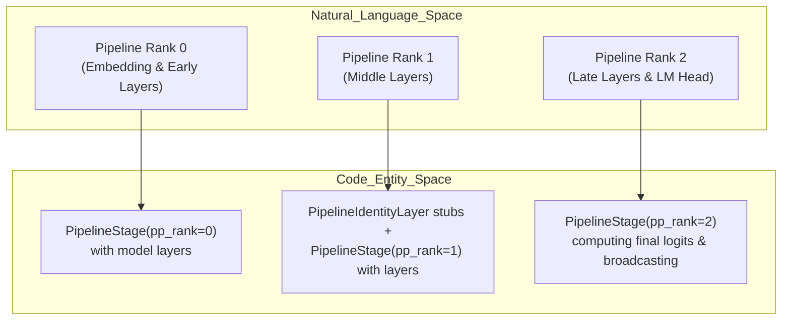
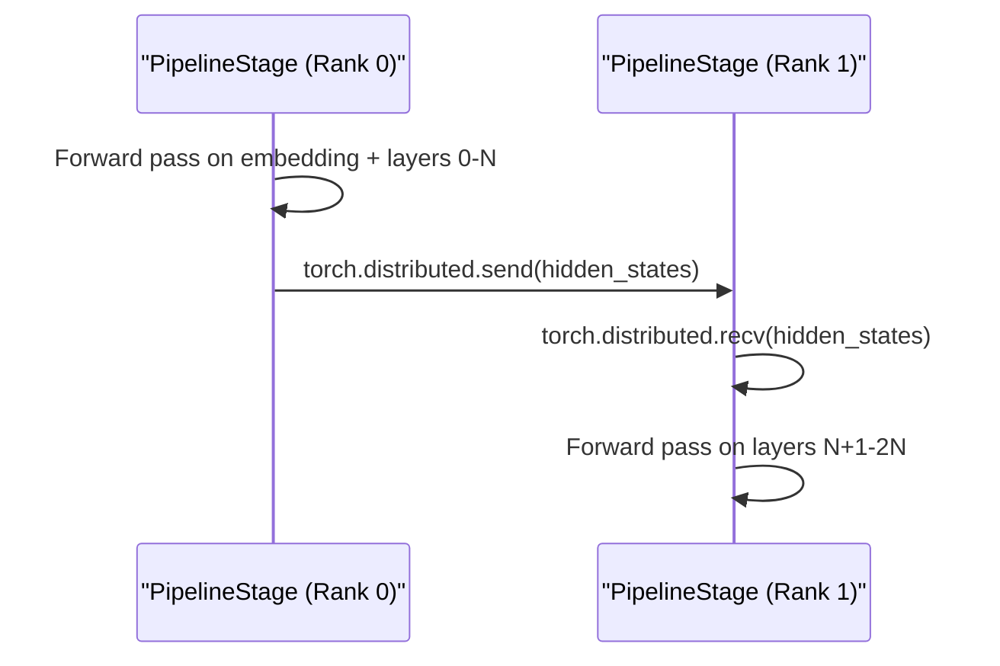
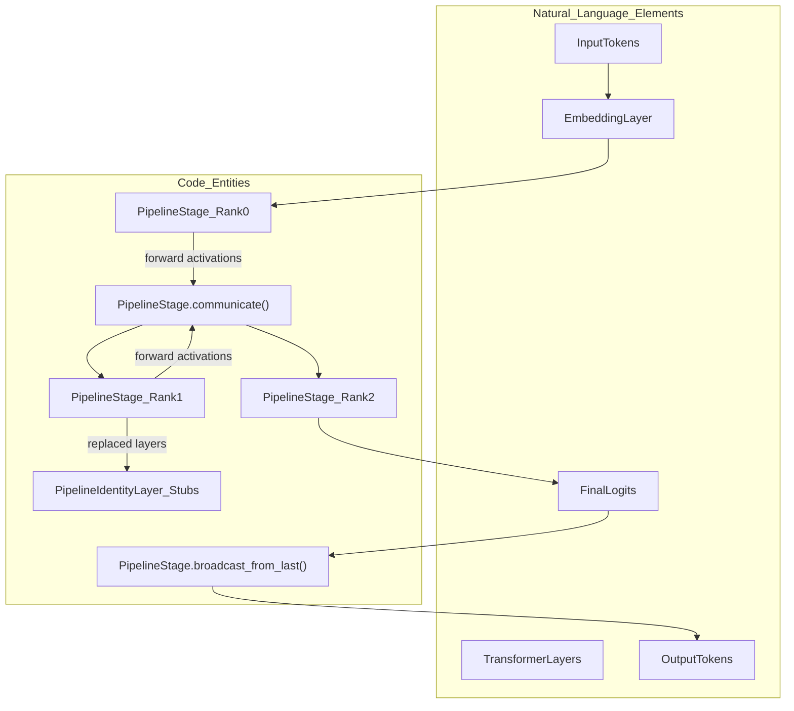

<!-- source: DeepWiki mcp.deepwiki.com · repo huggingface/transformers · page 8.4 Pipeline Parallelism · fetched 2026-10-26 -->

# Pipeline Parallelism

Relevant source files

The following files were used as context for generating this wiki page:

- [docs/source/en/expert_parallelism.md](docs/source/en/expert_parallelism.md)
- [docs/source/en/experts_interface.md](docs/source/en/experts_interface.md)
- [docs/source/en/fsdp.md](docs/source/en/fsdp.md)
- [docs/source/en/model_doc/hy_v4.md](docs/source/en/model_doc/hy_v4.md)
- [docs/source/en/model_doc/kimi_k25.md](docs/source/en/model_doc/kimi_k25.md)
- [docs/source/en/model_doc/mellum.md](docs/source/en/model_doc/mellum.md)
- [docs/source/en/model_doc/minimax_m3_vl.md](docs/source/en/model_doc/minimax_m3_vl.md)
- [src/transformers/distributed/__init__.py](src/transformers/distributed/__init__.py)
- [src/transformers/distributed/configuration_utils.py](src/transformers/distributed/configuration_utils.py)
- [src/transformers/distributed/fsdp.py](src/transformers/distributed/fsdp.py)
- [src/transformers/distributed/mixin.py](src/transformers/distributed/mixin.py)
- [src/transformers/distributed/pipeline_parallel.py](src/transformers/distributed/pipeline_parallel.py)
- [src/transformers/distributed/tensor_parallel.py](src/transformers/distributed/tensor_parallel.py)
- [src/transformers/distributed/utils.py](src/transformers/distributed/utils.py)
- [src/transformers/models/mellum/__init__.py](src/transformers/models/mellum/__init__.py)
- [src/transformers/models/mellum/configuration_mellum.py](src/transformers/models/mellum/configuration_mellum.py)
- [src/transformers/models/mellum/modular_mellum.py](src/transformers/models/mellum/modular_mellum.py)
- [src/transformers/models/qwen3/configuration_qwen3.py](src/transformers/models/qwen3/configuration_qwen3.py)
- [src/transformers/models/qwen3_moe/configuration_qwen3_moe.py](src/transformers/models/qwen3_moe/configuration_qwen3_moe.py)
- [src/transformers/utils/loading_report.py](src/transformers/utils/loading_report.py)
- [tests/models/deepseek_v4/test_modeling_deepseek_v4.py](tests/models/deepseek_v4/test_modeling_deepseek_v4.py)
- [tests/models/mellum/__init__.py](tests/models/mellum/__init__.py)
- [tests/pipeline_parallel/test_pipeline_parallel.py](tests/pipeline_parallel/test_pipeline_parallel.py)
- [tests/test_fsdp_mixin.py](tests/test_fsdp_mixin.py)
- [tests/test_tensor_parallel_mixin.py](tests/test_tensor_parallel_mixin.py)

## Purpose and Scope
This page documents the naive 1D pipeline parallel implementation found in `src/transformers/distributed/pipeline_parallel.py`. This implementation provides the basic building blocks for splitting a sequential transformer model layer-wise across multiple devices using PyTorch's distributed primitives and device meshes.

The page describes the key abstractions including the `PipelineStage` class representing each pipeline parallel partition, the point-to-point communication mechanisms between pipeline ranks, the `PipelineIdentityLayer` stub for replaced layers, the logits broadcast procedure, and the associated pipeline parallel test suite in `tests/pipeline_parallel/test_pipeline_parallel.py`.

Sources: [`src/transformers/distributed/pipeline_parallel.py:1-168`](), [`tests/pipeline_parallel/test_pipeline_parallel.py:1-120`]()

---

## 1. Core Abstractions: `PipelineStage` and `PipelineIdentityLayer`

### Overview
Pipeline parallelism partitions a model into multiple sequential pipeline stages, typically splitting by consecutive layers of a transformer. Each pipeline stage runs as a separate process or device rank in a 1D device mesh and holds only its assigned subset of the full model layers.

The two key classes implementing this in the codebase are:

- **`PipelineStage`**: Defined in [`src/transformers/distributed/pipeline_parallel.py:41-168`](), this class represents a pipeline stage responsible for:
  - Holding the model sub-module (typically a slice of layers).
  - Tracking pipeline parallel context: total pipeline size (`pp_size`), pipeline rank (`pp_rank`), and peer ranks for upstream and downstream communication.
  - Implementing communication methods for exchanging hidden state tensors between neighboring stages in the forward and backward passes (`communicate`).
  - Mapping checkpoint keys to stage ranks to support checkpoint loading and saving per pipeline partition (`find_rank_for_key`).
  - Broadcasting the final computed logits from the last pipeline stage to other ranks (`broadcast_from_last`).

- **`PipelineIdentityLayer`**: A minimal stub inheriting from `torch.nn.Identity`. It replaces layers not owned by the current pipeline stage during model slicing. This ensures that the PyTorch module list remains consistent in size and structure across all ranks, but only the layers owned by a rank perform real computation. The stub simply forwards inputs unchanged without computation.

This setup cleanly partitions the model so each process handles only a subset of layers, while preserving overall module structure and facilitating inter-stage communication.

### Diagram: Pipeline Stages and Code Entities
#### Figure 1: Mapping Pipeline Ranks to Code Entities

Sources: [`src/transformers/distributed/pipeline_parallel.py:41-168`]()

---

## 2. Inter-Stage Communication and Data Flow

### Data Flow in 1D Pipeline Parallelism
The 1D pipeline parallelism proceeds by splitting transformer layers across stages arranged sequentially:

- **Forward pass** proceeds rank-by-rank from pipeline rank 0 (first stage) to rank `pp_size-1` (last stage), with each stage receiving activations from the previous rank, computing its local layers, and sending activations forward.
- **Backward pass** reverses this order, propagating gradients back from the last stage to the first.

This linear pipeline structure allows model layers to be sharded vertically, reducing device memory per rank.

### Communication Mechanism
Communication between ranks is implemented in `PipelineStage.communicate()` method:

- **`recv_forward` operation**: 
  - A non-blocking receive (`torch.distributed.irecv`) fetches hidden states from the previous pipeline rank.
  - Skipped on the first stage (rank 0).
- **`send_forward` operation**: 
  - A non-blocking send (`torch.distributed.isend`) sends hidden states to the next pipeline rank.
  - Skipped on the last stage (`pp_size - 1`).
- Similar operations exist for the backward pass, exchanging gradients backward.

After starting asynchronous sends/receives, the method synchronizes completion via waiting on the communication handles.

This isolates communication logic from model computation and enables pipelined forward and backward activations passing.

### Diagram: Forward Activation Transmission Between Pipeline Ranks
#### Figure 2: Inter-Stage Activation Flow

Sources: [`src/transformers/distributed/pipeline_parallel.py:65-107`]()

---

## 3. Logits Broadcast and Final Output Aggregation

Only the last pipeline stage (`pp_rank == pp_size - 1`) computes the final logits tensor after its forward pass.

However, downstream APIs and inference code expect logits to be uniformly accessible on all ranks for things like token sampling.

To handle this, `PipelineStage.broadcast_from_last()` performs an all-rank broadcast of the final logits tensor from the last rank to all other pipeline ranks.

- When pipeline parallelism is enabled (`pp_size > 1`), the method uses `torch.distributed.broadcast` within the pipeline process group to send logits downstream.
- If pipeline parallelism is disabled (`pp_size <= 1`), this is a no-op and directly returns the logits.

This pattern ensures consistency of the output logits tensor across all pipeline stages during inference or evaluation.

Sources: [`src/transformers/distributed/pipeline_parallel.py:148-168`]()

---

## 4. Pipeline Parallel Test Suite

The pipeline parallelism implementation is tested via an integration test suite in `tests/pipeline_parallel/test_pipeline_parallel.py`.

Key test features include:

- Constructing toy transformer models and splitting them across multiple pipeline stages [`tests/pipeline_parallel/test_pipeline_parallel.py:1-120`]().
- Verifying correctness of model outputs by comparing distributed pipeline results against single-device baselines for the same inputs.
- Testing the communication steps between stages for forward and backward activations.
- Validating that the `PipelineIdentityLayer` stubs execute with identity semantics for non-owned layers.
- Ensuring the logits broadcast reliably synchronizes outputs among all ranks.

This test suite provides confidence in the correctness and synchronization of the pipeline parallel training and inference workflow.

Sources: [`tests/pipeline_parallel/test_pipeline_parallel.py:1-120`]()

---

## Summary Diagram: Pipeline Parallel System - Natural Language Concepts to Code Entities
#### Figure 3: System-to-Code Mapping

Sources: [`src/transformers/distributed/pipeline_parallel.py:41-168`](), [`tests/pipeline_parallel/test_pipeline_parallel.py:1-120`]()

---

# References
- `src/transformers/distributed/pipeline_parallel.py` (lines 1-168)
- `tests/pipeline_parallel/test_pipeline_parallel.py` (lines 1-120)

---

