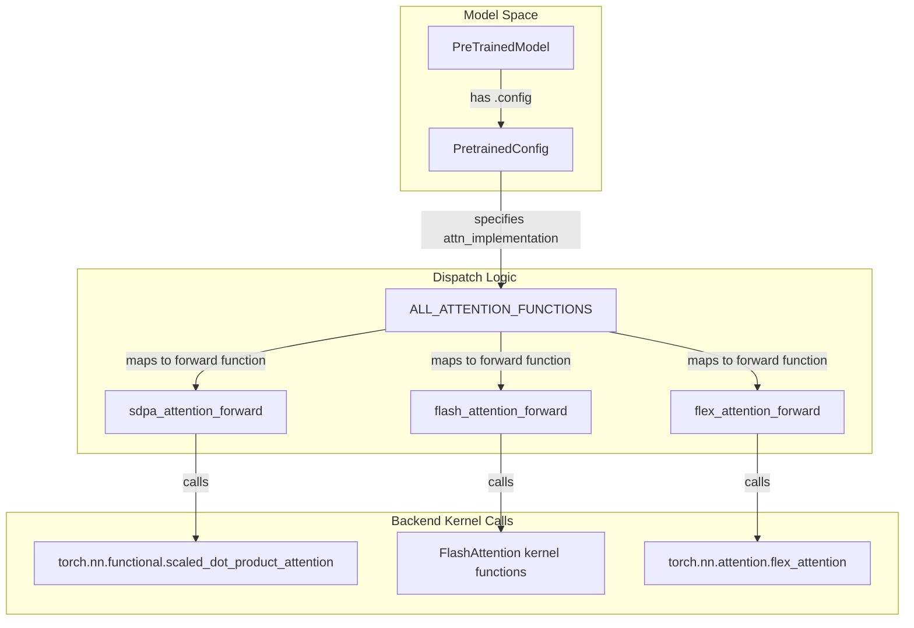
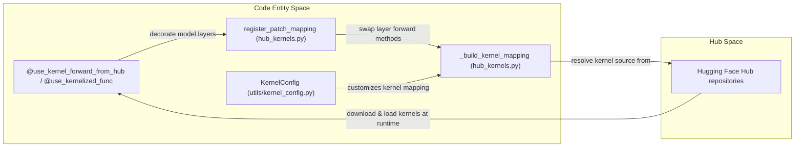

<!-- source: DeepWiki mcp.deepwiki.com · repo huggingface/transformers · page 9 Attention Backends & Kernel Integration · fetched 2026-10-26 -->

# Attention Backends & Kernel Integration

Relevant source files

The following files were used as context for generating this wiki page:

- [docs/source/en/main_classes/peft.md](docs/source/en/main_classes/peft.md)
- [docs/source/en/peft.md](docs/source/en/peft.md)
- [docs/source/en/perf_infer_gpu_multi.md](docs/source/en/perf_infer_gpu_multi.md)
- [docs/source/en/tensor_parallelism.md](docs/source/en/tensor_parallelism.md)
- [docs/source/zh/perf_infer_gpu_multi.md](docs/source/zh/perf_infer_gpu_multi.md)
- [src/transformers/conversion_mapping.py](src/transformers/conversion_mapping.py)
- [src/transformers/core_model_loading.py](src/transformers/core_model_loading.py)
- [src/transformers/integrations/accelerate.py](src/transformers/integrations/accelerate.py)
- [src/transformers/integrations/flash_attention.py](src/transformers/integrations/flash_attention.py)
- [src/transformers/integrations/flex_attention.py](src/transformers/integrations/flex_attention.py)
- [src/transformers/integrations/hub_kernels.py](src/transformers/integrations/hub_kernels.py)
- [src/transformers/integrations/npu_flash_attention.py](src/transformers/integrations/npu_flash_attention.py)
- [src/transformers/integrations/peft.py](src/transformers/integrations/peft.py)
- [src/transformers/integrations/sdpa_attention.py](src/transformers/integrations/sdpa_attention.py)
- [src/transformers/integrations/tensor_parallel.py](src/transformers/integrations/tensor_parallel.py)
- [src/transformers/modeling_flash_attention_utils.py](src/transformers/modeling_flash_attention_utils.py)
- [src/transformers/modeling_utils.py](src/transformers/modeling_utils.py)
- [src/transformers/models/afmoe/configuration_afmoe.py](src/transformers/models/afmoe/configuration_afmoe.py)
- [src/transformers/models/afmoe/modeling_afmoe.py](src/transformers/models/afmoe/modeling_afmoe.py)
- [src/transformers/models/afmoe/modular_afmoe.py](src/transformers/models/afmoe/modular_afmoe.py)
- [src/transformers/models/ibert/modeling_ibert.py](src/transformers/models/ibert/modeling_ibert.py)
- [src/transformers/models/llama4/configuration_llama4.py](src/transformers/models/llama4/configuration_llama4.py)
- [src/transformers/models/llama4/convert_llama4_weights_to_hf.py](src/transformers/models/llama4/convert_llama4_weights_to_hf.py)
- [src/transformers/models/llama4/modeling_llama4.py](src/transformers/models/llama4/modeling_llama4.py)
- [src/transformers/models/mllama/convert_mllama_weights_to_hf.py](src/transformers/models/mllama/convert_mllama_weights_to_hf.py)
- [src/transformers/models/mpnet/modeling_mpnet.py](src/transformers/models/mpnet/modeling_mpnet.py)
- [src/transformers/models/nystromformer/modeling_nystromformer.py](src/transformers/models/nystromformer/modeling_nystromformer.py)
- [src/transformers/models/vilt/modeling_vilt.py](src/transformers/models/vilt/modeling_vilt.py)
- [src/transformers/models/visual_bert/modeling_visual_bert.py](src/transformers/models/visual_bert/modeling_visual_bert.py)
- [src/transformers/utils/generic.py](src/transformers/utils/generic.py)
- [src/transformers/utils/kernel_config.py](src/transformers/utils/kernel_config.py)
- [tests/kernels/test_kernels.py](tests/kernels/test_kernels.py)
- [tests/models/afmoe/test_modeling_afmoe.py](tests/models/afmoe/test_modeling_afmoe.py)
- [tests/models/glm4_moe_lite/test_modeling_glm4_moe_lite.py](tests/models/glm4_moe_lite/test_modeling_glm4_moe_lite.py)
- [tests/models/youtu/test_modeling_youtu.py](tests/models/youtu/test_modeling_youtu.py)
- [tests/peft_integration/test_peft_integration.py](tests/peft_integration/test_peft_integration.py)
- [tests/tensor_parallel/test_tensor_parallel.py](tests/tensor_parallel/test_tensor_parallel.py)
- [tests/test_modeling_common.py](tests/test_modeling_common.py)
- [tests/utils/test_core_model_loading.py](tests/utils/test_core_model_loading.py)
- [tests/utils/test_generic.py](tests/utils/test_generic.py)
- [tests/utils/test_modeling_utils.py](tests/utils/test_modeling_utils.py)

The Hugging Face Transformers library features a modular and pluggable attention system designed to decouple high-level model architectures from low-level, hardware-optimized attention kernels. This modular architecture enables models to flexibly select among multiple efficient attention backends—such as PyTorch's Scaled Dot-Product Attention (SDPA), FlashAttention versions 2/3/4, FlexAttention, and Ascend NPU flash attention—without requiring internal architectural changes.

Furthermore, the library supports runtime loading of custom-compiled CUDA and Triton kernels directly from the Hugging Face Hub, allowing seamless replacement of standard PyTorch layers with optimized implementations for improved performance across different hardware. This infrastructure is centered around decorators and kernel configuration management, enabling flexible and dynamic integration of new kernel backends.

This page provides a high-level overview of these attention backends and kernel integration mechanisms. For detailed technical information, please refer to the linked child pages:

- [Flash Attention, SDPA & FlexAttention](#9.1) — Covers the `ALL_ATTENTION_FUNCTIONS` registry, attention implementation selection, and paged attention variants.
- [Hub Kernels & Custom Kernel Loading](#9.2) — Covers the `hub_kernels.py` runtime loading system, `@use_kernel_forward_from_hub` decorator, `KernelConfig`, and hardware integrations.

---

## Pluggable Attention Architecture

Transformers exposes a unified, pluggable interface for attention that supports multiple backend implementations accessed through a central registry called `ALL_ATTENTION_FUNCTIONS`. This registry maps string identifiers (e.g., `"sdpa"`, `"flash_attention_2"`, `"flex_attention"`) to corresponding forward functions that execute attention efficiently on the given hardware [src/transformers/modeling_utils.py:88]().

Models carry a `PretrainedConfig` specifying their preferred `attn_implementation`. At runtime, the model’s attention layers dispatch forward calls to the selected backend attention function retrieved from the registry. This decoupling allows the same model code to run with different optimized kernels simply by changing configuration flags, without altering model source code [src/transformers/modeling_flash_attention_utils:96-140]().

### Attention Dispatch Flow

This design supports flexible paging mechanisms (e.g., continuous batching with paged KV caches) to scale to long sequences and efficient inference [src/transformers/integrations/sdpa_attention.py]().

For a thorough explanation of the attention registry, attn_implementation selection, and the paged attention variants, see the child page [Flash Attention, SDPA & FlexAttention](#9.1).

Sources:
- `src/transformers/modeling_flash_attention_utils.py:96-140`
- `src/transformers/modeling_utils.py:88`
- `src/transformers/integrations/sdpa_attention.py`

---

## Optimized Attention Backends

The library integrates several specialized attention backends tailored to different hardware, precision modes, and application requirements:

- **SDPA**: PyTorch's native Scaled Dot-Product Attention kernel. It includes optimizations for CUDA GPUs, Ascend NPUs, and Intel XPUs and supports gating mechanisms like Grouped Query Attention (GQA) [src/transformers/integrations/sdpa_attention.py]().

- **FlashAttention-2/3/4**: Highly optimized graph- and tiled-based attention kernels for fast execution on CUDA devices, handling variable sequence lengths, KV caching, and supporting compatibility fixes for head dimension mismatches [src/transformers/integrations/flash_attention.py]().

- **FlexAttention**: A PyTorch compiler-friendly flexible attention implementation derived from torchtune's flex attention, allowing block masks, sliding windows, and advanced caching. This backend is compiled just once per training/inference session to save overhead [src/transformers/integrations/flex_attention.py]().

- **NPU Flash Attention**: Specialized fused flash attention tailored for Ascend NPUs integrating `torch_npu.npu_fusion_attention` with configurable causal masking modes via environment variables [src/transformers/integrations/npu_flash_attention.py]().

These backends are interchangeable and can be selected via configuration parameters or environment settings, enabling users to optimize for speed, memory, and hardware compatibility.

For a detailed description of supported attention backends, dispatch rules, and compatibility considerations, see [Flash Attention, SDPA & FlexAttention](#9.1).

Sources:
- `src/transformers/integrations/sdpa_attention.py`
- `src/transformers/integrations/flash_attention.py`
- `src/transformers/integrations/flex_attention.py`
- `src/transformers/integrations/npu_flash_attention.py`

---

## Hub-Loaded Custom Kernels

To maximize flexibility and allow rapid integration of new hardware-optimized kernels without bundling native code in the main package, Transformers supports dynamic runtime loading of CUDA/Triton kernels from the Hugging Face Hub via the `kernels` library [src/transformers/integrations/hub_kernels.py:83-104]().

This system centers on:
- Decorators like `@use_kernel_forward_from_hub` and `@use_kernelized_func` that enable annotating model submodules to override their forward implementations with kernel dispatches loaded on demand [src/transformers/integrations/hub_kernels.py:106-124]().
- A `KernelConfig` utility class managing kernel mappings from model layer names to kernel repositories, versions, and device qualifiers, supporting local development or remote hub kernels [src/transformers/utils/kernel_config.py]().
- Lazy kernel repository loading and monkey patch mechanisms to swap original PyTorch layers with high-performance kernel equivalents during model runtime setup [src/transformers/integrations/hub_kernels.py:28-37]().

### Hub Kernel Integration Flow

This dynamic kernel loading mechanism provides a path for model maintainers and third parties to publish highly specialized kernels targeting new architectures or optimization strategies, enabling Transformers to adopt cutting-edge improvements without core code changes.

For in-depth technical information about kernel loading, patching, versioning, and hardware support, consult the child page [Hub Kernels & Custom Kernel Loading](#9.2).

Sources:
- `src/transformers/integrations/hub_kernels.py:83-104`
- `src/transformers/integrations/hub_kernels.py:106-124`
- `src/transformers/utils/kernel_config.py`
- `src/transformers/integrations/hub_kernels.py:28-37`

---

# Further Reading

- [Flash Attention, SDPA & FlexAttention](#9.1)
- [Hub Kernels & Custom Kernel Loading](#9.2)

---

Sources:
- `src/transformers/integrations/hub_kernels.py`
- `src/transformers/modeling_flash_attention_utils.py`
- `src/transformers/utils/kernel_config.py`
- `src/transformers/integrations/npu_flash_attention.py`

---

