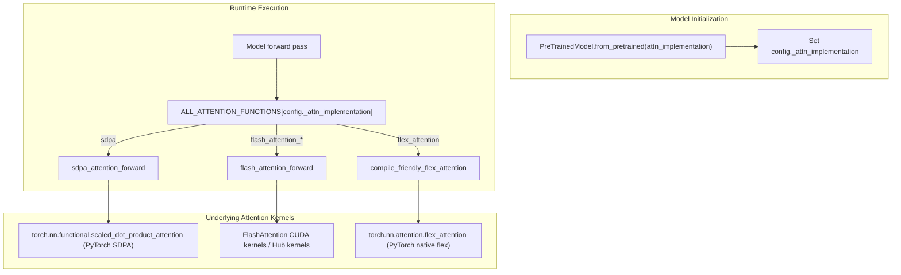
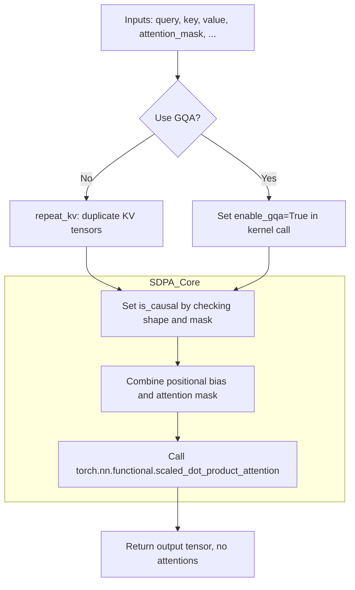
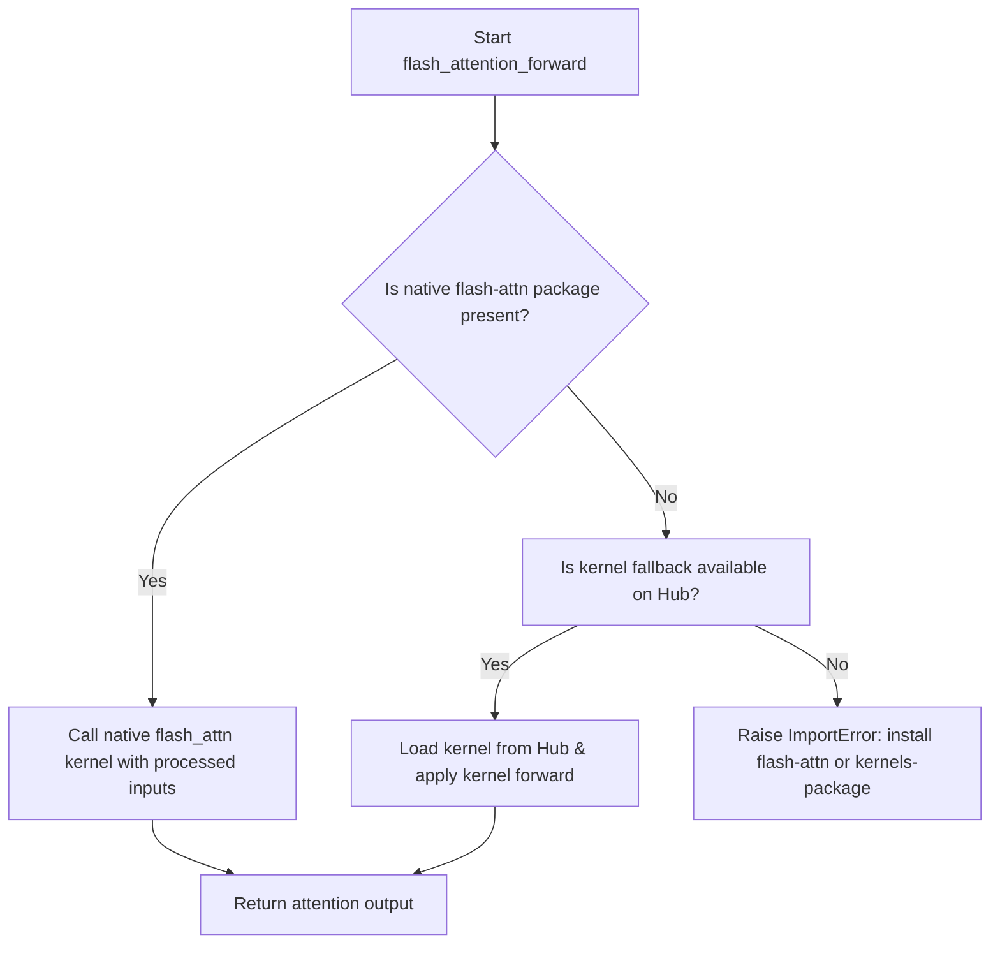
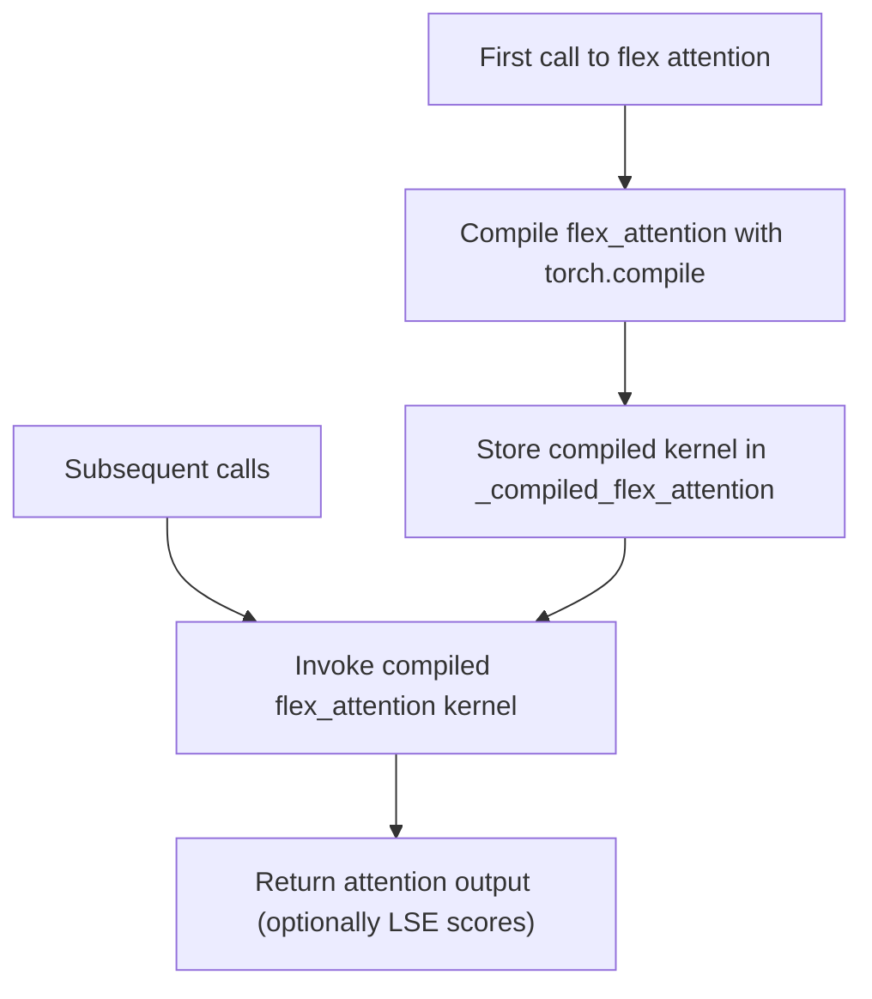
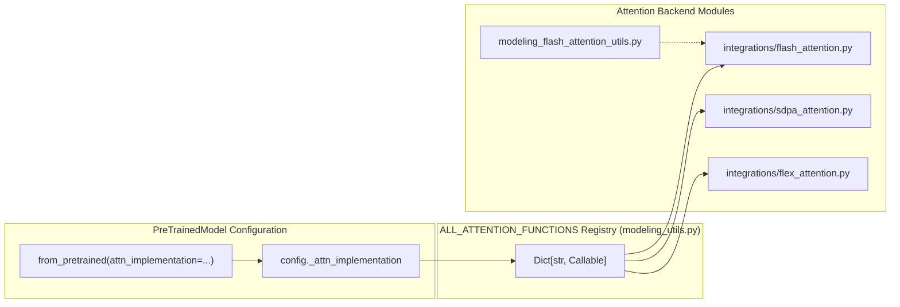

<!-- source: DeepWiki mcp.deepwiki.com · repo huggingface/transformers · page 9.1 Flash Attention, SDPA & FlexAttention · fetched 2026-10-26 -->

# Flash Attention, SDPA & FlexAttention

Relevant source files

The following files were used as context for generating this wiki page:

- [src/transformers/cache_utils.py](src/transformers/cache_utils.py)
- [src/transformers/configuration_utils.py](src/transformers/configuration_utils.py)
- [src/transformers/generation/candidate_generator.py](src/transformers/generation/candidate_generator.py)
- [src/transformers/generation/configuration_utils.py](src/transformers/generation/configuration_utils.py)
- [src/transformers/generation/utils.py](src/transformers/generation/utils.py)
- [src/transformers/integrations/executorch.py](src/transformers/integrations/executorch.py)
- [src/transformers/integrations/flash_attention.py](src/transformers/integrations/flash_attention.py)
- [src/transformers/integrations/flex_attention.py](src/transformers/integrations/flex_attention.py)
- [src/transformers/integrations/sdpa_attention.py](src/transformers/integrations/sdpa_attention.py)
- [src/transformers/masking_utils.py](src/transformers/masking_utils.py)
- [src/transformers/models/afmoe/configuration_afmoe.py](src/transformers/models/afmoe/configuration_afmoe.py)
- [src/transformers/models/afmoe/modeling_afmoe.py](src/transformers/models/afmoe/modeling_afmoe.py)
- [src/transformers/models/afmoe/modular_afmoe.py](src/transformers/models/afmoe/modular_afmoe.py)
- [src/transformers/models/ibert/modeling_ibert.py](src/transformers/models/ibert/modeling_ibert.py)
- [src/transformers/models/llama4/configuration_llama4.py](src/transformers/models/llama4/configuration_llama4.py)
- [src/transformers/models/llama4/convert_llama4_weights_to_hf.py](src/transformers/models/llama4/convert_llama4_weights_to_hf.py)
- [src/transformers/models/llama4/modeling_llama4.py](src/transformers/models/llama4/modeling_llama4.py)
- [src/transformers/models/mllama/convert_mllama_weights_to_hf.py](src/transformers/models/mllama/convert_mllama_weights_to_hf.py)
- [src/transformers/models/mpnet/modeling_mpnet.py](src/transformers/models/mpnet/modeling_mpnet.py)
- [src/transformers/models/nystromformer/modeling_nystromformer.py](src/transformers/models/nystromformer/modeling_nystromformer.py)
- [src/transformers/models/vilt/modeling_vilt.py](src/transformers/models/vilt/modeling_vilt.py)
- [src/transformers/models/visual_bert/modeling_visual_bert.py](src/transformers/models/visual_bert/modeling_visual_bert.py)
- [tests/generation/test_candidate_generator.py](tests/generation/test_candidate_generator.py)
- [tests/generation/test_configuration_utils.py](tests/generation/test_configuration_utils.py)
- [tests/generation/test_utils.py](tests/generation/test_utils.py)
- [tests/models/afmoe/test_modeling_afmoe.py](tests/models/afmoe/test_modeling_afmoe.py)
- [tests/models/glm4_moe_lite/test_modeling_glm4_moe_lite.py](tests/models/glm4_moe_lite/test_modeling_glm4_moe_lite.py)
- [tests/models/youtu/test_modeling_youtu.py](tests/models/youtu/test_modeling_youtu.py)
- [tests/utils/test_cache_utils.py](tests/utils/test_cache_utils.py)
- [tests/utils/test_configuration_utils.py](tests/utils/test_configuration_utils.py)
- [tests/utils/test_feature_extraction_utils.py](tests/utils/test_feature_extraction_utils.py)
- [tests/utils/test_image_processing_utils.py](tests/utils/test_image_processing_utils.py)
- [tests/utils/test_masking_utils.py](tests/utils/test_masking_utils.py)
- [tests/utils/test_tokenization_utils.py](tests/utils/test_tokenization_utils.py)

The Hugging Face Transformers library implements a pluggable attention backend system enabling models to dynamically dispatch to optimized scaled dot-product attention kernels. This abstraction facilitates hardware-aware implementations, improved performance, and extensibility. The supported attention backends include:

- **Eager:** A reference PyTorch-based implementation for attention.
- **Scaled Dot Product Attention (SDPA):** Uses PyTorch’s native `scaled_dot_product_attention` function.
- **Flash Attention:** Highly optimized CUDA kernels with versions 2, 3, and 4 support.
- **FlexAttention:** A newer PyTorch-native kernel offering efficient and flexible attention computation.

This page details the implementation, data flow, and interaction among these backends as implemented in the following core files:

- `src/transformers/modeling_flash_attention_utils.py`
- `src/transformers/integrations/flash_attention.py`
- `src/transformers/integrations/sdpa_attention.py`
- `src/transformers/integrations/flex_attention.py`

It also explains how the global `ALL_ATTENTION_FUNCTIONS` registry coordinates their selection, and covers paged attention variants used for continuous batching.

---

## The Attention Registry and Selection

### `ALL_ATTENTION_FUNCTIONS` Registry

Within `src/transformers/modeling_utils.py`, there exists the central registry `ALL_ATTENTION_FUNCTIONS`, a dictionary mapping attention backend names (strings) to their respective forward function implementations. This registry enables dynamic dispatch of the attention computation at runtime, according to the model configuration.

Models declare support for specific backends by attributes such as:

- `_supports_sdpa`
- `_supports_flash_attn`
- `_supports_flex_attn`

At model load (`PreTrainedModel.from_pretrained(...)`), the `attn_implementation` argument (e.g., `"sdpa"`, `"flash_attention_2"`, `"flex_attention"`, or paged variants) is used to set the configuration attribute `_attn_implementation`. This attribute guides all forward passes to invoke the corresponding kernel via `ALL_ATTENTION_FUNCTIONS`.

### `attn_implementation` Parsing and Paged Variants

The string value of `attn_implementation` may optionally specify paged attention by using the prefix `"paged|"`. Paged attention variants suit models using continuous batching with KV caches, and have specialized kernels handling paged memory layouts.

The function `split_attention_implementation` in `modeling_flash_attention_utils.py` parses such strings into `(is_paged: bool, base_implementation: str)` pairs.

---

### Attention Dispatch Flow Diagram

Sources:
`[src/transformers/modeling_utils.py]()`,
`[src/transformers/modeling_flash_attention_utils.py:1-173]()`,
`[src/transformers/integrations/sdpa_attention.py:79-142]()`,
`[src/transformers/integrations/flash_attention.py:26-102]()`,
`[src/transformers/integrations/flex_attention.py:59-129]()`

---

## Scaled Dot Product Attention (SDPA)

SDPA leverages PyTorch’s built-in `torch.nn.functional.scaled_dot_product_attention` to accelerate attention computation by using highly optimized native kernels under the hood.

### Key Features

- **Grouped Query Attention (GQA) Support:**
  In scenarios where the number of key and value heads is fewer than query heads (group attention), the function `repeat_kv` duplicates key and value tensors to align them for the kernel. The decision to use GQA natively is determined by `use_gqa_in_sdpa` based on device and mask conditions.
  `[src/transformers/integrations/sdpa_attention.py:18-27]()`, `[src/transformers/integrations/sdpa_attention.py:30-38]()`

- **Attention Mask and Causality Handling:**
  The attention mask is combined with learned or positional biases dynamically into an additive mask suitable for scaled dot product.
  `[src/transformers/integrations/sdpa_attention.py:40-77]()`
  The `is_causal` flag is carefully set at runtime, considering the query length and attention mask presence, to enable efficient kernel dispatch and avoid tracing/runtime jit issues.
  `[src/transformers/integrations/sdpa_attention.py:119-142]()`

- **Device-specific Mask Fixes:**
  On Ascend NPU devices, attention masks are forcibly cast to boolean to trigger the FlashAttentionScore kernel variant that achieves better performance.
  `[src/transformers/integrations/sdpa_attention.py:30-38]()`

---

### SDPA Attention Forward Workflow

Sources:
`[src/transformers/integrations/sdpa_attention.py:18-142]()`

---

## Flash Attention Integration

Flash Attention is comprised of specialized CUDA kernels that greatly accelerate scaled dot product attention by reducing memory overhead and increasing throughput.

### Supported Versions and Compatibility

| Version | Minimum CUDA | Devices | Hub Fallback Repository |
| :------ | :----------- | :------ | :---------------------- |
| 2       | -            | CUDA, MLU, MUSA, NPU, XPU | `kernels-community/flash-attn2` |
| 3       | 8 (Ampere)   | CUDA only | `kernels-community/vllm-flash-attn3` or `kernels-community/aiter-flash-attn` (ROCm) |
| 4       | 9 (Hopper)   | CUDA only | `kernels-community/flash-attn4` |

At runtime, availability detection relies on functions such as `is_flash_attn_2_available()` and a compatibility matrix in `FLASH_ATTENTION_COMPATIBILITY_MATRIX`.
`[src/transformers/modeling_flash_attention_utils.py:64-172]()`

If the native package is absent, the system attempts to load fallback kernels from the Hugging Face Hub dynamically using the mapping in `FLASH_ATTN_KERNEL_FALLBACK`.
`[src/transformers/modeling_flash_attention_utils.py:100-102]()`

---

### Flash Attention Forward Function Highlights

- Input tensors (`query`, `key`, `value`) are internally transposed/preprocessed to meet kernel API requirements.
- If value's head dimension is smaller than query's, zero-padding is applied for compatibility.
- Supports optional parameters: dropout probability, sliding window attention, softmax scaling, and auxiliary learnable sinks (`s_aux`).
- Utilizes dtype inference logic to choose appropriate computation precision (float16 vs bfloat16).
- Employs lazy imports of flash attention implementations based on the requested version and platform.
`[src/transformers/integrations/flash_attention.py:26-102]()`

---

### Flash Attention Forward Flow

Sources:
`[src/transformers/modeling_flash_attention_utils.py:64-172]()`,
`[src/transformers/integrations/flash_attention.py:26-102]()`

---

## Flex Attention

Flex Attention is a PyTorch-native efficient attention kernel introduced in PyTorch 2.5. It allows more flexible attention patterns, including block-sparse causal masks, without external CUDA kernels.

### Implementation Details

- The singleton class `WrappedFlexAttention` compiles `torch.nn.attention.flex_attention` once on first use with `torch.compile` for optimal performance.
`[src/transformers/integrations/flex_attention.py:59-129]()`
- It manages cross-version compatibility issues including a specific workaround for PyTorch 2.6.0 kernel instability, applying compilation modes (`COMPILE_FX`) selectively.
`[src/transformers/integrations/flex_attention.py:70-72]()`
- The kernel supports returning log-sum-exp (LSE) values with adaptation for Torch >=2.9 APIs using `AuxRequest` objects.
`[src/transformers/integrations/flex_attention.py:100-102]()`
- Masks are compressed into a block-causal `BlockMask` using PyTorch's built-in `CompressedMask`. This supports efficient packed and unpacked padded sequences.
`[src/transformers/masking_utils.py:31-34]()`
- A deprecated helper function `make_flex_block_causal_mask` builds block causal masks manually but is discouraged in favor of newer utilities.
`[src/transformers/integrations/flex_attention.py:127-129]()`

---

### Flex Attention Compilation Logic

Sources:
`[src/transformers/integrations/flex_attention.py:59-129]()`

---

## Paged Attention Variants

Paged attention is a specialized variant designed for **continuous batching** scenarios such as long sequence inference or streaming input, where KV caches are organized in pages or blocks to optimize memory utilization.

### Usage and Naming

- Paged variants prepend `"paged|"` to their base attention implementation name, e.g., `"paged|sdpa"`, `"paged|flash_attention_2"`.
- These variants provide alternative forward functions registered in `ALL_ATTENTION_FUNCTIONS` to handle memory management for paged KV caches.
- Paged attentions enable batched processing of queries with variable length and efficient cache accesses.
`[src/transformers/integrations/sdpa_attention.py:99-106]()`

---

## Summary Diagram: Flash Attention, SDPA & FlexAttention System Overview

This diagram relates the core source files managing the flash attention utilities, integration layers, and their registration for attention dispatch.

Sources:
`[src/transformers/modeling_flash_attention_utils.py]()`,
`[src/transformers/integrations/flash_attention.py]()`,
`[src/transformers/integrations/sdpa_attention.py]()`,
`[src/transformers/integrations/flex_attention.py]()`,
`[src/transformers/modeling_utils.py]()`

---

## Appendix: Key Functions & Classes

| Name | Location | Description |
| :----------------------------- | :-------------------------------------------- | :-------------------------------------------------------- |
| `ALL_ATTENTION_FUNCTIONS` | `modeling_utils.py` | Central registry mapping attention names to forward funcs |
| `split_attention_implementation` | `modeling_flash_attention_utils.py` | Parses attention strings, handles paged prefix |
| `sdpa_attention_forward` | `integrations/sdpa_attention.py` | Wrapper on PyTorch scaled dot product attention kernel |
| `flash_attention_forward` | `integrations/flash_attention.py` | Wraps Flash Attention kernels, input transformation, padding |
| `WrappedFlexAttention` | `integrations/flex_attention.py` | Singleton wrapper compiling and calling flex attention kernel |
| `compile_friendly_flex_attention` | `integrations/flex_attention.py` | User-facing compiled flex attention function |
| `FLASH_ATTN_KERNEL_FALLBACK` | `modeling_flash_attention_utils.py` | Maps flash attention versions to fallback Hub repos |
| `make_flex_block_causal_mask` | `integrations/flex_attention.py` | Deprecated helper to create block causal masks |
| `repeat_kv` | `integrations/sdpa_attention.py` | Helps replicate key/value heads for group-query attention |

---

# References

- **`modeling_flash_attention_utils.py`**: Core lazy imports, kernel fallback management, and paged attention parsing.
- **`integrations/flash_attention.py`**: Flash attention kernel invocation, input preprocessing, padding, dropout, and scaling features.
- **`integrations/sdpa_attention.py`**: PyTorch SDPA wrapper implementing GQA support, mask handling, and causality.
- **`integrations/flex_attention.py`**: Flex attention wrapper with singleton compilation, mask compression, and cross-version API support.
- **`modeling_utils.py`**: Holds the global `ALL_ATTENTION_FUNCTIONS` registry and mediates model attention dispatch.
- **`utils/generic.py`**: Utility `split_attention_implementation` for parsing attention implementation strings.

This suite of utilities and kernel integrations provides a modular, extensible system for performant scaled dot-product attention computation in the Transformers library, adaptable to a range of hardware platforms and application requirements.

---

This page is a **LEAF** node in the attention backends documentation hierarchy and serves as a detailed technical resource for attention kernel integration within Hugging Face Transformers.

Sources:
`[src/transformers/modeling_flash_attention_utils.py:1-173]()`,
`[src/transformers/integrations/flash_attention.py:1-102]()`,
`[src/transformers/integrations/sdpa_attention.py:1-142]()`,
`[src/transformers/integrations/flex_attention.py:1-129]()`,
`[src/transformers/modeling_utils.py]()`

---

