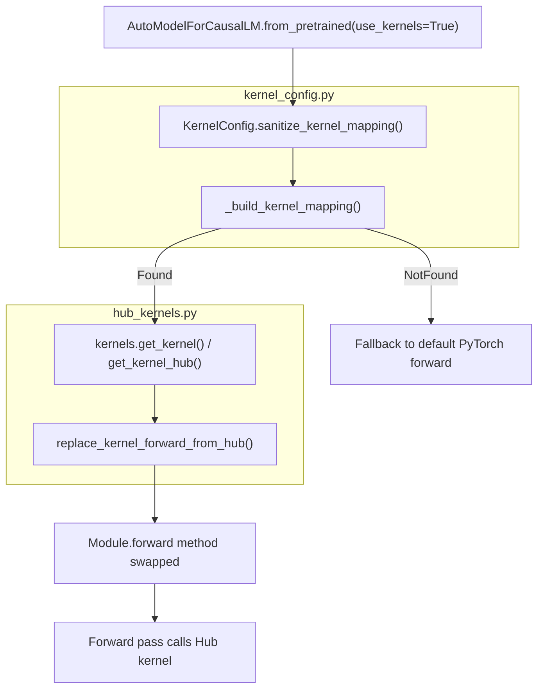
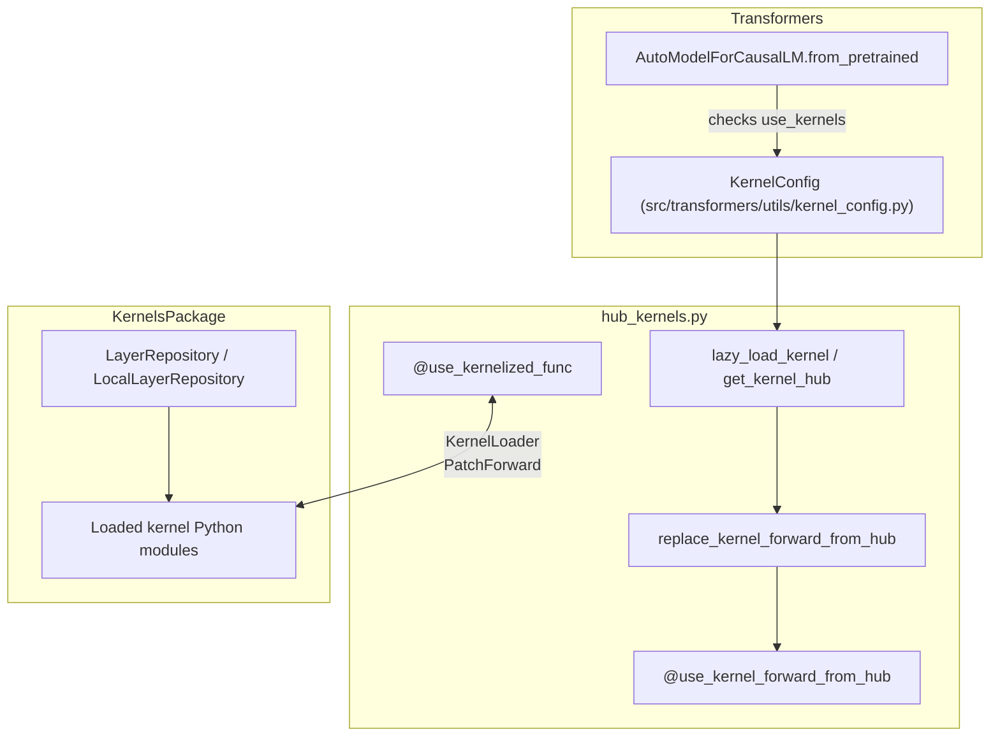

<!-- source: DeepWiki mcp.deepwiki.com · repo huggingface/transformers · page 9.2 Hub Kernels & Custom Kernel Loading · fetched 2026-10-26 -->

# Hub Kernels & Custom Kernel Loading

<details>
<summary>Relevant source files</summary>

The following files were used as context for generating this wiki page:

- [docs/source/en/main_classes/peft.md](docs/source/en/main_classes/peft.md)
- [docs/source/en/peft.md](docs/source/en/peft.md)
- [docs/source/en/perf_infer_gpu_multi.md](docs/source/en/perf_infer_gpu_multi.md)
- [docs/source/en/tensor_parallelism.md](docs/source/en/tensor_parallelism.md)
- [docs/source/zh/perf_infer_gpu_multi.md](docs/source/zh/perf_infer_gpu_multi.md)
- [src/transformers/conversion_mapping.py](src/transformers/conversion_mapping.py)
- [src/transformers/core_model_loading.py](src/transformers/core_model_loading.py)
- [src/transformers/integrations/accelerate.py](src/transformers/integrations/accelerate.py)
- [src/transformers/integrations/compressed_tensors.py](src/transformers/integrations/compressed_tensors.py)
- [src/transformers/integrations/deepgemm.py](src/transformers/integrations/deepgemm.py)
- [src/transformers/integrations/finegrained_fp8.py](src/transformers/integrations/finegrained_fp8.py)
- [src/transformers/integrations/hub_kernels.py](src/transformers/integrations/hub_kernels.py)
- [src/transformers/integrations/moe.py](src/transformers/integrations/moe.py)
- [src/transformers/integrations/npu_flash_attention.py](src/transformers/integrations/npu_flash_attention.py)
- [src/transformers/integrations/peft.py](src/transformers/integrations/peft.py)
- [src/transformers/integrations/sonicmoe.py](src/transformers/integrations/sonicmoe.py)
- [src/transformers/integrations/tensor_parallel.py](src/transformers/integrations/tensor_parallel.py)
- [src/transformers/modeling_flash_attention_utils.py](src/transformers/modeling_flash_attention_utils.py)
- [src/transformers/modeling_utils.py](src/transformers/modeling_utils.py)
- [src/transformers/quantizers/quantizer_finegrained_fp8.py](src/transformers/quantizers/quantizer_finegrained_fp8.py)
- [src/transformers/utils/generic.py](src/transformers/utils/generic.py)
- [src/transformers/utils/kernel_config.py](src/transformers/utils/kernel_config.py)
- [tests/integrations/test_moe.py](tests/integrations/test_moe.py)
- [tests/kernels/test_deepgemm.py](tests/kernels/test_deepgemm.py)
- [tests/kernels/test_finegrained_fp8.py](tests/kernels/test_finegrained_fp8.py)
- [tests/kernels/test_kernels.py](tests/kernels/test_kernels.py)
- [tests/kernels/test_sonicmoe.py](tests/kernels/test_sonicmoe.py)
- [tests/kernels/test_utils.py](tests/kernels/test_utils.py)
- [tests/peft_integration/test_peft_integration.py](tests/peft_integration/test_peft_integration.py)
- [tests/quantization/finegrained_fp8/test_fp8.py](tests/quantization/finegrained_fp8/test_fp8.py)
- [tests/tensor_parallel/test_tensor_parallel.py](tests/tensor_parallel/test_tensor_parallel.py)
- [tests/test_modeling_common.py](tests/test_modeling_common.py)
- [tests/utils/test_core_model_loading.py](tests/utils/test_core_model_loading.py)
- [tests/utils/test_generic.py](tests/utils/test_generic.py)
- [tests/utils/test_modeling_utils.py](tests/utils/test_modeling_utils.py)

</details>


The Hub Kernels system enables the Hugging Face Transformers library to dynamically load optimized CUDA, ROCm, Triton, and other platform-specific kernels directly from the Hugging Face Hub at runtime. This approach provides seamless access to high-performance custom implementations such as FlashAttention, specialized linear layers, Mixture-of-Experts (MoE) kernels, and hardware-specific accelerations (e.g., Ascend NPU), without requiring end users to manually compile or install complex dependencies locally.

This page covers the technical implementation details of the `hub_kernels.py` integration, core decorators for kernel loading, the `KernelConfig` mechanism for managing kernel mappings, hardware platform considerations including NPU/ROCm support, and kernel loading strategies.

---

## Overview and Purpose

The `hub_kernels.py` module located at `src/transformers/integrations/hub_kernels.py` provides the integration layer for runtime loading and dispatch of Hub-hosted kernels [src/transformers/integrations/hub_kernels.py:14-135]().

Key design goals include:

- **Dynamic kernel dispatch:** Swap module `forward` methods and functional implementations on-the-fly with high-performance Hub kernels for supported hardware platforms and models.
- **Flexible kernel mappings:** Manage kernel-to-layer associations via a mapping cache with device, mode (train/infer), versioning, and trusted remote code options.
- **Kernel availability gating:** Enable or disable kernel usage globally through environment variables such as `USE_HUB_KERNELS` [src/transformers/integrations/hub_kernels.py:62-64]().
- **Platform adaptation:** Support NVIDIA CUDA, AMD ROCm, Ascend NPU, Intel XPU, and other backends with identification of device capabilities.
- **Kernel isolation:** Lazy loading kernels so importing transformers or pipeline does not instantiate repositories; kernel repositories are constructed only when opted-in via `use_kernels=True` [src/transformers/integrations/hub_kernels.py:137-142]().
- **Backward compatibility:** Deprecated APIs supported with warnings and clear upgrade paths [src/transformers/integrations/hub_kernels.py:125-136]().

Sources:
- [src/transformers/integrations/hub_kernels.py:14-135]()
- [src/transformers/integrations/hub_kernels.py:62-64]()
- [src/transformers/integrations/hub_kernels.py:137-142]()
- [src/transformers/integrations/hub_kernels.py:125-136]()

---

## Architecture and Data Flow

The interaction flow for kernel loading and substitution is orchestrated through several core code entities:

1. **Kernel Mapping Lookup:** On model load with `use_kernels=True`, the `KernelConfig` instance queries the kernel mapping to find a matching kernel repository per model layer name, device, and mode [src/transformers/utils/kernel_config.py:99-157]().
2. **Kernel Loading:** The kernel bundle is lazily fetched and imported from Hub repositories via calls to the `kernels` library APIs like `get_kernel` and `replace_kernel_forward_from_hub` [src/transformers/integrations/hub_kernels.py:83-135]().
3. **Forward Method Replacement:** The `@use_kernel_forward_from_hub` decorator marks target model modules for kernel substitution, replacing the `forward` method with the Hub kernel implementation [src/transformers/integrations/hub_kernels.py:105-113]().
4. **Function Wrapping:** Functional operators are wrapped via `@use_kernelized_func` [src/transformers/integrations/hub_kernels.py:114-124]().
5. **Runtime Dispatching:** Model forward passes invoke the loaded kernel functions with fallbacks to PyTorch implementations if disabled or unavailable.

### Diagram: Hub Kernel Dispatch Flow (Code Entity Space)



Sources:
- [src/transformers/utils/kernel_config.py:99-157]()
- [src/transformers/integrations/hub_kernels.py:83-135]()
- [src/transformers/integrations/hub_kernels.py:105-113]()
- [src/transformers/integrations/hub_kernels.py:114-124]()

---

## Core Decorators and APIs

### `@use_kernel_forward_from_hub`

A decorator for `torch.nn.Module` classes that replaces their `forward` method at runtime with an optimized kernel loaded from the Hub repository [src/transformers/integrations/hub_kernels.py:106-113](). 

- It checks if kernel usage is enabled globally (`USE_HUB_KERNELS` environment variable).
- If disabled or if the `kernels` package is unavailable, logs a single warning and returns the class unmodified.
- When enabled, calls into the `kernels` package's `use_kernel_forward_from_hub` to perform the actual substitution.

This decorator enables modular acceleration of frequently used layers, e.g., RMSNorm and specialized MLPs, transparently.

### `@use_kernelized_func`

A decorator for functions implementing kernelizable operations, such as attention components or recurrent steps [src/transformers/integrations/hub_kernels.py:115-124](). 

- Accepts either a single callable or a list of callables.
- When kernels are enabled, performs kernelization via the `kernels` package `use_kernelized_func`.
- Otherwise, it is a no-op and logs a warning once.

Sources:
- [src/transformers/integrations/hub_kernels.py:106-113]()
- [src/transformers/integrations/hub_kernels.py:115-124]()

---

## KernelConfig: Managing Kernel Mappings

The `KernelConfig` class in `src/transformers/utils/kernel_config.py` encapsulates the mapping between Transformer layer names and their corresponding kernel repositories, keyed by device and execution mode (training or inference) [src/transformers/utils/kernel_config.py:94-137]().

### Core Responsibilities

- **Maintaining kernel mappings:** Stores a dictionary associating layer names to device-specific kernel repositories defined by remote Hub repository ID, layer name, version, revision, and trust flags [src/transformers/utils/kernel_config.py:100-115]().
- **Support for local or remote kernels:** Via `add_to_mapping_local` for local filesystem repositories or `add_to_mapping` for Hub repositories [src/transformers/utils/kernel_config.py:48-87]().
- **Registering kernel-capable layers:** Scans `model.named_modules()` to detect registered kernel layers either as function sets (`_kernel_funcs`) or marked classes (`kernel_layer_name`) [src/transformers/utils/kernel_config.py:117-137]().
- **Validating mappings:** Ensures mappings only reference registered layers and follow acceptable formats for devices, versions, revisions, and repository naming conventions [src/transformers/utils/kernel_config.py:128-181]().

The class also supports flags for using local kernels and inheriting default mappings to flexibly compose kernel loading strategies.

Sources:
- [src/transformers/utils/kernel_config.py:94-137]()
- [src/transformers/utils/kernel_config.py:100-115]()
- [src/transformers/utils/kernel_config.py:48-87]()
- [src/transformers/utils/kernel_config.py:117-137]()
- [src/transformers/utils/kernel_config.py:128-181]()

---

## Hardware and Platform Integration

The Hub kernel infrastructure supports diverse hardware backends:

### CUDA / NVIDIA GPUs

- The predominant platform, with kernels optimized for CUDA devices detected via PyTorch device queries.
- Supports fine-grained architectural capabilities including Hopper (SM90) and Blackwell (SM100) GPU series [src/transformers/integrations/finegrained_fp8.py:36]().
- Kernels like FlashAttention and DeepGEMM are conditionally loaded according to device capabilities.

### ROCm / AMD GPUs

- Detected with `is_rocm_platform()` checks [src/transformers/modeling_flash_attention_utils.py:28]().
- Supports specialized kernels including a rotor embedding kernel loaded from `kernels-community/aiter-rope` [src/transformers/integrations/hub_kernels.py:168]().
- ROCm kernel variants conditionally selected in the kernel mappings.

### Ascend NPU

- Kernel loading for Ascend NPU hardware integrates FlashAttention2 kernels facilitated via `integrations/npu_flash_attention.py` [src/transformers/modeling_flash_attention_utils.py:32]().

### Intel XPU and Other Backends

- Supported devices include `"cuda"`, `"rocm"`, `"xpu"`, `"npu"`, `"neuron"`, and `"tpu"` [src/transformers/utils/kernel_config.py:53-54]().
- Environment variables such as `USE_HUB_KERNELS` control activation of kernel loading uniformly across platforms.

This multi-platform support ensures maximum performance portability for large models across heterogeneous infrastructure.

Sources:
- [src/transformers/integrations/finegrained_fp8.py:36]()
- [src/transformers/modeling_flash_attention_utils.py:28]()
- [src/transformers/integrations/hub_kernels.py:168]()
- [src/transformers/modeling_flash_attention_utils.py:32]()
- [src/transformers/utils/kernel_config.py:53-54]()

---

## FlashAttention Kernel Fallbacks

When local compiled versions of popular kernels are unavailable, the system falls back to Hub-hosted kernels as specified in `modeling_flash_attention_utils.py` [src/transformers/modeling_flash_attention_utils.py:66-72]().

Example mappings include:

| Attention Implementation | Hub Repository                  | Notes                          |
|--------------------------|--------------------------------|--------------------------------|
| `flash_attention_2`       | `kernels-community/flash-attn2` | Standard FlashAttention v2     |
| `flash_attention_3`       | `kernels-community/vllm-flash-attn3` or `kernels-community/aiter-flash-attn` (ROCm) | FlashAttention v3 variants     |
| `flash_attention_4`       | `kernels-community/flash-attn4` | Latest FlashAttention v4       |

These mappings enable transparent usage of the latest high-perf attention backends without requiring local build overhead.

Sources:
- [src/transformers/modeling_flash_attention_utils.py:66-72]()

---

## Internal Kernel Path Mappings

The `hub_kernels.py` module maintains `_KERNELS_INTERNAL_PATH_MAPPINGS` to map canonical kernel names to internal package paths for Triton or CUDA kernels [src/transformers/integrations/hub_kernels.py:67-77]():

```python
_KERNELS_INTERNAL_PATH_MAPPINGS = {
    "chunk_kda": "ops.kda",
    "fused_recurrent_kda": "ops.kda",
    "chunk_gated_delta_rule": "ops.gated_delta_rule",
    "fused_recurrent_gated_delta_rule": "ops.gated_delta_rule",
    "mamba_split_conv1d_scan_combined": "ops.triton.ssd_combined",
    "selective_state_update": "ops.triton.selective_state_update",
    "mamba_chunk_scan_combined": "ops.triton.ssd_combined",
    "mamba_inner_fn": "ops.selective_scan_interface",
    "selective_scan_fn": "ops.selective_scan_interface",
}
```

This mapping is used internally by the `kernels` package to resolve the proper kernel implementation files during runtime loading and dispatch.

Sources:
- [src/transformers/integrations/hub_kernels.py:67-77]()

---

## Example Usage in Models

Several models use the decorators from `hub_kernels.py` to transparently swap in Hub kernels:

- **GptOss model (GPT Open Source):**

  ```python
  @use_kernel_forward_from_hub("RMSNorm")
  class GptOssRMSNorm(nn.Module):
      ...
  ```

- **GptOss Mixture-of-Experts MLP:**

  ```python
  @use_kernel_forward_from_hub("MegaBlocksMoeMLP")
  class GptOssMLP(nn.Module):
      ...
  ```

- **OpenAIPrivacyFilter model RMSNorm and rotary embedding:**

  ```python
  @use_kernel_forward_from_hub("RMSNorm")
  class OpenAIPrivacyFilterRMSNorm(nn.Module):
      ...
  
  @use_kernel_forward_from_hub("rotary_pos_emb")
  def apply_rotary_pos_emb(q, k, cos, sin, unsqueeze_dim=1):
      ...
  ```

These examples illustrate replacing critical computational components with fast kernels loaded at runtime.

Sources:
- [src/transformers/integrations/hub_kernels.py]()

---

## Testing and Validation

The `tests/kernels/test_kernels.py` suite performs end-to-end integration tests validating the Hub kernel loading and patching system:

- Loads models with and without kernel usage toggled via `use_kernels=True/False`.
- Verifies kernel forward outputs almost exactly match baseline models without kernels, allowing for small numerical tolerance [tests/test_modeling_common.py:161]().
- Tests ROCm-specific rotary embedding kernel against baseline to catch regressions.
- Ensures monkey patch mappings are cleared after tests to prevent cross-test contamination.

These tests confirm that kernel substitution is both functionally correct and transparent to users.

Sources:
- [tests/kernels/test_kernels.py]()
- [tests/test_modeling_common.py:161]()

---

# Summary Diagrams: Bridging Concepts to Code Entities

### Natural Language ↔ Hub Kernels System

```mermaid
graph LR
    A["User: Enable optimized model inference\nvia use_kernels=True"] --> B["Transformers Model Loading\n(AutoModelForCausalLM)"]
    B --> C["KernelConfig: kernel_mapping registry"]
    C --> D["Kernel repository config:\nlayer_name, device, repo_id, version"]
    D --> E["Hub Download via kernels.get_kernel"]
    E --> F["Runtime module forward\nmethod replacement @use_kernel_forward_from_hub"]
    F --> G["Optimized CUDA/Triton kernels\n(FlashAttention, MoE, Rotary Embeddings)"]
    G --> H["Hardware abstraction\n(CUDA, ROCm, NPU, XPU)"]
```



### Code Entities Interaction



---

# References and Sources

- [src/transformers/integrations/hub_kernels.py:14-135]()
- [src/transformers/integrations/hub_kernels.py:67-77]()
- [src/transformers/utils/kernel_config.py:48-157]()
- [src/transformers/utils/kernel_config.py:89-181]()
- [src/transformers/modeling_flash_attention_utils.py:64-72]()
- [src/transformers/integrations/finegrained_fp8.py:36]()
- [src/transformers/modeling_flash_attention_utils.py:28]()
- [src/transformers/integrations/hub_kernels.py:168]()
- [src/transformers/modeling_flash_attention_utils.py:32]()
- [src/transformers/utils/kernel_config.py:53-54]()
- [tests/kernels/test_kernels.py]()
- [tests/test_modeling_common.py:161]()

This concludes the detailed technical documentation on the Hugging Face Transformers Hub Kernels & Custom Kernel Loading system.

---

