# Page: Overview

# Overview

<details>
<summary>Relevant source files</summary>

The following files were used as context for generating this wiki page:

- [MIGRATION_GUIDE_V5.md](MIGRATION_GUIDE_V5.md)
- [README.md](README.md)
- [docs/source/ar/_toctree.yml](docs/source/ar/_toctree.yml)
- [docs/source/ar/tasks/language_modeling.md](docs/source/ar/tasks/language_modeling.md)
- [docs/source/ar/tasks/masked_language_modeling.md](docs/source/ar/tasks/masked_language_modeling.md)
- [docs/source/ar/tasks/multiple_choice.md](docs/source/ar/tasks/multiple_choice.md)
- [docs/source/ar/tasks/sequence_classification.md](docs/source/ar/tasks/sequence_classification.md)
- [docs/source/ar/tasks/summarization.md](docs/source/ar/tasks/summarization.md)
- [docs/source/ar/tasks/token_classification.md](docs/source/ar/tasks/token_classification.md)
- [docs/source/ar/tasks/translation.md](docs/source/ar/tasks/translation.md)
- [docs/source/en/_toctree.yml](docs/source/en/_toctree.yml)
- [docs/source/en/index.md](docs/source/en/index.md)
- [docs/source/en/main_classes/pipelines.md](docs/source/en/main_classes/pipelines.md)
- [docs/source/en/tasks/sequence_classification.md](docs/source/en/tasks/sequence_classification.md)
- [docs/source/ja/main_classes/pipelines.md](docs/source/ja/main_classes/pipelines.md)
- [docs/source/ko/main_classes/pipelines.md](docs/source/ko/main_classes/pipelines.md)
- [docs/source/ko/tasks/sequence_classification.md](docs/source/ko/tasks/sequence_classification.md)
- [docs/source/pt/tasks/sequence_classification.md](docs/source/pt/tasks/sequence_classification.md)
- [docs/source/ro/pipeline_tutorial.md](docs/source/ro/pipeline_tutorial.md)
- [docs/source/zh/main_classes/pipelines.md](docs/source/zh/main_classes/pipelines.md)
- [docs/source/zh/tasks/sequence_classification.md](docs/source/zh/tasks/sequence_classification.md)
- [src/transformers/__init__.py](src/transformers/__init__.py)
- [src/transformers/models/__init__.py](src/transformers/models/__init__.py)
- [src/transformers/models/auto/auto_mappings.py](src/transformers/models/auto/auto_mappings.py)
- [src/transformers/models/auto/configuration_auto.py](src/transformers/models/auto/configuration_auto.py)
- [src/transformers/models/auto/feature_extraction_auto.py](src/transformers/models/auto/feature_extraction_auto.py)
- [src/transformers/models/auto/image_processing_auto.py](src/transformers/models/auto/image_processing_auto.py)
- [src/transformers/models/auto/modeling_auto.py](src/transformers/models/auto/modeling_auto.py)
- [src/transformers/models/auto/processing_auto.py](src/transformers/models/auto/processing_auto.py)
- [src/transformers/models/auto/tokenization_auto.py](src/transformers/models/auto/tokenization_auto.py)
- [src/transformers/models/cohere/tokenization_cohere.py](src/transformers/models/cohere/tokenization_cohere.py)
- [src/transformers/utils/dummy_pt_objects.py](src/transformers/utils/dummy_pt_objects.py)
- [utils/check_auto.py](utils/check_auto.py)
- [utils/check_config_attributes.py](utils/check_config_attributes.py)
- [utils/check_repo.py](utils/check_repo.py)

</details>


The Hugging Face Transformers library provides thousands of pretrained models spanning modalities such as text, vision, audio, video, and multimodal tasks. Its primary purpose is to offer a unified, flexible, and extensible API for the entire model lifecycle: loading, training, fine-tuning, generation, and exporting state-of-the-art machine learning models. The library emphasizes modular code organization, readability, and performance through a "single-file-per-model" design philosophy that favors composition over complex inheritance or abstraction. This approach encourages ease of use, maintainability, and seamless integration with multiple frameworks and deployment targets [README.md:70-84]().

## Design Philosophy

The main design principles of the Transformers library are:

- **Ease of Use:** The library exposes high-level abstractions such as the `pipeline()` API, which simplifies performing common tasks such as text generation, classification, and object detection with minimal code, while allowing advanced users to customize all aspects of model configuration and execution [src/transformers/__init__.py:141-173]().

- **Performance and Scalability:** Transformers integrates deeply with optimized attention backends (e.g., Flash Attention, SDPA), quantization methods (BitsAndBytes, GPTQ, AWQ), and distributed training frameworks (DeepSpeed, FSDP, Accelerate) to maximize throughput and reduce resource usage during both training and inference [src/transformers/__init__.py:46-55]().

- **Hackability and Modularity:** Models are organized in isolated subdirectories under `src/transformers/models/`. Each model consists of configuration, model code, tokenizer, and processor files. This self-contained, compositional structure makes it simple to add new architectures or customize existing ones without impacting the global codebase [src/transformers/models/__init__.py:1-210]().

- **Ecosystem Integration:** Transformers acts as a central hub interoperable with related libraries such as PEFT (Parameter-Efficient Fine-Tuning) and Accelerate (device mapping and deployment), and supports multiple export formats (ONNX, ExecuTorch) for flexible deployment pipelines [README.md:73-76]().

For a detailed discussion of these design decisions, including the v5 migration rationale, single-file-per-model philosophy, and the dynamic weight loading API, see the child page **[Design Philosophy & V5 Migration Guide](#1.2)**.

## Key Subsystems Overview

The library is structured into core subsystems that encompass the full model lifecycle, from loading and preprocessing to generation, training, and deployment:

### 1. Model and Configuration

All models inherit from the `PreTrainedConfig` base class, standardizing the lifecycle of loading pretrained weights (`from_pretrained`) and saving models (`save_pretrained`). The paired `PreTrainedConfig` class defines hyperparameters and model architecture, supporting JSON serialization for reproducibility. This abstraction allows seamless swapping and interoperability among models and configurations across tasks and modalities [src/transformers/__init__.py:66-66](), [src/transformers/configuration_utils.py:23-23]().

### 2. Auto Factories and Lazy Loading

"Auto" classes like `AutoModel`, `AutoConfig`, `AutoTokenizer`, `AutoImageProcessor`, and `AutoProcessor` provide user-friendly factory-like APIs that resolve string model identifiers (e.g., `"bert-base-uncased"`) to concrete model, tokenizer, or processor classes. These employ lazy loading mechanics such as `_LazyAutoMapping` and `_LazyModule` to defer expensive imports until strictly necessary, optimizing startup time and resource footprint. The mappings are held in dictionaries like `MODEL_MAPPING_NAMES`, `CONFIG_MAPPING_NAMES`, and `TOKENIZER_MAPPING_NAMES`, defined in `modeling_auto.py`, `configuration_auto.py`, and `tokenization_auto.py` respectively [src/transformers/models/auto/modeling_auto.py:41-176](), [src/transformers/models/auto/configuration_auto.py:36-44](), [src/transformers/models/auto/tokenization_auto.py:64-135]().

### 3. Input Processing

Raw inputs—text, images, audio, and videos—are converted into model-ready tensors via tokenizers, feature extractors, image/audio processors, and processors. The system uses shared mixins such as `ProcessorMixin` to unify preprocessing, normalization, padding, and batching operations. This design supports multimodal pipelines and composite models (e.g., LLaVA, Qwen2-VL) effectively [src/transformers/__init__.py:178-181](), [src/transformers/models/auto/image_processing_auto.py:71-119]().

### 4. Text Generation

Models that support generation mix in `GenerationMixin`, which provides the flexible `generate()` method. This method implements a range of decoding algorithms including greedy search, beam search, contrastive search, speculative decoding, and supports streaming output. Behavior is controlled by `GenerationConfig` settings enabling fine-grained customization of the generation process [src/transformers/__init__.py:113-122]().

### 5. Training and Optimization

The `Trainer` class offers a comprehensive and extensible training loop with features like automatic mixed precision, gradient accumulation, checkpointing, evaluation, and distributed training across GPUs or clusters. It is configured via `TrainingArguments` and supports plugins via `TrainerCallback`. Optimization utilities include implementations of optimizers such as AdamW and Adafactor, as well as learning rate schedulers [docs/source/en/_toctree.yml:181-185](), [docs/source/en/_toctree.yml:187-200]().

## System Architecture: Bridging Concepts with Code Entities

### Pipeline to Model Loading Resolution Flow

This diagram illustrates how a user’s call to the high-level pipeline API resolves into concrete model class instantiation and checkpoint loading within the codebase:

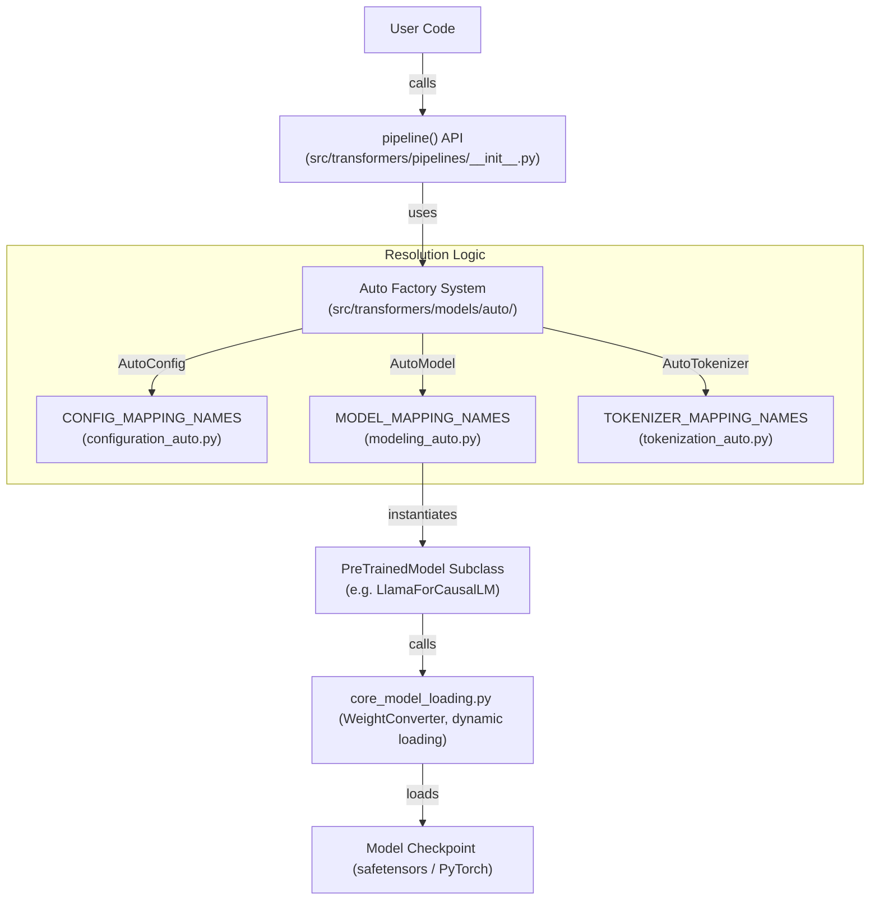

### Trainer Subsystem Interaction

This diagram shows the `Trainer` class’s orchestration of training, linking training arguments, callbacks, data collation, and optimization components:

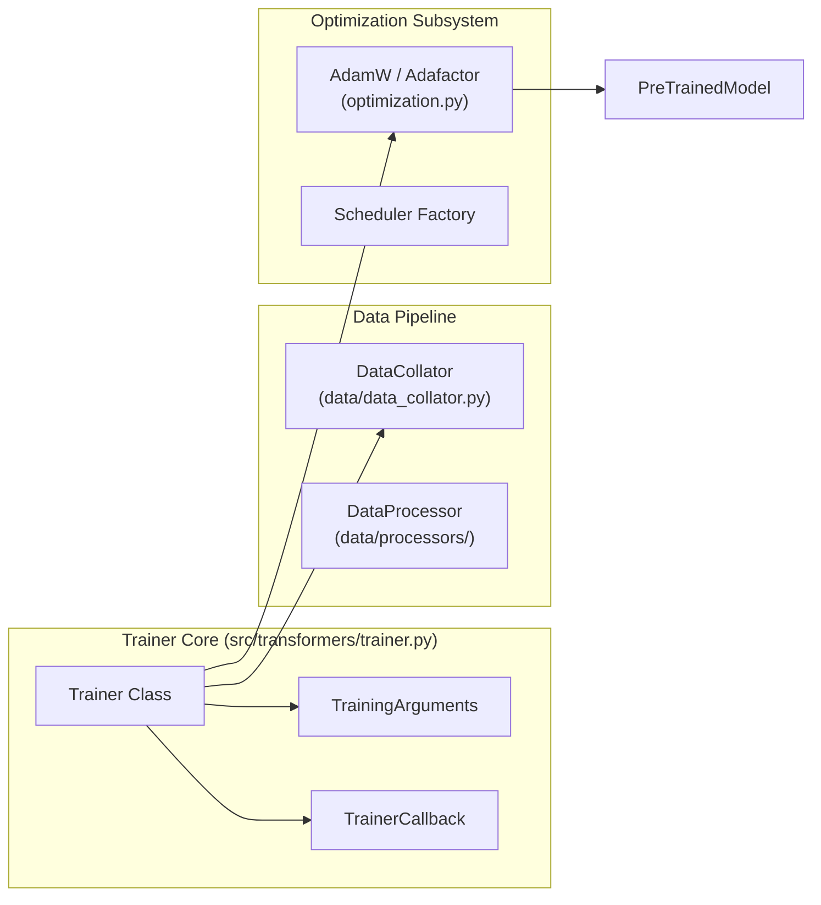

### Mapping Pipelines and Model Loading: Natural Language to Code Entities

```mermaid
graph TB
    PL[Pipeline API] --> AF[Auto Factory (AutoModel, AutoTokenizer, AutoConfig)]
    AF --> MM["MODEL_MAPPING_NAMES (models/auto/modeling_auto.py)"]
    AF --> TM["TOKENIZER_MAPPING_NAMES (models/auto/tokenization_auto.py)"]
    AF --> CM["CONFIG_MAPPING_NAMES (models/auto/configuration_auto.py)"]
    MM --> PTM[PreTrainedModel subclasses (modeling_utils.py)]
    PTM --> WC[WeightConverter (core_model_loading.py)]
    WC --> CKPT[Checkpoint files (safetensors, .bin)]
```

### Trainer and TrainingArgs Relationship: Natural Language to Code Entities

```mermaid
graph TB
    U["User Script"] --> TR[Trainer (trainer.py)]
    TR --> TA[TrainingArguments (training_args.py)]
    TR --> TC[TrainerCallback (trainer_callback.py)]
    TR --> DC[DataCollator (data/data_collator.py)]
    TR --> OPT[Optimizer classes (optimization.py)]
    TR --> MD[PreTrainedModel]
```

## Exploration Guide to Child Pages

For detailed technical guidance and usage instructions, please see the following child pages:

- **[Getting Started & Installation](#1.1)**: Installation instructions and dependency setup including optional extras (torch, vision, audio, quality). Demonstrates running your first inference with the `pipeline()` API. Covers `setup.py`, `pyproject.toml`, and the dependency version matrix.

- **[Design Philosophy & V5 Migration Guide](#1.2)**: Deep dive into the library’s core design rationales such as the single-file-per-model philosophy, composition-over-abstraction, the removal of TensorFlow/JAX in v5, and the dynamic loading of weights. Discusses `MIGRATION_GUIDE_V5.md` and `CONTRIBUTING.md`.

- **[Documentation Structure & Translations](#1.3)**: Explanation of the documentation tree layout using `_toctree.yml` per language, the `model_doc` documentation standard, internationalization (i18n) with translated READMEs, and doc-building workflows.

These child pages provide practical and conceptual details for onboarding, contributing, and advanced usage of the Transformers library.

---

**Sources:**
[README.md:70-84](), [src/transformers/__init__.py:141-173](), [src/transformers/__init__.py:46-55](), [src/transformers/models/__init__.py:1-210](), [README.md:73-76](), [src/transformers/__init__.py:66-66](), [src/transformers/configuration_utils.py:23-23](), [src/transformers/models/auto/modeling_auto.py:41-176](), [src/transformers/models/auto/configuration_auto.py:36-44](), [src/transformers/models/auto/tokenization_auto.py:64-135](), [src/transformers/__init__.py:178-181](), [src/transformers/models/auto/image_processing_auto.py:71-119](), [src/transformers/__init__.py:113-122](), [docs/source/en/_toctree.yml:181-185](), [docs/source/en/_toctree.yml:187-200]()

---

# Page: Getting Started & Installation

# Getting Started & Installation

<details>
<summary>Relevant source files</summary>

The following files were used as context for generating this wiki page:

- [.circleci/config.yml](.circleci/config.yml)
- [.circleci/create_circleci_config.py](.circleci/create_circleci_config.py)
- [conftest.py](conftest.py)
- [docs/source/en/chat_templating.md](docs/source/en/chat_templating.md)
- [docs/source/en/conversations.md](docs/source/en/conversations.md)
- [docs/source/en/generation_strategies.md](docs/source/en/generation_strategies.md)
- [docs/source/en/llm_tutorial.md](docs/source/en/llm_tutorial.md)
- [docs/source/en/model_doc/pix2struct.md](docs/source/en/model_doc/pix2struct.md)
- [docs/source/en/quicktour.md](docs/source/en/quicktour.md)
- [docs/source/en/tasks/language_modeling.md](docs/source/en/tasks/language_modeling.md)
- [docs/source/en/tasks/masked_language_modeling.md](docs/source/en/tasks/masked_language_modeling.md)
- [docs/source/es/chat_templating.md](docs/source/es/chat_templating.md)
- [docs/source/es/tasks/language_modeling.md](docs/source/es/tasks/language_modeling.md)
- [docs/source/ja/chat_templating.md](docs/source/ja/chat_templating.md)
- [docs/source/ja/tasks/masked_language_modeling.md](docs/source/ja/tasks/masked_language_modeling.md)
- [docs/source/ko/tasks/masked_language_modeling.md](docs/source/ko/tasks/masked_language_modeling.md)
- [docs/source/zh/chat_templating.md](docs/source/zh/chat_templating.md)
- [pyproject.toml](pyproject.toml)
- [setup.py](setup.py)
- [src/transformers/dependency_versions_table.py](src/transformers/dependency_versions_table.py)
- [src/transformers/exporters/exporter_openvino.py](src/transformers/exporters/exporter_openvino.py)
- [src/transformers/models/neucodec/feature_extraction_neucodec.py](src/transformers/models/neucodec/feature_extraction_neucodec.py)
- [src/transformers/models/neucodec/modular_neucodec.py](src/transformers/models/neucodec/modular_neucodec.py)
- [src/transformers/models/pix2struct/__init__.py](src/transformers/models/pix2struct/__init__.py)
- [tests/conftest_tests/test_cache_fallback.py](tests/conftest_tests/test_cache_fallback.py)
- [tests/models/pix2struct/test_image_processing_pix2struct.py](tests/models/pix2struct/test_image_processing_pix2struct.py)
- [tests/repo_utils/test_check_noisy_comments.py](tests/repo_utils/test_check_noisy_comments.py)
- [tests/repo_utils/test_tests_fetcher.py](tests/repo_utils/test_tests_fetcher.py)
- [tests/utils/test_testing_utils.py](tests/utils/test_testing_utils.py)
- [utils/check_noisy_comments.py](utils/check_noisy_comments.py)
- [utils/get_pr_run_slow_jobs.py](utils/get_pr_run_slow_jobs.py)
- [utils/tests_fetcher.py](utils/tests_fetcher.py)

</details>


This page provides a technical overview of how to set up the Hugging Face Transformers library, manage its extensive dependency graph, configure optional extras for different modalities, and run your first inference using the high-level `pipeline` API. It covers the implementation details of `setup.py`, the `pyproject.toml` configuration, the dependency versioning scheme, and a walkthrough of the initial model inference flow.

---

## Environment Setup & Supported Python Versions

Transformers supports **Python 3.10 through 3.14**, with explicit range definitions enforced during package configuration in `setup.py` [setup.py:50-51](). At startup, the module checks `sys.version_info` [setup.py:53]() to determine minor versions and adapt optional features (such as audio backend dependencies). It is strongly recommended to use an isolated virtual environment (`venv` or `conda`) to manage dependencies due to the extensive third-party package requirements of the library.

Sources: `setup.py:50-54`

---

## Core Dependencies & Version Management

The core dependencies of the Transformers library are centrally declared in the `_deps` list inside `setup.py` [setup.py:69-164](). This list acts as the single source of truth for runtime and development requirements.

Key components from the core dependency list include:

| Dependency | Version Constraints | Purpose |
| --- | --- | --- |
| `python` | `>= 3.10.0` | Python runtime version range [setup.py:120]() |
| `torch` | `>= 2.5` | PyTorch deep learning backend [setup.py:150]() |
| `accelerate` | `>= 1.1.0` | Device dispatch and multi-GPU utilities [setup.py:74]() |
| `huggingface-hub` | `>= 1.31.0, < 3.0` | Hub integration, caching, and downloads [setup.py:90]() |
| `tokenizers` | `>= 0.23.1, < 0.24.0` | Fast Rust-based tokenization backend [setup.py:149]() |
| `datasets` | `>= 2.15.0` | Dataset loading and preprocessing [setup.py:79]() |
| `safetensors` | `>= 0.8.0` | Secure weight serialization format [setup.py:135]() |

When modifications are made to `_deps` in `setup.py`, running `make fix-repo` automatically synchronizes and regenerates the internal version lookup table located at `src/transformers/dependency_versions_table.py` [setup.py:69-72](). This autogenerated module maps package names to their version specification strings and is used at runtime for dependency validation [src/transformers/dependency_versions_table.py:1-91]().

### Dependency Versioning Flow

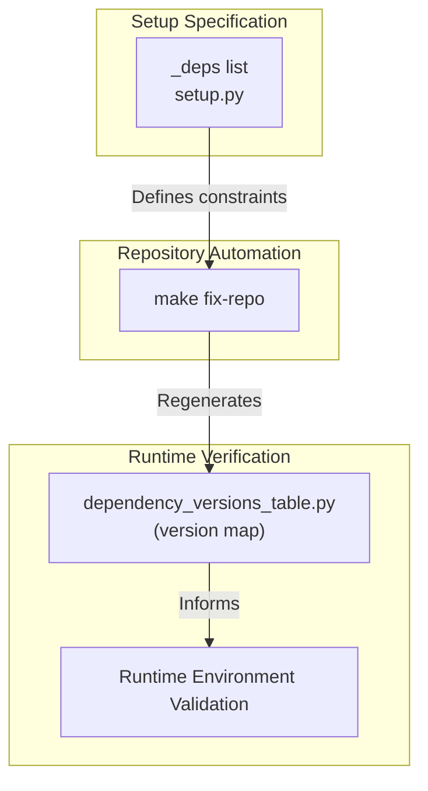

Sources: `setup.py:69-164`, `src/transformers/dependency_versions_table.py:1-91`

---

## Optional Extras Configuration

Transformers uses setuptools extras to organize optional dependencies into named groups. These groups allow users to selectively install modality-specific packages (such as vision, audio, or video tools) and development utilities.

The extras mapping is defined in the `extras` dictionary within `setup.py` [setup.py:175-192]() using the `deps_list()` helper [setup.py:171-173]().

| Extras Group | Included Packages & Dependencies | Description |
| --- | --- | --- |
| `torch` | `torch`, `accelerate` | Core PyTorch runtime and distribution support [setup.py:177]() |
| `vision` | `torchvision`, `Pillow` | Image loading and computer vision transformations [setup.py:178]() |
| `audio` | `torchaudio`, `librosa`, `pyctcdecode`, `phonemizer`, `kenlm` (if Python `< 13`) | Speech recognition and audio processing pipelines [setup.py:179-181]() |
| `video` | `av` | Video decoding and frame extraction utilities [setup.py:182]() |
| `quality` | `datasets`, `ruff`, `GitPython`, `urllib3`, `libcst`, `rich`, `ty`, `tomli`, `transformers-mlinter` | Code quality, linting, and static analysis suite [setup.py:184-186]() |
| `docs` | `hf-doc-builder` | Documentation generation and validation tools [setup.py:187]() |

### Example Installation Commands

Users can install specific extras using pip:

```bash
# Install core transformers with PyTorch support
pip install "transformers[torch]"

# Install with vision and audio capabilities
pip install "transformers[torch,vision,audio]"

# Install development environment with quality checks
pip install -e ".[quality]"
```

Sources: `setup.py:171-193`

---

## Repository Configuration & Tooling (`pyproject.toml`)

Development tools, linters, test options, and type checkers are configured in `pyproject.toml`. 

- **Coverage:** Configured under `[tool.coverage.run]` to track test coverage across the `transformers` package while omitting test conversion scripts [pyproject.toml:1-6]().
- **Ruff Linter:** Configured in `[tool.ruff]` with a line length of 119, targeting Python 3.10+, and enforcing specific lint rules (`E`, `F`, `I`, `W`, `UP`, `FURB`, `SIM`, `C4`, `C901`) [pyproject.toml:16-43](). It also defines per-file ignores for package `__init__.py` files [pyproject.toml:61-65]().
- **Pytest:** Configured under `[tool.pytest.ini_options]` with custom markers (`bitsandbytes`, `generate`, `is_training_test`, `is_tensor_parallel_test`, `is_fsdp_test`) and default environment variables like `HF_HUB_DOWNLOAD_TIMEOUT=60` [pyproject.toml:84-113]().
- **Type Checking (`ty`):** Suppresses specific false-positive rules for tensor operations and optional imports [pyproject.toml:115-134]().

Sources: `pyproject.toml:1-134`

---

## First Inference: Running Your First Pipeline

The high-level `pipeline()` API provides a zero-code-boilerplate interface for model inference across various modalities. It coordinates configuration resolution, model instantiation, and tokenizer loading automatically.

### Pipeline Creation & Inference Flow

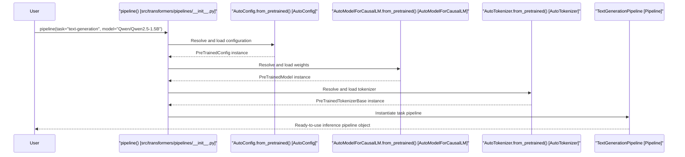

### Quickstart Example

Once installed, running text generation requires only a few lines of code:

```python
from transformers import pipeline

# Instantiate a text generation pipeline
generator = pipeline(task="text-generation", model="Qwen/Qwen2.5-1.5B")

# Execute inference
result = generator("The secret to baking is ")
print(result)
```

Sources: `docs/source/en/quicktour.md:149-157`, `src/transformers/pipelines/__init__.py`

---

# Sources

- `setup.py:1-193`
- `src/transformers/dependency_versions_table.py:1-91`
- `pyproject.toml:1-134`
- `docs/source/en/quicktour.md:149-157`

---

# Page: Design Philosophy & V5 Migration Guide

# Design Philosophy & V5 Migration Guide

<details>
<summary>Relevant source files</summary>

The following files were used as context for generating this wiki page:

- [.ai/AGENTS.md](.ai/AGENTS.md)
- [.ai/skills/add-or-fix-type-checking/SKILL.md](.ai/skills/add-or-fix-type-checking/SKILL.md)
- [.github/ISSUE_TEMPLATE/bug-report.yml](.github/ISSUE_TEMPLATE/bug-report.yml)
- [.github/ISSUE_TEMPLATE/migration.yml](.github/ISSUE_TEMPLATE/migration.yml)
- [.github/PULL_REQUEST_TEMPLATE.md](.github/PULL_REQUEST_TEMPLATE.md)
- [.github/scripts/codeowners_for_review_action](.github/scripts/codeowners_for_review_action)
- [.github/workflows/assign-reviewers.yml](.github/workflows/assign-reviewers.yml)
- [.github/workflows/check-workflow-permissions.yml](.github/workflows/check-workflow-permissions.yml)
- [.github/workflows/codeql.yml](.github/workflows/codeql.yml)
- [.github/workflows/trufflehog.yml](.github/workflows/trufflehog.yml)
- [.gitignore](.gitignore)
- [AGENTS.md](AGENTS.md)
- [CLAUDE.md](CLAUDE.md)
- [CONTRIBUTING.md](CONTRIBUTING.md)
- [MIGRATION_GUIDE_V5.md](MIGRATION_GUIDE_V5.md)
- [Makefile](Makefile)
- [docs/source/ar/_toctree.yml](docs/source/ar/_toctree.yml)
- [docs/source/ar/tasks/language_modeling.md](docs/source/ar/tasks/language_modeling.md)
- [docs/source/ar/tasks/masked_language_modeling.md](docs/source/ar/tasks/masked_language_modeling.md)
- [docs/source/ar/tasks/multiple_choice.md](docs/source/ar/tasks/multiple_choice.md)
- [docs/source/ar/tasks/sequence_classification.md](docs/source/ar/tasks/sequence_classification.md)
- [docs/source/ar/tasks/summarization.md](docs/source/ar/tasks/summarization.md)
- [docs/source/ar/tasks/token_classification.md](docs/source/ar/tasks/token_classification.md)
- [docs/source/ar/tasks/translation.md](docs/source/ar/tasks/translation.md)
- [docs/source/en/main_classes/pipelines.md](docs/source/en/main_classes/pipelines.md)
- [docs/source/en/models.md](docs/source/en/models.md)
- [docs/source/en/modular_transformers.md](docs/source/en/modular_transformers.md)
- [docs/source/en/philosophy.md](docs/source/en/philosophy.md)
- [docs/source/en/pr_checks.md](docs/source/en/pr_checks.md)
- [docs/source/en/tasks/sequence_classification.md](docs/source/en/tasks/sequence_classification.md)
- [docs/source/en/testing.md](docs/source/en/testing.md)
- [docs/source/es/pr_checks.md](docs/source/es/pr_checks.md)
- [docs/source/it/big_models.md](docs/source/it/big_models.md)
- [docs/source/it/pr_checks.md](docs/source/it/pr_checks.md)
- [docs/source/ja/big_models.md](docs/source/ja/big_models.md)
- [docs/source/ja/main_classes/model.md](docs/source/ja/main_classes/model.md)
- [docs/source/ja/main_classes/output.md](docs/source/ja/main_classes/output.md)
- [docs/source/ja/main_classes/pipelines.md](docs/source/ja/main_classes/pipelines.md)
- [docs/source/ja/main_classes/text_generation.md](docs/source/ja/main_classes/text_generation.md)
- [docs/source/ja/pr_checks.md](docs/source/ja/pr_checks.md)
- [docs/source/ko/main_classes/model.md](docs/source/ko/main_classes/model.md)
- [docs/source/ko/main_classes/pipelines.md](docs/source/ko/main_classes/pipelines.md)
- [docs/source/ko/model_doc/albert.md](docs/source/ko/model_doc/albert.md)
- [docs/source/ko/model_doc/code_llama.md](docs/source/ko/model_doc/code_llama.md)
- [docs/source/ko/model_doc/gpt2.md](docs/source/ko/model_doc/gpt2.md)
- [docs/source/ko/models.md](docs/source/ko/models.md)
- [docs/source/ko/pr_checks.md](docs/source/ko/pr_checks.md)
- [docs/source/ko/tasks/sequence_classification.md](docs/source/ko/tasks/sequence_classification.md)
- [docs/source/pt/tasks/sequence_classification.md](docs/source/pt/tasks/sequence_classification.md)
- [docs/source/ro/pipeline_tutorial.md](docs/source/ro/pipeline_tutorial.md)
- [docs/source/zh/_toctree.yml](docs/source/zh/_toctree.yml)
- [docs/source/zh/big_models.md](docs/source/zh/big_models.md)
- [docs/source/zh/generation_strategies.md](docs/source/zh/generation_strategies.md)
- [docs/source/zh/kernels.md](docs/source/zh/kernels.md)
- [docs/source/zh/main_classes/image_processor.md](docs/source/zh/main_classes/image_processor.md)
- [docs/source/zh/main_classes/model.md](docs/source/zh/main_classes/model.md)
- [docs/source/zh/main_classes/output.md](docs/source/zh/main_classes/output.md)
- [docs/source/zh/main_classes/pipelines.md](docs/source/zh/main_classes/pipelines.md)
- [docs/source/zh/main_classes/text_generation.md](docs/source/zh/main_classes/text_generation.md)
- [docs/source/zh/model_doc/bert.md](docs/source/zh/model_doc/bert.md)
- [docs/source/zh/perf_train_cpu.md](docs/source/zh/perf_train_cpu.md)
- [docs/source/zh/performance.md](docs/source/zh/performance.md)
- [docs/source/zh/philosophy.md](docs/source/zh/philosophy.md)
- [docs/source/zh/tasks/sequence_classification.md](docs/source/zh/tasks/sequence_classification.md)
- [src/transformers/_typing.py](src/transformers/_typing.py)
- [src/transformers/models/cohere/tokenization_cohere.py](src/transformers/models/cohere/tokenization_cohere.py)
- [src/transformers/safetensors_conversion.py](src/transformers/safetensors_conversion.py)
- [tests/repo_utils/test_checkers.py](tests/repo_utils/test_checkers.py)
- [utils/check_inits.py](utils/check_inits.py)
- [utils/check_reviewers.py](utils/check_reviewers.py)
- [utils/check_types.py](utils/check_types.py)
- [utils/checkers-requirements.txt](utils/checkers-requirements.txt)
- [utils/checkers.py](utils/checkers.py)
- [utils/get_test_reports.py](utils/get_test_reports.py)

</details>


This page documents the core architectural principles of the Hugging Face Transformers library, the significant breaking changes introduced in Version 5 (v5), and the technical implementations of the dynamic weight loading API and the modular transformers system. It also outlines key contributor guidelines for maintaining code quality, repository consistency, and agentic contribution policies.

---

## Design Philosophy

The Transformers library architecture is founded on three main design tenets aimed at maintainability, clarity, and extensibility at scale.

### 1. Single-File-per-Model (Legacy)

- Each model family is implemented entirely within a **single Python file** named `modeling_<model_name>.py` located under `src/transformers/models/<model_name>/` [docs/source/en/modular_transformers.md:18]().
- This *one-model-one-file* approach limits complex inheritance hierarchies and deep abstractions, making debugging straightforward and source navigation predictable.
- Variants and heads associated with the model (e.g., sequence classification, causal LM heads) are contained within the same file.
- This design ensures all model-related code is easy to locate and understand without jumping between scattered files.

Sources: 
[docs/source/en/modular_transformers.md:16-25]()

### 2. Composition over Over-Abstraction

- The library favors *composition* rather than deep class inheritance hierarchies.
- Specific model heads **do not** subclass the base model to extend behavior. Instead, they **compose** the base model by explicitly invoking it within their `forward()` methods.
- This results in shallow abstraction: a user-facing model class typically inherits only from a shared `PreTrainedModel` base, with minimal layers on top.
- This design reduces indirection, eases debugging, and improves code clarity.

Sources: 
[docs/source/en/modular_transformers.md:16-30]()

### 3. Explicit Code & Readability

- Avoids extensive use of `nn.Sequential` subclasses to enable easy breakpoint setting and debugging.
- Prioritizes clear, descriptive naming over terse abbreviations for variables and methods to improve readability.
- Accepts some level of code duplication within each single-model file if it provides self-containment and clarity.
- These design choices promote a codebase accessible to contributors of varying expertise and language backgrounds.

Sources: 
[docs/source/en/modular_transformers.md:18-45]()

---

## V5 Migration: Core Changes

Version 5 brings major architectural evolution, focusing on simplification, modernization, and maintainability.

### Removal of TensorFlow and JAX Support

- All **TensorFlow** and **JAX** implementations have been removed from the library [MIGRATION_GUIDE_V5.md:21-28]().
- Development is now fully concentrated on **PyTorch (`torch`)** as the single backend, significantly reducing maintenance overhead across model families [MIGRATION_GUIDE_V5.md:23-26]().
- External collaboration continues with JAX ecosystem projects, e.g., MaxText, but without direct JAX model support internally [MIGRATION_GUIDE_V5.md:24-26]().

Sources: 
[MIGRATION_GUIDE_V5.md:21-28]()

### Tokenizer Backend Consolidation

Before v5, tokenizers were implemented in parallel variants:
- **Slow tokenizers:** Python-based implementations, often backed by [SentencePiece](https://github.com/google/sentencepiece) [MIGRATION_GUIDE_V5.md:122-123]().
- **Fast tokenizers:** Rust-based implementations via the 🤗 [`tokenizers`](https://github.com/huggingface/tokenizers) library [MIGRATION_GUIDE_V5.md:124]().

With v5:
- Only **one tokenizer file per model** remains: `tokenization_<model>.py` [MIGRATION_GUIDE_V5.md:126]().
- This file dynamically selects and utilizes the best available backend:
  1. [`TokenizersBackend`](MIGRATION_GUIDE_V5.md:88) (preferred): Rust-based tokenizers from the 🤗 `tokenizers` library offering optimal performance and features [MIGRATION_GUIDE_V5.md:128-134]().
  2. [`SentencePieceBackend`](MIGRATION_GUIDE_V5.md:135): For tokenizers requiring `sentencepiece`, inheriting from `PythonBackend` [MIGRATION_GUIDE_V5.md:135]().
  3. [`PythonBackend`](MIGRATION_GUIDE_V5.md:136): Pure Python fallback implementation [MIGRATION_GUIDE_V5.md:136]().
  4. [`MistralCommonBackend`](MIGRATION_GUIDE_V5.md:137): Relies on `MistralCommon`'s tokenization library [MIGRATION_GUIDE_V5.md:137]().
- The [`AutoTokenizer`](MIGRATION_GUIDE_V5.md:139) factory automatically detects and loads the appropriate backend transparently [MIGRATION_GUIDE_V5.md:139]().

Sources: 
[MIGRATION_GUIDE_V5.md:120-140]()

---

## Dynamic Weight Loading API

A principal advancement in v5 is the new **dynamic weight loading API** that cleanly abstracts and modularizes weight transformations during checkpoint loading [MIGRATION_GUIDE_V5.md:30-38]().

### Motivation and `WeightConverter` Class

Traditionally, checkpoint loading contained ad-hoc logic for reshaping, merging, and splitting weights across various model architectures and parallelism schemes [MIGRATION_GUIDE_V5.md:32-37](). The new API models checkpoint weight transformations declaratively via the [`WeightConverter`](MIGRATION_GUIDE_V5.md:39) class [MIGRATION_GUIDE_V5.md:39-46]()]:

```python
class WeightConverter(WeightTransform):
    operations: list[ConversionOps]
    source_keys: Union[str, list[str]]
    target_keys: Union[str, list[str]]
```

- `source_keys`: Checkpoint keys where source tensors are read [MIGRATION_GUIDE_V5.md:44]().
- `target_keys`: Model keys where transformed tensors are assigned [MIGRATION_GUIDE_V5.md:45]().
- `operations`: A list of tensor `ConversionOps` like reshaping, concatenation, or splitting [MIGRATION_GUIDE_V5.md:43]().

### Example: Query-Key-Value Fusion

A common case fuses query, key, and value projection weights into a single combined matrix [MIGRATION_GUIDE_V5.md:47-51]()]:

```python
conversion = WeightConverter(
    ["self_attn.q_proj", "self_attn.k_proj", "self_attn.v_proj"],  # The input layers
    "self_attn.qkv_proj",  # The single layer as output
    operations=[Concatenate(dim=0)],
)
```

Sources: 
[MIGRATION_GUIDE_V5.md:30-75]()

### Diagram: Dynamic Weight Loading Flow (Code Entity Space)

Title: "WeightConverter Data Flow Architecture"

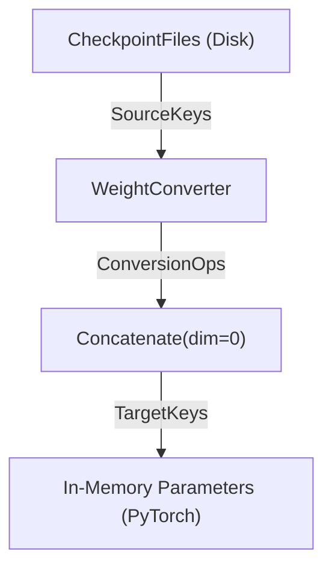

Sources: 
[MIGRATION_GUIDE_V5.md:30-75]()

---

## Modular Transformers System

The **modular transformers system** balances DRY principles with user simplicity by using code generation [docs/source/en/modular_transformers.md:16-21]().

### How it works

- Contributors write a **modular file** named `modular_<model>.py` inside `src/transformers/models/<name>/` [docs/source/en/modular_transformers.md:47]().
- This modular file **inherits** from existing models and overrides or extends only what differs [docs/source/en/modular_transformers.md:18-20]().
- An internal generator tool (`modular_model_converter.py`) automatically generates standalone legacy-style `modeling_<model>.py` and `configuration_<model>.py` files [docs/source/en/modular_transformers.md:20]().
- Users continue to consume the familiar single-file-per-model import style transparently [docs/source/en/modular_transformers.md:20]().
- Consistency checkers (`check_modular_conversion.py`) ensure generated files remain synchronized [Makefile:22]().

Sources: 
[docs/source/en/modular_transformers.md:16-50](), 
[Makefile:17-36]()

### Diagram: Modular Transformers Conversion Pipeline (Code Entity Space)

Title: "Modular Conversion Pipeline"

Image/Component Mapping:
- `modular_olmo2.py` -> `modular_model_converter.py` -> `modeling_olmo2.py` / `configuration_olmo2.py`

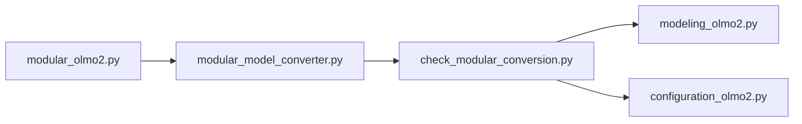

Sources: 
[docs/source/en/modular_transformers.md:16-50](), 
[Makefile:17-36]()

---

## Contributing Guidelines & Code Agent Policy

The repository maintains strict policies to ensure high quality and to avoid overwhelming maintainers, especially concerning automated code generation and pull request hygiene [CONTRIBUTING.md:19-27]().

### Code Agent Policy

- **First-time contributors must NOT submit PRs or issues generated by any language model or code agent [.github/PULL_REQUEST_TEMPLATE.md:17-22]()].**
- Autonomous bots or agents are prohibited from creating issues or pull requests [.github/PULL_REQUEST_TEMPLATE.md:21-22]().
- PRs suspected of being agent-generated are likely to be closed without review and may result in blocking the user [.github/PULL_REQUEST_TEMPLATE.md:23-27]().
- Contributors must verify tests locally using `utils/tests_fetcher.py` and repository checkers via `make fix-repo` before opening a PR [CONTRIBUTING.md:61-64]().

Sources: 
[CONTRIBUTING.md:19-66](), 
[.github/PULL_REQUEST_TEMPLATE.md:17-32]()

---

## Summary Table

| Topic                             | Description                                                                                   | Relevant Code Entities / Files                                          |
|----------------------------------|-----------------------------------------------------------------------------------------------|------------------------------------------------------------------------|
| Single-File-Per-Model Philosophy | One Python file per model family with all code self-contained                                | `src/transformers/models/<model>/modeling_<model>.py` [docs/source/en/modular_transformers.md:18]() |
| Composition over Inheritance      | Heads compose base models explicitly; no deep subclassing complexity                         | Various model `forward()` implementations [docs/source/en/modular_transformers.md:18-25]() |
| Tokenizer Backend Consolidation   | Single tokenizer file with dynamic backend selection and `AutoTokenizer`                     | [`TokenizersBackend`](MIGRATION_GUIDE_V5.md:88), [`SentencePieceBackend`](MIGRATION_GUIDE_V5.md:135), [`AutoTokenizer`](MIGRATION_GUIDE_V5.md:139) [MIGRATION_GUIDE_V5.md:120-140]() |
| Dynamic Weight Loading API        | `WeightConverter` class for declarative weight transformations on pretrained checkpoints     | [`WeightConverter`](MIGRATION_GUIDE_V5.md:39), `ConversionOps`, `Concatenate` [MIGRATION_GUIDE_V5.md:30-75]() |
| Modular Transformers System       | Modular files inherit, generator autogenerates legacy standalone modeling files              | `modular_model_converter.py`, `modular_<model>.py` [docs/source/en/modular_transformers.md:18-125]() |
| Code Agent Policy                 | Prevents agent-generated submissions from first-time contributors                            | [.github/PULL_REQUEST_TEMPLATE.md:17-32]() [CONTRIBUTING.md:19-27]() |

Sources: 
[MIGRATION_GUIDE_V5.md:19-140](), 
[docs/source/en/modular_transformers.md:16-125](), 
[CONTRIBUTING.md:19-66](), 
[.github/PULL_REQUEST_TEMPLATE.md:17-32]()

---

# Page: Documentation Structure & Translations

# Documentation Structure & Translations

<details>
<summary>Relevant source files</summary>

The following files were used as context for generating this wiki page:

- [.github/workflows/build_documentation.yml](.github/workflows/build_documentation.yml)
- [.github/workflows/build_pr_documentation.yml](.github/workflows/build_pr_documentation.yml)
- [.github/workflows/upload_pr_documentation.yml](.github/workflows/upload_pr_documentation.yml)
- [SECURITY.md](SECURITY.md)
- [docs/source/ar/task_summary.md](docs/source/ar/task_summary.md)
- [docs/source/de/llm_tutorial.md](docs/source/de/llm_tutorial.md)
- [docs/source/en/attention_interface.md](docs/source/en/attention_interface.md)
- [docs/source/en/cache_explanation.md](docs/source/en/cache_explanation.md)
- [docs/source/en/model_doc/flan-ul2.md](docs/source/en/model_doc/flan-ul2.md)
- [docs/source/en/model_doc/reformer.md](docs/source/en/model_doc/reformer.md)
- [docs/source/en/perplexity.md](docs/source/en/perplexity.md)
- [docs/source/en/tokenizer_summary.md](docs/source/en/tokenizer_summary.md)
- [docs/source/es/_toctree.yml](docs/source/es/_toctree.yml)
- [docs/source/es/attention.md](docs/source/es/attention.md)
- [docs/source/es/conversations.md](docs/source/es/conversations.md)
- [docs/source/es/model_memory_anatomy.md](docs/source/es/model_memory_anatomy.md)
- [docs/source/es/pipeline_tutorial.md](docs/source/es/pipeline_tutorial.md)
- [docs/source/es/pipeline_webserver.md](docs/source/es/pipeline_webserver.md)
- [docs/source/es/task_summary.md](docs/source/es/task_summary.md)
- [docs/source/es/tasks/audio_classification.md](docs/source/es/tasks/audio_classification.md)
- [docs/source/es/tasks_explained.md](docs/source/es/tasks_explained.md)
- [docs/source/es/tokenizer_summary.md](docs/source/es/tokenizer_summary.md)
- [docs/source/es/torch_compile.md](docs/source/es/torch_compile.md)
- [docs/source/fr/_toctree.yml](docs/source/fr/_toctree.yml)
- [docs/source/fr/autoclass_tutorial.md](docs/source/fr/autoclass_tutorial.md)
- [docs/source/fr/task_summary.md](docs/source/fr/task_summary.md)
- [docs/source/fr/tasks_explained.md](docs/source/fr/tasks_explained.md)
- [docs/source/fr/tutoriel_pipeline.md](docs/source/fr/tutoriel_pipeline.md)
- [docs/source/hi/_toctree.yml](docs/source/hi/_toctree.yml)
- [docs/source/hi/accelerate.md](docs/source/hi/accelerate.md)
- [docs/source/hi/pipeline_tutorial.md](docs/source/hi/pipeline_tutorial.md)
- [docs/source/ja/_toctree.yml](docs/source/ja/_toctree.yml)
- [docs/source/ja/llm_tutorial.md](docs/source/ja/llm_tutorial.md)
- [docs/source/ja/model_doc/albert.md](docs/source/ja/model_doc/albert.md)
- [docs/source/ja/model_doc/bart.md](docs/source/ja/model_doc/bart.md)
- [docs/source/ja/model_doc/bert.md](docs/source/ja/model_doc/bert.md)
- [docs/source/ja/model_doc/big_bird.md](docs/source/ja/model_doc/big_bird.md)
- [docs/source/ja/model_doc/bigbird_pegasus.md](docs/source/ja/model_doc/bigbird_pegasus.md)
- [docs/source/ja/model_doc/bloom.md](docs/source/ja/model_doc/bloom.md)
- [docs/source/ja/model_doc/camembert.md](docs/source/ja/model_doc/camembert.md)
- [docs/source/ja/model_doc/canine.md](docs/source/ja/model_doc/canine.md)
- [docs/source/ja/model_doc/convbert.md](docs/source/ja/model_doc/convbert.md)
- [docs/source/ja/model_doc/ctrl.md](docs/source/ja/model_doc/ctrl.md)
- [docs/source/ja/model_doc/data2vec.md](docs/source/ja/model_doc/data2vec.md)
- [docs/source/ja/model_doc/deberta-v2.md](docs/source/ja/model_doc/deberta-v2.md)
- [docs/source/ja/model_doc/deberta.md](docs/source/ja/model_doc/deberta.md)
- [docs/source/ja/task_summary.md](docs/source/ja/task_summary.md)
- [docs/source/ko/_toctree.yml](docs/source/ko/_toctree.yml)
- [docs/source/ko/accelerator_selection.md](docs/source/ko/accelerator_selection.md)
- [docs/source/ko/cache_explanation.md](docs/source/ko/cache_explanation.md)
- [docs/source/tr/_config.py](docs/source/tr/_config.py)
- [docs/source/tr/_toctree.yml](docs/source/tr/_toctree.yml)
- [docs/source/tr/index.md](docs/source/tr/index.md)
- [docs/source/tr/installation.md](docs/source/tr/installation.md)
- [docs/source/tr/quicktour.md](docs/source/tr/quicktour.md)
- [docs/source/zh/pipeline_tutorial.md](docs/source/zh/pipeline_tutorial.md)
- [docs/source/zh/task_summary.md](docs/source/zh/task_summary.md)
- [i18n/README_ar.md](i18n/README_ar.md)
- [i18n/README_de.md](i18n/README_de.md)
- [i18n/README_es.md](i18n/README_es.md)
- [i18n/README_fr.md](i18n/README_fr.md)
- [i18n/README_hd.md](i18n/README_hd.md)
- [i18n/README_ja.md](i18n/README_ja.md)
- [i18n/README_pt-br.md](i18n/README_pt-br.md)
- [i18n/README_ru.md](i18n/README_ru.md)
- [i18n/README_te.md](i18n/README_te.md)
- [i18n/README_ur.md](i18n/README_ur.md)
- [i18n/README_vi.md](i18n/README_vi.md)
- [i18n/README_zh-hans.md](i18n/README_zh-hans.md)
- [i18n/README_zh-hant.md](i18n/README_zh-hant.md)

</details>


This page (Section 1.3) details the technical organization of the documentation tree within the `docs/` directory of the Hugging Face Transformers repository. It covers multi-language management via language-specific `_toctree.yml` files, the `model_doc` convention for per-model architecture documentation, internationalization (i18n) README guides, and the automated GitHub Actions workflows responsible for building, validating, and deploying the documentation.

---

## 1. Documentation Tree Organization per Language

The documentation site is structured hierarchically using YAML navigation files named `_toctree.yml`. Each supported language maintains its own `_toctree.yml` file located at:

```
docs/source/{lang}/_toctree.yml
```

### Characteristics of `_toctree.yml` Files

- These YAML files define the site's navigation hierarchy for a specific language, mapping top-level sections, nested subsections, and Markdown files.
- Each entry in the `sections` list contains objects specifying:
  - `title`: The localized section title displayed in the sidebar.
  - `local`: A relative path to a Markdown documentation file (e.g., `installation`, `quicktour`) within the language source folder.
  - `sections`: Nested subsections or pages to create hierarchical grouping.

### Example: Korean `_toctree.yml` Excerpt

```yaml
- sections:
  - local: index
    title: 🤗 Transformers
  - local: installation
    title: 설치방법
  - local: quicktour
    title: 둘러보기
  title: 시작하기
- isExpanded: false
  sections:
  - sections:
    - local: models
      title: 모델 로드하기
    - local: custom_models
      title: 사용자 정의 모델 공유하기
    # ...
  title: 모델
```

Sources: `docs/source/ko/_toctree.yml:1-28` [docs/source/ko/_toctree.yml:1-28]()

---

## 2. Model Documentation Convention: `model_doc`

Within each language directory (e.g., `docs/source/en/`), a dedicated subfolder named `model_doc/` contains individual Markdown files documenting specific model architectures:

```
docs/source/en/model_doc/bert.md
docs/source/ko/model_doc/bert.md
docs/source/zh/model_doc/bert.md
```

### Purpose and Scope of `model_doc` Files

- Provide in-depth architectural references, configuration parameters, and code usage patterns for individual model families.
- Supplement API reference docs and conceptual guides by detailing parameter behaviors, attention implementations, and subclassing specifics.
- Linked directly from major language `_toctree.yml` files under model overview sections.

Sources: `docs/source/ja/_toctree.yml:186-240` [docs/source/ja/_toctree.yml:186-240]()

---

## 3. Internationalization (i18n) Helper READMEs

Translation and localization workflows are supported by per-language helper README files stored in the repository's `i18n/` root directory:

- `i18n/README_zh-hans.md`
- `i18n/README_ja.md`
- `i18n/README_fr.md`
- `i18n/README_ko.md`
- `i18n/README_ru.md`

### Contents of i18n READMEs

- **Glossaries of Technical Terms:** Dictates whether specific terms (e.g., "tokenizer", "pipeline", "Trainer", "checkpoint") should be translated or retained in English.
- **Style Guidelines:** Specific rules on punctuation, spacing around English words in CJK languages, and quotation styles.
- **Badges & Metadata:** Shields and links reflecting translation status and build health.

Sources: `i18n/README_zh-hans.md:17-40` [i18n/README_zh-hans.md:17-40](), `i18n/README_ja.md:17-50` [i18n/README_ja.md:17-50]()

---

## 4. Documentation Build Workflows

Documentation validation and building are automated via GitHub Actions workflows defined in `.github/workflows/`.

### 4.1. Pull Request Verification: `build_pr_documentation.yml`

- **Trigger:** Pull request events and merge groups.
- **Operations:**
  - Sets up Python and installs `uv` package manager [.github/workflows/build_pr_documentation.yml:25-34]().
  - Installs the core `doc-builder` tool from source [.github/workflows/build_pr_documentation.yml:35-38]().
  - Executes `doc-builder check-links docs/source/en` to validate all internal and external links [.github/workflows/build_pr_documentation.yml:39-42]().
  - Invokes the reusable documentation build workflow for English docs only [.github/workflows/build_pr_documentation.yml:43-52]().

Sources: `.github/workflows/build_pr_documentation.yml:1-52` [.github/workflows/build_pr_documentation.yml:1-52]()

### 4.2. Main Build and Multi-Language Deployment: `build_documentation.yml`

- **Trigger:** `workflow_dispatch`, or pushes to `main`, `doc-builder*`, and release branches [.github/workflows/build_documentation.yml:3-11]().
- **Operations:**
  - Triggers builds for English (`en`) via `huggingface/doc-builder` workflow [.github/workflows/build_documentation.yml:16-25]().
  - Triggers a separate parallel job (`build_other_lang`) for all supported international languages (`ar de es fr hi it ja ko pt ro tr zh`) [.github/workflows/build_documentation.yml:27-36]().

Sources: `.github/workflows/build_documentation.yml:1-37` [.github/workflows/build_documentation.yml:1-36]()

---

## 5. Bridging Natural Language Space to Code Entity Space

The documentation acts as a bridge guiding users from conceptual natural language descriptions to concrete code entities in the codebase.

### Diagram 1: Navigation Tree to Source Code Mapping

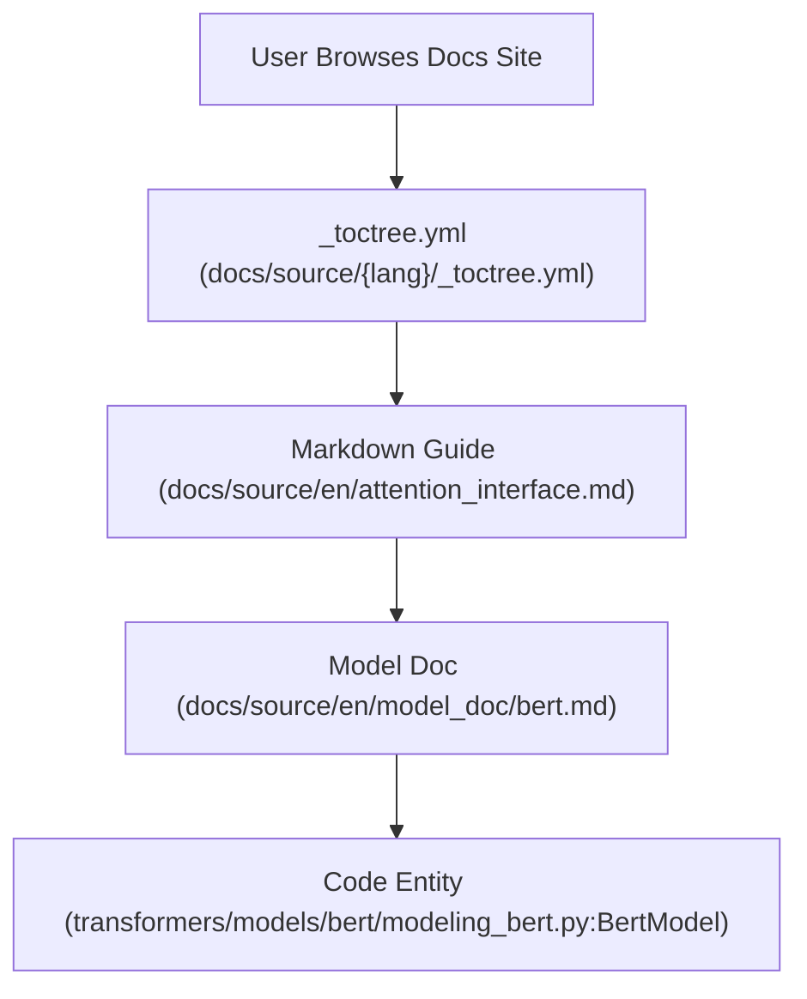

**Description:**  
Links hierarchical documentation entries in `_toctree.yml` down to specific model documentation files and ultimately to the underlying Python classes (`BertModel`, `PreTrainedModel`) defined in model modules.

Sources: `docs/source/en/attention_interface.md:1-45` [docs/source/en/attention_interface.md:1-45](), `docs/source/ko/_toctree.yml:1-28` [docs/source/ko/_toctree.yml:1-28]()

---

### Diagram 2: Doc-Builder Pipeline to Code Entity Documentation

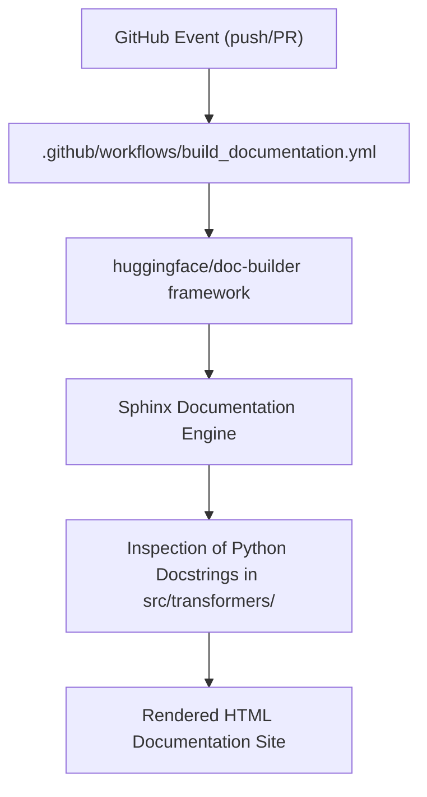

**Description:**  
Shows the transformation pipeline where the doc-builder workflow compiles Markdown files and extracts docstrings directly from Python source files into the deployed documentation.

Sources: `.github/workflows/build_documentation.yml:1-37` [.github/workflows/build_documentation.yml:1-36](), `.github/workflows/build_pr_documentation.yml:1-52` [.github/workflows/build_pr_documentation.yml:1-52]()

---

# Page: Core Architecture

# Core Architecture

<details>
<summary>Relevant source files</summary>

The following files were used as context for generating this wiki page:

- [docs/source/en/_toctree.yml](docs/source/en/_toctree.yml)
- [docs/source/en/index.md](docs/source/en/index.md)
- [docs/source/en/main_classes/peft.md](docs/source/en/main_classes/peft.md)
- [docs/source/en/peft.md](docs/source/en/peft.md)
- [docs/source/en/perf_infer_gpu_multi.md](docs/source/en/perf_infer_gpu_multi.md)
- [docs/source/en/tensor_parallelism.md](docs/source/en/tensor_parallelism.md)
- [docs/source/zh/perf_infer_gpu_multi.md](docs/source/zh/perf_infer_gpu_multi.md)
- [src/transformers/__init__.py](src/transformers/__init__.py)
- [src/transformers/conversion_mapping.py](src/transformers/conversion_mapping.py)
- [src/transformers/core_model_loading.py](src/transformers/core_model_loading.py)
- [src/transformers/integrations/accelerate.py](src/transformers/integrations/accelerate.py)
- [src/transformers/integrations/hub_kernels.py](src/transformers/integrations/hub_kernels.py)
- [src/transformers/integrations/npu_flash_attention.py](src/transformers/integrations/npu_flash_attention.py)
- [src/transformers/integrations/peft.py](src/transformers/integrations/peft.py)
- [src/transformers/integrations/tensor_parallel.py](src/transformers/integrations/tensor_parallel.py)
- [src/transformers/modeling_flash_attention_utils.py](src/transformers/modeling_flash_attention_utils.py)
- [src/transformers/modeling_utils.py](src/transformers/modeling_utils.py)
- [src/transformers/models/__init__.py](src/transformers/models/__init__.py)
- [src/transformers/models/auto/auto_mappings.py](src/transformers/models/auto/auto_mappings.py)
- [src/transformers/models/auto/configuration_auto.py](src/transformers/models/auto/configuration_auto.py)
- [src/transformers/models/auto/feature_extraction_auto.py](src/transformers/models/auto/feature_extraction_auto.py)
- [src/transformers/models/auto/image_processing_auto.py](src/transformers/models/auto/image_processing_auto.py)
- [src/transformers/models/auto/modeling_auto.py](src/transformers/models/auto/modeling_auto.py)
- [src/transformers/models/auto/processing_auto.py](src/transformers/models/auto/processing_auto.py)
- [src/transformers/models/auto/tokenization_auto.py](src/transformers/models/auto/tokenization_auto.py)
- [src/transformers/utils/dummy_pt_objects.py](src/transformers/utils/dummy_pt_objects.py)
- [src/transformers/utils/generic.py](src/transformers/utils/generic.py)
- [src/transformers/utils/kernel_config.py](src/transformers/utils/kernel_config.py)
- [tests/kernels/test_kernels.py](tests/kernels/test_kernels.py)
- [tests/peft_integration/test_peft_integration.py](tests/peft_integration/test_peft_integration.py)
- [tests/tensor_parallel/test_tensor_parallel.py](tests/tensor_parallel/test_tensor_parallel.py)
- [tests/test_modeling_common.py](tests/test_modeling_common.py)
- [tests/utils/test_core_model_loading.py](tests/utils/test_core_model_loading.py)
- [tests/utils/test_generic.py](tests/utils/test_generic.py)
- [tests/utils/test_modeling_utils.py](tests/utils/test_modeling_utils.py)
- [utils/check_auto.py](utils/check_auto.py)
- [utils/check_config_attributes.py](utils/check_config_attributes.py)
- [utils/check_repo.py](utils/check_repo.py)

</details>


The Hugging Face Transformers library builds on a cohesive set of foundational abstractions that standardize the creation, configuration, and use of models across domains such as natural language processing, vision, and audio. This core design enables a consistent, extensible, and scalable ecosystem where a wide variety of models, tokenizers, and processors conform to shared interfaces and workflows.

At the center of this architecture lie three key pillars: configuration management via `PreTrainedConfig`, model encapsulation through `PreTrainedModel`, and a dynamic lazy-loading factory system implemented by the `Auto` classes (`src/transformers/models/auto/modeling_auto.py:1-40`, `src/transformers/models/auto/configuration_auto.py:14-30`). These components collaborate seamlessly to abstract away the complexity of model internals and weight handling, presenting users with a simple yet powerful API.

---

## Foundational Abstractions

### PreTrainedConfig

`PreTrainedConfig` is the canonical class for storing model metadata and hyperparameters (`src/transformers/configuration_utils.py:1-50`). It provides:

- Serialization and deserialization methods like `save_pretrained` and `from_pretrained` for easy checkpoint management.
- Encoding of a model’s architectural parameters, including hidden sizes, number of layers, attention mechanisms, activation functions, and more.
- Support for extra domains such as quantization settings and integration with generation configurations (`GenerationConfig`).
- Identification of the model type via the `model_type` attribute, which is crucial for automated model class resolution.

This class guarantees that all configurations adhere to a unified interface for loading, saving, and manipulation, thereby ensuring reproducibility and checkpoint interoperability across the library.

For a comprehensive deep dive, see [PreTrainedModel & PreTrainedConfig](#2.1).

Sources: `src/transformers/configuration_utils.py:1-50`

### PreTrainedModel

`PreTrainedModel` subclasses PyTorch's `nn.Module` and forms the base for every Hugging Face model (`src/transformers/modeling_utils.py:165-190`). It extends the plain PyTorch model functionality with:

- Standard lifecycle hooks including `post_init` for fine-tuning initialization, and `from_pretrained` / `save_pretrained` for checkpoint management.
- Flexible and robust weight loading which supports sharded checkpoints, safetensors format, DeepSpeed zero optimization, and Accelerate integration.
- Management of tied weights through the internal `_tied_weights_keys` dictionary, safeguarding parameter sharing between layers.
- Features to support memory-efficient training, such as gradient checkpointing (`src/transformers/modeling_utils.py:40-45`).
- Transparent selection among optimized attention backends (like SDPA, Flash Attention, Flex Attention) based on hardware capabilities and user settings (`src/transformers/modeling_utils.py:79-90`).
- Methods and helpers for distributed training device placement and integration (`src/transformers/modeling_utils.py:57-65`).

This class ensures uniform and battle-tested behaviors for all model implementations throughout the library.

For details, see [PreTrainedModel & PreTrainedConfig](#2.1).

Sources: `src/transformers/modeling_utils.py:1-186`

### Auto Factory System

The `Auto` classes (`AutoModel`, `AutoConfig`, `AutoTokenizer`, `AutoImageProcessor`, `AutoProcessor`, etc.) follow a dynamic lazy-loading factory design pattern that:

- Takes a string identifier (e.g., `"bert-base-uncased"`) and dynamically maps it to the correct configuration, model, or tokenizer class (`src/transformers/models/auto/configuration_auto.py:93-120`).
- Internally uses registry mappings such as `_LazyAutoMapping` to defer the import of heavy model implementations until they are explicitly required, optimizing startup time and resource usage (`src/transformers/models/auto/auto_factory.py:1-50`, `src/transformers/__init__.py:15-35`).
- Supports `trust_remote_code`, which enables safe execution of custom model code uploaded on the Hugging Face Hub (`src/transformers/models/auto/configuration_auto.py:24-27`).
- Offers a uniform API whereby users can load any supported model and related components using a consistent call pattern.

This system greatly enhances scalability and adaptability given the rapidly growing ecosystem of architectures.

For in-depth mechanics, refer to [Auto Classes & Lazy-Loading Factory](#2.2).

Sources: `src/transformers/models/auto/configuration_auto.py:93-153`, `src/transformers/__init__.py:15-35`

### Weight Loading and Conversion Lifecycle

The library features an advanced weight loading architecture tailored to heterogeneous checkpoint formats (`src/transformers/core_model_loading.py:1-60`, `src/transformers/conversion_mapping.py:1-45`):

- **`WeightConverter`** and **`WeightRenaming`** classes formally describe mappings to rename parameter keys and transform tensor shapes to fit the internal model implementations.
- This system addresses complex cases like fused QKV weights, stacking of Mixture-of-Experts (MoE) expert weights, and rotary positional encoding permutations.
- The primary function `convert_and_load_state_dict_in_model` orchestrates the conversion, safe loading, and compatibility verification of checkpoint weights (`src/transformers/modeling_utils.py:51-56`).
- Supports sharded checkpoints, safetensors-optimized weights, and smooth transitions between checkpoint version formats.

For technical specifics, see [Model Weight Loading & Conversion](#2.3).

Sources: `src/transformers/core_model_loading.py:1-60`, `src/transformers/conversion_mapping.py:1-45`, `src/transformers/modeling_utils.py:51-56`

### Common Modeling Layers & Utilities

The library extracts shared modeling primitives and utilities into reusable modules:

- `GradientCheckpointingLayer` assists with memory-efficient gradient computations (`src/tests/test_modeling_common.py:62-62`).
- `modeling_layers.py`, `masking_utils.py`, and `modeling_rope_utils.py` provide standard components such as attention mask handling and rotary positional encoding variants (`src/transformers/modeling_utils.py:88-95`).
- `pytorch_utils.py` encapsulates various PyTorch helper functions for tensor operations and performance tuning (`src/transformers/modeling_utils.py:96-96`).
- Attention backend integration points enable seamless switching between optimized kernels like SDPA, FlashAttention, and FlexAttention (`src/transformers/modeling_utils.py:79-86`).

For further information, consult [Common Modeling Layers & Utilities](#2.4).

Sources: `src/tests/test_modeling_common.py:62-63`, `src/transformers/modeling_utils.py:79-96`

---

## System Entity Map: Bridging Natural Language Model IDs to Code Entities

### Diagram 1: Model Resolution Flow Between Model IDs and Code Entities

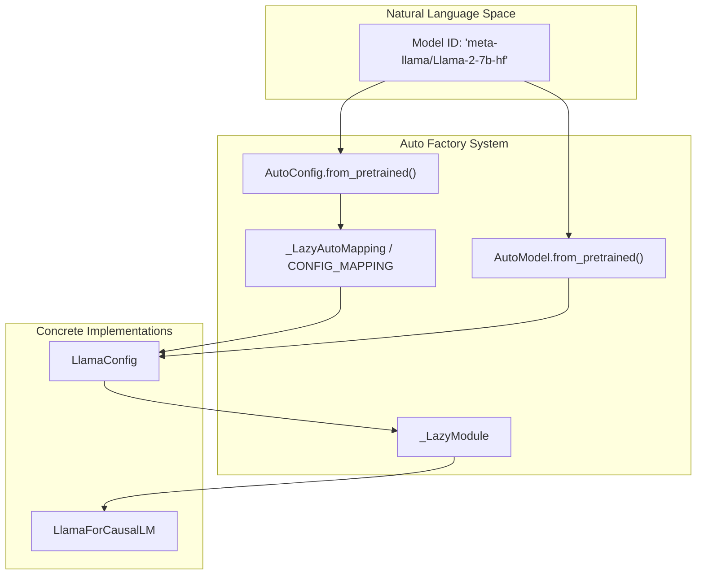

This diagram illustrates how a human-readable model identifier string flows through the system. The `AutoConfig` and `AutoModel` use internal lazy mapping (`src/transformers/models/auto/configuration_auto.py:93-120`) and dynamic imports to resolve and load corresponding configuration and model classes only when needed.

Sources: `src/transformers/models/auto/configuration_auto.py:93-153`, `src/transformers/__init__.py:15-35`

### Diagram 2: Core Architecture Components and Their Interactions

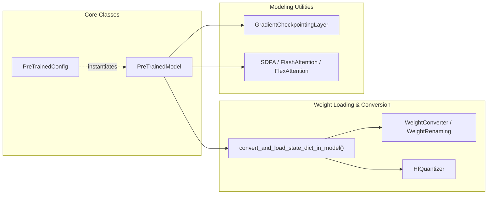

This representation exposes the dependencies and lifecycle in the core components. The configuration class directs model creation; weight loading mechanisms enable conversion and quantization (`src/transformers/modeling_utils.py:51-56`, `src/transformers/modeling_utils.py:97-99`); and models leverage shared layers and optimized attention kernels (`src/transformers/modeling_utils.py:79-86`).

Sources: `src/transformers/modeling_utils.py:51-99`, `src/tests/test_modeling_common.py:62-63`

---

## Summary Table of Core Components

| Component                | Code Entity                          | Role / Responsibility                                   |
|--------------------------|------------------------------------|---------------------------------------------------------|
| Configuration            | `PreTrainedConfig`                 | Metadata, hyperparameters, serialization handling       |
| Base Model Class         | `PreTrainedModel`                  | Weight loading, tied weights, backend selection          |
| Lazy Factory Mappings    | `_LazyAutoMapping`                 | Lazy resolution of model IDs to implementation classes   |
| Weight Conversion System | `WeightConverter`, `WeightRenaming` | Rename/transform checkpoint weights for compatibility    |
| Conversion Primitives    | `ConversionOps`                   | Atomic operations for weight conversion                  |
| Quantization             | `HfQuantizer`                    | Support for low-bit weight formats                        |
| Common Modeling Layers   | `GradientCheckpointingLayer`, Attention backends | Reusable layers and efficient GPU kernel integration    |

Sources: `src/transformers/configuration_utils.py:1-50`, `src/transformers/modeling_utils.py:40-100`, `src/transformers/core_model_loading.py:1-60`

---

## Navigation to Detailed Subsystems

This page provides a high-level architectural overview. For deep knowledge, each topic is covered extensively in separate focused documentation pages:

- **[PreTrainedModel & PreTrainedConfig](#2.1)**  
  Deep coverage of configuration and model base classes, their lifecycle methods, weight tying, attention backend selection, and memory optimization.

- **[Auto Classes & Lazy-Loading Factory](#2.2)**  
  Explanation of dynamic factory pattern, lazy imports, `_LazyAutoMapping`, `trust_remote_code`, and the loading of third-party Hub models.

- **[Model Weight Loading & Conversion](#2.3)**  
  Detailed design of the weight conversion machinery, including fused and expert weights, transformer permutations, and sharded checkpoint support.

- **[Common Modeling Layers & Utilities](#2.4)**  
  Shared low-level layers and utilities: gradient checkpointing layers, attention handling, RoPE utilities, and PyTorch helper functions.

Sources: `docs/source/en/_toctree.yml:1-76`, `src/transformers/__init__.py:15-60`

---

# Page: PreTrainedModel & PreTrainedConfig

# PreTrainedModel & PreTrainedConfig

<details>
<summary>Relevant source files</summary>

The following files were used as context for generating this wiki page:

- [docs/source/en/main_classes/peft.md](docs/source/en/main_classes/peft.md)
- [docs/source/en/peft.md](docs/source/en/peft.md)
- [docs/source/en/perf_infer_gpu_multi.md](docs/source/en/perf_infer_gpu_multi.md)
- [docs/source/en/tensor_parallelism.md](docs/source/en/tensor_parallelism.md)
- [docs/source/zh/perf_infer_gpu_multi.md](docs/source/zh/perf_infer_gpu_multi.md)
- [src/transformers/cache_utils.py](src/transformers/cache_utils.py)
- [src/transformers/configuration_utils.py](src/transformers/configuration_utils.py)
- [src/transformers/conversion_mapping.py](src/transformers/conversion_mapping.py)
- [src/transformers/core_model_loading.py](src/transformers/core_model_loading.py)
- [src/transformers/generation/candidate_generator.py](src/transformers/generation/candidate_generator.py)
- [src/transformers/generation/configuration_utils.py](src/transformers/generation/configuration_utils.py)
- [src/transformers/generation/utils.py](src/transformers/generation/utils.py)
- [src/transformers/integrations/accelerate.py](src/transformers/integrations/accelerate.py)
- [src/transformers/integrations/executorch.py](src/transformers/integrations/executorch.py)
- [src/transformers/integrations/hub_kernels.py](src/transformers/integrations/hub_kernels.py)
- [src/transformers/integrations/npu_flash_attention.py](src/transformers/integrations/npu_flash_attention.py)
- [src/transformers/integrations/peft.py](src/transformers/integrations/peft.py)
- [src/transformers/integrations/tensor_parallel.py](src/transformers/integrations/tensor_parallel.py)
- [src/transformers/masking_utils.py](src/transformers/masking_utils.py)
- [src/transformers/modeling_flash_attention_utils.py](src/transformers/modeling_flash_attention_utils.py)
- [src/transformers/modeling_utils.py](src/transformers/modeling_utils.py)
- [src/transformers/utils/generic.py](src/transformers/utils/generic.py)
- [src/transformers/utils/kernel_config.py](src/transformers/utils/kernel_config.py)
- [tests/generation/test_candidate_generator.py](tests/generation/test_candidate_generator.py)
- [tests/generation/test_configuration_utils.py](tests/generation/test_configuration_utils.py)
- [tests/generation/test_utils.py](tests/generation/test_utils.py)
- [tests/kernels/test_kernels.py](tests/kernels/test_kernels.py)
- [tests/peft_integration/test_peft_integration.py](tests/peft_integration/test_peft_integration.py)
- [tests/tensor_parallel/test_tensor_parallel.py](tests/tensor_parallel/test_tensor_parallel.py)
- [tests/test_modeling_common.py](tests/test_modeling_common.py)
- [tests/utils/test_cache_utils.py](tests/utils/test_cache_utils.py)
- [tests/utils/test_configuration_utils.py](tests/utils/test_configuration_utils.py)
- [tests/utils/test_core_model_loading.py](tests/utils/test_core_model_loading.py)
- [tests/utils/test_feature_extraction_utils.py](tests/utils/test_feature_extraction_utils.py)
- [tests/utils/test_generic.py](tests/utils/test_generic.py)
- [tests/utils/test_image_processing_utils.py](tests/utils/test_image_processing_utils.py)
- [tests/utils/test_masking_utils.py](tests/utils/test_masking_utils.py)
- [tests/utils/test_modeling_utils.py](tests/utils/test_modeling_utils.py)
- [tests/utils/test_tokenization_utils.py](tests/utils/test_tokenization_utils.py)

</details>


This page provides a technical deep dive into the two foundational base classes of the Hugging Face Transformers library: `PreTrainedModel` and `PreTrainedConfig`. These classes govern the lifecycle of every model in the library, handling everything from weight initialization and serialization to advanced features like gradient checkpointing, weight tying, attention implementation selection, per-layer attribute overrides via heterogeneity configurations, and the `PreTrainedConfig` serialization contract.

---

## PreTrainedConfig & Serialization Contract

`PreTrainedConfig` is the base class for all model configuration classes. It encapsulates the hyperparameters and architectural metadata required to instantiate a model and serves as the serialization and deserialization contract for model setups.

### Serialization and Lifecycle

- **Loading via `from_pretrained`**:  
  The class method loads the configuration for a model from a local directory or the Hugging Face Hub, resolving model identifiers, downloading configuration JSON files (`config.json`), and supporting custom configurations when `trust_remote_code=True` `[src/transformers/configuration_utils.py:1-48]`.

- **Saving via `save_pretrained`**:  
  Saves the configuration to disk as `config.json`, balancing readability and backward compatibility while integrating with Hub upload workflows.

- **Serialization Contract**:  
  - Special floating-point values (`NaN`, `Infinity`, `-Infinity`) are handled via explicit tagging (`_FLOAT_TAG_KEY`, `_FLOAT_TAG_VALUES`) to preserve JSON validity `[src/transformers/configuration_utils.py:60-65]`.
  - Legacy layer type names are automatically remapped to canonical names via `remap_legacy_layer_types` and `_LEGACY_LAYER_TYPE_REMAP` (e.g., `"mamba"` to `"linear_attention"`, `"attention"` to `"full_attention"`) `[src/transformers/configuration_utils.py:92-136]`.
  - Config classes can utilize dataclass transforms and kwargs wrapping (`wrap_init_to_accept_kwargs`) to ensure strict yet flexible parameter parsing `[src/transformers/configuration_utils.py:30-165]`.

### Heterogeneity Config Layer (`integrations/heterogeneity`)

For architectures with per-layer attribute overrides (e.g., varying hidden sizes, intermediate dimensions, or attention head counts across layers), `PreTrainedConfig` integrates `HeterogeneousConfigMixin`. This mixin allows configuration attributes to be specified as lists or dictionaries per layer index, letting models construct heterogeneous layer stacks dynamically.

Sources: `[src/transformers/configuration_utils.py:1-165]`, `[src/transformers/configuration_utils.py:488-540]()`

---

## PreTrainedModel & Loading Lifecycle

`PreTrainedModel` is an abstract subclass of `torch.nn.Module`, forming the foundational base for all PyTorch-based transformer models.

### Loading Lifecycle (`from_pretrained`)

1. **Resolve and Load Configuration**: Instantiates or loads the corresponding `PreTrainedConfig` `[src/transformers/modeling_utils.py:45-50]`.
2. **Model Initialization**: Instantiates the model class with the loaded config, invoking `_init_weights()` for uninitialized weights.
3. **Load Weights with Conversion**: Loads state dictionaries from `.bin` or `.safetensors` files, supporting sharded checkpoints and structural weight transformations via `WeightConverter`, `WeightRenaming`, and `ConversionOps` `[src/transformers/core_model_loading.py:81-181]`.
4. **Enforce Weight Tying**: Executes `tie_weights()` to share memory storage across designated parameter pairs `[src/transformers/modeling_utils.py:60-65]`.
5. **Post-Initialization Hook**: Runs `post_init()` to finalize initialization, quantization, and adapter setup.

### Loading Flow Diagram: Natural Language to Code Mapping

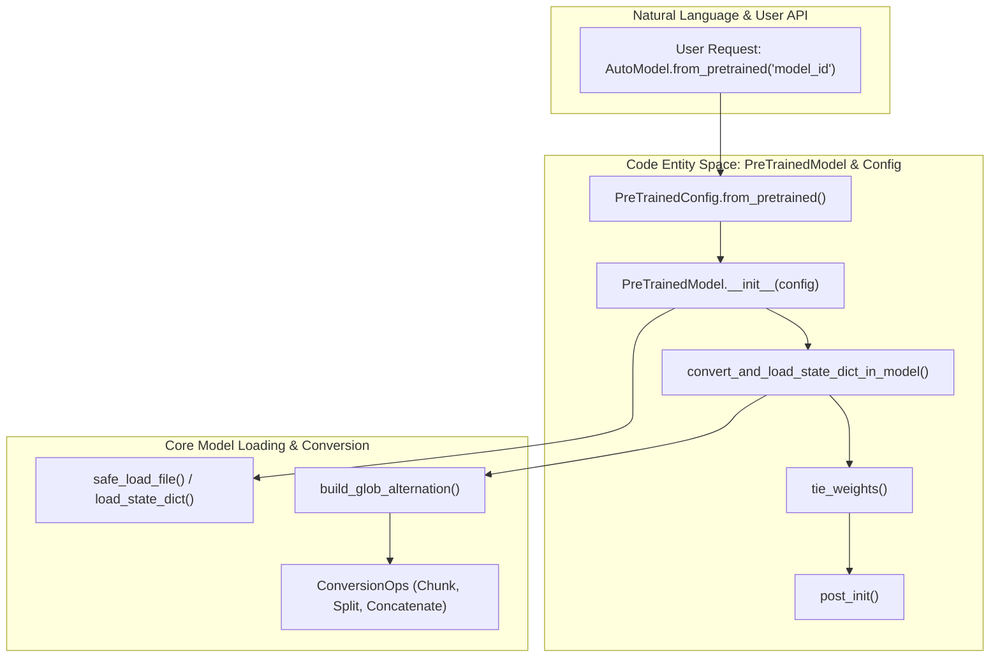

Sources: `[src/transformers/modeling_utils.py:35-186]`, `[src/transformers/core_model_loading.py:49-181]()`

---

## Weight Tying Implementation

Weight tying allows multiple parts of a model to share a single parameter tensor, reducing memory usage.

- The `_tied_weights_keys` class attribute defines a mapping of target parameter names to source parameter names `[src/transformers/tests/utils/test_modeling_utils.py:185-188]()`.
- The `tie_weights()` method iterates through these mappings, assigning the target parameter reference to point to the source parameter's tensor storage `[src/transformers/modeling_utils.py:63-63]()`.
- Underlying storage pointers (`storage_ptr()`) are validated to ensure true memory sharing.

### Weight Tying Diagram: Logic to Code Entities

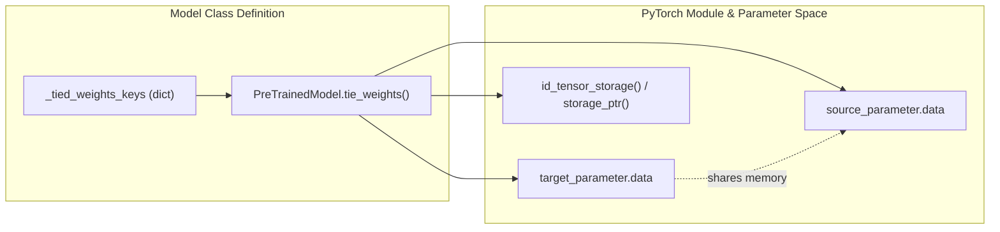

Sources: `[src/transformers/modeling_utils.py:63-63]`, `[src/transformers/pytorch_utils.py:96-96]()`

---

## Attention Implementation Selection

`PreTrainedModel` supports pluggable attention mechanisms, selectable via configuration or keyword arguments during initialization and forward passes.

| Implementation | Description | Requirements |
|----------------|-------------|--------------|
| **Eager** | Standard PyTorch native attention implementation | Always available |
| **SDPA** | Scaled Dot-Product Attention optimized kernels | PyTorch ≥ 2.0 |
| **FlashAttention-2 / 3 / 4** | High-performance hardware-accelerated CUDA/XPU kernels | CUDA/XPU + `flash-attn` package `[src/transformers/modeling_flash_attention_utils.py:96-140]()` |
| **FlexAttention** | PyTorch-native flexible compiled attention backend | PyTorch ≥ 2.5 + compatible hardware `[src/transformers/modeling_utils.py:120-120]()` |

The backend selection checks hardware availability and compatibility matrices dynamically before dispatching `flash_attention_forward`, `sdpa_attention_forward`, or eager implementations `[src/transformers/modeling_utils.py:79-93]()`.

Sources: `[src/transformers/modeling_utils.py:79-93]`, `[src/transformers/modeling_flash_attention_utils.py:96-140]()`

---

## Advanced Modeling Features & Gradient Checkpointing

To optimize memory consumption during training, `PreTrainedModel` provides built-in gradient checkpointing support:

- Calling `gradient_checkpointing_enable()` sets internal flags on the model and its constituent layers `[src/transformers/modeling_utils.py:44-44]()`.
- Individual modules inheriting from `GradientCheckpointingLayer` wrap their forward computation graph with PyTorch's `checkpoint()` utility, trading compute for reduced activation memory `[src/transformers/tests/test_modeling_common.py:62-62]()`.

Sources: `[src/transformers/modeling_utils.py:44-44]`, `[src/transformers/tests/test_modeling_common.py:62-62]()`

---

## Checkpoint Conversion System

When loading heterogeneous checkpoints from external formats or legacy structures, `transformers` utilizes `WeightConverter`, `WeightRenaming`, and subclasses of `ConversionOps` `[src/transformers/core_model_loading.py:51-181]()`.

- **`Chunk` / `Split`**: Divide fused tensors (such as combined QKV projections or multi-expert feed-forward weights) along specified dimensions `[src/transformers/core_model_loading.py:112-181]()`.
- **`Concatenate`**: Combines separate parameter tensors into unified projections.
- **`WeightRenaming`**: Matches source regex patterns against incoming state dictionaries and maps them to target architecture names.

Sources: `[src/transformers/core_model_loading.py:51-181]`, `[src/transformers/conversion_mapping.py:21-36]()`

---

# Page: Auto Classes & Lazy-Loading Factory

# Auto Classes & Lazy-Loading Factory

<details>
<summary>Relevant source files</summary>

The following files were used as context for generating this wiki page:

- [docs/source/en/_toctree.yml](docs/source/en/_toctree.yml)
- [docs/source/en/index.md](docs/source/en/index.md)
- [docs/source/en/main_classes/video_processor.md](docs/source/en/main_classes/video_processor.md)
- [src/transformers/__init__.py](src/transformers/__init__.py)
- [src/transformers/dynamic_module_utils.py](src/transformers/dynamic_module_utils.py)
- [src/transformers/feature_extraction_utils.py](src/transformers/feature_extraction_utils.py)
- [src/transformers/file_utils.py](src/transformers/file_utils.py)
- [src/transformers/image_processing_base.py](src/transformers/image_processing_base.py)
- [src/transformers/modelcard.py](src/transformers/modelcard.py)
- [src/transformers/models/__init__.py](src/transformers/models/__init__.py)
- [src/transformers/models/auto/auto_factory.py](src/transformers/models/auto/auto_factory.py)
- [src/transformers/models/auto/auto_mappings.py](src/transformers/models/auto/auto_mappings.py)
- [src/transformers/models/auto/configuration_auto.py](src/transformers/models/auto/configuration_auto.py)
- [src/transformers/models/auto/feature_extraction_auto.py](src/transformers/models/auto/feature_extraction_auto.py)
- [src/transformers/models/auto/image_processing_auto.py](src/transformers/models/auto/image_processing_auto.py)
- [src/transformers/models/auto/modeling_auto.py](src/transformers/models/auto/modeling_auto.py)
- [src/transformers/models/auto/processing_auto.py](src/transformers/models/auto/processing_auto.py)
- [src/transformers/models/auto/tokenization_auto.py](src/transformers/models/auto/tokenization_auto.py)
- [src/transformers/models/auto/video_processing_auto.py](src/transformers/models/auto/video_processing_auto.py)
- [src/transformers/models/instructblipvideo/video_processing_instructblipvideo.py](src/transformers/models/instructblipvideo/video_processing_instructblipvideo.py)
- [src/transformers/models/internvl/video_processing_internvl.py](src/transformers/models/internvl/video_processing_internvl.py)
- [src/transformers/models/smolvlm/video_processing_smolvlm.py](src/transformers/models/smolvlm/video_processing_smolvlm.py)
- [src/transformers/tokenization_utils_tokenizers.py](src/transformers/tokenization_utils_tokenizers.py)
- [src/transformers/utils/dummy_pt_objects.py](src/transformers/utils/dummy_pt_objects.py)
- [src/transformers/utils/hub.py](src/transformers/utils/hub.py)
- [src/transformers/video_processing_utils.py](src/transformers/video_processing_utils.py)
- [src/transformers/video_utils.py](src/transformers/video_utils.py)
- [tests/models/auto/test_configuration_auto.py](tests/models/auto/test_configuration_auto.py)
- [tests/models/auto/test_feature_extraction_auto.py](tests/models/auto/test_feature_extraction_auto.py)
- [tests/models/auto/test_image_processing_auto.py](tests/models/auto/test_image_processing_auto.py)
- [tests/models/auto/test_modeling_auto.py](tests/models/auto/test_modeling_auto.py)
- [tests/models/auto/test_tokenization_auto.py](tests/models/auto/test_tokenization_auto.py)
- [tests/models/auto/test_video_processing_auto.py](tests/models/auto/test_video_processing_auto.py)
- [tests/models/smolvlm/test_video_processing_smolvlm.py](tests/models/smolvlm/test_video_processing_smolvlm.py)
- [tests/tokenization/test_tokenization_fast.py](tests/tokenization/test_tokenization_fast.py)
- [tests/utils/test_dynamic_module_utils.py](tests/utils/test_dynamic_module_utils.py)
- [tests/utils/test_video_utils.py](tests/utils/test_video_utils.py)
- [utils/check_auto.py](utils/check_auto.py)
- [utils/check_config_attributes.py](utils/check_config_attributes.py)
- [utils/check_repo.py](utils/check_repo.py)

</details>


The Auto Class system in Hugging Face’s Transformers library provides a unified, extensible interface that maps textual model identifiers (e.g., `"bert-base-uncased"`, `"meta-llama/Llama-2-7b"`) transparently to the appropriate configuration, model, tokenizer, image processor, or composite processor classes. This abstraction enables users to instantiate these objects without manual specification of underlying model classes.

This capability is enabled by a lazy-loading factory pattern which defers imports of backend modules until needed, improving startup time, reducing memory footprint, and supporting dynamic augmentations such as remote custom code loading. This design maintains a clean user API that transparently handles diverse model architectures and modalities.

---

## Architecture Overview

The auto system follows the data flow below:

1. **Resolve model identifier or config**: From a user-provided string identifier or a loaded `PreTrainedConfig`, extract a `model_type` string describing the architecture family [src/transformers/models/auto/configuration_auto.py:81-90]().
2. **Lazy mappings to classes**: Use `model_type` as a key to look up specific classes in lazy mapping registries for configurations (`AutoConfig`), models (`AutoModel` and variants), tokenizers (`AutoTokenizer`), image processors (`AutoImageProcessor`), and combined processors (`AutoProcessor`).
3. **Lazy module proxy**: Class retrieval occurs behind a `_LazyModule` import proxy to defer imports until attribute use [src/transformers/utils/import_utils.py]().
4. **Optional trusted remote code**: If `trust_remote_code=True` is passed, unknown or custom `model_type`s trigger downloading and dynamic loading of remote model Python code from the Hugging Face Hub [src/transformers/dynamic_module_utils.py](). This creates dynamic modules on-the-fly, registered in `sys.modules`.
5. **Graceful optional backend handling**: If backend dependencies are missing (e.g., PyTorch, tokenizers), dummy placeholder classes (`DummyObject`) provide informative runtime errors instead of import failures [src/transformers/utils/dummy_pt_objects.py]().
6. **Instantiate and return**: With classes resolved, instantiate the requested factory object.

---

## From Model Identifier to Concrete Class: Data Flow Diagram

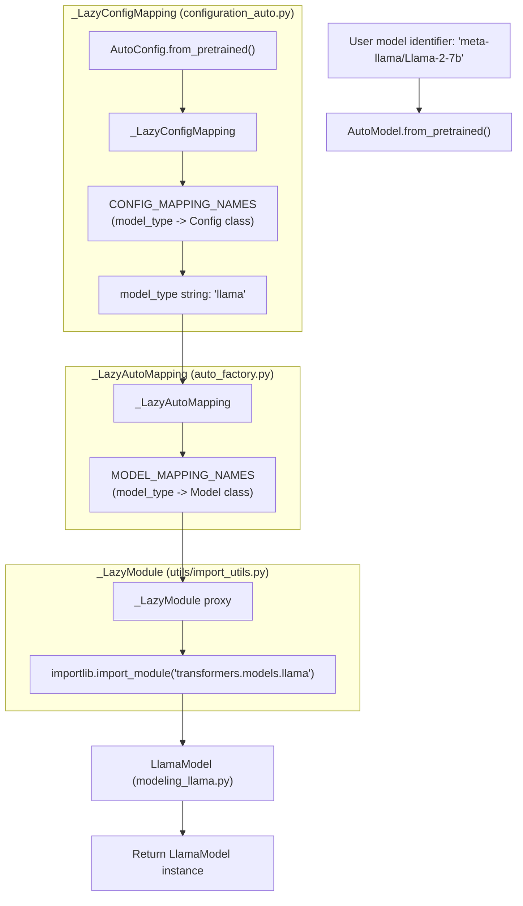

Sources: [src/transformers/models/auto/configuration_auto.py:93-118](), [src/transformers/models/auto/auto_factory.py:435-470](), [src/transformers/utils/import_utils.py]()

---

# Core Components

## 1. Lazy Mappings: `_LazyAutoMapping` and `_LazyConfigMapping`

The backbone of the auto system comprises dictionary-like mappings that resolve model-type strings to classes on-demand, deferring module imports.

- **`_LazyConfigMapping`**: A class used in `configuration_auto.py` that maps string keys (`model_type`) to configuration classes inheriting `PreTrainedConfig`. On first access, the target module (e.g., `.llama`) is imported dynamically, and configuration classes are retrieved and cached [src/transformers/models/auto/configuration_auto.py:93-118]().
- **`_LazyAutoMapping`**: Defined in `auto_factory.py`, it lazily loads model classes (and similarly tokenizer, image processor, processor classes) from model submodules keyed by `model_type` [src/transformers/models/auto/auto_factory.py:435-470](). This prevents eager loading of large modeling codebases.

Both classes support typical dictionary methods (`__getitem__`, `register`, iteration) and maintain internal caches for performance.

**Implementation references:**  
- `_LazyConfigMapping`: [src/transformers/models/auto/configuration_auto.py:93-118]()  
- `_LazyAutoMapping`: [src/transformers/models/auto/auto_factory.py:435-470]()

Sources: [src/transformers/models/auto/configuration_auto.py:93-118](), [src/transformers/models/auto/auto_factory.py:435-470]()

## 2. The `_LazyModule` Import Proxy

The `_LazyModule` (in `utils/import_utils.py`) intercepts attribute access on a module-like object and performs the actual import of the real submodule only upon first use. This mechanism enables:

- Minimizing initial import overhead of heavy submodules.
- Providing a seamless user API with immediate access to submodules/classes.
- Dynamic dispatch for model families and their tokenizers/processors.

This pattern is extensively used in the top-level transformers namespace and in the models submodule to optimize startup performance [src/transformers/__init__.py:16-19]().

Sources: [src/transformers/__init__.py:16-19](), [src/transformers/utils/import_utils.py]()

## 3. Dummy Objects for Optional Backends

To support environments lacking some optional dependencies (e.g., PyTorch, tokenizers, vision libs), the library declares dummy placeholder classes decorated by `DummyObject` from `src/transformers/utils/dummy_pt_objects.py`. These placeholders:

- Provide informative error messages only when instantiated or used via `requires_backends` [src/transformers/utils/dummy_pt_objects.py:5-10]().
- Avoid import-time failures to not break the entire library when optional backends are missing.

Sources: [src/transformers/utils/dummy_pt_objects.py:1-488]()

---

# Dynamic Module System for Trusted Remote Code

The library allows users to load remote models that may have custom Python code (e.g., novel architectures or tokenizers) not shipped in the Transformers source. This mode activates if and only if the user opts in with `trust_remote_code=True` [src/transformers/dynamic_module_utils.py]().

**Mechanism summary:**

1. Upon detecting an unknown `model_type` during `from_pretrained()`, the config's `"auto_map"` metadata is checked [src/transformers/models/auto/configuration_auto.py:24-27]().
2. Relevant Python files (e.g., modeling code) are downloaded from the HF Hub at runtime.
3. The downloaded Python files are loaded dynamically into new modules in `sys.modules`.
4. Model classes are retrieved from these dynamic modules and instantiated.

---

## Sequence Diagram: Dynamic Remote Code Loading with `trust_remote_code=True`

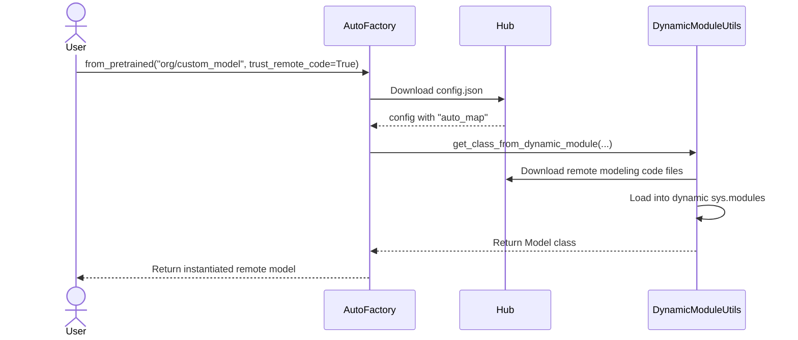

Sources: [src/transformers/dynamic_module_utils.py](), [src/transformers/models/auto/configuration_auto.py:24-27]()

---

# Specialization of Auto Classes & Their Lazy Registries

Each Auto class specializes in loading a category of objects and uses its dedicated lazy mapping:

| Auto Class            | Lazy Mapping Dictionary & Location               | Notes                                                  |
|-----------------------|-------------------------------------------------|--------------------------------------------------------|
| `AutoConfig`          | `CONFIG_MAPPING_NAMES` in `configuration_auto.py` | Maps `model_type` to `PreTrainedConfig` subclasses.    |
| `AutoModel*`          | `MODEL_MAPPING_NAMES` in `modeling_auto.py`       | Maps `model_type` to model classes (various variants). |
| `AutoTokenizer`       | `TOKENIZER_MAPPING_NAMES` in `tokenization_auto.py` | Maps to tokenizer classes; prefers Rust-based fast tokenizers if available. |
| `AutoImageProcessor`  | `IMAGE_PROCESSOR_MAPPING_NAMES` in `image_processing_auto.py` | Maps model types to image processor classes; handles backend fallbacks. |
| `AutoProcessor`       | `PROCESSOR_MAPPING_NAMES` in `processing_auto.py`  | For combined multimodal processor classes.              |

Sources: [src/transformers/models/auto/configuration_auto.py:26](), [src/transformers/models/auto/modeling_auto.py:41-176](), [src/transformers/models/auto/tokenization_auto.py:64-135](), [src/transformers/models/auto/image_processing_auto.py:68-119]()

---

# References and Key Source Files

- `src/transformers/models/auto/modeling_auto.py` [src/transformers/models/auto/modeling_auto.py:1-2700]()  
- `src/transformers/models/auto/configuration_auto.py` [src/transformers/models/auto/configuration_auto.py:1-465]()  
- `src/transformers/models/auto/tokenization_auto.py` [src/transformers/models/auto/tokenization_auto.py:1-1034]()  
- `src/transformers/models/auto/image_processing_auto.py` [src/transformers/models/auto/image_processing_auto.py:1-780]()  
- `src/transformers/models/auto/auto_factory.py` [src/transformers/models/auto/auto_factory.py:1-600]()  
- `src/transformers/utils/import_utils.py` [src/transformers/utils/import_utils.py:1-800]()  
- `src/transformers/utils/dummy_pt_objects.py` [src/transformers/utils/dummy_pt_objects.py:1-488]()  
- `src/transformers/dynamic_module_utils.py` [src/transformers/dynamic_module_utils.py:1-500]()

---

# Page: Model Weight Loading & Conversion

# Model Weight Loading & Conversion

<details>
<summary>Relevant source files</summary>

The following files were used as context for generating this wiki page:

- [docs/source/en/main_classes/peft.md](docs/source/en/main_classes/peft.md)
- [docs/source/en/peft.md](docs/source/en/peft.md)
- [docs/source/en/perf_infer_gpu_multi.md](docs/source/en/perf_infer_gpu_multi.md)
- [docs/source/en/tensor_parallelism.md](docs/source/en/tensor_parallelism.md)
- [docs/source/zh/perf_infer_gpu_multi.md](docs/source/zh/perf_infer_gpu_multi.md)
- [src/transformers/conversion_mapping.py](src/transformers/conversion_mapping.py)
- [src/transformers/core_model_loading.py](src/transformers/core_model_loading.py)
- [src/transformers/dynamic_module_utils.py](src/transformers/dynamic_module_utils.py)
- [src/transformers/file_utils.py](src/transformers/file_utils.py)
- [src/transformers/integrations/accelerate.py](src/transformers/integrations/accelerate.py)
- [src/transformers/integrations/hub_kernels.py](src/transformers/integrations/hub_kernels.py)
- [src/transformers/integrations/npu_flash_attention.py](src/transformers/integrations/npu_flash_attention.py)
- [src/transformers/integrations/peft.py](src/transformers/integrations/peft.py)
- [src/transformers/integrations/tensor_parallel.py](src/transformers/integrations/tensor_parallel.py)
- [src/transformers/modelcard.py](src/transformers/modelcard.py)
- [src/transformers/modeling_flash_attention_utils.py](src/transformers/modeling_flash_attention_utils.py)
- [src/transformers/modeling_utils.py](src/transformers/modeling_utils.py)
- [src/transformers/tokenization_utils_tokenizers.py](src/transformers/tokenization_utils_tokenizers.py)
- [src/transformers/utils/generic.py](src/transformers/utils/generic.py)
- [src/transformers/utils/hub.py](src/transformers/utils/hub.py)
- [src/transformers/utils/kernel_config.py](src/transformers/utils/kernel_config.py)
- [tests/kernels/test_kernels.py](tests/kernels/test_kernels.py)
- [tests/models/auto/test_configuration_auto.py](tests/models/auto/test_configuration_auto.py)
- [tests/models/auto/test_feature_extraction_auto.py](tests/models/auto/test_feature_extraction_auto.py)
- [tests/models/auto/test_modeling_auto.py](tests/models/auto/test_modeling_auto.py)
- [tests/models/auto/test_tokenization_auto.py](tests/models/auto/test_tokenization_auto.py)
- [tests/peft_integration/test_peft_integration.py](tests/peft_integration/test_peft_integration.py)
- [tests/tensor_parallel/test_tensor_parallel.py](tests/tensor_parallel/test_tensor_parallel.py)
- [tests/test_modeling_common.py](tests/test_modeling_common.py)
- [tests/tokenization/test_tokenization_fast.py](tests/tokenization/test_tokenization_fast.py)
- [tests/utils/test_core_model_loading.py](tests/utils/test_core_model_loading.py)
- [tests/utils/test_dynamic_module_utils.py](tests/utils/test_dynamic_module_utils.py)
- [tests/utils/test_generic.py](tests/utils/test_generic.py)
- [tests/utils/test_modeling_utils.py](tests/utils/test_modeling_utils.py)

</details>


The Model Weight Loading & Conversion subsystem provides a comprehensive and extensible framework within the Hugging Face Transformers library for loading heterogeneous checkpoints. These checkpoints often come from diverse training frameworks or repository conventions, featuring differences such as fused attention QKV weights, Mixture-of-Experts (MoE) expert stacking, rotary positional embedding (RoPE) permutations, or tensor layout variants.

This system abstracts the complexities of loading such heterogeneous checkpoints through key renaming, tensor transformations, stacking operations, and permutations. It integrates seamlessly with quantization mechanisms and memory offloading to support efficient loading across a variety of hardware configurations.

This page discusses the core implementation found primarily in `src/transformers/core_model_loading.py` and `src/transformers/conversion_mapping.py`, focusing on the mechanisms for handling fused QKV, MoE expert stacking, and RoPE permutations.

---

## System Architecture Overview

### Key Classes & Components

| Component               | Description                                                                                     | Implementation Location                       |
|-------------------------|-------------------------------------------------------------------------------------------------|----------------------------------------------|
| **WeightRenaming**       | Handles renaming of checkpoint keys using glob-like regex pattern matching.                      | `src/transformers/core_model_loading.py` [49-78]()          |
| **WeightConverter**      | Extends renaming with a sequence of tensor `ConversionOps` to convert weights on load.           | `src/transformers/core_model_loading.py` [81-110]()          |
| **ConversionOps**        | Abstract base and concrete tensor transformations (e.g., `Chunk`, `Concatenate`, `Interleave`). | `src/transformers/core_model_loading.py` [81-94](), [112-185]() |
| **Conversion Mapping**   | Model-specific mappings that coordinate renamings and conversion ops, including MoE and RoPE handling. | `src/transformers/conversion_mapping.py` [1-40]()              |

### Data Flow Overview

The following diagram bridges natural language functional concepts to code entities within `modeling_utils.py`, `conversion_mapping.py`, and `core_model_loading.py`:

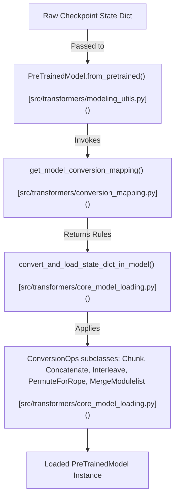

**Sources:**  
[src/transformers/modeling_utils.py:49-55](), [src/transformers/core_model_loading.py:530-560](), [src/transformers/conversion_mapping.py:1-40]()

---

## Conversion Operations: Tensor Transformations for Flexible Loading

At the core of supporting heterogeneous checkpoint formats is the system of `ConversionOps`, modular tensor operations applied during weight loading to reshape, split, concatenate, or permute tensors to the model’s expected format.

| Operation         | Class Name             | Description                                                                                  | Location                          |
|-------------------|------------------------|----------------------------------------------------------------------------------------------|---------------------------------|
| **Chunk**         | `Chunk`                | Splits a tensor along a given dimension into multiple equal chunks (e.g., fused QKV split).   | `src/transformers/core_model_loading.py` [112-147]() |
| **Concatenate**   | `Concatenate`          | Concatenates multiple tensors along a specific dimension (inverse of `Chunk`).                | `src/transformers/core_model_loading.py` [150-185]() |
| **Interleave**    | `Interleave`           | Interleaves/deinterleaves tensor slices to reorder elements, e.g., for RoPE key permutation.  | `src/transformers/core_model_loading.py` [186-207]() |
| **Transpose**     | `Transpose`            | Simple permute of two tensor dimensions for layout adjustment.                                | `src/transformers/core_model_loading.py` [207-210]() |
| **PermuteForRope**| `PermuteForRope`       | Specialized permutation to align rotary embeddings from different RoPE implementations.      | `src/transformers/conversion_mapping.py` [27-30]()  |
| **MergeModulelist** | `MergeModulelist`     | Stacks expert weights from a module list into one tensor, used for MoE expert stacking.       | `src/transformers/conversion_mapping.py` [24-27]()  |

**Sources:**  
[src/transformers/core_model_loading.py:112-210](), [src/transformers/conversion_mapping.py:21-35]()

---

### Handling Fused QKV Weights

Many attention architectures store Q, K, and V projections fused in one large weight tensor for better performance. The `Chunk(dim=0)` operation defined in `src/transformers/core_model_loading.py` [112-147]() is commonly used to split these fused weights into three separate tensors corresponding to query, key, and value projection layers.

### Mixture-of-Experts Expert Stacking

MoE layers often expect experts' weights stacked along a new dimension. The `MergeModulelist` operation aggregates a list of expert tensors into a single tensor layered on a new dimension for batched inference. This supports checkpoint formats where experts are stored as separate submodules.

### RoPE Positional Embeddings Permutation

Different implementations of Rotary Positional Embeddings reorder or permute positional embedding tensors distinctively. Conversion ops like `Interleave` and `PermuteForRope` rotate and reorder tensor dimensions so that pretrained RoPE weights from varied training frameworks conform to the model’s expected internal representation.

**Sources:**  
[src/transformers/core_model_loading.py:112-147](), [src/transformers/conversion_mapping.py:21-35]()

---

## Core Classes & Workflow Details

### `WeightRenaming`

- Defined as a class that supports renaming keys in the checkpoint state dict using glob-like regex patterns.
- Each `WeightRenaming` has `source_patterns` and `target_patterns`.
- Used to rename keys, handle prefix changes, and support straightforward key adjustments.

### `WeightConverter` (inherits `WeightRenaming`)

- Extends `WeightRenaming` to support a sequence of tensor conversion operations (`ConversionOps`).
- Holds a list of ops that transform tensor values associated with checkpoint keys.
- On weight loading, applies these ops in order to convert tensors (e.g., splitting, concatenating, permuting).
- Supports reverse operations for saving or conversion reverting [src/transformers/core_model_loading.py:81-110]().

### `ConversionOps` Abstract Base & Derived Classes

- Base class `ConversionOps` defines `convert()` and `reverse_op` properties [src/transformers/core_model_loading.py:81-100]().
- Implements modular tensor transformations that operate on input tensors and transform them for model loading.

### Class-Level Architecture Diagram

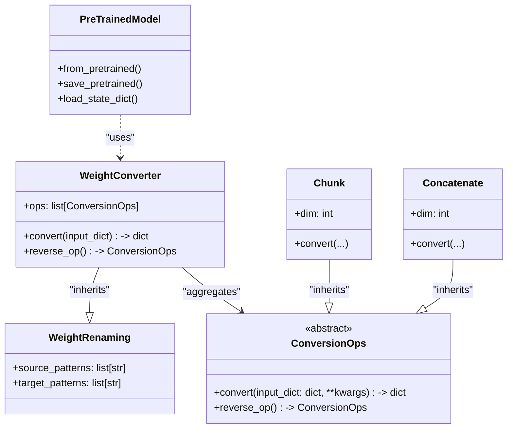

**Sources:**  
[src/transformers/core_model_loading.py:49-110]()

---

## Integration with Quantization & Offloading

The loading and conversion system seamlessly integrates with hardware-aware optimizations:

- **Quantization Support (`HfQuantizer`)**: Custom quantizers can be integrated as conversion ops or invoked during loading to convert weights into low-bit precision formats on-the-fly (e.g., bitsandbytes, GPTQ, AWQ) via `src/transformers/quantizers/auto.py` [98-99]().
- **Accelerate Offloading**: Device maps and disk offloading strategies from `src/transformers/integrations/accelerate.py` [69-77]() allow memory-efficient loading for large models by offloading tensors to different devices or disk during loading.

**Sources:**  
[src/transformers/modeling_utils.py:97-99](), [src/transformers/integrations/accelerate.py:69-77]()

---

## Summary

The Model Weight Loading & Conversion subsystem offers a powerful and modular framework for handling a wide variety of checkpoint formats and model architectures within Hugging Face Transformers:

- Provides universal key renaming and regex-based mapping to handle arbitrary checkpoint key patterns.
- Applies versatile tensor transformation ops to reshape, split, merge, and reorder weights on load.
- Supports mixture-of-experts expert stacking for MoE architectures.
- Aligns rotary positional embedding tensors across diverse frameworks through permutation.
- Integrates with quantization and offloading to optimize large model loading.

**Sources:**  
[src/transformers/core_model_loading.py:30-110](), [src/transformers/conversion_mapping.py:1-40](), [src/transformers/modeling_utils.py:49-55]()

---

# Page: Common Modeling Layers & Utilities

# Common Modeling Layers & Utilities

<details>
<summary>Relevant source files</summary>

The following files were used as context for generating this wiki page:

- [docs/source/en/model_doc/inkling.md](docs/source/en/model_doc/inkling.md)
- [docs/source/en/model_doc/mm-grounding-dino.md](docs/source/en/model_doc/mm-grounding-dino.md)
- [docs/source/en/model_doc/phi4_multimodal.md](docs/source/en/model_doc/phi4_multimodal.md)
- [src/transformers/generation/stopping_criteria.py](src/transformers/generation/stopping_criteria.py)
- [src/transformers/loss/loss_d_fine.py](src/transformers/loss/loss_d_fine.py)
- [src/transformers/loss/loss_utils.py](src/transformers/loss/loss_utils.py)
- [src/transformers/modeling_layers.py](src/transformers/modeling_layers.py)
- [src/transformers/modeling_rope_utils.py](src/transformers/modeling_rope_utils.py)
- [src/transformers/models/d_fine/configuration_d_fine.py](src/transformers/models/d_fine/configuration_d_fine.py)
- [src/transformers/models/d_fine/modeling_d_fine.py](src/transformers/models/d_fine/modeling_d_fine.py)
- [src/transformers/models/d_fine/modular_d_fine.py](src/transformers/models/d_fine/modular_d_fine.py)
- [src/transformers/models/deimv2/configuration_deimv2.py](src/transformers/models/deimv2/configuration_deimv2.py)
- [src/transformers/models/deimv2/modeling_deimv2.py](src/transformers/models/deimv2/modeling_deimv2.py)
- [src/transformers/models/deimv2/modular_deimv2.py](src/transformers/models/deimv2/modular_deimv2.py)
- [src/transformers/models/grounding_dino/modeling_grounding_dino.py](src/transformers/models/grounding_dino/modeling_grounding_dino.py)
- [src/transformers/models/grounding_dino/processing_grounding_dino.py](src/transformers/models/grounding_dino/processing_grounding_dino.py)
- [src/transformers/models/inkling/configuration_inkling.py](src/transformers/models/inkling/configuration_inkling.py)
- [src/transformers/models/inkling/feature_extraction_inkling.py](src/transformers/models/inkling/feature_extraction_inkling.py)
- [src/transformers/models/inkling/image_processing_inkling.py](src/transformers/models/inkling/image_processing_inkling.py)
- [src/transformers/models/inkling/modeling_inkling.py](src/transformers/models/inkling/modeling_inkling.py)
- [src/transformers/models/inkling/modular_inkling.py](src/transformers/models/inkling/modular_inkling.py)
- [src/transformers/models/inkling/processing_inkling.py](src/transformers/models/inkling/processing_inkling.py)
- [src/transformers/models/jina_embeddings_v3/modeling_jina_embeddings_v3.py](src/transformers/models/jina_embeddings_v3/modeling_jina_embeddings_v3.py)
- [src/transformers/models/jina_embeddings_v3/modular_jina_embeddings_v3.py](src/transformers/models/jina_embeddings_v3/modular_jina_embeddings_v3.py)
- [src/transformers/models/llama/configuration_llama.py](src/transformers/models/llama/configuration_llama.py)
- [src/transformers/models/mistral/configuration_mistral.py](src/transformers/models/mistral/configuration_mistral.py)
- [src/transformers/models/mm_grounding_dino/__init__.py](src/transformers/models/mm_grounding_dino/__init__.py)
- [src/transformers/models/mm_grounding_dino/configuration_mm_grounding_dino.py](src/transformers/models/mm_grounding_dino/configuration_mm_grounding_dino.py)
- [src/transformers/models/mm_grounding_dino/convert_mm_grounding_dino_to_hf.py](src/transformers/models/mm_grounding_dino/convert_mm_grounding_dino_to_hf.py)
- [src/transformers/models/mm_grounding_dino/modeling_mm_grounding_dino.py](src/transformers/models/mm_grounding_dino/modeling_mm_grounding_dino.py)
- [src/transformers/models/mm_grounding_dino/modular_mm_grounding_dino.py](src/transformers/models/mm_grounding_dino/modular_mm_grounding_dino.py)
- [src/transformers/models/nomic_bert/modeling_nomic_bert.py](src/transformers/models/nomic_bert/modeling_nomic_bert.py)
- [src/transformers/models/phi4_multimodal/convert_phi4_multimodal_weights_to_hf.py](src/transformers/models/phi4_multimodal/convert_phi4_multimodal_weights_to_hf.py)
- [src/transformers/models/phi4_multimodal/processing_phi4_multimodal.py](src/transformers/models/phi4_multimodal/processing_phi4_multimodal.py)
- [src/transformers/models/pp_doclayout_v2/modeling_pp_doclayout_v2.py](src/transformers/models/pp_doclayout_v2/modeling_pp_doclayout_v2.py)
- [src/transformers/models/pp_doclayout_v2/modular_pp_doclayout_v2.py](src/transformers/models/pp_doclayout_v2/modular_pp_doclayout_v2.py)
- [src/transformers/models/pp_doclayout_v3/image_processing_pp_doclayout_v3.py](src/transformers/models/pp_doclayout_v3/image_processing_pp_doclayout_v3.py)
- [src/transformers/models/pp_doclayout_v3/modeling_pp_doclayout_v3.py](src/transformers/models/pp_doclayout_v3/modeling_pp_doclayout_v3.py)
- [src/transformers/models/pp_doclayout_v3/modular_pp_doclayout_v3.py](src/transformers/models/pp_doclayout_v3/modular_pp_doclayout_v3.py)
- [src/transformers/models/rt_detr/configuration_rt_detr.py](src/transformers/models/rt_detr/configuration_rt_detr.py)
- [src/transformers/models/rt_detr/modeling_rt_detr.py](src/transformers/models/rt_detr/modeling_rt_detr.py)
- [src/transformers/models/rt_detr/modular_rt_detr.py](src/transformers/models/rt_detr/modular_rt_detr.py)
- [src/transformers/models/rt_detr_v2/configuration_rt_detr_v2.py](src/transformers/models/rt_detr_v2/configuration_rt_detr_v2.py)
- [src/transformers/models/rt_detr_v2/modeling_rt_detr_v2.py](src/transformers/models/rt_detr_v2/modeling_rt_detr_v2.py)
- [src/transformers/models/rt_detr_v2/modular_rt_detr_v2.py](src/transformers/models/rt_detr_v2/modular_rt_detr_v2.py)
- [src/transformers/models/tvp/modeling_tvp.py](src/transformers/models/tvp/modeling_tvp.py)
- [src/transformers/pytorch_utils.py](src/transformers/pytorch_utils.py)
- [tests/generation/test_stopping_criteria.py](tests/generation/test_stopping_criteria.py)
- [tests/models/d_fine/test_modeling_d_fine.py](tests/models/d_fine/test_modeling_d_fine.py)
- [tests/models/deimv2/test_modeling_deimv2.py](tests/models/deimv2/test_modeling_deimv2.py)
- [tests/models/grounding_dino/test_modeling_grounding_dino.py](tests/models/grounding_dino/test_modeling_grounding_dino.py)
- [tests/models/inkling/test_modeling_inkling.py](tests/models/inkling/test_modeling_inkling.py)
- [tests/models/inkling/test_processing_inkling.py](tests/models/inkling/test_processing_inkling.py)
- [tests/models/jina_embeddings_v3/test_modeling_jina_embeddings_v3.py](tests/models/jina_embeddings_v3/test_modeling_jina_embeddings_v3.py)
- [tests/models/mm_grounding_dino/test_modeling_mm_grounding_dino.py](tests/models/mm_grounding_dino/test_modeling_mm_grounding_dino.py)
- [tests/models/nomic_bert/test_modeling_nomic_bert.py](tests/models/nomic_bert/test_modeling_nomic_bert.py)
- [tests/models/phi4_multimodal/test_processing_phi4_multimodal.py](tests/models/phi4_multimodal/test_processing_phi4_multimodal.py)
- [tests/models/pp_doclayout_v2/test_modeling_pp_doclayout_v2.py](tests/models/pp_doclayout_v2/test_modeling_pp_doclayout_v2.py)
- [tests/models/pp_doclayout_v3/test_image_processing_pp_doclayout_v3.py](tests/models/pp_doclayout_v3/test_image_processing_pp_doclayout_v3.py)
- [tests/models/pp_doclayout_v3/test_modeling_pp_doclayout_v3.py](tests/models/pp_doclayout_v3/test_modeling_pp_doclayout_v3.py)
- [tests/models/rt_detr/test_modeling_rt_detr.py](tests/models/rt_detr/test_modeling_rt_detr.py)
- [tests/models/rt_detr_v2/test_modeling_rt_detr_v2.py](tests/models/rt_detr_v2/test_modeling_rt_detr_v2.py)
- [tests/models/tvp/test_modeling_tvp.py](tests/models/tvp/test_modeling_tvp.py)
- [tests/utils/test_modeling_rope_utils.py](tests/utils/test_modeling_rope_utils.py)

</details>


This section details the shared building blocks and utility functions used across model implementations in the Transformers library. These utilities ensure architectural consistency, provide optimized implementations for common operations such as Rotary Positional Embeddings (RoPE), manage complex logic including gradient checkpointing and attention masking, and unify loss calculation strategies across diverse tasks.

The main components covered include:
- `GradientCheckpointingLayer` as a base for activation checkpointing support in `[src/transformers/modeling_layers.py:53-110]()`,
- Utilities from `[src/transformers/modeling_layers.py]()` for common reusable layers and heads,
- Masking utilities from `[src/transformers/masking_utils.py]()` for attention mask generation,
- Advanced RoPE variants and dynamic update mechanisms in `[src/transformers/modeling_rope_utils.py:34-130]()`,
- Helper utilities for PyTorch in `[src/transformers/pytorch_utils.py:50-179]()`,
- The loss subpackage under `[src/transformers/loss/loss_utils.py:1-201]()` covering language modeling, sequence classification, segmentation, object detection, and speech recognition losses.

---

## Gradient Checkpointing Infrastructure

### Overview

Gradient checkpointing allows trading computation for memory efficiency during training by saving fewer intermediate activations and recomputing them on the backward pass. The Transformers library standardizes checkpointing support with a base class `GradientCheckpointingLayer` defined in `[src/transformers/modeling_layers.py:53-110]()` that can be extended by model layers.

### Implementation Details

- **Class:** `GradientCheckpointingLayer` inherits from `torch.nn.Module`.
- Overrides the `__call__` method to intercept forward calls.
- When `self.gradient_checkpointing` is `True` and the model is in training mode:
  - It disables caching-related keyword arguments like `use_cache`, `past_key_values`, and `layer_past` to avoid conflicts when recomputing activations.
  - Logs a warning once when modifying these arguments.
  - Calls the assigned checkpointing function `_gradient_checkpointing_func` which wraps the normal forward with checkpointing enabled.
  - Inputs that require gradients are passed as positional arguments to ensure gradient correctness during recomputation.
- Otherwise, it calls the usual forward pass.

### Usage Notes

- Inputs requiring gradients (e.g., hidden states) **must be passed as positional arguments** during checkpointing with `use_reentrant=True`.
- Passing such inputs as keyword arguments can break correct gradient propagation during recomputation.

### Diagram: `GradientCheckpointingLayer` Call Flow

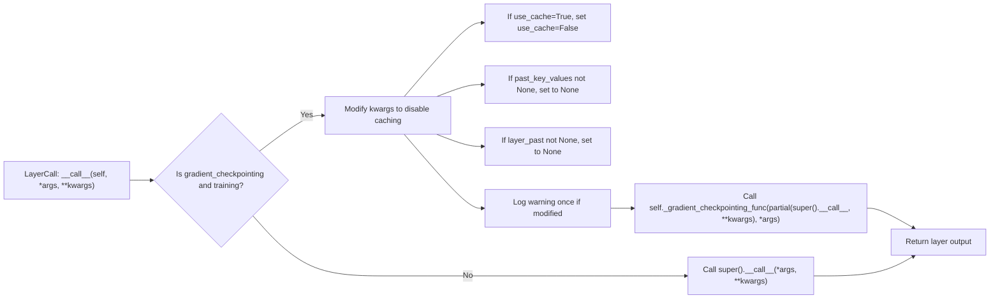

Sources: `[src/transformers/modeling_layers.py:53-110]()`

---

## Rotary Positional Embeddings (RoPE) Utilities

### Overview of RoPE

Rotary Positional Embeddings enhance transformer models by encoding position information through rotations in the query and key vectors within attention. This approach allows effective relative positional representation and better extrapolation to longer sequences.

The library supports multiple RoPE variants via `[src/transformers/modeling_rope_utils.py]()`, including:
- **Default RoPE:** Classic sinusoidal frequency-based embeddings.
- **Linear scaling RoPE:** Frequencies scale linearly with position.
- **Dynamic NTK RoPE:** Dynamic recomputation of frequencies allowing variable sequence lengths.
- **YaRN RoPE:** A dynamic variant that uses beta parameters for scaling frequencies.
- **LongRoPE:** Switches between short and long frequency factors based on input sequence length.

### Dynamic RoPE Frequency Updates

Some RoPE variants update their inverse frequency tensors (`inv_freq`) dynamically during forward passes to handle sequence length changes or scaling properties. This dynamic update is managed by the `@dynamic_rope_update` decorator in `[src/transformers/modeling_rope_utils.py:34-130]()`.

- For **dynamic NTK** RoPE: the `dynamic_frequency_update` function handles growth beyond cached lengths and resets for short sequences.
- For **LongRoPE**: the `longrope_frequency_update` switches between stored short and long frequency buffers depending on the input token positions.

### RoPE Parameter Initialization Functions

RoPE variants have corresponding parameter initialization functions producing inverse frequency tensors and optional scaling factors. These functions are mapped in `ROPE_INIT_FUNCTIONS`:

```python
ROPE_INIT_FUNCTIONS = {
    "default": _compute_default_rope_parameters,
    "linear": _compute_linear_scaling_rope_parameters,
    "dynamic": _compute_dynamic_ntk_rope_parameters,
    "yarn": _compute_yarn_rope_parameters,
    "longrope": _compute_longrope_parameters,
}
```

### Diagram: RoPE Parameter Initialization and Forward Update

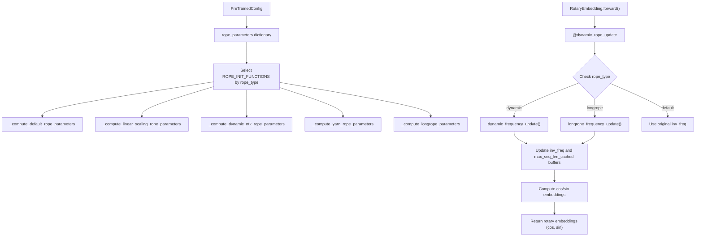

Sources: `[src/transformers/modeling_rope_utils.py:34-130]()`, `[src/transformers/modeling_rope_utils.py:255-303]()`

---

## Shared Modeling Layers in `modeling_layers.py`

This module defines reusable and generic modeling components used across multiple architectures, encouraging reuse and architectural uniformity.

### `GenericForSequenceClassification`

- Implemented in `[src/transformers/modeling_layers.py:114-163]()`.
- Instantiates a base model loaded from a given config (`AutoModel.from_config(config)`).
- Contains a linear classification head (`self.score`) on top of the final hidden states.
- The `forward` method routes inputs through the model and applies the classifier, supporting flexible input embedding modes and handling padding tokens carefully.

Sources: `[src/transformers/modeling_layers.py:53-163]()`

---

## Masking Utilities (`masking_utils.py`)

Attention masking is crucial to control token visibility in self-attention mechanisms across varying sequence lengths and architectures.

### Key Masking Utilities

- **`create_causal_mask`**: Generates standard lower-triangular masks to enforce autoregressive (causal) attention.
- **`bidirectional_mask_function`**: Supplies bidirectional mask logic useful for encoder models.
- **`create_sliding_window_causal_mask`**: Produces causal masks constrained to a limited sliding window across positions, enabling efficient long context handling.

Sources: `[src/transformers/masking_utils.py:1-100]()`, `[src/transformers/modeling_layers.py:30]()`

---

## PyTorch Utilities (`pytorch_utils.py`)

This module provides foundational PyTorch layers and helper functions used across models.

### Key Utilities

- **`Conv1D`** (`[src/transformers/pytorch_utils.py:95-122]()`): Implements a 1D convolutional layer consistent with GPT/OpenAI style, behaving like a linear projection with transposed weights.
- **`prune_linear_layer`** (`[src/transformers/pytorch_utils.py:61-92]()`): Prunes a linear layer by selecting a subset of indices in a specified dimension, returning a new `nn.Linear` layer with weights and biases remapped.
- **`apply_chunking_to_forward`** (`[src/transformers/pytorch_utils.py:124-179]()`): Splits input tensors into smaller chunks along a dimension, applies a forward function independently per chunk, and concatenates chunk outputs to reduce memory footprint.

Sources: `[src/transformers/pytorch_utils.py:50-179]()`

---

## Loss Subpackage (`loss/`)

The `loss/` subpackage standardizes loss calculations across diverse tasks, ranging from standard language modeling to object detection and speech recognition.

### Key Loss Functions and Modules

- **`fixed_cross_entropy` & `ForCausalLMLoss`**: Implemented in `[src/transformers/loss/loss_utils.py:32-71]()`, handles token upcasting, label shifting for autoregressive targets, and normalization by `num_items_in_batch`.
- **`ForMaskedLMLoss`, `ForSequenceClassificationLoss`, `ForQuestionAnsweringLoss`, `ForTokenClassification`, `ForSemanticSegmentationLoss`**: Standard losses for BERT-style masked language modeling, classification, regression, span QA, token classification, and segmentation (`[src/transformers/loss/loss_utils.py:74-201]()`).
- **Object Detection Losses**: Specialized bipartite matching and loss modules for detection models such as RT-DETR (`RTDetrForObjectDetectionLoss`, `[src/transformers/loss/loss_rt_detr.py]()`), D-FINE (`DFineForObjectDetectionLoss`, `[src/transformers/loss/loss_d_fine.py]()`), Deformable DETR (`DeformableDetrForObjectDetectionLoss`, `[src/transformers/loss/loss_deformable_detr.py]()`), and Grounding DINO (`GroundingDinoForObjectDetectionLoss`, `[src/transformers/loss/loss_grounding_dino.py]()`).
- **Speech Recognition Losses**: RNN-T and TDT loss integrations for Parakeet models (`ParakeetForRNNTLoss`, `ParakeetForTDTLoss`, `[src/transformers/loss/loss_rnnt.py]()`, `[src/transformers/loss/loss_tdt.py]()`).

Sources: `[src/transformers/loss/loss_utils.py:1-201]()`

---

# Summary Diagrams

## Mapping Natural Language Concepts to Code Entities

```mermaid
graph LR
    GradientCheckpointing["Gradient Checkpointing"] --> GCLayer["GradientCheckpointingLayer (modeling_layers.py)"]
    GradientCheckpointing --> CacheArgs["Cache Args Disabled During Checkpointing"]

    RoPE["Rotary Positional Embeddings (RoPE)"] --> RoPEDecorator["dynamic_rope_update (modeling_rope_utils.py)"]
    RoPEDecorator --> RoPEUpdate["dynamic_frequency_update / longrope_frequency_update"]
    RoPEUpdate --> InvFreqBuffers["inv_freq Buffers"]
    InvFreqBuffers --> RoPEForward["Cosine/Sine Embedding Computation"]

    AttentionMasks["Attention Masks"] --> CausalMask["create_causal_mask (masking_utils.py)"]
    AttentionMasks --> BiDirectional["bidirectional_mask_function (masking_utils.py)"]
    AttentionMasks --> SlidingWindow["create_sliding_window_causal_mask (masking_utils.py)"]

    PyTorchHelpers["PyTorch Utilities"] --> Conv1DLayer["Conv1D (pytorch_utils.py)"]
    PyTorchHelpers --> PruneLinear["prune_linear_layer (pytorch_utils.py)"]
    PyTorchHelpers --> ChunkingFn["apply_chunking_to_forward (pytorch_utils.py)"]

    LossSubpackage["Task Losses"] --> CausalLoss["ForCausalLMLoss (loss_utils.py)"]
    LossSubpackage --> DetectionLoss["RTDetrForObjectDetectionLoss (loss_rt_detr.py)"]
    LossSubpackage --> SpeechLoss["ParakeetForRNNTLoss (loss_rnnt.py)"]
```

## Data Flow: RoPE Parameters Initialization and Forward Update

```mermaid
sequenceDiagram
    participant Config as PreTrainedConfig
    participant RoPEInit as ROPE_INIT_FUNCTIONS
    participant RoPE as RotaryEmbedding Module
    participant Forward as Forward Pass

    Config->>RoPEInit: Provide rope_parameters dictionary
    RoPEInit->>RoPEInit: Compute inv_freq buffers and scale params
    RoPE->>Forward: Receive input x and position_ids
    Forward->>Forward: dynamic_rope_update decorator activates
    alt Dynamic RoPE Type
        Forward->>Forward: Call dynamic_frequency_update()
        Forward->>Forward: Update inv_freq buffers and cache length
    else LongRoPE Type
        Forward->>Forward: Call longrope_frequency_update()
        Forward->>Forward: Switch long_inv_freq buffers
    else Default RoPE
        Forward->>Forward: Use original inv_freq buffers
    end
    Forward->>Return: Return rotary embeddings (cos, sin)
```

---

# References & Sources

- Gradient Checkpointing Layer & Generic Heads: `[src/transformers/modeling_layers.py:53-110]()`
- Rotary Positional Embeddings & Dynamic Updates: `[src/transformers/modeling_rope_utils.py:34-130]()`, `[src/transformers/modeling_rope_utils.py:255-303]()`
- Masking Utilities: `[src/transformers/modeling_layers.py:29]()`, `[src/transformers/masking_utils.py:1-100]()`
- PyTorch Utilities (Conv1D, Pruning, Chunking): `[src/transformers/pytorch_utils.py:50-179]()`
- Loss Utilities & Subpackage: `[src/transformers/loss/loss_utils.py:1-201]()`

---

# Page: Model Architectures

# Model Architectures

<details>
<summary>Relevant source files</summary>

The following files were used as context for generating this wiki page:

- [docs/source/en/model_doc/granitevision.md](docs/source/en/model_doc/granitevision.md)
- [docs/source/en/model_doc/idefics2.md](docs/source/en/model_doc/idefics2.md)
- [docs/source/en/model_doc/llava.md](docs/source/en/model_doc/llava.md)
- [docs/source/en/model_doc/llava_next.md](docs/source/en/model_doc/llava_next.md)
- [docs/source/en/model_doc/llava_next_video.md](docs/source/en/model_doc/llava_next_video.md)
- [docs/source/en/model_doc/llava_onevision.md](docs/source/en/model_doc/llava_onevision.md)
- [docs/source/en/model_doc/minimax.md](docs/source/en/model_doc/minimax.md)
- [docs/source/en/model_doc/mistral.md](docs/source/en/model_doc/mistral.md)
- [docs/source/en/model_doc/mistral3.md](docs/source/en/model_doc/mistral3.md)
- [docs/source/en/model_doc/mixtral.md](docs/source/en/model_doc/mixtral.md)
- [docs/source/en/model_doc/qwen2.md](docs/source/en/model_doc/qwen2.md)
- [docs/source/en/model_doc/qwen2_5_vl.md](docs/source/en/model_doc/qwen2_5_vl.md)
- [docs/source/en/model_doc/qwen2_moe.md](docs/source/en/model_doc/qwen2_moe.md)
- [docs/source/en/model_doc/qwen2_vl.md](docs/source/en/model_doc/qwen2_vl.md)
- [docs/source/en/model_doc/seamless_m4t.md](docs/source/en/model_doc/seamless_m4t.md)
- [docs/source/en/model_doc/seamless_m4t_v2.md](docs/source/en/model_doc/seamless_m4t_v2.md)
- [docs/source/en/model_doc/splinter.md](docs/source/en/model_doc/splinter.md)
- [docs/source/en/model_doc/switch_transformers.md](docs/source/en/model_doc/switch_transformers.md)
- [docs/source/en/model_doc/video_llava.md](docs/source/en/model_doc/video_llava.md)
- [docs/source/en/model_doc/vipllava.md](docs/source/en/model_doc/vipllava.md)
- [docs/source/en/model_doc/xlm-roberta.md](docs/source/en/model_doc/xlm-roberta.md)
- [docs/source/en/tasks/prompting.md](docs/source/en/tasks/prompting.md)
- [src/transformers/models/cohere/modeling_cohere.py](src/transformers/models/cohere/modeling_cohere.py)
- [src/transformers/models/gemma/modeling_gemma.py](src/transformers/models/gemma/modeling_gemma.py)
- [src/transformers/models/llama/modeling_llama.py](src/transformers/models/llama/modeling_llama.py)
- [src/transformers/models/llava_next/convert_llava_next_weights_to_hf.py](src/transformers/models/llava_next/convert_llava_next_weights_to_hf.py)
- [src/transformers/models/llava_onevision/convert_llava_onevision_weights_to_hf.py](src/transformers/models/llava_onevision/convert_llava_onevision_weights_to_hf.py)
- [src/transformers/models/mistral/__init__.py](src/transformers/models/mistral/__init__.py)
- [src/transformers/models/mistral/modeling_mistral.py](src/transformers/models/mistral/modeling_mistral.py)
- [src/transformers/models/mixtral/__init__.py](src/transformers/models/mixtral/__init__.py)
- [src/transformers/models/mixtral/modeling_mixtral.py](src/transformers/models/mixtral/modeling_mixtral.py)
- [src/transformers/models/olmo/modeling_olmo.py](src/transformers/models/olmo/modeling_olmo.py)
- [src/transformers/models/persimmon/modeling_persimmon.py](src/transformers/models/persimmon/modeling_persimmon.py)
- [src/transformers/models/phi/modeling_phi.py](src/transformers/models/phi/modeling_phi.py)
- [src/transformers/models/phi3/modeling_phi3.py](src/transformers/models/phi3/modeling_phi3.py)
- [src/transformers/models/qwen2/__init__.py](src/transformers/models/qwen2/__init__.py)
- [src/transformers/models/qwen2/modeling_qwen2.py](src/transformers/models/qwen2/modeling_qwen2.py)
- [src/transformers/models/qwen2_moe/__init__.py](src/transformers/models/qwen2_moe/__init__.py)
- [src/transformers/models/qwen2_moe/modeling_qwen2_moe.py](src/transformers/models/qwen2_moe/modeling_qwen2_moe.py)
- [src/transformers/models/stablelm/modeling_stablelm.py](src/transformers/models/stablelm/modeling_stablelm.py)
- [src/transformers/models/starcoder2/modeling_starcoder2.py](src/transformers/models/starcoder2/modeling_starcoder2.py)
- [tests/models/minimax/test_modeling_minimax.py](tests/models/minimax/test_modeling_minimax.py)

</details>


The `transformers` library supports an extensive range of model architectures that enable applications across diverse modalities and tasks, including autoregressive language modeling, sequence-to-sequence generation, vision, audio processing, and multimodal fusion. These models follow a modular "single-file-per-model" design philosophy, which enhances maintainability and clarity. Almost all models inherit from the base class `PreTrainedModel`, offering standard utilities for weight loading, configuration handling, and shared core components such as attention mechanisms, normalization layers, and rotary positional embeddings.

This page provides a high-level taxonomy of the major model families implemented under `transformers/models/`. For detailed architectural descriptions, implementation specifics, and design patterns, please refer to the linked child pages.

---

### Architectural Taxonomy

Models are organized by architecture type and main modality focus. Foundational building blocks—including RMSNorm normalization variants, rotary positional embeddings (RoPE), and SwiGLU-style MLPs—are shared and adapted across multiple model families.

---

#### 3.1. Decoder-Only Language Models (LLMs)

Decoder-only models are autoregressive transformers predicting the next token based on previous tokens in a unidirectional manner. This architecture paradigm underpins most modern large language models (LLMs).

Representative models include:
- Llama (`src/transformers/models/llama/modeling_llama.py`)
- Mistral (`src/transformers/models/mistral/modeling_mistral.py`)
- Gemma (`src/transformers/models/gemma/modeling_gemma.py`)
- Qwen2/3 (`src/transformers/models/qwen2/modeling_qwen2.py`)
- Phi (`src/transformers/models/phi/modeling_phi.py`)
- Cohere (`src/transformers/models/cohere/modeling_cohere.py`)
- StableLM, Starcoder2, OLMo, Falcon, and others.

Common architectural elements include:
- **Normalization:** Variants of RMSNorm for stable training and quality, e.g., `LlamaRMSNorm` [src/transformers/models/llama/modeling_llama.py:52-70]() and `GemmaRMSNorm` [src/transformers/models/gemma/modeling_gemma.py:63-81]().
- **Rotary Positional Embeddings (RoPE):** Used to encode relative position information efficiently, implemented as classes like `LlamaRotaryEmbedding` [src/transformers/models/llama/modeling_llama.py:72-117](), `GemmaRotaryEmbedding` [src/transformers/models/gemma/modeling_gemma.py:99-144](), and `CohereRotaryEmbedding` [src/transformers/models/cohere/modeling_cohere.py:67-112]().
- **Attention Variants:** Includes grouped-query attention (GQA) and sliding window causal masking.
- **MLP Blocks:** SwiGLU-style gated MLPs combining gating and activation (e.g., `GemmaMLP` [src/transformers/models/gemma/modeling_gemma.py:83-97]()).

For a comprehensive survey of decoder-only LLM architectures, core components, and model-specific nuances, see [Decoder-Only Language Models (LLMs)](#3.1).

Sources:
- [src/transformers/models/llama/modeling_llama.py:26-153]()
- [src/transformers/models/mistral/modeling_mistral.py:14-146]()
- [src/transformers/models/gemma/modeling_gemma.py:1-159]()

---

#### 3.2. Mixture-of-Experts (MoE) Models

Mixture-of-Experts architectures enhance model capacity with conditional computation by routing input tokens to specialized expert neural subnetworks dynamically, increasing parameter efficiency without linear computational cost growth.

Key features:
- **Routing:** Top-k expert selection per token, implemented via classes like `MixtralTopKRouter` [src/transformers/models/mixtral/modeling_mixtral.py:95-111]().
- **Expert Layers:** Sparse expert MLP subnetworks process routed tokens independently, e.g., `MixtralSparseMoeBlock` [src/transformers/models/mixtral/modeling_mixtral.py:113-130]() and `Qwen2MoeMLP` [src/transformers/models/qwen2_moe/modeling_qwen2_moe.py:122-136]().
- **Normalization:** Adapted RMSNorm layers designed for MoE stability, such as `Qwen2MoeRMSNorm` [src/transformers/models/qwen2_moe/modeling_qwen2_moe.py:55-73]().

For details on MoE routing algorithms, expert parallelism, load balancing, and auxiliary loss strategies, see the child page [Mixture-of-Experts (MoE) Models](#3.2).

Sources:
- [src/transformers/models/mixtral/modeling_mixtral.py:55-145]()
- [src/transformers/models/qwen2_moe/modeling_qwen2_moe.py:55-146]()

---

#### 3.3. State Space & Hybrid Models

State space models (SSMs) and hybrids combine efficient sequence modeling with or without attention. SSMs capture long-range dependencies via recurrent state updates, often mixed with attention layers.

Examples include: Mamba, Jamba, FalconMamba/H1, NemotronH, Qwen3-Next, RWKV.

This family optimizes memory and computation for very long sequences and hybrid attention+SSM architectures. Detailed coverage is in [State Space & Hybrid Models](#3.3).

Sources:
- [src/transformers/models/llama/modeling_llama.py:26-45]()

---

#### 3.4. Encoder-Decoder & Sequence-to-Sequence Models

Encoder-decoder transformers simultaneously encode input sequences and decode output sequences, making them suitable for translation, summarization, and other seq2seq tasks.

Models: T5 and derivatives (e.g., T5Gemma), BART, mBART, Marian, Pegasus, M2M-100, NLLB, SwitchTransformers, LongT5.

Architectural focus:
- Cross-attention layers bridging encoder and decoder.
- Weight sharing options between encoder and decoder.
- Sequence-to-sequence generation pipelines.

See [Encoder-Decoder & Sequence-to-Sequence Models](#3.4) for comprehensive details.

Sources:
- [src/transformers/models/llama/modeling_llama.py:26-45]()

---

#### 3.5. Encoder-Only & Embedding Models

Encoder-only models focus on bidirectional context encoding, widely used for masked language modeling, embeddings extraction, and classification.

Main groups:
- BERT-family: BERT, RoBERTa, XLM-R, ELECTRA, DeBERTa.
- Specialized variants: ModernBERT and its decoder variant.
- Non-Language encoders: ESM protein models trained on biological sequences.
- Retrieval and embedding solutions: ColPali, ColQwen2, and image model wrappers like those over timm.

For a deeper dive, see [Encoder-Only & Embedding Models](#3.5).

Sources:
- [src/transformers/models/llama/modeling_llama.py:26-45]()

---

#### 3.6. Vision Backbones & Object Detection

Vision transformers and related architectures support image classification, detection, and segmentation.

Models:
- Vision Transformers (ViT), DINOv2/v3, SigLIP, CLIP.
- Detection and segmentation: DETR, Deformable DETR, RT-DETR, D-FINE, Mask2Former, SAM family, Grounding DINO, OWL-ViT.

Utilities include backbone processing helpers optimized for vision tasks. Details: [Vision Backbones & Object Detection](#3.6).

Sources:
- [src/transformers/models/llama/modeling_llama.py:26-45]()

---

#### 3.7. Vision-Language Models

Vision-language models integrate textual and visual inputs in a multimodal transformer framework, enabling tasks like image captioning, VQA, and instruction-following models.

Representative models:
- LLaVA family, PaliGemma, BLIP/BLIP-2, InstructBLIP, Idefics2/3, SmolVLM, InternVL, Qwen2-VL/Qwen3-VL, GLM-4V, Janus, Gemma3.

Architectural highlights include image token expansion, multi-modal projection layers, and cross-modal fusion layers. Refer to [Vision-Language Models](#3.7) for coverage.

Sources:
- [src/transformers/models/llama/modeling_llama.py:26-45]()

---

#### 3.8. Audio & Speech Models

Models for speech recognition, text-to-speech, and audio codecs:
- Speech recognition: Whisper, Wav2Vec2, HuBERT, WavLM, SeamlessM4T, Parakeet, Voxtral.
- Text-to-speech: SpeechT5, Bark, VITS.
- Neural codecs: EnCodec, DAC, Mimi.

Techniques include CTC decoding, audio feature extraction, and vocoder integration. See [Audio & Speech Models](#3.8).

Sources:
- [src/transformers/models/llama/modeling_llama.py:26-45]()

---

#### 3.9. Multimodal Omni & Specialized Models

These span multiple simultaneous modalities such as text, vision, and audio, with integrated transformer backbones.

Examples: Qwen2.5-Omni, Qwen3-Omni, MusicGen, RAG, Qwen2-Audio, Kosmos-2.5, recurrent Gemma. See [Multimodal Omni & Specialized Models](#3.9) for details.

Sources:
- [src/transformers/models/llama/modeling_llama.py:26-45]()

---

### Architecture Mapping: Natural Language to Code Entities

To illustrate how the conceptual model families relate to specific code constructs within the codebase, the diagrams below bridge natural language structures and the concrete class names or functions implementing them.

#### Decoder-Only LLM Autoregressive Generation Flow
```mermaid
graph TD
    Input["UserPrompt"] --> GenMixin["GenerationMixin.generate()"]
    GenMixin --> LlamaModel["LlamaForCausalLM"]
    LlamaModel --> DecoderLayer["LlamaDecoderLayer"]
    DecoderLayer --> Attention["LlamaAttention"]
    DecoderLayer --> MLPBlock["LlamaMLP"]
    DecoderLayer --> RMSNorm["LlamaRMSNorm"]
    Attention --> RoPE["apply_rotary_pos_emb"]
    LlamaModel --> NextToken["PredictedNextToken"]
```
Sources:
- [src/transformers/models/llama/modeling_llama.py:26-153]()
- [src/transformers/models/mistral/modeling_mistral.py:14-146]()

#### Mixture-of-Experts (MoE) Token Routing and Expert Layers
```mermaid
graph TD
    Tokens["InputHiddenStates"] --> RMSNorm["MixtralRMSNorm"]
    RMSNorm --> Router["MixtralTopKRouter"]
    Router --> Experts["MixtralExperts"]
    Experts --> SparseBlock["MixtralSparseMoeBlock"]
    SparseBlock --> Tokens
```
Sources:
- [src/transformers/models/mixtral/modeling_mixtral.py:55-145]()

---

### Summary Table: Model Families Overview

| Model Family                     | Representative Classes / Files                                         | Primary Modality     | Key Architectural Features                                  |
|---------------------------------|-----------------------------------------------------------------------|---------------------|-------------------------------------------------------------|
| **Decoder-Only LLMs**            | `LlamaForCausalLM` [src/transformers/models/llama/modeling_llama.py]() | Text                | RMSNorm, RoPE, GQA attention, SwiGLU MLP, causal masking    |
| **Mixture-of-Experts (MoE)**    | `MixtralSparseMoeBlock` [src/transformers/models/mixtral/modeling_mixtral.py](), `Qwen2MoeMLP` [src/transformers/models/qwen2_moe/modeling_qwen2_moe.py]() | Text                | Top-k routing, sparse MLP experts, load balancing, expert parallelism |
| **State Space & Hybrid**         | Various non-attention and hybrid SSM models [see #3.3 child page]     | Sequence (Text etc.) | SSM recurrence, selective state spaces, hybrid attention+SSM|
| **Encoder-Decoder & Seq2Seq**   | T5, BART, Marian, Pegasus, NLLB, SwitchTransformers [see #3.4]       | Text                | Cross-attention, encoder-decoder sharing, seq2seq generation|
| **Encoder-Only & Embedding**    | BERT-family, ModernBERT, ESM, retrieval (e.g., ColPali) [see #3.5]    | Text / Embeddings   | Masked LM, embedding head, classification                    |
| **Vision Backbones & Detection**| ViT, DINOv2, DETR, Mask2Former, SAM [see #3.6]                       | Images               | Patch embedding, multi-head attention, detection heads      |
| **Vision-Language Models**       | LLaVA, BLIP, Qwen2-VL / Qwen3-VL, GLM-4V [see #3.7]                  | Images + Text        | Image token expansion, multimodal fusion, projectors         |
| **Audio & Speech Models**        | Whisper, Wav2Vec2, Bark, EnCodec [see #3.8]                         | Audio                | Audio features, CTC decoding, neural vocoders               |
| **Multimodal Omni & Specialized**| Qwen2.5-Omni, MusicGen, Kosmos-2.5 [see #3.9]                       | Text, Images, Audio  | Unified transformers, multimodal embedding, shared KV cache |

Sources:
- [src/transformers/models/llama/modeling_llama.py:1-153]()
- [src/transformers/models/mixtral/modeling_mixtral.py:1-145]()

---

# Page: Decoder-Only Language Models (LLMs)

# Decoder-Only Language Models (LLMs)

<details>
<summary>Relevant source files</summary>

The following files were used as context for generating this wiki page:

- [docs/source/en/model_doc/bark.md](docs/source/en/model_doc/bark.md)
- [docs/source/en/model_doc/gemma2.md](docs/source/en/model_doc/gemma2.md)
- [docs/source/en/model_doc/gemma4.md](docs/source/en/model_doc/gemma4.md)
- [docs/source/en/model_doc/gpt2.md](docs/source/en/model_doc/gpt2.md)
- [docs/source/en/model_doc/gpt_neox.md](docs/source/en/model_doc/gpt_neox.md)
- [docs/source/en/model_doc/kyutai_speech_to_text.md](docs/source/en/model_doc/kyutai_speech_to_text.md)
- [docs/source/ko/model_doc/gemma2.md](docs/source/ko/model_doc/gemma2.md)
- [src/transformers/models/bamba/configuration_bamba.py](src/transformers/models/bamba/configuration_bamba.py)
- [src/transformers/models/bamba/convert_mamba_ssm_checkpoint.py](src/transformers/models/bamba/convert_mamba_ssm_checkpoint.py)
- [src/transformers/models/bloom/modeling_bloom.py](src/transformers/models/bloom/modeling_bloom.py)
- [src/transformers/models/codegen/modeling_codegen.py](src/transformers/models/codegen/modeling_codegen.py)
- [src/transformers/models/cohere/modeling_cohere.py](src/transformers/models/cohere/modeling_cohere.py)
- [src/transformers/models/cohere2/configuration_cohere2.py](src/transformers/models/cohere2/configuration_cohere2.py)
- [src/transformers/models/cohere2/modeling_cohere2.py](src/transformers/models/cohere2/modeling_cohere2.py)
- [src/transformers/models/cohere2/modular_cohere2.py](src/transformers/models/cohere2/modular_cohere2.py)
- [src/transformers/models/ctrl/modeling_ctrl.py](src/transformers/models/ctrl/modeling_ctrl.py)
- [src/transformers/models/decision_transformer/modeling_decision_transformer.py](src/transformers/models/decision_transformer/modeling_decision_transformer.py)
- [src/transformers/models/diffllama/modeling_diffllama.py](src/transformers/models/diffllama/modeling_diffllama.py)
- [src/transformers/models/diffllama/modular_diffllama.py](src/transformers/models/diffllama/modular_diffllama.py)
- [src/transformers/models/diffusion_gemma/configuration_diffusion_gemma.py](src/transformers/models/diffusion_gemma/configuration_diffusion_gemma.py)
- [src/transformers/models/diffusion_gemma/convert_diffusion_gemma_weights.py](src/transformers/models/diffusion_gemma/convert_diffusion_gemma_weights.py)
- [src/transformers/models/encoder_decoder/modeling_encoder_decoder.py](src/transformers/models/encoder_decoder/modeling_encoder_decoder.py)
- [src/transformers/models/falcon/modeling_falcon.py](src/transformers/models/falcon/modeling_falcon.py)
- [src/transformers/models/falcon_h1/configuration_falcon_h1.py](src/transformers/models/falcon_h1/configuration_falcon_h1.py)
- [src/transformers/models/gemma/modeling_gemma.py](src/transformers/models/gemma/modeling_gemma.py)
- [src/transformers/models/gemma/modular_gemma.py](src/transformers/models/gemma/modular_gemma.py)
- [src/transformers/models/gemma2/modeling_gemma2.py](src/transformers/models/gemma2/modeling_gemma2.py)
- [src/transformers/models/gemma2/modular_gemma2.py](src/transformers/models/gemma2/modular_gemma2.py)
- [src/transformers/models/gemma3/configuration_gemma3.py](src/transformers/models/gemma3/configuration_gemma3.py)
- [src/transformers/models/gemma3/modeling_gemma3.py](src/transformers/models/gemma3/modeling_gemma3.py)
- [src/transformers/models/gemma3/modular_gemma3.py](src/transformers/models/gemma3/modular_gemma3.py)
- [src/transformers/models/gemma3n/configuration_gemma3n.py](src/transformers/models/gemma3n/configuration_gemma3n.py)
- [src/transformers/models/gemma3n/modeling_gemma3n.py](src/transformers/models/gemma3n/modeling_gemma3n.py)
- [src/transformers/models/gemma3n/modular_gemma3n.py](src/transformers/models/gemma3n/modular_gemma3n.py)
- [src/transformers/models/gemma4/configuration_gemma4.py](src/transformers/models/gemma4/configuration_gemma4.py)
- [src/transformers/models/gemma4/modeling_gemma4.py](src/transformers/models/gemma4/modeling_gemma4.py)
- [src/transformers/models/gemma4/modular_gemma4.py](src/transformers/models/gemma4/modular_gemma4.py)
- [src/transformers/models/gemma4_unified/configuration_gemma4_unified.py](src/transformers/models/gemma4_unified/configuration_gemma4_unified.py)
- [src/transformers/models/gemma4_unified/convert_gemma4_unified_weights.py](src/transformers/models/gemma4_unified/convert_gemma4_unified_weights.py)
- [src/transformers/models/gemma4_unified/modeling_gemma4_unified.py](src/transformers/models/gemma4_unified/modeling_gemma4_unified.py)
- [src/transformers/models/gemma4_unified/modular_gemma4_unified.py](src/transformers/models/gemma4_unified/modular_gemma4_unified.py)
- [src/transformers/models/gpt2/modeling_gpt2.py](src/transformers/models/gpt2/modeling_gpt2.py)
- [src/transformers/models/gpt_bigcode/modeling_gpt_bigcode.py](src/transformers/models/gpt_bigcode/modeling_gpt_bigcode.py)
- [src/transformers/models/gpt_neo/modeling_gpt_neo.py](src/transformers/models/gpt_neo/modeling_gpt_neo.py)
- [src/transformers/models/gpt_neox/modeling_gpt_neox.py](src/transformers/models/gpt_neox/modeling_gpt_neox.py)
- [src/transformers/models/gpt_neox_japanese/modeling_gpt_neox_japanese.py](src/transformers/models/gpt_neox_japanese/modeling_gpt_neox_japanese.py)
- [src/transformers/models/gptj/modeling_gptj.py](src/transformers/models/gptj/modeling_gptj.py)
- [src/transformers/models/granitemoehybrid/configuration_granitemoehybrid.py](src/transformers/models/granitemoehybrid/configuration_granitemoehybrid.py)
- [src/transformers/models/granitemoehybrid/modular_granitemoehybrid.py](src/transformers/models/granitemoehybrid/modular_granitemoehybrid.py)
- [src/transformers/models/granitemoeshared/modular_granitemoeshared.py](src/transformers/models/granitemoeshared/modular_granitemoeshared.py)
- [src/transformers/models/helium/configuration_helium.py](src/transformers/models/helium/configuration_helium.py)
- [src/transformers/models/kyutai_speech_to_text/__init__.py](src/transformers/models/kyutai_speech_to_text/__init__.py)
- [src/transformers/models/kyutai_speech_to_text/configuration_kyutai_speech_to_text.py](src/transformers/models/kyutai_speech_to_text/configuration_kyutai_speech_to_text.py)
- [src/transformers/models/kyutai_speech_to_text/convert_kyutai_speech_to_text_to_hf.py](src/transformers/models/kyutai_speech_to_text/convert_kyutai_speech_to_text_to_hf.py)
- [src/transformers/models/kyutai_speech_to_text/feature_extraction_kyutai_speech_to_text.py](src/transformers/models/kyutai_speech_to_text/feature_extraction_kyutai_speech_to_text.py)
- [src/transformers/models/kyutai_speech_to_text/modeling_kyutai_speech_to_text.py](src/transformers/models/kyutai_speech_to_text/modeling_kyutai_speech_to_text.py)
- [src/transformers/models/kyutai_speech_to_text/modular_kyutai_speech_to_text.py](src/transformers/models/kyutai_speech_to_text/modular_kyutai_speech_to_text.py)
- [src/transformers/models/llama/modeling_llama.py](src/transformers/models/llama/modeling_llama.py)
- [src/transformers/models/lxmert/modeling_lxmert.py](src/transformers/models/lxmert/modeling_lxmert.py)
- [src/transformers/models/mimi/modeling_mimi.py](src/transformers/models/mimi/modeling_mimi.py)
- [src/transformers/models/mistral/modeling_mistral.py](src/transformers/models/mistral/modeling_mistral.py)
- [src/transformers/models/mixtral/modeling_mixtral.py](src/transformers/models/mixtral/modeling_mixtral.py)
- [src/transformers/models/moshi/modeling_moshi.py](src/transformers/models/moshi/modeling_moshi.py)
- [src/transformers/models/mpt/modeling_mpt.py](src/transformers/models/mpt/modeling_mpt.py)
- [src/transformers/models/olmo/modeling_olmo.py](src/transformers/models/olmo/modeling_olmo.py)
- [src/transformers/models/openai/modeling_openai.py](src/transformers/models/openai/modeling_openai.py)
- [src/transformers/models/opt/modeling_opt.py](src/transformers/models/opt/modeling_opt.py)
- [src/transformers/models/persimmon/modeling_persimmon.py](src/transformers/models/persimmon/modeling_persimmon.py)
- [src/transformers/models/phi/modeling_phi.py](src/transformers/models/phi/modeling_phi.py)
- [src/transformers/models/phi3/modeling_phi3.py](src/transformers/models/phi3/modeling_phi3.py)
- [src/transformers/models/qwen2/modeling_qwen2.py](src/transformers/models/qwen2/modeling_qwen2.py)
- [src/transformers/models/qwen2_moe/modeling_qwen2_moe.py](src/transformers/models/qwen2_moe/modeling_qwen2_moe.py)
- [src/transformers/models/recurrent_gemma/modeling_recurrent_gemma.py](src/transformers/models/recurrent_gemma/modeling_recurrent_gemma.py)
- [src/transformers/models/speech_encoder_decoder/modeling_speech_encoder_decoder.py](src/transformers/models/speech_encoder_decoder/modeling_speech_encoder_decoder.py)
- [src/transformers/models/stablelm/modeling_stablelm.py](src/transformers/models/stablelm/modeling_stablelm.py)
- [src/transformers/models/starcoder2/modeling_starcoder2.py](src/transformers/models/starcoder2/modeling_starcoder2.py)
- [src/transformers/models/t5gemma2/configuration_t5gemma2.py](src/transformers/models/t5gemma2/configuration_t5gemma2.py)
- [src/transformers/models/t5gemma2/modeling_t5gemma2.py](src/transformers/models/t5gemma2/modeling_t5gemma2.py)
- [src/transformers/models/t5gemma2/modular_t5gemma2.py](src/transformers/models/t5gemma2/modular_t5gemma2.py)
- [src/transformers/models/trocr/modeling_trocr.py](src/transformers/models/trocr/modeling_trocr.py)
- [src/transformers/models/vision_encoder_decoder/modeling_vision_encoder_decoder.py](src/transformers/models/vision_encoder_decoder/modeling_vision_encoder_decoder.py)
- [src/transformers/models/xglm/modeling_xglm.py](src/transformers/models/xglm/modeling_xglm.py)
- [tests/models/aya_vision/test_modeling_aya_vision.py](tests/models/aya_vision/test_modeling_aya_vision.py)
- [tests/models/cohere2/test_modeling_cohere2.py](tests/models/cohere2/test_modeling_cohere2.py)
- [tests/models/deepseek_v3/test_modeling_deepseek_v3.py](tests/models/deepseek_v3/test_modeling_deepseek_v3.py)
- [tests/models/diffllama/test_modeling_diffllama.py](tests/models/diffllama/test_modeling_diffllama.py)
- [tests/models/fast_vlm/test_modeling_fast_vlm.py](tests/models/fast_vlm/test_modeling_fast_vlm.py)
- [tests/models/gemma/test_modeling_gemma.py](tests/models/gemma/test_modeling_gemma.py)
- [tests/models/gemma2/test_modeling_gemma2.py](tests/models/gemma2/test_modeling_gemma2.py)
- [tests/models/gemma3/test_modeling_gemma3.py](tests/models/gemma3/test_modeling_gemma3.py)
- [tests/models/gemma3n/test_modeling_gemma3n.py](tests/models/gemma3n/test_modeling_gemma3n.py)
- [tests/models/gemma4/test_modeling_gemma4.py](tests/models/gemma4/test_modeling_gemma4.py)
- [tests/models/gemma4_unified/test_modeling_gemma4_unified.py](tests/models/gemma4_unified/test_modeling_gemma4_unified.py)
- [tests/models/gpt2/test_modeling_gpt2.py](tests/models/gpt2/test_modeling_gpt2.py)
- [tests/models/gpt_neox/test_modeling_gpt_neox.py](tests/models/gpt_neox/test_modeling_gpt_neox.py)
- [tests/models/granitemoehybrid/test_modeling_granitemoehybrid.py](tests/models/granitemoehybrid/test_modeling_granitemoehybrid.py)
- [tests/models/lighton_ocr/test_modeling_lighton_ocr.py](tests/models/lighton_ocr/test_modeling_lighton_ocr.py)
- [tests/models/llama/test_modeling_llama.py](tests/models/llama/test_modeling_llama.py)
- [tests/models/mistral/test_modeling_mistral.py](tests/models/mistral/test_modeling_mistral.py)
- [tests/models/mixtral/test_modeling_mixtral.py](tests/models/mixtral/test_modeling_mixtral.py)
- [tests/models/olmo/test_modeling_olmo.py](tests/models/olmo/test_modeling_olmo.py)
- [tests/models/paddleocr_vl/test_modeling_paddleocr_vl.py](tests/models/paddleocr_vl/test_modeling_paddleocr_vl.py)
- [tests/models/paligemma2/test_modeling_paligemma2.py](tests/models/paligemma2/test_modeling_paligemma2.py)
- [tests/models/perception_lm/test_modeling_perception_lm.py](tests/models/perception_lm/test_modeling_perception_lm.py)
- [tests/models/phi3/test_modeling_phi3.py](tests/models/phi3/test_modeling_phi3.py)
- [tests/models/qwen2/test_modeling_qwen2.py](tests/models/qwen2/test_modeling_qwen2.py)
- [tests/models/qwen2_moe/test_modeling_qwen2_moe.py](tests/models/qwen2_moe/test_modeling_qwen2_moe.py)
- [tests/models/qwen3/test_modeling_qwen3.py](tests/models/qwen3/test_modeling_qwen3.py)
- [tests/models/qwen3_moe/test_modeling_qwen3_moe.py](tests/models/qwen3_moe/test_modeling_qwen3_moe.py)
- [tests/models/recurrent_gemma/test_modeling_recurrent_gemma.py](tests/models/recurrent_gemma/test_modeling_recurrent_gemma.py)
- [tests/models/t5gemma2/test_modeling_t5gemma2.py](tests/models/t5gemma2/test_modeling_t5gemma2.py)

</details>


Modern autoregressive Language Models (LLMs) in the Transformers library follow a decoder-only transformer architecture pattern. This design processes input token sequences through a stack of transformer decoder layers under causal masking, enforcing autoregressive generation where each token prediction depends only on previously generated tokens.

---

## Core Architecture Pattern

Popular decoder-only LLMs such as Llama, Mistral, Gemma (and its variants), Qwen2/3, Phi, Cohere, StableLM, Starcoder2, OLMo, Falcon, GPT-2, and GPT-NeoX share this general structure:

- **Input Embeddings Layer**: Converts input token IDs to dense hidden vectors, often scaled by a learned or static factor.
- **Transformer Decoder Blocks Stack**: Multiple layers consisting of:
  - Multi-headed self-attention sublayer, often enhanced by Rotary Positional Embeddings (RoPE) to encode relative positional information.
  - SwiGLU-activated feed-forward MLP layers (also called gated linear units).
  - Norm layers (usually RMSNorm variants) applied before or after submodules.
- **Causal Masking**: Ensures tokens can only attend to previous tokens and themselves, preserving autoregressiveness.
- **Output Head (Language Modeling Head)**: A linear projection layer that maps final hidden states to vocabulary logits for next token prediction.

Attention mechanisms may incorporate Grouped-Query Attention (GQA) to reduce memory and compute by sharing keys/values across groups of query heads, as used in Mistral, Llama 3, Falcon, etc.

Sources: [src/transformers/models/llama/modeling_llama.py:53-159](), [src/transformers/models/mistral/modeling_mistral.py:34-118]()

---

## Data Flow and Entity Mapping in Llama

The following diagram provides a technical mapping of Llama's key components from input tokens to final logits, bridging natural language concepts with code entities:

```mermaid
graph TD
    subgraph Input_Processing
        Input["input_ids"] --> Embed["LlamaModel.embed_tokens"]
    end

    subgraph Transformer_Block_LlamaDecoderLayer
        Embed --> Norm1["LlamaRMSNorm"]
        Norm1 --> Attn["LlamaAttention"]
        Attn --> Residual1["ResidualConnection1"]
        Residual1 --> Norm2["LlamaRMSNorm"]
        Norm2 --> MLP["LlamaMLP"]
        MLP --> Residual2["ResidualConnection2"]
    end

    subgraph Output_Head
        Residual2 --> FinalNorm["LlamaRMSNorm"]
        FinalNorm --> LMHead["LlamaForCausalLM.lm_head"]
    end

    subgraph Attention_Subcomponents
        Attn --> RoPE["LlamaRotaryEmbedding"]
        RoPE --> applyRoPE["apply_rotary_pos_emb"]
    end
```

- Input tokens enter `LlamaModel` through `embed_tokens` [src/transformers/models/llama/modeling_llama.py:53-67]().
- Each transformer layer applies RMSNorm normalization, self-attention (`LlamaAttention`), and a SwiGLU MLP (`LlamaMLP`) [src/transformers/models/llama/modeling_llama.py:73-159]().
- Rotary position embeddings (`LlamaRotaryEmbedding`) inject relative positional info into queries and keys via `apply_rotary_pos_emb` [src/transformers/models/llama/modeling_llama.py:73-149]().
- Residual connections surround self-attention and MLP blocks for training stability.
- The final normalized hidden states are projected to vocabulary logits by `lm_head`.

Sources: [src/transformers/models/llama/modeling_llama.py:53-67](), [src/transformers/models/llama/modeling_llama.py:73-128](), [src/transformers/models/llama/modeling_llama.py:127-159]()

---

## Shared Components and Implementation Details

### Rotary Positional Embeddings (RoPE)

RoPE is the prevalent technique for encoding positional information:

- Encodes relative token positions using rotation-based embeddings applied multiplicatively to query/key vectors in attention.
- Classes like `LlamaRotaryEmbedding` compute inverse frequency tensors and a scaling factor (`rope_theta` hyperparameter) for embedding calculation [src/transformers/models/llama/modeling_llama.py:73-117]().
- The `apply_rotary_pos_emb(q, k, cos, sin)` function applies rotary embeddings efficiently by splitting and rotating halves of the hidden dimensions [src/transformers/models/llama/modeling_llama.py:119-149]().
- Advanced features include "dynamic RoPE update," allowing positional embeddings to adapt for varying sequence lengths, important in Llama 3.1 and others [src/transformers/models/llama/modeling_llama.py:108-117]().
- Variants of RoPE (e.g., "default") differ slightly across model implementations like Mistral, Gemma, Gemma2, Falcon, Qwen2, and Cohere.

Sources: [src/transformers/models/llama/modeling_llama.py:73-155](), [src/transformers/models/mistral/modeling_mistral.py:51-81](), [src/transformers/models/gemma/modeling_gemma.py:99-159](), [src/transformers/models/gemma2/modeling_gemma2.py:85-140]()

---

### RMS Normalization (RMSNorm)

RMSNorm normalizes by root mean square magnitude, omitting mean subtraction:

- Implemented for efficiency and numerical stability benefits over LayerNorm.
- `LlamaRMSNorm` defines the norm with a learnable parameter `weight` and epsilon `eps` to avoid divide-by-zero [src/transformers/models/llama/modeling_llama.py:51-70]().
- Gemma and Mistral variants (e.g., `GemmaRMSNorm`, `MixtralRMSNorm`) extend with additional learnable offset bias `(1 + weight)` and differences in normalization ordering [src/transformers/models/gemma/modeling_gemma.py:63-80](), [src/transformers/models/mixtral/modeling_mixtral.py:133-145]().
- Implementations convert inputs to float32 for stable variance calculation and cast back to original dtype on output [src/transformers/models/llama/modeling_llama.py:61-66]().

Sources: [src/transformers/models/llama/modeling_llama.py:53-67](), [src/transformers/models/gemma/modeling_gemma.py:63-80](), [src/transformers/models/mixtral/modeling_mixtral.py:133-145]()

---

### SwiGLU MLP (Feed-Forward Layer)

All modern decoder-only LLMs utilize SwiGLU gating in the feed-forward block to improve expressivity:

- Contains three linear layers:
  - `gate_proj`: projects input to intermediate hidden size [src/transformers/models/mistral/modeling_mistral.py:40]().
  - `up_proj`: alternative projection (same size) [src/transformers/models/mistral/modeling_mistral.py:41]().
  - `down_proj`: projects back to hidden size [src/transformers/models/mistral/modeling_mistral.py:42]().
- The forward pass computes: `down_proj(activation(gate_proj(x)) * up_proj(x))` [src/transformers/models/mistral/modeling_mistral.py:46]().
- Typical activation function is SiLU in Mistral and variants of GELU in Gemma family [src/transformers/models/mistral/modeling_mistral.py:43](), [src/transformers/models/gemma/modeling_gemma.py:92]().
- This gated structure allows multiplicative interactions increasing model capacity without higher parameter count.

Sources: [src/transformers/models/mistral/modeling_mistral.py:34-49](), [src/transformers/models/gemma/modeling_gemma.py:83-98]()

---

### Grouped-Query Attention (GQA)

GQA reduces memory and compute by grouping the key-value heads fewer than query heads:

- Keys and values are projected to fewer heads (`num_key_value_heads`), then repeated to match queries [src/transformers/models/mistral/modeling_mistral.py:83-107]().
- The `repeat_kv` function expands key/value tensors along group dimension to align with full attention heads [src/transformers/models/mistral/modeling_mistral.py:83-92]().
- Mistral’s attention explicitly implements this pattern, and it’s used across Llama 3, Falcon, and others for efficiency [src/transformers/models/mistral/modeling_mistral.py:83-118]().
- Enables a tradeoff between computational speed and modeling fidelity.

Sources: [src/transformers/models/mistral/modeling_mistral.py:83-118]()

---

### Masking and Attention Backends

- **Causal Masking:** Ensures tokens attend only to current and previous tokens, guaranteeing autoregressiveness [src/transformers/models/llama/modeling_llama.py:28]().
- Some models support **Sliding-Window Masking** where attention is limited to a fixed window of preceding tokens for scaling to long sequences (e.g., Mistral, Gemma3/4) [src/transformers/models/mistral/modeling_mistral.py:16](), [src/transformers/models/gemma3/modular_gemma3.py:30]().
- Masking utilities used include `create_causal_mask` and `create_sliding_window_causal_mask` [src/transformers/models/mistral/modeling_mistral.py:16]().
- Multiple attention backends are supported:
  - FlashAttention: CUDA/Triton-accelerated kernels providing high performance.
  - SDPA (Scaled Dot-Product Attention): reference implementation.
  - Eager attention: manual computation with masking and dropout, for compatibility [src/transformers/models/mistral/modeling_mistral.py:95-117]().
- KV caching systems hold past keys and values to enable fast decoding, especially for autoregressive generation [src/transformers/models/mistral/modeling_mistral.py:143]().

Sources: [src/transformers/models/mistral/modeling_mistral.py:16-40](), [src/transformers/models/mistral/modeling_mistral.py:95-118](), [src/transformers/models/llama/modeling_llama.py:28-40]()

---

## Model Variations Summary Table

| Feature                  | Llama                           | Mistral                       | Gemma                         | Falcon                       | GPT-2 / GPT-NeoX            |
|--------------------------|--------------------------------|-------------------------------|-------------------------------|------------------------------|-----------------------------|
| **Normalization**        | `LlamaRMSNorm`                 | `MixtralRMSNorm`              | `GemmaRMSNorm`                | `LayerNorm`                  | `LayerNorm`                 |
| **Positional Encoding**  | RoPE with dynamic scaling      | RoPE + sliding window mask    | RoPE                          | RoPE                         | Absolute/Rotary             |
| **Activation (MLP)**     | SiLU (SwiGLU)                  | SiLU (SwiGLU)                 | GELU and SwiGLU variants      | GELU                         | GELU / GELU-variants        |
| **Attention Mechanism**  | Multi-headed with GQA & MQA    | Grouped-Query Attention (GQA) | Multi-headed                  | Multi-headed with GQA & MQA  | Multi-headed standard SDPA  |
| **Masking**              | Strict causal                  | Sliding window causal         | Strict causal                 | Strict causal                | Strict causal               |
| **KV Cache Support**     | Yes                           | Yes (flash attention optimized) | Yes                         | Yes                         | Yes                        |

Sources: [src/transformers/models/llama/modeling_llama.py:1-72](), [src/transformers/models/mistral/modeling_mistral.py:35-120](), [src/transformers/models/gemma/modeling_gemma.py:50-98](), [src/transformers/models/falcon/modeling_falcon.py:60-160]()

---

## Advanced Multimodal & Hybrid Decoder-Only Models

### Gemma 3 & Gemma 4 Extensions

- Gemma3 and Gemma4 extend decoder-only LLMs with **multimodal capabilities**, supporting text, image, and audio token embeddings [src/transformers/models/gemma3/modular_gemma3.py:50-120](), [src/transformers/models/gemma4/modular_gemma4.py:64-105]().
- Use specialized embedding layers like `Gemma3TextScaledWordEmbedding` and multimodal embedders [src/transformers/models/gemma3/modular_gemma3.py:61](), [src/transformers/models/gemma4/modular_gemma4.py:68]().
- Gemma4 enables **shared key-value caches across layers** (`shared_kv_states` dictionary) to optimize memory [src/transformers/models/gemma4/modular_gemma4.py:90]().
- Attention mechanisms mix full causal and local sliding-window attention for scalability [src/transformers/models/gemma3/modular_gemma3.py:122]().
- Masking functions such as `create_masks_for_vision_model` compose causal and sliding window masks, adapted for multimodal inputs [src/transformers/models/gemma4/modular_gemma4.py:83-143]().

### System Architecture Diagram: Gemma3 & Gemma4

```mermaid
graph TB
    subgraph Gemma3_Multimodal_Decoder
        Gemma3Embed["Gemma3TextScaledWordEmbedding"]
        Gemma3Embed --> Gemma3Stack["Gemma3TextModel"]
        Gemma3Stack --> Gemma3Attn["Gemma3Attention"]
        Gemma3Attn --> Gemma3RoPE["Gemma3RotaryEmbedding"]
        Gemma3Stack --> Gemma3MLP["Gemma3MLP"]
        Gemma3Stack --> Gemma3Norm["Gemma3RMSNorm"]
    end

    subgraph Gemma4_Multimodal_Decoder
        Gemma4Embed["Gemma4MultimodalEmbedder"]
        Gemma4Embed --> Gemma4Stack["Gemma4TextModel"]
        Gemma4Stack --> Gemma4Attn["Gemma4FullAttentionAndSlidingAttention"]
        Gemma4Stack --> Gemma4Norm["Gemma4RMSNorm"]
        Gemma4Stack --> KVShared["shared_kv_states"]
    end

    subgraph Masking_Mechanism
        MaskFn["create_masks_for_vision_model"]
        MaskFn --> FullMask["FullCausalMask"]
        MaskFn --> SlideMask["SlidingWindowMask"]
    end

    Gemma3Stack -.-> MaskFn
    Gemma4Stack -.-> MaskFn
```

Sources: [src/transformers/models/gemma3/modular_gemma3.py:50-130](), [src/transformers/models/gemma4/modular_gemma4.py:83-140](), [src/transformers/models/gemma4/modeling_gemma4.py:78-102]()

---

## Decoder-Only LLM Models and Their Code Mappings

```mermaid
graph LR
    Llama["Llama"] --> LlamaCode["src/transformers/models/llama/modeling_llama.py"]
    Mistral["Mistral"] --> MistralCode["src/transformers/models/mistral/modeling_mistral.py"]
    Gemma["Gemma"] --> GemmaCode["src/transformers/models/gemma/modeling_gemma.py"]
    Gemma3["Gemma3"] --> Gemma3Code["src/transformers/models/gemma3/modular_gemma3.py"]
    Gemma4["Gemma4"] --> Gemma4Code["src/transformers/models/gemma4/modular_gemma4.py"]
    Falcon["Falcon"] --> FalconCode["src/transformers/models/falcon/modeling_falcon.py"]
    GPT2["GPT-2"] --> GPT2Code["src/transformers/models/gpt2/modeling_gpt2.py"]
    GPTNeoX["GPT-NeoX"] --> GPTNeoXCode["src/transformers/models/gpt_neox/modeling_gpt_neox.py"]
    Qwen2["Qwen2/3"] --> QwenCode["src/transformers/models/qwen2/modeling_qwen2.py"]
    Phi["Phi"] --> PhiCode["src/transformers/models/phi/modeling_phi.py"]
    Cohere["Cohere"] --> CohereCode["src/transformers/models/cohere/modeling_cohere.py"]
    StableLM["StableLM"] --> StableLMCode["src/transformers/models/stablelm/modeling_stablelm.py"]
    Starcoder2["Starcoder2"] --> StarcoderCode["src/transformers/models/starcoder2/modeling_starcoder2.py"]
    OLMo["OLMo"] --> OLMoCode["src/transformers/models/olmo/modeling_olmo.py"]
```

Sources: Repository source files and import paths across `src/transformers/models/`.

---

## Common Components Shared Across LLM Models

```mermaid
graph LR
    RMSNorm["RMSNormLayers"] --> LlamaRMSNorm["LlamaRMSNorm"]
    RMSNorm --> GemmaRMSNorm["GemmaRMSNorm"]
    RMSNorm --> MixtralRMSNorm["MixtralRMSNorm"]

    RotaryEmbedding["RotaryPositionEmbeddings"] --> LlamaRotaryEmbedding["LlamaRotaryEmbedding"]
    RotaryEmbedding --> apply_rotary_pos_emb["apply_rotary_pos_emb"]

    SwiGLU["SwiGLUMLPLayers"] --> MistralMLP["MistralMLP"]
    SwiGLU --> GemmaMLP["GemmaMLP"]

    GQA["GroupedQueryAttention"] --> repeat_kv["repeat_kv"]

    Masking["MaskingStrategies"] --> create_causal_mask["create_causal_mask"]
    Masking --> create_sliding_window_causal_mask["create_sliding_window_causal_mask"]
```

Sources: [src/transformers/models/llama/modeling_llama.py:51-149](), [src/transformers/models/mistral/modeling_mistral.py:34-118](), [src/transformers/models/gemma/modeling_gemma.py:63-98]()

---

# Page: Mixture-of-Experts (MoE) Models

# Mixture-of-Experts (MoE) Models

<details>
<summary>Relevant source files</summary>

The following files were used as context for generating this wiki page:

- [docs/source/en/model_doc/dbrx.md](docs/source/en/model_doc/dbrx.md)
- [docs/source/ko/model_doc/dbrx.md](docs/source/ko/model_doc/dbrx.md)
- [src/transformers/integrations/flash_attention.py](src/transformers/integrations/flash_attention.py)
- [src/transformers/integrations/flex_attention.py](src/transformers/integrations/flex_attention.py)
- [src/transformers/integrations/sdpa_attention.py](src/transformers/integrations/sdpa_attention.py)
- [src/transformers/models/afmoe/configuration_afmoe.py](src/transformers/models/afmoe/configuration_afmoe.py)
- [src/transformers/models/afmoe/modeling_afmoe.py](src/transformers/models/afmoe/modeling_afmoe.py)
- [src/transformers/models/afmoe/modular_afmoe.py](src/transformers/models/afmoe/modular_afmoe.py)
- [src/transformers/models/axk1/configuration_axk1.py](src/transformers/models/axk1/configuration_axk1.py)
- [src/transformers/models/axk1/modeling_axk1.py](src/transformers/models/axk1/modeling_axk1.py)
- [src/transformers/models/axk2/configuration_axk2.py](src/transformers/models/axk2/configuration_axk2.py)
- [src/transformers/models/axk2/modeling_axk2.py](src/transformers/models/axk2/modeling_axk2.py)
- [src/transformers/models/axk2/modular_axk2.py](src/transformers/models/axk2/modular_axk2.py)
- [src/transformers/models/dbrx/configuration_dbrx.py](src/transformers/models/dbrx/configuration_dbrx.py)
- [src/transformers/models/dbrx/modeling_dbrx.py](src/transformers/models/dbrx/modeling_dbrx.py)
- [src/transformers/models/dbrx/modular_dbrx.py](src/transformers/models/dbrx/modular_dbrx.py)
- [src/transformers/models/deepseek_ocr2/configuration_deepseek_ocr2.py](src/transformers/models/deepseek_ocr2/configuration_deepseek_ocr2.py)
- [src/transformers/models/deepseek_v2/configuration_deepseek_v2.py](src/transformers/models/deepseek_v2/configuration_deepseek_v2.py)
- [src/transformers/models/deepseek_v2/modeling_deepseek_v2.py](src/transformers/models/deepseek_v2/modeling_deepseek_v2.py)
- [src/transformers/models/deepseek_v2/modular_deepseek_v2.py](src/transformers/models/deepseek_v2/modular_deepseek_v2.py)
- [src/transformers/models/deepseek_v3/configuration_deepseek_v3.py](src/transformers/models/deepseek_v3/configuration_deepseek_v3.py)
- [src/transformers/models/deepseek_v3/modeling_deepseek_v3.py](src/transformers/models/deepseek_v3/modeling_deepseek_v3.py)
- [src/transformers/models/deepseek_v3/modular_deepseek_v3.py](src/transformers/models/deepseek_v3/modular_deepseek_v3.py)
- [src/transformers/models/deepseek_v32/configuration_deepseek_v32.py](src/transformers/models/deepseek_v32/configuration_deepseek_v32.py)
- [src/transformers/models/deepseek_v32/modeling_deepseek_v32.py](src/transformers/models/deepseek_v32/modeling_deepseek_v32.py)
- [src/transformers/models/deepseek_v32/modular_deepseek_v32.py](src/transformers/models/deepseek_v32/modular_deepseek_v32.py)
- [src/transformers/models/deepseek_v4/configuration_deepseek_v4.py](src/transformers/models/deepseek_v4/configuration_deepseek_v4.py)
- [src/transformers/models/deepseek_v4/modeling_deepseek_v4.py](src/transformers/models/deepseek_v4/modeling_deepseek_v4.py)
- [src/transformers/models/deepseek_v4/modular_deepseek_v4.py](src/transformers/models/deepseek_v4/modular_deepseek_v4.py)
- [src/transformers/models/doge/modeling_doge.py](src/transformers/models/doge/modeling_doge.py)
- [src/transformers/models/doge/modular_doge.py](src/transformers/models/doge/modular_doge.py)
- [src/transformers/models/dots1/configuration_dots1.py](src/transformers/models/dots1/configuration_dots1.py)
- [src/transformers/models/dots1/modeling_dots1.py](src/transformers/models/dots1/modeling_dots1.py)
- [src/transformers/models/dots1/modular_dots1.py](src/transformers/models/dots1/modular_dots1.py)
- [src/transformers/models/ernie4_5_moe/configuration_ernie4_5_moe.py](src/transformers/models/ernie4_5_moe/configuration_ernie4_5_moe.py)
- [src/transformers/models/exaone_moe/configuration_exaone_moe.py](src/transformers/models/exaone_moe/configuration_exaone_moe.py)
- [src/transformers/models/exaone_moe/modeling_exaone_moe.py](src/transformers/models/exaone_moe/modeling_exaone_moe.py)
- [src/transformers/models/exaone_moe/modular_exaone_moe.py](src/transformers/models/exaone_moe/modular_exaone_moe.py)
- [src/transformers/models/flex_olmo/configuration_flex_olmo.py](src/transformers/models/flex_olmo/configuration_flex_olmo.py)
- [src/transformers/models/flex_olmo/modeling_flex_olmo.py](src/transformers/models/flex_olmo/modeling_flex_olmo.py)
- [src/transformers/models/flex_olmo/modular_flex_olmo.py](src/transformers/models/flex_olmo/modular_flex_olmo.py)
- [src/transformers/models/glm4_moe/configuration_glm4_moe.py](src/transformers/models/glm4_moe/configuration_glm4_moe.py)
- [src/transformers/models/glm4_moe/modeling_glm4_moe.py](src/transformers/models/glm4_moe/modeling_glm4_moe.py)
- [src/transformers/models/glm4_moe/modular_glm4_moe.py](src/transformers/models/glm4_moe/modular_glm4_moe.py)
- [src/transformers/models/glm4_moe_lite/configuration_glm4_moe_lite.py](src/transformers/models/glm4_moe_lite/configuration_glm4_moe_lite.py)
- [src/transformers/models/glm4_moe_lite/modeling_glm4_moe_lite.py](src/transformers/models/glm4_moe_lite/modeling_glm4_moe_lite.py)
- [src/transformers/models/glm4_moe_lite/modular_glm4_moe_lite.py](src/transformers/models/glm4_moe_lite/modular_glm4_moe_lite.py)
- [src/transformers/models/glm5_next/configuration_glm5_next.py](src/transformers/models/glm5_next/configuration_glm5_next.py)
- [src/transformers/models/glm5_next/modeling_glm5_next.py](src/transformers/models/glm5_next/modeling_glm5_next.py)
- [src/transformers/models/glm5_next/modular_glm5_next.py](src/transformers/models/glm5_next/modular_glm5_next.py)
- [src/transformers/models/glm_moe_dsa/configuration_glm_moe_dsa.py](src/transformers/models/glm_moe_dsa/configuration_glm_moe_dsa.py)
- [src/transformers/models/glm_moe_dsa/modeling_glm_moe_dsa.py](src/transformers/models/glm_moe_dsa/modeling_glm_moe_dsa.py)
- [src/transformers/models/glm_moe_dsa/modular_glm_moe_dsa.py](src/transformers/models/glm_moe_dsa/modular_glm_moe_dsa.py)
- [src/transformers/models/gpt_oss/configuration_gpt_oss.py](src/transformers/models/gpt_oss/configuration_gpt_oss.py)
- [src/transformers/models/gpt_oss/modeling_gpt_oss.py](src/transformers/models/gpt_oss/modeling_gpt_oss.py)
- [src/transformers/models/gpt_oss/modular_gpt_oss.py](src/transformers/models/gpt_oss/modular_gpt_oss.py)
- [src/transformers/models/granite_swa/modeling_granite_swa.py](src/transformers/models/granite_swa/modeling_granite_swa.py)
- [src/transformers/models/granite_swa/modular_granite_swa.py](src/transformers/models/granite_swa/modular_granite_swa.py)
- [src/transformers/models/granitemoe/modeling_granitemoe.py](src/transformers/models/granitemoe/modeling_granitemoe.py)
- [src/transformers/models/granitemoe/modular_granitemoe.py](src/transformers/models/granitemoe/modular_granitemoe.py)
- [src/transformers/models/granitemoe_swa/modeling_granitemoe_swa.py](src/transformers/models/granitemoe_swa/modeling_granitemoe_swa.py)
- [src/transformers/models/granitemoe_swa/modular_granitemoe_swa.py](src/transformers/models/granitemoe_swa/modular_granitemoe_swa.py)
- [src/transformers/models/granitemoeshared/modeling_granitemoeshared.py](src/transformers/models/granitemoeshared/modeling_granitemoeshared.py)
- [src/transformers/models/hunyuan_v1_moe/configuration_hunyuan_v1_moe.py](src/transformers/models/hunyuan_v1_moe/configuration_hunyuan_v1_moe.py)
- [src/transformers/models/hy_v4/__init__.py](src/transformers/models/hy_v4/__init__.py)
- [src/transformers/models/hy_v4/configuration_hy_v4.py](src/transformers/models/hy_v4/configuration_hy_v4.py)
- [src/transformers/models/hy_v4/modeling_hy_v4.py](src/transformers/models/hy_v4/modeling_hy_v4.py)
- [src/transformers/models/hy_v4/modular_hy_v4.py](src/transformers/models/hy_v4/modular_hy_v4.py)
- [src/transformers/models/ibert/modeling_ibert.py](src/transformers/models/ibert/modeling_ibert.py)
- [src/transformers/models/jetmoe/modeling_jetmoe.py](src/transformers/models/jetmoe/modeling_jetmoe.py)
- [src/transformers/models/kimi_linear/modeling_kimi_linear.py](src/transformers/models/kimi_linear/modeling_kimi_linear.py)
- [src/transformers/models/llama4/configuration_llama4.py](src/transformers/models/llama4/configuration_llama4.py)
- [src/transformers/models/llama4/convert_llama4_weights_to_hf.py](src/transformers/models/llama4/convert_llama4_weights_to_hf.py)
- [src/transformers/models/llama4/modeling_llama4.py](src/transformers/models/llama4/modeling_llama4.py)
- [src/transformers/models/longcat_flash/configuration_longcat_flash.py](src/transformers/models/longcat_flash/configuration_longcat_flash.py)
- [src/transformers/models/longcat_flash/modeling_longcat_flash.py](src/transformers/models/longcat_flash/modeling_longcat_flash.py)
- [src/transformers/models/longcat_flash/modular_longcat_flash.py](src/transformers/models/longcat_flash/modular_longcat_flash.py)
- [src/transformers/models/minicpm3/modeling_minicpm3.py](src/transformers/models/minicpm3/modeling_minicpm3.py)
- [src/transformers/models/minicpm3/modular_minicpm3.py](src/transformers/models/minicpm3/modular_minicpm3.py)
- [src/transformers/models/minimax/configuration_minimax.py](src/transformers/models/minimax/configuration_minimax.py)
- [src/transformers/models/minimax/modeling_minimax.py](src/transformers/models/minimax/modeling_minimax.py)
- [src/transformers/models/minimax/modular_minimax.py](src/transformers/models/minimax/modular_minimax.py)
- [src/transformers/models/minimax_m2/configuration_minimax_m2.py](src/transformers/models/minimax_m2/configuration_minimax_m2.py)
- [src/transformers/models/minimax_m2/modular_minimax_m2.py](src/transformers/models/minimax_m2/modular_minimax_m2.py)
- [src/transformers/models/mistral4/configuration_mistral4.py](src/transformers/models/mistral4/configuration_mistral4.py)
- [src/transformers/models/mistral4/modeling_mistral4.py](src/transformers/models/mistral4/modeling_mistral4.py)
- [src/transformers/models/mistral4/modular_mistral4.py](src/transformers/models/mistral4/modular_mistral4.py)
- [src/transformers/models/mixtral/modular_mixtral.py](src/transformers/models/mixtral/modular_mixtral.py)
- [src/transformers/models/mllama/convert_mllama_weights_to_hf.py](src/transformers/models/mllama/convert_mllama_weights_to_hf.py)
- [src/transformers/models/mpnet/modeling_mpnet.py](src/transformers/models/mpnet/modeling_mpnet.py)
- [src/transformers/models/nystromformer/modeling_nystromformer.py](src/transformers/models/nystromformer/modeling_nystromformer.py)
- [src/transformers/models/olmoe/modeling_olmoe.py](src/transformers/models/olmoe/modeling_olmoe.py)
- [src/transformers/models/openai_privacy_filter/configuration_openai_privacy_filter.py](src/transformers/models/openai_privacy_filter/configuration_openai_privacy_filter.py)
- [src/transformers/models/openai_privacy_filter/modeling_openai_privacy_filter.py](src/transformers/models/openai_privacy_filter/modeling_openai_privacy_filter.py)
- [src/transformers/models/openai_privacy_filter/modular_openai_privacy_filter.py](src/transformers/models/openai_privacy_filter/modular_openai_privacy_filter.py)
- [src/transformers/models/phimoe/modeling_phimoe.py](src/transformers/models/phimoe/modeling_phimoe.py)
- [src/transformers/models/qwen3_5/configuration_qwen3_5.py](src/transformers/models/qwen3_5/configuration_qwen3_5.py)
- [src/transformers/models/qwen3_5_moe/configuration_qwen3_5_moe.py](src/transformers/models/qwen3_5_moe/configuration_qwen3_5_moe.py)
- [src/transformers/models/qwen3_moe/modeling_qwen3_moe.py](src/transformers/models/qwen3_moe/modeling_qwen3_moe.py)
- [src/transformers/models/qwen3_moe/modular_qwen3_moe.py](src/transformers/models/qwen3_moe/modular_qwen3_moe.py)
- [src/transformers/models/qwen3_next/configuration_qwen3_next.py](src/transformers/models/qwen3_next/configuration_qwen3_next.py)
- [src/transformers/models/qwen4_exp/modular_qwen4_exp.py](src/transformers/models/qwen4_exp/modular_qwen4_exp.py)
- [src/transformers/models/solar_open/configuration_solar_open.py](src/transformers/models/solar_open/configuration_solar_open.py)
- [src/transformers/models/solar_open/modeling_solar_open.py](src/transformers/models/solar_open/modeling_solar_open.py)
- [src/transformers/models/solar_open/modular_solar_open.py](src/transformers/models/solar_open/modular_solar_open.py)
- [src/transformers/models/vilt/modeling_vilt.py](src/transformers/models/vilt/modeling_vilt.py)
- [src/transformers/models/visual_bert/modeling_visual_bert.py](src/transformers/models/visual_bert/modeling_visual_bert.py)
- [src/transformers/models/youtu/modeling_youtu.py](src/transformers/models/youtu/modeling_youtu.py)
- [src/transformers/models/youtu/modular_youtu.py](src/transformers/models/youtu/modular_youtu.py)
- [tests/causal_lm_tester.py](tests/causal_lm_tester.py)
- [tests/fixtures/dac/expected_integration.json](tests/fixtures/dac/expected_integration.json)
- [tests/fixtures/gpt_oss/integration_tests.json](tests/fixtures/gpt_oss/integration_tests.json)
- [tests/models/afmoe/test_modeling_afmoe.py](tests/models/afmoe/test_modeling_afmoe.py)
- [tests/models/axk1/test_modeling_axk1.py](tests/models/axk1/test_modeling_axk1.py)
- [tests/models/axk2/test_modeling_axk2.py](tests/models/axk2/test_modeling_axk2.py)
- [tests/models/dbrx/test_modeling_dbrx.py](tests/models/dbrx/test_modeling_dbrx.py)
- [tests/models/doge/test_modeling_doge.py](tests/models/doge/test_modeling_doge.py)
- [tests/models/flex_olmo/test_modeling_flex_olmo.py](tests/models/flex_olmo/test_modeling_flex_olmo.py)
- [tests/models/florence2/test_modeling_florence2.py](tests/models/florence2/test_modeling_florence2.py)
- [tests/models/glm46v/test_modeling_glm46v.py](tests/models/glm46v/test_modeling_glm46v.py)
- [tests/models/glm4_moe_lite/test_modeling_glm4_moe_lite.py](tests/models/glm4_moe_lite/test_modeling_glm4_moe_lite.py)
- [tests/models/glm4v/test_modeling_glm4v.py](tests/models/glm4v/test_modeling_glm4v.py)
- [tests/models/glm4v_moe/test_modeling_glm4v_moe.py](tests/models/glm4v_moe/test_modeling_glm4v_moe.py)
- [tests/models/glm5_next/test_modeling_glm5_next.py](tests/models/glm5_next/test_modeling_glm5_next.py)
- [tests/models/glm_moe_dsa/test_modeling_glm_moe_dsa.py](tests/models/glm_moe_dsa/test_modeling_glm_moe_dsa.py)
- [tests/models/gpt_oss/test_modeling_gpt_oss.py](tests/models/gpt_oss/test_modeling_gpt_oss.py)
- [tests/models/hy_v4/__init__.py](tests/models/hy_v4/__init__.py)
- [tests/models/kimi_k25/test_modeling_kimi_k25.py](tests/models/kimi_k25/test_modeling_kimi_k25.py)
- [tests/models/minimax_m2/test_modeling_minimax_m2.py](tests/models/minimax_m2/test_modeling_minimax_m2.py)
- [tests/models/phimoe/test_modeling_phimoe.py](tests/models/phimoe/test_modeling_phimoe.py)
- [tests/models/qwen4_exp/test_modeling_qwen4_exp.py](tests/models/qwen4_exp/test_modeling_qwen4_exp.py)
- [tests/models/solar_open/test_modeling_solar_open.py](tests/models/solar_open/test_modeling_solar_open.py)
- [tests/models/tipsv2_dpt/test_modeling_tipsv2_dpt.py](tests/models/tipsv2_dpt/test_modeling_tipsv2_dpt.py)
- [tests/models/youtu/test_modeling_youtu.py](tests/models/youtu/test_modeling_youtu.py)

</details>


Mixture-of-Experts (MoE) architectures in the Hugging Face `transformers` library provide a scalable technique to increase model capacity by sparsely activating subsets of sub-networks ("experts") within each layer. This enables models such as Mixtral, Qwen2/3-MoE, DeepSeek-V2/V3/V3.2/V4, GPT-OSS, Llama4, DBRX, JetMoE, GraniteMoE, PhiMoE, OLMoE, GLM-MoE, and MiniMax to scale to extremely large parameter counts while maintaining inference-time efficiency.

This page details the MoE-specific architecture implemented across these models. It covers key components like the **TopKRouter** mechanism for expert selection, **expert weight stacking** optimizations, **load-balancing auxiliary loss**, and support for **expert parallelism** in distributed training and inference.

---

## Architecture Overview

MoE replaces the standard feed-forward network (FFN or MLP) layers in transformer blocks with sparse routing logic and a set of experts. Each token's hidden state selects a small subset of the experts, typically via a top-k gating mechanism, and routes computation accordingly.

### Core Components Diagram: Natural Language Space to Code Entity Space

```mermaid
graph TD
    subgraph "Token_Routing_&_Gating"
        InputHS["Input Hidden States (batch_size × seq_len × hidden_dim)"]
        Router["Router (TopKRouter class)"]
        LinearProj["Linear projection (F.linear / nn.Linear)"]
        TopKSelect["Top-K selection (torch.topk)"]
        NormWeights["Normalize weights (softmax or sigmoid)"]
        RoutingOutputs["Routing Weights & Indices"]
        InputHS --> Router
        Router --> LinearProj
        LinearProj --> TopKSelect
        TopKSelect --> NormWeights
        NormWeights --> RoutingOutputs
    end

    subgraph "Expert_Execution_&_Aggregation"
        Experts["Experts (Stacked expert weights)"]
        SparseCompute["Sparse expert computation (batched_mm_experts_forward or looped MLPs)"]
        WeightedSum["Weighted accumulation (index_add_) per token"]
        RoutingOutputs --> SparseCompute
        InputHS --> SparseCompute
        SparseCompute --> WeightedSum
        WeightedSum --> OutputHS["Output Hidden States"]
    end
```

- The **Router** maps hidden states to logits over experts. Top-k gating selects the experts and normalizes weights.
- The **Experts** form a set of parametric feed-forward blocks, implemented as stacked parameters for memory efficient batch execution.
- Sparse routing computes expert outputs for selected tokens and aggregates weighted outputs.
  
**Sources:**  
[src/transformers/models/llama4/modeling_llama4.py:141-152]()  
[src/transformers/models/gpt_oss/modular_gpt_oss.py:114-130]()  
[src/transformers/models/qwen3_moe/modeling_qwen3_moe.py:127-144]()  
[src/transformers/integrations/moe.py:78-132]()  

---

## 1. TopKRouter: Expert Routing Mechanism

The **TopKRouter** is responsible for choosing which experts each token attends to. It typically:

- Projects input hidden states into expert logits using a learned linear layer.
- Selects the top-k experts by highest logits.
- Applies a normalization (softmax or sigmoid + normalization) on selected logits to generate routing weights.

### Implementations

#### Llama4Router (Llama4)

- Linear layer parameterized with shape `(hidden_size, num_local_experts)` without bias.
- For each token, selects top-k experts and computes sigmoid-normalized scores, clipping others to -inf before sigmoid.
- Returns both normalized scores and raw logits for auxiliary loss computation.

```python
class Llama4Router(nn.Linear):
    def __init__(self, config):
        super().__init__(config.hidden_size, config.num_local_experts, bias=False)
        self.num_experts = config.num_local_experts
        self.top_k = config.num_experts_per_tok

    def forward(self, hidden_states):
        router_logits = super().forward(hidden_states)
        router_top_value, router_indices = torch.topk(router_logits, self.top_k, dim=1)
        router_scores = torch.full_like(router_logits, float("-inf")).scatter_(1, router_indices, router_top_value)
        router_scores = torch.nn.functional.sigmoid(router_scores.float()).to(router_scores.dtype)
        return router_scores, router_logits
```
[src/transformers/models/llama4/modeling_llama4.py:140-152]()

The sigmoid normalization differs from the more conventional softmax but is tailored for stable expert weighting in this model.

#### GptOssTopKRouter (GPT-OSS)

- Uses `F.linear` with learnable weights and bias.
- Applies softmax over top-k selected logits to obtain normalized router scores.
- Returns router logits, scores, and indices.

```python
class GptOssTopKRouter(nn.Module):
    def __init__(self, config):
        super().__init__()
        self.top_k = config.num_experts_per_tok
        self.num_experts = config.num_local_experts
        self.hidden_dim = config.hidden_size
        self.weight = nn.Parameter(torch.zeros(self.num_experts, self.hidden_dim))
        self.bias = nn.Parameter(torch.zeros(self.num_experts))

    def forward(self, hidden_states):
        router_logits = F.linear(hidden_states, self.weight, self.bias)  # (num_tokens, num_experts)
        router_top_value, router_indices = torch.topk(router_logits, self.top_k, dim=-1)  # (num_tokens, top_k)
        router_scores = torch.nn.functional.softmax(router_top_value, dim=1, dtype=router_top_value.dtype)
        return router_logits, router_scores, router_indices
```
[src/transformers/models/gpt_oss/modular_gpt_oss.py:114-129]()

#### Qwen3VLMoeTextTopKRouter (Qwen2/3-MoE)

- Simple linear transformation with learnable weight.
- Top-k selection with softmax normalization.
- Returns router logits, weights, and indices for further expert dispatch.

```python
class Qwen3VLMoeTextTopKRouter(nn.Module):
    def __init__(self, config):
        super().__init__()
        self.top_k = config.num_experts_per_tok
        self.num_experts = config.num_local_experts
        self.weight = nn.Parameter(torch.zeros(self.num_experts, config.hidden_size))

    def forward(self, hidden_states):
        router_logits = F.linear(hidden_states, self.weight)
        router_top_value, router_indices = torch.topk(router_logits, self.top_k, dim=1)
        router_scores = torch.nn.functional.softmax(router_top_value, dim=1, dtype=router_top_value.dtype)
        return router_logits, router_scores, router_indices
```
[src/transformers/models/qwen3_moe/modeling_qwen3_moe.py:127-144]()

### TopKRouter Workflow Diagram

```mermaid
flowchart TD
    HiddenStates["Hidden States (Tokens × Hidden Size)"]
    LinearLayer["Linear Projection: router_logits = F.linear(...)"]
    TopK["Top-K Selection (torch.topk)"]
    Normalize["Normalize scores (softmax or sigmoid)"]
    Output["Outputs: router_logits, router_scores, router_indices"]

    HiddenStates --> LinearLayer --> TopK --> Normalize --> Output
```

**Sources:**  
[src/transformers/models/llama4/modeling_llama4.py:141-152]()  
[src/transformers/models/gpt_oss/modular_gpt_oss.py:114-130]()  
[src/transformers/models/qwen3_moe/modeling_qwen3_moe.py:127-144]()  

---

## 2. Expert Weight Stacking and Computation

Experts are implemented as collections of weight tensors stacked across the expert dimension rather than as separate modules per expert. This design allows efficient batched computation and seamless expert parallelism.

### Common Parameter Shapes

- For example, in `Llama4TextExperts`:
  - `gate_up_proj` parameter has shape `(num_experts, hidden_size, 2 * intermediate_size)`, combining gating and up projections.
  - `down_proj` parameter has shape `(num_experts, intermediate_size, hidden_size)`.

### Llama4TextExperts Forward

The forward process applies gating and activation per expert in a batched fashion:

- Reshape input hidden states to separate expert dimension.
- Compute `gate_up = hidden_states @ gate_up_proj` using batched matrix multiply.
- Split `gate_up` into `gate` and `up` parts.
- Apply nonlinearity to `gate` and multiply with `up`.
- Multiply by `down_proj`.
- Flatten result to original token dimension.

```python
class Llama4TextExperts(nn.Module):
    def __init__(self, config):
        super().__init__()
        self.num_experts = config.num_local_experts
        self.intermediate_size = config.intermediate_size
        self.hidden_size = config.hidden_size
        self.expert_dim = self.intermediate_size
        self.gate_up_proj = nn.Parameter(torch.zeros(self.num_experts, self.hidden_size, 2 * self.expert_dim))
        self.down_proj = nn.Parameter(torch.empty((self.num_experts, self.expert_dim, self.hidden_size)))
        self.act_fn = ACT2FN[config.hidden_act]

    def forward(self, hidden_states: torch.Tensor) -> torch.Tensor:
        """
        This should really not be run on a single machine, as we are reaching compute bound:
        - the inputs are expected to be "sorted" per expert already.
        - the weights are viewed with another dim, to match num_expert, 1, shape * num_tokens, shape
        Args:
            hidden_states (torch.Tensor): (batch_size * token_num, hidden_size)
            selected_experts (torch.Tensor): (batch_size * token_num, top_k)
            routing_weights (torch.Tensor): (batch_size * token_num, top_k)
        Returns:
            torch.Tensor
        """
        hidden_states = hidden_states.view(self.gate_up_proj.shape[0], -1, self.hidden_size)
        gate_up = torch.bmm(hidden_states, self.gate_up_proj)
        gate, up = gate_up.chunk(2, dim=-1)  # not supported for DTensors
        next_states = torch.bmm((up * self.act_fn(gate)), self.down_proj)
        next_states = next_states.view(-1, self.hidden_size)
        return next_states
```
[src/transformers/models/llama4/modeling_llama4.py:54-83]()

### GPT-OSS Experts

GPT-OSS experts extend the above with bias terms and a custom gating mechanism including clamping and scaling:

- Uses biases for gate-up and down projections.
- For each expert actively routed to by tokens, computes gated output.
- Uses an accumulation pattern via `index_add_` to combine weighted expert outputs according to routing weights.

This is implemented by iterating over experts hit by the current batch's router indices and applying masked specialist computation.

```python
@use_experts_implementation(is_concatenated=False, is_transposed=True, has_bias=True)
class GptOssExperts(nn.Module):
    def __init__(self, config):
        super().__init__()
        self.intermediate_size = config.intermediate_size
        self.num_experts = config.num_local_experts
        self.hidden_size = config.hidden_size
        self.gate_up_proj = nn.Parameter(torch.empty(self.num_experts, self.hidden_size, 2 * self.intermediate_size))
        self.gate_up_proj_bias = nn.Parameter(torch.empty(self.num_experts, 2 * self.intermediate_size))
        self.down_proj = nn.Parameter(torch.empty((self.num_experts, self.intermediate_size, self.hidden_size)))
        self.down_proj_bias = nn.Parameter(torch.empty(self.num_experts, self.hidden_size))
        self.alpha = config.swiglu_alpha
        self.limit = config.swiglu_limit

    def _apply_gate(self, gate_up: torch.Tensor) -> torch.Tensor:
        gate, up = gate_up[..., ::2], gate_up[..., 1::2]
        gate = gate.clamp(min=None, max=self.limit)
        up = up.clamp(min=-self.limit, max=self.limit)
        glu = gate * torch.sigmoid(gate * self.alpha)
        gated_output = (up + 1) * glu
        return gated_output

    def forward(self, hidden_states: torch.Tensor, router_indices=None, routing_weights=None) -> torch.Tensor:
        next_states = torch.zeros_like(hidden_states, dtype=hidden_states.dtype, device=hidden_states.device)
        with torch.no_grad():
            expert_mask = torch.nn.functional.one_hot(
                router_indices, num_classes=self.num_experts
            )  # masking is also a class
            expert_mask = expert_mask.permute(2, 1, 0)
            # we sum on the top_k and on the sequence length to get which experts
            # are hit this time around
            expert_hit = torch.greater(expert_mask.sum(dim=(-1, -2)), 0).nonzero()
        for expert_idx in expert_hit:
            # expert_idx only have 1 element, so we can use scale for fast indexing
            expert_idx = expert_idx[0]
            # skip masking index
            if expert_idx == self.num_experts:
                continue
            top_k_pos, token_idx = torch.where(expert_mask[expert_idx])
            current_state = hidden_states[token_idx]
            gate_up = current_state @ self.gate_up_proj[expert_idx] + self.gate_up_proj_bias[expert_idx]
            gated_output = self._apply_gate(gate_up)
            out = gated_output @ self.down_proj[expert_idx] + self.down_proj_bias[expert_idx]
            weighted_output = out * routing_weights[token_idx, top_k_pos, None]
            next_states.index_add_(0, token_idx, weighted_output.to(hidden_states.dtype))

        return next_states
```
[src/transformers/models/gpt_oss/modular_gpt_oss.py:66-112]()

### Batched Experts Dispatch Utility

To speed up expert computation, many models rely on the `batched_mm_experts_forward` function defined in `integrations/moe.py` (not fully shown here). This function performs batched matrix multiplication for all experts and tokens in a single kernel call, replacing slower Python loops. This function accepts tokens, routing indices, routing weights, expert weight tensors, and optionally performs margin clipping for expert parallelism safety.

```mermaid
graph LR
    RouterOutputs["Router Scores & Indices"]
    HiddenStates["Hidden States"]
    BatchedMM["batched_mm_experts_forward"]
    Intermediate["Expert Gated Activations"]
    Accumulate["index_add_ to accumulate outputs"]

    RouterOutputs --> BatchedMM
    HiddenStates --> BatchedMM
    BatchedMM --> Intermediate --> Accumulate
```

This method enables parallel execution of all experts on all tokens with efficient GPU usage, essential to training and inference scaling.

**Sources:**  
[src/transformers/models/llama4/modeling_llama4.py:55-85]()  
[src/transformers/models/gpt_oss/modular_gpt_oss.py:66-112]()  
[src/transformers/integrations/moe.py:78-132]()  

---

## 3. Load-Balancing Auxiliary Loss

MoE training includes an auxiliary load-balancing loss to encourage an even distribution of tokens across experts and avoid collapse (where a few experts dominate). This loss uses router logits or probabilities to compute expert utilization statistics.

- Router logits or scores are exposed from the router forward passes.
- External training scripts compute this auxiliary loss during training.
- This mechanism is consistent across MoE models like Mixtral, Qwen2-MoE, and Llama4.

**Sources:**  
[src/transformers/models/mixtral/modeling_mixtral.py:45]()  
[src/transformers/models/qwen3_moe/modeling_qwen3_moe.py:44]()  

---

## 4. Expert Parallelism (EP)

Large MoE models can have thousands of experts distributed across multiple devices for scale-out training and inference. Expert parallelism handles sharding by experts.

- The router dispatches tokens to experts that may reside on different GPUs.
- The distributed infrastructure, via the `DistributedMixin` and parallelism plans (`ep_plan`), maps expert weights and router computations across devices.
- The `batched_mm_experts_forward` call includes margin clipping to safely index expert ranges per device.

This makes it possible to train models with extremely large total expert counts beyond single-GPU memory.

**Sources:**  
[src/transformers/integrations/moe.py:128-132]()  

---

## 5. Model-Specific MoE Implementations

| Model             | Router Class              | Expert Class                | Key Details                                                                           | File                                            |
|-------------------|---------------------------|-----------------------------|----------------------------------------------------------------------------------------|-------------------------------------------------|
| **Mixtral**       | `MixtralTopKRouter`       | `MixtralExperts`            | Classic top-k router. Jitter noise on inputs during training.                         | `src/transformers/models/mixtral/modeling_mixtral.py`  |
| **Qwen2/3-MoE**   | `Qwen3VLMoeTextTopKRouter`| `Qwen3VLMoeTextExperts`     | Sparse experts and shared dense MLP. Encoding top-k router with softmax scoring.      | `src/transformers/models/qwen3_moe/modeling_qwen3_moe.py` |
| **DeepSeek-V2/V3/V3.2/V4** | `DeepseekV3TopkRouter`  | `DeepseekV3MLP`             | Top-k routing with inference optimizations. DeepSeek-V4 uses `DeepseekV4MoE` and `DeepseekV4MLP`. | `src/transformers/models/deepseek_v3/modeling_deepseek_v3.py` <br> `src/transformers/models/deepseek_v4/modeling_deepseek_v4.py` |
| **GPT-OSS**       | `GptOssTopKRouter`        | `GptOssExperts`             | Bias-supported gating and GLU variant expert MLPs. Uses optimized kernel decorators.  | `src/transformers/models/gpt_oss/modular_gpt_oss.py`  |
| **Llama4**        | `Llama4Router`            | `Llama4TextExperts`         | Sigmoid normalized router with SwiGLU gating and a shared expert MLP.                | `src/transformers/models/llama4/modeling_llama4.py`      |
| **GraniteMoE**    | `GraniteTopKRouter`       | `GraniteExperts`            | Modular expert design with rotary embeddings and batching optimized with Flash Attention utils. | `src/transformers/models/granitemoe/modeling_granitemoe.py`   |
| **GLM-MoE-DSA**   | `GlmMoeDsaTopkRouter`     | Routed experts & Indexer    | Sparse attention with DSA indexer, interleaved rotary embeddings, and expert scaling. | `src/transformers/models/glm_moe_dsa/modular_glm_moe_dsa.py` |
| **DBRX**          | `DbrxTopKRouter`          | `DbrxExperts`               | Top-k router with custom expert implementation.                                       | `src/transformers/models/dbrx/modeling_dbrx.py` |
| **JetMoE**        | `JetMoeTopKGating`        | `JetMoeParallelExperts`     | Top-k gating with parallel expert weights for efficient computation.                  | `src/transformers/models/jetmoe/modeling_jetmoe.py` |
| **PhiMoE**        | `PhiMoETopKRouter`        | `PhiMoEExperts`             | Top-k router with custom expert implementation.                                       | `src/transformers/models/phimoe/modeling_phimoe.py` |
| **OLMoE**         | `OlmoeTopKRouter`         | `OlmoeExperts`              | Top-k router with custom expert implementation.                                       | `src/transformers/models/olmoe/modeling_olmoe.py` |
| **MiniMax**       | `MiniMaxTopKRouter`       | `MiniMaxExperts`            | Top-k router with custom expert implementation.                                       | `src/transformers/models/minimax/modeling_minimax.py` |

---

## 6. Rotary Embeddings in MoE Models

Rotary Positional Embeddings (RoPE) provide relative positional information within attention layers and are widely employed by MoE models for their efficiency and compatibility with sparse expert routing.

- Implemented as modular classes such as `Llama4RotaryEmbedding`, `JetMoeRotaryEmbedding`, `DeepseekV4RotaryEmbedding`, and `GlmMoeDsaRotaryEmbedding`.
- Typically, they compute per-head sinusoidal frequencies and apply rotations to query and key tensors.
- Many use advanced interleaved or partial rotary dimension patterns to optimize for memory and compute.
- Rotary embeddings are applied dynamically with support for variable sequence lengths and caching.

For example, `DeepseekV4RotaryEmbedding` [src/transformers/models/deepseek_v4/modeling_deepseek_v4.py:75-111]() handles multi-layer-type rotary embedding with interleaved RoPE, where `inv_freq` buffers are built per layer type. The `apply_rotary_pos_emb` function [src/transformers/models/deepseek_v4/modular_deepseek_v4.py:46-63]() specifically applies this interleaved RoPE to the trailing rope slice of the input tensor.

**Sources:**  
[src/transformers/models/llama4/modeling_llama4.py:39-42]()  
[src/transformers/models/jetmoe/modeling_jetmoe.py:68-141]()  
[src/transformers/models/deepseek_v4/modeling_deepseek_v4.py:74-131]()  
[src/transformers/models/deepseek_v4/modular_deepseek_v4.py:46-63]()  
[src/transformers/models/glm_moe_dsa/modeling_glm_moe_dsa.py:67-120]()  

---

## 7. Deployment and Kernel Integration

- Several MoE models use decorators such as `@use_kernel_forward_from_hub` [src/transformers/models/gpt_oss/modeling_gpt_oss.py:46]() or related decorators to load optimized expert kernels and RMSNorm implementations dynamically from the Hugging Face Hub.
- Integration with flash attention, fused MoE kernels, and fp8 quantization backends significantly improve inference throughput.
- The `_use_experts_implementation` decorator enables switching between PyTorch naive expert computations and highly optimized fused backends transparently.
- MoE sparse routing and batched expert invocation are tightly coupled with these optimized kernels for efficiency.
- For example, `GptOssExperts` [src/transformers/models/gpt_oss/modeling_gpt_oss.py:67]() is decorated with `@use_experts_implementation`, and `GptOssMLP` [src/transformers/models/gpt_oss/modeling_gpt_oss.py:133]() uses `@use_kernel_forward_from_hub("MegaBlocksMoeMLP")`. This allows the model to leverage highly optimized kernels for MoE operations.
- The `sdpa_attention_forward` function [src/transformers/integrations/sdpa_attention.py:80-92]() and `compile_friendly_flex_attention` [src/transformers/integrations/flex_attention.py:114-129]() are examples of how attention mechanisms are optimized for performance, which is crucial for MoE models.

**Sources:**
[src/transformers/models/gpt_oss/modeling_gpt_oss.py:46]()
[src/transformers/models/gpt_oss/modeling_gpt_oss.py:67]()
[src/transformers/models/gpt_oss/modeling_gpt_oss.py:133]()
[src/transformers/integrations/sdpa_attention.py:80-92]()
[src/transformers/integrations/flex_attention.py:114-129]()
[tests/models/gpt_oss/test_modeling_gpt_oss.py:95-99]()

---

## Summary Diagram: MoE Models to Key Code Entities

```mermaid
graph TD
    subgraph "Models"
        Mixtral["Mixtral"] 
        Qwen3VLMoE["Qwen3-VL-MoE"] 
        DeepSeekV3["DeepSeek-V2/V3/V3.2"] 
        DeepSeekV4["DeepSeek-V4"]
        GPT_OSS["GPT-OSS"] 
        Llama4["Llama4"] 
        Granite["GraniteMoE"] 
        GLM_MoE["GLM-MoE"]
        DBRX["DBRX"]
        JetMoE["JetMoE"]
        PhiMoE["PhiMoE"]
        OLMoE["OLMoE"]
        MiniMax["MiniMax"]
    end

    subgraph "Routers"
        Mixtral -- "MixtralTopKRouter" --> RouterMixtral["TopKRouter class"]
        Qwen3VLMoE -- "Qwen3VLMoeTextTopKRouter" --> RouterQwen3VLMoe["TopKRouter class"]
        DeepSeekV3 -- "DeepseekV3TopkRouter" --> RouterDeepseek["TopKRouter class"]
        DeepSeekV4 -- "DeepseekV4MoE" --> RouterDeepseekV4["TopKRouter class"]
        GPT_OSS -- "GptOssTopKRouter" --> RouterGptOss["TopKRouter class"]
        Llama4 -- "Llama4Router" --> RouterLlama4["Linear Router with Sigmoid"]
        Granite -- "GraniteTopKRouter" --> RouterGranite["TopKRouter class"]
        GLM_MoE -- "GlmMoeDsaTopkRouter" --> RouterGLM["Advanced TopKRouter with DSA"]
        DBRX -- "DbrxTopKRouter" --> RouterDBRX["TopKRouter class"]
        JetMoE -- "JetMoeTopKGating" --> RouterJet["TopKRouter class"]
        PhiMoE -- "PhiMoETopKRouter" --> RouterPhi["TopKRouter class"]
        OLMoE -- "OlmoeTopKRouter" --> RouterOLMoE["TopKRouter class"]
        MiniMax -- "MiniMaxTopKRouter" --> RouterMiniMax["TopKRouter class"]
    end

    subgraph "Experts"
        Mixtral -- "MixtralExperts" --> ExpertsMixtral["Gated SwiGLU Experts"]
        Qwen3VLMoE -- "Qwen3VLMoeTextExperts" --> ExpertsQwen3VLMoe["Sparse Experts + Shared MLP"]
        DeepSeekV3 -- "DeepseekV3MLP" --> ExpertsDeepseek["Sparse Experts MLP"]
        DeepSeekV4 -- "DeepseekV4MLP" --> ExpertsDeepseekV4["Sparse Experts MLP"]
        GPT_OSS -- "GptOssExperts" --> ExpertsGptOss["Gated GLU Experts"]
        Llama4 -- "Llama4TextExperts + Shared Expert MLP" --> ExpertsLlama4["Experts with gate_up_proj"]
        Granite -- "GraniteExperts" --> ExpertsGranite["Stacked Experts"]
        GLM_MoE -- "Routed Experts + Indexer" --> ExpertsGLM["Experts with routed scaling"]
        DBRX -- "DbrxExperts" --> ExpertsDBRX["Experts and rotary embedding"]
        JetMoE -- "JetMoeParallelExperts" --> ExpertsJet["Stacked parallel experts"]
        PhiMoE -- "PhiMoEExperts" --> ExpertsPhi["Gated Expert MLPs"]
        OLMoE -- "OlmoeExperts" --> ExpertsOLMoE["Sparse Experts with rotary embeddings"]
        MiniMax -- "MiniMaxExperts" --> ExpertsMiniMax["Sparse Experts MLP"]
    end

    Mixtral --> RouterMixtral --> ExpertsMixtral
    Qwen3VLMoE --> RouterQwen3VLMoe --> ExpertsQwen3VLMoe
    DeepSeekV3 --> RouterDeepseek --> ExpertsDeepseek
    DeepSeekV4 --> RouterDeepseekV4 --> ExpertsDeepseekV4
    GPT_OSS --> RouterGptOss --> ExpertsGptOss
    Llama4 --> RouterLlama4 --> ExpertsLlama4
    Granite --> RouterGranite --> ExpertsGranite
    GLM_MoE --> RouterGLM --> ExpertsGLM
    DBRX --> RouterDBRX --> ExpertsDBRX
    JetMoE --> RouterJet --> ExpertsJet
    PhiMoE --> RouterPhi --> ExpertsPhi
    OLMoE --> RouterOLMoE --> ExpertsOLMoE
    MiniMax --> RouterMiniMax --> ExpertsMiniMax
```

---

## Summary of Key Classes and Their Roles

| Class Name                | Model             | Role                                            | File Reference                                |
|---------------------------|-------------------|------------------------------------------------|-----------------------------------------------|
| `MixtralTopKRouter`       | Mixtral           | Router selecting top-k experts                  | `mixtral/modeling_mixtral.py:100-130`         |
| `MixtralExperts`          | Mixtral           | Stacked SwiGLU experts with gate projection    | `mixtral/modeling_mixtral.py:55-85`           |
| `Qwen3VLMoeTextTopKRouter`| Qwen3-VL-MoE      | Router producing softmax expert routing weights| `qwen3_moe/modeling_qwen3_moe.py:127-144`|
| `Qwen3VLMoeTextExperts`   | Qwen3-VL-MoE      | Sparse experts computed with expert masking    | `qwen3_moe/modeling_qwen3_moe.py:87-125`|
| `GptOssTopKRouter`        | GPT-OSS           | Router with linear projection, bias, top-k     | `gpt_oss/modular_gpt_oss.py:114-130`          |
| `GptOssExperts`           | GPT-OSS           | Experts with gated GLU structure and biases    | `gpt_oss/modular_gpt_oss.py:66-112`           |
| `Llama4Router`            | Llama4            | Sigmoid normalized router with linear layer    | `llama4/modeling_llama4.py:141-152`            |
| `Llama4TextExperts`       | Llama4            | Experts with gate_up_proj/down_proj architecture| `llama4/modeling_llama4.py:55-85`              |
| `DeepseekV3TopkRouter`    | DeepSeek-V3       | Top-K router with sigmoid scoring               | `deepseek_v3/modeling_deepseek_v3.py:131-147` |
| `DeepseekV3MLP`           | DeepSeek-V3       | Gated MoE expert MLP                            | `deepseek_v3/modeling_deepseek_v3.py:115-129` |
| `DeepseekV4MoE`           | DeepSeek-V4       | MoE layer with router and experts               | `deepseek_v4/modeling_deepseek_v4.py:1000-1020` |
| `DeepseekV4MLP`           | DeepSeek-V4       | Gated MoE expert MLP                            | `deepseek_v4/modeling_deepseek_v4.py:1022-1036` |
| `GraniteTopKRouter`       | GraniteMoE        | TopK router integrated with FlashAttention      | `granitemoe/modeling_granitemoe.py:121-150`   |
| `GraniteExperts`          | GraniteMoE        | Stacked experts with gating                      | `granitemoe/modeling_granitemoe.py:144-175`   |
| `GlmMoeDsaTopkRouter`     | GLM-MoE-DSA       | Advanced router with DSA indexing and sparse routing | `glm_moe_dsa/modular_glm_moe_dsa.py`         |
| `DbrxRotaryEmbedding`     | DBRX              | Rotary positional embedding                      | `dbrx/modeling_dbrx.py:44-97`                  |
| `DbrxExperts`             | DBRX              | Expert weights and gating                        | `dbrx/modeling_dbrx.py:200-250` (modular)     |
| `JetMoeTopKGating`        | JetMoE            | Standard top-k router                            | `jetmoe/modeling_jetmoe.py:160-180`            |
| `JetMoeParallelExperts`   | JetMoE            | Stacked expert weights optimized for parallelism| `jetmoe/modeling_jetmoe.py:115-138`            |
| `PhiMoETopKRouter`        | PhiMoE            | Top-k router with custom expert implementation   | `phimoe/modeling_phimoe.py:120-135`            |
| `PhiMoEExperts`           | PhiMoE            | Gated expert MLPs                                | `phimoe/modeling_phimoe.py:80-118`             |
| `OlmoeTopKRouter`         | OLMoE             | Top-k router with custom expert implementation   | `olmoe/modeling_olmoe.py:120-135`              |
| `OlmoeExperts`            | OLMoE             | Sparse Experts with rotary embeddings            | `olmoe/modeling_olmoe.py:80-118`               |
| `MiniMaxTopKRouter`       | MiniMax           | Top-k router with custom expert implementation   | `minimax/modeling_minimax.py:120-135`          |
| `MiniMaxExperts`          | MiniMax           | Sparse Experts MLP                               | `minimax/modeling_minimax.py:80-118`           |

---

## Additional Notes

- Many MoE modules are decorated with `@use_kernel_forward_from_hub` or related decorators to enable loading optimized kernels automatically.
- Rotary embeddings and fast attention kernels integrate seamlessly with MoE layers, enabling efficient sparse expert inference.
- Auxiliary router logits are exposed in outputs for use in training with load-balancing loss terms.
- Expert parallelism enables sharded large expert sets distributed across multiple devices.
- Sparse gating combined with batched expert computation allows MoE models to scale to billions of parameters while only activating small fractions of parameters during inference.

---

**Sources:**  
- `src/transformers/models/llama4/modeling_llama4.py`  
- `src/transformers/models/qwen3_moe/modeling_qwen3_moe.py`  
- `src/transformers/models/gpt_oss/modular_gpt_oss.py`  
- `src/transformers/models/deepseek_v3/modeling_deepseek_v3.py`  
- `src/transformers/models/deepseek_v4/modeling_deepseek_v4.py`  
- `src/transformers/models/mixtral/modeling_mixtral.py`  
- `src/transformers/integrations/moe.py`  
- `src/transformers/models/glm_moe_dsa/modular_glm_moe_dsa.py`  
- `src/transformers/models/jetmoe/modeling_jetmoe.py`  
- `src/transformers/models/granitemoe/modeling_granitemoe.py`  
- `src/transformers/models/dbrx/modeling_dbrx.py`
- `src/transformers/models/phimoe/modeling_phimoe.py`
- `src/transformers/models/olmoe/modeling_olmoe.py`
- `src/transformers/models/minimax/modeling_minimax.py`
- `src/transformers/integrations/sdpa_attention.py`
- `src/transformers/integrations/flex_attention.py`
- `tests/models/gpt_oss/test_modeling_gpt_oss.py`

---

# Page: State Space & Hybrid Models

# State Space & Hybrid Models

<details>
<summary>Relevant source files</summary>

The following files were used as context for generating this wiki page:

- [docs/source/en/model_doc/bamba.md](docs/source/en/model_doc/bamba.md)
- [docs/source/en/model_doc/bartpho.md](docs/source/en/model_doc/bartpho.md)
- [docs/source/en/model_doc/bigbird_pegasus.md](docs/source/en/model_doc/bigbird_pegasus.md)
- [docs/source/en/model_doc/byt5.md](docs/source/en/model_doc/byt5.md)
- [docs/source/en/model_doc/encoder-decoder.md](docs/source/en/model_doc/encoder-decoder.md)
- [docs/source/en/model_doc/falcon_mamba.md](docs/source/en/model_doc/falcon_mamba.md)
- [docs/source/en/model_doc/mamba.md](docs/source/en/model_doc/mamba.md)
- [docs/source/en/model_doc/mamba2.md](docs/source/en/model_doc/mamba2.md)
- [docs/source/en/model_doc/pegasus_x.md](docs/source/en/model_doc/pegasus_x.md)
- [docs/source/en/model_doc/zamba2.md](docs/source/en/model_doc/zamba2.md)
- [src/transformers/models/bamba/modeling_bamba.py](src/transformers/models/bamba/modeling_bamba.py)
- [src/transformers/models/bamba/modular_bamba.py](src/transformers/models/bamba/modular_bamba.py)
- [src/transformers/models/falcon_h1/modeling_falcon_h1.py](src/transformers/models/falcon_h1/modeling_falcon_h1.py)
- [src/transformers/models/falcon_h1/modular_falcon_h1.py](src/transformers/models/falcon_h1/modular_falcon_h1.py)
- [src/transformers/models/falcon_mamba/configuration_falcon_mamba.py](src/transformers/models/falcon_mamba/configuration_falcon_mamba.py)
- [src/transformers/models/falcon_mamba/modeling_falcon_mamba.py](src/transformers/models/falcon_mamba/modeling_falcon_mamba.py)
- [src/transformers/models/falcon_mamba/modular_falcon_mamba.py](src/transformers/models/falcon_mamba/modular_falcon_mamba.py)
- [src/transformers/models/granitemoehybrid/modeling_granitemoehybrid.py](src/transformers/models/granitemoehybrid/modeling_granitemoehybrid.py)
- [src/transformers/models/jamba/configuration_jamba.py](src/transformers/models/jamba/configuration_jamba.py)
- [src/transformers/models/jamba/modeling_jamba.py](src/transformers/models/jamba/modeling_jamba.py)
- [src/transformers/models/jamba/modular_jamba.py](src/transformers/models/jamba/modular_jamba.py)
- [src/transformers/models/lfm2/modeling_lfm2.py](src/transformers/models/lfm2/modeling_lfm2.py)
- [src/transformers/models/lfm2/modular_lfm2.py](src/transformers/models/lfm2/modular_lfm2.py)
- [src/transformers/models/lfm2_moe/configuration_lfm2_moe.py](src/transformers/models/lfm2_moe/configuration_lfm2_moe.py)
- [src/transformers/models/lfm2_moe/modeling_lfm2_moe.py](src/transformers/models/lfm2_moe/modeling_lfm2_moe.py)
- [src/transformers/models/lfm2_moe/modular_lfm2_moe.py](src/transformers/models/lfm2_moe/modular_lfm2_moe.py)
- [src/transformers/models/mamba/modeling_mamba.py](src/transformers/models/mamba/modeling_mamba.py)
- [src/transformers/models/mamba2/configuration_mamba2.py](src/transformers/models/mamba2/configuration_mamba2.py)
- [src/transformers/models/mamba2/modeling_mamba2.py](src/transformers/models/mamba2/modeling_mamba2.py)
- [src/transformers/models/minimax_m3_vl/modeling_minimax_m3_vl.py](src/transformers/models/minimax_m3_vl/modeling_minimax_m3_vl.py)
- [src/transformers/models/minimax_m3_vl/modular_minimax_m3_vl.py](src/transformers/models/minimax_m3_vl/modular_minimax_m3_vl.py)
- [src/transformers/models/nemotron_h/configuration_nemotron_h.py](src/transformers/models/nemotron_h/configuration_nemotron_h.py)
- [src/transformers/models/nemotron_h/modeling_nemotron_h.py](src/transformers/models/nemotron_h/modeling_nemotron_h.py)
- [src/transformers/models/nemotron_h/modular_nemotron_h.py](src/transformers/models/nemotron_h/modular_nemotron_h.py)
- [src/transformers/models/olmo_hybrid/__init__.py](src/transformers/models/olmo_hybrid/__init__.py)
- [src/transformers/models/olmo_hybrid/configuration_olmo_hybrid.py](src/transformers/models/olmo_hybrid/configuration_olmo_hybrid.py)
- [src/transformers/models/olmo_hybrid/convert_olmo_hybrid_weights_to_hf.py](src/transformers/models/olmo_hybrid/convert_olmo_hybrid_weights_to_hf.py)
- [src/transformers/models/olmo_hybrid/modeling_olmo_hybrid.py](src/transformers/models/olmo_hybrid/modeling_olmo_hybrid.py)
- [src/transformers/models/olmo_hybrid/modular_olmo_hybrid.py](src/transformers/models/olmo_hybrid/modular_olmo_hybrid.py)
- [src/transformers/models/qwen3_next/modeling_qwen3_next.py](src/transformers/models/qwen3_next/modeling_qwen3_next.py)
- [src/transformers/models/qwen3_next/modular_qwen3_next.py](src/transformers/models/qwen3_next/modular_qwen3_next.py)
- [src/transformers/models/zamba/configuration_zamba.py](src/transformers/models/zamba/configuration_zamba.py)
- [src/transformers/models/zamba/modeling_zamba.py](src/transformers/models/zamba/modeling_zamba.py)
- [src/transformers/models/zamba2/configuration_zamba2.py](src/transformers/models/zamba2/configuration_zamba2.py)
- [src/transformers/models/zamba2/modeling_zamba2.py](src/transformers/models/zamba2/modeling_zamba2.py)
- [src/transformers/models/zamba2/modular_zamba2.py](src/transformers/models/zamba2/modular_zamba2.py)
- [tests/models/aria/test_modeling_aria.py](tests/models/aria/test_modeling_aria.py)
- [tests/models/bamba/test_modeling_bamba.py](tests/models/bamba/test_modeling_bamba.py)
- [tests/models/ernie4_5_vl_moe/test_modeling_ernie4_5_vl_moe.py](tests/models/ernie4_5_vl_moe/test_modeling_ernie4_5_vl_moe.py)
- [tests/models/falcon_h1/test_modeling_falcon_h1.py](tests/models/falcon_h1/test_modeling_falcon_h1.py)
- [tests/models/falcon_mamba/test_modeling_falcon_mamba.py](tests/models/falcon_mamba/test_modeling_falcon_mamba.py)
- [tests/models/jamba/test_modeling_jamba.py](tests/models/jamba/test_modeling_jamba.py)
- [tests/models/lfm2/test_modeling_lfm2.py](tests/models/lfm2/test_modeling_lfm2.py)
- [tests/models/lfm2_moe/test_modeling_lfm2_moe.py](tests/models/lfm2_moe/test_modeling_lfm2_moe.py)
- [tests/models/mamba/test_modeling_mamba.py](tests/models/mamba/test_modeling_mamba.py)
- [tests/models/mamba2/test_modeling_mamba2.py](tests/models/mamba2/test_modeling_mamba2.py)
- [tests/models/minimax_m3_vl/test_modeling_minimax_m3_vl.py](tests/models/minimax_m3_vl/test_modeling_minimax_m3_vl.py)
- [tests/models/nemotron_h/test_modeling_nemotron_h.py](tests/models/nemotron_h/test_modeling_nemotron_h.py)
- [tests/models/nemotron_h_omni/test_modeling_nemotron_h_omni.py](tests/models/nemotron_h_omni/test_modeling_nemotron_h_omni.py)
- [tests/models/olmo_hybrid/test_modeling_olmo_hybrid.py](tests/models/olmo_hybrid/test_modeling_olmo_hybrid.py)
- [tests/models/qwen3_5/test_modeling_qwen3_5.py](tests/models/qwen3_5/test_modeling_qwen3_5.py)
- [tests/models/qwen3_5_moe/test_modeling_qwen3_5_moe.py](tests/models/qwen3_5_moe/test_modeling_qwen3_5_moe.py)
- [tests/models/qwen3_next/test_modeling_qwen3_next.py](tests/models/qwen3_next/test_modeling_qwen3_next.py)
- [tests/models/qwen3_vl/test_modeling_qwen3_vl.py](tests/models/qwen3_vl/test_modeling_qwen3_vl.py)
- [tests/models/qwen3_vl_moe/test_modeling_qwen3_vl_moe.py](tests/models/qwen3_vl_moe/test_modeling_qwen3_vl_moe.py)
- [tests/models/zamba/test_modeling_zamba.py](tests/models/zamba/test_modeling_zamba.py)
- [tests/models/zamba2/test_modeling_zamba2.py](tests/models/zamba2/test_modeling_zamba2.py)

</details>


State Space Models (SSMs) and hybrid variants provide non-attention sequence modeling mechanisms based on continuous-time linear dynamical systems for efficient and scalable sequence processing. This page covers the core implementations and design patterns of SSM and hybrid attention+SSM models in the `transformers` library, such as Mamba, Mamba2, Jamba, Bamba, FalconMamba/H1, Zamba, GraniteMoEHybrid, NemotronH, Qwen3-Next, LFM2, xLSTM, and RWKV. We emphasize SSM recurrence, selective state spaces, and the architectural interleaving of attention and SSM layers.

---

## SSM Recurrence and Selective State Spaces

State Space Models represent sequences by outputs of continuous-time linear time-invariant systems parameterized by matrices:

- \( A \): State transition matrix
- \( B \): Input matrix
- \( C \): Output matrix
- \( D \): Optional feedthrough matrix

The dynamics are defined as:

\[
\frac{d s(t)}{dt} = A s(t) + B x(t)
\]

\[
y(t) = C s(t) + D x(t)
\]

Discretization with a timestep \(\Delta t\) converts these equations into efficient recurrence relations:

\[
s_t = dA \cdot s_{t-1} + dB \cdot x_t
\]

where

\[
dA = e^{\Delta t A}, \quad dB = \Delta t B
\]

and the output:

\[
y_t = C \cdot s_t + D \cdot x_t
\]

Optionally, the output \(y_t\) may be gated, commonly with a SiLU activation.

### Selective State Space Computation

The library provides efficient implementations of SSM recurrence via:

- **Recurrent updates:** Step-wise progression using the discretized matrices directly, efficient for generation.
- **Associative scans:** Parallel prefix operations (available in PyTorch 2.9+) and custom CUDA kernels (e.g., mambapy) speed up sequence-wide state computations.

These methods rely on custom kernels loaded optionally from the Hugging Face Hub for acceleration, with PyTorch fallbacks when needed.

Sources: [src/transformers/models/mamba/modeling_mamba.py:148-170](), [src/transformers/models/mamba/modeling_mamba.py:173-213]()

---

## Mamba & Mamba2 Architectures

### Mamba

- Implements the selective SSM recurrence using the `MambaMixer` class.
- Input sequence tokens pass through embeddings, then a convolutional causal 1D operation (`causal_conv1d_fn`) capturing local context.
- The projection splits features into two: hidden state input \(x\) and gating input \(z\).
- The core recurrence on \(x\) uses `mamba_selective_scan` to apply the SSM dynamics across the sequence.
- The output is gated by \(\text{SiLU}(z)\) before final linear projection.
- Supports incremental state caching for autoregressive generation.

Sources: [src/transformers/models/mamba/modeling_mamba.py:80-100](), [src/transformers/models/mamba/modeling_mamba.py:173-213]()

### Mamba2

- An advanced variant enhancing stability and efficiency with:
  - Semiseparable matrix factorizations and chunking.
  - Numerically stable segment sum calculations implemented with cumulative sums and boolean masks (`segment_sum`).
  - A fused kernel `mamba2_split_conv1d_scan_combined` combining causal convolution and SSM updates in chunks.
- Handles padded chunks for long sequences ensuring stable and batched computations.

Sources: [src/transformers/models/mamba2/modeling_mamba2.py:73-90](), [src/transformers/models/mamba2/modeling_mamba2.py:166-176]()

---

### Core Data Flow in Mamba Mixer Layer

```mermaid
graph TD
    subgraph "NaturalLanguageSpace"
        InputTokens["Input Tokens"]
    end

    subgraph "CodeEntitySpace:MambaMixer.forward"
        InputTokens --> Embed["MambaModel.embeddings"]
        Embed --> InProj["in_proj (nn.Linear)"]

        subgraph "SSMProcessingPath"
            InProj --> Split["Split into (x, z)"]
            Split -- "x" --> Conv["causal_conv1d_fn (local causal conv)"]
            Conv --> XProj["x_proj (nn.Linear)"]
            XProj --> DeltaProj["dt_proj (nn.Linear)"]
            XProj --> BCProj["B and C Projections"]

            DeltaProj --> Scan["mamba_selective_scan (SSM recurrence)"]
            BCProj --> Scan
            Conv --> Scan
        end

        subgraph "GatingPath"
            Split -- "z" --> GatedActivation["SiLU(z)"]
        end

        Scan --> Gate["Gate = ScanOutput * SiLU(z)"]
        Gate --> OutputProj["out_proj (nn.Linear)"]

    end

    OutputProj --> LayerOutput["Layer Output"]
```

This illustrates the selective recurrence layer's forward pass, highlighting local convolution, projections, selective scan recurrence, output gating, and final projection.

Sources: [src/transformers/models/mamba/modeling_mamba.py:48-230]()

---

## Hybrid Attention-SSM Models

Hybrid models combine SSM-based recurrence with multi-headed self-attention or mixture-of-experts (MoE) layers, interleaved in transformer stacks to capture both local dynamics and global context.

### Jamba and Bamba

- **Jamba:** Integrates `JambaAttention` layers with the Mamba2-based SSM mixers (`Mamba2Mixer`), adding MoE experts for sparse routing within attention and feed-forward blocks.
- **Bamba:** Combines Llama-style multi-headed attention with `BambaRotaryEmbedding` RoPE positional encodings and Mamba2 SSM recurrence mixers, bridging transformer and SSM modules.

Sources: [src/transformers/models/jamba/modeling_jamba.py:154-156](), [src/transformers/models/bamba/modeling_bamba.py:49-96]()

### Zamba and NemotronH

- **Zamba2:** Uses gated RMS normalization (`Zamba2RMSNormGated`) combined with sliding window attention and SSM recurrence.
- **NemotronH:** NVIDIA's hybrid SSM design mixing Mamba2 recurrence, gated norms, and fused kernels for efficient large-scale sequence generation.

Sources: [src/transformers/models/zamba2/modeling_zamba2.py:50-68](), [src/transformers/models/nemotron_h/modeling_nemotron_h.py:45]()

### GraniteMoEHybrid

- IBM’s **GraniteMoEHybrid** model blends Mamba2 SSM recurrence with `GraniteMoeHybridAttention` layers featuring optional rotary embeddings and MoE routing.
- The model interleaves layers of attention, MoE, and selective state space recurrence.

Sources: [src/transformers/models/granitemoehybrid/modeling_granitemoehybrid.py:121-126]()

### FalconMamba/H1

- **FalconMamba/H1** integrates Mamba's SSM with Falcon's architecture, utilizing `FalconMambaWeightlessRMSNorm` and the core Mamba SSM functions.

Sources: [src/transformers/models/falcon_mamba/modeling_falcon_mamba.py:46-61]()

### Qwen3-Next

- **Qwen3-Next** incorporates `Qwen3NextRMSNormGated` and `Qwen3NextRotaryEmbedding` within its hybrid architecture, combining SSM and attention mechanisms.

Sources: [src/transformers/models/qwen3_next/modeling_qwen3_next.py:58-75](), [src/transformers/models/qwen3_next/modeling_qwen3_next.py:77-93]()

---

### Hybrid Transformer Layer Interleaving Pattern

```mermaid
graph LR
    Layer0["Layer 0: SSM Layer (Mamba2Mixer)"]
    Layer1["Layer 1: SSM Layer (Mamba2Mixer)"]
    Layer2["Layer 2: Attention Layer (e.g., JambaAttention)"]
    Layer3["Layer 3: MoE or MLP Layer (e.g., JambaSparseMoeBlock)"]

    Layer0 --> Layer1 --> Layer2 --> Layer3

    subgraph "Code Entities"
        Mamba2Mixer["Mamba2Mixer\n(src/transformers/models/mamba2/modeling_mamba2.py)"]
        JambaAttention["JambaAttention\n(src/transformers/models/jamba/modeling_jamba.py)"]
        MoEBlock["JambaSparseMoeBlock\n(src/transformers/models/jamba/modeling_jamba.py)"]
    end

    Layer0 -.-> Mamba2Mixer
    Layer1 -.-> Mamba2Mixer
    Layer2 -.-> JambaAttention
    Layer3 -.-> MoEBlock
```

This pattern highlights how SSM and attention/MoE modules are interleaved to capture complementary sequence dynamics.

Sources: [src/transformers/models/jamba/modeling_jamba.py:870-900](), [src/transformers/models/bamba/modular_bamba.py:122-136](), [src/transformers/models/granitemoehybrid/modeling_granitemoehybrid.py:978-1010]()

---

## Implementation Details

### Optimized Kernel Usage

Several key functions are decorated with `@use_kernel_func_from_hub_with_fallback` to dynamically load optimized CUDA kernels from the Hugging Face Hub, with PyTorch fallback:

- `causal_conv1d_fn` and `causal_conv1d_update`: Efficient causal grouped 1D convolution operations essential for local feature extraction and state updates.
- `mamba_selective_state_update` and `mamba_selective_scan`: Core SSM recurrence and sequence-wide scan implementations.
- `mamba2_split_conv1d_scan_combined`: A kernel fusing causal convolution and chunked SSM recurrence for Mamba2 models, enhancing efficiency and numerical stability.

Sources: [src/transformers/models/mamba/modeling_mamba.py:80-100](), [src/transformers/models/mamba/modeling_mamba.py:127-170](), [src/transformers/models/mamba/modeling_mamba.py:173-213](), [src/transformers/models/mamba2/modeling_mamba2.py:166-176]()

### Cache and State Management

- SSM recurrence layers maintain state tensors distinct from Transformer KV caches, storing convolutional states needed for autoregressive generation.
- Hybrid models combine SSM states with attention KV caches, managing them consistently for fast generation.

### Numerical Stability via Segment Sum (Mamba2)

Mamba2 achieves numerical stability by:

- Computing segment sums using a stable method involving cumulative sums and masking with lower-triangular boolean matrices to avoid unstable subtractions.
- Leveraging chunking and semiseparable matrix factorizations of \(A\) for stable and efficient recurrence computation.

Sources: [src/transformers/models/mamba2/modeling_mamba2.py:73-90]()

---

## Model-to-Code Mapping: Natural Language to Code Entities

```mermaid
graph TD
    Mamba["Mamba Model"]
    Mamba2["Mamba2 Model"]
    Jamba["Jamba Model"]
    Bamba["Bamba Model"]
    Zamba["Zamba / Zamba2 Model"]
    GraniteMoEHybrid["GraniteMoEHybrid Model"]
    NemotronH["NemotronH Model"]
    Qwen3Next["Qwen3-Next Model"]
    FalconMamba["FalconMamba/H1 Model"]

    Mamba -->|"SSM Layer"| MambaMixer["MambaMixer\n(src/transformers/models/mamba/modeling_mamba.py)"]
    Mamba2 -->|"SSM Layer"| Mamba2Mixer["Mamba2Mixer\n(src/transformers/models/mamba2/modeling_mamba2.py)"]
    Jamba -->|"Attention Layer"| JambaAttention["JambaAttention\n(src/transformers/models/jamba/modeling_jamba.py)"]
    Jamba -->|"SSM Layer"| Mamba2Mixer
    Bamba -->|"Attention Layer"| BambaAttention["BambaAttention\n(src/transformers/models/bamba/modeling_bamba.py)"]
    Bamba -->|"SSM Layer"| Mamba2Mixer
    Zamba -->|"Norm Layer"| Zamba2RMSNormGated["Zamba2RMSNormGated\n(src/transformers/models/zamba2/modeling_zamba2.py)"]
    GraniteMoEHybrid -->|"Attention Layer"| GraniteAttention["GraniteMoeHybridAttention\n(src/transformers/models/granitemoehybrid/modeling_granitemoehybrid.py)"]
    GraniteMoEHybrid -->|"SSM Layer"| Mamba2Mixer
    NemotronH -->|"SSM Layer"| Mamba2Mixer
    NemotronH -->|"Norm Layer"| Zamba2RMSNormGated
    Qwen3Next -->|"Norm Layer"| Qwen3NextRMSNormGated["Qwen3NextRMSNormGated\n(src/transformers/models/qwen3_next/modeling_qwen3_next.py)"]
    Qwen3Next -->|"SSM+Attention Layers"| Qwen3NextLayers["modular_qwen3_next.py"]
    FalconMamba -->|"Norm Layer"| FalconMambaWeightlessRMSNorm["FalconMambaWeightlessRMSNorm\n(src/transformers/models/falcon_mamba/modeling_falcon_mamba.py)"]
    FalconMamba -->|"SSM Layer"| MambaMixer

    subgraph "Libraries & Implementations"
        MambaMixer
        Mamba2Mixer
        JambaAttention
        BambaAttention
        GraniteAttention
        Zamba2RMSNormGated
        Qwen3NextRMSNormGated
        FalconMambaWeightlessRMSNorm
    end
```

This diagram links model names to their main implementation classes and source files, aiding navigation for contributors and engineers.

Sources: [src/transformers/models/mamba/modeling_mamba.py](), [src/transformers/models/mamba2/modeling_mamba2.py](), [src/transformers/models/jamba/modeling_jamba.py](), [src/transformers/models/bamba/modeling_bamba.py](), [src/transformers/models/zamba2/modeling_zamba2.py](), [src/transformers/models/granitemoehybrid/modeling_granitemoehybrid.py](), [src/transformers/models/nemotron_h/modeling_nemotron_h.py](), [src/transformers/models/qwen3_next/modeling_qwen3_next.py](), [src/transformers/models/falcon_mamba/modeling_falcon_mamba.py]()

---

## Summary Table of SSM and Hybrid Models in Transformers

| Model                | Main SSM Layer      | Attention Component              | Notable Features                            | Main Source File(s)                              |
|----------------------|---------------------|---------------------------------|---------------------------------------------|-------------------------------------------------|
| **Mamba**            | `MambaMixer`        | None                            | Selective SSM recurrence                     | `modeling_mamba.py`                              |
| **Mamba2**           | `Mamba2Mixer`       | None                            | Stable segment sums, chunked recurrence     | `modeling_mamba2.py`                             |
| **Jamba**            | `Mamba2Mixer`       | `JambaAttention` + MoE          | MoE-enhanced attention + SSM                 | `modeling_jamba.py`                              |
| **Bamba**            | `Mamba2Mixer`       | `BambaAttention`                | Llama-style attention + SSM + RoPE           | `modeling_bamba.py`                               |
| **FalconMamba/H1**   | `MambaMixer`        | None                            | Falcon architecture with Mamba SSM          | `modeling_falcon_mamba.py`, `modeling_falcon_h1.py` |
| **Zamba / Zamba2**   | `Mamba2Mixer`       | Shared attention                | Gated RMSNorm, SSM recurrence                | `modeling_zamba2.py`                             |
| **GraniteMoEHybrid** | `Mamba2Mixer`       | `GraniteMoeHybridAttention`    | IBM hybrid MoE + SSM                         | `modeling_granitemoehybrid.py`                   |
| **NemotronH**        | `Mamba2Mixer`       | Gated Norm layers               | NVIDIA hybrid with fused kernels              | `modeling_nemotron_h.py`, uses `zamba2` norms   |
| **Qwen3-Next**       | SSM + Attention     | RMSNorm gating + Rotary         | LFM2 selective state spaces                   | `modeling_qwen3_next.py` |

---

# References and Sources

- Mamba base: [src/transformers/models/mamba/modeling_mamba.py:48-230]()
- Mamba2 variant: [src/transformers/models/mamba2/modeling_mamba2.py:14-180]()
- Jamba hybrid: [src/transformers/models/jamba/modeling_jamba.py:1-156](), [src/transformers/models/jamba/modeling_jamba.py:870-900]()
- Bamba hybrid: [src/transformers/models/bamba/modeling_bamba.py:1-151]()
- FalconMamba/H1: [src/transformers/models/falcon_mamba/modeling_falcon_mamba.py:1-196]()
- Zamba models: [src/transformers/models/zamba/modeling_zamba.py:1-154](), [src/transformers/models/zamba2/modeling_zamba2.py:1-149]()
- GraniteMoEHybrid: [src/transformers/models/granitemoehybrid/modeling_granitemoehybrid.py:1-146](), [src/transformers/models/granitemoehybrid/modeling_granitemoehybrid.py:978-1010]()
- NemotronH: [src/transformers/models/nemotron_h/modeling_nemotron_h.py:1-166]()
- Qwen3-Next: [src/transformers/models/qwen3_next/modeling_qwen3_next.py:1-154]()

---

This completes the comprehensive technical overview of state space and hybrid models in the Hugging Face Transformers library, detailing their theoretical foundations, key implementations, data flow, and interactions of their core components.

---

# Page: Encoder-Decoder & Sequence-to-Sequence Models

# Encoder-Decoder & Sequence-to-Sequence Models

<details>
<summary>Relevant source files</summary>

The following files were used as context for generating this wiki page:

- [docs/source/en/model_doc/t5gemma.md](docs/source/en/model_doc/t5gemma.md)
- [src/transformers/models/autoformer/modeling_autoformer.py](src/transformers/models/autoformer/modeling_autoformer.py)
- [src/transformers/models/bark/modeling_bark.py](src/transformers/models/bark/modeling_bark.py)
- [src/transformers/models/bart/configuration_bart.py](src/transformers/models/bart/configuration_bart.py)
- [src/transformers/models/bart/modeling_bart.py](src/transformers/models/bart/modeling_bart.py)
- [src/transformers/models/bigbird_pegasus/modeling_bigbird_pegasus.py](src/transformers/models/bigbird_pegasus/modeling_bigbird_pegasus.py)
- [src/transformers/models/biogpt/modeling_biogpt.py](src/transformers/models/biogpt/modeling_biogpt.py)
- [src/transformers/models/biogpt/modular_biogpt.py](src/transformers/models/biogpt/modular_biogpt.py)
- [src/transformers/models/blenderbot/modeling_blenderbot.py](src/transformers/models/blenderbot/modeling_blenderbot.py)
- [src/transformers/models/blenderbot_small/modeling_blenderbot_small.py](src/transformers/models/blenderbot_small/modeling_blenderbot_small.py)
- [src/transformers/models/fuyu/modeling_fuyu.py](src/transformers/models/fuyu/modeling_fuyu.py)
- [src/transformers/models/hunyuan_vl/__init__.py](src/transformers/models/hunyuan_vl/__init__.py)
- [src/transformers/models/hunyuan_vl/configuration_hunyuan_vl.py](src/transformers/models/hunyuan_vl/configuration_hunyuan_vl.py)
- [src/transformers/models/informer/modeling_informer.py](src/transformers/models/informer/modeling_informer.py)
- [src/transformers/models/led/modeling_led.py](src/transformers/models/led/modeling_led.py)
- [src/transformers/models/longt5/configuration_longt5.py](src/transformers/models/longt5/configuration_longt5.py)
- [src/transformers/models/longt5/modeling_longt5.py](src/transformers/models/longt5/modeling_longt5.py)
- [src/transformers/models/m2m_100/modeling_m2m_100.py](src/transformers/models/m2m_100/modeling_m2m_100.py)
- [src/transformers/models/marian/modeling_marian.py](src/transformers/models/marian/modeling_marian.py)
- [src/transformers/models/mbart/modeling_mbart.py](src/transformers/models/mbart/modeling_mbart.py)
- [src/transformers/models/mt5/configuration_mt5.py](src/transformers/models/mt5/configuration_mt5.py)
- [src/transformers/models/mt5/modeling_mt5.py](src/transformers/models/mt5/modeling_mt5.py)
- [src/transformers/models/mvp/configuration_mvp.py](src/transformers/models/mvp/configuration_mvp.py)
- [src/transformers/models/mvp/modeling_mvp.py](src/transformers/models/mvp/modeling_mvp.py)
- [src/transformers/models/nllb_moe/modeling_nllb_moe.py](src/transformers/models/nllb_moe/modeling_nllb_moe.py)
- [src/transformers/models/pegasus/modeling_pegasus.py](src/transformers/models/pegasus/modeling_pegasus.py)
- [src/transformers/models/pegasus_x/modeling_pegasus_x.py](src/transformers/models/pegasus_x/modeling_pegasus_x.py)
- [src/transformers/models/pix2struct/modeling_pix2struct.py](src/transformers/models/pix2struct/modeling_pix2struct.py)
- [src/transformers/models/plbart/modeling_plbart.py](src/transformers/models/plbart/modeling_plbart.py)
- [src/transformers/models/pop2piano/configuration_pop2piano.py](src/transformers/models/pop2piano/configuration_pop2piano.py)
- [src/transformers/models/pop2piano/modeling_pop2piano.py](src/transformers/models/pop2piano/modeling_pop2piano.py)
- [src/transformers/models/switch_transformers/modeling_switch_transformers.py](src/transformers/models/switch_transformers/modeling_switch_transformers.py)
- [src/transformers/models/switch_transformers/modular_switch_transformers.py](src/transformers/models/switch_transformers/modular_switch_transformers.py)
- [src/transformers/models/t5/modeling_t5.py](src/transformers/models/t5/modeling_t5.py)
- [src/transformers/models/t5gemma/configuration_t5gemma.py](src/transformers/models/t5gemma/configuration_t5gemma.py)
- [src/transformers/models/t5gemma/modeling_t5gemma.py](src/transformers/models/t5gemma/modeling_t5gemma.py)
- [src/transformers/models/t5gemma/modular_t5gemma.py](src/transformers/models/t5gemma/modular_t5gemma.py)
- [src/transformers/models/time_series_transformer/modeling_time_series_transformer.py](src/transformers/models/time_series_transformer/modeling_time_series_transformer.py)
- [src/transformers/models/udop/modeling_udop.py](src/transformers/models/udop/modeling_udop.py)
- [src/transformers/models/umt5/configuration_umt5.py](src/transformers/models/umt5/configuration_umt5.py)
- [src/transformers/models/umt5/modeling_umt5.py](src/transformers/models/umt5/modeling_umt5.py)
- [tests/models/bark/test_modeling_bark.py](tests/models/bark/test_modeling_bark.py)
- [tests/models/bart/test_modeling_bart.py](tests/models/bart/test_modeling_bart.py)
- [tests/models/bigbird_pegasus/test_modeling_bigbird_pegasus.py](tests/models/bigbird_pegasus/test_modeling_bigbird_pegasus.py)
- [tests/models/biogpt/test_modeling_biogpt.py](tests/models/biogpt/test_modeling_biogpt.py)
- [tests/models/blenderbot/test_modeling_blenderbot.py](tests/models/blenderbot/test_modeling_blenderbot.py)
- [tests/models/blenderbot_small/test_modeling_blenderbot_small.py](tests/models/blenderbot_small/test_modeling_blenderbot_small.py)
- [tests/models/csm/test_modeling_csm.py](tests/models/csm/test_modeling_csm.py)
- [tests/models/dia/test_modeling_dia.py](tests/models/dia/test_modeling_dia.py)
- [tests/models/fsmt/test_modeling_fsmt.py](tests/models/fsmt/test_modeling_fsmt.py)
- [tests/models/fuyu/test_modeling_fuyu.py](tests/models/fuyu/test_modeling_fuyu.py)
- [tests/models/glm_ocr/test_modeling_glm_ocr.py](tests/models/glm_ocr/test_modeling_glm_ocr.py)
- [tests/models/hunyuan_vl/test_modeling_hunyuan_vl.py](tests/models/hunyuan_vl/test_modeling_hunyuan_vl.py)
- [tests/models/kosmos2/test_modeling_kosmos2.py](tests/models/kosmos2/test_modeling_kosmos2.py)
- [tests/models/kyutai_speech_to_text/test_modeling_kyutai_speech_to_text.py](tests/models/kyutai_speech_to_text/test_modeling_kyutai_speech_to_text.py)
- [tests/models/led/test_modeling_led.py](tests/models/led/test_modeling_led.py)
- [tests/models/longt5/test_modeling_longt5.py](tests/models/longt5/test_modeling_longt5.py)
- [tests/models/m2m_100/test_modeling_m2m_100.py](tests/models/m2m_100/test_modeling_m2m_100.py)
- [tests/models/marian/test_modeling_marian.py](tests/models/marian/test_modeling_marian.py)
- [tests/models/mbart/test_modeling_mbart.py](tests/models/mbart/test_modeling_mbart.py)
- [tests/models/mt5/test_modeling_mt5.py](tests/models/mt5/test_modeling_mt5.py)
- [tests/models/mvp/test_modeling_mvp.py](tests/models/mvp/test_modeling_mvp.py)
- [tests/models/pegasus/test_modeling_pegasus.py](tests/models/pegasus/test_modeling_pegasus.py)
- [tests/models/pegasus_x/test_modeling_pegasus_x.py](tests/models/pegasus_x/test_modeling_pegasus_x.py)
- [tests/models/plbart/test_modeling_plbart.py](tests/models/plbart/test_modeling_plbart.py)
- [tests/models/pop2piano/test_modeling_pop2piano.py](tests/models/pop2piano/test_modeling_pop2piano.py)
- [tests/models/prophetnet/test_modeling_prophetnet.py](tests/models/prophetnet/test_modeling_prophetnet.py)
- [tests/models/switch_transformers/test_modeling_switch_transformers.py](tests/models/switch_transformers/test_modeling_switch_transformers.py)
- [tests/models/t5/test_modeling_t5.py](tests/models/t5/test_modeling_t5.py)
- [tests/models/t5gemma/__init__.py](tests/models/t5gemma/__init__.py)
- [tests/models/t5gemma/test_modeling_t5gemma.py](tests/models/t5gemma/test_modeling_t5gemma.py)
- [tests/models/udop/test_modeling_udop.py](tests/models/udop/test_modeling_udop.py)
- [tests/models/umt5/test_modeling_umt5.py](tests/models/umt5/test_modeling_umt5.py)

</details>


Encoder-decoder architectures (or Sequence-to-Sequence models) are fundamental for transforming input sequences into output sequences, widely applied in machine translation, summarization, and multimodal generation. This page details their implementation within the `transformers` library focusing on key models such as T5, BART, mBART, Marian, Pegasus, M2M-100, NLLB, SwitchTransformers, LongT5, UDOP, and T5Gemma. It covers the cross-attention mechanism, encoder-decoder weight sharing, and seq2seq generation flow.

---

## Core Architecture Overview

### Encoder-Decoder Paradigm

Seq2Seq models consist of two principal components:

- **Encoder**: Processes input tokens and emits sequence representation (`encoder_hidden_states`).
- **Decoder**: Generates output tokens autoregressively, attending to encoder outputs through **cross-attention** layers. This conditioning allows the decoder to utilize contextual information from the input sequence.

### Data Flow Summary

1. **Encoding Input Tokens**: Input tokens (`input_ids`) pass through the encoder yielding `encoder_hidden_states`.  
2. **Preparing Decoder Inputs**: During training, labels are shifted right to create `decoder_input_ids` for teacher forcing, aligning decoder inputs to predict the next token.  
3. **Cross-Attention**: Decoder self-attention layers incorporate cross-attention that attends `encoder_hidden_states`.  
4. **Generating Outputs**: Decoder outputs feed into a linear output head projecting to vocabulary logits for token generation.

This high-level flow is implemented in models such as BART and T5 extensively [src/transformers/models/bart/modeling_bart.py:58-71,188-210,1218-1250](), [src/transformers/models/t5/modeling_t5.py:50-100,176-183]().

### Encoder-Decoder Weight Sharing

Many models tie the token embedding weights between encoder and decoder to reduce parameters and enhance model consistency. This is controlled in config classes through `tie_word_embeddings` flags.  
For example, T5 and T5Gemma expose this feature enabling a shared embedding layer between encoder and decoder [tests/models/t5/test_modeling_t5.py:184-188](), [src/transformers/models/t5gemma/modular_t5gemma.py:94-149]().

---

## Natural Language to Code Entity Mapping

The diagram below links core natural language concepts to the corresponding code entities facilitating model understanding and navigation:

```mermaid
graph TD
    subgraph "Natural Language Space"
        NLInput["Input Text Tokens"]
        NLOutput["Output Text Tokens"]
    end
    
    subgraph "Code Entity Space"
        Tokenizer["`PreTrainedTokenizer`"]
        Config["`PreTrainedConfig`"]
        
        subgraph "Model"
            Encoder["Encoder (`BaseModelOutput`)"]
            Decoder["Decoder (`BaseModelOutputWithPastAndCrossAttentions`)"]
            LMHead["Language Modeling Head (`nn.Linear`)"]
        end
        GenMixin["`GenerationMixin`"]
        CacheSystem["`EncoderDecoderCache` and KV Caches"]
    end

    NLInput --> Tokenizer
    Tokenizer -->|`input_ids`| Encoder
    Encoder -->|`encoder_hidden_states`| Decoder
    Decoder -->|`hidden_states`| LMHead
    LMHead -->|`logits`| NLOutput
    Config -.-> Encoder
    Config -.-> Decoder
    GenMixin -.-> LMHead
    GenMixin -.-> CacheSystem
```

- Tokenizers convert raw text input to token IDs for the encoder.  
- Encoder produces hidden states contextualizing input tokens.  
- Decoder attends encoder hidden states via cross-attention.  
- A linear LM head maps decoder hidden states to predicted token logits.  
- GenerationMixin manages autoregressive decoding with caching for efficiency.

Sources: [src/transformers/models/bart/modeling_bart.py:1218-1250](), [src/transformers/models/t5/modeling_t5.py:50-100](), [src/transformers/models/mbart/modeling_mbart.py:151-180]().

---

## Key Model Implementations

### T5 and MT5

- **Layer Normalization**: Uses T5-style RMS normalization via `T5LayerNorm` and `T5GemmaRMSNorm` without mean subtraction or bias, achieving stable normalization [src/transformers/models/t5/modeling_t5.py:50-72](), [src/transformers/models/t5gemma/modeling_t5gemma.py:61-75]().

- **Gated MLP**: Implements gated-activation feed-forward networks (`T5DenseGatedActDense` and variants) which provide capacity and expressivity improvements [src/transformers/models/t5/modeling_t5.py:87-124]().

- **Embedding Weight Sharing**: Controlled by `tie_word_embeddings` configuration flags, enabling encoder-decoder embedding sharing to reduce parameters and maintain consistency. Also seen in T5Gemma’s modular design [tests/models/t5/test_modeling_t5.py:184-188](), [src/transformers/models/t5gemma/modular_t5gemma.py:94-149]().

- **Generation Support**: Full integration with `GenerationMixin` providing beam search, caching, and dynamic decoding support, facilitating flexible seq2seq generation [src/transformers/models/t5/modeling_t5.py]().

### BART and mBART

- **Positional Embeddings**: `BartLearnedPositionalEmbedding` implements learned positional embeddings with an offset to adjust for padding tokens [src/transformers/models/bart/modeling_bart.py:74-83]().

- **Scaled Token Embeddings**: `BartScaledWordEmbedding` overrides feeding embeddings by scaling outputs, improving training stability [src/transformers/models/bart/modeling_bart.py:101-112]().

- **Decoder Input Shift**: Managed by utility `shift_tokens_right` which shifts the decoder input tokens, important for causal decoding. mBART adapts this logic to handle language tokens [src/transformers/models/mbart/modeling_mbart.py:59-76](), [src/transformers/models/bart/modeling_bart.py:58-71]().

- **Cross-Attention Handling**: The `BartAttention` class serves both self- and cross-attention depending on presence of `key_value_states`, facilitating efficient reuse across encoder and decoder attention layers [src/transformers/models/bart/modeling_bart.py:188-210]().

### SwitchTransformers (Mixture-of-Experts)

- **Token Routing to Experts**: `SwitchTransformersTop1Router` uses a top-1 expert assignment with optional jitter noise to balance load between experts during sparse mixture-of-experts execution [src/transformers/models/switch_transformers/modeling_switch_transformers.py:52-111]().

- **Capacity Masking**: Tokens are masked if routing exceeds expert capacity ensuring expert load is controlled [src/transformers/models/switch_transformers/modeling_switch_transformers.py:102-108]().

- **Custom LayerNorm and Sparse MLP**: Implements specialized layer norms (`SwitchTransformersLayerNorm`) and sparse feed-forward layers tailored for expert splitting and MoE scalability [src/transformers/models/switch_transformers/modeling_switch_transformers.py:113-140]().

### T5Gemma

- **Modular Encoder and Decoder Configs**: Uses distinct but coordinated `T5GemmaModuleConfig` for encoder and decoder. Configurations can customize dropout, attention, and positional embeddings separately [src/transformers/models/t5gemma/modular_t5gemma.py:69-149]().

- **RMSNorm and Gated MLPs**: Implements `T5GemmaRMSNorm` along with dropout-enhanced gated MLP blocks, combining the gating mechanism and normalization for stable training dynamics [src/transformers/models/t5gemma/modeling_t5gemma.py:61-161]().

- **Cross-Attention Specificities**: Cross-attention disables sliding window attention to ensure compatibility with encoder hidden sizes; it requires explicit hidden size for cross-attention keys and values [src/transformers/models/t5gemma/modular_t5gemma.py:179-188]().

---

## Cross-Attention Mechanism Deep Dive

Cross-attention integrates encoder context into decoder hidden states as follows:

- **Queries**: Derived from decoder hidden states at current timestep.  
- **Keys & Values**: Derived from encoder hidden states.  
- **Cache Utilization**: Uses caches (`EncoderDecoderCache`) for key and value tensors to accelerate autoregressive decoding by avoiding recomputation.  
- **Scaled Dot-Product**: Attention scores computed by dot product between queries and keys scaled by head dimension, followed by softmax and value weighting.

Example cross-attention usage from BART:

```mermaid
graph LR
    DecoderLayer["Decoder Layer"]
    SelfAttn["Self-Attention"]
    CrossAttn["BartAttention (Cross-Attention)"]
    FFN["Feed-Forward Network"]
    EncStates["Encoder Hidden States"]
    PrevState["Previous Decoder Hidden States"]

    PrevState --> SelfAttn
    SelfAttn --> CrossAttn
    EncStates --> CrossAttn
    CrossAttn --> FFN
```

Cross-attention is vital for grounding the decoder output on encoder contexts. The cache system (`EncoderDecoderCache`) avoids recomputation for each decoder timestep.  
Sources: [src/transformers/models/bart/modeling_bart.py:188-210,450-480](), [src/transformers/models/t5/modeling_t5.py:176-183](), [src/transformers/models/mbart/modeling_mbart.py:151-180]().

---

## Sequence-to-Sequence Generation Flow

`GenerationMixin` offers a unified seq2seq generation interface:

- Supports multiple decoding strategies: greedy search, beam search, multinomial sampling, contrastive search, and speculative decoding.  
- Efficiently reuses encoder outputs and caches decoder hidden states and attention keys/values in `EncoderDecoderCache` for faster autoregressive decoding.  
- Manages decoder input shifting and preparation, e.g., shifting labels right for teacher forcing during training and handling `decoder_start_token_id` during generation.

Sources: [tests/models/t5/test_modeling_t5.py:47-135](), [src/transformers/models/switch_transformers/modeling_switch_transformers.py:20-60](), [src/transformers/models/t5gemma/modeling_t5gemma.py:30-80]().

---

## Specialized Encoder-Decoder Models and Features

| Model                | Notable Features                                                                         | Location in Code                         |
|----------------------|------------------------------------------------------------------------------------------|----------------------------------------|
| **Marian**           | Multilingual translation with specialized tokenization and handling                      | `src/transformers/models/marian/`      |
| **Pegasus / BigBirdPegasus** | Efficient summarization with block sparse attention, specialized positional embeddings   | `src/transformers/models/pegasus/`, `bigbird_pegasus/` |
| **M2M-100 / NLLB**   | Many-to-many translation with complex cross-attention and MoE expert layers              | `src/transformers/models/m2m_100/`, `nllb_moe/` |
| **LongT5**           | Local-global hybrid attention using sliding local window masks for long inputs          | `src/transformers/models/longt5/modeling_longt5.py` |
| **UDOP**             | Multimodal encoder-decoder incorporating visual bounding box inputs                     | `src/transformers/models/udop/modeling_udop.py`  |
| **T5Gemma**          | Modular T5 variant with advanced rotary embeddings, gating, and modular configs          | `src/transformers/models/t5gemma/`     |
| **SwitchTransformers**| Mixture-of-experts model with token routing, capacity control, and sparse expert layers | `src/transformers/models/switch_transformers/`   |

---

## Cross-Attention, Weight Sharing & Generation Summary Table

| Topic                                  | Description                                                                                  | Relevant Classes / Methods                                                   |
|---------------------------------------|----------------------------------------------------------------------------------------------|-----------------------------------------------------------------------------|
| **Cross-Attention**                   | Decoder’s scaled dot-product attention to encoder contexts during decoding                    | `BartAttention`, `T5Attention`, `MBartAttention`                            |
| **Encoder-Decoder Weight Sharing**   | Shared embedding layers to reduce parameters and encourage joint representations              | `tie_word_embeddings` config flag, shared embedding layers                  |
| **Sequence Generation**               | Use of `GenerationMixin` enabling diverse decoding strategies and KV-cache use                | `GenerationMixin.generate()`, `EncoderDecoderCache`                         |
| **Local Attention (LongT5)**          | Efficient sliding window masks for local attention on long sequences                         | `_split_into_blocks`, `_mask_local_attention_mask`                          |
| **Multimodal Extensions (UDOP)**     | Incorporation of visual bounding boxes and associated attention masks                        | `BaseModelOutputWithAttentionMask`, bounding box utilities                  |
| **Routing in MoE (SwitchTransformers)** | Token routing with top-1 expert choice, jitter noise, and capacity masking to balance load   | `SwitchTransformersTop1Router`, expert_capacity mechanisms                  |

---

## Additional Diagrams: Model Families & Code Entities

### Seq2Seq Model Family to Code Classes

```mermaid
graph TD
    subgraph "Model Families"
        T5["T5 / MT5"]
        BART["BART / mBART"]
        PEGASUS["Pegasus / BigBirdPegasus"]
        M2M100["M2M-100 / NLLB"]
        SWITCH["SwitchTransformers (MoE)"]
        LONGT5["LongT5"]
        UDOP["UDOP"]
        T5GEMMA["T5Gemma"]
    end
    
    subgraph "Code Classes & Files"
        T5Cls["`T5Model`, `T5PreTrainedModel` (src/transformers/models/t5/modeling_t5.py)"]
        BartCls["`BartModel` (src/transformers/models/bart/modeling_bart.py)"]
        PegasusCls["`PegasusModel`, `BigBirdPegasusModel` (src/transformers/models/pegasus/, bigbird_pegasus/)"]
        M2MCls["`M2M100Model` (src/transformers/models/m2m_100/modeling_m2m_100.py)"]
        SwitchCls["`SwitchTransformersModel` (src/transformers/models/switch_transformers/modeling_switch_transformers.py)"]
        LongT5Cls["`LongT5Model` (src/transformers/models/longt5/modeling_longt5.py)"]
        UdopCls["`UdopModel` (src/transformers/models/udop/modeling_udop.py)"]
        T5GemmaCls["`T5GemmaModel` (src/transformers/models/t5gemma/modeling_t5gemma.py)"]
    end

    T5 --> T5Cls
    BART --> BartCls
    PEGASUS --> PegasusCls
    M2M100 --> M2MCls
    SWITCH --> SwitchCls
    LONGT5 --> LongT5Cls
    UDOP --> UdopCls
    T5GEMMA --> T5GemmaCls
```

### Cross-Attention Components & Cache

```mermaid
graph TD
    Query["Decoder Hidden States (query)"]
    KeyValue["Encoder Hidden States (key, value)"]
    Cache["`EncoderDecoderCache` / `Cache` (cache_utils.py)"]
    CrossAttnLayer["Cross-Attention Layer (e.g. `BartAttention`, `T5Attention`)"]
    
    Query --> CrossAttnLayer
    KeyValue --> CrossAttnLayer
    CrossAttnLayer --> Cache
```

---

## Summary

- Encoder-decoder models encode input sequences into rich contextual embeddings and decode outputs conditioned on these representations.
- Cross-attention mechanism is essential for decoder to utilize encoder outputs dynamically.
- Weight sharing between encoder and decoder embeddings is a common parameter-saving approach.
- Variants and extensions tailor this paradigm for mixture-of-expert routing, longer input support, multimodal inputs, and modularized architectures.
- GenerationMixin provides a unified API for sequence generation with support for caching and diverse decoding strategies.

---

## Sources

- `src/transformers/models/bart/modeling_bart.py`
- `src/transformers/models/mbart/modeling_mbart.py`
- `src/transformers/models/t5/modeling_t5.py`
- `src/transformers/models/t5gemma/modeling_t5gemma.py`
- `src/transformers/models/t5gemma/modular_t5gemma.py`
- `src/transformers/models/switch_transformers/modeling_switch_transformers.py`
- `src/transformers/models/longt5/modeling_longt5.py`
- `src/transformers/models/udop/modeling_udop.py`
- `tests/models/t5/test_modeling_t5.py`
- `tests/models/t5gemma/test_modeling_t5gemma.py`

---

# Page: Encoder-Only & Embedding Models

# Encoder-Only & Embedding Models

<details>
<summary>Relevant source files</summary>

The following files were used as context for generating this wiki page:

- [docs/source/en/model_doc/modernbert.md](docs/source/en/model_doc/modernbert.md)
- [src/transformers/backbone_utils.py](src/transformers/backbone_utils.py)
- [src/transformers/models/beit/modular_beit.py](src/transformers/models/beit/modular_beit.py)
- [src/transformers/models/bert/modeling_bert.py](src/transformers/models/bert/modeling_bert.py)
- [src/transformers/models/bert_generation/modeling_bert_generation.py](src/transformers/models/bert_generation/modeling_bert_generation.py)
- [src/transformers/models/big_bird/modeling_big_bird.py](src/transformers/models/big_bird/modeling_big_bird.py)
- [src/transformers/models/blip/modeling_blip.py](src/transformers/models/blip/modeling_blip.py)
- [src/transformers/models/blip/modeling_blip_text.py](src/transformers/models/blip/modeling_blip_text.py)
- [src/transformers/models/bridgetower/modeling_bridgetower.py](src/transformers/models/bridgetower/modeling_bridgetower.py)
- [src/transformers/models/camembert/modeling_camembert.py](src/transformers/models/camembert/modeling_camembert.py)
- [src/transformers/models/camembert/modular_camembert.py](src/transformers/models/camembert/modular_camembert.py)
- [src/transformers/models/convnext/modeling_convnext.py](src/transformers/models/convnext/modeling_convnext.py)
- [src/transformers/models/convnextv2/modeling_convnextv2.py](src/transformers/models/convnextv2/modeling_convnextv2.py)
- [src/transformers/models/data2vec/modeling_data2vec_text.py](src/transformers/models/data2vec/modeling_data2vec_text.py)
- [src/transformers/models/electra/modeling_electra.py](src/transformers/models/electra/modeling_electra.py)
- [src/transformers/models/ernie/modeling_ernie.py](src/transformers/models/ernie/modeling_ernie.py)
- [src/transformers/models/esm/modeling_esm.py](src/transformers/models/esm/modeling_esm.py)
- [src/transformers/models/esm/modeling_esmfold.py](src/transformers/models/esm/modeling_esmfold.py)
- [src/transformers/models/evolla/configuration_evolla.py](src/transformers/models/evolla/configuration_evolla.py)
- [src/transformers/models/evolla/modeling_evolla.py](src/transformers/models/evolla/modeling_evolla.py)
- [src/transformers/models/evolla/modular_evolla.py](src/transformers/models/evolla/modular_evolla.py)
- [src/transformers/models/megatron_bert/modeling_megatron_bert.py](src/transformers/models/megatron_bert/modeling_megatron_bert.py)
- [src/transformers/models/modernbert/configuration_modernbert.py](src/transformers/models/modernbert/configuration_modernbert.py)
- [src/transformers/models/modernbert/modeling_modernbert.py](src/transformers/models/modernbert/modeling_modernbert.py)
- [src/transformers/models/modernbert/modular_modernbert.py](src/transformers/models/modernbert/modular_modernbert.py)
- [src/transformers/models/modernbert_decoder/modeling_modernbert_decoder.py](src/transformers/models/modernbert_decoder/modeling_modernbert_decoder.py)
- [src/transformers/models/modernbert_decoder/modular_modernbert_decoder.py](src/transformers/models/modernbert_decoder/modular_modernbert_decoder.py)
- [src/transformers/models/pp_lcnet/modeling_pp_lcnet.py](src/transformers/models/pp_lcnet/modeling_pp_lcnet.py)
- [src/transformers/models/pp_lcnet/modular_pp_lcnet.py](src/transformers/models/pp_lcnet/modular_pp_lcnet.py)
- [src/transformers/models/pp_lcnet_v3/modeling_pp_lcnet_v3.py](src/transformers/models/pp_lcnet_v3/modeling_pp_lcnet_v3.py)
- [src/transformers/models/pp_lcnet_v4/modeling_pp_lcnet_v4.py](src/transformers/models/pp_lcnet_v4/modeling_pp_lcnet_v4.py)
- [src/transformers/models/prophetnet/modeling_prophetnet.py](src/transformers/models/prophetnet/modeling_prophetnet.py)
- [src/transformers/models/rembert/modeling_rembert.py](src/transformers/models/rembert/modeling_rembert.py)
- [src/transformers/models/roberta/modeling_roberta.py](src/transformers/models/roberta/modeling_roberta.py)
- [src/transformers/models/roberta_prelayernorm/modeling_roberta_prelayernorm.py](src/transformers/models/roberta_prelayernorm/modeling_roberta_prelayernorm.py)
- [src/transformers/models/roc_bert/modeling_roc_bert.py](src/transformers/models/roc_bert/modeling_roc_bert.py)
- [src/transformers/models/roformer/modeling_roformer.py](src/transformers/models/roformer/modeling_roformer.py)
- [src/transformers/models/segformer/modeling_segformer.py](src/transformers/models/segformer/modeling_segformer.py)
- [src/transformers/models/tapas/modeling_tapas.py](src/transformers/models/tapas/modeling_tapas.py)
- [src/transformers/models/timm_backbone/configuration_timm_backbone.py](src/transformers/models/timm_backbone/configuration_timm_backbone.py)
- [src/transformers/models/timm_backbone/modeling_timm_backbone.py](src/transformers/models/timm_backbone/modeling_timm_backbone.py)
- [src/transformers/models/timm_wrapper/configuration_timm_wrapper.py](src/transformers/models/timm_wrapper/configuration_timm_wrapper.py)
- [src/transformers/models/timm_wrapper/modeling_timm_wrapper.py](src/transformers/models/timm_wrapper/modeling_timm_wrapper.py)
- [src/transformers/models/xlm_roberta/modeling_xlm_roberta.py](src/transformers/models/xlm_roberta/modeling_xlm_roberta.py)
- [src/transformers/models/xlm_roberta/modular_xlm_roberta.py](src/transformers/models/xlm_roberta/modular_xlm_roberta.py)
- [src/transformers/models/xlm_roberta_xl/modeling_xlm_roberta_xl.py](src/transformers/models/xlm_roberta_xl/modeling_xlm_roberta_xl.py)
- [src/transformers/models/xmod/modeling_xmod.py](src/transformers/models/xmod/modeling_xmod.py)
- [src/transformers/utils/output_capturing.py](src/transformers/utils/output_capturing.py)
- [tests/models/bridgetower/test_modeling_bridgetower.py](tests/models/bridgetower/test_modeling_bridgetower.py)
- [tests/models/esm/test_modeling_esm.py](tests/models/esm/test_modeling_esm.py)
- [tests/models/esm/test_modeling_esmfold.py](tests/models/esm/test_modeling_esmfold.py)
- [tests/models/evolla/test_modeling_evolla.py](tests/models/evolla/test_modeling_evolla.py)
- [tests/models/falcon/test_modeling_falcon.py](tests/models/falcon/test_modeling_falcon.py)
- [tests/models/layoutlmv2/test_modeling_layoutlmv2.py](tests/models/layoutlmv2/test_modeling_layoutlmv2.py)
- [tests/models/modernbert/test_modeling_modernbert.py](tests/models/modernbert/test_modeling_modernbert.py)
- [tests/models/nllb_moe/test_modeling_nllb_moe.py](tests/models/nllb_moe/test_modeling_nllb_moe.py)
- [tests/models/persimmon/test_modeling_persimmon.py](tests/models/persimmon/test_modeling_persimmon.py)
- [tests/models/phi/test_modeling_phi.py](tests/models/phi/test_modeling_phi.py)
- [tests/models/stablelm/test_modeling_stablelm.py](tests/models/stablelm/test_modeling_stablelm.py)
- [tests/models/timm_wrapper/test_modeling_timm_wrapper.py](tests/models/timm_wrapper/test_modeling_timm_wrapper.py)

</details>


This section covers the implementation details of encoder-only transformer models and embedding wrappers supported by the Hugging Face Transformers library. It focuses on widely used BERT-family encoders (BERT, RoBERTa, XLM-R, ELECTRA, DeBERTa), ModernBERT with its decoder variant, ESM protein models, and retrieval/embedding models such as ColPali, ColQwen2, and timm wrappers for vision backbones.

These models serve as the backbone encoders for various NLP tasks such as classification, token tagging, question answering, and embeddings extraction, as well as specialized domains including protein sequences and visual embeddings.

---

## 1. BERT-Family Encoders

The BERT family includes models like BERT, RoBERTa, XLM-R, ELECTRA, and DeBERTa, which share the typical encoder-only transformer architecture with self-attention layers generating contextualized token embeddings.

### Key Concepts & Classes

- **Input Embeddings**: Token embeddings augmented by position and token type embeddings, implemented as `nn.Embedding` layers.
- **Transformer Encoder Layers**: Multiple layers of self-attention and feed-forward neural networks.
- **Output Heads**: Pretraining heads (e.g., masked language modeling) or task-specific heads (e.g., classification, token classification).
- **Attention Masking**: Masks are used to specify which tokens to attend to.

### Core Base Class

All these models derive from `PreTrainedModel`, which manages weight loading, saving, and configuration.

### Data Flow Overview

```mermaid
flowchart LR
    InputIDs["Input IDs or Input Embeddings"] --> Embeddings["Token + Position + TokenType Embeddings"]
    Embeddings --> EncoderStack["Stack of Transformer Encoder Layers"]
    EncoderStack --> Output["Contextualized Hidden States"]
    Output --> TaskHeads["Optional Task-specific Head"]
```

Sources: Common pattern based on [src/transformers/models/bert/modeling_bert.py:53-108]() and related Bert-family files.

---

## 2. ModernBERT and ModernBERT Decoder Variant

ModernBERT is a recent encoder-only model design with the following innovations:

- Rotary positional embeddings applied selectively per layer type.
- Gated Linear Unit (GLU) style MLP layers for enhanced expressiveness.
- Local and full attention layers alternating per configuration.
- Optional sparse prediction for masked language modeling.

### Configuration – `ModernBertConfig`

The configuration class defines hyperparameters such as vocabulary size, hidden size, intermediate size, layer count, attention head count, dropout rates, local attention window size, and options for rotary embeddings and classifier pooling [src/transformers/models/modernbert/modular_modernbert.py:54-158]().

Important attributes include:

- `layer_types`: Defines attention patterns, e.g., `"sliding_attention"` vs `"full_attention"`.
- `rope_parameters`: Rotary positional embedding parameters for each layer type.
- `classifier_pooling`: Pooling mode for classification (`"cls"` or `"mean"`).
- Sparse prediction flags for memory-efficient masked LM.

### Core Model Components

- **`ModernBertEmbeddings`**: Embedding layer for input tokens, applying LayerNorm and Dropout after token embedding lookup [src/transformers/models/modernbert/modeling_modernbert.py:52-72]().
- **`ModernBertMLP`**: Implements GLU-based feed-forward layers combining linear, nonlinear activation, gating, and dropout [src/transformers/models/modernbert/modeling_modernbert.py:74-92]().
- **`ModernBertRotaryEmbedding`**: Layer-type aware rotary embedding with buffers caching inverse frequency tensors, supporting dynamic positional scaling [src/transformers/models/modernbert/modeling_modernbert.py:93-145]().

### Data Flow

```mermaid
flowchart TD
    InputIDs["input_ids or inputs_embeds"] -->|embedding lookup| TokenEmbeddings[ModernBertEmbeddings]
    TokenEmbeddings --> NormAndDropout["LayerNorm + Dropout"]
    NormAndDropout --> Encoders["Transformer Encoder Stack with local & full attention layers"]
    Encoders --> RotaryEmbedding[Rotary Embeddings (ModernBertRotaryEmbedding)]
    Encoders --> MLP["GLU MLP layers (ModernBertMLP)"]
    Encoders --> Output["Last Hidden State"]
    Output --> Head["Optional MLM/Classification Heads"]
```

### Design Notes

- Rotary embeddings are computed per layer type and applied efficiently with dynamic updates.
- GLU MLP layers replace typical Bert intermediate and output modules for better gating.
- Local attention windows and full attention layers are configured via `layer_types`.

### Testing

Tests verify model instantiation, forward pass, MLM and classification heads behavior [tests/models/modernbert/test_modeling_modernbert.py:49-179]().

Sources:  
[src/transformers/models/modernbert/modular_modernbert.py:1-159](),  
[src/transformers/models/modernbert/modeling_modernbert.py:52-145](),  
[tests/models/modernbert/test_modeling_modernbert.py:49-179]()

---

## 3. ESM Protein Models

ESM ("Evolutionary Scale Modeling") models apply transformer-based encoding to protein sequence modeling and related biological tasks, leveraging similar architectures but adapting positional embeddings and activations for biological data.

### Implementation Highlights

- Uses transformer encoder backbone architecture analogous to BERT.
- Rotary positional embeddings tailored for protein sequences via `EsmRotaryEmbedding`, inspired by ModernBERT's rotary embeddings [src/transformers/models/esm/modeling_esm.py:105-153]().
- Specialized GELU variant activation function replicating original ESM behavior [src/transformers/models/esm/modeling_esm.py:81-85]().
- Includes domain-specific utilities for contact prediction like symmetry enforcement and average product correction [src/transformers/models/esm/modeling_esm.py:88-102]().
- Supports multitask output heads: masked language modeling, classification, and token classification.

### Data Flow

```mermaid
flowchart TD
    InputIDs["Protein token IDs"] --> Embeddings["Embedding Layer"]
    Embeddings --> PosEmbedding["ESM Rotary Embeddings (EsmRotaryEmbedding)"]
    PosEmbedding --> TransformerBlocks["Stacked Transformer Encoder Layers"]
    TransformerBlocks --> Output["Model Outputs (MLM, Classification, Token Classification)"]
```

Sources:  
[src/transformers/models/esm/modeling_esm.py:105-153](),
[src/transformers/models/esm/modeling_esm.py:81-85](),
[src/transformers/models/esm/modeling_esm.py:88-102]()

---

## 4. Retrieval & Embedding Models: ColPali, ColQwen2, timm Wrappers

### timm Wrapper Models

- These models wrap external `timm` image backbones enabling seamless usage in Transformers.
- Use `TimmWrapperPreTrainedModel` to integrate `timm` models [src/transformers/models/timm_wrapper/modeling_timm_wrapper.py:82]().
- Robust model instantiation with error handling for unsupported architectures [src/transformers/models/timm_wrapper/modeling_timm_wrapper.py:59-78]().
- Overrides `load_state_dict` to adjust keys when loading weights outside standard `from_pretrained` [src/transformers/models/timm_wrapper/modeling_timm_wrapper.py:107-113]().
- Supports gradient checkpointing when available via the timm backend [src/transformers/models/timm_wrapper/modeling_timm_wrapper.py:96-105]().
- Input modality is fixed as `"image"`; these models do not expose token embeddings, as input is raw pixel tensors [src/transformers/models/timm_wrapper/modeling_timm_wrapper.py:85-86]().

### ColPali and ColQwen2 Models (Embedding Augmentation via Hashing)

- Use byte-level n-gram polynomial rolling hash functions to generate embeddings reflecting local token subsequence structure.
- Multiple hash functions using different primes create composite hash embeddings.
- Hash embeddings supplement standard token embeddings in retrieval and embedding tasks.
- Implemented mainly in modular files such as `modular_blt.py` (not fully shown here).

Sources:
[src/transformers/models/timm_wrapper/modeling_timm_wrapper.py:59-113](),
[src/transformers/models/timm_wrapper/modeling_timm_wrapper.py:82](),
[src/transformers/models/timm_wrapper/modeling_timm_wrapper.py:85-86]()

---

## 5. Architecture Overview Diagram: Encoder-Only Models and Embeddings

```mermaid
graph TD
    subgraph NaturalLanguageSpace["Natural Language Space"]
        text["Raw Text"]
        tokens["Tokenized IDs"]
        protein_seq["Protein Sequences"]
        images["Raw Images"]
    end

    subgraph CodeEntitySpace["Code Entity Space in transformers/"]
        bert["BERT-family: modeling_bert.py"]
        modernbert["ModernBERT: modeling_modernbert.py"]
        modernbert_config["ModernBertConfig: configuration_modernbert.py"]
        esm["ESM protein: modeling_esm.py"]
        timm_wrapper["Timm wrappers: modeling_timm_wrapper.py"]
        blt["ColQwen2/ColPali hash embeddings: modular_blt.py"]
    end

    text --> tokens
    tokens --> bert
    tokens --> modernbert
    tokens --> blt
    protein_seq --> esm
    images --> timm_wrapper

    bert --> bert_model["PreTrainedModel"]
    modernbert_config --> modernbert
    modernbert --> ModernBertEmbeddings["ModernBertEmbeddings"]
    modernbert --> ModernBertMLP["ModernBertMLP + RotaryEmbedding"]
    esm --> EsmRotaryEmbedding["ESM Rotary Embeddings"]
    timm_wrapper --> timm_wrapper.Model["TimmWrapperPreTrainedModel"]
    blt --> rolling_polynomial_hash["rolling_polynomial_hash"]
    blt --> compute_hash_embeddings["compute_hash_embeddings"]
```

---

## 6. Detailed Component Description: ModernBERT Core Classes

This section dives deeper into key components of ModernBERT as a representative advanced encoder-only model.

### `ModernBertEmbeddings`

- Performs token embedding lookup.
- Applies LayerNorm and Dropout to embeddings as a standard preprocessing step before encoding layers.
- Accepts either `input_ids` or pre-computed `inputs_embeds`.

```python
class ModernBertEmbeddings(nn.Module):
    def __init__(self, config: ModernBertConfig):
        super().__init__()
        self.tok_embeddings = nn.Embedding(config.vocab_size, config.hidden_size, padding_idx=config.pad_token_id)
        self.norm = nn.LayerNorm(config.hidden_size, eps=config.norm_eps, bias=config.norm_bias)
        self.drop = nn.Dropout(config.embedding_dropout)

    def forward(self, input_ids=None, inputs_embeds=None):
        if inputs_embeds is not None:
            hidden_states = self.drop(self.norm(inputs_embeds))
        else:
            hidden_states = self.drop(self.norm(self.tok_embeddings(input_ids)))
        return hidden_states
```
Sources: [src/transformers/models/modernbert/modeling_modernbert.py:51-71]()

### `ModernBertMLP`

- Implements a GLU (Gated Linear Unit) feed-forward architecture replacing the conventional `Intermediate` + `Output` MLP layers in BERT.
- The input to the feed-forward is projected into twice the intermediate size, split into two halves.
- One half is activated with a nonlinear function (e.g., GeLU), the other half acts as a gate.
- The elementwise product of the activated input and gate is passed through a linear projection and dropout.

```python
class ModernBertMLP(nn.Module):
    def __init__(self, config: ModernBertConfig):
        super().__init__()
        self.Wi = nn.Linear(config.hidden_size, int(config.intermediate_size) * 2, bias=config.mlp_bias)
        self.act = ACT2FN[config.hidden_activation]
        self.drop = nn.Dropout(config.mlp_dropout)
        self.Wo = nn.Linear(config.intermediate_size, config.hidden_size, bias=config.mlp_bias)

    def forward(self, hidden_states):
        input, gate = self.Wi(hidden_states).chunk(2, dim=-1)
        return self.Wo(self.drop(self.act(input) * gate))
```
Sources: [src/transformers/models/modernbert/modeling_modernbert.py:73-91]()

### `ModernBertRotaryEmbedding`

- Manages rotary positional embeddings adapted per layer type ("full_attention" or "sliding_attention") [src/transformers/models/modernbert/modeling_modernbert.py:99]().
- At initialization, computes inverse frequency tensors and caches them as `nn.Buffer` to avoid repeated recomputation [src/transformers/models/modernbert/modeling_modernbert.py:111-112]().
- Supports alternative rotary embedding functions via `ROPE_INIT_FUNCTIONS` [src/transformers/models/modernbert/modeling_modernbert.py:109]().
- Includes mechanisms for dynamic rope update during model operation [src/transformers/models/modernbert/modeling_modernbert.py:142]().
- Allows handling of multiple layer types with distinct rotary parameters [src/transformers/models/modernbert/modeling_modernbert.py:101-113]().

Sources:
[src/transformers/models/modernbert/modeling_modernbert.py:93-145]()

---

## 7. ESM Protein Model Rotary Embeddings

- `EsmRotaryEmbedding` implements rotary positional embeddings specialized for protein sequences [src/transformers/models/esm/modeling_esm.py:105]().
- Inspired by ModernBERT’s implementation but adapted to protein tokenizer output statistics and sequence characteristics.
- This embedding is a key component in enabling efficient long-range protein context modeling.
- The model uses a customized GELU activation (`gelu`) matching the original ESM repo for consistency [src/transformers/models/esm/modeling_esm.py:81-85]().

Sources:
[src/transformers/models/esm/modeling_esm.py:105](),
[src/transformers/models/esm/modeling_esm.py:81-85]()

---

## 8. Embedding Augmentation: Hashing Functions in ColQwen2/ColPali

- Employs byte-level n-gram polynomial rolling hashes applied on input tokens.
- Uses multiple primes for different hash functions.
- Aggregates hash codes into embeddings, which are concatenated or combined with standard token embeddings.
- Improves retrieval and embedding model diversity by capturing fine-grained sequence substructure.
- Found primarily in modular files (e.g., `modular_blt.py`).

---

## 9. timm Model Wrapper

- `TimmWrapperPreTrainedModel` encapsulates models from the external `timm` library, widely used for image backbones [src/transformers/models/timm_wrapper/modeling_timm_wrapper.py:82]().
- Provides a standardized interface compatible with Hugging Face Transformers for training and inference.
- Ensures error clarity if a `timm` architecture is not supported or missing by catching `RuntimeError` [src/transformers/models/timm_wrapper/modeling_timm_wrapper.py:59-78]().
- Supports gradient checkpointing when the underlying `timm` model exposes the method [src/transformers/models/timm_wrapper/modeling_timm_wrapper.py:96-105]().
- Input to these models is images (pixel tensors), so no token embeddings are exposed [src/transformers/models/timm_wrapper/modeling_timm_wrapper.py:85-86]().
- Overrides loading functions to fix key naming discrepancies between `timm` and Transformers checkpoints [src/transformers/models/timm_wrapper/modeling_timm_wrapper.py:107-113]().

Sources:
[src/transformers/models/timm_wrapper/modeling_timm_wrapper.py:82](),
[src/transformers/models/timm_wrapper/modeling_timm_wrapper.py:59-78](),
[src/transformers/models/timm_wrapper/modeling_timm_wrapper.py:96-105](),
[src/transformers/models/timm_wrapper/modeling_timm_wrapper.py:85-86](),
[src/transformers/models/timm_wrapper/modeling_timm_wrapper.py:107-113]()

---

## Summary Table of Encoder-Only & Embedding Models

| Model Family / Type | Main Code File(s) | Key Concepts | Attention/Positional Embeddings | Unique Features |
|---|---|---|---|---|
| BERT & Variants | `modeling_bert.py` | Transformer encoder, MLM heads | Absolute position embeddings | Classic pretraining/head designs |
| ModernBERT & Decoder | `modeling_modernbert.py`, `modular_modernbert.py` | GLU MLP, local + full attention | Rotary embeddings with dynamic stack | Sparse prediction, classifier pooling options |
| ESM Protein Models | `modeling_esm.py` | Protein sequence modeling | Rotary embeddings | Protein-optimized activations & outputs |
| ColPali, ColQwen2 Hash Embeddings | `modular_blt.py` | Hash-based token augmentation | N/A | Polynomial Rolling Hash augmentation |
| timm Wrapper (Images) | `modeling_timm_wrapper.py` | Vision backbone wrappers | No token embeddings | Supports all timm models |

---

# Diagrams Bridging Conceptual and Code Entity Spaces

### Diagram 1: ModernBERT Natural Language to Code Mapping

```mermaid
graph LR
    NL_TokenInput["Natural Language Token IDs"] --> MB_Emb["ModernBertEmbeddings (embedding lookup)"]
    MB_Emb --> MB_NormDrop["LayerNorm + Dropout"]
    MB_NormDrop --> MB_Layers["Encoder stack with layers acting as: ModernBertRotaryEmbedding (positional embeddings) & ModernBertMLP (GLU MLP)"]
    MB_Layers --> MB_Output["Last hidden states"]
    MB_Output --> MB_Heads["Heads (MaskedLM, SequenceClassification, etc.)"]

    subgraph CodeEntities["Relevant Code Files"]
        ModMB_mod["src/transformers/models/modernbert/modular_modernbert.py"]
        ModMB_md["src/transformers/models/modernbert/modeling_modernbert.py"]
    end

    MB_Emb -->|Defined In| ModMB_md
    MB_NormDrop -->|Defined In| ModMB_md
    MB_Layers -->|Config In| ModMB_mod
    MB_Heads -->|Utilize Outputs| ModMB_md
```
Sources:
[src/transformers/models/modernbert/modular_modernbert.py]()
[src/transformers/models/modernbert/modeling_modernbert.py]()

### Diagram 2: ESM Protein Model Flow & Code

```mermaid
flowchart TD
    Input_ProteinSeq["Protein Token IDs"] --> Esm_Emb["Embedding Layer"]
    Esm_Emb --> Esm_Rope["EsmRotaryEmbedding Positional Encoding"]
    Esm_Rope --> Esm_Transformer["Transformer Encoder Layers"]
    Esm_Transformer --> Esm_Output["Model Outputs (MLM, Classification)"]

    subgraph CodeFiles["Source Files"]
      ESM_impl["src/transformers/models/esm/modeling_esm.py"]
      ESM_config["src/transformers/models/esm/configuration_esm.py"]
    end

    Esm_Rope -- "RoPE implementation" --> ESM_impl
    Esm_Transformer -- "Uses ALL_ATTENTION_FUNCTIONS" --> ESM_impl
```
Sources:
[src/transformers/models/esm/modeling_esm.py]()
[src/transformers/models/esm/configuration_esm.py]()

---

# Conclusion

Encoder-only and embedding models in Hugging Face Transformers cover a wide spectrum — from foundational NLP BERT-family encoders to newer models such as ModernBERT with optimized rotary embeddings and GLU layers, specialized protein sequence models like ESM, and embedding/retrieval models enhanced by local hashing strategies. The library also integrates popular vision backbones via the `timm` wrapper.

Common patterns include embedding layers with LayerNorm and dropout, transformer encoder stacks with flexible attention mechanisms, rotary positional embeddings, and modular output heads for diverse downstream tasks.

This page provides a deep technical view bridging conceptual model architectures and code-level entities, aiding researchers and engineers in understanding and extending these models.

---

**Sources:**

- [src/transformers/models/modernbert/modular_modernbert.py:1-159]()
- [src/transformers/models/modernbert/modeling_modernbert.py:52-145]()
- [tests/models/modernbert/test_modeling_modernbert.py:49-179]()
- [src/transformers/models/esm/modeling_esm.py:15-159]()
- `src/transformers/models/blt/modular_blt.py`
- [src/transformers/models/timm_wrapper/modeling_timm_wrapper.py:15-159]()
- [src/transformers/models/bert/modeling_bert.py:53-108]()

---

# Page: Vision Backbones & Object Detection

# Vision Backbones & Object Detection

<details>
<summary>Relevant source files</summary>

The following files were used as context for generating this wiki page:

- [docs/source/en/model_doc/dinov2_with_registers.md](docs/source/en/model_doc/dinov2_with_registers.md)
- [docs/source/en/model_doc/metaclip_2.md](docs/source/en/model_doc/metaclip_2.md)
- [docs/source/en/model_doc/mm-grounding-dino.md](docs/source/en/model_doc/mm-grounding-dino.md)
- [docs/source/en/model_doc/phi4_multimodal.md](docs/source/en/model_doc/phi4_multimodal.md)
- [docs/source/en/model_doc/pixio.md](docs/source/en/model_doc/pixio.md)
- [docs/source/en/model_doc/sam_hq.md](docs/source/en/model_doc/sam_hq.md)
- [docs/source/en/model_doc/siglip.md](docs/source/en/model_doc/siglip.md)
- [docs/source/en/tasks/zero_shot_image_classification.md](docs/source/en/tasks/zero_shot_image_classification.md)
- [src/transformers/loss/loss_deformable_detr.py](src/transformers/loss/loss_deformable_detr.py)
- [src/transformers/loss/loss_for_object_detection.py](src/transformers/loss/loss_for_object_detection.py)
- [src/transformers/loss/loss_grounding_dino.py](src/transformers/loss/loss_grounding_dino.py)
- [src/transformers/loss/loss_lw_detr.py](src/transformers/loss/loss_lw_detr.py)
- [src/transformers/loss/loss_rf_detr.py](src/transformers/loss/loss_rf_detr.py)
- [src/transformers/loss/loss_rt_detr.py](src/transformers/loss/loss_rt_detr.py)
- [src/transformers/loss/loss_utils.py](src/transformers/loss/loss_utils.py)
- [src/transformers/models/aimv2/modeling_aimv2.py](src/transformers/models/aimv2/modeling_aimv2.py)
- [src/transformers/models/aimv2/modular_aimv2.py](src/transformers/models/aimv2/modular_aimv2.py)
- [src/transformers/models/align/modeling_align.py](src/transformers/models/align/modeling_align.py)
- [src/transformers/models/altclip/modeling_altclip.py](src/transformers/models/altclip/modeling_altclip.py)
- [src/transformers/models/audio_spectrogram_transformer/modeling_audio_spectrogram_transformer.py](src/transformers/models/audio_spectrogram_transformer/modeling_audio_spectrogram_transformer.py)
- [src/transformers/models/chinese_clip/modeling_chinese_clip.py](src/transformers/models/chinese_clip/modeling_chinese_clip.py)
- [src/transformers/models/clip/convert_clip_original_pytorch_to_hf.py](src/transformers/models/clip/convert_clip_original_pytorch_to_hf.py)
- [src/transformers/models/clip/modeling_clip.py](src/transformers/models/clip/modeling_clip.py)
- [src/transformers/models/clipseg/modeling_clipseg.py](src/transformers/models/clipseg/modeling_clipseg.py)
- [src/transformers/models/clipseg/modular_clipseg.py](src/transformers/models/clipseg/modular_clipseg.py)
- [src/transformers/models/conditional_detr/modeling_conditional_detr.py](src/transformers/models/conditional_detr/modeling_conditional_detr.py)
- [src/transformers/models/deformable_detr/modeling_deformable_detr.py](src/transformers/models/deformable_detr/modeling_deformable_detr.py)
- [src/transformers/models/deit/configuration_deit.py](src/transformers/models/deit/configuration_deit.py)
- [src/transformers/models/deit/modeling_deit.py](src/transformers/models/deit/modeling_deit.py)
- [src/transformers/models/detr/modeling_detr.py](src/transformers/models/detr/modeling_detr.py)
- [src/transformers/models/dinov2/modeling_dinov2.py](src/transformers/models/dinov2/modeling_dinov2.py)
- [src/transformers/models/dinov2_with_registers/__init__.py](src/transformers/models/dinov2_with_registers/__init__.py)
- [src/transformers/models/dinov2_with_registers/configuration_dinov2_with_registers.py](src/transformers/models/dinov2_with_registers/configuration_dinov2_with_registers.py)
- [src/transformers/models/dinov2_with_registers/convert_dinov2_with_registers_to_hf.py](src/transformers/models/dinov2_with_registers/convert_dinov2_with_registers_to_hf.py)
- [src/transformers/models/dinov2_with_registers/modeling_dinov2_with_registers.py](src/transformers/models/dinov2_with_registers/modeling_dinov2_with_registers.py)
- [src/transformers/models/dinov2_with_registers/modular_dinov2_with_registers.py](src/transformers/models/dinov2_with_registers/modular_dinov2_with_registers.py)
- [src/transformers/models/dpt/modeling_dpt.py](src/transformers/models/dpt/modeling_dpt.py)
- [src/transformers/models/edgetam/modeling_edgetam.py](src/transformers/models/edgetam/modeling_edgetam.py)
- [src/transformers/models/edgetam_video/modeling_edgetam_video.py](src/transformers/models/edgetam_video/modeling_edgetam_video.py)
- [src/transformers/models/eomt/modeling_eomt.py](src/transformers/models/eomt/modeling_eomt.py)
- [src/transformers/models/eomt_dinov3/modeling_eomt_dinov3.py](src/transformers/models/eomt_dinov3/modeling_eomt_dinov3.py)
- [src/transformers/models/flava/modeling_flava.py](src/transformers/models/flava/modeling_flava.py)
- [src/transformers/models/git/modeling_git.py](src/transformers/models/git/modeling_git.py)
- [src/transformers/models/grounding_dino/modeling_grounding_dino.py](src/transformers/models/grounding_dino/modeling_grounding_dino.py)
- [src/transformers/models/grounding_dino/processing_grounding_dino.py](src/transformers/models/grounding_dino/processing_grounding_dino.py)
- [src/transformers/models/groupvit/modeling_groupvit.py](src/transformers/models/groupvit/modeling_groupvit.py)
- [src/transformers/models/hiera/modeling_hiera.py](src/transformers/models/hiera/modeling_hiera.py)
- [src/transformers/models/idefics/vision.py](src/transformers/models/idefics/vision.py)
- [src/transformers/models/ijepa/configuration_ijepa.py](src/transformers/models/ijepa/configuration_ijepa.py)
- [src/transformers/models/ijepa/modeling_ijepa.py](src/transformers/models/ijepa/modeling_ijepa.py)
- [src/transformers/models/kosmos2/modeling_kosmos2.py](src/transformers/models/kosmos2/modeling_kosmos2.py)
- [src/transformers/models/mask2former/modeling_mask2former.py](src/transformers/models/mask2former/modeling_mask2former.py)
- [src/transformers/models/maskformer/modeling_maskformer.py](src/transformers/models/maskformer/modeling_maskformer.py)
- [src/transformers/models/maskformer/modular_maskformer.py](src/transformers/models/maskformer/modular_maskformer.py)
- [src/transformers/models/metaclip_2/configuration_metaclip_2.py](src/transformers/models/metaclip_2/configuration_metaclip_2.py)
- [src/transformers/models/metaclip_2/modeling_metaclip_2.py](src/transformers/models/metaclip_2/modeling_metaclip_2.py)
- [src/transformers/models/metaclip_2/modular_metaclip_2.py](src/transformers/models/metaclip_2/modular_metaclip_2.py)
- [src/transformers/models/mm_grounding_dino/__init__.py](src/transformers/models/mm_grounding_dino/__init__.py)
- [src/transformers/models/mm_grounding_dino/configuration_mm_grounding_dino.py](src/transformers/models/mm_grounding_dino/configuration_mm_grounding_dino.py)
- [src/transformers/models/mm_grounding_dino/convert_mm_grounding_dino_to_hf.py](src/transformers/models/mm_grounding_dino/convert_mm_grounding_dino_to_hf.py)
- [src/transformers/models/mm_grounding_dino/modeling_mm_grounding_dino.py](src/transformers/models/mm_grounding_dino/modeling_mm_grounding_dino.py)
- [src/transformers/models/mm_grounding_dino/modular_mm_grounding_dino.py](src/transformers/models/mm_grounding_dino/modular_mm_grounding_dino.py)
- [src/transformers/models/mra/modeling_mra.py](src/transformers/models/mra/modeling_mra.py)
- [src/transformers/models/oneformer/modeling_oneformer.py](src/transformers/models/oneformer/modeling_oneformer.py)
- [src/transformers/models/owlv2/modeling_owlv2.py](src/transformers/models/owlv2/modeling_owlv2.py)
- [src/transformers/models/owlvit/modeling_owlvit.py](src/transformers/models/owlvit/modeling_owlvit.py)
- [src/transformers/models/phi4_multimodal/convert_phi4_multimodal_weights_to_hf.py](src/transformers/models/phi4_multimodal/convert_phi4_multimodal_weights_to_hf.py)
- [src/transformers/models/phi4_multimodal/processing_phi4_multimodal.py](src/transformers/models/phi4_multimodal/processing_phi4_multimodal.py)
- [src/transformers/models/pixio/__init__.py](src/transformers/models/pixio/__init__.py)
- [src/transformers/models/pixio/configuration_pixio.py](src/transformers/models/pixio/configuration_pixio.py)
- [src/transformers/models/pixio/convert_pixio_to_pytorch.py](src/transformers/models/pixio/convert_pixio_to_pytorch.py)
- [src/transformers/models/pixio/modeling_pixio.py](src/transformers/models/pixio/modeling_pixio.py)
- [src/transformers/models/pixio/modular_pixio.py](src/transformers/models/pixio/modular_pixio.py)
- [src/transformers/models/rwkv/modeling_rwkv.py](src/transformers/models/rwkv/modeling_rwkv.py)
- [src/transformers/models/sam/configuration_sam.py](src/transformers/models/sam/configuration_sam.py)
- [src/transformers/models/sam/modeling_sam.py](src/transformers/models/sam/modeling_sam.py)
- [src/transformers/models/sam2/modeling_sam2.py](src/transformers/models/sam2/modeling_sam2.py)
- [src/transformers/models/sam2/modular_sam2.py](src/transformers/models/sam2/modular_sam2.py)
- [src/transformers/models/sam2_video/modeling_sam2_video.py](src/transformers/models/sam2_video/modeling_sam2_video.py)
- [src/transformers/models/sam2_video/modular_sam2_video.py](src/transformers/models/sam2_video/modular_sam2_video.py)
- [src/transformers/models/sam3/modeling_sam3.py](src/transformers/models/sam3/modeling_sam3.py)
- [src/transformers/models/sam3_tracker/modeling_sam3_tracker.py](src/transformers/models/sam3_tracker/modeling_sam3_tracker.py)
- [src/transformers/models/sam3_tracker_video/modeling_sam3_tracker_video.py](src/transformers/models/sam3_tracker_video/modeling_sam3_tracker_video.py)
- [src/transformers/models/sam_hq/configuration_sam_hq.py](src/transformers/models/sam_hq/configuration_sam_hq.py)
- [src/transformers/models/sam_hq/modeling_sam_hq.py](src/transformers/models/sam_hq/modeling_sam_hq.py)
- [src/transformers/models/sam_hq/modular_sam_hq.py](src/transformers/models/sam_hq/modular_sam_hq.py)
- [src/transformers/models/siglip/modeling_siglip.py](src/transformers/models/siglip/modeling_siglip.py)
- [src/transformers/models/siglip2/modeling_siglip2.py](src/transformers/models/siglip2/modeling_siglip2.py)
- [src/transformers/models/siglip2/modular_siglip2.py](src/transformers/models/siglip2/modular_siglip2.py)
- [src/transformers/models/swiftformer/modeling_swiftformer.py](src/transformers/models/swiftformer/modeling_swiftformer.py)
- [src/transformers/models/table_transformer/modeling_table_transformer.py](src/transformers/models/table_transformer/modeling_table_transformer.py)
- [src/transformers/models/tvp/modeling_tvp.py](src/transformers/models/tvp/modeling_tvp.py)
- [src/transformers/models/videomae/configuration_videomae.py](src/transformers/models/videomae/configuration_videomae.py)
- [src/transformers/models/videomae/modeling_videomae.py](src/transformers/models/videomae/modeling_videomae.py)
- [src/transformers/models/vit/configuration_vit.py](src/transformers/models/vit/configuration_vit.py)
- [src/transformers/models/vit/modeling_vit.py](src/transformers/models/vit/modeling_vit.py)
- [src/transformers/models/vit_mae/modeling_vit_mae.py](src/transformers/models/vit_mae/modeling_vit_mae.py)
- [src/transformers/models/vit_msn/modeling_vit_msn.py](src/transformers/models/vit_msn/modeling_vit_msn.py)
- [src/transformers/models/vivit/modeling_vivit.py](src/transformers/models/vivit/modeling_vivit.py)
- [src/transformers/models/x_clip/modeling_x_clip.py](src/transformers/models/x_clip/modeling_x_clip.py)
- [src/transformers/models/xlstm/modeling_xlstm.py](src/transformers/models/xlstm/modeling_xlstm.py)
- [src/transformers/models/yolos/modeling_yolos.py](src/transformers/models/yolos/modeling_yolos.py)
- [src/transformers/models/yoso/modeling_yoso.py](src/transformers/models/yoso/modeling_yoso.py)
- [src/transformers/utils/backbone_utils.py](src/transformers/utils/backbone_utils.py)
- [tests/models/clip/test_modeling_clip.py](tests/models/clip/test_modeling_clip.py)
- [tests/models/conditional_detr/test_modeling_conditional_detr.py](tests/models/conditional_detr/test_modeling_conditional_detr.py)
- [tests/models/dab_detr/test_modeling_dab_detr.py](tests/models/dab_detr/test_modeling_dab_detr.py)
- [tests/models/deformable_detr/test_modeling_deformable_detr.py](tests/models/deformable_detr/test_modeling_deformable_detr.py)
- [tests/models/depth_pro/test_modeling_depth_pro.py](tests/models/depth_pro/test_modeling_depth_pro.py)
- [tests/models/detr/test_modeling_detr.py](tests/models/detr/test_modeling_detr.py)
- [tests/models/dinov2_with_registers/test_modeling_dinov2_with_registers.py](tests/models/dinov2_with_registers/test_modeling_dinov2_with_registers.py)
- [tests/models/flava/test_modeling_flava.py](tests/models/flava/test_modeling_flava.py)
- [tests/models/fnet/test_modeling_fnet.py](tests/models/fnet/test_modeling_fnet.py)
- [tests/models/grounding_dino/test_modeling_grounding_dino.py](tests/models/grounding_dino/test_modeling_grounding_dino.py)
- [tests/models/hiera/test_modeling_hiera.py](tests/models/hiera/test_modeling_hiera.py)
- [tests/models/mask2former/test_modeling_mask2former.py](tests/models/mask2former/test_modeling_mask2former.py)
- [tests/models/maskformer/test_modeling_maskformer.py](tests/models/maskformer/test_modeling_maskformer.py)
- [tests/models/metaclip_2/test_modeling_metaclip_2.py](tests/models/metaclip_2/test_modeling_metaclip_2.py)
- [tests/models/mm_grounding_dino/test_modeling_mm_grounding_dino.py](tests/models/mm_grounding_dino/test_modeling_mm_grounding_dino.py)
- [tests/models/mobilenet_v1/test_modeling_mobilenet_v1.py](tests/models/mobilenet_v1/test_modeling_mobilenet_v1.py)
- [tests/models/mobilenet_v2/test_modeling_mobilenet_v2.py](tests/models/mobilenet_v2/test_modeling_mobilenet_v2.py)
- [tests/models/mobilevit/test_modeling_mobilevit.py](tests/models/mobilevit/test_modeling_mobilevit.py)
- [tests/models/mobilevitv2/test_modeling_mobilevitv2.py](tests/models/mobilevitv2/test_modeling_mobilevitv2.py)
- [tests/models/mpt/test_modeling_mpt.py](tests/models/mpt/test_modeling_mpt.py)
- [tests/models/nemotron/test_modeling_nemotron.py](tests/models/nemotron/test_modeling_nemotron.py)
- [tests/models/owlv2/test_modeling_owlv2.py](tests/models/owlv2/test_modeling_owlv2.py)
- [tests/models/owlvit/test_modeling_owlvit.py](tests/models/owlvit/test_modeling_owlvit.py)
- [tests/models/phi4_multimodal/test_processing_phi4_multimodal.py](tests/models/phi4_multimodal/test_processing_phi4_multimodal.py)
- [tests/models/pixio/test_modeling_pixio.py](tests/models/pixio/test_modeling_pixio.py)
- [tests/models/rwkv/test_modeling_rwkv.py](tests/models/rwkv/test_modeling_rwkv.py)
- [tests/models/sam/test_modeling_sam.py](tests/models/sam/test_modeling_sam.py)
- [tests/models/sam_hq/test_modeling_sam_hq.py](tests/models/sam_hq/test_modeling_sam_hq.py)
- [tests/models/segformer/test_modeling_segformer.py](tests/models/segformer/test_modeling_segformer.py)
- [tests/models/siglip/test_modeling_siglip.py](tests/models/siglip/test_modeling_siglip.py)
- [tests/models/siglip2/test_modeling_siglip2.py](tests/models/siglip2/test_modeling_siglip2.py)
- [tests/models/swiftformer/test_modeling_swiftformer.py](tests/models/swiftformer/test_modeling_swiftformer.py)
- [tests/models/table_transformer/test_modeling_table_transformer.py](tests/models/table_transformer/test_modeling_table_transformer.py)
- [tests/models/timesformer/test_modeling_timesformer.py](tests/models/timesformer/test_modeling_timesformer.py)
- [tests/models/timm_backbone/test_modeling_timm_backbone.py](tests/models/timm_backbone/test_modeling_timm_backbone.py)
- [tests/models/tvp/test_modeling_tvp.py](tests/models/tvp/test_modeling_tvp.py)
- [tests/models/vit_mae/test_modeling_vit_mae.py](tests/models/vit_mae/test_modeling_vit_mae.py)
- [tests/models/vivit/test_modeling_vivit.py](tests/models/vivit/test_modeling_vivit.py)
- [tests/models/xlstm/test_modeling_xlstm.py](tests/models/xlstm/test_modeling_xlstm.py)
- [tests/utils/test_backbone_utils.py](tests/utils/test_backbone_utils.py)

</details>


This section covers the vision backbone architectures based on Vision Transformers (ViT), including variants like DINOv2/v3, SigLIP, CLIP, as well as the infrastructure and utilities supporting vision tasks. It also details detection and segmentation models implementing state-of-the-art transformer-based object detectors such as DETR, Deformable DETR, RT-DETR, and segmentation frameworks including Mask2Former and the Segment Anything Model (SAM) family, as well as grounding and multimodal detection with Grounding DINO and OWL-ViT.

The following subsections delve into the technical implementations, output data flows, key model classes, and utility components internal to the Hugging Face Transformers codebase.

---

## 1. Vision Transformer Backbones

Vision transformer (ViT) backbones process input images by splitting them into patches, projecting these patches into embedding vectors, and applying a transformer encoder stack. This results in rich feature embeddings that serve as the foundation for various vision and vision-language applications.

### 1.1 Core Components

- **Patch Embeddings:**  
  Typically instantiated as a 2D convolution layer (`nn.Conv2d`) where kernel size and stride equal the patch size (e.g., 16x16). This projects image patches of shape `(batch, channels, patch_height, patch_width)` into embedding vectors of dimension `hidden_size`.

- **Position Embeddings:**  
  Learned embeddings add spatial positional information to patch embeddings. These include:
  - Position embeddings for each patch token.
  - Sometimes an additional class embedding (learned vector) prepended to patch tokens.
  Models provide interpolation logic to adapt the pretrained position embeddings for input images of resolutions differing from those used during training.

- **Pooling:**  
  After transformer layers, the model pools the last hidden states to produce a global image embedding vector. This could be the embedding of a class token or the mean of all patch token embeddings.

### 1.2 Notable Vision Backbone Classes and Configurations

| Model       | Vision Embeddings Class                  | Configuration Class              | File & Line Reference                        |
|-------------|-----------------------------------------|--------------------------------|----------------------------------------------|
| **CLIP**    | `CLIPVisionEmbeddings`                   | `CLIPVisionConfig`              | [src/transformers/models/clip/modeling_clip.py:138-160]()       |
| **SigLIP**  | `SiglipVisionEmbeddings`                  | `SiglipVisionConfig`            | [src/transformers/models/siglip/modeling_siglip.py:116-135]()   |
| **Git**     | `GitEmbeddings` (vision part)             | `GitVisionConfig`               | [src/transformers/models/git/modeling_git.py:73-113]()           |
| **OwlViT**  | `OwlViTVisionEmbeddings`                  | `OwlViTVisionConfig`            | [src/transformers/models/owlvit/modeling_owlvit.py:80-150]()     |

### 1.3 Position Embedding Interpolation

Pretrained position embeddings must be adapted when fine-tuning or inferring on images with different resolutions than training. The common strategy is bicubic interpolation of patch position embeddings in a 2D spatial grid, optionally concatenating any class token embedding.

Example (from `SiglipVisionEmbeddings`):

```python
def interpolate_pos_encoding(self, embeddings: torch.Tensor, height: int, width: int) -> torch.Tensor:
    num_patches = embeddings.shape[1]
    num_positions = self.position_embedding.weight.shape[0]

    if not torch.jit.is_tracing() and num_patches == num_positions and height == width:
        return self.position_embedding(self.position_ids)

    patch_pos_embed = self.position_embedding.weight.unsqueeze(0)
    patch_pos_embed = torch.nn.functional.interpolate(
        patch_pos_embed.reshape(1, int(math.sqrt(num_positions)), int(math.sqrt(num_positions)), -1).permute(0, 3, 1, 2),
        size=(height, width),
        mode="bicubic",
        align_corners=False,
    )
    patch_pos_embed = patch_pos_embed.permute(0, 2, 3, 1).reshape(1, height * width, -1)
    return patch_pos_embed
```
[src/transformers/models/siglip/modeling_siglip.py:137-155]()

This pattern is similarly used in the CLIP and DINOv2 model implementations, enabling flexible image input sizes.

### 1.4 Data Flow in Vision Backbones

```mermaid
flowchart TD
    InputImage["Input Image tensor (B, C, H, W)"]
    PatchEmbedding["Patch Embedding (nn.Conv2d projecting patches)"]
    FlattenPatches["Flatten & reshape to (B, Num_Patches, Embed_Dim)"]
    PositionEmbedding["Add Position Embeddings (nn.Embedding)"]
    TransformerEncoder["Transformer Encoder (stack of layers)"]
    Pooling["Pooling (e.g. CLS token or mean-pooling)"]
    ImageEmbedding["Image Embeddings Output (B, Embed_Dim)"]

    InputImage --> PatchEmbedding --> FlattenPatches --> PositionEmbedding --> TransformerEncoder --> Pooling --> ImageEmbedding
```

Sources:  
[src/transformers/models/clip/modeling_clip.py:138-160]()  
[src/transformers/models/siglip/modeling_siglip.py:116-135]()  
[src/transformers/models/git/modeling_git.py:73-113]()  
[src/transformers/models/owlvit/modeling_owlvit.py:80-150]()  
[src/transformers/models/siglip/modeling_siglip.py:137-155]()

---

## 2. Object Detection & Segmentation Models

Transformer-based detection and segmentation models build on vision backbones and add task-specific heads to predict object classes, bounding boxes, and masks. Architectures typically use transformer encoder-decoder structures that leverage attention mechanisms for spatial and multi-scale reasoning.

### 2.1 DETR Family: DETR, Deformable DETR, RT-DETR

Detection Transformer (DETR) formulates object detection as a direct set prediction problem, doing away with traditional anchors and post-processing like NMS.

| Model               | Model Class                                   | Output Class                                   | Key Features                                   | File Reference                                     |
|---------------------|-----------------------------------------------|-----------------------------------------------|------------------------------------------------|----------------------------------------------------|
| **DETR**            | `DetrForObjectDetection` (modular)            | `DetrObjectDetectionOutput`                    | Transformer decoder with learned object queries| `src/transformers/models/detr/modeling_detr.py`                      |
| **Deformable DETR** | `DeformableDetrForObjectDetection`             | `DeformableDetrObjectDetectionOutput`         | Multi-scale deformable attention for efficiency | [src/transformers/models/deformable_detr/modeling_deformable_detr.py:50-130]() |
| **RT-DETR**         | `RTDetrForObjectDetection`                      | `RTDetrObjectDetectionOutput`                   | Real-time efficient transformer detector       | `src/transformers/loss/loss_rt_detr.py`          |

#### Deformable DETR Data Flow

1. **Multi-scale Backbone Features:**  
   Extracted via a convolutional backbone such as ResNet or a lightweight CNN, possibly using `load_backbone()` utility [src/transformers/backbone_utils.py]().

2. **Transformer Encoder:**  
   Encodes flattened multi-scale features using deformable attention, efficiently attending over spatial positions. The `MultiScaleDeformableAttention` class is a key component [src/transformers/models/grounding_dino/modeling_grounding_dino.py:75-128]().

3. **Transformer Decoder:**  
   Learns object queries that cross-attend to encoder outputs with deformable attention, producing object-level representations. The `DeformableDetrDecoderOutput` dataclass captures the intermediate states [src/transformers/models/deformable_detr/modeling_deformable_detr.py:57-70]().

4. **Prediction Heads:**  
   Outputs classification logits for object classes (including no-object) and bounding box coordinate predictions normalized relative to image size. These are encapsulated in `DeformableDetrObjectDetectionOutput` [src/transformers/models/deformable_detr/modeling_deformable_detr.py:116-130]().

### 2.2 Mask2Former: Unified Segmentation Framework

Mask2Former unifies panoptic, instance, and semantic segmentation using:

- **Pixel Decoder:**  
  Based on Multi-Scale Deformable Attention, producing multi-scale image features and mask embedding features. The output is represented by `Mask2FormerPixelDecoderOutput` [src/transformers/models/mask2former/modeling_mask2former.py:53-70]().

- **Transformer Decoder:**  
  Operates on mask queries to predict segmentation masks and class logits. The `Mask2FormerMaskedAttentionDecoderOutput` captures its outputs [src/transformers/models/mask2former/modeling_mask2former.py:80-102]().

Core outputs include:

- `Mask2FormerPixelDecoderOutput` — multi-scale features and pixel-level maps.
- `Mask2FormerMaskedAttentionDecoderOutput` — hidden states and attentions per decoder layer, mask query logits.

Typical data flow: Backbone → Pixel Decoder → Transformer Decoder → Mask & Class Predictions. The overall model output is `Mask2FormerModelOutput` [src/transformers/models/mask2former/modeling_mask2former.py:143-146]().

### 2.3 Segment Anything Model (SAM) Family

The SAM family provides foundation segmentation models that generate masks prompted by user inputs (e.g., points, boxes). Modular implementations like `src/transformers/models/sam2/modular_sam2.py` accommodate flexible inputs, including videos, and advanced prompt encodings. Examples include `SamModel` [src/transformers/models/sam/modeling_sam.py](), `Sam2Model` [src/transformers/models/sam2/modeling_sam2.py](), and `Sam2VideoModel` [src/transformers/models/sam2_video/modeling_sam2_video.py]().

Sources:  
[src/transformers/models/deformable_detr/modeling_deformable_detr.py:50-130]()  
[src/transformers/loss/loss_rt_detr.py]()  
[src/transformers/backbone_utils.py]()  
[src/transformers/models/grounding_dino/modeling_grounding_dino.py:75-128]()  
[src/transformers/models/deformable_detr/modeling_deformable_detr.py:57-70]()  
[src/transformers/models/deformable_detr/modeling_deformable_detr.py:116-130]()  
[src/transformers/models/mask2former/modeling_mask2former.py:53-70]()  
[src/transformers/models/mask2former/modeling_mask2former.py:80-102]()  
[src/transformers/models/mask2former/modeling_mask2former.py:143-146]()  
`src/transformers/models/sam2/modular_sam2.py`  
`src/transformers/models/sam/modeling_sam.py`  
`src/transformers/models/sam2/modeling_sam2.py`  
`src/transformers/models/sam2_video/modeling_sam2_video.py`

---

## 3. Grounding DINO & OWL-ViT: Grounded and Open-Vocabulary Detection

### Grounding DINO

Grounding DINO integrates vision and language by applying cross-attention between text and multi-scale deformable vision features. This supports referring expression grounding and general object detection.

- Uses sinusoidal positional encodings for anchors, implemented in `encode_sinusoidal_position_embedding` [src/transformers/models/grounding_dino/modeling_grounding_dino.py:39-73]().
- The `GroundingDinoDecoderOutput` carries intermediate hidden states and reference points over decoder layers [src/transformers/models/grounding_dino/modeling_grounding_dino.py:139-154]().
- Provides detailed bounding box classification outputs via `GroundingDinoForObjectDetectionOutput` [src/transformers/models/grounding_dino/modeling_grounding_dino.py:156-160]().

### OWL-ViT

OWL-ViT performs open-world and open-vocabulary object detection through contrastive learning.

- Computes similarity logits between text and patch-level image embeddings.
- Uses a contrastive loss to align projected text and image representations, defined by `contrastive_loss` and `image_text_contrastive_loss` [src/transformers/models/owlvit/modeling_owlvit.py:54-62]() (copied from CLIP).
- Outputs include classification logits, objectness scores, and normalized bounding box predictions, encapsulated in `Owlv2ObjectDetectionOutput` [src/transformers/models/owlv2/modeling_owlv2.py:103-146]().

Sources:  
[src/transformers/models/grounding_dino/modeling_grounding_dino.py:39-73]()  
[src/transformers/models/grounding_dino/modeling_grounding_dino.py:139-154]()  
[src/transformers/models/grounding_dino/modeling_grounding_dino.py:156-160]()  
[src/transformers/models/owlvit/modeling_owlvit.py:54-62]()  
[src/transformers/models/owlv2/modeling_owlv2.py:103-146]()

---

## 4. Vision-Language Contrastive Models: CLIP, SigLIP, DINOv2/v3

Vision-language contrastive models jointly train text and vision encoders to produce embeddings aligned in a shared space.

- **CLIP:**  
  Classic contrastive model using ViT-based vision and transformer text encoders. The `CLIPOutput` dataclass holds the contrastive loss and similarity scores [src/transformers/models/clip/modeling_clip.py:106-135]().

- **SigLIP:**  
  Variant improving vision-text alignment. Its `SiglipOutput` is similar to CLIP's [src/transformers/models/siglip/modeling_siglip.py:83-111]().

- **DINOv2/v3:**  
  Self-distilled vision transformers trained without text, usable as backbones. Implemented in `src/transformers/models/dinov2/modeling_dinov2.py` and `src/transformers/models/dinov2_with_registers/modeling_dinov2_with_registers.py`.

Contrastive loss utilities:

```python
def contrastive_loss(logits: torch.Tensor) -> torch.Tensor:
    return nn.functional.cross_entropy(logits, torch.arange(len(logits), device=logits.device))
```
[src/transformers/models/clip/modeling_clip.py:47-48]()

```python
def image_text_contrastive_loss(similarity: torch.Tensor) -> torch.Tensor:
    caption_loss = contrastive_loss(similarity)
    image_loss = contrastive_loss(similarity.T)
    return (caption_loss + image_loss) / 2.0
```
[src/transformers/models/clip/modeling_clip.py:51-54]()

Sources:  
[src/transformers/models/clip/modeling_clip.py:106-135]()  
[src/transformers/models/siglip/modeling_siglip.py:83-111]()  
`src/transformers/models/dinov2/modeling_dinov2.py`  
`src/transformers/models/dinov2_with_registers/modeling_dinov2_with_registers.py`  
[src/transformers/models/clip/modeling_clip.py:47-48]()  
[src/transformers/models/clip/modeling_clip.py:51-54]()

---

## 5. Model Outputs Overview and Data Flow

Output dataclasses standardize model interface:

| Model Type              | Output Class                                     | Key Attributes                                                                  |
|-------------------------|------------------------------------------------|---------------------------------------------------------------------------------|
| Vision Backbone         | e.g., `CLIPVisionModelOutput`                   | `last_hidden_state`, `image_embeds`, `hidden_states`, `attentions`              |
| Contrastive Models      | e.g., `CLIPOutput`, `SiglipOutput`, `OwlViTOutput` | `loss`, `logits_per_image`, `logits_per_text`, `text_embeds`, `image_embeds`    |
| DETR & Variants         | e.g., `DeformableDetrObjectDetectionOutput`    | `loss`, `logits`, `pred_boxes`, `intermediate_hidden_states`, `intermediate_reference_points` |
| Mask2Former             | `Mask2FormerModelOutput`                         | Multi-scale features, mask logits, intermediate decoder activations           |

Sources:  
[src/transformers/models/clip/modeling_clip.py:74-84]()  
[src/transformers/models/siglip/modeling_siglip.py:49-60]()  
[src/transformers/models/owlvit/modeling_owlvit.py:66-86]()  
[src/transformers/models/deformable_detr/modeling_deformable_detr.py:116-130]()  
[src/transformers/models/mask2former/modeling_mask2former.py:143-146]()

---

## 6. Backbone Utilities & Integration

- **Backbone Loading:**  
  `load_backbone` utility [src/transformers/backbone_utils.py]() to load pretrained CNN or transformer backbones with various configuration options. This is used in models like Deformable DETR [src/transformers/models/deformable_detr/modeling_deformable_detr.py:32]() and Grounding DINO [src/transformers/models/grounding_dino/modeling_grounding_dino.py:26]().

- **Position Embedding Interpolation:**  
  Functions to resize and interpolate position embeddings adapting to new input resolutions, as seen in `SiglipVisionEmbeddings.interpolate_pos_encoding` [src/transformers/models/siglip/modeling_siglip.py:137-155]().

- **Gradient Checkpointing Layer:**  
  `GradientCheckpointingLayer` [src/transformers/modeling_layers.py]() used to save memory during training by recomputing intermediate activations. This is integrated into various models, e.g., SigLIP [src/transformers/models/siglip/modeling_siglip.py:27](), Deformable DETR [src/transformers/models/deformable_detr/modeling_deformable_detr.py:34](), and CLIP [src/transformers/models/clip/modeling_clip.py:26]().

- **Contrastive Loss Functions:**  
  Shared contrastive loss implementations improve modularity and reuse across vision-language models, as detailed in Section 4. These are often found in `src/transformers/loss/loss_utils.py` or directly in model files.

Sources:  
[src/transformers/backbone_utils.py]()  
[src/transformers/models/deformable_detr/modeling_deformable_detr.py:32]()  
[src/transformers/models/grounding_dino/modeling_grounding_dino.py:26]()  
[src/transformers/models/siglip/modeling_siglip.py:137-155]()  
[src/transformers/modeling_layers.py]()  
[src/transformers/models/siglip/modeling_siglip.py:27]()  
[src/transformers/models/deformable_detr/modeling_deformable_detr.py:34]()  
[src/transformers/models/clip/modeling_clip.py:26]()  
`src/transformers/loss/loss_utils.py`

---

## 7. Example Mermaid Diagrams

### 7.1 Natural Language Space ↔ Vision Transformer Code Entity Mapping

```mermaid
flowchart LR
    subgraph NaturalLanguageSpace
        CLIP["CLIP"]
        SigLIP["SigLIP"]
        DINOv2["DINOv2/v3"]
        OWLViT["OWL-ViT"]
        GroundingDINO["Grounding DINO"]
        DETR["DETR Family"]
        Mask2Former["Mask2Former"]
        SAM["SAM family"]
    end

    subgraph CodeEntitySpace
        CLIPModel["CLIPModel\n(src/transformers/models/clip/modeling_clip.py)"]
        SigLIPModel["SiglipModel\n(src/transformers/models/siglip/modeling_siglip.py)"]
        DINOv2Model["Dinov2Model\n(src/transformers/models/dinov2/modeling_dinov2.py)"]
        OWLViTModel["OwlViTModel\n(src/transformers/models/owlvit/modeling_owlvit.py)"]
        GroundingDINOModel["GroundingDinoModel\n(src/transformers/models/grounding_dino/modeling_grounding_dino.py)"]
        DETRModel["DetrModel\n(src/transformers/models/detr/modeling_detr.py)"]
        DeformableDETRModel["DeformableDetrModel\n(src/transformers/models/deformable_detr/modeling_deformable_detr.py)"]
        RTDETRModel["RTDetrModel\n(src/transformers/loss/loss_rt_detr.py)"]
        Mask2FormerModel["Mask2FormerModel\n(src/transformers/models/mask2former/modeling_mask2former.py)"]
        SAMModel["SamModel\n(src/transformers/models/sam/modeling_sam.py)"]
    end

    CLIP --> CLIPModel
    SigLIP --> SigLIPModel
    DINOv2 --> DINOv2Model
    OWLViT --> OWLViTModel
    GroundingDINO --> GroundingDINOModel
    DETR --> DETRModel
    DETR --> DeformableDETRModel
    DETR --> RTDETRModel
    Mask2Former --> Mask2FormerModel
    SAM --> SAMModel
```
Sources:  
`src/transformers/models/clip/modeling_clip.py`  
`src/transformers/models/siglip/modeling_siglip.py`  
`src/transformers/models/dinov2/modeling_dinov2.py`  
`src/transformers/models/owlvit/modeling_owlvit.py`  
`src/transformers/models/grounding_dino/modeling_grounding_dino.py`  
`src/transformers/models/detr/modeling_detr.py`  
`src/transformers/models/deformable_detr/modeling_deformable_detr.py`  
`src/transformers/loss/loss_rt_detr.py`  
`src/transformers/models/mask2former/modeling_mask2former.py`  
`src/transformers/models/sam/modeling_sam.py`

### 7.2 Vision Backbone Internal Data Flow (ViT-based example)

```mermaid
flowchart TD
    InputImage["Input Image Tensor (B, C, H, W)"]
    PatchEmbedding["Patch Embedding\n(nn.Conv2d projecting patches)"]
    FlattenPatches["Flatten & Reshape to\n(Batch, Num_Patches, Embed_Dim)"]
    PositionEmbedding["Add Position Embeddings\n(nn.Embedding)"]
    TransformerEncoder["Transformer Encoder\n(Multiple Layers)"]
    Pooling["Pool last hidden state\n(e.g., CLS token or mean)"]
    ImageEmbedding["Image Embeddings Output\n(Batch, Embed_Dim)"]

    InputImage --> PatchEmbedding --> FlattenPatches --> PositionEmbedding --> TransformerEncoder --> Pooling --> ImageEmbedding
```
Sources:  
[src/transformers/models/siglip/modeling_siglip.py:116-135]()  
[src/transformers/models/clip/modeling_clip.py:138-160]()  
[src/transformers/models/git/modeling_git.py:73-113]()

---

## 8. Summary Table of Key Models and Core Files

| Model / Family       | Core Files                                                  | Description                                         |
|----------------------|-------------------------------------------------------------|----------------------------------------------------|
| CLIP                 | `src/transformers/models/clip/modeling_clip.py`                             | Vision-language contrastive model                    |
| SigLIP               | `src/transformers/models/siglip/modeling_siglip.py`                         | Variant of CLIP with vision+text contrastive learning |
| DINOv2/v3            | `src/transformers/models/dinov2/modeling_dinov2.py`                         | Self-distillation vision transformer                 |
| OWL-ViT              | `src/transformers/models/owlvit/modeling_owlvit.py`                         | Open-world language-vision detection model           |
| Grounding DINO       | `src/transformers/models/grounding_dino/modeling_grounding_dino.py`         | Grounded object detection                             |
| DETR                 | `src/transformers/models/detr/modeling_detr.py`                             | Transformer-based object detection                    |
| Deformable DETR      | `src/transformers/models/deformable_detr/modeling_deformable_detr.py`      | Multi-scale deformable attention object detector      |
| RT-DETR              | `src/transformers/loss/loss_rt_detr.py`                       | Efficient real-time transformer detector              |
| Mask2Former          | `src/transformers/models/mask2former/modeling_mask2former.py`               | Unified instance, panoptic, semantic segmentation    |
| SAM family           | `src/transformers/models/sam/modeling_sam.py`, `src/transformers/models/sam2/modular_sam2.py` | Foundation promptable segmentation models            |

---

## References & Sources

- [src/transformers/models/siglip/modeling_siglip.py:1-155]()  
- [src/transformers/models/deformable_detr/modeling_deformable_detr.py:1-130]()  
- [src/transformers/models/clip/modeling_clip.py:1-165]()  
- [src/transformers/models/grounding_dino/modeling_grounding_dino.py:30-150]()  
- [src/transformers/models/mask2former/modeling_mask2former.py:1-146]()  
- [src/transformers/models/git/modeling_git.py:70-165]()  
- [src/transformers/models/owlvit/modeling_owlvit.py:50-150]()  
- `src/transformers/loss/loss_rt_detr.py`  
- `src/transformers/models/dinov2/modeling_dinov2.py`  
- `src/transformers/models/detr/modeling_detr.py`  
- `src/transformers/backbone_utils.py`  
- `src/transformers/modeling_layers.py`  
- `src/transformers/models/sam2/modular_sam2.py`  
- `src/transformers/models/sam/modeling_sam.py`  
- `src/transformers/models/sam2/modeling_sam2.py`  
- `src/transformers/models/sam2_video/modeling_sam2_video.py`  
- `src/transformers/models/dinov2_with_registers/modeling_dinov2_with_registers.py`  
- `src/transformers/models/owlv2/modeling_owlv2.py`  

---

This page consolidates detailed architectural and implementation insights on vision backbones and detection/segmentation transformers maintained in the Hugging Face Transformers library, enabling technical users to explore, extend, and deploy these models effectively.

---

# Page: Vision-Language Models

# Vision-Language Models

<details>
<summary>Relevant source files</summary>

The following files were used as context for generating this wiki page:

- [docs/source/en/model_doc/deepseek_vl.md](docs/source/en/model_doc/deepseek_vl.md)
- [docs/source/en/model_doc/deepseek_vl_hybrid.md](docs/source/en/model_doc/deepseek_vl_hybrid.md)
- [docs/source/en/model_doc/janus.md](docs/source/en/model_doc/janus.md)
- [src/transformers/models/aria/image_processing_aria.py](src/transformers/models/aria/image_processing_aria.py)
- [src/transformers/models/aria/image_processing_pil_aria.py](src/transformers/models/aria/image_processing_pil_aria.py)
- [src/transformers/models/aria/modeling_aria.py](src/transformers/models/aria/modeling_aria.py)
- [src/transformers/models/aria/modular_aria.py](src/transformers/models/aria/modular_aria.py)
- [src/transformers/models/aya_vision/modeling_aya_vision.py](src/transformers/models/aya_vision/modeling_aya_vision.py)
- [src/transformers/models/blip_2/modeling_blip_2.py](src/transformers/models/blip_2/modeling_blip_2.py)
- [src/transformers/models/blt/modeling_blt.py](src/transformers/models/blt/modeling_blt.py)
- [src/transformers/models/blt/modular_blt.py](src/transformers/models/blt/modular_blt.py)
- [src/transformers/models/chameleon/modeling_chameleon.py](src/transformers/models/chameleon/modeling_chameleon.py)
- [src/transformers/models/cohere2_vision/image_processing_cohere2_vision.py](src/transformers/models/cohere2_vision/image_processing_cohere2_vision.py)
- [src/transformers/models/deepseek_ocr2/image_processing_pil_deepseek_ocr2.py](src/transformers/models/deepseek_ocr2/image_processing_pil_deepseek_ocr2.py)
- [src/transformers/models/deepseek_vl/configuration_deepseek_vl.py](src/transformers/models/deepseek_vl/configuration_deepseek_vl.py)
- [src/transformers/models/deepseek_vl/image_processing_deepseek_vl.py](src/transformers/models/deepseek_vl/image_processing_deepseek_vl.py)
- [src/transformers/models/deepseek_vl/modeling_deepseek_vl.py](src/transformers/models/deepseek_vl/modeling_deepseek_vl.py)
- [src/transformers/models/deepseek_vl/modular_deepseek_vl.py](src/transformers/models/deepseek_vl/modular_deepseek_vl.py)
- [src/transformers/models/deepseek_vl_hybrid/__init__.py](src/transformers/models/deepseek_vl_hybrid/__init__.py)
- [src/transformers/models/deepseek_vl_hybrid/image_processing_deepseek_vl_hybrid.py](src/transformers/models/deepseek_vl_hybrid/image_processing_deepseek_vl_hybrid.py)
- [src/transformers/models/deepseek_vl_hybrid/modeling_deepseek_vl_hybrid.py](src/transformers/models/deepseek_vl_hybrid/modeling_deepseek_vl_hybrid.py)
- [src/transformers/models/deepseek_vl_hybrid/modular_deepseek_vl_hybrid.py](src/transformers/models/deepseek_vl_hybrid/modular_deepseek_vl_hybrid.py)
- [src/transformers/models/emu3/modeling_emu3.py](src/transformers/models/emu3/modeling_emu3.py)
- [src/transformers/models/emu3/modular_emu3.py](src/transformers/models/emu3/modular_emu3.py)
- [src/transformers/models/ernie4_5_vl_moe/modeling_ernie4_5_vl_moe.py](src/transformers/models/ernie4_5_vl_moe/modeling_ernie4_5_vl_moe.py)
- [src/transformers/models/fsmt/modeling_fsmt.py](src/transformers/models/fsmt/modeling_fsmt.py)
- [src/transformers/models/glm/modeling_glm.py](src/transformers/models/glm/modeling_glm.py)
- [src/transformers/models/glm46v/modeling_glm46v.py](src/transformers/models/glm46v/modeling_glm46v.py)
- [src/transformers/models/glm4v/modeling_glm4v.py](src/transformers/models/glm4v/modeling_glm4v.py)
- [src/transformers/models/glm4v/modular_glm4v.py](src/transformers/models/glm4v/modular_glm4v.py)
- [src/transformers/models/glm4v_moe/modeling_glm4v_moe.py](src/transformers/models/glm4v_moe/modeling_glm4v_moe.py)
- [src/transformers/models/glm_image/modeling_glm_image.py](src/transformers/models/glm_image/modeling_glm_image.py)
- [src/transformers/models/glm_ocr/modeling_glm_ocr.py](src/transformers/models/glm_ocr/modeling_glm_ocr.py)
- [src/transformers/models/got_ocr2/modeling_got_ocr2.py](src/transformers/models/got_ocr2/modeling_got_ocr2.py)
- [src/transformers/models/got_ocr2/modular_got_ocr2.py](src/transformers/models/got_ocr2/modular_got_ocr2.py)
- [src/transformers/models/granite/modeling_granite.py](src/transformers/models/granite/modeling_granite.py)
- [src/transformers/models/helium/modeling_helium.py](src/transformers/models/helium/modeling_helium.py)
- [src/transformers/models/idefics/modeling_idefics.py](src/transformers/models/idefics/modeling_idefics.py)
- [src/transformers/models/idefics/processing_idefics.py](src/transformers/models/idefics/processing_idefics.py)
- [src/transformers/models/idefics2/modeling_idefics2.py](src/transformers/models/idefics2/modeling_idefics2.py)
- [src/transformers/models/idefics3/modeling_idefics3.py](src/transformers/models/idefics3/modeling_idefics3.py)
- [src/transformers/models/instructblip/modeling_instructblip.py](src/transformers/models/instructblip/modeling_instructblip.py)
- [src/transformers/models/instructblipvideo/modeling_instructblipvideo.py](src/transformers/models/instructblipvideo/modeling_instructblipvideo.py)
- [src/transformers/models/instructblipvideo/modular_instructblipvideo.py](src/transformers/models/instructblipvideo/modular_instructblipvideo.py)
- [src/transformers/models/internvl/modeling_internvl.py](src/transformers/models/internvl/modeling_internvl.py)
- [src/transformers/models/internvl/modular_internvl.py](src/transformers/models/internvl/modular_internvl.py)
- [src/transformers/models/janus/__init__.py](src/transformers/models/janus/__init__.py)
- [src/transformers/models/janus/image_processing_janus.py](src/transformers/models/janus/image_processing_janus.py)
- [src/transformers/models/janus/modeling_janus.py](src/transformers/models/janus/modeling_janus.py)
- [src/transformers/models/janus/modular_janus.py](src/transformers/models/janus/modular_janus.py)
- [src/transformers/models/llava/modeling_llava.py](src/transformers/models/llava/modeling_llava.py)
- [src/transformers/models/llava_next/image_processing_llava_next.py](src/transformers/models/llava_next/image_processing_llava_next.py)
- [src/transformers/models/llava_next/modeling_llava_next.py](src/transformers/models/llava_next/modeling_llava_next.py)
- [src/transformers/models/llava_next_video/modeling_llava_next_video.py](src/transformers/models/llava_next_video/modeling_llava_next_video.py)
- [src/transformers/models/llava_next_video/modular_llava_next_video.py](src/transformers/models/llava_next_video/modular_llava_next_video.py)
- [src/transformers/models/llava_onevision/image_processing_llava_onevision.py](src/transformers/models/llava_onevision/image_processing_llava_onevision.py)
- [src/transformers/models/llava_onevision/image_processing_pil_llava_onevision.py](src/transformers/models/llava_onevision/image_processing_pil_llava_onevision.py)
- [src/transformers/models/llava_onevision/modeling_llava_onevision.py](src/transformers/models/llava_onevision/modeling_llava_onevision.py)
- [src/transformers/models/llava_onevision/modular_llava_onevision.py](src/transformers/models/llava_onevision/modular_llava_onevision.py)
- [src/transformers/models/mistral3/modeling_mistral3.py](src/transformers/models/mistral3/modeling_mistral3.py)
- [src/transformers/models/mistral3/modular_mistral3.py](src/transformers/models/mistral3/modular_mistral3.py)
- [src/transformers/models/mllama/modeling_mllama.py](src/transformers/models/mllama/modeling_mllama.py)
- [src/transformers/models/olmo2/modeling_olmo2.py](src/transformers/models/olmo2/modeling_olmo2.py)
- [src/transformers/models/paddleocr_vl/modeling_paddleocr_vl.py](src/transformers/models/paddleocr_vl/modeling_paddleocr_vl.py)
- [src/transformers/models/paligemma/modeling_paligemma.py](src/transformers/models/paligemma/modeling_paligemma.py)
- [src/transformers/models/qwen2_5_omni/modeling_qwen2_5_omni.py](src/transformers/models/qwen2_5_omni/modeling_qwen2_5_omni.py)
- [src/transformers/models/qwen2_5_omni/modular_qwen2_5_omni.py](src/transformers/models/qwen2_5_omni/modular_qwen2_5_omni.py)
- [src/transformers/models/qwen2_5_vl/modeling_qwen2_5_vl.py](src/transformers/models/qwen2_5_vl/modeling_qwen2_5_vl.py)
- [src/transformers/models/qwen2_5_vl/modular_qwen2_5_vl.py](src/transformers/models/qwen2_5_vl/modular_qwen2_5_vl.py)
- [src/transformers/models/qwen2_vl/modeling_qwen2_vl.py](src/transformers/models/qwen2_vl/modeling_qwen2_vl.py)
- [src/transformers/models/qwen3_5/modeling_qwen3_5.py](src/transformers/models/qwen3_5/modeling_qwen3_5.py)
- [src/transformers/models/qwen3_5/modular_qwen3_5.py](src/transformers/models/qwen3_5/modular_qwen3_5.py)
- [src/transformers/models/qwen3_5_moe/modeling_qwen3_5_moe.py](src/transformers/models/qwen3_5_moe/modeling_qwen3_5_moe.py)
- [src/transformers/models/qwen3_omni_moe/configuration_qwen3_omni_moe.py](src/transformers/models/qwen3_omni_moe/configuration_qwen3_omni_moe.py)
- [src/transformers/models/qwen3_omni_moe/modeling_qwen3_omni_moe.py](src/transformers/models/qwen3_omni_moe/modeling_qwen3_omni_moe.py)
- [src/transformers/models/qwen3_omni_moe/modular_qwen3_omni_moe.py](src/transformers/models/qwen3_omni_moe/modular_qwen3_omni_moe.py)
- [src/transformers/models/qwen3_vl/modeling_qwen3_vl.py](src/transformers/models/qwen3_vl/modeling_qwen3_vl.py)
- [src/transformers/models/qwen3_vl/modular_qwen3_vl.py](src/transformers/models/qwen3_vl/modular_qwen3_vl.py)
- [src/transformers/models/qwen3_vl_moe/modeling_qwen3_vl_moe.py](src/transformers/models/qwen3_vl_moe/modeling_qwen3_vl_moe.py)
- [src/transformers/models/smolvlm/modeling_smolvlm.py](src/transformers/models/smolvlm/modeling_smolvlm.py)
- [src/transformers/models/smolvlm/modular_smolvlm.py](src/transformers/models/smolvlm/modular_smolvlm.py)
- [src/transformers/models/video_llava/modeling_video_llava.py](src/transformers/models/video_llava/modeling_video_llava.py)
- [src/transformers/models/vipllava/modeling_vipllava.py](src/transformers/models/vipllava/modeling_vipllava.py)
- [tests/models/aria/test_image_processing_aria.py](tests/models/aria/test_image_processing_aria.py)
- [tests/models/blip/test_modeling_blip.py](tests/models/blip/test_modeling_blip.py)
- [tests/models/blip_2/test_modeling_blip_2.py](tests/models/blip_2/test_modeling_blip_2.py)
- [tests/models/blt/test_modeling_blt.py](tests/models/blt/test_modeling_blt.py)
- [tests/models/chameleon/test_modeling_chameleon.py](tests/models/chameleon/test_modeling_chameleon.py)
- [tests/models/deepseek_vl/test_image_processing_deepseek_vl.py](tests/models/deepseek_vl/test_image_processing_deepseek_vl.py)
- [tests/models/deepseek_vl/test_modeling_deepseek_vl.py](tests/models/deepseek_vl/test_modeling_deepseek_vl.py)
- [tests/models/deepseek_vl_hybrid/test_modeling_deepseek_vl_hybrid.py](tests/models/deepseek_vl_hybrid/test_modeling_deepseek_vl_hybrid.py)
- [tests/models/emu3/test_modeling_emu3.py](tests/models/emu3/test_modeling_emu3.py)
- [tests/models/exaone4_5/test_modeling_exaone4_5.py](tests/models/exaone4_5/test_modeling_exaone4_5.py)
- [tests/models/idefics/test_modeling_idefics.py](tests/models/idefics/test_modeling_idefics.py)
- [tests/models/idefics2/test_modeling_idefics2.py](tests/models/idefics2/test_modeling_idefics2.py)
- [tests/models/idefics3/test_modeling_idefics3.py](tests/models/idefics3/test_modeling_idefics3.py)
- [tests/models/instructblip/test_modeling_instructblip.py](tests/models/instructblip/test_modeling_instructblip.py)
- [tests/models/instructblipvideo/test_modeling_instructblipvideo.py](tests/models/instructblipvideo/test_modeling_instructblipvideo.py)
- [tests/models/janus/test_image_processing_janus.py](tests/models/janus/test_image_processing_janus.py)
- [tests/models/janus/test_modeling_janus.py](tests/models/janus/test_modeling_janus.py)
- [tests/models/lilt/test_modeling_lilt.py](tests/models/lilt/test_modeling_lilt.py)
- [tests/models/llava/test_modeling_llava.py](tests/models/llava/test_modeling_llava.py)
- [tests/models/llava_next/test_image_processing_llava_next.py](tests/models/llava_next/test_image_processing_llava_next.py)
- [tests/models/llava_next/test_modeling_llava_next.py](tests/models/llava_next/test_modeling_llava_next.py)
- [tests/models/llava_next_video/test_modeling_llava_next_video.py](tests/models/llava_next_video/test_modeling_llava_next_video.py)
- [tests/models/llava_onevision/test_image_processing_llava_onevision.py](tests/models/llava_onevision/test_image_processing_llava_onevision.py)
- [tests/models/llava_onevision/test_modeling_llava_onevision.py](tests/models/llava_onevision/test_modeling_llava_onevision.py)
- [tests/models/longformer/test_modeling_longformer.py](tests/models/longformer/test_modeling_longformer.py)
- [tests/models/luke/test_modeling_luke.py](tests/models/luke/test_modeling_luke.py)
- [tests/models/mllama/test_modeling_mllama.py](tests/models/mllama/test_modeling_mllama.py)
- [tests/models/moshi/test_modeling_moshi.py](tests/models/moshi/test_modeling_moshi.py)
- [tests/models/mra/test_modeling_mra.py](tests/models/mra/test_modeling_mra.py)
- [tests/models/paligemma/test_modeling_paligemma.py](tests/models/paligemma/test_modeling_paligemma.py)
- [tests/models/pix2struct/test_modeling_pix2struct.py](tests/models/pix2struct/test_modeling_pix2struct.py)
- [tests/models/qwen2_5_omni/test_modeling_qwen2_5_omni.py](tests/models/qwen2_5_omni/test_modeling_qwen2_5_omni.py)
- [tests/models/qwen2_5_vl/test_modeling_qwen2_5_vl.py](tests/models/qwen2_5_vl/test_modeling_qwen2_5_vl.py)
- [tests/models/qwen2_vl/test_modeling_qwen2_vl.py](tests/models/qwen2_vl/test_modeling_qwen2_vl.py)
- [tests/models/qwen3_omni_moe/test_modeling_qwen3_omni_moe.py](tests/models/qwen3_omni_moe/test_modeling_qwen3_omni_moe.py)
- [tests/models/smolvlm/test_modeling_smolvlm.py](tests/models/smolvlm/test_modeling_smolvlm.py)
- [tests/models/video_llava/test_modeling_video_llava.py](tests/models/video_llava/test_modeling_video_llava.py)
- [tests/models/vipllava/test_modeling_vipllava.py](tests/models/vipllava/test_modeling_vipllava.py)
- [tests/test_training_mixin.py](tests/test_training_mixin.py)

</details>


This page documents the technical implementation details of vision-language architectures in the Hugging Face Transformers library, specifically covering the LLaVA family, PaliGemma, BLIP/BLIP-2, InstructBLIP, Idefics2/3, SmolVLM, InternVL, Qwen2-VL/Qwen3-VL, GLM-4V, Janus, and Gemma3. The focus is on how image token expansion, projection modules, and cross-modal fusion are realized across these models.

---

## Purpose and Scope

Vision-language models (VLMs) integrate visual input (images or videos) with natural language processing using large multimodal transformer architectures. These models generally:

- Encode visual inputs into latent representations (visual embeddings)
- Project these embeddings into a joint or aligned semantic space with text embeddings
- Fuse projected visual features with language model embeddings to achieve cross-modal reasoning and generation

This page anchors the technical details around core patterns, key components such as projectors, image patch/token expansions, and cross-modal fusion approaches in major model implementations. It explicitly maps natural language components to code symbols and files for precise navigation.

---

## Core Architecture of Vision-Language Models in Transformers

### General High-Level Structure

Vision-language transformers typically comprise:

- **Vision Tower (Encoder):** A CNN, Vision Transformer (ViT), or other backbone extracting per-patch or frame embeddings from pixel-level inputs.
- **Projector / Feature Aligner:** A linear or MLP head that projects vision features into the dimensionality compatible with the language model embeddings.
- **Language Model (Decoder or Decoder-Only):** A large language model (like LLaMA, Qwen, Gemma, etc.) that performs cross-modal fusion via attention layers.

The fusion often involves inserting visual tokens into the language model input sequence, replacing or concatenating with text token embeddings.

---

### Multimodal Input and Feature Fusion Pipeline (Concept to Code)

```mermaid
graph TD
    subgraph "Natural Input Space"
        A1["Raw Image/Video Input"]
        A2["Raw Text Input"]
    end

    subgraph "Preprocessing"
        B1["ImageProcessor (image normalization, patching)"]
        B2["Tokenizer (text tokenization)"]
    end

    subgraph "Embedding Space"
        C1["pixel_values (Tensor)"]
        C2["input_ids (Tensor)"]
    end

    subgraph "Vision Tower"
        D1["VisionTower (AutoModel, e.g. ViT/SigLIP/CLIP)"]
    end

    subgraph "Projection"
        E1["MultiModalProjector (linear/MLP)"]
    end

    subgraph "Cross-Modal Fusion"
        F1["Projected Vision Features"]
        F2["Text Embeddings"]
        F3["Multimodal Input Sequence (concat/replace)"]
    end

    subgraph "Language Model"
        G1["LanguageModel (Decoder Transformer)"]
    end

    A1 --> B1 --> C1 --> D1 --> E1 --> F1
    A2 --> B2 --> C2 --> F2
    F1 & F2 --> F3 --> G1
```

**Mapping to Code Entities Example:**

- `ImageProcessor` → e.g. `AutoProcessor` (model dependent)
- `VisionTower` → e.g. `llava.modeling_llava.LlavaModel.vision_tower`, `paligemma.modeling_paligemma.PaliGemmaModel.vision_tower`
- `MultiModalProjector` → `LlavaMultiModalProjector`, `PaliGemmaMultiModalProjector`
- `LanguageModel` → e.g. `AutoModel` instances inside each VLM wrapper model

**Sources:**  
[src/transformers/models/llava/modeling_llava.py:130-137](),  
[src/transformers/models/paligemma/modeling_paligemma.py:122-133]()

---

## Key Components Detailed

### 1. Vision Tower and Patch Embedding

- Vision towers extract embedded representations from images or videos.
- Implementations vary from ViT-style patch embeddings, CNN backbones, or specialized video encoders.
- Qwen2.5-VL uses a 3D convolutional patch embedder `Qwen2_5_VisionPatchEmbed` supporting temporal and spatial patch extraction with configurable kernel sizes [src/transformers/models/qwen2_5_vl/modeling_qwen2_5_vl.py:94-118]().
- Idefics2 employs a variable input resolution approach by dynamically computing patch positions and uses a modified patch embedding strategy based on NaViT's "Patch n' Pack" allowing flexible aspect ratios in input images [src/transformers/models/idefics2/modeling_idefics2.py:101-149]().

### 2. Projectors: Aligning Vision Features to Language Space

Vision encoder outputs and text embeddings live in different latent spaces and may differ in dimension. Projectors adapt vision features to be compatible for subsequent fusion:

- **LLaVA** uses a 2-layer MLP projector (`LlavaMultiModalProjector`) with configurable activation for smooth mapping of concatenated multi-layer vision features to text embedding size [src/transformers/models/llava/modeling_llava.py:87-106]().
- **PaliGemma** uses a simple linear projector (`PaliGemmaMultiModalProjector`) transforming vision hidden states into the language model projection dimension [src/transformers/models/paligemma/modeling_paligemma.py:91-99]().
- In Qwen architectures, patch merging modules (`Qwen2_5_VLPatchMerger`) spatially merge vision tokens and perform normalization (`Qwen2_5_VLRMSNorm`), bridging patch tokens to the model embedding size [src/transformers/models/qwen2_5_vl/modular_qwen2_5_vl.py:151-155]().

### 3. Cross-Modal Fusion

- Fusion generally involves substituting placeholder tokens in the language model input sequence with projected vision features.
- **Placeholder tokens** are identified by `image_token_id` or `vision_start_token_id` in the text input token IDs.
- Masking mechanisms ensure correct attention patterns and prevent leakage across modalities.
- For example, **PaliGemma**'s `get_placeholder_mask` extracts mask positions matching placeholder tokens for alignment with project vision features during forward pass [src/transformers/models/paligemma/modeling_paligemma.py:149-164]().

---

## Rotary Embeddings and Positional Encoding for Vision Tokens

- Position encodings are critical to impose spatial (and temporal for video) structure on vision tokens.
- Qwen2VL family implements multidimensional rotary embeddings expanded to 3D grids (temporal + spatial) via `Qwen2VLRotaryEmbedding` [src/transformers/models/qwen2_vl/modeling_qwen2_vl.py:111-160]().
- Axial rotary embeddings are used in many vision modules to separately encode height and width positions within patches, for example in Qwen3 and Qwen3-MoE vision components. `Qwen2_5_VLVisionRotaryEmbedding` [src/transformers/models/qwen2_5_vl/modeling_qwen2_5_vl.py:120-152]() and `Qwen3_5MoeVisionRotaryEmbedding` [src/transformers/models/qwen3_5_moe/modeling_qwen3_5_moe.py:76-135]() are examples.
- The rotary embeddings apply cos/sin transformations adapted per spatial dimension and are integrated into the attention mechanisms for better structure-awareness.

**Sources:**  
[src/transformers/models/qwen2_vl/modeling_qwen2_vl.py:111-160](),  
[src/transformers/models/qwen2_5_vl/modeling_qwen2_5_vl.py:120-152](),  
[src/transformers/models/qwen3_5_moe/modeling_qwen3_5_moe.py:76-135]()

---

## Model Families and Their Vision-Language Architectures

### LLaVA Family

- Vision backbone: Pretrained vision encoder loaded via `AutoModel`.
- Projector: `LlavaMultiModalProjector`, a two-layer MLP for projective alignment.
- Fusion: Visual embeddings replace placeholder tokens indicated by `image_token_id` in input sequences.
- Language model: Generally a decoder-only LLaMA variant.
- Key classes: `LlavaModel` in `modeling_llava.py` encapsulates vision + projector + decoder LM [src/transformers/models/llava/modeling_llava.py:130-137]()

### PaliGemma

- Vision tower: SigLIP-based vision encoder.
- Projector: Single linear projection from vision hidden states to the language model projection dimension.
- Fusion: Placeholder mask manages visual token positions for language model input.
- Language model: Gemma decoder.
- Key classes: `PaliGemmaModel`, `PaliGemmaMultiModalProjector` [src/transformers/models/paligemma/modeling_paligemma.py:122-133]()

### Qwen2-VL / Qwen2.5-VL and Qwen3-VL

- Vision patch embedding using 3D convolution layers supporting temporal and spatial dimensions. `Qwen2_5_VisionPatchEmbed` [src/transformers/models/qwen2_5_vl/modeling_qwen2_5_vl.py:94-118]()
- Patch merging layers reduce the vision token sequence length and normalize features. `Qwen2_5_VLPatchMerger` [src/transformers/models/qwen2_5_vl/modular_qwen2_5_vl.py:151-155]()
- Advanced rotary embeddings incorporate axial and 3D encodings for spatiotemporal relation preservation. `Qwen2VLRotaryEmbedding` [src/transformers/models/qwen2_vl/modeling_qwen2_vl.py:111-160]()
- Vision tokens integrated seamlessly into the LM input stream with specialized cross-modal attention.
- Key classes: `Qwen2VLModel`, `Qwen2_5_VisionPatchEmbed`, `Qwen2_5_VLPatchMerger`, `Qwen2VLRotaryEmbedding` [src/transformers/models/qwen2_vl/modeling_qwen2_vl.py](), [src/transformers/models/qwen2_5_vl/modular_qwen2_5_vl.py]()

### Idefics2 and Idefics3

- Vision encoder supports variable-sized images and computes position embeddings dynamically. `Idefics2VisionEmbeddings` [src/transformers/models/idefics2/modeling_idefics2.py:101-149]()
- Perceiver Resampler modules reduce visual token counts before fusion to control input length.
- Uses a vision backbone based on SigLIP with additional patch embedding adaptations.
- Key classes: `Idefics2VisionEmbeddings`, `Idefics2Config`, main model [src/transformers/models/idefics2/modeling_idefics2.py:101-149]()

### Other Vision-Language Models (Summary)

- **SmolVLM:** Focused on efficient lightweight vision-language modeling (details not shown here).
- **InternVL:** Supports internVideo structures for video + language (details not shown here).
- **BLIP / BLIP-2 / InstructBLIP:** Encoder-decoder vision-language models, with projectors and fusion (not detailed in shown code but follow similar patterns).
- **Janus:** Multimodal architectures supporting complex fusion (refer to `modular_janus.py`).
- **GLM-4V** and **Gemma3:** Transformer-based large-scale multimodal models with advanced projection and fusion layers.

---

## Diagram: System to Codebridge for Vision-Language Fusion in LLaVA and PaliGemma

```mermaid
graph LR
    VisionInput["Raw Images/Videos"] --> LlavaImgProc["Llava ImageProcessor"]
    VisionInput --> PaliImgProc["PaliGemma ImageProcessor"]

    LlavaImgProc --> LlavaVisionTensor["pixel_values (Tensor)"]
    PaliImgProc --> PaliVisionTensor["pixel_values (Tensor)"]

    LlavaVisionTensor --> LlavaVisionTower["LlavaModel.vision_tower (AutoModel)"]
    PaliVisionTensor --> PaliVisionTower["PaliGemmaModel.vision_tower (AutoModel)"]

    LlavaVisionTower --> LlavaProjector["LlavaMultiModalProjector (2-layer MLP)"]
    PaliVisionTower --> PaliProjector["PaliGemmaMultiModalProjector (Linear)"]

    TextInput["Raw Text"] --> LlavaTokenizer["Llava Tokenizer"]
    TextInput --> PaliTokenizer["PaliGemma Tokenizer"]

    LlavaTokenizer --> LlavaInputIDs["input_ids (Tensor)"]
    PaliTokenizer --> PaliInputIDs["input_ids (Tensor)"]

    LlavaInputIDs --> LlavaTextEmbedding["LlavaModel.language_model Embedding Layer"]
    PaliInputIDs --> PaliTextEmbedding["PaliGemmaModel.language_model Embedding Layer"]

    LlavaProjector & LlavaTextEmbedding --> LlavaFusion["Multimodal Fusion (replace placeholders)"]
    PaliProjector & PaliTextEmbedding --> PaliFusion["Multimodal Fusion (replace placeholders)"]

    LlavaFusion --> LlavaLanguageModel["LlavaModel.language_model (Decoder)"]
    PaliFusion --> PaliLanguageModel["PaliGemmaModel.language_model (Decoder)"]
```

**Sources:**  
[src/transformers/models/llava/modeling_llava.py:130-137](),  
[src/transformers/models/paligemma/modeling_paligemma.py:122-133]()

---

## Image Token Expansion and Patch Merging in Qwen Models

- Vision inputs often produce many fine-grained tokens.
- To control input length and computational cost, Qwen models spatially merge patches post embedding.
- `Qwen2_5_VLPatchMerger` merges patches with a configurable spatial merge size, using linear projection and RMSNorm normalization [src/transformers/models/qwen2_5_vl/modular_qwen2_5_vl.py:151-155]().
- Rotary embeddings in Qwen2.5-VL are axial for spatial grids, capturing positional information distinctly for height and width dimensions [src/transformers/models/qwen2_5_vl/modular_qwen2_5_vl.py:128-150]().
- Vision tokens post merging are fed into the language model transformer layers with proper positional embeddings.

---

## Diagram: Vision Token Expansion and Position Encoding in Qwen2.5-VL

```mermaid
graph LR
    RawVideo["Raw Video Frames"] --> PatchEmbed["Qwen2_5_VisionPatchEmbed (3D Conv)"]
    PatchEmbed --> VisionBlocks["Qwen2_5_VLVisionBlock (Transformer Layers)"]
    VisionBlocks --> PatchMerger["Qwen2_5_VLPatchMerger (Spatial Merge + RMSNorm)"]

    VisionBlocks & PatchMerger --> RotEmb["Qwen2_5_VLVisionRotaryEmbedding (Axial 2D)"]
    PosIds["get_vision_position_ids"] --> RotEmb

    PatchMerger --> ProjectedVisionTokens["Projected vision tokens"]

    ProjectedVisionTokens --> LanguageModel["Qwen2VLModel (Decoder) input"]
```

**Sources:**  
[src/transformers/models/qwen2_5_vl/modeling_qwen2_5_vl.py:94-118](),  
[src/transformers/models/qwen2_5_vl/modular_qwen2_5_vl.py:128-150](),  
[src/transformers/models/qwen2_5_vl/modular_qwen2_5_vl.py:151-155]()

---

## Advanced Vision Encoder Features: Idefics2 and Perceiver Resampler

- Idefics2 implements variable resolution support by computing patch position IDs adaptively using a patch attention mask. `Idefics2VisionEmbeddings` [src/transformers/models/idefics2/modeling_idefics2.py:101-149]()
- They incorporate a Perceiver Resampler module that reduces a large number of image patch tokens to a smaller fixed set for efficient fusion with language tokens.
- This design manages inputs with varying image sizes and aspect ratios while keeping the multimodal input manageable [src/transformers/models/idefics2/modeling_idefics2.py:101-149]().

---

## Omni-Modal Extensions and Mixture-of-Experts (MoE) Integration

- Qwen2.5-Omni extends VLMs to include image, video, audio, and text modalities.
- It processes audio features with chunking and padding utilities to fixed-size windows to handle variable length audio sequences. `chunk_and_pad_features` [src/transformers/models/qwen2_5_omni/modular_qwen2_5_omni.py:80-112]()
- MoE variants like Qwen3OmniMoe augment sparse expert routing layers, enabling multimodal mixture of expert attention and efficient scaling. `Qwen3OmniMoePreTrainedModel` [src/transformers/models/qwen3_omni_moe/modeling_qwen3_omni_moe.py:113-148]()

**Sources:**  
[src/transformers/models/qwen2_5_omni/modular_qwen2_5_omni.py:80-112](),  
[src/transformers/models/qwen3_omni_moe/modeling_qwen3_omni_moe.py:113-148]()

---

## Summary Table of Vision-Language Model Components and Files

| Model Family | Vision Tower | Visual Projection | Language Model Embedding & Fusion | Rotary Embeddings | Position Encoding & Patch Handling | Main Files (modeling) |
|---|---|---|---|---|---|---|
| LLaVA | `AutoModel` (`llava.modeling_llava.LlavaModel.vision_tower`) | `LlavaMultiModalProjector` (2-layer MLP) | `AutoModel` (`llava.modeling_llava.LlavaModel.language_model`) | Standard rotary / RoPE | Vision feature layer selection | `llava/modeling_llava.py` |
| PaliGemma | SigLIP-based vision encoder | `PaliGemmaMultiModalProjector` (Linear) | `AutoModel` (Gemma LM) | Standard rotary | Placeholder mask for vision tokens | `paligemma/modeling_paligemma.py` |
| Qwen2-VL / Qwen2.5-VL | Vision patch embedding via 3D conv | Patch merging (`Qwen2_5_VLPatchMerger`) | Qwen decoder models (`Qwen2VLModel`) | 3D axial rotary embedding (`Qwen2VLRotaryEmbedding`) | Spatial & temporal position ids via utility functions | `qwen2_vl/modeling_qwen2_vl.py`, `qwen2_5_vl/modular_qwen2_5_vl.py` |
| Idefics2 / Idefics3 | Variable resolution SigLIP adapted | Perceiver Resampler | Decoder (e.g., Gemma) | Standard or axial rotary | Position ids computed adaptively using masks | `idefics2/modeling_idefics2.py` |
| Qwen2.5-Omni / Qwen3-Omni-MoE | Multi-modal vision/audio/text | Multimodal sparse MoE routing | MoE language model blocks | Axial rotary embeddings | Audio chunking utilities for long sequences | `qwen2_5_omni/modular_qwen2_5_omni.py`, `qwen3_omni_moe/modeling_qwen3_omni_moe.py` |
| Gemma3 | Gemma3TextModel (Gemma3TextConfig) | MLP-based projection akin to Gemma2 | Gemma3TextModel (decoder) | Gemma3RotaryEmbedding (standard RoPE variant) | Fusion via multimodal input tokens | `gemma3/modular_gemma3.py`, `gemma3/modeling_gemma3.py` |

---

## Summary

Vision-Language Models in the Hugging Face Transformers ecosystem implement a wide range of architectures by combining vision towers, projection modules, and large language models with flexible fusion strategies:

- **Image token expansion:** Using patch embedding or 3D convolution for images/videos.
- **Projectors:** Linear or MLP layers bridging vision embeddings and language model embedding spaces.
- **Cross-modal fusion:** Insertion or replacement of multimodal tokens in the language model inputs, carefully handled with masking and position IDs.
- **Rotary embeddings:** Extended for spatial and temporal data to preserve encoding consistency.
- **Advanced features:** Variable resolution inputs, Resampler modules (Perceiver), multi-modal audio/video integration, and sparse Mixture-of-Experts scaling for multimodal reasoning.

This modular design allows the Transformers library to support diverse VLM families including LLaVA, PaliGemma, BLIP variants, Qwen families, Idefics2/3, SmolVLM, and others.

---

# End of Vision-Language Models

---

**Sources:**

- [src/transformers/models/llava/modeling_llava.py]()
- [src/transformers/models/paligemma/modeling_paligemma.py]()
- [src/transformers/models/qwen2_vl/modeling_qwen2_vl.py]()
- [src/transformers/models/qwen2_5_vl/modular_qwen2_5_vl.py]()
- [src/transformers/models/idefics2/modeling_idefics2.py]()
- [src/transformers/models/qwen2_5_omni/modular_qwen2_5_omni.py]()
- [src/transformers/models/qwen3_omni_moe/modeling_qwen3_omni_moe.py]()
- [src/transformers/models/qwen3_5_moe/modeling_qwen3_5_moe.py]()

---

# Page: Audio & Speech Models

# Audio & Speech Models

<details>
<summary>Relevant source files</summary>

The following files were used as context for generating this wiki page:

- [docs/source/en/model_doc/dac.md](docs/source/en/model_doc/dac.md)
- [docs/source/en/model_doc/encodec.md](docs/source/en/model_doc/encodec.md)
- [docs/source/en/model_doc/whisper.md](docs/source/en/model_doc/whisper.md)
- [docs/source/en/model_doc/xcodec.md](docs/source/en/model_doc/xcodec.md)
- [docs/source/ko/model_doc/whisper.md](docs/source/ko/model_doc/whisper.md)
- [src/transformers/audio_utils.py](src/transformers/audio_utils.py)
- [src/transformers/image_transforms.py](src/transformers/image_transforms.py)
- [src/transformers/models/audio_spectrogram_transformer/__init__.py](src/transformers/models/audio_spectrogram_transformer/__init__.py)
- [src/transformers/models/audio_spectrogram_transformer/feature_extraction_audio_spectrogram_transformer.py](src/transformers/models/audio_spectrogram_transformer/feature_extraction_audio_spectrogram_transformer.py)
- [src/transformers/models/audioflamingo3/configuration_audioflamingo3.py](src/transformers/models/audioflamingo3/configuration_audioflamingo3.py)
- [src/transformers/models/audioflamingo3/modeling_audioflamingo3.py](src/transformers/models/audioflamingo3/modeling_audioflamingo3.py)
- [src/transformers/models/audioflamingo3/modular_audioflamingo3.py](src/transformers/models/audioflamingo3/modular_audioflamingo3.py)
- [src/transformers/models/clap/feature_extraction_clap.py](src/transformers/models/clap/feature_extraction_clap.py)
- [src/transformers/models/clvp/feature_extraction_clvp.py](src/transformers/models/clvp/feature_extraction_clvp.py)
- [src/transformers/models/clvp/processing_clvp.py](src/transformers/models/clvp/processing_clvp.py)
- [src/transformers/models/dac/__init__.py](src/transformers/models/dac/__init__.py)
- [src/transformers/models/dac/configuration_dac.py](src/transformers/models/dac/configuration_dac.py)
- [src/transformers/models/dac/convert_dac_checkpoint.py](src/transformers/models/dac/convert_dac_checkpoint.py)
- [src/transformers/models/dac/feature_extraction_dac.py](src/transformers/models/dac/feature_extraction_dac.py)
- [src/transformers/models/dac/modeling_dac.py](src/transformers/models/dac/modeling_dac.py)
- [src/transformers/models/data2vec/modeling_data2vec_audio.py](src/transformers/models/data2vec/modeling_data2vec_audio.py)
- [src/transformers/models/dia/processing_dia.py](src/transformers/models/dia/processing_dia.py)
- [src/transformers/models/encodec/configuration_encodec.py](src/transformers/models/encodec/configuration_encodec.py)
- [src/transformers/models/encodec/feature_extraction_encodec.py](src/transformers/models/encodec/feature_extraction_encodec.py)
- [src/transformers/models/encodec/modeling_encodec.py](src/transformers/models/encodec/modeling_encodec.py)
- [src/transformers/models/glmasr/modeling_glmasr.py](src/transformers/models/glmasr/modeling_glmasr.py)
- [src/transformers/models/glmasr/modular_glmasr.py](src/transformers/models/glmasr/modular_glmasr.py)
- [src/transformers/models/hubert/modeling_hubert.py](src/transformers/models/hubert/modeling_hubert.py)
- [src/transformers/models/musicflamingo/configuration_musicflamingo.py](src/transformers/models/musicflamingo/configuration_musicflamingo.py)
- [src/transformers/models/musicflamingo/modeling_musicflamingo.py](src/transformers/models/musicflamingo/modeling_musicflamingo.py)
- [src/transformers/models/musicflamingo/modular_musicflamingo.py](src/transformers/models/musicflamingo/modular_musicflamingo.py)
- [src/transformers/models/musicgen_melody/feature_extraction_musicgen_melody.py](src/transformers/models/musicgen_melody/feature_extraction_musicgen_melody.py)
- [src/transformers/models/pop2piano/feature_extraction_pop2piano.py](src/transformers/models/pop2piano/feature_extraction_pop2piano.py)
- [src/transformers/models/pop2piano/processing_pop2piano.py](src/transformers/models/pop2piano/processing_pop2piano.py)
- [src/transformers/models/pop2piano/tokenization_pop2piano.py](src/transformers/models/pop2piano/tokenization_pop2piano.py)
- [src/transformers/models/seamless_m4t/feature_extraction_seamless_m4t.py](src/transformers/models/seamless_m4t/feature_extraction_seamless_m4t.py)
- [src/transformers/models/sew/modeling_sew.py](src/transformers/models/sew/modeling_sew.py)
- [src/transformers/models/sew_d/modeling_sew_d.py](src/transformers/models/sew_d/modeling_sew_d.py)
- [src/transformers/models/speech_to_text/__init__.py](src/transformers/models/speech_to_text/__init__.py)
- [src/transformers/models/speech_to_text/feature_extraction_speech_to_text.py](src/transformers/models/speech_to_text/feature_extraction_speech_to_text.py)
- [src/transformers/models/speecht5/feature_extraction_speecht5.py](src/transformers/models/speecht5/feature_extraction_speecht5.py)
- [src/transformers/models/speecht5/modeling_speecht5.py](src/transformers/models/speecht5/modeling_speecht5.py)
- [src/transformers/models/unispeech/modeling_unispeech.py](src/transformers/models/unispeech/modeling_unispeech.py)
- [src/transformers/models/unispeech_sat/modeling_unispeech_sat.py](src/transformers/models/unispeech_sat/modeling_unispeech_sat.py)
- [src/transformers/models/univnet/feature_extraction_univnet.py](src/transformers/models/univnet/feature_extraction_univnet.py)
- [src/transformers/models/vibevoice_asr/configuration_vibevoice_asr.py](src/transformers/models/vibevoice_asr/configuration_vibevoice_asr.py)
- [src/transformers/models/vibevoice_asr/modeling_vibevoice_asr.py](src/transformers/models/vibevoice_asr/modeling_vibevoice_asr.py)
- [src/transformers/models/vibevoice_asr/modular_vibevoice_asr.py](src/transformers/models/vibevoice_asr/modular_vibevoice_asr.py)
- [src/transformers/models/voxtral/modeling_voxtral.py](src/transformers/models/voxtral/modeling_voxtral.py)
- [src/transformers/models/voxtral/modular_voxtral.py](src/transformers/models/voxtral/modular_voxtral.py)
- [src/transformers/models/voxtral_realtime/configuration_voxtral_realtime.py](src/transformers/models/voxtral_realtime/configuration_voxtral_realtime.py)
- [src/transformers/models/wav2vec2/feature_extraction_wav2vec2.py](src/transformers/models/wav2vec2/feature_extraction_wav2vec2.py)
- [src/transformers/models/wav2vec2/modeling_wav2vec2.py](src/transformers/models/wav2vec2/modeling_wav2vec2.py)
- [src/transformers/models/wav2vec2_bert/modeling_wav2vec2_bert.py](src/transformers/models/wav2vec2_bert/modeling_wav2vec2_bert.py)
- [src/transformers/models/wav2vec2_conformer/modeling_wav2vec2_conformer.py](src/transformers/models/wav2vec2_conformer/modeling_wav2vec2_conformer.py)
- [src/transformers/models/wavlm/modeling_wavlm.py](src/transformers/models/wavlm/modeling_wavlm.py)
- [src/transformers/models/whisper/configuration_whisper.py](src/transformers/models/whisper/configuration_whisper.py)
- [src/transformers/models/whisper/convert_openai_to_hf.py](src/transformers/models/whisper/convert_openai_to_hf.py)
- [src/transformers/models/whisper/feature_extraction_whisper.py](src/transformers/models/whisper/feature_extraction_whisper.py)
- [src/transformers/models/whisper/processing_whisper.py](src/transformers/models/whisper/processing_whisper.py)
- [src/transformers/models/whisper/tokenization_whisper.py](src/transformers/models/whisper/tokenization_whisper.py)
- [src/transformers/models/xcodec/__init__.py](src/transformers/models/xcodec/__init__.py)
- [src/transformers/models/xcodec/configuration_xcodec.py](src/transformers/models/xcodec/configuration_xcodec.py)
- [src/transformers/models/xcodec/convert_xcodec_weights_to_hf.py](src/transformers/models/xcodec/convert_xcodec_weights_to_hf.py)
- [src/transformers/models/xcodec/modeling_xcodec.py](src/transformers/models/xcodec/modeling_xcodec.py)
- [tests/fixtures/xcodec/integration_tests.json](tests/fixtures/xcodec/integration_tests.json)
- [tests/models/audio_spectrogram_transformer/test_feature_extraction_audio_spectrogram_transformer.py](tests/models/audio_spectrogram_transformer/test_feature_extraction_audio_spectrogram_transformer.py)
- [tests/models/clap/test_feature_extraction_clap.py](tests/models/clap/test_feature_extraction_clap.py)
- [tests/models/clvp/test_feature_extraction_clvp.py](tests/models/clvp/test_feature_extraction_clvp.py)
- [tests/models/clvp/test_processing_clvp.py](tests/models/clvp/test_processing_clvp.py)
- [tests/models/dac/test_modeling_dac.py](tests/models/dac/test_modeling_dac.py)
- [tests/models/dia/test_feature_extraction_dia.py](tests/models/dia/test_feature_extraction_dia.py)
- [tests/models/encodec/test_feature_extraction_encodec.py](tests/models/encodec/test_feature_extraction_encodec.py)
- [tests/models/encodec/test_modeling_encodec.py](tests/models/encodec/test_modeling_encodec.py)
- [tests/models/got_ocr2/test_modeling_got_ocr2.py](tests/models/got_ocr2/test_modeling_got_ocr2.py)
- [tests/models/internvl/test_modeling_internvl.py](tests/models/internvl/test_modeling_internvl.py)
- [tests/models/mistral3/test_modeling_mistral3.py](tests/models/mistral3/test_modeling_mistral3.py)
- [tests/models/musicgen_melody/test_feature_extraction_musicgen_melody.py](tests/models/musicgen_melody/test_feature_extraction_musicgen_melody.py)
- [tests/models/seamless_m4t/test_feature_extraction_seamless_m4t.py](tests/models/seamless_m4t/test_feature_extraction_seamless_m4t.py)
- [tests/models/speech_to_text/test_feature_extraction_speech_to_text.py](tests/models/speech_to_text/test_feature_extraction_speech_to_text.py)
- [tests/models/speecht5/test_feature_extraction_speecht5.py](tests/models/speecht5/test_feature_extraction_speecht5.py)
- [tests/models/speecht5/test_modeling_speecht5.py](tests/models/speecht5/test_modeling_speecht5.py)
- [tests/models/univnet/test_feature_extraction_univnet.py](tests/models/univnet/test_feature_extraction_univnet.py)
- [tests/models/wav2vec2/test_feature_extraction_wav2vec2.py](tests/models/wav2vec2/test_feature_extraction_wav2vec2.py)
- [tests/models/whisper/test_feature_extraction_whisper.py](tests/models/whisper/test_feature_extraction_whisper.py)
- [tests/models/whisper/test_tokenization_whisper.py](tests/models/whisper/test_tokenization_whisper.py)
- [tests/models/xcodec/test_modeling_xcodec.py](tests/models/xcodec/test_modeling_xcodec.py)
- [tests/pipelines/test_pipelines_table_question_answering.py](tests/pipelines/test_pipelines_table_question_answering.py)
- [tests/test_image_transforms.py](tests/test_image_transforms.py)
- [tests/utils/test_audio_utils.py](tests/utils/test_audio_utils.py)
- [tests/utils/test_file_utils.py](tests/utils/test_file_utils.py)

</details>


The `transformers` library encompasses a wide range of audio and speech models designed for automatic speech recognition (ASR), text-to-speech (TTS), neural audio codecs, and audio-language multimodal understanding. Supported architectures include CTC-based models (e.g., Wav2Vec2, HuBERT, WavLM, UniSpeech, UniSpeechSat, Data2VecAudio, SEW, SEW-D, Wav2Vec2-Conformer, Wav2Vec2-BERT, GLM-ASR), encoder-decoder transformers (e.g., Whisper, SeamlessM4T, Voxtral, VibeVoice-ASR), autoregressive audio-language models (e.g., Bark, AudioFlamingo3, MusicFlamingo), and neural vocoders and codecs (e.g., SpeechT5 vocoder, EnCodec, DAC, Mimi, XCodec, NeuCodec).

This page provides a deep technical overview covering:

- Audio feature extraction and preprocessing  
- ASR decoding paradigms including CTC and encoder-decoder architectures  
- Specialized logits processors for audio generation  
- TTS model components and vocoders  
- Neural codec models  
- Integrated pipeline support for audio tasks  

---

## Audio Processing Fundamentals

Audio models require transforming raw audio waveforms into tensor inputs compatible with model architectures. This step involves audio loading, normalization, mono conversion, and feature extraction.

### Audio Loading and Mono Conversion

Audio inputs can be URLs, local file paths, or base64 encoded strings. The library handles fetching and decoding these formats robustly with retries and fallback [src/transformers/audio_utils.py:176-192](). The `_fetch_audio_bytes` function fetches audio from a URL with retries [src/transformers/audio_utils.py:66-69](). The `get_audio_filetype` function identifies the file type from magic bytes [src/transformers/audio_utils.py:113-173]().

Multichannel input audio is generally converted to mono for consistency and simplicity in ASR:

- `_to_mono` ensures audio tensors are either one-dimensional (mono) or have shape `(channels, samples)` where channels > 1. It averages over channels dimension 0 [src/transformers/pipelines/automatic_speech_recognition.py:41-72]().

- For shapes ambiguous between multichannel or multiple samples, it raises an error rather than silently proceeding with potentially incorrect averaging.

### Audio Feature Extraction

Feature extraction transforms raw waveforms into model inputs like log-Mel spectrograms or learned latent representations.

| Model       | Feature Extraction Type           | Key Class / Method                                         |
|-------------|---------------------------------|------------------------------------------------------------|
| Whisper     | Log-Mel Spectrogram              | `WhisperFeatureExtractor` [src/transformers/models/whisper/feature_extraction_whisper.py]() |
| Wav2Vec2    | CNN encoder latents + transformer| Encoded inside `Wav2Vec2Model` [src/transformers/models/wav2vec2/modeling_wav2vec2.py:596-618]() |
| SeamlessM4T | Multilingual feature extractor   | `SeamlessM4TFeatureExtractor` [src/transformers/models/seamless_m4t/feature_extraction_seamless_m4t.py]() |
| CLAP        | Audio feature extraction         | `ClapFeatureExtractor` [src/transformers/models/clap/feature_extraction_clap.py]() |
| Pop2Piano   | Audio feature extraction         | `Pop2PianoFeatureExtractor` [src/transformers/models/pop2piano/feature_extraction_pop2piano.py]() |

Sources:
- [src/transformers/audio_utils.py:66-69]()
- [src/transformers/audio_utils.py:113-173]()
- [src/transformers/pipelines/automatic_speech_recognition.py:41-72]()
- [src/transformers/models/whisper/feature_extraction_whisper.py]()
- [src/transformers/models/wav2vec2/modeling_wav2vec2.py:596-618]()
- [src/transformers/models/seamless_m4t/feature_extraction_seamless_m4t.py]()
- [src/transformers/models/clap/feature_extraction_clap.py]()
- [src/transformers/models/pop2piano/feature_extraction_pop2piano.py]()

---

## Automatic Speech Recognition (ASR)

The library supports multiple ASR paradigms distinguished by architectural and decoding approaches.

### CTC-Based Models (Wav2Vec2, HuBERT, WavLM, UniSpeech, UniSpeechSat, Data2VecAudio, SEW, SEW-D, Wav2Vec2-Conformer, Wav2Vec2-BERT, GLM-ASR)

These models employ Connectionist Temporal Classification (CTC):

- Pipeline:
  ```text
  Raw Audio waveform → Feature Encoder (CNN) → Transformer Encoder → lm_head → CTC decoding
  ```
- `lm_head` projects encoder outputs to vocabulary logits for CTC loss computation during training and inference decoding.
- Supports greedy and beam search decoding [src/transformers/models/wav2vec2/modeling_wav2vec2.py:1506-1510]().
- `_compute_mask_indices` is used for SpecAugment style masking during training [src/transformers/models/wav2vec2/modeling_wav2vec2.py:104-157]().

### Sequence-to-Sequence Encoder-Decoder ASR: Whisper, SeamlessM4T, Voxtral, VibeVoice-ASR

Whisper utilizes a Transformer encoder-decoder model:

- The encoder consumes the log-Mel spectrogram features.
- The decoder autoregressively generates tokens corresponding to text, language, and optionally timestamps.
- Custom `LogitsProcessor` classes enforce constraints such as paired timestamp emission and no-speech detection.
- The generation is managed by `WhisperGenerationMixin` extending the core `GenerationMixin` [src/transformers/models/whisper/generation_whisper.py]().

#### Core Classes and Functions:

- `WhisperForConditionalGeneration`: Implements the encoder-decoder with attention masks and token shifting for decoder input preparation [src/transformers/models/whisper/modeling_whisper.py]().
- `WhisperTimeStampLogitsProcessor`: Regulates timestamp token emission order ensuring logical segments [src/transformers/models/whisper/generation_whisper.py:27-33]().
- Tokenization is handled by `WhisperTokenizer` supporting language codes, tasks (translate, transcribe), and normalizers [src/transformers/models/whisper/tokenization_whisper.py]() and `WhisperProcessor` [docs/source/en/model_doc/whisper.md:115-123]().
- `_dynamic_time_warping`: Aligns generated tokens with audio frames producing token-level timestamp boundaries [src/transformers/models/whisper/generation_whisper.py:64-115]().

Voxtral is a modular encoder-decoder model for ASR, where `VoxtralForConditionalGeneration` uses a `VoxtralEncoder` and `VoxtralDecoder` [src/transformers/models/voxtral/modeling_voxtral.py](). The `VoxtralConfig` defines the sub-configurations for the encoder and decoder [src/transformers/models/voxtral/modular_voxtral.py:43-50]().

VibeVoice-ASR is another modular ASR model, with `VibeVoiceAsrForConditionalGeneration` using acoustic and semantic tokenizers and a text decoder [src/transformers/models/vibevoice_asr/modeling_vibevoice_asr.py](). The `VibeVoiceAsrConfig` defines the sub-configurations for these components [src/transformers/models/vibevoice_asr/modular_vibevoice_asr.py:43-99]().

Sources:
- [src/transformers/models/wav2vec2/modeling_wav2vec2.py:104-157]()
- [src/transformers/models/wav2vec2/modeling_wav2vec2.py:1506-1510]()
- [src/transformers/models/whisper/generation_whisper.py]()
- [src/transformers/models/whisper/generation_whisper.py:27-33]()
- [src/transformers/models/whisper/generation_whisper.py:64-115]()
- [src/transformers/models/whisper/modeling_whisper.py]()
- [src/transformers/models/whisper/tokenization_whisper.py]()
- [docs/source/en/model_doc/whisper.md:115-123]()
- [src/transformers/models/voxtral/modeling_voxtral.py]()
- [src/transformers/models/voxtral/modular_voxtral.py:43-50]()
- [src/transformers/models/vibevoice_asr/modeling_vibevoice_asr.py]()
- [src/transformers/models/vibevoice_asr/modular_vibevoice_asr.py:43-99]()

---

## Audio-Language Multimodal Models

Some models integrate speech with natural language understanding to enable cross-modal tasks.

- **Qwen2-Audio**: Couples a speech encoder with a large language model decoder for audio-conditioned text generation. See `Qwen2AudioForConditionalGeneration` in [src/transformers/models/qwen2_audio/modeling_qwen2_audio.py:871](). The `AudioFlamingo3` and `MusicFlamingo` models also follow a similar modular approach for audio-language tasks [src/transformers/models/audioflamingo3/modular_audioflamingo3.py](), [src/transformers/models/musicflamingo/modular_musicflamingo.py]().
- **SeamlessM4T**: Supports speech-to-text, text-to-speech, and speech-to-speech translation in one framework with integrated vocoder output for waveform generation [src/transformers/models/seamless_m4t/modeling_seamless_m4t.py:120-135]().
- **CLVP**: A Contrastive Language-Audio Pre-training model for multimodal processing [src/transformers/models/clvp/processing_clvp.py]().

Sources:
- [src/transformers/models/qwen2_audio/modeling_qwen2_audio.py:871]()
- [src/transformers/models/seamless_m4t/modeling_seamless_m4t.py:120-135]()
- [src/transformers/models/audioflamingo3/modular_audioflamingo3.py]()
- [src/transformers/models/musicflamingo/modular_musicflamingo.py]()
- [src/transformers/models/clvp/processing_clvp.py]()

---

## ASR Pipeline Data Flow

The `AutomaticSpeechRecognitionPipeline` abstracts audio ingestion, preprocessing, model inference, and output decoding.

### Data Flow Steps

1. **Mono Conversion**: Converts multi-channel audio to mono via `_to_mono()` [src/transformers/pipelines/automatic_speech_recognition.py:41-72]().

2. **Chunking & Feature Extraction**: Splits audio into chunks respecting stride parameters; each chunk is transformed to feature tensors using the model’s feature extractor [src/transformers/pipelines/automatic_speech_recognition.py:95-118]().

3. **Model Inference**: Forward pass to get logits or directly generate output sequences.

4. **Decoding & Postprocessing**: Applies CTC or autoregressive decoding. Supports timestamp extraction for alignment.

### ASR Pipeline Data Flow Diagram

```mermaid
graph TD
    subgraph "Input Space"
        RawAudio["Raw Audio (URL/Path/Array)"]
    end

    subgraph "AutomaticSpeechRecognitionPipeline"
        ConvMono["_to_mono()"]
        Preproc["Preprocessing (Chunking, Feature Extraction)"]
        Forward["Model Forward Pass"]
        Postproc["Postprocessing (CTC or Seq2Seq Decoding)"]
    end

    subgraph "Model Entities"
        Whisper["WhisperForConditionalGeneration"]
        Wav2Vec2["Wav2Vec2ForCTC"]
        Voxtral["VoxtralForConditionalGeneration"]
        VibeVoiceASR["VibeVoiceAsrForConditionalGeneration"]
    end

    RawAudio --> ConvMono
    ConvMono --> Preproc
    Preproc --> Forward
    Forward --> Whisper
    Forward --> Wav2Vec2
    Forward --> Voxtral
    Forward --> VibeVoiceASR
    Whisper --> Postproc
    Wav2Vec2 --> Postproc
    Voxtral --> Postproc
    VibeVoiceASR --> Postproc
    Postproc --> Transcription["Final Transcription / Timestamped Chunks"]
```

Sources:
- [src/transformers/pipelines/automatic_speech_recognition.py:41-72]()
- [src/transformers/pipelines/automatic_speech_recognition.py:95-118]()

---

## Text-to-Speech (TTS) and Neural Audio Generation

TTS models generate audio from text or latent representations.

### SpeechT5

SpeechT5 is a multitask encoder-decoder Transformer designed for speech-to-speech, speech-to-text, and TTS:

- The encoder encodes text or speech inputs.
- The decoder produces Mel-spectrograms.
- The `SpeechT5HifiGan` vocoder converts spectrograms to waveforms using generative adversarial networks [src/transformers/models/speecht5/modeling_speecht5.py:2028](), [src/transformers/models/speecht5/modeling_speecht5.py:2237-2260]().
- `shift_spectrograms_right` is used to shift input spectrograms for the decoder [src/transformers/models/speecht5/modeling_speecht5.py:68-87]().
- `_compute_mask_indices` is also used in SpeechT5 for masking [src/transformers/models/speecht5/modeling_speecht5.py:90-140]().

### Bark: Multi-Codebook Audio Synthesis Model

Bark autoregressively generates audio tokens from multiple codebooks representing semantic, coarse, and fine details:

- It employs logits processors to manage alternating codebook emissions and EOS token prioritization during generation [src/transformers/models/bark/modeling_bark.py:26-30](), [src/transformers/models/bark/modeling_bark.py:43-49]().

### VITS: Variational Inference with Adversarial Learning for End-to-End Text-to-Speech

VITS is an end-to-end TTS model that directly synthesizes raw audio waveforms from text. It combines variational autoencoders with adversarial training.

Sources:
- [src/transformers/models/speecht5/modeling_speecht5.py:68-87]()
- [src/transformers/models/speecht5/modeling_speecht5.py:90-140]()
- [src/transformers/models/speecht5/modeling_speecht5.py:2028]()
- [src/transformers/models/speecht5/modeling_speecht5.py:2237-2260]()
- [src/transformers/models/bark/modeling_bark.py:26-30]()
- [src/transformers/models/bark/modeling_bark.py:43-49]()

---

## Neural Codecs

Neural codecs efficiently compress and reconstruct audio via discrete latent variables.

- **EnCodec, DAC, Mimi, XCodec, NeuCodec** implement Transformer-based encoders and decoders converting audio to/from compressed discrete codes.
- They support streaming via convolutional padding caches and dynamic positional encodings [src/transformers/models/encodec/modeling_encodec.py](), [src/transformers/models/dac/modeling_dac.py](), [src/transformers/models/mimi/modeling_mimi.py](), [src/transformers/models/xcodec/modeling_xcodec.py]().
- The `DacModelTester` and `DacModelTest` classes are used for testing the DAC model [tests/models/dac/test_modeling_dac.py:47-123](), [tests/models/dac/test_modeling_dac.py:126-174]().
- Similarly, `XCodecModelTester` and `XCodecModelTest` are used for XCodec [tests/models/xcodec/test_modeling_xcodec.py]().

Sources:
- [src/transformers/models/encodec/modeling_encodec.py]()
- [src/transformers/models/dac/modeling_dac.py]()
- [src/transformers/models/mimi/modeling_mimi.py]()
- [src/transformers/models/xcodec/modeling_xcodec.py]()
- [tests/models/dac/test_modeling_dac.py:47-123]()
- [tests/models/dac/test_modeling_dac.py:126-174]()
- [tests/models/xcodec/test_modeling_xcodec.py]()

---

## Specialized Architectures

### SeamlessM4T: Multilingual Speech and Text Processing

- Handles speech-to-text, text-to-speech, and speech-to-speech for over 100 languages.
- Produces waveform outputs and generates discrete audio units in a joint encoder-decoder framework with integrated vocoder support [src/transformers/models/seamless_m4t/modeling_seamless_m4t.py:120-135]().

### Pop2Piano: Pop Music Generation

- `Pop2PianoTokenizer` and `Pop2PianoFeatureExtractor` are used for processing musical inputs [src/transformers/models/pop2piano/tokenization_pop2piano.py](), [src/transformers/models/pop2piano/feature_extraction_pop2piano.py]().

Sources:
- [src/transformers/models/seamless_m4t/modeling_seamless_m4t.py:120-135]()
- [src/transformers/models/pop2piano/tokenization_pop2piano.py]()
- [src/transformers/models/pop2piano/feature_extraction_pop2piano.py]()

---

## Key Technical Components

### Logits Processors for Audio Generation

Specialized `LogitsProcessor` subclasses control token emission with audio-specific constraints:

| Processor                          | Purpose                                                | Model Example                 | Source File / Lines                       |
|----------------------------------|--------------------------------------------------------|------------------------------|-------------------------------------------|
| `WhisperTimeStampLogitsProcessor` | Enforces paired timestamp tokens in chronological order | Whisper                      | [src/transformers/models/whisper/generation_whisper.py:27-33]() |
| `DummyTimestampLogitProcessor`    | Simulated timestamp token pattern for testing          | Whisper                      | [tests/models/whisper/test_modeling_whisper.py:72-145]()      |
| `BarkEosPrioritizerLogitsProcessor` | Preferentially prioritizes EOS token in multi-codebook generation | Bark                          | [src/transformers/models/bark/modeling_bark.py:26-30]()       |
| `AlternatingCodebooksLogitsProcessor` | Controls alternation between codebooks during Bark generation | Bark                          | [src/transformers/models/bark/modeling_bark.py:26-30]()       |

Sources:
- [src/transformers/models/whisper/generation_whisper.py:27-33]()
- [tests/models/whisper/test_modeling_whisper.py:72-145]()
- [src/transformers/models/bark/modeling_bark.py:26-30]()
- [src/transformers/models/bark/modeling_bark.py:43-49]()

---

### Audio Masking Utilities for Training Augmentation

SpecAugment style masking is used during training to improve model robustness:

- `_compute_mask_indices` samples spans of time indices to mask in feature sequences, supporting Wav2Vec2 and SpeechT5 [src/transformers/models/wav2vec2/modeling_wav2vec2.py:104-157](), [src/transformers/models/speecht5/modeling_speecht5.py:90-140]().

Sources:
- [src/transformers/models/wav2vec2/modeling_wav2vec2.py:104-157]()
- [src/transformers/models/speecht5/modeling_speecht5.py:90-140]()

---

### Dynamic Time Warping for Timestamp Alignment

Whisper aligns its generated token sequence with audio frames using dynamic time warping (`_dynamic_time_warping`), enabling accurate token-level timestamps for transcription [src/transformers/models/whisper/generation_whisper.py:64-115]().

Sources:
- [src/transformers/models/whisper/generation_whisper.py:64-115]()

---

## Audio Model Architecture to Code Mapping

This diagram maps major audio/speech model families to their corresponding code entities and files:

```mermaid
graph LR
    subgraph "Task Space"
        ASR["ASR (Speech-to-Text)"]
        TTS["TTS (Text-to-Audio)"]
        ALM["Audio-Language Modeling"]
        CODEC["Neural Codecs"]
    end

    subgraph "Model Classes"
        Whisper["WhisperForConditionalGeneration"]
        Wav2Vec2["Wav2Vec2ForCTC"]
        HuBERT["HubertForCTC"]
        WavLM["WavLMForCTC"]
        UniSpeech["UniSpeechForCTC"]
        UniSpeechSat["UniSpeechSatForCTC"]
        Data2VecAudio["Data2VecAudioForCTC"]
        SEW["SEWForCTC"]
        SEWD["SEW-DForCTC"]
        Wav2Vec2Conformer["Wav2Vec2ConformerForCTC"]
        Wav2Vec2BERT["Wav2Vec2BertForCTC"]
        GLMASR["GLMAsrForConditionalGeneration"]
        Voxtral["VoxtralForConditionalGeneration"]
        VibeVoiceASR["VibeVoiceAsrForConditionalGeneration"]
        SpeechT5["SpeechT5ForTextToSpeech"]
        Bark["BarkModel"]
        VITS["VitsModel"]
        SeamlessM4T["SeamlessM4TModel"]
        Qwen2Audio["Qwen2AudioForConditionalGeneration"]
        AudioFlamingo3["AudioFlamingo3ForConditionalGeneration"]
        MusicFlamingo["MusicFlamingoForConditionalGeneration"]
        EnCodec["EnCodecModel"]
        DAC["DACModel"]
        Mimi["MimiModel"]
        XCodec["XCodecModel"]
        NeuCodec["NeuCodecModel"]
    end

    subgraph "Implementation Files"
        WF["models/whisper/modeling_whisper.py"]
        WVF["models/wav2vec2/modeling_wav2vec2.py"]
        HUF["models/hubert/modeling_hubert.py"]
        WLF["models/wavlm/modeling_wavlm.py"]
        USF["models/unispeech/modeling_unispeech.py"]
        USSF["models/unispeech_sat/modeling_unispeech_sat.py"]
        D2AF["models/data2vec/modeling_data2vec_audio.py"]
        SEWF["models/sew/modeling_sew.py"]
        SEWDF["models/sew_d/modeling_sew_d.py"]
        W2CF["models/wav2vec2_conformer/modeling_wav2vec2_conformer.py"]
        W2BF["models/wav2vec2_bert/modeling_wav2vec2_bert.py"]
        GLMF["models/glmasr/modeling_glmasr.py"]
        VTF["models/voxtral/modeling_voxtral.py"]
        VVAF["models/vibevoice_asr/modeling_vibevoice_asr.py"]
        STF["models/speecht5/modeling_speecht5.py"]
        BKF["models/bark/modeling_bark.py"]
        VITSF["models/vits/modeling_vits.py"]
        SM4F["models/seamless_m4t/modeling_seamless_m4t.py"]
        QAF["models/qwen2_audio/modeling_qwen2_audio.py"]
        AFF["models/audioflamingo3/modeling_audioflamingo3.py"]
        MFF["models/musicflamingo/modeling_musicflamingo.py"]
        EF["models/encodec/modeling_encodec.py"]
        DF["models/dac/modeling_dac.py"]
        MF["models/mimi/modeling_mimi.py"]
        XCF["models/xcodec/modeling_xcodec.py"]
        NCF["models/neucodec/modeling_neucodec.py"]
    end

    ASR --- Whisper
    ASR --- Wav2Vec2
    ASR --- HuBERT
    ASR --- WavLM
    ASR --- UniSpeech
    ASR --- UniSpeechSat
    ASR --- Data2VecAudio
    ASR --- SEW
    ASR --- SEWD
    ASR --- Wav2Vec2Conformer
    ASR --- Wav2Vec2BERT
    ASR --- GLMASR
    ASR --- Voxtral
    ASR --- VibeVoiceASR

    TTS --- SpeechT5
    TTS --- Bark
    TTS --- VITS

    ALM --- Qwen2Audio
    ALM --- SeamlessM4T
    ALM --- AudioFlamingo3
    ALM --- MusicFlamingo

    CODEC --- EnCodec
    CODEC --- DAC
    CODEC --- Mimi
    CODEC --- XCodec
    CODEC --- NeuCodec

    Whisper --- WF
    Wav2Vec2 --- WVF
    HuBERT --- HUF
    WavLM --- WLF
    UniSpeech --- USF
    UniSpeechSat --- USSF
    Data2VecAudio --- D2AF
    SEW --- SEWF
    SEWD --- SEWDF
    Wav2Vec2Conformer --- W2CF
    Wav2Vec2BERT --- W2BF
    GLMASR --- GLMF
    Voxtral --- VTF
    VibeVoiceASR --- VVAF
    SpeechT5 --- STF
    Bark --- BKF
    VITS --- VITSF
    SeamlessM4T --- SM4F
    Qwen2Audio --- QAF
    AudioFlamingo3 --- AFF
    MusicFlamingo --- MFF
    EnCodec --- EF
    DAC --- DF
    Mimi --- MF
    XCodec --- XCF
    NeuCodec --- NCF
```

---

# Summary

The `transformers` library provides a comprehensive ecosystem for speech and audio models across ASR, TTS, neural codecs, and audio-language multimodal understanding. The stack includes fine-grained audio loading, feature extraction, output decoding, and specialized logits processors addressing characteristics unique to speech and audio generation.

Core implementations include Whisper for seq2seq ASR, Wav2Vec2 and HuBERT for CTC ASR, SpeechT5 and Bark for text-to-speech generation, SeamlessM4T for multilingual speech understanding and generation, and neural codec models such as EnCodec, DAC, and Mimi.

This enables research, fine-tuning, and deployment for state-of-the-art audio and speech tasks with consistent APIs and integrated pipelines.

---

# Sources

- [src/transformers/audio_utils.py:66-69]()
- [src/transformers/audio_utils.py:113-173]()
- [src/transformers/audio_utils.py:176-192]()
- [src/transformers/pipelines/automatic_speech_recognition.py:41-72]()
- [src/transformers/pipelines/automatic_speech_recognition.py:95-118]()
- [src/transformers/models/whisper/modeling_whisper.py]()
- [src/transformers/models/whisper/generation_whisper.py]()
- [src/transformers/models/whisper/generation_whisper.py:27-33]()
- [src/transformers/models/whisper/generation_whisper.py:64-115]()
- [src/transformers/models/whisper/tokenization_whisper.py]()
- [src/transformers/models/whisper/feature_extraction_whisper.py]()
- [docs/source/en/model_doc/whisper.md:115-123]()
- [src/transformers/models/wav2vec2/modeling_wav2vec2.py:104-157]()
- [src/transformers/models/wav2vec2/modeling_wav2vec2.py:596-618]()
- [src/transformers/models/wav2vec2/modeling_wav2vec2.py:1506-1510]()
- [src/transformers/models/speecht5/modeling_speecht5.py:68-87]()
- [src/transformers/models/speecht5/modeling_speecht5.py:90-140]()
- [src/transformers/models/speecht5/modeling_speecht5.py:2028]()
- [src/transformers/models/speecht5/modeling_speecht5.py:2237-2260]()
- [src/transformers/models/bark/modeling_bark.py:26-30]()
- [src/transformers/models/bark/modeling_bark.py:43-49]()
- [src/transformers/models/seamless_m4t/feature_extraction_seamless_m4t.py]()
- [src/transformers/models/seamless_m4t/modeling_seamless_m4t.py:120-135]()
- [src/transformers/models/qwen2_audio/modeling_qwen2_audio.py:871]()
- [src/transformers/models/encodec/modeling_encodec.py]()
- [src/transformers/models/dac/modeling_dac.py]()
- [src/transformers/models/mimi/modeling_mimi.py]()
- [src/transformers/models/xcodec/modeling_xcodec.py]()
- [src/transformers/models/voxtral/modeling_voxtral.py]()
- [src/transformers/models/voxtral/modular_voxtral.py:43-50]()
- [src/transformers/models/vibevoice_asr/modeling_vibevoice_asr.py]()
- [src/transformers/models/vibevoice_asr/modular_vibevoice_asr.py:43-99]()
- [src/transformers/models/audioflamingo3/modular_audioflamingo3.py]()
- [src/transformers/models/musicflamingo/modular_musicflamingo.py]()
- [src/transformers/models/clap/feature_extraction_clap.py]()
- [src/transformers/models/pop2piano/tokenization_pop2piano.py]()
- [src/transformers/models/pop2piano/feature_extraction_pop2piano.py]()
- [src/transformers/models/clvp/processing_clvp.py]()
- [tests/models/whisper/test_modeling_whisper.py:72-145]()
- [tests/models/dac/test_modeling_dac.py:47-123]()
- [tests/models/dac/test_modeling_dac.py:126-174]()
- [tests/models/xcodec/test_modeling_xcodec.py]()

---

# Page: Multimodal Omni & Specialized Models

# Multimodal Omni & Specialized Models

<details>
<summary>Relevant source files</summary>

The following files were used as context for generating this wiki page:

- [docs/source/en/model_doc/internvl.md](docs/source/en/model_doc/internvl.md)
- [docs/source/en/model_doc/qwen2_audio.md](docs/source/en/model_doc/qwen2_audio.md)
- [docs/source/en/model_doc/smolvlm.md](docs/source/en/model_doc/smolvlm.md)
- [src/transformers/models/chameleon/processing_chameleon.py](src/transformers/models/chameleon/processing_chameleon.py)
- [src/transformers/models/csm/generation_csm.py](src/transformers/models/csm/generation_csm.py)
- [src/transformers/models/d_fine/convert_d_fine_original_pytorch_checkpoint_to_hf.py](src/transformers/models/d_fine/convert_d_fine_original_pytorch_checkpoint_to_hf.py)
- [src/transformers/models/emu3/processing_emu3.py](src/transformers/models/emu3/processing_emu3.py)
- [src/transformers/models/glm4v/configuration_glm4v.py](src/transformers/models/glm4v/configuration_glm4v.py)
- [src/transformers/models/glm4v_moe/configuration_glm4v_moe.py](src/transformers/models/glm4v_moe/configuration_glm4v_moe.py)
- [src/transformers/models/glm4v_moe/modular_glm4v_moe.py](src/transformers/models/glm4v_moe/modular_glm4v_moe.py)
- [src/transformers/models/glm_image/configuration_glm_image.py](src/transformers/models/glm_image/configuration_glm_image.py)
- [src/transformers/models/glm_image/processing_glm_image.py](src/transformers/models/glm_image/processing_glm_image.py)
- [src/transformers/models/glm_ocr/configuration_glm_ocr.py](src/transformers/models/glm_ocr/configuration_glm_ocr.py)
- [src/transformers/models/glm_ocr/modular_glm_ocr.py](src/transformers/models/glm_ocr/modular_glm_ocr.py)
- [src/transformers/models/internvl/__init__.py](src/transformers/models/internvl/__init__.py)
- [src/transformers/models/internvl/convert_internvl_weights_to_hf.py](src/transformers/models/internvl/convert_internvl_weights_to_hf.py)
- [src/transformers/models/internvl/processing_internvl.py](src/transformers/models/internvl/processing_internvl.py)
- [src/transformers/models/janus/convert_janus_weights_to_hf.py](src/transformers/models/janus/convert_janus_weights_to_hf.py)
- [src/transformers/models/kosmos2_5/modeling_kosmos2_5.py](src/transformers/models/kosmos2_5/modeling_kosmos2_5.py)
- [src/transformers/models/musicgen/modeling_musicgen.py](src/transformers/models/musicgen/modeling_musicgen.py)
- [src/transformers/models/musicgen_melody/modeling_musicgen_melody.py](src/transformers/models/musicgen_melody/modeling_musicgen_melody.py)
- [src/transformers/models/qwen2_5_omni/configuration_qwen2_5_omni.py](src/transformers/models/qwen2_5_omni/configuration_qwen2_5_omni.py)
- [src/transformers/models/qwen2_5_vl/configuration_qwen2_5_vl.py](src/transformers/models/qwen2_5_vl/configuration_qwen2_5_vl.py)
- [src/transformers/models/qwen2_audio/modeling_qwen2_audio.py](src/transformers/models/qwen2_audio/modeling_qwen2_audio.py)
- [src/transformers/models/qwen2_audio/processing_qwen2_audio.py](src/transformers/models/qwen2_audio/processing_qwen2_audio.py)
- [src/transformers/models/qwen2_vl/configuration_qwen2_vl.py](src/transformers/models/qwen2_vl/configuration_qwen2_vl.py)
- [src/transformers/models/qwen3_vl_moe/configuration_qwen3_vl_moe.py](src/transformers/models/qwen3_vl_moe/configuration_qwen3_vl_moe.py)
- [src/transformers/models/qwen3_vl_moe/modular_qwen3_vl_moe.py](src/transformers/models/qwen3_vl_moe/modular_qwen3_vl_moe.py)
- [src/transformers/models/rag/modeling_rag.py](src/transformers/models/rag/modeling_rag.py)
- [src/transformers/models/seamless_m4t/modeling_seamless_m4t.py](src/transformers/models/seamless_m4t/modeling_seamless_m4t.py)
- [src/transformers/models/seamless_m4t_v2/modeling_seamless_m4t_v2.py](src/transformers/models/seamless_m4t_v2/modeling_seamless_m4t_v2.py)
- [src/transformers/models/speech_to_text/modeling_speech_to_text.py](src/transformers/models/speech_to_text/modeling_speech_to_text.py)
- [tests/models/imagegpt/test_modeling_imagegpt.py](tests/models/imagegpt/test_modeling_imagegpt.py)
- [tests/models/kosmos2_5/test_modeling_kosmos2_5.py](tests/models/kosmos2_5/test_modeling_kosmos2_5.py)
- [tests/models/mimi/test_modeling_mimi.py](tests/models/mimi/test_modeling_mimi.py)
- [tests/models/musicgen/test_modeling_musicgen.py](tests/models/musicgen/test_modeling_musicgen.py)
- [tests/models/musicgen_melody/test_modeling_musicgen_melody.py](tests/models/musicgen_melody/test_modeling_musicgen_melody.py)
- [tests/models/qwen2_audio/test_modeling_qwen2_audio.py](tests/models/qwen2_audio/test_modeling_qwen2_audio.py)
- [tests/models/reformer/test_modeling_reformer.py](tests/models/reformer/test_modeling_reformer.py)
- [tests/models/seamless_m4t/test_modeling_seamless_m4t.py](tests/models/seamless_m4t/test_modeling_seamless_m4t.py)
- [tests/models/seamless_m4t_v2/test_modeling_seamless_m4t_v2.py](tests/models/seamless_m4t_v2/test_modeling_seamless_m4t_v2.py)
- [tests/models/speech_to_text/test_modeling_speech_to_text.py](tests/models/speech_to_text/test_modeling_speech_to_text.py)
- [tests/models/videomae/test_modeling_videomae.py](tests/models/videomae/test_modeling_videomae.py)
- [tests/models/vit_msn/test_modeling_vit_msn.py](tests/models/vit_msn/test_modeling_vit_msn.py)
- [tests/models/xlnet/test_modeling_xlnet.py](tests/models/xlnet/test_modeling_xlnet.py)

</details>


Multimodal Omni models are advanced unified architectures designed to handle and generate across multiple data modalities—text, image, video, and audio—in a single integrated framework. These models typically combine specialized encoders for each modality with a powerful core model, usually an LLM, facilitating rich fusion and cross-modal reasoning. This page provides a detailed technical exposition of key multimodal omni architectures such as **Qwen2.5-Omni**, **Qwen3-Omni**, **MusicGen**, **RAG**, **Qwen2-Audio**, **Kosmos-2.5**, **recurrent Gemma**, and other specialized domain-specific models.

---

## 1. Unified Multimodal Architecture: Qwen & Omni Variants

The Qwen Omni family represents multimodal large language models with versatile input support including text, image, video, and audio. Their architecture revolves around integrating multiple encoders and modality-specific submodules into a unified transformer backbone that models fused modalities with specialized attention and embeddings.

### Architecture Overview

- **Input modality-specific encoders:** Separate encoders preprocess each modality before joint modeling:
  - Vision encoder(s) to process images and video frames.
  - Audio encoder(s) to extract features from raw audio signals.
  - Text encoder / tokenizer for language inputs.

- **Multimodal Rotary Positional Embeddings (mROPE):** An extension of classical RoPE that simultaneously encodes multiple axes like temporal (T), height (H), width (W) in an interleaved manner, preserving spatial-temporal continuity so the model can attend effectively over multiple dimensions.

- **Unified Transformer Fusion:** Encoded modality features are fused in the transformer layers. The decoder layers are autoregressive and generate token sequences (usually text tokens or possibly audio tokens).

### Multimodal Rotary Positional Embeddings (mROPE)

- Standard RoPE is extended for multiple modalities by defining per-axis frequencies.
- Frequencies of rotary embeddings for axes T, H, W are **interleaved** to form positions embeddings of pattern `[THWTHWTHW...]`.
- This interleaving, rather than concatenation, enables smooth geometric transitions beneficial for vision and video inputs.
- This design is implemented and configured within `Qwen2VLRotaryEmbedding` and related classes at [src/transformers/models/qwen2_vl/modeling_qwen2_vl.py:114-161]().

### Audio Feature Processing Pipeline in Qwen2.5-Omni

- Raw audio features (e.g., log-mel spectrograms) are processed in a multi-stage pipeline:

  1. **Chunking and Padding:** Audio input features are split into chunks of size `n_window * 2`. The last chunk is padded to match the longest chunk length using either zero padding or cached padded features passed in kwargs for efficiency.

  2. **Cumulative Lengths Calculation:** Cumulative sums of chunk lengths prepare indices for flash attention style packed processing.

  3. **Convolutional Reduction:** Several stride-2 convolutions reduce temporal dimension to manageable size while extracting salient features.

  4. **Transformer Encoder Layers:** Audio features are encoded via transformer blocks.

  5. **Pooling and Merging:** Optionally average pools the temporal dimension with stride 2 to further compress sequence length.

- This audio preprocessing and encoding logic enable modeling long audio contexts efficiently. The implementation is found at [src/transformers/models/qwen2_5_omni/modeling_qwen2_5_omni.py:70-153]().

---

### Omni Model Component Map and Data Flow

```mermaid
flowchart TD
    subgraph Input_Processing
        AudioSignal["Raw Audio Signal"]
        AudioFeatures["Audio Feature Extractor"]
        ImageVideo["Image/Video Input"]
        VisionPatchEmbed["Vision Patch Embedder"]
        TextTokens["Tokenized Text Input"]
    end

    AudioSignal --> AudioFeatures
    ImageVideo --> VisionPatchEmbed
    TextTokens --> TextEncoder["Text Token Embedding"]

    subgraph Encoders
        AudioFeatures --> AudioEncoder["Qwen2_5OmniAudioEncoder"]
        VisionPatchEmbed --> VisionEncoder["Qwen2_5OmniVisionEncoder"]
        TextEncoder --> TextEncoderLayers["Qwen2_5OmniTextEncoder"]
    end

    subgraph Fusion_Core
        AudioEncoder --> OmniModel["Qwen2_5OmniPreTrainedModel"]
        VisionEncoder --> OmniModel
        TextEncoderLayers --> OmniModel
        OmniModel --> OmniDecoder["Qwen2_5OmniUnifiedDecoder"]
    end

    subgraph Output_Heads
        OmniDecoder --> CLMHead["Causal Language Modeling Head"]
        OmniDecoder --> AudioGenHead["Audio Token Generation Head"]
    end
```

**Key classes & files:**
- `Qwen2_5OmniPreTrainedModel`: The core model coordinating encoders and decoder fusion.
- Modality encoders: `Qwen2_5OmniVisionEncoder`, `Qwen2_5OmniAudioEncoder`, and `Qwen2_5OmniTextEncoder`.
- Multimodal rotary embeddings integrated in encoder attention mechanisms.

Sources:  
`src/transformers/models/qwen2_5_omni/modeling_qwen2_5_omni.py`  
`src/transformers/models/qwen2_5_omni/modular_qwen2_5_omni.py`

---

## 2. MusicGen: Specialized Audio Generation Model

MusicGen is an autoregressive Transformer decoder targeting high-fidelity music generation conditioned on text or melody prompts.

### Core Components

- **Decoder-only transformer:** Generates discrete audio tokens representing quantized audio units from EnCodec model.

- **Conditioning:**
  - Textual conditioning via a T5 encoder providing cross-attention hidden states.
  - Optional melody conditioning enables interactive musical input influence.

- **Positional Embeddings:** Implements `MusicgenSinusoidalPositionalEmbedding` combining sequence positions and codebook embeddings across multiple quantization codebooks as inputs to the decoder. This embeds temporal and codebook axes jointly [src/transformers/models/musicgen/modeling_musicgen.py:106-147]().

- **Classifier-Free Guidance (CFG):** Supports CFG by interpolating conditional and unconditional logits at generation time, enhancing generation quality [src/transformers/models/musicgen/modeling_musicgen.py:32]().

### MusicGen Data Flow Diagram

```mermaid
sequenceDiagram
    participant P as MusicgenProcessor
    participant E as TextEncoder(T5)
    participant D as MusicgenDecoder
    participant H as LMHead

    P->>E: Encode Text Prompt
    E->>D: Provide Encoder Hidden States (for Cross-Attention Conditioning)
    D->>D: Autoregressive Self-Attention on Audio Token Streams
    D->>H: Compute Logits for Multiple Audio Codebooks
    H->>P: Output Acoustic Units for EnCodec Decoder
```

Sources:  
`src/transformers/models/musicgen/modeling_musicgen.py`  
`src/transformers/models/musicgen_melody/modeling_musicgen_melody.py`

---

## 3. Recurrent Gemma

The recurrent Gemma models extend transformer architectures with integrated state-space models (SSMs):

- **SSM Integration:** Recurrence layers inside transformer blocks enable extended memory across very long sequences, overcoming standard transformer length limitations.

- **Use Cases:** Efficient long-context autoregressive modeling in domains needing sustained context retention.

- **Architecture:** Combines gating and scaling mechanisms for recurrent layers optimized for generative performance.

- **Implementation:** Found in `recurrent_gemma` model modules (not fully detailed here).

---

## 4. Retrieval-Augmented Generation (RAG)

RAG models merge pretrained transformers with an external non-parametric retrieval module for knowledge-enhanced text generation:

- **Retriever:** The `RagRetriever` fetches relevant documents or passages according to input query embeddings.

- **Encoding & Marginalization:** The question encoder and document encoder produce embeddings; decoder conditions on retrieved documents, marginalizing over them probabilistically.

- **Generation:** The autoregressive decoder generates output text conditioned on fused external knowledge.

- **Outputs:** Include logits, retrieved document scores, embeddings, and past key values for efficient decoding.

- **Key classes:** `RagModel`, `RagRetriever`, and output dataclasses in [src/transformers/models/rag/modeling_rag.py]().

---

## 5. Qwen2-Audio: Audio-Centric LLM

Qwen2Audio models build on the Qwen transformer backbone tailored exclusively for audio modalities:

- Specialized handling for audio input features like mel spectrograms.

- Layer designs including chunked stride-2 convolutions to reduce temporal dimensions efficiently.

- Positional encodings and attention masks distinctly adapt for audio segments.

- Support for caching mechanisms to accelerate autoregressive decoding.

- Core implementations are in [src/transformers/models/qwen2_audio/modeling_qwen2_audio.py]() and share utilities with Qwen2.5-Omni [src/transformers/models/qwen2_5_omni/modeling_qwen2_5_omni.py:80-153]().

---

## 6. Kosmos-2.5: Vision, Language & Reasoning

Kosmos-2.5 is a multimodal foundation model designed to integrate vision and language with reasoning capabilities:

- Vision encoder layers extract spatial features using advanced axial and interleaved rotary positional embeddings.

- Language model layers fuse visual contexts for multimodal understanding and reasoning.

- Primary implementation is located at [src/transformers/models/kosmos2_5/modeling_kosmos2_5.py].

- This architecture supports diverse tasks requiring language grounded in vision inputs.

---

## 7. OMNI-MoE: Qwen3 Omni with Mixture of Experts

Qwen3 Omni MoE is a modular sparse expert variant of the Qwen Omni architecture:

- Integrates Mixture-of-Experts (MoE) layers in transformer blocks for scale and specialization.

- Employs routing via `Qwen3MoeTopKRouter` for selective expert activation based on input tokens.

- Rotary embeddings are generalized for multimodal inputs.

- Core components are implemented in `src/transformers/models/qwen3_omni_moe/modeling_qwen3_omni_moe.py`.

---

## 8. Specialized Architectures

### Evolutionary Scale Modeling (ESM)

- Protein-focused models specialized for biological sequence modeling.

- Implement custom rotary embeddings suited for amino acid sequence geometry.

- Include heads like `EsmContactPredictionHead` for biological contact prediction.

- Implemented in [src/transformers/models/esm/modeling_esm.py].

### SAM (Segment Anything Model)

- Vision model for segmentation tasks.

- Uses ViT-based prompt and mask transformers to generate segmentation masks on images or videos.

- Supports temporal modeling for videos.

- Implementation under `src/transformers/models/sam2/modeling_sam2.py`.

### ModernBERT

- Encoder-only transformer variant optimized for natural language understanding.

- Uses GLU-based feedforward MLP blocks (`ModernBertMLP`).

- Supports both sliding window and full attention modes.

- Found in `src/transformers/models/modernbert/modeling_modernbert.py`.

---

## 9. Summary Table: Models & Primary Modalities

| Model Class                          | Modalities              | Key Code Entities / Features                                             |
|------------------------------------|------------------------|-------------------------------------------------------------------------|
| `Qwen2_5OmniPreTrainedModel`       | Text, Image, Video, Audio | Multi-encoder integration, multimodal rotary embeddings [qwen2_5_omni]    |
| `Qwen3OmniMoePreTrainedModel`      | Text, Image, Video, Audio | Mixture-of-experts (MoE) sparse routing, modular experts [qwen3_omni_moe] |
| `MusicgenForConditionalGeneration` | Text → Audio            | Multi-codebook autoregressive decoding, classifier-free guidance [musicgen]|
| `RagModel`                         | Text + Knowledge Base   | Retrieval and marginalization augmented generation [rag]                 |
| `Qwen2AudioEncoderLayer`           | Audio-only              | Audio chunking, stride-2 convolutions, specialized attention [qwen2_audio]|
| `Kosmos2_5Model`                   | Vision + Text           | Axial/interleaved RoPE, vision-language fusion [kosmos2_5]               |
| `RecurrentGemma`                   | Text (long-context)     | State-space model integration for long sequences [recurrent_gemma]       |
| `EsmModel`                        | Protein sequences       | Contact prediction, bio-specific RoPE [esm]                              |
| `ModernBertModel`                 | Text-only               | GLU MLP, sliding/full attention modes [modernbert]                       |
| `MimiModel`                      | Audio Codec             | Streaming neural codec, cached padding [mimi]                           |

---

## 10. Natural Language to Code Mapping: Omni Models

```mermaid
graph TD
    Qwen2_5_Omni["Qwen2.5-Omni Model"]
    Qwen2_5_Omni --> Qwen2_5_Omni_Config["Qwen2_5OmniConfig"]
    Qwen2_5_Omni --> Qwen2_5_Omni_Pretrained["Qwen2_5OmniPreTrainedModel"]
    Qwen2_5_Omni_Pretrained --> Qwen2_5_Omni_Encoders["Vision, Audio, Text Encoders"]
    Qwen2_5_Omni_Encoders --> TextEncoder["Qwen2_5VLTextModel"]
    Qwen2_5_Omni_Encoders --> VisionEncoder["Qwen2_5VLVisionBlock"]
    Qwen2_5_Omni_Encoders --> AudioEncoder["Qwen2_5OmniAudioEncoder"]
    Qwen2_5_Omni_Pretrained --> Decoder["Qwen2_5OmniDecoder"]
    Decoder --> GenerationMixin["GenerationMixin (generate)"]
    GenerationMixin --> Output["CausalLMOutputWithPast"]
```

Sources:  
`src/transformers/models/qwen2_5_omni/modeling_qwen2_5_omni.py`  
`src/transformers/models/qwen2_5_vl/modeling_qwen2_5_vl.py`  
`src/transformers/models/qwen2_5_omni/modular_qwen2_5_omni.py`

---

## 11. Natural Language to Code Mapping: MusicGen

```mermaid
graph LR
    MusicGen["MusicGen Model"]
    MusicGen --> MusicGenConfig["MusicgenConfig"]
    MusicGen --> MusicGenDecoder["MusicgenDecoder"]
    MusicGen --> TextEncoder["T5EncoderModel (conditioning)"]
    MusicGenDecoder --> CodebookEmbedding["MusicgenSinusoidalPositionalEmbedding"]
    MusicGenDecoder --> LogitsProcessor["ClassifierFreeGuidanceLogitsProcessor"]
    MusicGenDecoder --> GenerationMixin["GenerationMixin (autoregressive decoding)"]
    GenerationMixin --> Output["Audio Codebook Token Logits"]
```

Sources:  
`src/transformers/models/musicgen/modeling_musicgen.py`  
`src/transformers/models/musicgen_melody/modeling_musicgen_melody.py`

---

## References and Sources

- `src/transformers/models/qwen2_5_omni/modeling_qwen2_5_omni.py`  
- `src/transformers/models/qwen2_5_omni/modular_qwen2_5_omni.py`  
- `src/transformers/models/qwen2_5_vl/modeling_qwen2_5_vl.py`  
- `src/transformers/models/qwen3_omni_moe/modeling_qwen3_omni_moe.py`  
- `src/transformers/models/musicgen/modeling_musicgen.py`  
- `src/transformers/models/musicgen_melody/modeling_musicgen_melody.py`  
- `src/transformers/models/rag/modeling_rag.py`  
- `src/transformers/models/recurrent_gemma/modeling_recurrent_gemma.py`  
- `src/transformers/models/kosmos2_5/modeling_kosmos2_5.py`  
- `src/transformers/models/esm/modeling_esm.py`  
- `src/transformers/models/modernbert/modeling_modernbert.py`  
- `src/transformers/models/t5gemma/modular_t5gemma.py`  
- `src/transformers/models/mimi/modeling_mimi.py`  

---

This technical overview captures the state-of-the-art multimodal omni and specialized models supported in the Transformers codebase, emphasizing implementation details, data flows, positional embedding innovations, and specialized architecture features.

---

# Page: Tokenization & Input Processing

# Tokenization & Input Processing

<details>
<summary>Relevant source files</summary>

The following files were used as context for generating this wiki page:

- [src/transformers/models/plbart/tokenization_plbart.py](src/transformers/models/plbart/tokenization_plbart.py)
- [src/transformers/models/udop/convert_udop_to_hf.py](src/transformers/models/udop/convert_udop_to_hf.py)
- [src/transformers/processing_utils.py](src/transformers/processing_utils.py)
- [src/transformers/tokenization_python.py](src/transformers/tokenization_python.py)
- [src/transformers/tokenization_utils_base.py](src/transformers/tokenization_utils_base.py)
- [tests/models/altclip/test_processing_altclip.py](tests/models/altclip/test_processing_altclip.py)
- [tests/models/aria/test_processing_aria.py](tests/models/aria/test_processing_aria.py)
- [tests/models/aya_vision/test_processing_aya_vision.py](tests/models/aya_vision/test_processing_aya_vision.py)
- [tests/models/cohere2_vision/test_processing_cohere2_vision.py](tests/models/cohere2_vision/test_processing_cohere2_vision.py)
- [tests/models/colmodernvbert/test_processing_colmodernvbert.py](tests/models/colmodernvbert/test_processing_colmodernvbert.py)
- [tests/models/colpali/test_processing_colpali.py](tests/models/colpali/test_processing_colpali.py)
- [tests/models/colqwen2/test_processing_colqwen2.py](tests/models/colqwen2/test_processing_colqwen2.py)
- [tests/models/csm/test_processing_csm.py](tests/models/csm/test_processing_csm.py)
- [tests/models/dia/test_processing_dia.py](tests/models/dia/test_processing_dia.py)
- [tests/models/emu3/test_processing_emu3.py](tests/models/emu3/test_processing_emu3.py)
- [tests/models/fnet/test_tokenization_fnet.py](tests/models/fnet/test_tokenization_fnet.py)
- [tests/models/hunyuan_vl/test_processing_hunyuan_vl.py](tests/models/hunyuan_vl/test_processing_hunyuan_vl.py)
- [tests/models/internvl/test_processing_internvl.py](tests/models/internvl/test_processing_internvl.py)
- [tests/models/layoutlmv2/test_tokenization_layoutlmv2.py](tests/models/layoutlmv2/test_tokenization_layoutlmv2.py)
- [tests/models/layoutlmv3/test_tokenization_layoutlmv3.py](tests/models/layoutlmv3/test_tokenization_layoutlmv3.py)
- [tests/models/layoutxlm/test_tokenization_layoutxlm.py](tests/models/layoutxlm/test_tokenization_layoutxlm.py)
- [tests/models/markuplm/test_tokenization_markuplm.py](tests/models/markuplm/test_tokenization_markuplm.py)
- [tests/models/mllama/test_processing_mllama.py](tests/models/mllama/test_processing_mllama.py)
- [tests/models/pixtral/test_processing_pixtral.py](tests/models/pixtral/test_processing_pixtral.py)
- [tests/models/qwen2_5_omni/test_processing_qwen2_5_omni.py](tests/models/qwen2_5_omni/test_processing_qwen2_5_omni.py)
- [tests/models/qwen2_5_vl/test_processing_qwen2_5_vl.py](tests/models/qwen2_5_vl/test_processing_qwen2_5_vl.py)
- [tests/models/qwen2_vl/test_processing_qwen2_vl.py](tests/models/qwen2_vl/test_processing_qwen2_vl.py)
- [tests/models/smolvlm/test_processing_smolvlm.py](tests/models/smolvlm/test_processing_smolvlm.py)
- [tests/models/tapas/test_tokenization_tapas.py](tests/models/tapas/test_tokenization_tapas.py)
- [tests/models/udop/test_tokenization_udop.py](tests/models/udop/test_tokenization_udop.py)
- [tests/test_processing_common.py](tests/test_processing_common.py)
- [tests/test_tokenization_common.py](tests/test_tokenization_common.py)
- [tests/tokenization/test_tokenization_utils.py](tests/tokenization/test_tokenization_utils.py)
- [utils/fetch_hub_objects_for_ci.py](utils/fetch_hub_objects_for_ci.py)

</details>


This page provides a high-level overview of how the `transformers` library converts raw, unstructured data—such as text, images, audio, and video—into numerical tensors suitable for model consumption. The library employs a unified processing architecture that abstracts modality-specific complexities while maintaining high-performance backends.

## The Processing Hierarchy

Input processing is governed by two primary base abstractions: **Tokenizers** for discrete sequence data (primarily text) and **Processors** for continuous or multimodal data. These classes handle the entire lifecycle from raw input to the final `BatchEncoding` or `BatchFeature` objects.

### Data Flow Overview

The following diagram illustrates the path from raw input to model-ready tensors, highlighting the core classes involved in the transformation.

**Input Processing Pipeline**

```mermaid
graph TD
    subgraph "Natural Language & Raw Signal Space"
        RAW_TEXT["Raw Text (str)"]
        RAW_IMG["Raw Image (PIL/np)"]
        RAW_AUDIO["Raw Audio (np)"]
        RAW_VIDEO["Raw Video (Path/URL/np)"]
    end

    subgraph "Code Entity Space: transformers/processing_utils.py"
        PROC["ProcessorMixin"]
        TOKENIZER["PreTrainedTokenizerBase"]
        IMG_PROC["ImageProcessingMixin"]
        FEAT_EXT["FeatureExtractionMixin"]
        VID_PROC["BaseVideoProcessor"]
    end

    subgraph "Output Space"
        B_ENC["BatchEncoding (Tensors)"]
        B_FEAT["BatchFeature (Tensors)"]
    end

    RAW_TEXT --> TOKENIZER
    RAW_IMG --> IMG_PROC
    RAW_AUDIO --> FEAT_EXT
    RAW_VIDEO --> VID_PROC

    TOKENIZER --> B_ENC
    IMG_PROC --> PROC
    FEAT_EXT --> PROC
    VID_PROC --> PROC
    PROC --> B_FEAT

    style PROC stroke-width:4px
    style TOKENIZER stroke-width:4px
```

**Sources:** [src/transformers/tokenization_utils_base.py:16-19](), [src/transformers/processing_utils.py:98-138](), [src/transformers/image_processing_base.py:61-65](), [src/transformers/video_processing_utils.py:80-102]()

---

## Tokenizers (Text & Discrete Sequences)

Tokenizers convert raw text into sequences of token IDs — the primary input format for language models. At the core lies the `PreTrainedTokenizerBase` class [src/transformers/tokenization_utils_base.py:16-19](), which exposes a unified interface (`__call__`) for flexible encoding of text with support for batching, special tokens, padding, truncation, and attention masks.

There are two main tokenizer categories:

- **Slow Tokenizers:** Pure Python implementations focusing on flexibility and ease of debugging.
- **Fast Tokenizers:** Rust-based with Python bindings via the `tokenizers` library, offering significant speed improvements and advanced features such as offset mapping, which links tokens back to character positions in the original text.

Special tokens are encapsulated via the `AddedToken` class [src/transformers/tokenization_utils_base.py:101-127](), which supports flags for special handling (stripping, single-word status, normalization). Truncation behavior is controlled by the `TruncationStrategy` enum [src/transformers/tokenization_utils_base.154-163](), supporting modes like `only_first`, `longest_first`, or no truncation.

The tokenizer output is wrapped in a `BatchEncoding` object [src/transformers/tokenization_utils_base.py:195-208](), which acts like a dictionary containing token IDs, attention masks, and provides utility methods to map tokens back to text spans.

For an in-depth technical exploration of tokenization methods, including tokenizers based on SentencePiece, Byte-Pair Encoding (BPE), `tiktoken`, and specialized implementations for models, see the detailed child page **[Tokenizers](#4.1)**.

**Sources:** [src/transformers/tokenization_utils_base.py:15-19](), [src/transformers/tokenization_utils_base.py:154-163](), [src/transformers/tokenization_utils_base.py:195-208](), [src/transformers/tokenization_utils_base.py:101-127]()

---

## Image, Video & Audio Processors

To handle continuous data types like images, audio, and video, the library offers dedicated processor classes:

- **Image Processors:** These perform operations such as resizing, cropping, normalization, and color space conversion. The `ImageProcessingMixin` class enables loading/saving, configuration management, and transforms raw images (PIL or NumPy arrays) into tensor representations. Outputs are wrapped in `BatchFeature` objects.

- **Video Processors:** Built on top of image processors, `BaseVideoProcessor` manages decoding videos from various inputs (arrays, PIL images, paths, URLs), frame sampling either by number or FPS, resizing, normalization, and color conversions. Frame sampling logic allows uniform selection with configurable FPS or frame counts. The post-processed video data is output as a `BatchFeature`.

- **Audio Processors:** Using `FeatureExtractionMixin`, audio processors extract features (e.g., mel-spectrograms) from raw waveforms represented as NumPy arrays or tensors. Processed features conform to `BatchFeature` for tensor compatibility.

Multimodal input processing is managed by the composite `ProcessorMixin` class [src/transformers/processing_utils.py:92](), which unifies multiple processing chains (e.g., tokenizer + image processor) for downstream multimodal modeling.

Behind the scenes, a lazy-loading mapping `MODALITY_TO_AUTOPROCESSOR_MAPPING` [src/transformers/processing_utils.py:127]() in `processing_utils.py` dynamically imports the correct auto-processor class depending on the modality requested (tokenizer, image_processor, audio_processor, video_processor). This ensures no circular import issues and centralizes modality-to-class resolution.

For rich technical details on resizing algorithms, video frame sampling strategies, mel-spectrogram extraction, and multimodal processor composition, please refer to the child page **[Image, Video & Audio Processors](#4.2)**.

**Sources:** [src/transformers/processing_utils.py:98-138](), [src/transformers/video_processing_utils.py:80-102](), [src/transformers/feature_extraction_utils.py:58-85](), [src/transformers/image_processing_base.py:61-75](), [src/transformers/processing_utils.py:92](), [src/transformers/processing_utils.py:127]()

---

## Hub Integration & Caching

The library integrates closely with the Hugging Face Hub for model and processor assets management, enabling smooth downloading, versioning, and local caching of all tokenizer and processor files.

- The core utility function `cached_file` [src/transformers/tokenization_utils_base.py:49]() in `utils/hub.py` manages downloading files, validating cache, handling revisions, and supporting offline usage modes.

- Cache management uses environment variables (e.g., `HF_MODULES_CACHE`) for customization, and stores data under the user's Hugging Face cache directory by default.

- In offline mode (detected by `is_offline_mode()` [src/transformers/tokenization_utils_base.py:35]()), the library avoids downloading and uses only cached files.

- Chat models use specialized prompt templates stored as Jinja files in directories like `additional_chat_templates/` on the Hub; these templates are version controlled and cached locally.

- User-agent strings record the current transformers version to track usage and facilitate debugging for Hub interactions.

For an extensive discussion on file caching, download strategies, user-agent handling, and offline mode, see the child page **[Hub Integration & File Caching](#4.3)**.

**Sources:** [src/transformers/utils/hub.py:108-129](), [src/transformers/tokenization_utils_base.py:49](), [src/transformers/utils/hub.py:77-89](), [src/transformers/tokenization_utils_base.py:35]()

---

## Summary Table of Key Classes

| Modality | Base Class | Primary Output | Config File |
| :----------- | :------------------------- | :------------------------- | :------------------------- |
| **Text** | `PreTrainedTokenizerBase` | `BatchEncoding` | `tokenizer_config.json` |
| **Image** | `ImageProcessingMixin` | `BatchFeature` | `preprocessor_config.json` |
| **Audio** | `FeatureExtractionMixin` | `BatchFeature` | `preprocessor_config.json` |
| **Video** | `BaseVideoProcessor` | `BatchFeature` | `preprocessor_config.json` |
| **Multimodal** | `ProcessorMixin` | `BatchFeature` | N/A (wraps various others) |

This table highlights the primary input processing classes, associated outputs, and configuration files across modalities.

**Sources:** [src/transformers/processing_utils.py:128-138](), [src/transformers/tokenization_utils_base.py:145-150](), [src/transformers/image_processing_base.py:27-28](), [src/transformers/video_processing_utils.py:37-39]()

---

# Glossary Diagram: Input Processing System to Code Entities

```mermaid
flowchart TD
    RawText["Raw text input (str)"]
    RawImage["Raw image input (PIL Image or np.ndarray)"]
    RawAudio["Raw audio waveform (np.ndarray or torch.Tensor)"]
    RawVideo["Raw video input (paths, URLs, arrays)"]

    RawText -->|tokenize()| PreTrainedTokenizerBase["PreTrainedTokenizerBase\n(src/transformers/tokenization_utils_base.py)"]
    RawImage -->|process()| ImageProcessingMixin["ImageProcessingMixin\n(src/transformers/image_processing_base.py)"]
    RawAudio -->|extract_features()| FeatureExtractionMixin["FeatureExtractionMixin\n(src/transformers/feature_extraction_utils.py)"]
    RawVideo -->|process()| BaseVideoProcessor["BaseVideoProcessor\n(src/transformers/video_processing_utils.py)"]

    PreTrainedTokenizerBase --> BatchEncoding["BatchEncoding\n(Tokenized output)"]
    ImageProcessingMixin -.-> ProcessorMixin["ProcessorMixin\n(Composite multimodal processor in\nsrc/transformers/processing_utils.py)"]
    FeatureExtractionMixin -.-> ProcessorMixin
    BaseVideoProcessor -.-> ProcessorMixin

    ProcessorMixin --> BatchFeature["BatchFeature\n(Processed tensor output)"]
```

**Sources:** [src/transformers/tokenization_utils_base.py](), [src/transformers/image_processing_base.py](), [src/transformers/feature_extraction_utils.py](), [src/transformers/video_processing_utils.py](), [src/transformers/processing_utils.py]()

---

This page is a parent overview. For detail on specific aspects of input processing, see the respective child pages:

- [Tokenizers](#4.1) — Dive deep into tokenizer classes, tokenization strategies, tokenizer backends, and special token handling.

- [Image, Video & Audio Processors](#4.2) — Explore detailed preprocessing techniques across image, video, and audio modalities.

- [Hub Integration & File Caching](#4.3) — Understand how the library manages downloads, caching, and offline operation with the Hugging Face Hub.

- [Chat Templates & Response Parsing](#4.4) — Learn about chat prompt templating and response parsing used in conversational models.

Each child page covers extensive technical detail relevant to its domain, while this page connects the big picture of input processing in `transformers`.

---

# Page: Tokenizers

# Tokenizers

<details>
<summary>Relevant source files</summary>

The following files were used as context for generating this wiki page:

- [docs/source/en/fast_tokenizers.md](docs/source/en/fast_tokenizers.md)
- [docs/source/en/model_doc/vits.md](docs/source/en/model_doc/vits.md)
- [docs/source/en/model_doc/voxtral.md](docs/source/en/model_doc/voxtral.md)
- [docs/source/en/quantization/gguf.md](docs/source/en/quantization/gguf.md)
- [src/transformers/cli/serving/model_manager.py](src/transformers/cli/serving/model_manager.py)
- [src/transformers/convert_slow_tokenizer.py](src/transformers/convert_slow_tokenizer.py)
- [src/transformers/integrations/ggml.py](src/transformers/integrations/ggml.py)
- [src/transformers/integrations/gguf/__init__.py](src/transformers/integrations/gguf/__init__.py)
- [src/transformers/integrations/gguf/dequant.py](src/transformers/integrations/gguf/dequant.py)
- [src/transformers/integrations/gguf/gguf_config_mapping.py](src/transformers/integrations/gguf/gguf_config_mapping.py)
- [src/transformers/integrations/gguf/gguf_conversion_mapping.py](src/transformers/integrations/gguf/gguf_conversion_mapping.py)
- [src/transformers/integrations/gguf/gguf_tokenizer_mapping.py](src/transformers/integrations/gguf/gguf_tokenizer_mapping.py)
- [src/transformers/integrations/gguf/kernels.py](src/transformers/integrations/gguf/kernels.py)
- [src/transformers/integrations/gguf/reader.py](src/transformers/integrations/gguf/reader.py)
- [src/transformers/integrations/gguf/utils.py](src/transformers/integrations/gguf/utils.py)
- [src/transformers/loss/loss_rnnt.py](src/transformers/loss/loss_rnnt.py)
- [src/transformers/modeling_gguf_pytorch_utils.py](src/transformers/modeling_gguf_pytorch_utils.py)
- [src/transformers/models/plbart/tokenization_plbart.py](src/transformers/models/plbart/tokenization_plbart.py)
- [src/transformers/models/udop/convert_udop_to_hf.py](src/transformers/models/udop/convert_udop_to_hf.py)
- [src/transformers/models/vits/tokenization_vits.py](src/transformers/models/vits/tokenization_vits.py)
- [src/transformers/models/voxtral/processing_voxtral.py](src/transformers/models/voxtral/processing_voxtral.py)
- [src/transformers/quantizers/quantizer_gguf.py](src/transformers/quantizers/quantizer_gguf.py)
- [src/transformers/tokenization_mistral_common.py](src/transformers/tokenization_mistral_common.py)
- [src/transformers/tokenization_python.py](src/transformers/tokenization_python.py)
- [src/transformers/tokenization_utils_base.py](src/transformers/tokenization_utils_base.py)
- [tests/models/fnet/test_tokenization_fnet.py](tests/models/fnet/test_tokenization_fnet.py)
- [tests/models/layoutlmv2/test_tokenization_layoutlmv2.py](tests/models/layoutlmv2/test_tokenization_layoutlmv2.py)
- [tests/models/layoutlmv3/test_tokenization_layoutlmv3.py](tests/models/layoutlmv3/test_tokenization_layoutlmv3.py)
- [tests/models/layoutxlm/test_tokenization_layoutxlm.py](tests/models/layoutxlm/test_tokenization_layoutxlm.py)
- [tests/models/markuplm/test_tokenization_markuplm.py](tests/models/markuplm/test_tokenization_markuplm.py)
- [tests/models/tapas/test_tokenization_tapas.py](tests/models/tapas/test_tokenization_tapas.py)
- [tests/models/udop/test_tokenization_udop.py](tests/models/udop/test_tokenization_udop.py)
- [tests/models/voxtral/test_modeling_voxtral.py](tests/models/voxtral/test_modeling_voxtral.py)
- [tests/quantization/ggml/test_ggml.py](tests/quantization/ggml/test_ggml.py)
- [tests/quantization/ggml/test_gguf_integration.py](tests/quantization/ggml/test_gguf_integration.py)
- [tests/quantization/quanto_integration/test_quanto.py](tests/quantization/quanto_integration/test_quanto.py)
- [tests/test_tokenization_common.py](tests/test_tokenization_common.py)
- [tests/test_tokenization_mistral_common.py](tests/test_tokenization_mistral_common.py)
- [tests/tokenization/test_tokenization_utils.py](tests/tokenization/test_tokenization_utils.py)
- [tests/utils/test_import_utils.py](tests/utils/test_import_utils.py)

</details>


Tokenizers are a fundamental component of the 🤗 Transformers library, responsible for converting raw text into numerical token representations suitable for neural model consumption. This page details the core classes and concepts behind tokenization, including the primary base classes such as `PreTrainedTokenizerBase` and `BatchEncoding`, user-extensible `AddedToken`, and token truncation strategies (`TruncationStrategy`). It contrasts slow (Python-based) vs. fast (Rust-based) tokenizers, explains specialized backends like SentencePiece, Byte-Pair Encoding (BPE), tiktoken, and Mistral-common, and covers utilities such as `convert_slow_tokenizer`. Furthermore, it outlines model-specific tokenizer implementations and integration with chat templating for conversational models.

---

## Core Abstractions

Tokenization revolves around a set of key classes that provide the user-facing API, handle encoded output metadata, manage tokenizer vocabularies, special tokens, and control truncation/padding schemes.

### PreTrainedTokenizerBase

`PreTrainedTokenizerBase` is the foundational abstract base class shared by all tokenizer implementations — both slow (Python) and fast (Rust-based). This class exposes:

- Tokenization and encoding interfaces: `__call__()`, `encode()`, `batch_encode_plus()`.
- Special token logic: adding, identifying, and managing tokens such as `[CLS]`, `[SEP]`, padding tokens.
- Padding and truncation management through enums like `TruncationStrategy`.
- File I/O for tokenizer configuration, including the loading and saving of tokenizer metadata in `tokenizer_config.json`.

All model-specific tokenizer classes derive from or wrap this interface, ensuring consistent user experience regardless of backend or tokenization method.

Sources:
[src/transformers/tokenization_utils_base.py:15-18]()

### BatchEncoding

`BatchEncoding` is a specialized dictionary subclass that represents the output of tokenization and encoding operations:

- It contains fields such as token ids (`input_ids`), attention masks, token type ids, offset mappings to the source text, and special tokens masks.
- Provides mapping utilities allowing conversion between character or word indices and token indices via methods like `char_to_token()`, `word_to_tokens()`.
- For fast tokenizers, wraps the underlying Rust tokenizer `Encoding` object transparently, exposing rich token-level metadata.
- Supports seamless conversion to tensors in frameworks like PyTorch or NumPy, facilitating downstream model input.

This class abstracts away input/output data flow details of tokenization while exposing convenient methods for alignment with original input text.

Sources:
[src/transformers/tokenization_utils_base.py:195-208]()

### AddedToken

`AddedToken` represents tokens explicitly added by users, which may behave differently from existing vocabulary tokens:

- Holds the `content` string of the token.
- Configurable flags such as `single_word` (marks if token should be treated as a single word), `lstrip` and `rstrip` (stripping whitespace behavior), and `special` (whether the token is a special token).
- The `normalized` attribute controls if the token is normalized during pre-tokenization steps.

This class enables custom tokens with special behaviors to be inserted in tokenizer vocabularies in a flexible machine-readable manner.

Sources:
[src/transformers/tokenization_utils_base.py:98-120]()

### TruncationStrategy (Enum)

Defines the way sequences are truncated when the input exceeds the tokenizer’s or model’s maximum input length:

- `ONLY_FIRST`: Truncate only the first sequence in a sequence pair.
- `ONLY_SECOND`: Truncate only the second sequence in a sequence pair.
- `LONGEST_FIRST`: Truncate the longest sequence(s) first, respecting max length.
- `DO_NOT_TRUNCATE`: Disable truncation (risky if input is too long).

Users specify this strategy as a parameter to control truncation behavior during encoding.

Sources:
[src/transformers/tokenization_utils_base.py:154-164]()

---

## Tokenizer Hierarchy and Data Flow

Tokenizers are organized into a hierarchy of base abstractions, concrete implementations, and output data containers.

### Tokenizer Architecture Overview

```mermaid
graph TD
    subgraph "Base Classes"
        PreTrainedTokenizerBase["PreTrainedTokenizerBase\n(Base abstraction)"] --> SlowTokenizer["PreTrainedTokenizer\n(Slow Python-based)"]
        PreTrainedTokenizerBase --> FastTokenizer["TokenizersBackend\n(Fast Rust-based)"]
    end

    subgraph "Model-Specific Implementations"
        SlowTokenizer --> T5Tokenizer["T5Tokenizer\n(SentencePiece-based slow)"]
        SlowTokenizer --> WhisperTokenizer["WhisperTokenizer\n(Specialized slow tokenizer)"]
        FastTokenizer --> LlamaTokenizer["LlamaTokenizer\n(Fast BPE + ByteFallback)"]
        FastTokenizer --> GPT2TokenizerFast["GPT2TokenizerFast\n(Fast BPE)"]
        FastTokenizer --> MistralCommonBackend["MistralCommonBackend\n(Fast Mistral-common backend)"]
    end

    subgraph "Output"
        PreTrainedTokenizerBase -- "tokenize()/encode()" --> BatchEncoding["BatchEncoding\n(holds tokens, masks, offsets, etc.)"]
    end
```

**Explanation:**

- `PreTrainedTokenizerBase` defines the interface surface.
- Slow tokenizers (Python-based) subclass `PreTrainedTokenizer` and handle tokenization logic natively.
- Fast tokenizers wrap Rust `tokenizers.Tokenizer` instances via `TokenizersBackend`.
- All tokenizer operations funnel into producing `BatchEncoding` outputs unified across tokenizer types.

Sources:
[src/transformers/tokenization_utils_base.py:195-208](),
[src/transformers/tokenization_mistral_common.py:31-35]()

---

## Slow vs. Fast Tokenizers

### Slow Tokenizers

- Fully implemented in Python.
- Easier to inspect, modify, and debug but significantly less performant.
- Often leverage SentencePiece tokenizer models internally.
- Preferable for research, debugging, or models requiring customized tokenization steps.

Sources:
[src/transformers/tokenization_python.py:1-14]()

### Fast Tokenizers

- Rust-based implementations using the `tokenizers` library.
- Orders of magnitude faster than slow tokenizers, especially on large or batched input.
- Expose richer metadata such as offset mappings, special token handling, and optimized pre-tokentokenization.
- Store all tokenizer state in a single `tokenizer.json` file for easy serialization.
- Support multiple tokenization algorithms (BPE, Unigram, WordPiece, etc.) uniformly.
- Wrapped in Python by the `TokenizersBackend` class for unified interface.

The system provides a utility to convert legacy slow tokenizers into fast tokenizers for performance gain without sacrificing semantics.

Sources:
[src/transformers/tokenization_utils_base.py:149-150]()

---

## Specialized Tokenizer Backends

### SentencePiece Backend

- Common in models like T5, ALBERT, Marian.
- Implements Unigram or BPE models; vocab stored in `.model` protobuf files.
- Uses the `SentencePieceExtractor` utility to extract vocabulary and merges, and translates sentencepiece special tokens into `AddedToken`s.
- Optional dependencies on `sentencepiece` and `protobuf` handled gracefully to keep dependencies optional.
- Supports building fast tokenizer counterparts from SentencePiece slow tokenizers.

Sources:
[src/transformers/convert_slow_tokenizer.py:146-197]()

### Byte-Pair Encoding (BPE)

- Used by GPT-2, RoBERTa, GPT-NeoX.
- Vocabulary and merges stored separately, merges generated or loaded explicitly.
- Fast tokenizers support BPE natively at high speed.

Sources:
[src/transformers/convert_slow_tokenizer.py:170-185]()

### tiktoken Backend

- Used by newer LLMs such as Qwen2 and Llama 3.
- Often integrates vocabulary files with specific naming schemes (like Tekken vocab files).
- Wrapped via fast tokenizer infrastructure for efficient tokenization aligned with model requirements.

Sources:
[src/transformers/integrations/mistral/constants.py:1-2]()

### Mistral-Common Backend

- Integrates tokenizers from the `mistral_common` Rust and Python libraries.
- Implements classes such as `MistralTokenizer` and `Tekkenizer`.
- Supports special token policies and validation via `SpecialTokenPolicy` and `SpecialTokens`.
- Provides optimized Mistral model-specific tokenization with correct handling of prefix space, special tokens, and fallback policies.
- Available only if `mistral_common` backend is accessible, and disables functionality otherwise.

Sources:
[src/transformers/tokenization_mistral_common.py:48-57]()

---

## convert_slow_tokenizer Utility

This utility module enables converting slow Python tokenizers into fast Rust-based tokenizers by extracting and translating vocabularies and merges from SentencePiece protobuf models and other formats.

Key features:

- Parses SentencePiece models (`.model` files) using protobuf to extract tokens and optional vocabulary scores.
- Generates BPE merges from vocabularies in a manner compatible with Rust tokenizers.
- Handles special tokens and user-defined symbols, converting them to `AddedToken` instances.
- Supports optional dependencies checks to avoid mandatory installs of `sentencepiece` or `protobuf`.
- Includes specialized extractors like the `GemmaSentencePieceExtractor` for sorting vocab by scores and Mistral-specific vocab handling.
- Facilitates migration of legacy slow tokenizer implementations to fast tokenizer counterparts for performance.

This conversion functionality helps unify tokenizer infrastructure and enables faster tokenization for popular models without rewriting existing tokenization logic.

Sources:
[src/transformers/convert_slow_tokenizer.py:14-19]()

---

## Model-Specific Tokenizers

Tokenizers are specialized per model family based on underlying tokenization approach, vocabulary, and special tokens.

| Model Family | Tokenizer Class | Backend Type | Notes | Source Path |
|---|---|---|---|---|
| LLaMA | `LlamaTokenizer` | Fast Rust-based (BPE + ByteFallback) | Efficient, supports metaspace, fast processing | `models/llama/tokenization_llama.py` |
| Mistral | `MistralCommonBackend` | Fast, using `mistral_common` libs | Specialized Mistral tokenizers with Tekkenizer | `tokenization_mistral_common.py` |
| T5 | `T5Tokenizer` | Slow, SentencePiece | Unigram SentencePiece tokenizer | `models/t5/tokenization_t5.py` |
| Whisper | `WhisperTokenizer` | Slow Python | Specialized for speech/audio transcription tasks | `models/whisper/tokenization_whisper.py` |
| GPT-2 | `GPT2Tokenizer` (slow), `GPT2TokenizerFast` (fast) | BPE slow and fast | Classic BPE tokenizer variants | `models/gpt2/tokenization_gpt2.py` |
| Voxtral | `VoxtralTokenizer` | Fast Rust-based | Specialized for Voxtral models | `models/voxtral/tokenization_voxtral.py` |
| VITS | `VitsTokenizer` | Slow Python | Specialized for VITS models | `models/vits/tokenization_vits.py` |
| PLBART | `PLBartTokenizer` | Slow SentencePiece | Specialized for PLBART models | `models/plbart/tokenization_plbart.py` |

The `AutoTokenizer` factory dynamically loads the appropriate tokenizer class based on model identifiers.

Model-specific tokenizers carefully handle prefix-space behavior, normalization, and special tokens to reproduce native tokenization results consistent with original pretrained weights.

Sources:
[src/transformers/tokenization_mistral_common.py:31-35]()

---

## Chat Templates and Tokenization

The Transformers library supports chat templates that transform a list of chat messages into a prompt string, encoded by the tokenizer for conversational models.

### Workflow

- Input: a list of chat messages (`List[Dict]`) describing conversation turns with fields such as `role` and `content`.
- `apply_chat_template()` uses `render_jinja_template()` to format these messages into a single concatenated prompt string based on a Jinja template.
- The generated prompt string is then passed to `PreTrainedTokenizerBase.encode()` or `__call__()` to produce `BatchEncoding` containing tokens.
- The tokens are padded, truncated, and prepared for model input, including special tokens and attention masks tailored for chat models.

### Data Flow Diagram: Chat Tokenization

```mermaid
graph LR
    subgraph "Natural Language Space"
        Messages["List[Dict(role, content)]\nMulti-turn chat messages"]
    end

    subgraph "Code Entity Space"
        Messages -->|"apply_chat_template()"| Template["render_jinja_template()\nFormat prompt text"]
        Template -->|"Prompt string"| Tokenizer["PreTrainedTokenizerBase.encode()"]
        Tokenizer -->|"BatchEncoding\n(token ids, attention_mask, etc.)"| Output["BatchEncoding"]
    end
```

Chat templates are typically stored as `.jinja` files within model repositories in `additional_chat_templates/` or referenced from `tokenizer_config.json` to ensure consistent conversational formatting and role-based delimiters.

Sources:
[src/transformers/tokenization_utils_base.py:67](),
[src/transformers/tokenization_utils_base.py:43-45]()

---

## Summary Diagram: From Raw Text to Model Inputs

```mermaid
graph TD
    RawText["Raw Text / Chat Messages"] -->|"Preprocessing\n(normalization, pre-tokenization)"| Tokenizer["PreTrainedTokenizerBase / TokenizersBackend"]
    Tokenizer -->|"Encoding\n(model vocab lookup, BPE/WordPiece/SentencePiece)"| Encoding["Encoding (tokenizers.Encoding for fast tokenizers)"]
    Encoding -->|"Post-processing\n(add special tokens, padding, truncation)"| BatchEncodingOutput["BatchEncoding Output\n(input_ids, attention_mask, offsets, etc.)"]
    BatchEncodingOutput -->|"Tensor conversion"| ModelInputs["Model Input Tensors\nfor Model Forward Pass"]
```

- Raw input text or structured chat messages undergo text normalization and token splitting.
- The tokenizer backend converts strings into token IDs referencing the model's vocabulary.
- Post-processing adds special tokens, applies padding and truncation rules.
- The resulting `BatchEncoding` container can be converted into tensors suitable for the model’s forward pass.

This diagram bridges natural language inputs to the code components transforming them into model-ready data.

Sources:
[src/transformers/tokenization_utils_base.py](),
[src/transformers/convert_slow_tokenizer.py]()

---

## References and Further Reading

- Core tokenizer base classes and `BatchEncoding`: `src/transformers/tokenization_utils_base.py`
- Slow to fast tokenizer conversion utilities: `src/transformers/convert_slow_tokenizer.py`
- Mistral common tokenizer integration: `src/transformers/tokenization_mistral_common.py`
- Hub integration and chat template loading: `src/transformers/utils/hub.py`

---

This page provides a comprehensive, technical view of the tokenizer system inside the Transformers library, bridging conceptual understanding and detailed implementation through informative diagrams, class responsibilities, and backend distinctions.

---

# Page: Image, Video & Audio Processors

# Image, Video & Audio Processors

<details>
<summary>Relevant source files</summary>

The following files were used as context for generating this wiki page:

- [docs/source/en/main_classes/video_processor.md](docs/source/en/main_classes/video_processor.md)
- [docs/source/en/model_doc/pixtral.md](docs/source/en/model_doc/pixtral.md)
- [src/transformers/feature_extraction_utils.py](src/transformers/feature_extraction_utils.py)
- [src/transformers/hf_argparser.py](src/transformers/hf_argparser.py)
- [src/transformers/image_processing_base.py](src/transformers/image_processing_base.py)
- [src/transformers/image_utils.py](src/transformers/image_utils.py)
- [src/transformers/models/auto/auto_factory.py](src/transformers/models/auto/auto_factory.py)
- [src/transformers/models/auto/video_processing_auto.py](src/transformers/models/auto/video_processing_auto.py)
- [src/transformers/models/blip/processing_blip.py](src/transformers/models/blip/processing_blip.py)
- [src/transformers/models/blip_2/processing_blip_2.py](src/transformers/models/blip_2/processing_blip_2.py)
- [src/transformers/models/conditional_detr/image_processing_conditional_detr.py](src/transformers/models/conditional_detr/image_processing_conditional_detr.py)
- [src/transformers/models/cosmos3_edge/processing_cosmos3_edge.py](src/transformers/models/cosmos3_edge/processing_cosmos3_edge.py)
- [src/transformers/models/deformable_detr/image_processing_deformable_detr.py](src/transformers/models/deformable_detr/image_processing_deformable_detr.py)
- [src/transformers/models/detr/image_processing_detr.py](src/transformers/models/detr/image_processing_detr.py)
- [src/transformers/models/ernie4_5_vl_moe/image_processing_ernie4_5_vl_moe.py](src/transformers/models/ernie4_5_vl_moe/image_processing_ernie4_5_vl_moe.py)
- [src/transformers/models/ernie4_5_vl_moe/modular_ernie4_5_vl_moe.py](src/transformers/models/ernie4_5_vl_moe/modular_ernie4_5_vl_moe.py)
- [src/transformers/models/glm46v/image_processing_glm46v.py](src/transformers/models/glm46v/image_processing_glm46v.py)
- [src/transformers/models/glm4v/image_processing_glm4v.py](src/transformers/models/glm4v/image_processing_glm4v.py)
- [src/transformers/models/glm_image/image_processing_glm_image.py](src/transformers/models/glm_image/image_processing_glm_image.py)
- [src/transformers/models/glm_image/image_processing_pil_glm_image.py](src/transformers/models/glm_image/image_processing_pil_glm_image.py)
- [src/transformers/models/glmga/image_processing_glmga.py](src/transformers/models/glmga/image_processing_glmga.py)
- [src/transformers/models/grounding_dino/image_processing_grounding_dino.py](src/transformers/models/grounding_dino/image_processing_grounding_dino.py)
- [src/transformers/models/hunyuan_vl/image_processing_hunyuan_vl.py](src/transformers/models/hunyuan_vl/image_processing_hunyuan_vl.py)
- [src/transformers/models/hunyuan_vl/image_processing_pil_hunyuan_vl.py](src/transformers/models/hunyuan_vl/image_processing_pil_hunyuan_vl.py)
- [src/transformers/models/idefics2/processing_idefics2.py](src/transformers/models/idefics2/processing_idefics2.py)
- [src/transformers/models/idefics3/processing_idefics3.py](src/transformers/models/idefics3/processing_idefics3.py)
- [src/transformers/models/instructblip/processing_instructblip.py](src/transformers/models/instructblip/processing_instructblip.py)
- [src/transformers/models/instructblipvideo/processing_instructblipvideo.py](src/transformers/models/instructblipvideo/processing_instructblipvideo.py)
- [src/transformers/models/instructblipvideo/video_processing_instructblipvideo.py](src/transformers/models/instructblipvideo/video_processing_instructblipvideo.py)
- [src/transformers/models/internvl/video_processing_internvl.py](src/transformers/models/internvl/video_processing_internvl.py)
- [src/transformers/models/kimi_k25/image_processing_kimi_k25.py](src/transformers/models/kimi_k25/image_processing_kimi_k25.py)
- [src/transformers/models/kimi_k25/video_processing_kimi_k25.py](src/transformers/models/kimi_k25/video_processing_kimi_k25.py)
- [src/transformers/models/kosmos2/processing_kosmos2.py](src/transformers/models/kosmos2/processing_kosmos2.py)
- [src/transformers/models/llava/processing_llava.py](src/transformers/models/llava/processing_llava.py)
- [src/transformers/models/llava_next/processing_llava_next.py](src/transformers/models/llava_next/processing_llava_next.py)
- [src/transformers/models/llava_next_video/processing_llava_next_video.py](src/transformers/models/llava_next_video/processing_llava_next_video.py)
- [src/transformers/models/llava_onevision/processing_llava_onevision.py](src/transformers/models/llava_onevision/processing_llava_onevision.py)
- [src/transformers/models/minimax_m3_vl/image_processing_minimax_m3_vl.py](src/transformers/models/minimax_m3_vl/image_processing_minimax_m3_vl.py)
- [src/transformers/models/paddleocr_vl/image_processing_paddleocr_vl.py](src/transformers/models/paddleocr_vl/image_processing_paddleocr_vl.py)
- [src/transformers/models/paddleocr_vl/image_processing_pil_paddleocr_vl.py](src/transformers/models/paddleocr_vl/image_processing_pil_paddleocr_vl.py)
- [src/transformers/models/paddleocr_vl/modular_paddleocr_vl.py](src/transformers/models/paddleocr_vl/modular_paddleocr_vl.py)
- [src/transformers/models/paligemma/processing_paligemma.py](src/transformers/models/paligemma/processing_paligemma.py)
- [src/transformers/models/pixtral/__init__.py](src/transformers/models/pixtral/__init__.py)
- [src/transformers/models/pixtral/configuration_pixtral.py](src/transformers/models/pixtral/configuration_pixtral.py)
- [src/transformers/models/pixtral/modeling_pixtral.py](src/transformers/models/pixtral/modeling_pixtral.py)
- [src/transformers/models/pixtral/processing_pixtral.py](src/transformers/models/pixtral/processing_pixtral.py)
- [src/transformers/models/qwen2_vl/image_processing_pil_qwen2_vl.py](src/transformers/models/qwen2_vl/image_processing_pil_qwen2_vl.py)
- [src/transformers/models/qwen2_vl/image_processing_qwen2_vl.py](src/transformers/models/qwen2_vl/image_processing_qwen2_vl.py)
- [src/transformers/models/rt_detr/image_processing_rt_detr.py](src/transformers/models/rt_detr/image_processing_rt_detr.py)
- [src/transformers/models/smolvlm/video_processing_smolvlm.py](src/transformers/models/smolvlm/video_processing_smolvlm.py)
- [src/transformers/models/video_llama_3/image_processing_pil_video_llama_3.py](src/transformers/models/video_llama_3/image_processing_pil_video_llama_3.py)
- [src/transformers/models/video_llama_3/image_processing_video_llama_3.py](src/transformers/models/video_llama_3/image_processing_video_llama_3.py)
- [src/transformers/models/video_llava/processing_video_llava.py](src/transformers/models/video_llava/processing_video_llava.py)
- [src/transformers/models/yolos/image_processing_yolos.py](src/transformers/models/yolos/image_processing_yolos.py)
- [src/transformers/processing_utils.py](src/transformers/processing_utils.py)
- [src/transformers/video_processing_utils.py](src/transformers/video_processing_utils.py)
- [src/transformers/video_utils.py](src/transformers/video_utils.py)
- [tests/models/altclip/test_processing_altclip.py](tests/models/altclip/test_processing_altclip.py)
- [tests/models/aria/test_processing_aria.py](tests/models/aria/test_processing_aria.py)
- [tests/models/auto/test_image_processing_auto.py](tests/models/auto/test_image_processing_auto.py)
- [tests/models/auto/test_video_processing_auto.py](tests/models/auto/test_video_processing_auto.py)
- [tests/models/aya_vision/test_processing_aya_vision.py](tests/models/aya_vision/test_processing_aya_vision.py)
- [tests/models/cohere2_vision/test_processing_cohere2_vision.py](tests/models/cohere2_vision/test_processing_cohere2_vision.py)
- [tests/models/colmodernvbert/test_processing_colmodernvbert.py](tests/models/colmodernvbert/test_processing_colmodernvbert.py)
- [tests/models/colpali/test_processing_colpali.py](tests/models/colpali/test_processing_colpali.py)
- [tests/models/colqwen2/test_processing_colqwen2.py](tests/models/colqwen2/test_processing_colqwen2.py)
- [tests/models/conditional_detr/test_image_processing_conditional_detr.py](tests/models/conditional_detr/test_image_processing_conditional_detr.py)
- [tests/models/csm/test_processing_csm.py](tests/models/csm/test_processing_csm.py)
- [tests/models/deformable_detr/test_image_processing_deformable_detr.py](tests/models/deformable_detr/test_image_processing_deformable_detr.py)
- [tests/models/detr/test_image_processing_detr.py](tests/models/detr/test_image_processing_detr.py)
- [tests/models/dia/test_processing_dia.py](tests/models/dia/test_processing_dia.py)
- [tests/models/emu3/test_processing_emu3.py](tests/models/emu3/test_processing_emu3.py)
- [tests/models/grounding_dino/test_image_processing_grounding_dino.py](tests/models/grounding_dino/test_image_processing_grounding_dino.py)
- [tests/models/hunyuan_vl/test_processing_hunyuan_vl.py](tests/models/hunyuan_vl/test_processing_hunyuan_vl.py)
- [tests/models/internvl/test_processing_internvl.py](tests/models/internvl/test_processing_internvl.py)
- [tests/models/kimi_k25/test_image_processing_kimi_k25.py](tests/models/kimi_k25/test_image_processing_kimi_k25.py)
- [tests/models/mllama/test_processing_mllama.py](tests/models/mllama/test_processing_mllama.py)
- [tests/models/pixtral/test_modeling_pixtral.py](tests/models/pixtral/test_modeling_pixtral.py)
- [tests/models/pixtral/test_processing_pixtral.py](tests/models/pixtral/test_processing_pixtral.py)
- [tests/models/qwen2_5_omni/test_processing_qwen2_5_omni.py](tests/models/qwen2_5_omni/test_processing_qwen2_5_omni.py)
- [tests/models/qwen2_5_vl/test_processing_qwen2_5_vl.py](tests/models/qwen2_5_vl/test_processing_qwen2_5_vl.py)
- [tests/models/qwen2_vl/test_image_processing_qwen2_vl.py](tests/models/qwen2_vl/test_image_processing_qwen2_vl.py)
- [tests/models/qwen2_vl/test_processing_qwen2_vl.py](tests/models/qwen2_vl/test_processing_qwen2_vl.py)
- [tests/models/smolvlm/test_processing_smolvlm.py](tests/models/smolvlm/test_processing_smolvlm.py)
- [tests/models/smolvlm/test_video_processing_smolvlm.py](tests/models/smolvlm/test_video_processing_smolvlm.py)
- [tests/models/vivit/test_image_processing_vivit.py](tests/models/vivit/test_image_processing_vivit.py)
- [tests/models/yolos/test_image_processing_yolos.py](tests/models/yolos/test_image_processing_yolos.py)
- [tests/test_image_processing_common.py](tests/test_image_processing_common.py)
- [tests/test_processing_common.py](tests/test_processing_common.py)
- [tests/test_video_processing_common.py](tests/test_video_processing_common.py)
- [tests/utils/test_hf_argparser.py](tests/utils/test_hf_argparser.py)
- [tests/utils/test_image_utils.py](tests/utils/test_image_utils.py)
- [tests/utils/test_video_utils.py](tests/utils/test_video_utils.py)
- [utils/fetch_hub_objects_for_ci.py](utils/fetch_hub_objects_for_ci.py)

</details>


Processors in the `transformers` library handle the preparation of non-textual data—including images, videos, and audio—or multimodal combinations with text, transforming raw inputs into tensors suitable for model consumption. Unlike tokenizers that process text, these processors implement modality-specific logic such as image resizing and normalization, video frame sampling, and audio feature extraction, and they can be composed for multimodal inputs.

This page provides an in-depth technical explanation of the key processor classes and mixins: `ProcessorMixin`, `ImageProcessingMixin`, `BaseVideoProcessor`, `FeatureExtractionMixin`, and `BatchFeature`. It covers the data flow, key functions and classes, as well as multimodal processor composition.

---

## Core Abstractions and Class Hierarchy

The processing system in `transformers` is designed around modular components for each modality. The design employs mixin base classes offering standardized APIs for preprocessing operations and configurations. Composition of these enables seamless multimodal input management.

### Key Classes and Mixins

| Class / Mixin                  | Role / Description                                                                                  | Source Location                        |
|-------------------------------|---------------------------------------------------------------------------------------------------|--------------------------------------|
| `ProcessorMixin`              | Base class for multimodal processors that wrap tokenizer(s) and one or more modality-specific processors (image, video, audio, etc.). Manages loading, saving, and coordinated invocation of sub-processors. | [src/transformers/processing_utils.py:230-2430]() |
| `ImageProcessingMixin`        | Abstract base mixin for image processors implementing resizing, rescaling, normalization, and cropping logic, handling different image types and channel dimension conventions.                                  | [src/transformers/image_processing_base.py:100-109]() |
| `BaseVideoProcessor`          | Abstract video processor handling frame sampling (by number or FPS), spatial transforms on frames, and holds temporal metadata about videos.                 | [src/transformers/video_processing_utils.py:76-82]() |
| `FeatureExtractionMixin`      | Base mixin for audio processors and feature extractors specialized in loading audio data and extracting features such as Mel-spectrograms.                     | [src/transformers/feature_extraction_utils.py:58-84]() |
| `BatchFeature`                | Specialized dict subclass wrapping batched processor outputs (e.g., pixel values, input features, input ids). Supports unified conversion to tensors and device placement. | [src/transformers/feature_extraction_utils.py:58-84]() |

This modular architecture allows each processor mixin or class to focus on domain-specific transformations, while the `ProcessorMixin` orchestrates and composes them for practical, multimodal applications.

Sources:
- [src/transformers/processing_utils.py:230-2430]()
- [src/transformers/image_processing_base.py:100-109]()
- [src/transformers/video_processing_utils.py:76-82]()
- [src/transformers/feature_extraction_utils.py:58-84]()

---

## Data Flow and Processing Pipelines

### From Raw Input to Model-ready Tensors

Processor classes convert raw inputs into tensors suitable for model consumption, with modality-specific logic:

- **Images:** Inputs may be PIL `Image` objects, numpy arrays, or torch tensors. Images undergo resizing (to configurable sizes with maintained aspect ratios), center cropping (optional), and normalization through pixel rescaling or mean/std standardization. Channel dimension ordering is normalized internally.
  
- **Videos:** Inputs can be video files, URLs, or lists/arrays of frames. Temporal frame sampling is supported by specifying either frame count or FPS (mutually exclusive). Each sampled frame then undergoes spatial image transforms including resize and normalization.

- **Audio:** Audio input is loaded from local or remote files, or from base64 strings, using multiple backend options (e.g., librosa, torchaudio). Feature extraction (typically Mel-spectrograms) converts waveforms into spectral representations consistent across batches, wrapped into unified output containers.

Processors produce output wrapped in `BatchFeature` objects, which standardize multi-modal outputs for easy batching, framework conversion, and model feeding.

Sources:
- [src/transformers/image_utils.py:82-84]()
- [src/transformers/video_utils.py:61-76]()
- [src/transformers/feature_extraction_utils.py:58-84]()

---

## ProcessorMixin: Orchestration for Multimodal Processing

`ProcessorMixin` is the central abstraction for combined tokenization and non-text feature extraction. It coordinates sub-processor lifecycles and input dispatch:

- **Loading and Saving:** Overrides `from_pretrained()` and `save_pretrained()` to cascade operations to all sub-components (tokenizer, image processor, video processor, feature extractor).
- **Call (`__call__`) Implementation:** Dispatches processing based on input arguments, invoking tokenizer for text and the appropriate processor(s) for images, video, and audio.
- **Validation and Standardization:** Provides structured keyword argument handling per modality via typed dataclasses (`TextKwargs`, `ImagesKwargs`, `VideosKwargs`).
- **Agnostic Modality Mapping:** Uses `MODALITY_TO_AUTOPROCESSOR_MAPPING` registry for dynamic processor lookup and instantiation.

This unified interface enables easy processing of inputs with any combination of text, image, video, and audio.

Sources:
- [src/transformers/processing_utils.py:230-2430]()
- [src/transformers/processing_utils.py:166-225]()
- [src/transformers/processing_utils.py:99-127]()

---

## ImageProcessingMixin: Image Preprocessing

The `ImageProcessingMixin` abstracts image processing details and provides implementations for:

- **Input Handling:** Accepts various input types, including PIL Images, NumPy arrays, and Torch tensors, and normalizes them to a consistent internal format.
- **Resizing:** Implements configurable resizing with interpolation methods, typically via Pillow or Torchvision backends, respecting aspect ratio and size constraints.
- **Normalization:** Supports rescaling pixel values (e.g., from [0-255] to [0-1]) and applying mean/std normalization matching the expected training regime (e.g., ImageNet or CLIP stats).
- **Channel Dimension Management:** Converts images between `channels_first` and `channels_last` as models require.
- **Cropping and Padding:** Implements center cropping and padding strategies based on processor configuration.

Helper functions in `src/transformers/image_utils.py` augment this with utility routines like `make_list_of_images()` and `is_scaled_image()` to robustly handle input variants.

Sources:
- [src/transformers/image_processing_base.py:100-109]()
- [src/transformers/image_utils.py:166-198]()
- [src/transformers/image_utils.py:155-164]()

---

## Video Processing: BaseVideoProcessor and Frame Sampling

Video processing in `transformers` is centered on `BaseVideoProcessor`, which provides:

- **Frame Sampling (`sample_frames` method):** Uniformly samples video frames from raw input by specifying either:
  - `num_frames`: total number of frames to sample,
  - or `frames_per_second` (FPS) for temporal sampling rate.
  
  These options are mutually exclusive and result in frame indices selected from the video duration. The method returns two outputs: the selected frame indices and a `VideoMetadata` instance that records video details such as total frame count and timestamp information.

- **Spatial Processing:** Applies spatial image transforms (resize, crop, normalize) on sampled frames leveraging image processing utilities.

- **Metadata Management:** `VideoMetadata` data class captures properties like total frames count, frame timestamps, and effective FPS.

- **Sub-class Specializations:** Model-specific video processors extend `BaseVideoProcessor` with custom resizing and patchification logic matching vision transformer architecture's needs, e.g., `Qwen2VLVideoProcessor`.

Sources:
- [src/transformers/video_processing_utils.py:76-82]()
- [src/transformers/video_processing_utils.py:90-91]()
- [src/transformers/video_utils.py:80-120]()
- [src/transformers/models/qwen2_vl/image_processing_qwen2_vl.py:100-101]()

---

## Audio Feature Extraction: FeatureExtractionMixin

For audio modalities, `FeatureExtractionMixin` supports:

- **Loading:** Audio is loaded from files or streams, supporting local paths, HTTP URLs, or base64-encoded data.
- **Backends:** Multiple audio decoding backends are supported, including `torchaudio` and `librosa`, selected according to availability.
- **Feature Extraction:** Mel Spectrograms, STFT, or other spectral features are extracted into NumPy arrays or framework tensors.
- **Batch Creation:** Outputs are wrapped into unified `BatchFeature` containers, facilitating batch tensor conversion and device movement.
- **Parameterization:** Sampling rate, normalization, and padding are configurable per audio processor.

This abstraction provides seamless audio data preparation for speech and audio models.

Sources:
- [src/transformers/feature_extraction_utils.py:58-84]()
- [src/transformers/audio_utils.py:100-102]()

---

## Multimodal Processor Composition

Several multimodal models integrate text, image, video, and sometimes audio via composed processors. These inherit from `ProcessorMixin`. Examples include:

- **LLaVA, LlavaNext, LlavaOnevision** processors — Combine tokenizer with image and/or video processors, implementing custom logic for replacement of special tokens denoting images/videos within text.
- **Qwen2-VL and Qwen2VLVideoProcessor** — Specialized video and image processors managing resizing, patchification, and token merging suited for their vision-language models.
- **PaliGemmaProcessor** — Example that wraps an image processor and tokenizer while automatically adding special tokens (`<image>`, `<loc0000>`, `<seg000>`) for fine-grained control over multimodal inputs. Handles suffix labels for training.

These processors implement methods like `replace_image_token` and `replace_video_token` that compute placeholders in textual prompts, allowing models to align text and visual features.

Sources:
- [src/transformers/models/llava/processing_llava.py:40-42]()
- [src/transformers/models/llava_next/processing_llava_next.py:40-42]()
- [src/transformers/models/llava_onevision/processing_llava_onevision.py:39-83]()
- [src/transformers/models/qwen2_vl/image_processing_qwen2_vl.py:100-101]()
- [src/transformers/models/paligemma/processing_paligemma.py:63-92]()
- [src/transformers/models/llava_onevision/processing_llava_onevision.py:85-107]()
- [src/transformers/models/llava_onevision/processing_llava_onevision.py:109-115]()

---

## BatchFeature: Unified Container for Outputs

`BatchFeature` is a specialized container subclassing `dict` that holds all processed features from any modality:

- Contains keys such as `pixel_values`, `input_features`, `input_ids`, `attention_mask`, `labels`, etc.
- Supports conversion between frameworks (PyTorch, TensorFlow, NumPy) via `.to_tensor()` methods.
- Provides easy `.to(device)` functionality for device placement.
- Facilitates combined batching of multimodal tensors with consistent naming and metadata.
- Used as the common output datatype from all processor calls.

This container simplifies downstream handling by models and pipelines regardless of input modality.

Sources:
- [src/transformers/feature_extraction_utils.py:58-84]()
- [src/transformers/feature_extraction_utils.py:158-175]()

---

## Integration Example: PaliGemmaProcessor

`PaliGemmaProcessor` demonstrates multimodal processor composition:

- **Initialization:** Wraps a dedicated image processor and tokenizer. Ensures the tokenizer has special tokens for images and locations, adding them if missing.
- **Call:** Combines image and text inputs into a single `BatchFeature`, supports suffix prompts for finetuning.
- **Labeling:** Masks non-target tokens during training using token type ids for proper loss computation.
- **Padding/Layout:** Implements methods to infer image-token alignment and to prepare layout for batch processing.

This processor highlights advanced multimodal coordination required for vision-language understanding.

Sources:
- [src/transformers/models/paligemma/processing_paligemma.py:63-92]()
- [src/transformers/models/paligemma/processing_paligemma.py:95-135]()
- [src/transformers/models/paligemma/processing_paligemma.py:128-134]()
- [src/transformers/models/paligemma/processing_paligemma.py:137-157]()

---

## Testing Infrastructure

The library provides testing utilities and mixins like `ProcessorTesterMixin` to:

- Validate correct loading and saving of processors.
- Verify processing behavior with diverse inputs (images, videos, audio).
- Test modality-specific edge cases.
- Use real HuggingFace Hub assets to verify reproducibility.

Test suites in `tests/test_processing_common.py` and `tests/test_image_processing_common.py` cover these systematically.

Sources:
- [tests/test_processing_common.py:129-180]()
- [tests/test_image_processing_common.py:185-193]()
- [tests/test_processing_common.py:56-69]()

---

## Diagrams

### Multimodal Processing Flow: Natural Language Concepts to Code Entities

```mermaid
graph TD
    subgraph "Natural Language Concepts"
        RawInput["Raw Input<br>(Text + Image + Video + Audio)"]
        ProcessedBatch["Processed & Batched Model Inputs"]
    end

    subgraph "Code Entity Space"
        RawInput --> ProcessorCall["ProcessorMixin.__call__()"]
        ProcessorCall --> Tokenizer["PreTrainedTokenizerBase"]
        ProcessorCall --> ImgProcessor["ImageProcessingMixin"]
        ProcessorCall --> VidProcessor["BaseVideoProcessor"]
        ProcessorCall --> AudioProcessor["FeatureExtractionMixin"]

        Tokenizer --> BatchFeature["BatchFeature"]
        ImgProcessor --> BatchFeature
        VidProcessor --> BatchFeature
        AudioProcessor --> BatchFeature

        BatchFeature --> ProcessedBatch
    end

    style RawInput stroke-dasharray: 5 5
    style ProcessedBatch stroke-dasharray: 5 5
```
Diagram Title: Multimodal Processing Flow: Natural Language Concepts to Code Entities
Sources:
- [src/transformers/processing_utils.py:230-2430]()
- [src/transformers/tokenization_utils_base.py:100-109]()
- [src/transformers/image_processing_base.py:100-109]()
- [src/transformers/video_processing_utils.py:76-82]()
- [src/transformers/feature_extraction_utils.py:58-84]()

### Image, Video, and Audio Processing Call Hierarchy

```mermaid
graph LR
    PI[ProcessorMixin]
    PI -->|calls| Tokenizer["PreTrainedTokenizerBase"]
    PI -->|calls| ImageProc["ImageProcessingMixin"]
    PI -->|calls| VideoProc["BaseVideoProcessor"]
    PI -->|calls| AudioProc["FeatureExtractionMixin"]

    ImageProc -->|outputs| BatchFeature
    VideoProc -->|outputs| BatchFeature
    AudioProc -->|outputs| BatchFeature
    Tokenizer -->|outputs| BatchFeature
```
Diagram Title: Image, Video, and Audio Processing Call Hierarchy
Sources:
- [src/transformers/processing_utils.py:230-2430]()
- [src/transformers/tokenization_utils_base.py:100-109]()
- [src/transformers/image_processing_base.py:100-109]()
- [src/transformers/video_processing_utils.py:76-82]()
- [src/transformers/feature_extraction_utils.py:58-84]()

---

## Summary Table of Modality Processing Responsibilities

| Modality | Processor Class / Mixin         | Key Responsibilities                              | Output Field(s) in BatchFeature   |
|----------|--------------------------------|---------------------------------------------------|----------------------------------|
| Text     | Tokenizer (e.g., `PreTrainedTokenizerBase`) | Tokenization, padding, attention mask creation      | `input_ids`, `attention_mask`    |
| Image    | `ImageProcessingMixin`          | Conversion from PIL/ndarray/tensor, resizing, rescaling, normalization, channel format conversion | `pixel_values`                   |
| Video    | `BaseVideoProcessor`            | Frame sampling, resize/crop frames, temporal metadata extraction    | `pixel_values_videos`            |
| Audio    | `FeatureExtractionMixin`        | Loading waveform, resampling, Mel-spectrogram extraction          | `input_values`, `input_features`|

Sources:
- [src/transformers/tokenization_utils_base.py:100-109]()
- [src/transformers/image_processing_base.py:100-109]()
- [src/transformers/video_processing_utils.py:76-82]()
- [src/transformers/feature_extraction_utils.py:58-84]()

---

## References and Sources

- `ProcessorMixin`, `ProcessingKwargs`, `TextKwargs`, `ImagesKwargs`, `VideosKwargs`  
  [src/transformers/processing_utils.py:230-2430](), [src/transformers/processing_utils.py:166-225]()

- `ImageProcessingMixin` and image utility functions  
  [src/transformers/image_processing_base.py:100-109](), [src/transformers/image_utils.py:82-210]()

- `BaseVideoProcessor`, video frame sampling, and metadata extraction  
  [src/transformers/video_processing_utils.py:76-82]()

- `FeatureExtractionMixin` and audio loading  
  [src/transformers/feature_extraction_utils.py:58-84]()

- `BatchFeature` container and tensor conversions  
  [src/transformers/feature_extraction_utils.py:58-84]()

- `PaliGemmaProcessor` as an example multimodal processor  
  [src/transformers/models/paligemma/processing_paligemma.py:63-136]()

- Testing infrastructure for processors  
  [tests/test_processing_common.py:129-180](), [tests/test_image_processing_common.py:185-193]()

---

This composable and extensible processing system in `transformers` provides a consistent interface and infrastructure for handling diverse data modalities, enabling the efficient development and deployment of multimodal machine learning models.

---

# Page: Hub Integration & File Caching

# Hub Integration & File Caching

<details>
<summary>Relevant source files</summary>

The following files were used as context for generating this wiki page:

- [.ai/AGENTS.md](.ai/AGENTS.md)
- [.ai/skills/add-or-fix-type-checking/SKILL.md](.ai/skills/add-or-fix-type-checking/SKILL.md)
- [.github/ISSUE_TEMPLATE/bug-report.yml](.github/ISSUE_TEMPLATE/bug-report.yml)
- [.github/ISSUE_TEMPLATE/migration.yml](.github/ISSUE_TEMPLATE/migration.yml)
- [.github/PULL_REQUEST_TEMPLATE.md](.github/PULL_REQUEST_TEMPLATE.md)
- [.github/scripts/codeowners_for_review_action](.github/scripts/codeowners_for_review_action)
- [.github/workflows/assign-reviewers.yml](.github/workflows/assign-reviewers.yml)
- [.github/workflows/check-workflow-permissions.yml](.github/workflows/check-workflow-permissions.yml)
- [.github/workflows/codeql.yml](.github/workflows/codeql.yml)
- [.github/workflows/trufflehog.yml](.github/workflows/trufflehog.yml)
- [.gitignore](.gitignore)
- [AGENTS.md](AGENTS.md)
- [CLAUDE.md](CLAUDE.md)
- [CONTRIBUTING.md](CONTRIBUTING.md)
- [Makefile](Makefile)
- [docs/source/en/modular_transformers.md](docs/source/en/modular_transformers.md)
- [docs/source/en/pr_checks.md](docs/source/en/pr_checks.md)
- [docs/source/en/testing.md](docs/source/en/testing.md)
- [docs/source/es/pr_checks.md](docs/source/es/pr_checks.md)
- [docs/source/it/pr_checks.md](docs/source/it/pr_checks.md)
- [docs/source/ja/pr_checks.md](docs/source/ja/pr_checks.md)
- [docs/source/ko/pr_checks.md](docs/source/ko/pr_checks.md)
- [src/transformers/_typing.py](src/transformers/_typing.py)
- [src/transformers/dynamic_module_utils.py](src/transformers/dynamic_module_utils.py)
- [src/transformers/file_utils.py](src/transformers/file_utils.py)
- [src/transformers/modelcard.py](src/transformers/modelcard.py)
- [src/transformers/safetensors_conversion.py](src/transformers/safetensors_conversion.py)
- [src/transformers/tokenization_utils_tokenizers.py](src/transformers/tokenization_utils_tokenizers.py)
- [src/transformers/utils/hub.py](src/transformers/utils/hub.py)
- [tests/models/auto/test_configuration_auto.py](tests/models/auto/test_configuration_auto.py)
- [tests/models/auto/test_feature_extraction_auto.py](tests/models/auto/test_feature_extraction_auto.py)
- [tests/models/auto/test_modeling_auto.py](tests/models/auto/test_modeling_auto.py)
- [tests/models/auto/test_tokenization_auto.py](tests/models/auto/test_tokenization_auto.py)
- [tests/repo_utils/test_checkers.py](tests/repo_utils/test_checkers.py)
- [tests/tokenization/test_tokenization_fast.py](tests/tokenization/test_tokenization_fast.py)
- [tests/utils/test_dynamic_module_utils.py](tests/utils/test_dynamic_module_utils.py)
- [utils/check_inits.py](utils/check_inits.py)
- [utils/check_reviewers.py](utils/check_reviewers.py)
- [utils/check_types.py](utils/check_types.py)
- [utils/checkers-requirements.txt](utils/checkers-requirements.txt)
- [utils/checkers.py](utils/checkers.py)
- [utils/get_test_reports.py](utils/get_test_reports.py)

</details>


The Hugging Face Transformers library implements a comprehensive system for downloading, caching, and validating model-related files from the Hugging Face Hub. This system ensures efficient reuse of downloaded assets, supports offline mode environments, and provides robust validation of files through metadata and commit hash verification. It also supports auxiliary assets like adapters and dynamic modules necessary for custom model code execution with `trust_remote_code`.

The core of this functionality is implemented in `utils/hub.py` and is tightly integrated with components such as tokenizers, processors, and PEFT adapters. Additional support for managing dynamic modules resides in `dynamic_module_utils.py`. This page details these mechanisms in full technical depth.

---

## Core Caching Mechanism

The primary utilities for downloading and caching files from the Hub are the functions `cached_file` and `cached_files` located in `src/transformers/utils/hub.py`. They handle fetching files by model repository identifier or local path, ensuring minimal redundant downloads and proper cache use.

### Key Components

- **`hf_api()`**:  
  Returns a singleton instance of `huggingface_hub.HfApi` configured with the Transformers library's name and version to maintain consistent user agent reporting and telemetry. This instance is reused for all Hub interactions inside the library.  
  Defined at: [src/transformers/utils/hub.py:77-89]()

- **`cached_file(path_or_repo_id, filename, ...)`**:  
  Main function to fetch a single file, supporting:
  - Local filesystem paths (return immediately).
  - Remote Hub repositories with revision specifiers (branches, tags, commits).
  - Parameters for cache directory override (`cache_dir`), forced re-download (`force_download`), local-only mode (`local_files_only`), authentication tokens, and subfolder access.

  The method first tries to locate the file in the local cache using the helper `_get_cache_file_to_return`. If not cached or forced download is requested, it uses `huggingface_hub.hf_hub_download()` to download with cache management and checksum verification.

  It handles errors gracefully such as offline mode, repository or revision not found, or network issues by propagating exceptions or fallback behaviors.  
  See main logic inferred from: [src/transformers/utils/hub.py:49]() and helper snippet [src/transformers/utils/hub.py:116-129]()

- **`_get_cache_file_to_return(path_or_repo_id, full_filename, cache_dir, revision, repo_type)`**:  
  Helper that attempts to load a cached file path synchronously without downloading or verifying freshness — useful for offline mode fallback. Returns `None` if no cached file is available.  
  Defined at: [src/transformers/utils/hub.py:116-129]()

- **`list_repo_templates(repo_id, *, local_files_only, revision, cache_dir, token)`**:  
  Lists available chat Jinja template files from the Hub or local cache under the `additional_chat_templates/` directory for a given repo revision, supporting offline fallback.  
  Defined at: [src/transformers/utils/hub.py:132-175]()

### Operational Data Flow

Below is a detailed data flow from a user's request to load a model file via `from_pretrained` to obtaining a cached file:

```mermaid
flowchart TD
  A["PreTrainedModel/Tokenizer/Processor.from_pretrained()"] --> B["Call cached_file(path_or_repo_id, filename)"]
  B --> C{"Is path_or_repo_id a local filesystem path?"}
  C -- Yes --> D["Return local file path immediately"]
  C -- No --> E{"Is offline mode enabled?"}
  E -- Yes --> F["Try to load cached file via _get_cache_file_to_return()"]
  F -- Found --> G["Return cached file path"]
  F -- Not Found --> H["Raise OfflineModeIsEnabled or LocalEntryNotFoundError"]
  E -- No --> I["Call huggingface_hub.hf_hub_download() to download or load cache"]
  I --> J["Download file if missing or outdated, cache it"]
  J --> G
  G --> K["Return cached file path to caller"]
```

This flexible flow supports multiple deployment scenarios, including offline environments and updates from Hub revisions.

Sources: [src/transformers/utils/hub.py:49-129]()

---

## Offline Mode & Environment Management

### Offline Mode

Transformers respects offline mode flags from the environment that restrict Hub network activity:

- The function `huggingface_hub.is_offline_mode()` checks environment variables such as `HF_HUB_OFFLINE` or `TRANSFORMERS_OFFLINE` to determine if network calls to the Hub should be disabled.
- When offline mode is active, the caching utilities behave strictly by attempting to load files from the local cache only and raising `OfflineModeIsEnabled` exceptions if files are missing.
- This mode enables deployment in air-gapped or secured environments.

Sources: [src/transformers/utils/hub.py:39]()

### Cache Directory and Module Cache

- The environment variable `HF_MODULES_CACHE` defines the directory used to cache dynamically loaded Python modules (used by `trust_remote_code`).
- Default location: `${HF_HOME}/modules`.
- This supports dynamically downloading and caching remote code safely for custom architectures.

Source: [src/transformers/utils/hub.py:108]()

### User-Agent for HTTP Requests

- Hub API requests include detailed user-agent headers reporting:
  - Transformers version (from `__version__`).
  - Torch version if available.
  - Unique session ID for telemetry.
- This information is set via `build_hf_headers()` in `huggingface_hub` and augmented internally.
- Ensures consistent client tracking and debugging capabilities.

Source snippet references: [src/transformers/utils/hub.py:52]()

---

## Safetensors Conversion Utility

The Transformers library supports integration with the `safetensors` format for model weights:

- `safetensors` provides a pickle-free, secure, and efficient serialization format.
- Transformers includes utilities (in e.g., `safetensors_conversion.py`) to convert PyTorch weights to the safetensors format and vice versa.
- This conversion utility ties into the Hub caching workflow to load `.safetensors` files seamlessly.
- Use of safetensors enhances security during model loading by preventing arbitrary code execution vulnerabilities inherent to pickle.

(Note: The actual safetensors implementation details are in separate files not fully shown here.)

Sources: [src/transformers/safetensors_conversion.py]()

---

## Dynamic Module Loading for `trust_remote_code=True`

When loading models with `trust_remote_code=True`, Transformers dynamically downloads and imports custom Python code defining architectures or utilities hosted remotely on the Hub. This process requires safe and robust handling of:

- Downloading dynamic modules into a local cache directory (`HF_MODULES_CACHE`).
- Creating necessary `__init__.py` files in the cache path to make it a proper Python package.
- Patching `sys.path` to prioritize the cache location so Python can import the dynamic modules.
- Recursively resolving relative imports inside the dynamic module tree by parsing source files.
- Extracting import statements outside of `try/except` blocks to list external dependencies (though installing external packages is left to the user).

### Key Utilities and Functions

- **`init_hf_modules()`**:  
  Creates the cache directory for dynamic modules and writes `__init__.py` files recursively along subpaths to form valid namespace packages. This enables proper importing of remote code at runtime.  
  Located at: [src/transformers/dynamic_module_utils.py:85-99]()

- **`get_relative_imports(module_file)`**:  
  Uses regex-based parsing to extract module names from relative `from .` imports in a module source file. This allows recursive downloading of all required modules.  
  Located at: [src/transformers/dynamic_module_utils.py:123-141]()

- **`get_relative_import_files(module_file)`**:
  Recursively finds all files needed for a given module by following relative imports.
  Located at: [src/transformers/dynamic_module_utils.py:144-173]()

- **`get_imports(filename)`**:  
  Parses the source code AST to extract import statements (both `import X` and `from Y import Z`) selectively, excluding those guarded by `try/except` clauses to avoid forcing optional dependencies.  
  Located at: [src/transformers/dynamic_module_utils.py:176-186]()

This system ensures that high-trust remote code is safely and consistently imported with version control and caching.

Sources: [src/transformers/dynamic_module_utils.py:85-186]()

---

## Integration with Specialized Components: PEFT Adapters

Parameter-Efficient Fine-Tuning (PEFT) adapters leverage and integrate the Hub caching mechanisms:

- The `PeftAdapterMixin` loads adapter configuration (`adapter_config.json`) and weights (e.g., `.safetensors`) using `cached_file`.
- It supports loading adapters from local paths or Hub repos with versioning.
- This integration ensures adapters are efficiently cached and loaded offline if available.
  
Sources: [tests/models/auto/test_modeling_auto.py:36]()

---

## Entity Mapping: Natural Language to Code Entities

The following diagram associates common natural language system components with their corresponding Transformers code entities for Hub integration and caching, bridging user concepts to implementation:

```mermaid
graph LR
  subgraph "Natural Language Components"
    PT["PreTrainedModel.from_pretrained()"]
    TK["Tokenizer.from_pretrained()"]
    PR["Processor.from_pretrained()"]
    PAM["PEFT Adapter Loading"]
    DML["Dynamic Module Loading (trust_remote_code)"]
  end

  subgraph "Transformers Hub Utilities (src/transformers/utils/hub.py)"
    HF_API["hf_api()"]
    CF["cached_file()"]
    LRT["list_repo_templates()"]
    DKW["DownloadKwargs TypedDict"]
    SAG["define_sagemaker_information()"]
  end

  subgraph "Dynamic Modules (src/transformers/dynamic_module_utils.py)"
    HFM["init_hf_modules()"]
    GETREL["get_relative_imports(module_file)"]
    GETRELFILES["get_relative_import_files(module_file)"]
    GETIMP["get_imports(filename)"]
  end

  subgraph "Consumers using Hub utilities"
    PTB["PreTrainedTokenizerBase"]
    PMIX["ProcessorMixin"]
    PEFT["PeftAdapterMixin"]
  end

  PT --> CF
  TK --> CF
  PR --> CF
  PAM --> CF
  DML --> HFM
  CF --> HF_API
  CF --> SAG
  HFM --> GETREL
  HFM --> GETRELFILES
  HFM --> GETIMP
  PTB --> CF
  PEFT --> CF
```

This visualization clarifies the central role of the `cached_file` utility and the `hf_api()` client in orchestrating all Hub interactions from high-level consumers in the library.

Sources:  
[src/transformers/utils/hub.py:77-98, 132-175, 177-201]()
[src/transformers/dynamic_module_utils.py:85-186]()
[tests/models/auto/test_modeling_auto.py:36]()

---

## Hub Utility Reference Table

| Utility                     | Description                                                                                     | Location                                      |
|-----------------------------|-------------------------------------------------------------------------------------------------|-----------------------------------------------|
| `cached_file`               | Downloads and caches files from Hub or local path; supports revision, offline and force options | [src/transformers/utils/hub.py:49]()         |
| `hf_api`                    | Singleton `HfApi` instance with transformers-specific metadata                                   | [src/transformers/utils/hub.py:77-89]()      |
| `list_repo_templates`       | Lists Jinja chat templates from a repository                                                   | [src/transformers/utils/hub.py:132-175]()    |
| `define_sagemaker_information` | Detects SageMaker environment metadata for telemetry                                       | [src/transformers/utils/hub.py:177-201]()    |
| `DownloadKwargs`            | Typed dict for parameters to download functions                                                 | [src/transformers/utils/hub.py:92-101]()     |
| `init_hf_modules`            | Initializes the dynamic modules cache directory and creates `__init__.py` files                 | [src/transformers/dynamic_module_utils.py:85-99]() |
| `get_relative_imports`      | Extracts relative import module names from Python source using regex                            | [src/transformers/dynamic_module_utils.py:123-141]() |
| `get_relative_import_files` | Recursively finds all files needed for a given module by following relative imports             | [src/transformers/dynamic_module_utils.py:144-173]() |
| `get_imports`                | Extracts top-level import statements excluding those in try/except blocks                      | [src/transformers/dynamic_module_utils.py:176-186]() |

---

# Summary

The Transformers library provides a robust and extensible system for interfacing with the Hugging Face Hub, centered around efficient file caching, metadata validation, and offline mode operation. The `cached_file()` function is the core utility providing consistent access to model files, tokenizers, processors, adapters, and dynamic modules.

Advanced features include dynamic Python module loading under `trust_remote_code`, safetensors format conversion for secure model weighting, and tight integration with PEFT for adapter loading. The system's telemetry-aware API client and flexible caching paths support diverse runtime scenarios, from local development to scaled production deployments without internet access.

---

**Sources:**  
[src/transformers/utils/hub.py:1-201]()
[src/transformers/dynamic_module_utils.py:85-186]()
[src/transformers/safetensors_conversion.py]()
[tests/models/auto/test_modeling_auto.py:36]()

---

# Page: Chat Templates & Response Parsing

# Chat Templates & Response Parsing

<details>
<summary>Relevant source files</summary>

The following files were used as context for generating this wiki page:

- [docs/source/en/chat_extras.md](docs/source/en/chat_extras.md)
- [docs/source/en/chat_response_parsing.md](docs/source/en/chat_response_parsing.md)
- [docs/source/en/chat_templating.md](docs/source/en/chat_templating.md)
- [docs/source/en/chat_templating_writing.md](docs/source/en/chat_templating_writing.md)
- [docs/source/en/conversations.md](docs/source/en/conversations.md)
- [docs/source/en/generation_strategies.md](docs/source/en/generation_strategies.md)
- [docs/source/en/llm_tutorial.md](docs/source/en/llm_tutorial.md)
- [docs/source/en/model_doc/pix2struct.md](docs/source/en/model_doc/pix2struct.md)
- [docs/source/en/quicktour.md](docs/source/en/quicktour.md)
- [docs/source/en/tasks/keypoint_matching.md](docs/source/en/tasks/keypoint_matching.md)
- [docs/source/en/tasks/language_modeling.md](docs/source/en/tasks/language_modeling.md)
- [docs/source/en/tasks/masked_language_modeling.md](docs/source/en/tasks/masked_language_modeling.md)
- [docs/source/es/chat_templating.md](docs/source/es/chat_templating.md)
- [docs/source/es/tasks/language_modeling.md](docs/source/es/tasks/language_modeling.md)
- [docs/source/ja/chat_templating.md](docs/source/ja/chat_templating.md)
- [docs/source/ja/tasks/masked_language_modeling.md](docs/source/ja/tasks/masked_language_modeling.md)
- [docs/source/ko/tasks/masked_language_modeling.md](docs/source/ko/tasks/masked_language_modeling.md)
- [docs/source/zh/chat_templating.md](docs/source/zh/chat_templating.md)
- [src/transformers/models/ernie4_5_vl_moe/processing_ernie4_5_vl_moe.py](src/transformers/models/ernie4_5_vl_moe/processing_ernie4_5_vl_moe.py)
- [src/transformers/models/pix2struct/__init__.py](src/transformers/models/pix2struct/__init__.py)
- [src/transformers/models/qwen2_5_omni/processing_qwen2_5_omni.py](src/transformers/models/qwen2_5_omni/processing_qwen2_5_omni.py)
- [src/transformers/models/qwen3_omni_moe/processing_qwen3_omni_moe.py](src/transformers/models/qwen3_omni_moe/processing_qwen3_omni_moe.py)
- [src/transformers/models/smolvlm/processing_smolvlm.py](src/transformers/models/smolvlm/processing_smolvlm.py)
- [src/transformers/utils/chat_parsing/content_parsers.py](src/transformers/utils/chat_parsing/content_parsers.py)
- [src/transformers/utils/chat_parsing/response_parser.py](src/transformers/utils/chat_parsing/response_parser.py)
- [src/transformers/utils/chat_parsing/response_templates.py](src/transformers/utils/chat_parsing/response_templates.py)
- [src/transformers/utils/chat_template_utils.py](src/transformers/utils/chat_template_utils.py)
- [tests/models/ernie4_5_vl_moe/test_processing_ernie4_5_vl_moe.py](tests/models/ernie4_5_vl_moe/test_processing_ernie4_5_vl_moe.py)
- [tests/models/pix2struct/test_image_processing_pix2struct.py](tests/models/pix2struct/test_image_processing_pix2struct.py)
- [tests/models/qwen3_omni_moe/test_processing_qwen3_omni_moe.py](tests/models/qwen3_omni_moe/test_processing_qwen3_omni_moe.py)
- [tests/models/qwen3_vl/test_processing_qwen3_vl.py](tests/models/qwen3_vl/test_processing_qwen3_vl.py)
- [tests/utils/test_chat_parsing.py](tests/utils/test_chat_parsing.py)
- [tests/utils/test_chat_template_utils.py](tests/utils/test_chat_template_utils.py)

</details>


## Purpose and Scope

This page details core mechanisms enabling advanced conversational workflows in Hugging Face Transformers. Chat models generate raw token sequences, but users interact with structured messages (dictionaries with roles, contents, tool calls, etc.). Transformers implements a bidirectional glue layer:

1.  **Chat Templates (Ingress):** Jinja-based templates configured on tokenizers or processors format chat message lists and tools into a single tokenizable prompt string using `apply_chat_template` [docs/source/en/chat_templating.md:1-132]().

2.  **Tool & JSON Schema Helpers:** Utilities in `src/transformers/utils/chat_template_utils.py` parse Python functions with annotations and docstrings to generate JSON schemas that describe tool signatures for use in templates [src/transformers/utils/chat_template_utils.py:1-169]().

3.  **Response Parsing (Egress):** Declarative, often streaming parsing of model output tokens back into structured dicts is implemented in the `chat_parsing` package, supporting complex field extraction and tool-call argument decoding [docs/source/en/chat_response_parsing.md:1-109](), [src/transformers/utils/chat_parsing/response_parser.py:66-147]().

Sources:
[docs/source/en/chat_templating.md:1-132]()
[src/transformers/utils/chat_template_utils.py:1-169]()
[docs/source/en/chat_response_parsing.md:1-109]()
[src/transformers/utils/chat_parsing/response_parser.py:66-147]()

---

## 1. Jinja Chat Templates & `apply_chat_template`

Transformer causal LMs generate text tokens sequentially. When fine-tuned for chat, they rely on specific control tokens (e.g., `[INST]`, `<|user|>`, `<|im_start|>`) to delimit user, system, and assistant turns. To handle the variety of model-specific prompt formats without rigid hardcoding, Transformers stores a **Jinja template string** in the tokenizer's `chat_template` attribute.

### Data Flow of Chat Template Application

-   **Input:** a list of chat messages (`List[Dict]`), each having:
    -   `role`: "user", "assistant", or "system"
    -   `content`: text string or (for multimodal models) lists of content dicts (e.g., images or video placeholders)
-   **Optional:** `tools` as Python functions or JSON schema dicts describing callable external tools, enabling function-calling support.
-   The template is executed with Jinja, receiving messages, tools, and special tokens as variables.
-   **Output:** a formatted string that encodes the entire chat history in the model's expected prompt format.
-   Finally, the result is optionally tokenized by the tokenizer.

### Diagram: Chat Template Application Flow

```mermaid
graph TD
    subgraph "NaturalLanguageSpace"
        ChatHistoryList["List[MessageDicts: {role, content}]"]
        ToolList["List[Functions or Dicts describing tools]"]
        ChatHistoryList -->|input| ApplyChatTemplate["apply_chat_template()"]
        ToolList -->|input| ApplyChatTemplate
    end
    subgraph "CodeEntitySpace"
        ApplyChatTemplate -->|invokes| ChatTemplateUtils["chat_template_utils.py"]
        ChatTemplateUtils -->|creates| JinjaEnv["Jinja Environment & Template"]
        JinjaEnv -->|renders| PromptString["Formatted prompt string"]
        PromptString -->|tokenize| Tokenizer["PreTrainedTokenizer.tokenize()"]
        Tokenizer -->|outputs| ModelInputTensor["Tensor ready for model input"]
    end
```
Sources:
[docs/source/en/chat_templating.md:1-132]()
[src/transformers/utils/chat_template_utils.py:1-169]()

### Multimodal Chat Templates

For models supporting multimodal input (e.g., images, videos), templates are typically set on the **processor** instead of the tokenizer since the content may be a list of heterogeneous items ([text, image, video] dictionaries). The template emits special tokens like `<|image|>` or `<|video|>`, which are expanded by the processor into model-specific token sequences after templating [src/transformers/models/smolvlm/processing_smolvlm.py:43-76](). This design decouples textual prompt formatting from media tokenization.

Sources:
[src/transformers/models/smolvlm/processing_smolvlm.py:43-76]()

### Whitespace Control in Jinja

Templates use Jinja's whitespace control syntax (``) to avoid unwanted spaces or line breaks that could degrade model performance. Proper whitespace management is crucial to matching training-time prompt formats exactly [docs/source/en/chat_templating_writing.md:88-106]().

Sources:
[docs/source/en/chat_templating_writing.md:88-106]()

---

## 2. Tool & JSON Schema Helpers (`chat_template_utils.py`)

When external callable tools are passed to `apply_chat_template`, their Python function signatures and docstrings are parsed to generate JSON schema descriptions. These schemas inform the chat prompt about the shape, type, and purpose of tool arguments, enabling the model to generate valid tool calls.

### Core Responsibilities

-   Parse Python function signatures and type annotations (PEP 484 style).
-   Extract Google-style docstring sections (`Args:` and `Returns:`) for argument descriptions.
-   Map Python types (`int`, `str`, `Union`, `Literal`, `list`, `Optional`, etc.) into corresponding JSON schema fields.
-   Handle unions and nullable types by JSON Schema’s `anyOf`, `type` arrays, and `nullable` flags.
-   Raise informative exceptions (`DocstringParsingException`, `TypeHintParsingException`) on parsing failures.

### Diagram: JSON Schema Generation Flow

```mermaid
graph TD
    subgraph "NaturalLanguageSpace"
        PythonFunction["Python Function with Annotations & Docstring"]
        PythonFunction --> ParseTypeHints["parse_type_hint() and docstring extraction"]
        ParseTypeHints --> ExtractDocstring["Parse `Args:` & `Returns:` sections using regex"]
    end
    subgraph "CodeEntitySpace"
        ExtractDocstring --> GetJsonSchema["get_json_schema()"]
        GetJsonSchema --> JsonSchemaDict["JSON Schema Parameter Object"]
        JsonSchemaDict --> ToolsListForTemplate["`tools` variable for Jinja context"]
    end
```
Sources:
[src/transformers/utils/chat_template_utils.py:1-169]()

### Notable Components

-   **`get_json_schema(fn)`**:
    Takes a Python function, extracts its name, argument information, and argument descriptions, then returns a standardized JSON schema dict usable by chat templates. It makes use of helper regexes to parse docstrings and recursive parsing of type hints [src/transformers/utils/chat_template_utils.py:54-69]().

-   **`_parse_type_hint(hint)`**:
    Recursively converts Python type hints — including complex nested generics and `Union` types — into JSON schema-compatible types, utilizing JSON Schema constructs such as `anyOf`, `nullable`, and handling Python built-in types with mappings [src/transformers/utils/chat_template_utils.py:98-169]().

-   **Custom Exceptions**:
    -   `DocstringParsingException` indicates missing or malformed argument documentation.
    -   `TypeHintParsingException` indicates unsupported or custom types that cannot be parsed into JSON schema [src/transformers/utils/chat_template_utils.py:72-78]().

Sources:
[src/transformers/utils/chat_template_utils.py:54-69]()
[src/transformers/utils/chat_template_utils.py:98-169]()
[src/transformers/utils/chat_template_utils.py:72-78]()

### Testing & Validation

Extensive testing of JSON schema generation covers typical usage scenarios: simple and nested types, union and optional types, default arguments, and malformed or missing docstrings. The test suite in `tests/utils/test_chat_template_utils.py` ensures robustness [tests/utils/test_chat_template_utils.py:1-211]().

Sources:
[tests/utils/test_chat_template_utils.py:1-211]()

---

## 3. Response Parsing Architecture (`chat_parsing/`)

Response parsing is the reverse operation of chat templating: it converts raw token stream output from a model into structured message dictionaries (`role`, `content`, `thinking`, `tool_calls`, etc.).

### Overview

-   The main public API is the tokenizer's `parse_response()` method, which accepts the generated text output and the original prompt prefix.
-   Parsing uses a declarative **response template** (`ResponseTemplate`), which defines the fields by tag delimiters, regex patterns, or JSON blocks.
-   The parser extracts fields such as natural text content, "thinking" traces, and nested tool-call requests encoded in JSON or XML-like formats.
-   To support user interfaces with streaming generation, the `ResponseParser` class parses output incrementally and emits parsing events.

### Diagram: Response Parsing Flow

```mermaid
graph TD
    subgraph "NaturalLanguageSpace"
        RawModelOutput["Raw output tokens or text"]
        PromptPrefix["Prompt prefix tokens or text"]
        RawModelOutput -->|input| ParserFeed["ResponseParser.feed()"]
        PromptPrefix -->|input| ParserInit["tokenizer.get_response_parser()"]
    end
    subgraph "CodeEntitySpace"
        ParserInit --> ResponseParser["ResponseParser instance"]
        ParserFeed --> ContentParsers["content_parsers.py"]
        ContentParsers --> ParserFinalize["ResponseParser.finalize()"]
        ParserFinalize --> ParsedMessage["Parsed structured message dict"]
    end
```
Sources:
[src/transformers/utils/chat_parsing/response_parser.py:66-147]()

### Synchronous and Streaming Methods

-   **Synchronous Parsing:**
    The function `parse_response(text, response_template, prefix=...)` parses the entire generated output at once and returns the structured message dictionary [docs/source/en/chat_response_parsing.md:36-52](), [src/transformers/utils/chat_parsing/response_parser.py:66-83]().

-   **Streaming Parsing:**
    The `ResponseParser` instance can be fed partial text chunks, emits parsing events (`region_open`, `region_chunk`, `region_close`), and supports incremental and real-time updates for UI renderers and advanced pipelines [docs/source/en/chat_response_parsing.md:75-90](), [src/transformers/utils/chat_parsing/response_parser.py:86-147]().

Sources:
[docs/source/en/chat_response_parsing.md:36-52]()
[src/transformers/utils/chat_parsing/response_parser.py:66-83]()
[docs/source/en/chat_response_parsing.md:75-90]()
[src/transformers/utils/chat_parsing/response_parser.py:86-147]()

---

## 4. Streaming Events & Tool-Call Extraction

The streaming `ResponseParser` emits structured events for each parsed region (field) during model generation:

| Event Type     | Meaning                                   | Content                                                              |
| :------------- | :---------------------------------------- | :------------------------------------------------------------------- |
| `region_open`  | Start of a region (e.g., `<think>` tag)   | Field name, metadata                                                 |
| `region_chunk` | Content appended inside the region        | String chunk                                                         |
| `region_close` | End of the region (e.g., closing tag)     | Final parsed value (e.g., typed JSON object for tool calls)          |

For tool calls, after extraction of the tool name and argument JSON strings, argument values are cast from strings into appropriate Python types guided by the supplied tool JSON schema. The coercion utilizes the `_coerce()` function which attempts parsing of integer, float, boolean, null, object, and array types, falling back to the raw string if parsing fails [src/transformers/utils/chat_parsing/response_parser.py:42-63]().

This architecture enables robust conversation flows in which the model's request to invoke tools can be immediately understood and acted upon, facilitating flexible function-calling and tool integration.

Sources:
[src/transformers/utils/chat_parsing/response_parser.py:42-63]()

---

## Summary Diagram: Chat System End-to-End Flow

```mermaid
flowchart LR
    subgraph NL_SPACE["Natural Language Space"]
        UserMessages["User & System Messages\nList[Dict{role, content}]"]
        ToolFunctions["User-supplied Python Functions"]
        UserMessages -->|input| ApplyChatTemplate["apply_chat_template()"]
        ToolFunctions -->|generate JSON schema| ApplyChatTemplate
    end

    subgraph CODE_SPACE["Code Entity Space"]
        ApplyChatTemplate --> JinjaUtils["chat_template_utils.py\n(Jinja templates,\nfunction-to-JSON-schema)"]
        JinjaUtils --> FormattedPrompt["Formatted prompt string"]
        FormattedPrompt --> Tokenizer["Tokenizer.tokenize()"]
        Tokenizer --> ModelInput["Model Input Tensors"]
        ModelInput --> Model["Causal LM Model"]
        Model --> RawOutputTokens["Raw Output Tokens/Text"]
        RawOutputTokens -->|input| ResponseParserInit["tokenizer.get_response_parser() or parse_response()"]
        ResponseParserInit --> ResponseParser["ResponseParser"]
        ResponseParser --> ParsedMessage["Structured Message Dict\n{role, content, tool_calls, ...}"]
    end

    UserMessages -.- ParsedMessage
```
Sources:
[src/transformers/utils/chat_template_utils.py:1-169]()
[src/transformers/utils/chat_parsing/response_parser.py:66-147]()

---

## References

-   Chat templating and `apply_chat_template`:
    [docs/source/en/chat_templating.md:1-132](), [docs/source/en/chat_templating_writing.md:1-119]()

-   Tool argument parsing, JSON schemas, and exceptions:
    [src/transformers/utils/chat_template_utils.py:1-169](), [tests/utils/test_chat_template_utils.py:1-211]()

-   Response parsing, streaming events, and parsing internals:
    [docs/source/en/chat_response_parsing.md:1-109](), [src/transformers/utils/chat_parsing/response_parser.py:66-147](), [tests/utils/test_chat_parsing.py:1-195]()

-   Multimodal chat templates and processor expansions:
    [src/transformers/models/smolvlm/processing_smolvlm.py:43-76]()

---

*This page documents the bidirectional glue layer enabling flexible, model-specific chat prompt formatting and robust parsing of generated token streams into structured message dictionaries, supporting advanced chat features like tool use and multimodality.*

---

# Page: Text Generation

# Text Generation

<details>
<summary>Relevant source files</summary>

The following files were used as context for generating this wiki page:

- [src/transformers/cache_utils.py](src/transformers/cache_utils.py)
- [src/transformers/configuration_utils.py](src/transformers/configuration_utils.py)
- [src/transformers/generation/candidate_generator.py](src/transformers/generation/candidate_generator.py)
- [src/transformers/generation/configuration_utils.py](src/transformers/generation/configuration_utils.py)
- [src/transformers/generation/utils.py](src/transformers/generation/utils.py)
- [src/transformers/integrations/executorch.py](src/transformers/integrations/executorch.py)
- [src/transformers/masking_utils.py](src/transformers/masking_utils.py)
- [tests/generation/test_candidate_generator.py](tests/generation/test_candidate_generator.py)
- [tests/generation/test_configuration_utils.py](tests/generation/test_configuration_utils.py)
- [tests/generation/test_utils.py](tests/generation/test_utils.py)
- [tests/utils/test_cache_utils.py](tests/utils/test_cache_utils.py)
- [tests/utils/test_configuration_utils.py](tests/utils/test_configuration_utils.py)
- [tests/utils/test_feature_extraction_utils.py](tests/utils/test_feature_extraction_utils.py)
- [tests/utils/test_image_processing_utils.py](tests/utils/test_image_processing_utils.py)
- [tests/utils/test_masking_utils.py](tests/utils/test_masking_utils.py)
- [tests/utils/test_tokenization_utils.py](tests/utils/test_tokenization_utils.py)

</details>


The text generation subsystem in the `transformers` library provides a flexible, extensible, and efficient framework for autoregressive decoding across multiple modalities such as text-decoder, text-to-text, speech-to-text, and vision-to-text. It unifies various decoding strategies within a common infrastructure, leveraging key-value (KV) caching for performance and modular components for logit processing, stopping criteria, and candidate generation.

---

## System Overview

At its core, text generation is driven by the method `GenerationMixin.generate()` [src/transformers/generation/utils.py:196-4431](). This method takes generation parameters encapsulated in a `GenerationConfig` instance [src/transformers/generation/configuration_utils.py:100-152]() and selects the decoding strategy accordingly. Supported strategies include greedy search, multinomial sampling, beam search, and assisted/speculative decoding.

The generation process proceeds iteratively by:
- Performing a model forward pass to produce logits for the next token(s).
- Efficiently managing and updating KV caches to reuse past attention key and value states.
- Applying a sequence of logit processors to adjust token probability distributions with techniques such as temperature scaling, top-k/top-p filtering, repetition penalty, and no-repeat n-gram blocking [src/transformers/generation/utils.py:90-108]().
- Evaluating stopping criteria to decide when to terminate the generation loop [src/transformers/generation/utils.py:109-116]().
- Optionally leveraging candidate generators (e.g., assistant models) to propose token candidates for speculative or assisted decoding [src/transformers/generation/utils.py:58-72]().

This design supports low-level optimizations like lazy initialization of caches, beam search cache reordering, and advanced batching APIs for high-throughput inference with request scheduling and paged cache memory management. The subsystem also integrates watermarking and streaming generation utilities.

---

## Text Generation Execution Flow

```mermaid
graph TD
    subgraph "Natural_Language_Space"
        Input["User Prompt Input"] --> Strategy["Choose Decoding Strategy"]
        Strategy --> Output["Generated Output Tokens"]
    end

    subgraph "Code_Entity_Space"
        GM["GenerationMixin.generate()"] --> GC["GenerationConfig"]
        GC --> ModeSelect{"Generate Decoding Mode"}
        ModeSelect -- "sample / greedy_search" --> Sample["_sample()"]
        ModeSelect -- "beam_search / beam_sample" --> Beam["_beam_search()"]
        ModeSelect -- "assisted_generation" --> Assist["_assisted_decoding()"]

        Sample --> Model["Model Forward Pass"]
        Beam --> Model
        Assist --> Model

        Model --> LogitsProc["LogitsProcessorList"]
        LogitsProc --> StopCrit["StoppingCriteriaList"]
        StopCrit --> KVCache["Update KV Cache & State"]
        KVCache -->|loop to next token| Model
        Model --> Output
    end

    Input -.-> GM
    Sample -.-> Output
```

This diagram maps the natural language generation workflow to the underlying code logic. The entry is through `GenerationMixin.generate()` which uses `GenerationConfig` settings to dispatch to the corresponding generation algorithm method. Each generation step involves model inference, logit post-processing, cache management, and termination checks, producing output tokens iteratively.

Sources: [src/transformers/generation/utils.py:141-152]()

---

## Core Components Overview

### 1. GenerationMixin & Decoding Strategies

- **Role:** Provides the main `generate()` interface for autoregressive text (and multimodal) generation.
- **Functionality:**  
  - Inspects `GenerationConfig` to select an internal generation method [src/transformers/generation/utils.py:141-152]().  
  - Supports key modes like greedy search, multinomial sampling (`_sample()`), beam search (`_beam_search()`), and assisted decoding (`_assisted_decoding()`) [src/transformers/generation/utils.py:141-152]().  
  - Supports speculative and assisted generation via `CandidateGenerator` subclasses that provide token candidates from a smaller assistant model which are verified by the main model [src/transformers/generation/candidate_generator.py:39-141]().  
  - Allows custom or community-contributed generation methods through `custom_generate`.

- **Key Classes / Enums:**  
  - `GenerationMixin` (class with `.generate()` method) [src/transformers/generation/utils.py:196-4431]()  
  - `GenerationConfig` (configuration options and flags) [src/transformers/generation/configuration_utils.py:100-152]()  
  - `GenerationMode` (enum of generation modes) [src/transformers/generation/configuration_utils.py:82-98]()  
  - `CandidateGenerator` (abstract base and implementations for assisted generation) [src/transformers/generation/candidate_generator.py:39-141]()

- **Further Reading:**  
  See [GenerationMixin & Decoding Strategies](#5.1) for details on how `.generate()` coordinates different decoding algorithms and assisted generation.

Sources: [src/transformers/generation/utils.py:130-150](), [src/transformers/generation/candidate_generator.py:39-141](), [src/transformers/generation/configuration_utils.py:82-112]()

---

### 2. KV Cache Implementations

- **Role:** Manage caching of attention key and value tensors during autoregressive decoding to avoid recomputing attention over all generated tokens from scratch.

- **Implementations:**  
  - `DynamicCache`: Default cache type that dynamically grows cached KV states as new tokens are generated [src/transformers/cache_utils.py:113-172](). Allows cropping, reordering, and lazy initialization of cached states.  
  - `StaticCache`: Fixed-size pre-allocated cache with a maximum sequence length, facilitating compiler optimizations and accommodating different attention head layouts (multi-head, multi-query, grouped-query) [tests/utils/test_cache_utils.py:100-135]().  
  - `QuantizedCache`: Compresses KV tensors to reduce memory footprint using quantization backends [src/transformers/generation/utils.py:35]().  
  - `EncoderDecoderCache`: Specialized cache handling separate encoder and decoder caches for encoder-decoder models [src/transformers/generation/utils.py:34]().

- **APIs Provided:**  
  - Update the cache with new key/value tensors [src/transformers/cache_utils.py:56-58]().  
  - Reorder cache entries for beam search pruning [src/transformers/cache_utils.py:100-104]().  
  - Crop stale tokens from cache for sliding window attention [src/transformers/cache_utils.py:173-174]().  
  - Offload and prefetch cache data between devices for memory efficiency [src/transformers/cache_utils.py:75-85]().

- **Further Reading:**  
  Refer to [KV Cache Implementations](#5.2) for comprehensive details on each cache class and their memory management strategies.

Sources: [src/transformers/cache_utils.py:27-172](), [src/transformers/generation/utils.py:30-36](), [tests/utils/test_cache_utils.py:80-121]()

---

### 3. Logits Processors, Stopping Criteria & Watermarking

- **Role:** Modularize probability manipulations and termination logic for generation, enabling rich control over how tokens are sampled or pruned.

- **Components:**  
  - `LogitsProcessorList`: A composable list of `LogitsProcessor` objects that adjust logits each generation step [src/transformers/generation/utils.py:91](). Common processors include: temperature scaling, top-k/top-p filtering, repetition penalty (to avoid repetitions), no-repeat n-gram blocking, and bad-words filtering [src/transformers/generation/utils.py:92-108]().  
  - `StoppingCriteriaList`: Holds various stopping criteria like maximum length, maximum generation time, EOS token generated, or occurrence of certain strings to decide when to stop generating [src/transformers/generation/utils.py:115]().  
  - Watermarking processors inject subtle patterns for watermark detection in generated text [src/transformers/generation/configuration_utils.py:62-63]().  
  - Streamers support token-by-token output streaming, integrating seamlessly with logits processing.

- **Further Reading:**  
  See [Logits Processors, Stopping Criteria & Watermarking](#5.3) for an in-depth view of processors, criteria, and watermark detection.

Sources: [src/transformers/generation/utils.py:90-108](), [src/transformers/generation/utils.py:109-116](), [src/transformers/generation/configuration_utils.py:62-63]()

---

### 4. Continuous Batching

- **Role:** Support asynchronous, high-throughput generation serving multiple requests concurrently by dynamically batching inputs in-flight.

- **Features:**  
  - `ContinuousMixin` API to integrate continuous batching and scheduling of requests [src/transformers/generation/utils.py:80]().  
  - Request schedulers (e.g., FIFO, prefill-first) to manage request priorities and batching.  
  - Paged KV cache management to balance memory usage over large generation contexts.  
  - Model runners abstract model invocation with dynamic batch resizing.  
  - Integration with optimized attention backends such as flash-paged and SDPA-paged to accelerate computation.

- **Further Reading:**  
  For technical details, see [Continuous Batching](#5.4).

Sources: [src/transformers/generation/utils.py:80]()

---

## Component Relationships: Decoding Parameters to Internal Logic

```mermaid
graph LR
    subgraph "Decoding_Parameters"
        DO_Sample["do_sample=True"]
        Num_Beams["num_beams > 1"]
        Temp["temperature"]
        Max_New_Tokens["max_new_tokens"]
        Assistant_Model["assistant_model present"]
    end

    subgraph "Internal_Coding_Entities"
        Gen_Mode_Sample["GenerationMode.SAMPLE"]
        Gen_Mode_Beam["GenerationMode.BEAM_SEARCH"]
        Temp_Processor["TemperatureLogitsWarper"]
        Max_Length_Criteria["MaxLengthCriteria"]
        Assist_Generator["AssistedCandidateGenerator"]
    end

    DO_Sample --> Gen_Mode_Sample
    Num_Beams --> Gen_Mode_Beam
    Temp --> Temp_Processor
    Max_New_Tokens --> Max_Length_Criteria
    Assistant_Model --> Assist_Generator
```

This mapping relates common generation parameters set by users to internal code entities and components: decoding mode enums, logits processors enforcing temperature, stopping criteria for maximum length, and candidate generators for assisted decoding.

Sources: [src/transformers/generation/configuration_utils.py:82-110](), [src/transformers/generation/utils.py:130-150](), [src/transformers/generation/candidate_generator.py:80-100]()

---

## Summary Table of Components

| Component                      | Code Entity                                     | Role                                                                                       |
|-------------------------------|------------------------------------------------|--------------------------------------------------------------------------------------------|
| **Orchestrator**              | `GenerationMixin`                               | Coordinates generation loop, decoding mode dispatching, managing KV cache and outputs.     |
| **Generation Configuration**  | `GenerationConfig`                              | Encapsulates hyperparameters and flags controlling generation and decoding strategies.     |
| **KV Cache Manager**           | `Cache`, `DynamicCache`, `StaticCache`, etc.  | Implements efficient key-value caching for attention states to accelerate autoregressive generation. |
| **Speculative/Assisted Decoding** | `CandidateGenerator` and subclasses           | Generate token candidates from assistant models for enhanced or faster decoding.           |
| **Logits Modifiers**           | `LogitsProcessorList`                           | Apply filters and transformations on logits such as temperature and repetition penalties.  |
| **Stopping Criteria**          | `StoppingCriteriaList`                          | Implements when to stop generating based on length, time, EOS token, or special strings.   |
| **Continuous Batching**        | `ContinuousBatchingManager`, `ContinuousMixin`| Enables asynchronous high-throughput generation with batched request scheduling and paged cache support. |

---

For comprehensive technical details on each major subsystem, please refer to the following child pages:

- [GenerationMixin & Decoding Strategies](#5.1)  
- [KV Cache Implementations](#5.2)  
- [Logits Processors, Stopping Criteria & Watermarking](#5.3)  
- [Continuous Batching](#5.4)  

---

**Sources:**  
[src/transformers/generation/utils.py:1-192,130-150](),  
[src/transformers/generation/configuration_utils.py:1-152](),  
[src/transformers/cache_utils.py:1-174](),  
[src/transformers/generation/candidate_generator.py:1-141](),  
[src/transformers/generation/logits_process.py:1-108](),  
[tests/utils/test_cache_utils.py:80-121]()

---

# Page: GenerationMixin & Decoding Strategies

# GenerationMixin & Decoding Strategies

<details>
<summary>Relevant source files</summary>

The following files were used as context for generating this wiki page:

- [docs/source/en/internal/generation_utils.md](docs/source/en/internal/generation_utils.md)
- [docs/source/en/main_classes/text_generation.md](docs/source/en/main_classes/text_generation.md)
- [docs/source/ko/internal/generation_utils.md](docs/source/ko/internal/generation_utils.md)
- [src/transformers/cache_utils.py](src/transformers/cache_utils.py)
- [src/transformers/configuration_utils.py](src/transformers/configuration_utils.py)
- [src/transformers/generation/__init__.py](src/transformers/generation/__init__.py)
- [src/transformers/generation/candidate_generator.py](src/transformers/generation/candidate_generator.py)
- [src/transformers/generation/configuration_utils.py](src/transformers/generation/configuration_utils.py)
- [src/transformers/generation/logits_process.py](src/transformers/generation/logits_process.py)
- [src/transformers/generation/utils.py](src/transformers/generation/utils.py)
- [src/transformers/generation/watermarking.py](src/transformers/generation/watermarking.py)
- [src/transformers/integrations/executorch.py](src/transformers/integrations/executorch.py)
- [src/transformers/masking_utils.py](src/transformers/masking_utils.py)
- [src/transformers/models/whisper/generation_whisper.py](src/transformers/models/whisper/generation_whisper.py)
- [src/transformers/models/whisper/modeling_whisper.py](src/transformers/models/whisper/modeling_whisper.py)
- [tests/generation/test_candidate_generator.py](tests/generation/test_candidate_generator.py)
- [tests/generation/test_configuration_utils.py](tests/generation/test_configuration_utils.py)
- [tests/generation/test_logits_process.py](tests/generation/test_logits_process.py)
- [tests/generation/test_utils.py](tests/generation/test_utils.py)
- [tests/generation/test_watermarking.py](tests/generation/test_watermarking.py)
- [tests/models/whisper/test_modeling_whisper.py](tests/models/whisper/test_modeling_whisper.py)
- [tests/utils/test_cache_utils.py](tests/utils/test_cache_utils.py)
- [tests/utils/test_configuration_utils.py](tests/utils/test_configuration_utils.py)
- [tests/utils/test_feature_extraction_utils.py](tests/utils/test_feature_extraction_utils.py)
- [tests/utils/test_image_processing_utils.py](tests/utils/test_image_processing_utils.py)
- [tests/utils/test_masking_utils.py](tests/utils/test_masking_utils.py)
- [tests/utils/test_tokenization_utils.py](tests/utils/test_tokenization_utils.py)

</details>


The `GenerationMixin` class is the core abstraction in the Hugging Face Transformers library that enables autoregressive text generation for diverse model architectures. At its heart is the `generate()` method, which orchestrates a variety of decoding strategies like greedy search, multinomial sampling, beam search, contrastive search, assisted/speculative decoding, and supports custom generation methods.

This page delves into the technical implementation details of `generate()`, how it dispatches decoding modes via `GenerationConfig` and `GenerationMode`, the role of candidate generators in assisted decoding, and the integration with logits processors, stopping criteria, and KV cache management. Modularity is emphasized for extensibility, including support for user-provided custom generation routines.

---

## Overview of `generate()` and Decoding Mode Dispatch

### Entry point: `GenerationMixin.generate()`

Located in `src/transformers/generation/utils.py` [src/transformers/generation/utils.py:1-4431](), the `generate()` method is the façade for text generation calls. Its responsibilities include:

- Parsing and normalizing generation parameters, often aggregated in a `GenerationConfig` instance.
- Determining the appropriate decoding mode based on parameters like `do_sample`, `num_beams`, and flags such as presence of an `assistant_model`.
- Dispatching to a corresponding private method that implements the selected decoding algorithm.
- Managing the autoregressive generation loop, including forward passes with KV cache reuse, logits post-processing, and stopping checks.

### Decoding Mode Dispatch Table

The dispatch from `generate()` to specific decoding implementations is governed by a mapping called `GENERATION_MODES_MAPPING` [src/transformers/generation/utils.py:141-152](). This maps members of the `GenerationMode` enum to method names of `GenerationMixin`.

```python
GENERATION_MODES_MAPPING = {
    GenerationMode.SAMPLE: "_sample",
    GenerationMode.GREEDY_SEARCH: "_sample",  # Greedy search treated similarly to sampling but without randomness
    GenerationMode.BEAM_SEARCH: "_beam_search",
    GenerationMode.BEAM_SAMPLE: "_beam_search",  # Beam search with sampling
    GenerationMode.ASSISTED_GENERATION: "_assisted_decoding",
    # Deprecated methods
    GenerationMode.DOLA_GENERATION: "transformers-community/dola",
    GenerationMode.CONTRASTIVE_SEARCH: "transformers-community/contrastive-search",
    GenerationMode.GROUP_BEAM_SEARCH: "transformers-community/group-beam-search",
    GenerationMode.CONSTRAINED_BEAM_SEARCH: "transformers-community/constrained-beam-search",
}
```

The typical flow:

- If `do_sample` is `False` and `num_beams` is 1, it uses greedy decoding (`_sample` method).
- If `do_sample` is `True` with `num_beams` 1, multinomial sampling is used (same `_sample` method).
- If `num_beams` > 1, beam search methods (`_beam_search`) are chosen.
- If an `assistant_model` or assisted decoding parameters are provided, assisted decoding (`_assisted_decoding`) is invoked.

### Internal Autoregressive Generation Loop

Each decoding strategy internally executes a token-by-token generation loop structured as:

1. **Forward pass:** The underlying pre-trained model is called with current input tokens and cached key/value states to produce output logits.

2. **Logits processing:** These raw logits are passed through a list of `LogitsProcessor` instances (packaged as `LogitsProcessorList`) that apply transformations like temperature scaling, top-k/top-p filtering, repetition penalties, bad word suppression, etc.

3. **Stopping criteria checks:** A `StoppingCriteriaList` evaluates whether generation should halt early based on factors such as maximum length, presence of EOS tokens, or stop string matches.

4. **Cache update:** The KV cache, which stores past key and value attention states, is updated with new states from the current forward pass, enabling efficient incremental decoding.

5. **Next token selection:** Depending on strategy, tokens are selected via argmax (greedy), probabilistic sampling, beam pruning, or candidate verification (assisted decoding).

6. **Iteration:** The process repeats until all sequences meet stopping conditions.

---

### Mermaid Diagram: Generation Execution Flow Mapping

```mermaid
graph TD
    A["GenerationMixin.generate()"] --> B{"Determine Decoding Mode"}
    B -- "do_sample=False, num_beams=1" --> C["_sample (Greedy)"]
    B -- "do_sample=True, num_beams=1" --> C["_sample (Sampling)"]
    B -- "num_beams > 1" --> D["_beam_search"]
    B -- "assistant_model set" --> E["_assisted_decoding"]

    subgraph "Decoding Loop"
        C --> F["PreTrainedModel.forward(input_ids, cache)"]
        F --> G["LogitsProcessorList (modify logits)"]
        G --> H["StoppingCriteriaList (check stop)"]
        H --> I["Cache.update(key_states, value_states)"]
        I --> F
    end

    subgraph "Assisted Decoding Flow"
        E --> J["CandidateGenerator.get_candidates(input_ids)"]
        J --> K["AssistantModel.forward()"]
        K --> L["MainModel verifies candidates"]
    end
```

Sources: [src/transformers/generation/utils.py:139-152](), [src/transformers/generation/configuration_utils.py:82-98]()

---

## GenerationConfig & GenerationMode Explained

### `GenerationConfig`

Defined in `src/transformers/generation/configuration_utils.py` [src/transformers/generation/configuration_utils.py:100-1920](), `GenerationConfig` is a rich dataclass that bundles all configurable parameters controlling text generation. It supports length limits, sampling parameters, beam setup, assisted decoding flags, logits processor options, and stopping criteria.

Key parameter groups include:

| Parameter Category              | Examples                                                | Purpose                                                  |
|-------------------------------|---------------------------------------------------------|----------------------------------------------------------|
| Length control                 | `max_new_tokens`, `min_length`, `early_stopping`, `max_time` | Control generated sequence length and stop timing.       |
| Sampling options               | `do_sample`, `temperature`, `top_k`, `top_p`, `typical_p`  | Control randomness and diversity of sampling.            |
| Beam search configuration     | `num_beams`, `num_beam_groups`, `beam_group_size`      | Govern beam search width and groups.                      |
| Assisted decoding parameters  | `assistant_model`, `num_assistant_tokens`, `assistant_confidence_threshold` | Enable and tune assisted/speculative decoding.           |
| Logits processing and stopping| Lists and dicts controlling logits processors, penalties, stop strings | Fine-grained token scoring and generation stopping.      |

When `generate()` is called, `GenerationConfig` merges official model defaults with user overrides and global defaults to form a comprehensive control config.

### `GenerationMode`

An `ExplicitEnum` [src/transformers/generation/configuration_utils.py:82-98]() that enumerates all supported generation modes, acting as the anchor for decode dispatch.

| Mode                        | Description                                      |
|-----------------------------|------------------------------------------------|
| `GREEDY_SEARCH`             | Deterministic argmax decoding (`do_sample=False, num_beams=1`) |
| `SAMPLE`                    | Multinomial sampling decoding (`do_sample=True, num_beams=1`)  |
| `BEAM_SEARCH`               | Beam search decoding with pruning (`num_beams > 1, do_sample=False`) |
| `BEAM_SAMPLE`               | Beam search with sampling (`num_beams > 1, do_sample=True`)    |
| `ASSISTED_GENERATION`       | Assisted/speculative decoding using assistant models          |
| `DOLA_GENERATION`           | Dynamic Optimized Lookahead generation                         |
| `CONTRASTIVE_SEARCH`        | Contrastive search decoding                                    |
| `GROUP_BEAM_SEARCH`         | Group beam search decoding                                     |
| `CONSTRAINED_BEAM_SEARCH`   | Constrained beam search decoding                               |

---

### Table: Dispatch Conditions for GenerationMode

| Generation Mode         | Typical Parameter Setup                                       |
|------------------------|--------------------------------------------------------------|
| Greedy Search          | `do_sample=False`, `num_beams=1`                             |
| Multinomial Sampling   | `do_sample=True`, `num_beams=1`                              |
| Beam Search            | `num_beams > 1`, `do_sample=False`                           |
| Beam Sampling          | `num_beams > 1`, `do_sample=True`                            |
| Assisted Generation    | Presence of `assistant_model` or `prompt_lookup_num_tokens`  |
| DOLA Generation        | `dola_model` is set                                          |
| Contrastive Search     | `penalty_alpha` and `top_k` are set                          |
| Group Beam Search      | `num_beam_groups > 1`                                        |
| Constrained Beam Search| `constraints` are provided                                   |

Sources: [src/transformers/generation/configuration_utils.py:82-155](), [src/transformers/generation/utils.py:139-152]()

---

## Custom Generation Methods (`custom_generate`)

Some models support fully custom generation code by implementing a `custom_generate()` method, overriding the default `generate` dispatch. This is especially common in community or vendor models providing advanced decoding algorithms such as:

- DOLA (Dynamic Optimized Lookahead)
- Contrastive search
- Group beam search
- Constrained beam search

Such methods allow specialized heuristics on cache management, beam pruning, or multi-pass generation best suited to specific model architectures or tasks.

Enabling `trust_remote_code=True` on model load triggers automatic detection and delegation to these custom generate implementations.

Sources: [src/transformers/generation/utils.py:41-46]()

---

## Assisted and Speculative Decoding: Candidate Generators

### Concept

Assisted decoding accelerates generation by predicting multiple future candidate tokens ahead of time using a smaller "assistant" model. The main model verifies these candidates in parallel. This speculative approach reduces the sequential forward passes needed, speeding up generation while maintaining quality.

### `CandidateGenerator` Abstract Base Class

Defined in `src/transformers/generation/candidate_generator.py` [src/transformers/generation/candidate_generator.py:39-75](), this class establishes the interface for all candidate generators:

- **`get_candidates(input_ids)`**
  Returns candidate tokens sequences (and optionally logits) to try for the current input.

- **`update_candidate_strategy(input_ids, scores, num_matches)`**
  Optional method to update the candidate generation policy dynamically based on model verification results.

### Concrete Implementations

| Candidate Generator Class                   | Description                                                  |
|--------------------------------------------|--------------------------------------------------------------|
| `AssistedCandidateGenerator` [src/transformers/generation/candidate_generator.py:78-141]()                | Uses a smaller assistant model to generate token candidates. |
| `PromptLookupCandidateGenerator` [src/transformers/generation/utils.py:63]()            | Looks up candidate tokens from prompts or n-gram heuristics without a model. |
| `EarlyExitCandidateGenerator` [src/transformers/generation/utils.py:62]()               | Leverages early exit outputs from models supporting multi-exit drafts. |
| `MTPCandidateGenerator` [src/transformers/generation/utils.py:65]()                      | Supports multi-token prediction architectures.              |
| `AssistedCandidateGeneratorDifferentTokenizers` [src/transformers/generation/utils.py:61]() | Variant handling assistant and main models with different tokenizers. |
| `DFlashTokenCandidateGenerator` [src/transformers/generation/utils.py:62]() | Generates candidates for DFlash (Dynamic Flash) decoding. |
| `SinglePositionMultiTokenCandidateGenerator` [src/transformers/generation/utils.py:67]() | Generates multiple tokens at a single position. |
| `UniversalSpeculativeDecodingGenerator` [src/transformers/generation/utils.py:68]() | A general-purpose speculative decoding generator. |

### Assisted Decoding Flow

1. The `CandidateGenerator` proposes next tokens or sequences.
2. The assistant model predicts logits/scores for these candidates.
3. The main model verifies some or all candidates, confirming or rejecting them.
4. Accepted tokens are appended; rejected tokens cause fallbacks to standard generation.

---

### Mermaid Diagram: Assisted Decoding Entity Mapping

```mermaid
graph LR
    subgraph NaturalLanguageSpace
        P["Prompt (Input tokens)"]
        C["Candidate Tokens proposed"]
        V["Verified output tokens"]
    end

    subgraph CodeEntitySpace
        M["GenerationMixin.generate()"]
        CG["CandidateGenerator"]
        AM["PreTrainedModel (Assistant Model)"]
        TM["PreTrainedModel (Target Model)"]

        M --> CG
        CG --> AM
        AM -- "Generate candidates and logits" --> C
        C -- "Verification of candidates" --> TM
        TM -- "Confirmed tokens appended" --> V
    end
```

Sources: [src/transformers/generation/candidate_generator.py:39-141](), [src/transformers/generation/utils.py:58-68]()

---

## Logits Processing & Stopping Criteria

### Logits Processing with `LogitsProcessorList`

Before selecting the next token, output logits pass through a chain of transformations formulated as `LogitsProcessor` instances aggregated in a `LogitsProcessorList` [src/transformers/generation/logits_process.py:63-98](). These processors include:

- **`TemperatureLogitsWarper`** [src/transformers/generation/logits_process.py:103-105](): Adjust softmax temperature.
- **`TopKLogitsWarper` / `TopPLogitsWarper`** [src/transformers/generation/logits_process.py:104-105](): Restrict token candidates to top-k or nucleus top-p sets.
- **`NoRepeatNGramLogitsProcessor`** [src/transformers/generation/logits_process.py:95]() : Penalize repeated n-grams to avoid repetition.
- **`MinLengthLogitsProcessor`** [src/transformers/generation/logits_process.py:101-159](): Enforce minimum output length by suppressing EOS tokens.
- **`NoBadWordsLogitsProcessor`** [src/transformers/generation/logits_process.py:95](): Filter undesirable tokens or token sequences.
- **`ForcedBOSTokenLogitsProcessor` / `ForcedEOSTokenLogitsProcessor`** [src/transformers/generation/logits_process.py:87-88](): Force the generation of BOS/EOS tokens.
- **`RepetitionPenaltyLogitsProcessor`** [src/transformers/generation/logits_process.py:98](): Apply a penalty to repeated tokens.
- **`SequenceBiasLogitsProcessor`** [src/transformers/generation/logits_process.py:99](): Bias token probabilities towards or against specific sequences.
- **`SuppressTokensLogitsProcessor` / `SuppressTokensAtBeginLogitsProcessor`** [src/transformers/generation/logits_process.py:100-101](): Suppress specific tokens.
- **`LogitNormalization`** [src/transformers/generation/logits_process.py:90](): Normalize logits.
- **`MinNewTokensLengthLogitsProcessor`** [src/transformers/generation/logits_process.py:93](): Enforce a minimum number of new tokens.
- **`ExponentialDecayLengthPenalty`** [src/transformers/generation/logits_process.py:86](): Apply a length penalty that decays exponentially.
- **`InfNanRemoveLogitsProcessor`** [src/transformers/generation/logits_process.py:89](): Remove infinite or NaN values from logits.
- **`PrefixConstrainedLogitsProcessor`** [src/transformers/generation/logits_process.py:97](): Constrain generation to follow a given prefix.
- **`UnbatchedClassifierFreeGuidanceLogitsProcessor`** [src/transformers/generation/logits_process.py:107](): Apply classifier-free guidance for unbatched inputs.
- **`EpsilonLogitsWarper` / `EtaLogitsWarper`** [src/transformers/generation/logits_process.py:84-85](): Apply epsilon/eta warping.
- **`MinPLogitsWarper`** [src/transformers/generation/logits_process.py:94](): Apply min-p sampling.
- **`TopHLogitsWarper`** [src/transformers/generation/logits_process.py:103](): Apply top-h sampling.
- **`TypicalLogitsWarper`** [src/transformers/generation/logits_process.py:106](): Apply typical sampling.

Each processor takes the current logits and modifies them, enabling modular, composable heuristics.

### Stopping Criteria via `StoppingCriteriaList`

Defines conditions under which generation should stop. Built-in criteria include:

- **`MaxLengthCriteria`** [src/transformers/generation/stopping_criteria.py:112](): Stop when maximum length reached.
- **`MaxTimeCriteria`** [src/transformers/generation/stopping_criteria.py:113](): Stop after a maximum time budget.
- **`EosTokenCriteria`** [src/transformers/generation/stopping_criteria.py:111](): Detect EOS tokens.
- **`StopStringCriteria`** [src/transformers/generation/stopping_criteria.py:114](): Stop if specific stop strings appear in output.
- **`ConfidenceCriteria`** [src/transformers/generation/stopping_criteria.py:110](): Stop based on model confidence thresholds.

The generation loop consults this list at every step, allowing user-defined, flexible stopping rules.

Sources: [src/transformers/generation/logits_process.py:49-159](), [src/transformers/generation/stopping_criteria.py:107-114]()

---

## Efficient Key-Value Cache Management

Text generation often requires attending over all past tokens, which can be costly. The library manages this efficiently via KV caches holding past attention key and value tensors, abstracted by classes in `src/transformers/cache_utils.py` [src/transformers/cache_utils.py:1-2210]().

### Cache Class Hierarchy and Types

- **`CacheLayerMixin` (abstract base)** [src/transformers/cache_utils.py:27-112](): Interface for cache layers per attention block.
- **`DynamicCache` and `DynamicLayer`** [src/transformers/cache_utils.py:113-174](): Grow cache dynamically with generated tokens.
- **`StaticCache` and `StaticLayer`** [src/transformers/cache_utils.py:39-40](): Pre-allocate fixed-size cache buffers for optimized speed and compilation.
- **`QuantizedCache`** [src/transformers/cache_utils.py:35](): Specialized cache for quantized models storing keys/values in low-bit formats.
- **`EncoderDecoderCache`** [src/transformers/cache_utils.py:34](): Cache specifically designed for encoder-decoder models.
- Specialized cache handling for multi-query, linear, and sliding window attentions.

### Cache in the Generation Loop

- After each forward pass, cache layers update their stored key-value states to include new tokens.
- During beam search, caches reorder via `reorder_cache()` [src/transformers/cache_utils.py:100-105]() to follow selected beams.
- In assisted decoding, cache cropping or rollback supports rejected speculative tokens.
- Cache updates minimize recomputation by keeping incremental hidden states readily accessible.

---

### Mermaid Diagram: KV Cache Integration in Generation

```mermaid
graph TD
    A["GenerationMixin.generate()"] --> B["PreTrainedModel.forward(input_ids, past_key_values)"]
    B --> C["New key/value states"]
    C --> D["Cache.update(key_states, value_states)"]
    D --> E["Use updated cache for next input"]
    E --> B

    subgraph BeamSearch
        F["Beam indices"]
        F --> G["Cache.reorder_cache(beam_idx)"]
        G --> D
    end

    subgraph SpeculativeDecoding
        H["Rejected tokens from candidate verification"]
        H --> I["Cache.crop(length_to_remove)"]
        I --> D
    end
```

Sources: [src/transformers/cache_utils.py:27-44](), [src/transformers/generation/utils.py:30-36]()

---

## Model-Specific Generation Mixins

While `GenerationMixin` provides a general framework, some models require specialized generation logic due to their unique architectures or task requirements. These models often implement their own generation mixins that inherit from `GenerationMixin` and override specific methods or introduce new ones.

### Whisper Generation Mixin

The `WhisperGenerationMixin` [src/transformers/models/whisper/generation_whisper.py:26]() (found in `src/transformers/models/whisper/generation_whisper.py`) extends `GenerationMixin` to handle the specific needs of the Whisper model for speech-to-text generation. This includes:

- **Timestamp generation:** Whisper models can generate timestamps for transcribed speech. The mixin integrates `WhisperTimeStampLogitsProcessor` [src/transformers/models/whisper/generation_whisper.py:32]() to manage the generation of these special tokens.
- **No-speech detection:** It incorporates `WhisperNoSpeechDetection` [src/transformers/models/whisper/generation_whisper.py:31]() to identify segments without speech, allowing for more robust transcription.
- **Dynamic Time Warping (DTW):** The `_dynamic_time_warping` function [src/transformers/models/whisper/generation_whisper.py:64-115]() is used to align generated tokens with the input audio, enabling accurate token-level timestamps.
- **Median filtering:** The `_median_filter` function [src/transformers/models/whisper/generation_whisper.py:43-61]() is applied to smooth timestamp predictions.
- **Padding logic:** The `_pad_to_max_length` function [src/transformers/models/whisper/generation_whisper.py:126-181]() handles padding of sequences, especially considering the unique requirements of timestamp tokens.

These specialized functionalities ensure that Whisper models can leverage their full capabilities during generation.

Sources: [src/transformers/models/whisper/generation_whisper.py:1-2086](), [src/transformers/models/whisper/modeling_whisper.py:48]()

---

# Summary

- The `GenerationMixin.generate()` method is the pivotal orchestrator of text generation, dynamically dispatching among greedy, sampling, beam search, contrastive search, and assisted decoding strategies.

- `GenerationConfig` consolidates an exhaustive set of parameters controlling generation behavior; `GenerationMode` enumerates supported decoding strategies guiding dispatch.

- Assisted/speculative decoding leverages a well-defined `CandidateGenerator` interface and implementations that exploit smaller assistant models or prompt lookup heuristics for faster token prediction.

- Logits processors and stopping criteria enable fine control over token probability manipulation and conditions to end generation.

- KV cache management is critical to performance in autoregressive decoding; the system supports a variety of cache implementations optimized for different model architectures and hardware.

- The modular design facilitates extensibility, including custom generation methods in user or vendor repositories under `trust_remote_code=True`, and model-specific mixins like `WhisperGenerationMixin` for specialized generation logic.

---

# References

- `GenerationMixin`, `generate()`, `_sample()`, `_beam_search()`, `_assisted_decoding()`: `src/transformers/generation/utils.py:139-152`
- `GenerationConfig`, `GenerationMode`: `src/transformers/generation/configuration_utils.py:82-155`
- `CandidateGenerator`, `AssistedCandidateGenerator`: `src/transformers/generation/candidate_generator.py:39-141`
- `LogitsProcessorList`: `src/transformers/generation/logits_process.py:63-98`
- `StoppingCriteriaList`: `src/transformers/generation/stopping_criteria.py:107-114`
- KV Cache classes and utilities: `src/transformers/cache_utils.py:27-44`
- `WhisperGenerationMixin`: `src/transformers/models/whisper/generation_whisper.py:26`
- Decoding strategies guide: `docs/source/en/main_classes/text_generation.md`

---

# Page: KV Cache Implementations

# KV Cache Implementations

<details>
<summary>Relevant source files</summary>

The following files were used as context for generating this wiki page:

- [docs/source/en/kv_cache.md](docs/source/en/kv_cache.md)
- [docs/source/en/tasks/any_to_any.md](docs/source/en/tasks/any_to_any.md)
- [docs/source/en/tasks/audio_classification.md](docs/source/en/tasks/audio_classification.md)
- [docs/source/en/tasks/image_captioning.md](docs/source/en/tasks/image_captioning.md)
- [docs/source/en/tasks/image_classification.md](docs/source/en/tasks/image_classification.md)
- [docs/source/en/tasks/image_feature_extraction.md](docs/source/en/tasks/image_feature_extraction.md)
- [docs/source/en/tasks/image_text_to_text.md](docs/source/en/tasks/image_text_to_text.md)
- [docs/source/en/tasks/knowledge_distillation_for_image_classification.md](docs/source/en/tasks/knowledge_distillation_for_image_classification.md)
- [docs/source/en/tasks/mask_generation.md](docs/source/en/tasks/mask_generation.md)
- [docs/source/en/tasks/monocular_depth_estimation.md](docs/source/en/tasks/monocular_depth_estimation.md)
- [docs/source/en/tasks/object_detection.md](docs/source/en/tasks/object_detection.md)
- [docs/source/en/tasks/semantic_segmentation.md](docs/source/en/tasks/semantic_segmentation.md)
- [docs/source/en/tasks/text-to-speech.md](docs/source/en/tasks/text-to-speech.md)
- [docs/source/en/tasks/video_classification.md](docs/source/en/tasks/video_classification.md)
- [docs/source/en/tasks/video_text_to_text.md](docs/source/en/tasks/video_text_to_text.md)
- [docs/source/en/tasks/visual_document_retrieval.md](docs/source/en/tasks/visual_document_retrieval.md)
- [docs/source/en/tasks/visual_question_answering.md](docs/source/en/tasks/visual_question_answering.md)
- [docs/source/ja/tasks/audio_classification.md](docs/source/ja/tasks/audio_classification.md)
- [docs/source/ja/tasks/image_classification.md](docs/source/ja/tasks/image_classification.md)
- [docs/source/ja/tasks/object_detection.md](docs/source/ja/tasks/object_detection.md)
- [docs/source/ja/tasks/video_classification.md](docs/source/ja/tasks/video_classification.md)
- [docs/source/ko/tasks/audio_classification.md](docs/source/ko/tasks/audio_classification.md)
- [docs/source/ko/tasks/image_classification.md](docs/source/ko/tasks/image_classification.md)
- [docs/source/ko/tasks/object_detection.md](docs/source/ko/tasks/object_detection.md)
- [docs/source/ko/tasks/video_classification.md](docs/source/ko/tasks/video_classification.md)
- [src/transformers/cache_utils.py](src/transformers/cache_utils.py)
- [src/transformers/configuration_utils.py](src/transformers/configuration_utils.py)
- [src/transformers/generation/candidate_generator.py](src/transformers/generation/candidate_generator.py)
- [src/transformers/generation/configuration_utils.py](src/transformers/generation/configuration_utils.py)
- [src/transformers/generation/utils.py](src/transformers/generation/utils.py)
- [src/transformers/integrations/executorch.py](src/transformers/integrations/executorch.py)
- [src/transformers/masking_utils.py](src/transformers/masking_utils.py)
- [tests/generation/test_candidate_generator.py](tests/generation/test_candidate_generator.py)
- [tests/generation/test_configuration_utils.py](tests/generation/test_configuration_utils.py)
- [tests/generation/test_utils.py](tests/generation/test_utils.py)
- [tests/utils/test_cache_utils.py](tests/utils/test_cache_utils.py)
- [tests/utils/test_configuration_utils.py](tests/utils/test_configuration_utils.py)
- [tests/utils/test_feature_extraction_utils.py](tests/utils/test_feature_extraction_utils.py)
- [tests/utils/test_image_processing_utils.py](tests/utils/test_image_processing_utils.py)
- [tests/utils/test_masking_utils.py](tests/utils/test_masking_utils.py)
- [tests/utils/test_tokenization_utils.py](tests/utils/test_tokenization_utils.py)

</details>


Key-Value (KV) caching is a fundamental optimization for autoregressive generation in the Hugging Face Transformers library. It stores the key (`K`) and value (`V`) tensors computed by the attention mechanism for previously generated tokens to avoid redundant recalculations in subsequent decoding steps. This significantly reduces computation and improves generation speed and latency [docs/source/en/kv_cache.md:19-21]().

The cache design is modular and extensible. At the heart is the abstract base class **`Cache`**, which manages the cache for all model layers. Cache behavior per layer is abstracted by the **`CacheLayerMixin`** base class. Various concrete cache implementations exist, balancing trade-offs between memory usage, performance, JIT compilation support, and special attention patterns (e.g., sliding window, quantization, encoder-decoder caching) [src/transformers/cache_utils.py:1-174](), [docs/source/en/kv_cache.md:25-37]().

---

## Core Abstractions

### Cache & CacheLayerMixin Overview

- **`Cache`**: Abstract base class representing the full multi-layer cache for a model during generation. Holds a list of layer-specific cache objects (instances of `CacheLayerMixin` subclasses).
- **`CacheLayerMixin`**: Abstract base for a single layer’s KV cache that stores keys and values and provides APIs for:
  - **Lazy initialization** of key/value tensors upon the first update.
  - **Update semantics** to add new tokens’ KV states to the cache.
  - **Querying** sequence lengths and max lengths.
  - **Cropping support** to remove tokens from cache tail (useful in rollback strategies).
  - **Reordering** cache entries to support beam search.
  - **Offloading and prefetching** cache tensors between devices (e.g., CPU/GPU).

This design supports a range of cache behaviors from dynamically growing caches to fixed-size preallocated buffers and quantized storage. Cache layers encapsulate attention-specific state management [src/transformers/cache_utils.py:26-112]().

Sources:
[src/transformers/cache_utils.py:26-112]()

---

### Mapping Natural Language Cache Concepts to Code Entities

```mermaid
graph TD
    subgraph Natural_Language_Space
        P["User prompt & generation request"]
        CI["Cache implementation parameter (`cache_implementation`)"]
    end

    subgraph Code_Entity_Space
        GC["GenerationConfig (src/transformers/generation/configuration_utils.py)"]
        GM["GenerationMixin.generate() (src/transformers/generation/utils.py)"]
        Cache["Cache (src/transformers/cache_utils.py)"]
        Layer["CacheLayerMixin (src/transformers/cache_utils.py)"]
    end

    P --> GM
    CI --> GC
    GC --> GM
    GM --> Cache
    Cache --> Layer
```

- The user submits a text prompt or generation request.
- The `cache_implementation` configuration parameter is parsed and stored in `GenerationConfig`.
- `GenerationMixin.generate()` examines this configuration and instantiates the appropriate concrete `Cache` subclass.
- The `Cache` contains multiple `CacheLayerMixin` instances corresponding to model layers.
- These layers hold and update the key-value states used in attention computations during generation.

This flow underpins how cache strategies are selected and integrated into the generation pipeline [src/transformers/generation/utils.py:31-37](), [src/transformers/cache_utils.py:26-112](), [src/transformers/generation/configuration_utils.py:47-59]().

Sources:
[src/transformers/generation/utils.py:31-37]()
[src/transformers/cache_utils.py:26-112]()
[src/transformers/generation/configuration_utils.py:47-59]()

---

## Concrete Cache Implementations

### DynamicCache

- **Description:** The default cache type. Implements a dynamically growing cache that concatenates new key/value tensors along the sequence length dimension.
- **Key Features:**
  - Uses a list of `DynamicLayer` instances (subclass of `CacheLayerMixin`).
  - Supports sliding window attention layers by stopping growth at max window size.
  - Supports cache cropping to remove tokens from the tail.
  - No fixed maximum length limit (returns -1).
- **Suitable for:** General autoregressive generation with variable-length inputs.
- **Implementation Details:** Each layer initializes empty tensors and grows the cache by concatenation on every update [src/transformers/cache_utils.py:113-174]().

Sources:
[src/transformers/cache_utils.py:113-174]()

---

### StaticCache

- **Description:** Pre-allocates fixed-size memory buffers for keys and values with a defined maximum cache length.
- **Key Features:**
  - Uses `StaticLayer` per attention layer which copies key/values into fixed buffers via indexed copy.
  - Supports sliding/chunked attentions by never exceeding predefined max length.
  - Supports early initialization where cache tensors are pre-allocated given batch size, head count, and dimension — improving compatibility with JIT compilation (`torch.compile`).
  - Does not grow dynamically; instead, overwrites positions in pre-allocated buffers.
- **Suitable for:** Latency-critical applications that can benefit from static memory layouts and compiler optimizations.
- **Implementation Details:** Relies on `index_copy_` operations instead of concatenation to update keys/values in place [docs/source/en/kv_cache.md:70-76](), [tests/utils/test_cache_utils.py:122-152]().

Sources:
[docs/source/en/kv_cache.md:70-76]()
[tests/utils/test_cache_utils.py:122-152]()

---

### QuantizedCache

- **Description:** Stores keys and values using quantized precision to reduce memory footprint.
- **Key Features:**
  - Leverages third-party quantization libraries (Optimum Quanto, HQQ).
  - No support for sliding window or cache offloading.
  - Lower memory usage on large caches at the expense of compute overhead.
- **Suitable for:** Very long context generations where memory is the dominant constraint.
- **Implementation Details:** Wraps quantizer backends and manages quantized update methods on cache update [src/transformers/cache_utils.py:17-20](), [docs/source/en/kv_cache.md:25-30]().

Sources:
[src/transformers/cache_utils.py:17-20]()
[docs/source/en/kv_cache.md:25-30]()

---

### SlidingWindowCache

- **Description:** Supports sliding or chunked attention by evicting "oldest" keys/values when cache grows beyond a window size.
- **Key Features:**
  - Implements circular buffer semantics to keep a fixed cache window during generation.
  - Maintains fixed memory size while keeping newest tokens cached.
  - Mostly integrated as specialized sliding window layers within `DynamicCache` or `StaticCache`.
- **Suitable for:** Models implementing sliding window or chunked attention like Mistral, Gemma2.
- **Implementation Details:** Specialized `DynamicSlidingWindowLayer` and `StaticSlidingWindowLayer` implement eviction logic [docs/source/en/kv_cache.md:37]().

Sources:
[docs/source/en/kv_cache.md:37]()
[src/transformers/cache_utils.py:70-71]()

---

### EncoderDecoderCache

- **Description:** Designed for encoder-decoder models supporting separate caches for decoder self-attention and encoder-decoder cross-attention.
- **Key Features:**
  - Composes two internal caches: `decoder_cache` and `cross_attention_cache`.
  - Each independently manages its layers, updates, and reordering.
- **Suitable for:** Seq2seq models like T5 or BART requiring separate cache maintenance.
- **Implementation Details:** Delegates layer updates and cache manipulation to two underlying `Cache` instances [src/transformers/generation/utils.py:31-37]().

Sources:
[src/transformers/generation/utils.py:31-37]()

---

## Cache API Operations & Lifecycle

### Cache Update

During each generation step, the model passes newly computed key and value states to the cache for incorporation.

Sequence diagram showing interactions during cache update:

```mermaid
sequenceDiagram
    participant Model as PreTrainedModel
    participant CacheObj as Cache
    participant Layer as CacheLayerMixin (DynamicLayer / StaticLayer)

    Model->>CacheObj: update(key_states, value_states, layer_idx, **cache_kwargs)
    CacheObj->>Layer: update(key_states, value_states, **cache_kwargs)

    alt Layer is StaticLayer
        Layer->>Layer: index_copy_(dim=-2, index=current_pos, source=key_states)
    else Layer is DynamicLayer
        Layer->>Layer: torch.cat(existing_keys, key_states, dim=-2)
    end

    Layer-->>CacheObj: (cached_keys, cached_values)
    CacheObj-->>Model: (cached_keys, cached_values)
```

- `Cache.update()` forwards new KV states to the `CacheLayerMixin` of the specified layer.
- **StaticLayer** copies new keys and values into pre-allocated buffers by indexed in-place operations.
- **DynamicLayer** concatenates new keys and values to existing cached tensors, growing dynamically.
- The updated cached tensors are returned for use in subsequent computations [src/transformers/cache_utils.py:129-148]().

Sources:
[src/transformers/cache_utils.py:129-148]()

---

### Cache Reordering in Beam Search

Beam search requires reordering the cache based on the selected beam indices across beams.

```python
def reorder_cache(self, beam_idx: torch.LongTensor) -> None:
    if self.get_seq_length() > 0:
        self.keys = self.keys.index_select(0, beam_idx.to(self.keys.device))
        self.values = self.values.index_select(0, beam_idx.to(self.values.device))
```

- This operation re-indexes cache entries along the batch dimension to keep them aligned with current beams.
- Called by the generation loop after beam selection to maintain cache correctness [src/transformers/cache_utils.py:100-105]().

Sources:
[src/transformers/cache_utils.py:100-105]()

---

### Cache Cropping (Rollback)

Some decoding strategies (e.g., speculative decoding) require removing tokens from the end of the cache when generation rolls back.

Example cropping method in `DynamicLayer`:

```python
def crop(self, tokens_to_remove: int) -> None:
    if not self.is_initialized:
        return
    self.keys = self.keys[:, :, :-tokens_to_remove, :]
    self.values = self.values[:, :, :-tokens_to_remove, :]
```

- Drops the last `tokens_to_remove` tokens from the cache tensors by slicing.
- Not all cache implementations support cropping [src/transformers/cache_utils.py:167-172]().

Sources:
[src/transformers/cache_utils.py:167-172]()

---

### Early Initialization

To optimize generation latency and enable JIT compilation, caches may be initialized early with fixed shapes.

- `StaticCache` supports `early_initialization()` by allocating KV tensors based on known batch size, heads, and head dimension.
- Avoids dynamic memory allocations during generation.
- Skips initialization for linear attention layers that have specialized state shapes [tests/utils/test_cache_utils.py:122-152]().

Sources:
[tests/utils/test_cache_utils.py:122-152]()

---

## Cache Implementation Selection

The cache backend is configurable via the `cache_implementation` parameter in `GenerationConfig` or direct generate() calls.

Supported values and mapping to cache classes:

| `cache_implementation`     | Concrete Cache Class         | Notes                                                                            |
|----------------------------|-----------------------------|----------------------------------------------------------------------------------|
| `"dynamic"`                | `DynamicCache`               | Default cache; dynamic growth; sliding support                                  |
| `"static"`                 | `StaticCache`                | Fixed max cache length; suitable for torch.compile; sliding support             |
| `"quantized"`              | `QuantizedCache`             | Memory-efficient quantized storage; no sliding/offload support                  |
| `"sliding_window"` (deprecated) | `DynamicCache` with sliding layers | Deprecated alias for sliding window dynamic cache                              |
| `"encoder_decoder"`        | `EncoderDecoderCache`        | Special handling for encoder-decoder models with decoder and cross-attention   |

These options provide flexibility to suit different generation scenarios, hardware targets, and performance needs [src/transformers/generation/configuration_utils.py:47-59](), [docs/source/en/kv_cache.md:25-37]().

Sources:
[src/transformers/generation/configuration_utils.py:47-59]()
[docs/source/en/kv_cache.md:25-37]()

---

## Feature Summary Table

| Cache Type          | Sliding Support | Offload Support | torch.compile Support | Memory Usage  | Use Case                                       |
|---------------------|-----------------|-----------------|-----------------------|---------------|------------------------------------------------|
| DynamicCache        | Yes             | Yes             | No                    | Medium        | Default, variable-length generation             |
| StaticCache         | Yes             | Yes             | Yes                   | High          | Latency-sensitive, JIT-compiled decoding        |
| QuantizedCache      | No              | No              | No                    | Low           | Long context generation with memory constraints |
| SlidingWindowCache* | Yes             | Partially       | No                    | Medium        | Sliding window/chunked attention models          |
| EncoderDecoderCache | N/A             | Yes             | Partial               | Medium        | Seq2seq models needing separate cross caches     |

_*Note: Sliding window caching is mostly integrated within dynamic or static cache implementations rather than as a standalone cache._

---

## Cache Class Relationships

```mermaid
classDiagram
    Cache <|-- DynamicCache
    Cache <|-- StaticCache
    Cache <|-- QuantizedCache
    Cache <|-- EncoderDecoderCache

    class Cache{
        +layers: list[CacheLayerMixin]
        +update(key_states, value_states, layer_idx, **kwargs)
        +reset()
        +reorder_cache(beam_idx)
    }
    class CacheLayerMixin{
        +keys: torch.Tensor
        +values: torch.Tensor
        +update(key_states: torch.Tensor, value_states: torch.Tensor, **kwargs)
        +lazy_initialization(key_states: torch.Tensor, value_states: torch.Tensor)
        +reset()
        +reorder_cache(beam_idx: torch.LongTensor)
        +get_seq_length() -> int
        +get_max_length() -> int
        +crop(tokens_to_remove: int)
    }
    class DynamicCache{
        +layers: list[DynamicLayer]
    }
    class StaticCache{
        +layers: list[StaticLayer]
        +early_initialization(batch_size: int, num_heads: int, head_dim: int, dtype, device)
    }
    class QuantizedCache{
        +layers: list[QuantoQuantizedLayer]
    }
    class EncoderDecoderCache{
        +decoder_cache: Cache
        +cross_attention_cache: Cache
    }
```

This diagram illustrates the inheritance and composition hierarchy of cache classes and the cache layer base class, highlighting their role in managing KV states for generation [src/transformers/cache_utils.py:1-174]().

Sources:
[src/transformers/cache_utils.py:1-174]()

---

# Summary

The KV cache system in Hugging Face Transformers is a sophisticated modular framework balancing flexibility, performance, and compatibility with modern hardware and generation strategies. By selecting appropriate cache implementations (`DynamicCache`, `StaticCache`, `QuantizedCache`, or `EncoderDecoderCache`) via the `cache_implementation` parameter, users and developers can optimize key/value caching for their model and task, enabling efficient autoregressive text generation with minimal overhead.

---

## References

- `src/transformers/cache_utils.py`: Base classes, cache layers, and concrete cache implementations.  
- `src/transformers/generation/configuration_utils.py`: Cache implementation options in generation config.  
- `src/transformers/generation/utils.py`: Integration of cache with generation pipeline.  
- `tests/utils/test_cache_utils.py`: Tests validating cache operation and early initialization.  
- `docs/source/en/kv_cache.md`: User-level explanations and cache type comparisons.

**Sources:**  
[src/transformers/cache_utils.py:1-174]()  
[src/transformers/generation/configuration_utils.py:47-59]()  
[src/transformers/generation/utils.py:30-37]()  
[tests/utils/test_cache_utils.py:93-153]()  
[docs/source/en/kv_cache.md:19-37, 70-76]()

---

# Page: Logits Processors, Stopping Criteria & Watermarking

# Logits Processors, Stopping Criteria & Watermarking

<details>
<summary>Relevant source files</summary>

The following files were used as context for generating this wiki page:

- [docs/source/en/internal/generation_utils.md](docs/source/en/internal/generation_utils.md)
- [docs/source/en/main_classes/text_generation.md](docs/source/en/main_classes/text_generation.md)
- [docs/source/ko/internal/generation_utils.md](docs/source/ko/internal/generation_utils.md)
- [src/transformers/generation/__init__.py](src/transformers/generation/__init__.py)
- [src/transformers/generation/logits_process.py](src/transformers/generation/logits_process.py)
- [src/transformers/generation/stopping_criteria.py](src/transformers/generation/stopping_criteria.py)
- [src/transformers/generation/watermarking.py](src/transformers/generation/watermarking.py)
- [src/transformers/loss/loss_d_fine.py](src/transformers/loss/loss_d_fine.py)
- [src/transformers/models/d_fine/configuration_d_fine.py](src/transformers/models/d_fine/configuration_d_fine.py)
- [src/transformers/models/d_fine/modeling_d_fine.py](src/transformers/models/d_fine/modeling_d_fine.py)
- [src/transformers/models/d_fine/modular_d_fine.py](src/transformers/models/d_fine/modular_d_fine.py)
- [src/transformers/models/deimv2/configuration_deimv2.py](src/transformers/models/deimv2/configuration_deimv2.py)
- [src/transformers/models/deimv2/modeling_deimv2.py](src/transformers/models/deimv2/modeling_deimv2.py)
- [src/transformers/models/deimv2/modular_deimv2.py](src/transformers/models/deimv2/modular_deimv2.py)
- [src/transformers/models/pp_doclayout_v2/modeling_pp_doclayout_v2.py](src/transformers/models/pp_doclayout_v2/modeling_pp_doclayout_v2.py)
- [src/transformers/models/pp_doclayout_v2/modular_pp_doclayout_v2.py](src/transformers/models/pp_doclayout_v2/modular_pp_doclayout_v2.py)
- [src/transformers/models/pp_doclayout_v3/image_processing_pp_doclayout_v3.py](src/transformers/models/pp_doclayout_v3/image_processing_pp_doclayout_v3.py)
- [src/transformers/models/pp_doclayout_v3/modeling_pp_doclayout_v3.py](src/transformers/models/pp_doclayout_v3/modeling_pp_doclayout_v3.py)
- [src/transformers/models/pp_doclayout_v3/modular_pp_doclayout_v3.py](src/transformers/models/pp_doclayout_v3/modular_pp_doclayout_v3.py)
- [src/transformers/models/rt_detr/configuration_rt_detr.py](src/transformers/models/rt_detr/configuration_rt_detr.py)
- [src/transformers/models/rt_detr/modeling_rt_detr.py](src/transformers/models/rt_detr/modeling_rt_detr.py)
- [src/transformers/models/rt_detr/modular_rt_detr.py](src/transformers/models/rt_detr/modular_rt_detr.py)
- [src/transformers/models/rt_detr_v2/configuration_rt_detr_v2.py](src/transformers/models/rt_detr_v2/configuration_rt_detr_v2.py)
- [src/transformers/models/rt_detr_v2/modeling_rt_detr_v2.py](src/transformers/models/rt_detr_v2/modeling_rt_detr_v2.py)
- [src/transformers/models/rt_detr_v2/modular_rt_detr_v2.py](src/transformers/models/rt_detr_v2/modular_rt_detr_v2.py)
- [src/transformers/models/whisper/generation_whisper.py](src/transformers/models/whisper/generation_whisper.py)
- [src/transformers/models/whisper/modeling_whisper.py](src/transformers/models/whisper/modeling_whisper.py)
- [src/transformers/pytorch_utils.py](src/transformers/pytorch_utils.py)
- [tests/generation/test_logits_process.py](tests/generation/test_logits_process.py)
- [tests/generation/test_stopping_criteria.py](tests/generation/test_stopping_criteria.py)
- [tests/generation/test_watermarking.py](tests/generation/test_watermarking.py)
- [tests/models/d_fine/test_modeling_d_fine.py](tests/models/d_fine/test_modeling_d_fine.py)
- [tests/models/deimv2/test_modeling_deimv2.py](tests/models/deimv2/test_modeling_deimv2.py)
- [tests/models/pp_doclayout_v2/test_modeling_pp_doclayout_v2.py](tests/models/pp_doclayout_v2/test_modeling_pp_doclayout_v2.py)
- [tests/models/pp_doclayout_v3/test_image_processing_pp_doclayout_v3.py](tests/models/pp_doclayout_v3/test_image_processing_pp_doclayout_v3.py)
- [tests/models/pp_doclayout_v3/test_modeling_pp_doclayout_v3.py](tests/models/pp_doclayout_v3/test_modeling_pp_doclayout_v3.py)
- [tests/models/rt_detr/test_modeling_rt_detr.py](tests/models/rt_detr/test_modeling_rt_detr.py)
- [tests/models/rt_detr_v2/test_modeling_rt_detr_v2.py](tests/models/rt_detr_v2/test_modeling_rt_detr_v2.py)
- [tests/models/whisper/test_modeling_whisper.py](tests/models/whisper/test_modeling_whisper.py)

</details>


This section details the components in the Transformers generation framework responsible for controlling token scores during generation (`LogitsProcessor` and warpers), halting conditions (`StoppingCriteria`), and embedding/detecting watermarks in generated sequences. These utilities contribute critical fine-grained control for decoding strategies such as temperature sampling, top-k/top-p filtering, repetition penalty, and controlling stopping behavior. They also enable advanced functionality like watermarking machine-generated text and streaming outputs token-by-token.

---

## Logits Processors and Warpers

Logits processors are modular, composable classes that manipulate the prediction scores (logits) produced by the model's language modeling head before the next generation step. This allows dynamic adjustment of token probabilities, for instance to implement temperature scaling, top-k/top-p filtering, or enforce repetition penalties.

These processors are collected and managed inside a `LogitsProcessorList`, which applies each processor sequentially on life-cycle tensors at every generation step.

### Core Abstractions

- **`LogitsProcessor`**  
  The abstract base class for all logits processors defines the interface and expected behavior. It implements a `__call__()` method that takes the current sequence `input_ids` and a `scores` tensor representing prediction logits for the next token. It returns the processed logits tensor.  
  It also includes a `supports_continuous_batching` boolean attribute indicating whether the processor supports continuous batching inference optimizations.  
  [src/transformers/generation/logits_process.py:49-61]()

- **`LogitsProcessorList`**  
  Inherits from Python's `list` but adds a callable interface via `__call__()`. Each time it is called, it iterates through each `LogitsProcessor` in order on the `scores` tensor, verifying and passing along additional keyword arguments if required by individual processors.  
  [src/transformers/generation/logits_process.py:63-98]()

- **`LogitsWarper`**  
  A special subset of logits processors that modify logits in a probabilistic sampling manner, such as scaling logits by temperature or filtering via top-k/top-p. Internally managed alongside processors in generation routines. These warpers are subclasses such as `TemperatureLogitsWarper`, `TopKLogitsWarper`, and `TopPLogitsWarper` defined in the codebase.  
  [src/transformers/generation/__init__.py:70-75]()

### Important Built-in Logits Processors

The framework includes a wide range of built-in logits processors that control generation behaviors through manipulating logits:

| Processor Class                       | Purpose                                                                                      | Key Parameters                                      | Location                                     |
|-------------------------------------|----------------------------------------------------------------------------------------------|----------------------------------------------------|----------------------------------------------|
| `TemperatureLogitsWarper`            | Scales logits by `1/temperature` to control sampling randomness.                            | `temperature` (float)                               | [src/transformers/generation/logits_process.py:1776]() |
| `TopKLogitsWarper`                   | Keeps only top-k highest logits, sets others to `-inf`, implementing top-k sampling.         | `top_k` (int)                                       | [src/transformers/generation/logits_process.py:1776]() |
| `TopPLogitsWarper`                   | Keeps smallest set of tokens cumulatively covering top-p probability mass (nucleus sampling).| `top_p` (float)                                     | [src/transformers/generation/logits_process.py:1776]() |
| `MinPLogitsWarper`                   | Keeps tokens with probability at least `min_p`.                                              | `min_p` (float)                                     | [src/transformers/generation/logits_process.py:1776]() |
| `RepetitionPenaltyLogitsProcessor`  | Applies a penalty to logits of tokens already generated to reduce repetition.                | `penalty` (float)                                   | [src/transformers/generation/logits_process.py:1776]() |
| `NoRepeatNGramLogitsProcessor`      | Prevents generation of repeated n-grams by masking tokens that would complete such n-grams.  | `ngram_size` (int)                                  | [src/transformers/generation/logits_process.py:1776]() |
| `MinLengthLogitsProcessor`           | Sets EOS token logit to `-inf` until minimum length is reached, preventing early stop.       | `min_length` (int), `eos_token_id`                  | [src/transformers/generation/logits_process.py:101-161]() |
| `MinNewTokensLengthLogitsProcessor` | Like `MinLength` but counts newly generated tokens after prompt separately.                   | `min_new_tokens` (int)                              | [src/transformers/generation/logits_process.py:1776]() |
| `LogitNormalization`                 | Applies log softmax normalizing logits distribution.                                         | None                                               | [src/transformers/generation/logits_process.py:1776]() |
| `WhisperTimeStampLogitsProcessor`    | Specific to Whisper models, handles timestamp token generation logic.                        | `timestamp_begin`, `vocab_size`, etc.               | [src/transformers/models/whisper/generation_whisper.py:33](), [tests/models/whisper/test_modeling_whisper.py:72-145]() |

Many other processors exist, such as `ForcedBOSTokenLogitsProcessor`, `NoBadWordsLogitsProcessor`, and more, enabling advanced control over generation.

### Logits Processing Data Flow

The following diagram outlines the flow from model output logits through various processors until final token sampling:

```mermaid
graph TD
    subgraph "Natural Language Space"
    Prompt["Input Text Prompt"]
    GeneratedToken["Generated Token"]
    end

    subgraph "Code Entity Space"
    Model["PreTrainedModel.forward()"]
    RawLogits["Raw Model Output Logits (Tensor)"]
    LPL["LogitsProcessorList.__call__()"]

    subgraph "Built-in Processors"
    RP["RepetitionPenaltyLogitsProcessor.__call__()"]
    NRN["NoRepeatNGramLogitsProcessor.__call__()"]
    TW["TemperatureLogitsWarper.__call__()"]
    TK["TopKLogitsWarper.__call__()"]
    TP["TopPLogitsWarper.__call__()"]
    MNP["MinPLogitsWarper.__call__()"]
    ML["MinLengthLogitsProcessor.__call__()"]
    WTSP["WhisperTimeStampLogitsProcessor.__call__()"]
    end

    Softmax["torch.nn.functional.softmax"]
    Sample["torch.multinomial / Argmax"]
    end

    Prompt --> Model
    Model --> RawLogits
    RawLogits --> LPL
    LPL --> RP
    RP --> NRN
    NRN --> TW
    TW --> TK
    TK --> TP
    TP --> MNP
    MNP --> ML
    ML --> WTSP
    WTSP --> Softmax
    Softmax --> Sample
    Sample --> GeneratedToken
```

Sources: [src/transformers/generation/logits_process.py:49-104](), [src/transformers/generation/__init__.py:70-75](), [src/transformers/models/whisper/generation_whisper.py:33](), [tests/models/whisper/test_modeling_whisper.py:72-145]()

---

## Stopping Criteria

Stopping criteria are mechanisms to halt the generation loop based on dynamic conditions beyond just generating an end-of-sequence token. They are managed as a `StoppingCriteriaList` which is queried each generation step to decide which batch sequences should stop.

### Key Classes & Implementation

- **`StoppingCriteria`**: Abstract base class defining the `__call__(input_ids, scores, **kwargs)` interface returning a boolean tensor indicating which sequences should stop.  
  [src/transformers/generation/stopping_criteria.py:48-60]()

- **`StoppingCriteriaList`**: Container managing multiple `StoppingCriteria` instances; calling it returns the elementwise logical OR of each criterion's results.  
  [src/transformers/generation/__init__.py:192]()

- **Implemented Examples:**
  - `MaxLengthCriteria`: Stops generation when the total generated tokens (including prompt tokens for decoder-only models) reach a given max length.  
    [src/transformers/generation/stopping_criteria.py:62-90]()

  - `MaxTimeCriteria`: Stops generation if the elapsed wall time exceeds a user-defined maximum duration.  
    [src/transformers/generation/stopping_criteria.py:93-115]()

  - `StopStringCriteria`: Stops generation if the output ends with any of the user-defined strings. It efficiently handles partial matches over token boundaries using cached embeddings.  
    [src/transformers/generation/stopping_criteria.py:118-151]()

These stopping conditions integrate directly with the generation loop to support early termination or runtime limits beyond EOS tokens.

### Stopping Data Flow

During generation, after processing model output logits and sampling a token, the stopping criteria are checked:

```mermaid
graph LR
    InputIDs["Current input_ids (Batch, SeqLen)"]
    Scores["Model output scores (logits)"]
    SCList["StoppingCriteriaList.__call__()"]
    ShouldStop["Boolean stop flags (Batch,)"]

    InputIDs --> SCList
    Scores --> SCList
    SCList --> ShouldStop
```

Sources: [src/transformers/generation/stopping_criteria.py:1-160]()

---

## Watermarking

The Transformers library supports statistical watermarking schemes that bias the logits during generation to embed imperceptible signals allowing later detection of machine-generated text.

### Components

- **`WatermarkLogitsProcessor`**: Implements a green-list/red-list token partition based on hashing of previous output tokens, adding a small bias to favor green-list tokens at each step, thus embedding a watermark.  
  [src/transformers/generation/__init__.py:78]()
- **`SynthIDTextWatermarkLogitsProcessor`**: Inspired by Google’s SynthID method, uses pseudo-randomized perturbations on logits to watermark generated text more robustly.  
  [src/transformers/generation/__init__.py:70]()
- **`WatermarkDetector`**: Detects embedded watermarks by statistically analyzing token sequences, for example using Z-score metrics. Configurable via `WatermarkingConfig` or `SynthIDTextWatermarkingConfig`.  
  [src/transformers/generation/__init__.py:105]()
  [src/transformers/generation/watermarking.py]()

These classes enable practical watermarking for generated outputs, serving transparency and detection in language generation systems.

Sources: [src/transformers/generation/configuration_utils.py:27-28](), [src/transformers/generation/watermarking.py](), [src/transformers/generation/__init__.py:70](), [src/transformers/generation/__init__.py:78](), [src/transformers/generation/__init__.py:105]()

---

## Streamers for Token-by-Token Output

Streamers are callback-like utilities supporting streaming text generation for interactive UI applications or asynchronous workers.

- **`BaseStreamer`**: Abstract base class defining `put(token_id: int)` for processing new tokens and `end()` for signaling generation completion.  
  [src/transformers/generation/__init__.py:30]()
- **`TextStreamer`**: Concrete streamer that prints generated tokens to standard output immediately.  
  [src/transformers/generation/__init__.py:30]()
- **`TextIteratorStreamer`**: Stores token IDs in an internal thread-safe queue accessible via iteration.  
  [src/transformers/generation/__init__.py:30]()
- **`AsyncTextIteratorStreamer`**: Asynchronous variant for integration with `asyncio` applications.  
  [src/transformers/generation/__init__.py:30]()

Streamers integrate directly with the token generation loop, enabling token-by-token callbacks, which is crucial for real-time or interactive applications.

Sources: [src/transformers/generation/__init__.py:30]()

---

## System Architecture: Generation Control Overview

The below diagram bridges the high-level `generate()` method execution to the internal components for logits processing, stopping criteria, and streaming:

```mermaid
graph LR
    subgraph "User API Layer"
    GEN["GenerationMixin.generate()"]
    end

    subgraph "Config Layer"
    GCONF["GenerationConfig"]
    end

    subgraph "Processor Management"
    LPL["LogitsProcessorList"]
    SCL["StoppingCriteriaList"]
    end

    subgraph "Execution Loop"
    LOOP["While not all sequences done"]
    FWD["PreTrainedModel.forward()"]
    PROC["LogitsProcessorList.__call__()"]
    STOP["StoppingCriteriaList.__call__()"]
    STRM["BaseStreamer.put()"]
    end

    GEN --> GCONF
    GCONF --> LPL
    GCONF --> SCL
    LOOP --> FWD
    FWD --> PROC
    PROC --> STOP
    STOP --> LOOP
    PROC --> STRM
```

This high-level control architecture outlines how the `GenerationMixin.generate()` method orchestrates modular logits processing for token scores, applies stopping criteria based on various conditions, and optionally streams token outputs via streamer callbacks.

Sources:  
- [docs/source/en/main_classes/text_generation.md]()
- [src/transformers/generation/logits_process.py:49-104]()  
- [src/transformers/generation/stopping_criteria.py:1-160]()  
- [src/transformers/generation/configuration_utils.py:27-28]()  
- [src/transformers/generation/watermarking.py]()  
- [src/transformers/generation/__init__.py:30]()

---

# Summary

- **Logits processors/warpers** offer composable and extendable transformations of token logits to implement sampling filters, temperature scaling, and repetition avoidance.
- **Stopping criteria** allow stopping generation based on length, timing, or user-defined stop sequences.
- **Watermarking tools** manipulate logits to encode invisible signatures for machine-generated text detection.
- **Streamers** allow incremental token output for real-time applications, facilitating responsive generation APIs.

Together, these components form the backbone of controlled, efficient, and flexible text generation in Hugging Face Transformers.

---

# Sources

- [src/transformers/generation/logits_process.py:49-104]()  
- [src/transformers/generation/__init__.py:70-78]()  
- [src/transformers/generation/stopping_criteria.py:1-160]()  
- [src/transformers/generation/configuration_utils.py:27-28]()  
- [src/transformers/generation/watermarking.py]()  
- [src/transformers/generation/__init__.py:30]()
- [src/transformers/generation/__init__.py:105]()
- [src/transformers/models/whisper/generation_whisper.py:33]()
- [tests/models/whisper/test_modeling_whisper.py:72-145]()

---

# Page: Continuous Batching

# Continuous Batching

<details>
<summary>Relevant source files</summary>

The following files were used as context for generating this wiki page:

- [benchmark_v2/benchmark_scripts/continuous_batching_overall.py](benchmark_v2/benchmark_scripts/continuous_batching_overall.py)
- [docs/source/en/continuous_batching.md](docs/source/en/continuous_batching.md)
- [docs/source/en/continuous_batching_architecture.md](docs/source/en/continuous_batching_architecture.md)
- [docs/source/en/main_classes/continuous_batching.md](docs/source/en/main_classes/continuous_batching.md)
- [docs/source/en/paged_attention.md](docs/source/en/paged_attention.md)
- [examples/pytorch/continuous_batching.py](examples/pytorch/continuous_batching.py)
- [src/transformers/generation/continuous_batching/cache.py](src/transformers/generation/continuous_batching/cache.py)
- [src/transformers/generation/continuous_batching/continuous_api.py](src/transformers/generation/continuous_batching/continuous_api.py)
- [src/transformers/generation/continuous_batching/distributed.py](src/transformers/generation/continuous_batching/distributed.py)
- [src/transformers/generation/continuous_batching/initialization.py](src/transformers/generation/continuous_batching/initialization.py)
- [src/transformers/generation/continuous_batching/input_outputs.py](src/transformers/generation/continuous_batching/input_outputs.py)
- [src/transformers/generation/continuous_batching/model_runner.py](src/transformers/generation/continuous_batching/model_runner.py)
- [src/transformers/generation/continuous_batching/offloading_manager.py](src/transformers/generation/continuous_batching/offloading_manager.py)
- [src/transformers/generation/continuous_batching/requests.py](src/transformers/generation/continuous_batching/requests.py)
- [src/transformers/generation/continuous_batching/scheduler.py](src/transformers/generation/continuous_batching/scheduler.py)
- [src/transformers/generation/continuous_batching/utils.py](src/transformers/generation/continuous_batching/utils.py)
- [src/transformers/integrations/eager_paged.py](src/transformers/integrations/eager_paged.py)
- [src/transformers/integrations/flash_paged.py](src/transformers/integrations/flash_paged.py)
- [src/transformers/integrations/sdpa_paged.py](src/transformers/integrations/sdpa_paged.py)
- [tests/generation/test_continuous_batching.py](tests/generation/test_continuous_batching.py)

</details>


Continuous batching maximizes GPU utilization by dynamically rescheduling the batch at every generation step. As requests finish, new ones join immediately instead of waiting for the entire batch to complete. This approach keeps the GPU fully utilized and achieves high throughput. This wiki page presents a comprehensive technical analysis of the continuous batching subsystem in Hugging Face Transformers, covering the continuous batching API, request scheduling, paged KV cache management, model execution, async management, and the specialized flash_paged and sdpa_paged attention backends.

---

## 1. Purpose and Scope

Continuous batching is an advanced generation API designed for high-throughput inference workloads. It handles many simultaneous requests asynchronously and schedules them efficiently with fine-grained control over batching, cache allocation, and device utilization.

Key features include:
- Dynamic request scheduling with prefix sharing optimizations.
- Paged KV cache management tailored for stacked attention layers with different cache behaviors.
- Static tensor management and CUDA graph support for accelerated execution.
- Integration with flash attention and scaled dot-product attention kernels adapted for paged caching.
- Support for asynchronous streaming APIs enabling real-time token delivery.
- Distributed conditioning for tensor parallel and multi-device setups.

This page covers the full technical detail of these components, focusing on the core classes and data flow driving continuous batching within the `src/transformers/generation/continuous_batching/` folder and related attention backends.

---

## 2. Continuous Batching API Overview

The main continuous batching API is implemented primarily in `continuous_api.py`. The entry point is the class `ContinuousBatchingManager`, which manages a background generation thread and accepts requests either synchronously (blocking) or asynchronously (event-loop driven).

### Core Data Types

- **`ProtoPretrainedModel`** (abstract base class): Defines the expected interface for models compatible with continuous batching, such as methods to set attention implementation and get logits processors [src/transformers/generation/continuous_batching/continuous_api.py:73-85]().
- **`RequestState`**: Tracks the lifecycle of each generation request, including prompt tokens, generated tokens, current status (`PENDING`, `PREFILLING`, `DECODING`, etc.), errors, and more [src/transformers/generation/continuous_batching/requests.py:83-152]().
- **`GenerationOutput`**: Represents the output for a generation request, including generated tokens, prompt tokens, status, errors, and time metrics [src/transformers/generation/continuous_batching/requests.py:94-121]().
- **`OutputRouter`**: Routes generation outputs either to async callbacks registered per request or to a thread-safe output queue otherwise [src/transformers/generation/continuous_batching/continuous_api.py:87-139]().

### Data Flow for Request to Output

```mermaid
graph TD
    subgraph "Natural Language Space"
        UserPrompt["User Prompt Submission"]
    end

    subgraph "Code Entity Space"
        Manager["ContinuousBatchingManager"]
        API["ContinuousBatchingAPI"]
        ReqState["RequestState"]
        Router["OutputRouter"]
        BackgroundLoop["Background Generation Thread"]
    end

    UserPrompt -->|"`generate_batch()` or `add_request()`"| Manager
    Manager -->|Manages| BackgroundLoop
    Manager -->|Instantiates| ReqState
    BackgroundLoop -->|Forwards outputs| Router
    Router -->|Dispatches outputs| UserPrompt
```

Sources: [src/transformers/generation/continuous_batching/continuous_api.py:1-160](), [src/transformers/generation/continuous_batching/requests.py:83-152]()

---

## 3. Request Scheduling Subsystem

Managing thousands of simultaneous generation requests requires an efficient scheduling strategy to allocate tokens and KV cache memory safely.

### Scheduler Base Class

The abstract `Scheduler` base class tracks:
- Active requests currently being decoded.
- Waiting requests pending scheduling.
- Requests marked for cancellation.
- Cache block freeing upon request completion.
- A safety margin parameter controlling how aggressively new requests are admitted based on cache occupancy [src/transformers/generation/continuous_batching/scheduler.py:29-42]().

It offers APIs for adding/removing requests, checking pending workload, and preparing batches.

### FIFO Scheduler Implementation

`FIFOScheduler` is a straightforward first-in-first-out scheduling scheme honoring token budgets and cache limits. It:
- Prioritizes requests based on arrival order.
- Balances prefill and decoding tokens within batch token budgets.
- Attempts cache block allocation per request; marks requests as starved if allocation fails.
- Splits requests when prefix sharing allows partial reuse of KV cache states [src/transformers/generation/continuous_batching/scheduler.py:118-128]().

### Scheduling Data Flow

```mermaid
graph TD
    subgraph "Scheduler Internal State"
        Waiting["waiting_requests (queue)"]
        Active["active_requests (map)"]
        Cancelling["requests_to_cancel (set)"]
    end

    subgraph "Batch Scheduling Workflow"
        Sched["Scheduler.schedule_batch()"]
        Cache["PagedAttentionCache (block allocator)"]
        BlockAlloc["Allocate/free KV cache blocks"]
        FutureStates["Produce FutureRequestState batch"]
    end

    Waiting --> Sched
    Active --> Sched
    Cancelling --> Sched
    Sched --> BlockAlloc
    BlockAlloc -->|Success / Failure| Sched
    Sched --> FutureStates
```

Sources: [src/transformers/generation/continuous_batching/scheduler.py:22-128]()

---

## 4. Paged KV Cache Management

KV cache management is critical for continuous batching since many request caches must coexist efficiently.

### Paged Attention Cache Hierarchy

The KV cache is organized hierarchically:

- **Pages:** Layer-level memory units.
- **Blocks:** Request-level units subdividing pages.
- **Sectors:** Attention-type-specific contiguous cache regions for different cache semantics.

### `PagedAttentionCache` Class

`PagedAttentionCache` manages:
- Multiple cache allocators specialized for attention types (full attention vs sliding window attention), each responsible for their sector.
- Coordinated allocation of cache sectors and blocks, including free/block lists and pinning blocks to requests.
- Handling prefix sharing to detect and reuse common prompt prefixes across requests.

This mechanism ensures cache storage is balanced against layer attention types by aligning sector sizes through LCM computation of block sizes [src/transformers/generation/continuous_batching/cache.py:70-134]().

### Cache Allocation Types

- `FullAttentionCacheAllocator`: For classic full attention layers [src/transformers/generation/continuous_batching/cache.py:29]().
- `SlidingAttentionCacheAllocator`: For sliding window attention layers, commonly used in long-context models [src/transformers/generation/continuous_batching/cache.py:30]().

```mermaid
graph LR
    PAC["PagedAttentionCache"]
    FAAlloc["FullAttentionCacheAllocator"]
    SAAlloc["SlidingAttentionCacheAllocator"]
    CacheTensor["GPU Memory Tensors"]

    PAC --> FAAlloc
    PAC --> SAAlloc
    FAAlloc --> CacheTensor
    SAAlloc --> CacheTensor
```

Sources: [src/transformers/generation/continuous_batching/cache.py:70-134]()

---

## 5. Model Execution, I/O & Static Tensor Management

### `ContinuousBatchingIOs`

This class holds large pre-allocated static tensors for input/output storage, enabling efficient reuse and CUDA graphs:

- Buffers for input IDs, position IDs, cumulative sequence lengths (`cu_seq_lens_q` / `cu_seq_lens_k`) per attention type.
- Tensors for read/write indices managing cache access.
- Logits indices for token position extraction.
- Block tables supporting kernel-accelerated paged attention fused with cache updates.
- The padding of query and KV cache dimensions to fixed intervals avoids dynamic tensor sizing, enabling CUDA graph capture and reuse [src/transformers/generation/continuous_batching/input_outputs.py:80-135]().

### CUDA Graph Management

`CudaGraphBuffer` manages captured CUDA graphs keyed by static dimension tuples, ensuring safe reset and reuse [src/transformers/generation/continuous_batching/utils.py:30-48]().

### Specialized Attention Backends

Continuous batching integrates with specialized attention kernels for performance and kernel fusion capabilities. The main backends are:

| Backend | Description | Code Reference |
|:--------|:------------|:---------------|
| Flash Paged | Uses FlashAttention kernels with paged cache via `flash_attn_with_kvcache` or varlen variants. Supports efficient fused cache update using block tables and sliding window attention [src/transformers/integrations/flash_paged.py:9-45](). | `flash_attention_forward` from `flash_attention.py` |
| SDPA Paged | Uses scaled dot-product attention with paged cache adapted for hybrid attention types. Deprecated variants serve as compatibility layers [src/transformers/integrations/sdpa_paged.py:19-45](). | `sdpa_attention_forward` from `sdpa_attention.py` |
| Eager Paged | Baseline PyTorch implementation for paged cache without kernel fusion, used for correctness and fallback [src/transformers/integrations/eager_paged.py](). | `eager_paged_attention_forward` from `eager_paged.py` |

These backends replace the attention computation inside the model, enabling direct integration with continuous batching's paged KV cache management.

Sources: [src/transformers/generation/continuous_batching/input_outputs.py:80-135](), [src/transformers/generation/continuous_batching/utils.py:30-48](), [src/transformers/integrations/flash_paged.py:9-45](), [src/transformers/integrations/sdpa_paged.py:19-45]()

---

## 6. Distributed Coordination & Async Management

Continuous batching runs reliably in distributed or tensor-parallel setups.

- **`BackgroundThreadStatus`** maintains thread stop/pause status flags locally and across the tensor parallel group to coordinate graceful shutdowns and pauses [src/transformers/generation/continuous_batching/continuous_api.py:141-160]().
- **`DistributedHelper`** manages tensor-parallel rank awareness and orchestrates distributed resource sharing [src/transformers/generation/continuous_batching/distributed.py]().

This coordination ensures model runners and schedulers act consistently across devices.

Sources: [src/transformers/generation/continuous_batching/continuous_api.py:141-160]()

---

## 7. Usage Examples

### 7.1 Synchronous Batched Generation

Using `model.generate_batch()` enables batched continuous generation synchronously:

```python
import torch
from transformers import AutoModelForCausalLM, AutoTokenizer, ContinuousBatchingConfig, GenerationConfig

model = AutoModelForCausalLM.from_pretrained(
    "Qwen/Qwen3-4B",
    attn_implementation="flash_attention_2",
    device_map="auto",
    dtype=torch.bfloat16,
)
tokenizer = AutoTokenizer.from_pretrained("Qwen/Qwen3-4B")

prompts = [
    "What's up?",
    "Name a cat breed.",
    "Write a detailed history of quantum mechanics.",
]
inputs = [tokenizer.encode(p) for p in prompts]

generation_config = GenerationConfig(max_new_tokens=64, eos_token_id=tokenizer.eos_token_id)

outputs = model.generate_batch(inputs=inputs, generation_config=generation_config)

for request_id, output in outputs.items():
    text = tokenizer.decode(output.generated_tokens, skip_special_tokens=True)
    print(f"[{request_id}] {text}")
```

Sources: Example adapted from [docs/source/en/continuous_batching.md:31-60]() and `examples/pytorch/continuous_batching.py`.

### 7.2 Asynchronous Streaming Generation

Using a context manager, requests can be streamed asynchronously:

```python
with model.continuous_batching_context_manager(generation_config=generation_config) as manager:
    manager.add_request(
        input_ids=tokenizer.encode("Write a detailed history of quantum mechanics."),
        request_id="long",
        max_new_tokens=512,
    )
    manager.add_request(
        input_ids=tokenizer.encode("What's up?"),
        request_id="short_0",
        max_new_tokens=32,
    )

    for result in manager:
        text = tokenizer.decode(result.generated_tokens, skip_special_tokens=True)
        print(f"[{result.request_id}] {text}")
```

Sources: Example adapted from [docs/source/en/continuous_batching.md:70-90]().

---

# Summary Mermaid Diagram: Continuous Batching Components & Workflows

```mermaid
flowchart LR
    User["User Prompt"] -->|submit| CBAPI["ContinuousBatchingAPI / Manager"]

    CBAPI -.->|creates| ReqState["RequestState per request"]
    CBAPI -->|manages| BGThread["Background Generation Thread"]
    BGThread -->|uses| Scheduler["Scheduler (e.g. FIFOScheduler)"]
    Scheduler --> Cache["PagedAttentionCache"]
    Cache --> AllocFull["FullAttentionCacheAllocator"]
    Cache --> AllocSliding["SlidingAttentionCacheAllocator"]

    BGThread --> IOs["ContinuousBatchingIOs (Static Tensors)"]
    BGThread --> FS["CudaGraphBuffer"]

    BGThread --> ModelRunner["ModelRunner"]
    ModelRunner -->|calls| ProtoModel["ProtoPretrainedModel interface"]

    ProtoModel -->|uses| AttentionKernel["flash_paged / sdpa_paged / eager_paged"]

    ModelRunner -->|produces| Outputs["GenerationOutput"]
    Outputs --> OutputRouter["OutputRouter"]
    OutputRouter -->|delivers| User

    classDef natural fill:#fff,stroke:#000,stroke-width:1px;
    classDef code fill:#eee,stroke:#000,stroke-width:1px;

    class User natural
    class CBAPI,BGThread,Scheduler,Cache,AllocFull,AllocSliding,IOs,FS,ModelRunner,ProtoModel,AttentionKernel,Outputs,OutputRouter code
```

This diagram bridges user requests to internal code entities, illustrating component roles and interactions to maximize continuous batching throughput and GPU efficiency.

---

# References

- `src/transformers/generation/continuous_batching/continuous_api.py`
- `src/transformers/generation/continuous_batching/requests.py`
- `src/transformers/generation/continuous_batching/scheduler.py`
- `src/transformers/generation/continuous_batching/cache.py`
- `src/transformers/generation/continuous_batching/input_outputs.py`
- `src/transformers/generation/continuous_batching/utils.py`
- `src/transformers/integrations/flash_paged.py`
- `src/transformers/integrations/sdpa_paged.py`
- `src/transformers/integrations/eager_paged.py`
- `examples/pytorch/continuous_batching.py`
- Tests and benchmarks under `tests/generation/test_continuous_batching.py` and `benchmark_v2/benchmark_scripts/continuous_batching_overall.py`

Sources: All files listed above in the user-provided content.

---

# Page: Training

# Training

<details>
<summary>Relevant source files</summary>

The following files were used as context for generating this wiki page:

- [awesome-transformers.md](awesome-transformers.md)
- [docs/source/ar/llm_tutorial_optimization.md](docs/source/ar/llm_tutorial_optimization.md)
- [docs/source/ar/sagemaker.md](docs/source/ar/sagemaker.md)
- [docs/source/ar/serialization.md](docs/source/ar/serialization.md)
- [docs/source/ar/trainer.md](docs/source/ar/trainer.md)
- [docs/source/en/llm_tutorial_optimization.md](docs/source/en/llm_tutorial_optimization.md)
- [docs/source/en/main_classes/optimizer_schedules.md](docs/source/en/main_classes/optimizer_schedules.md)
- [docs/source/en/main_classes/quantization.md](docs/source/en/main_classes/quantization.md)
- [docs/source/en/model_doc/prophetnet.md](docs/source/en/model_doc/prophetnet.md)
- [docs/source/en/quantization/overview.md](docs/source/en/quantization/overview.md)
- [docs/source/en/trainer.md](docs/source/en/trainer.md)
- [docs/source/es/trainer.md](docs/source/es/trainer.md)
- [docs/source/ja/serialization.md](docs/source/ja/serialization.md)
- [docs/source/ko/llm_tutorial_optimization.md](docs/source/ko/llm_tutorial_optimization.md)
- [docs/source/ko/model_doc/mamba.md](docs/source/ko/model_doc/mamba.md)
- [docs/source/ko/model_doc/mamba2.md](docs/source/ko/model_doc/mamba2.md)
- [docs/source/ko/serialization.md](docs/source/ko/serialization.md)
- [docs/source/ko/trainer.md](docs/source/ko/trainer.md)
- [docs/source/zh/serialization.md](docs/source/zh/serialization.md)
- [examples/scheduler/README.md](examples/scheduler/README.md)
- [examples/scheduler/run_greedy.py](examples/scheduler/run_greedy.py)
- [src/transformers/integrations/__init__.py](src/transformers/integrations/__init__.py)
- [src/transformers/models/layoutlmv2/configuration_layoutlmv2.py](src/transformers/models/layoutlmv2/configuration_layoutlmv2.py)
- [src/transformers/optimization.py](src/transformers/optimization.py)
- [src/transformers/quantizers/auto.py](src/transformers/quantizers/auto.py)
- [src/transformers/testing_utils.py](src/transformers/testing_utils.py)
- [src/transformers/trainer.py](src/transformers/trainer.py)
- [src/transformers/trainer_pt_utils.py](src/transformers/trainer_pt_utils.py)
- [src/transformers/trainer_utils.py](src/transformers/trainer_utils.py)
- [src/transformers/training_args.py](src/transformers/training_args.py)
- [src/transformers/utils/__init__.py](src/transformers/utils/__init__.py)
- [src/transformers/utils/import_utils.py](src/transformers/utils/import_utils.py)
- [src/transformers/utils/quantization_config.py](src/transformers/utils/quantization_config.py)
- [tests/optimization/test_greedy_lr.py](tests/optimization/test_greedy_lr.py)
- [tests/optimization/test_optimization.py](tests/optimization/test_optimization.py)
- [tests/trainer/test_trainer.py](tests/trainer/test_trainer.py)
- [tests/trainer/test_trainer_optimizers.py](tests/trainer/test_trainer_optimizers.py)

</details>


The training infrastructure in Transformers provides a high-level API for fine-tuning and evaluating models across various hardware backends. It centers around the `Trainer` class [src/transformers/trainer.py:15-16](), which abstracts the complexity of the training loop, distributed orchestration, and device-specific optimizations.

Sources: [src/transformers/trainer.py:15-16]()

## Core Infrastructure

The training system is built on two primary pillars: the `Trainer` and `TrainingArguments`.

*   **`Trainer`**: An optimized PyTorch training loop that handles gradient accumulation, mixed precision (FP16/BF16), evaluation strategies, and checkpointing [src/transformers/trainer.py:15-16](). It integrates with `accelerate` to support distributed training modes such as DDP and Fully Sharded Data Parallel (FSDP), as well as with `deepspeed` for efficient large-scale training [src/transformers/trainer.py:216-233]().
*   **`TrainingArguments`**: A comprehensive dataclass centralizing all training hyperparameters and infrastructure settings, such as learning rates, batch sizes, precision flags (`fp16`, `bf16`, `tf32`), gradient accumulation, logging schedules, and checkpoint strategies [src/transformers/training_args.py:180-200]().

The `Trainer` class orchestrates training by consuming a model, datasets, and an instance of `TrainingArguments` to configure its behavior. It invokes optimization utilities, manages distributed device contexts, and coordinates evaluation and prediction runs.

For complete details, see the child page [Trainer & TrainingArguments](#6.1).

### Trainer System Orchestration Diagram

This diagram bridges the conceptual training system components with their code entities:

```mermaid
title "Trainer System Orchestration"
graph TD
    subgraph "Natural_Language_Space"
        TA["TrainingArguments"]
        T["Trainer"]
        CH["CallbackHandler"]
    end

    subgraph "Code_Entity_Space"
        T_Class["Trainer (src/transformers/trainer.py)"]
        TA_Class["TrainingArguments (src/transformers/training_args.py)"]
        OC_Class["OptimizerContext (src/transformers/trainer_optimizer.py)"]
        DC_Class["DataCollator (src/transformers/data/data_collator.py)"]
    end

    TA -- "configures" --> T
    T -- "executes optimization via" --> OC_Class
    T -- "manages callbacks via" --> CH
    T -- "uses data preprocessing via" --> DC_Class
    TA_Class -- "defines parameters for" --> TA
    T_Class -- "implements training loop" --> T
```

Sources: [src/transformers/trainer.py:15-233](), [src/transformers/training_args.py:180-200](), [src/transformers/trainer_optimizer.py:90-102](), [src/transformers/data/data_collator.py:30-90]()

## Callbacks, Optimizers & Schedulers

Training behavior extension and optimization configuration are achieved with:

*   **TrainerCallback System**: The `TrainerCallback` base class allows users to hook into key lifecycle events in the training loop such as start/end of epochs or steps, evaluation start/end, or checkpoint saving [src/transformers/trainer.py:86-95](). The `CallbackHandler` inside `Trainer` manages callback execution to modularize behavior.
*   **Built-in Callbacks**: Includes callbacks for early stopping, progress reporting, TensorBoard logging, and integration with experiment tracking services like WandB or Comet. These are often managed via `integration_utils.py` [src/transformers/integrations/__init__.py:84-126]().
*   **Optimizers & LR Schedulers**: Supports standard optimizers like `AdamW` and `Adafactor`, as well as schedulers for learning rate annealing. Custom and advanced optimizers (e.g., paged versions, 8-bit optimizers) are available via `trainer_optimizer.py` [src/transformers/trainer.py:96-102](), and registered in `OptimizerNames` in `TrainingArguments` [src/transformers/training_args.py:113-160](). The `GreedyLR` scheduler is also available [src/transformers/trainer.py:82]().

This structure allows flexible customization of training schedules and logging.

For full technical specifics, see [Callbacks, Optimizers & Schedulers](#6.2).

Sources: [src/transformers/trainer.py:86-95](), [src/transformers/integrations/__init__.py:84-126](), [src/transformers/trainer.py:96-102](), [src/transformers/training_args.py:113-160](), [src/transformers/trainer.py:82]()

## Data Collators & Datasets

Proper input batching and preprocessing is critical for training efficiency:

*   **DataCollator Classes**: Implement dynamic padding and batching strategies to transform raw input samples into tensors suitable for model input [src/transformers/trainer.py:57]():
    *   `DataCollatorWithPadding`: Handles dynamic padding to batch inputs of unequal length [src/transformers/trainer.py:57]().
    *   `DataCollatorForSeq2Seq`: Specialized collator for encoder-decoder models.
    *   `DataCollatorForLanguageModeling`: Adds masked tokens for MLM or manages causal padding for CLM.
    *   `DataCollatorForTokenClassification`: Supports token classification task-specific batching.
*   **Dataset Support**: Works with both standard map-style datasets and `IterableDataset`s, enabling streaming or very large datasets usage [src/transformers/trainer.py:53](). Utilities in `trainer_pt_utils.py` assist with handling distributed data shards (`IterableDatasetShard`) and optimized sampler strategies (`LengthGroupedSampler`, `BatchRebalanceSampler`) [src/transformers/trainer_pt_utils.py:106-108]().
*   **Preprocessing Utilities**: Task-specific processing logic and argument parsers are provided in the `data/processors` and related modules. The `hf_argparser` is used for command-line argument parsing.

These components interact seamlessly with the `Trainer` to provide batches efficiently.

For detailed usage and classes, see [Data Collators & Datasets](#6.3).

Sources: [src/transformers/trainer.py:57](), [src/transformers/trainer.py:53](), [src/transformers/trainer_pt_utils.py:106-108]()

## Training Examples & Scripts

The `examples/pytorch/` directory demonstrates practical usage with diverse scenarios:

1.  **Trainer-based scripts**: Standard fine-tuning and training using the `Trainer` abstraction on tasks like language modeling (CLM, MLM), named entity recognition (NER), GLUE, summarization, translation, speech recognition, and image classification.
2.  **Accelerate based no-trainer scripts**: Offers lower-level training loops leveraging the `accelerate` library for customization and control, especially valuable for research or advanced workflows requiring full control. This pattern is used when the `Trainer` class is not suitable for specific needs.
3.  Supports advanced features like mixed precision, distributed training, gradient accumulation, and more.

These examples serve as templates and starting points for building custom training workflows.

For full script listings and details, see [Training Examples & Scripts](#6.4).

Sources: [src/transformers/trainer.py:216-233]()

## Quantization-Aware Training & Fine-Tuning

Transformers support training and fine-tuning quantized models seamlessly with PEFT integration and advanced quantization backends:

*   **Validation Before Training**: The framework validates:
    *   That quantized models are not combined with `torch.compile()` (unsupported) [src/transformers/trainer_utils.py:124-128]().
    *   That fully quantized models have trainable adapters (like PEFT modules such as LoRA) attached; direct training of quantized weights is unsupported [src/transformers/trainer_utils.py:130-135]().
    *   That the quantization method supports training, raising errors otherwise [src/transformers/trainer_utils.py:137-142]().
*   **Integration**: The validation is performed by `validate_quantization_for_training` in the Trainer utilities [src/transformers/trainer_utils.py:102-143]().
*   **Quantization Methods**: A variety of quantization approaches are enumerated in `QuantizationMethod` from `utils/quantization_config.py` [src/transformers/utils/quantization_config.py:43-70]() for reference. These methods are mapped to specific quantizers in `quantizers/auto.py` [src/transformers/quantizers/auto.py:77-108]().

This enables efficient and safe fine-tuning workflows leveraging quantized models with adapter strategies.

### Quantization Training Validation Diagram

```mermaid
title "Quantization Training Validation"
graph LR
    subgraph "Natural_Language_Space"
        QM["QuantizedModel"]
        AM["AdapterPEFT"]
    end

    subgraph "Code_Entity_Space"
        VQ["validate_quantization_for_training (src/transformers/trainer_utils.py)"]
        TC["Training Capability Checks"]
        QM_Enum["QuantizationMethod (src/transformers/utils/quantization_config.py)"]
        AQ_Map["AUTO_QUANTIZER_MAPPING (src/transformers/quantizers/auto.py)"]
    end

    QM --> VQ
    AM --> VQ
    VQ -- "Enforces" --> TC
    TC -- "Raises Error on" --> E1["Quantized + Compiled Model"]
    TC -- "Raises Error on" --> E2["Quantized + No Trainable Adapters"]
    TC -- "Raises Error on" --> E3["Quantization Method Lacks Training Support"]
    QM_Enum -- "Defines" --> E3
    AQ_Map -- "Maps to" --> QM_Enum
```

Sources: [src/transformers/trainer_utils.py:102-143](), [src/transformers/utils/quantization_config.py:43-70](), [src/transformers/quantizers/auto.py:77-108]()

---

### Child Pages
*   **[Trainer & TrainingArguments](#6.1)**: Deep dive into the training loop and hyperparameter configuration.
*   **[Callbacks, Optimizers & Schedulers](#6.2)**: Extending the trainer and configuring optimization logic.
*   **[Data Collators & Datasets](#6.3)**: Utilities for batching and preprocessing training data.
*   **[Training Examples & Scripts](#6.4)**: Reference implementations and the no-trainer pattern.

---

# Page: Trainer & TrainingArguments

# Trainer & TrainingArguments

<details>
<summary>Relevant source files</summary>

The following files were used as context for generating this wiki page:

- [awesome-transformers.md](awesome-transformers.md)
- [docs/source/ar/llm_tutorial_optimization.md](docs/source/ar/llm_tutorial_optimization.md)
- [docs/source/ar/sagemaker.md](docs/source/ar/sagemaker.md)
- [docs/source/ar/serialization.md](docs/source/ar/serialization.md)
- [docs/source/ar/trainer.md](docs/source/ar/trainer.md)
- [docs/source/en/llm_tutorial_optimization.md](docs/source/en/llm_tutorial_optimization.md)
- [docs/source/en/main_classes/optimizer_schedules.md](docs/source/en/main_classes/optimizer_schedules.md)
- [docs/source/en/main_classes/quantization.md](docs/source/en/main_classes/quantization.md)
- [docs/source/en/model_doc/prophetnet.md](docs/source/en/model_doc/prophetnet.md)
- [docs/source/en/quantization/overview.md](docs/source/en/quantization/overview.md)
- [docs/source/en/trainer.md](docs/source/en/trainer.md)
- [docs/source/es/trainer.md](docs/source/es/trainer.md)
- [docs/source/ja/serialization.md](docs/source/ja/serialization.md)
- [docs/source/ko/llm_tutorial_optimization.md](docs/source/ko/llm_tutorial_optimization.md)
- [docs/source/ko/model_doc/mamba.md](docs/source/ko/model_doc/mamba.md)
- [docs/source/ko/model_doc/mamba2.md](docs/source/ko/model_doc/mamba2.md)
- [docs/source/ko/serialization.md](docs/source/ko/serialization.md)
- [docs/source/ko/trainer.md](docs/source/ko/trainer.md)
- [docs/source/zh/serialization.md](docs/source/zh/serialization.md)
- [examples/scheduler/README.md](examples/scheduler/README.md)
- [examples/scheduler/run_greedy.py](examples/scheduler/run_greedy.py)
- [src/transformers/integrations/__init__.py](src/transformers/integrations/__init__.py)
- [src/transformers/models/layoutlmv2/configuration_layoutlmv2.py](src/transformers/models/layoutlmv2/configuration_layoutlmv2.py)
- [src/transformers/optimization.py](src/transformers/optimization.py)
- [src/transformers/quantizers/auto.py](src/transformers/quantizers/auto.py)
- [src/transformers/testing_utils.py](src/transformers/testing_utils.py)
- [src/transformers/trainer.py](src/transformers/trainer.py)
- [src/transformers/trainer_pt_utils.py](src/transformers/trainer_pt_utils.py)
- [src/transformers/trainer_utils.py](src/transformers/trainer_utils.py)
- [src/transformers/training_args.py](src/transformers/training_args.py)
- [src/transformers/utils/__init__.py](src/transformers/utils/__init__.py)
- [src/transformers/utils/import_utils.py](src/transformers/utils/import_utils.py)
- [src/transformers/utils/quantization_config.py](src/transformers/utils/quantization_config.py)
- [tests/optimization/test_greedy_lr.py](tests/optimization/test_greedy_lr.py)
- [tests/optimization/test_optimization.py](tests/optimization/test_optimization.py)
- [tests/trainer/test_trainer.py](tests/trainer/test_trainer.py)
- [tests/trainer/test_trainer_optimizers.py](tests/trainer/test_trainer_optimizers.py)

</details>


## Purpose and Scope
This page covers the core training infrastructure in Hugging Face Transformers, focusing on the `Trainer` class [src/transformers/trainer.py:15-16]() and the `TrainingArguments` dataclass [src/transformers/training_args.py:180-183](). It explains the implementation of the training loop, evaluation, prediction, checkpointing, and how distributed training orchestration is handled across several backends. Further, it details how `TrainingArguments` encapsulates training hyperparameters, mixed precision, gradient accumulation, logging, and evaluation strategies.

Sources: [src/transformers/trainer.py:15-16](), [src/transformers/training_args.py:180-183]()

---

## Trainer Core Architecture

The `Trainer` class is a comprehensive, high-level PyTorch training loop implementation tailored for Transformer models. It abstracts complexities of distributed training (e.g., Distributed Data Parallel (DDP), Fully Sharded Data Parallel (FSDP), DeepSpeed), mixed precision training, gradient accumulation, evaluation, prediction, and checkpointing. `Trainer` integrates with the Accelerate library to manage device placement and multi-GPU orchestration automatically and safely.

### Training Loop Overview

The central method `Trainer.train()` manages the lifecycle of training, including:

- Resuming from checkpoints if specified,
- Iterating over training epochs and steps,
- Performing forward and backward propagation steps with optional gradient accumulation,
- Applying optimization and learning rate scheduling,
- Logging metrics and invoking callbacks,
- Conditional checkpoint saving based on configured saving strategies,
- Conducting evaluation at intervals during training.

The `Trainer` class abstracts device placement, mixed precision scaling, and distributed synchronization details, exposing a simple API for training/model fine-tuning.

### Code Entity Association Diagram: Trainer Components for Training Loop
```mermaid
graph TD
    subgraph "Natural Language Space"
        A["Training Loop"]
        B["Batch Processing"]
        C["Loss Computation"]
        D["Optimizer Step"]
        E["Checkpointing"]
        F["Evaluation & Metrics"]
        G["Distributed Orchestration"]
    end

    subgraph "Code Entity Space"
        A1["Trainer.train()"]
        B1["Trainer.get_train_dataloader()"]
        C1["Trainer.compute_loss()"]
        D1["Trainer.training_step()"]
        E1["Trainer._save_checkpoint()"]
        F1["Trainer.evaluate()"]
        G1["Trainer._setup_accelerator()"]
    end

    A --> A1
    B --> B1
    C --> C1
    D --> D1
    E --> E1
    F --> F1
    G --> G1

    A1 --> B1
    B1 --> D1
    D1 --> C1
    D1 --> E1
    A1 --> F1
    A1 --> G1
```

Sources: [src/transformers/trainer.py:1754-1800]()

---

### Detailed Trainer Lifecycle Functions

| Method | Role | Implementation Details |
|---|---|---|
| `train()` | Main training loop | Orchestrates checkpoint loading, epoch and step iteration, applies gradient accumulation, logging, calls evaluation and callback systems. Tools distributed training orchestration seamlessly. [src/transformers/trainer.py:1754-1800]() |
| `compute_loss()` | Loss calculation | Computes loss between model outputs and labels, supports flexibility for custom loss functions or label mappings. [src/transformers/trainer.py:3450-3500]() |
| `training_step()` | Single optimization step | Runs forward pass, applies mixed precision loss scaling as needed, executes backward pass and gradient clipping if configured. [src/transformers/trainer.py:3430-3445]() |
| `evaluate()` | Evaluation loop | Performs inference on validation dataset, aggregates outputs across distributed devices, computes and logs metrics. [src/transformers/trainer.py:3650-3800]() |
| `predict()` | Prediction on a dataset | Silently runs model in eval mode on arbitrary datasets, aggregates predictions, and computes metrics without mutating trainer state. [src/transformers/trainer.py:3850-3900]() |
| `_save_checkpoint()` | Checkpoint saving | Saves model, optimizer, scheduler, RNG states, and training state to disk checkpoint folder with optional rotation/pruning. [src/transformers/trainer.py:3100-3250]() |
| `_setup_accelerator()` | Distributed & mixed precision setup | Initializes the accelerate `Accelerator` to manage distributed backend (DDP, FSDP, DeepSpeed), mixed precision, and device placement. [src/transformers/trainer.py:216-231]() |

`Trainer` integrates a rich callback system (`TrainerCallback` and related classes) to allow extensibility at steps such as training start, end, steps, evaluation start/end, and checkpoint save/load.

Sources: [src/transformers/trainer.py:1754-3900](), [src/transformers/trainer.py:216-231](), [src/transformers/trainer.py:3100-3250]()

---

## TrainingArguments

`TrainingArguments` is a structured configuration dataclass that encapsulates all the parameters controlling the behavior of the training run when using `Trainer`. It centralizes hyperparameters, logging/evaluation strategies, mixed precision configurations, distributed training flags, checkpoint/save policies, and other training options.

Configurations can be supplied directly when instantiating the dataclass or parsed from command-line input using the `HfArgumentParser`.

### Categories of Parameters

| Category | Key Parameters & Behavior | Source Lines |
|---|---|---|
| **Output & Checkpointing**| `output_dir`, `save_strategy`, `save_steps`, `save_total_limit`, `load_best_model_at_end` | [src/transformers/training_args.py:320-350]() |
| **Batching** | `per_device_train_batch_size`, `per_device_eval_batch_size`, `gradient_accumulation_steps` | [src/transformers/training_args.py:190-210]() |
| **Optimization** | `learning_rate`, `weight_decay`, `adam_beta1`, `adam_beta2`, `max_grad_norm`, `optim` | [src/transformers/training_args.py:240-280]() |
| **Precision** | `fp16`, `bf16`, `tf32`, `half_precision_backend` | [src/transformers/training_args.py:650-680]() |
| **Logging & Evaluation** | `logging_strategy`, `logging_steps`, `eval_strategy`, `eval_steps`, `evaluation_strategy` | [src/transformers/training_args.py:350-380]() |
| **Distributed Training** | `local_rank`, `deepspeed`, `fsdp`, `ddp_find_unused_parameters` | [src/transformers/training_args.py:750-850]() |
| **Miscellaneous** | `seed`, `disable_tqdm`, `report_to`, `run_name`, `overwrite_output_dir` | Various lines |

This dataclass also handles environment-adaptive defaults such as device detection, distributed backend inference, and mixed precision availability.

### TrainingArguments Dataclass Association Diagram
```mermaid
graph TD
    subgraph "Code Entity Space"
        TA["TrainingArguments"]
        OPT["OptimizerNames"]
        IS["IntervalStrategy"]
        FS["SaveStrategy"]
        PM["ParallelMode"]
    end

    subgraph "System Functionality"
        Precision["Mixed Precision: fp16, bf16, tf32"]
        Dist["Distributed Setup: DDP, FSDP, DeepSpeed"]
        Logging["Logging & Evaluation Strategies"]
        Optimizer["Optimization Hyperparameters"]
        Batch["Batch Size & Gradient Accumulation"]
        Checkpoint["Checkpoint Management"]
    end

    TA --> OPT
    TA --> IS
    TA --> FS
    TA --> PM
    TA --> Precision
    TA --> Dist
    TA --> Logging
    TA --> Optimizer
    TA --> Batch
    TA --> Checkpoint
```

Sources: [src/transformers/training_args.py:180-350](), [src/transformers/training_args.py:650-680](), [src/transformers/training_args.py:750-850]()

---

## Distributed Training Orchestration

The `Trainer` utilizes the `accelerate.Accelerator` abstraction to manage distributed training complexities. Supported orchestration backends include:

- **Distributed Data Parallel (DDP):** Standard PyTorch DDP for multi-GPU across nodes or single-node multi-GPU.
- **Fully Sharded Data Parallel (FSDP):** Shards model parameters and optimizer states for memory efficiency; integrated with FSDP plugins.
- **DeepSpeed:** Integration for zero-optimization, offloading, and large model training accelerated by DeepSpeed.

`Trainer` also supports gradient accumulation by accumulating gradients over multiple steps before performing optimizer updates. This allows effective training with large effective batch sizes while respecting hardware memory constraints.

Checkpointing strategies (`save_strategy`) allow training state saving on steps, epochs, or disabling saving. Checkpoints are named with the prefix `checkpoint-` followed by the global training step. Checkpoint rotation is enabled with `save_total_limit` to keep disk usage bounded.

### Distributed Training Orchestration Flow Diagram
```mermaid
sequenceDiagram
    participant Trainer
    participant Accelerator
    participant Model
    participant Optimizer
    participant Scheduler
    participant Storage

    Trainer->>Accelerator: Initialize distributed backend & mixed precision
    Trainer->>Model: Send model to device(s)
    loop Training Loop
        Trainer->>Accelerator: Process batch (split and scattering)
        Accelerator->>Model: Forward & backward pass
        alt Gradient accumulation complete
            Trainer->>Optimizer: optimizer.step()
            Trainer->>Scheduler: scheduler.step()
            Trainer->>Optimizer: optimizer.zero_grad()
        end
        Trainer->>Storage: Conditionally save checkpoint
    end
```

Sources: [src/transformers/trainer.py:216-250](), [src/transformers/training_args.py:750-850](), [src/transformers/trainer_utils.py:120-150]()

---

## Evaluation and Prediction Pipelines

Evaluation and prediction are handled internally by a shared evaluation loop `_evaluation_loop`. This loop:

- Iterates over the evaluation or prediction dataset DataLoader,
- Performs forward passes with `torch.no_grad()` to disable gradient computation,
- Collects outputs across possible distributed replicas using utilities like `nested_detach` [src/transformers/trainer_pt_utils.py:174-180]() and `nested_gather`,
- Aggregates outputs and computes evaluation metrics via the user-supplied `compute_metrics` function,
- Efficiently manages memory by using containers such as `EvalLoopContainer`.

The evaluation can be triggered during training (`Trainer.evaluate()`) or run independently for inference (`Trainer.predict()`).

### Evaluation Flow Sequence
```mermaid
sequenceDiagram
    participant Trainer
    participant DataLoader
    participant Model
    participant CallbackHandler

    Trainer->>CallbackHandler: on_evaluate_start()
    loop Evaluation Steps
        DataLoader->>Trainer: next batch
        Trainer->>Model: forward(batch)
        Model->>Trainer: outputs (loss, logits, etc.)
        Trainer->>Trainer: nested_gather(outputs)
        Trainer->>Trainer: accumulate metrics (compute_metrics)
    end
    Trainer->>CallbackHandler: on_evaluate_end()
```

Sources: [src/transformers/trainer.py:3650-3800](), [src/transformers/trainer_pt_utils.py:174-180]()

---

## Checkpointing Mechanism

Checkpoints preserve the training state including:

- Model parameters,
- Optimizer state,
- Learning rate scheduler state,
- RNG (random number generator) states for Python, NumPy, and PyTorch to ensure reproducibility,
- Trainer state like global step and epoch.

These are saved into a `checkpoint-<step>` directory within the configured `output_dir`.

- Checkpoint saving frequency is configurable by `save_strategy` and `save_steps`.
- Old checkpoints can be pruned automatically using `save_total_limit`.
- Checkpoints allow training resumption seamlessly preserving optimizer/scheduler state.

### Checkpoint Persistence Data Flow
```mermaid
graph LR
    TrainerState["TrainerState"]
    ModelWeights["Model Weights"]
    OptimizerState["Optimizer State"]
    SchedulerState["Scheduler State"]
    RNGStates["RNG States"]
    CheckpointDir["checkpoint-<step> directory"]

    TrainerState --> CheckpointDir
    ModelWeights --> CheckpointDir
    OptimizerState --> CheckpointDir
    SchedulerState --> CheckpointDir
    RNGStates --> CheckpointDir

    CheckpointDir -.-> Trainer.train(resume_from_checkpoint)
```

Sources: [src/transformers/trainer_utils.py:119-150](), [src/transformers/trainer.py:3075-3150]()

---

# Summary

The `Trainer` class along with the `TrainingArguments` dataclass form the backbone of the training ecosystem in Hugging Face Transformers. They provide a unified, extensible, and hardware-agnostic training experience that covers:

- Complete training and evaluation lifecycle management,
- Mixed precision and gradient accumulation support,
- Distributed training orchestration across various backends (DDP, FSDP, DeepSpeed),
- Flexible checkpointing and robust checkpoint resuming,
- User-configurable hyperparameters governing optimization, logging, evaluation, and batch handling,
- Integration of callbacks for extensibility and custom behavior injection.

These components enable users to train, fine-tune, validate, and predict with Transformer models effectively and efficiently, minimizing boilerplate and addressing modern neural network training complexities.

---

# References

- Trainer implementation: [src/transformers/trainer.py:1-4620]()
- TrainingArguments: [src/transformers/training_args.py:1-2920]()
- Trainer Utilities (checkpoint, distributed, utils): [src/transformers/trainer_utils.py:1-1262](), [src/transformers/trainer_pt_utils.py:1-1659]()
- Trainer Callbacks: [src/transformers/trainer_callback.py:1-784]()

Sources: [src/transformers/trainer.py](), [src/transformers/training_args.py](), [src/transformers/trainer_utils.py](), [src/transformers/trainer_pt_utils.py](), [src/transformers/trainer_callback.py]()

---

# Page: Callbacks, Optimizers & Schedulers

# Callbacks, Optimizers & Schedulers

<details>
<summary>Relevant source files</summary>

The following files were used as context for generating this wiki page:

- [docs/source/en/main_classes/callback.md](docs/source/en/main_classes/callback.md)
- [docs/source/en/main_classes/optimizer_schedules.md](docs/source/en/main_classes/optimizer_schedules.md)
- [docs/source/en/main_classes/quantization.md](docs/source/en/main_classes/quantization.md)
- [docs/source/en/quantization/overview.md](docs/source/en/quantization/overview.md)
- [docs/source/ja/main_classes/callback.md](docs/source/ja/main_classes/callback.md)
- [docs/source/ko/main_classes/callback.md](docs/source/ko/main_classes/callback.md)
- [docs/source/zh/main_classes/callback.md](docs/source/zh/main_classes/callback.md)
- [examples/scheduler/README.md](examples/scheduler/README.md)
- [examples/scheduler/run_greedy.py](examples/scheduler/run_greedy.py)
- [src/transformers/data/data_collator.py](src/transformers/data/data_collator.py)
- [src/transformers/integrations/__init__.py](src/transformers/integrations/__init__.py)
- [src/transformers/integrations/fsdp.py](src/transformers/integrations/fsdp.py)
- [src/transformers/integrations/integration_utils.py](src/transformers/integrations/integration_utils.py)
- [src/transformers/integrations/tpu.py](src/transformers/integrations/tpu.py)
- [src/transformers/models/layoutlmv2/configuration_layoutlmv2.py](src/transformers/models/layoutlmv2/configuration_layoutlmv2.py)
- [src/transformers/optimization.py](src/transformers/optimization.py)
- [src/transformers/quantizers/auto.py](src/transformers/quantizers/auto.py)
- [src/transformers/testing_utils.py](src/transformers/testing_utils.py)
- [src/transformers/trainer.py](src/transformers/trainer.py)
- [src/transformers/trainer_callback.py](src/transformers/trainer_callback.py)
- [src/transformers/trainer_pt_utils.py](src/transformers/trainer_pt_utils.py)
- [src/transformers/trainer_seq2seq.py](src/transformers/trainer_seq2seq.py)
- [src/transformers/trainer_utils.py](src/transformers/trainer_utils.py)
- [src/transformers/training_args.py](src/transformers/training_args.py)
- [src/transformers/utils/__init__.py](src/transformers/utils/__init__.py)
- [src/transformers/utils/import_utils.py](src/transformers/utils/import_utils.py)
- [src/transformers/utils/quantization_config.py](src/transformers/utils/quantization_config.py)
- [tests/optimization/test_greedy_lr.py](tests/optimization/test_greedy_lr.py)
- [tests/optimization/test_optimization.py](tests/optimization/test_optimization.py)
- [tests/trainer/test_data_collator.py](tests/trainer/test_data_collator.py)
- [tests/trainer/test_trainer.py](tests/trainer/test_trainer.py)
- [tests/trainer/test_trainer_accelerator.py](tests/trainer/test_trainer_accelerator.py)
- [tests/trainer/test_trainer_callback.py](tests/trainer/test_trainer_callback.py)
- [tests/trainer/test_trainer_checkpointing.py](tests/trainer/test_trainer_checkpointing.py)
- [tests/trainer/test_trainer_evaluation.py](tests/trainer/test_trainer_evaluation.py)
- [tests/trainer/test_trainer_optimizers.py](tests/trainer/test_trainer_optimizers.py)
- [tests/trainer/test_trainer_seq2seq.py](tests/trainer/test_trainer_seq2seq.py)
- [tests/trainer/test_training_args.py](tests/trainer/test_training_args.py)
- [tests/trainer/trainer_test_utils.py](tests/trainer/trainer_test_utils.py)

</details>


This page provides an in-depth technical overview of the extensible components that regulate and augment training within the Hugging Face Transformers library. It covers the:

- **`TrainerCallback` system**, enabling customized training behavior by hooking into the Trainer lifecycle.
- Built-in **callbacks** such as early stopping, TensorBoard, and Weights & Biases (Wandb) integrations.
- **Optimization utilities**, including supported optimizers (`AdamW`, `Adafactor`, etc.), the optimizer factory in `trainer_optimizer.py`.
- Learning rate **schedulers**, including standard types and the library's custom GreedyLR scheduler.

Implementation details, data flow diagrams, and references to core classes and functions are included to guide understanding and usage.

---

## Callback System

The callback system in the `transformers` library is designed for extensibility, allowing users and integrations to plug into the core training loop without modifying it. Callbacks respond to specific lifecycle events during training, evaluation, and prediction, enabling side effects such as logging, early stopping, checkpointing, or custom metrics collection.

### Core Classes & Data Flow

- **`TrainerCallback`** [src/transformers/trainer_callback.py:34-143]():

  An abstract base class defining a rich set of hook methods triggered by the `Trainer` throughout training. Implementations override desired hooks such as:

  - `on_train_begin`, `on_train_end`
  - `on_epoch_begin`, `on_epoch_end`
  - `on_step_begin`, `on_step_end`
  - `on_evaluate_begin`, `on_evaluate_end`
  - `on_save`, `on_log`

  All hooks receive:

  1. `TrainingArguments` — current training configuration containing hyperparameters and logging settings [src/transformers/training_args.py:179-203]().
  2. `TrainerState` — dataclass storing dynamic state, including steps completed, best metrics, and log history [src/transformers/trainer_callback.py:34-149]().
  3. `TrainerControl` — mutable object that callbacks use to request changes to training behavior (e.g., halt training or trigger saving) [src/transformers/trainer_callback.py:46-73]().

- **`CallbackHandler`** [src/transformers/trainer.py:88-95]():

  The orchestrating entity which holds a list of registered `TrainerCallback` instances. When the Trainer invokes lifecycle events, the `CallbackHandler` forwards these calls sequentially to all active callbacks. It also collects and consolidates flags in `TrainerControl` reflecting decisions like stopping early or saving checkpoints.

- **`TrainerState`** and **`TrainerControl`**:

  These classes encapsulate shared state and control decisions across callbacks and the Trainer core loop, enabling decoupling of callback logic from the training internals.

### Callback Execution Flow

The Trainer emits lifecycle events by invoking corresponding methods on `CallbackHandler`. Each callback is then run in sequence for that event, receiving the current training context. Modifications to `TrainerControl` by any callback propagate back to the Trainer, which adapts loop behavior accordingly.

**Diagram: Callback Execution Sequence**

```mermaid
sequenceDiagram
    participant Trainer as "Trainer"
    participant CallbackHandler as "CallbackHandler"
    participant TrainerCallback as "TrainerCallback"
    participant TrainerControl as "TrainerControl"

    Trainer->>CallbackHandler: "on_step_end(args, state, control)"
    CallbackHandler->>TrainerCallback: "on_step_end(args, state, control)"
    activate TrainerCallback
    Note over TrainerCallback: "Evaluate metrics, update control flags"
    TrainerCallback->>TrainerControl: "set should_stop or should_save flags"
    deactivate TrainerCallback
    CallbackHandler-->>Trainer: "Updated TrainerControl"
    Trainer->>Trainer: "Adjust training loop (e.g., stop, save)"
```
Sources: [src/transformers/trainer.py:88-95](), [src/transformers/trainer_callback.py:34-149]()

### Built-in Callbacks

The library includes several standard callback implementations catering to common training needs:

| Callback Class | Purpose | Source Reference |
|---|---|---|
| `DefaultFlowCallback` | Default control flow: logs, evaluation, checkpointing at intervals | [src/transformers/trainer_callback.py:530-560]() |
| `EarlyStoppingCallback`| Stops training when monitored metric plateaus beyond patience | [src/transformers/trainer/test_trainer.py:41]() |
| `TensorBoardCallback` | Logs metrics to TensorBoard during training | [src/transformers/integrations/integration_utils.py:149-154]() |
| `WandbCallback` | Integrates with Weights & Biases for logging | [src/transformers/integrations/integration_utils.py:104-112]() |
| `ProgressCallback` | Manages progress bars with `tqdm` during training and eval | [src/transformers/trainer_callback.py:480-500]() |

Users can pass these callbacks to the `Trainer` constructor or enable integrations via utilities that automatically attach appropriate callbacks.
Sources: [src/transformers/trainer/test_trainer.py:41](), [src/transformers/trainer_callback.py:480-560](), [src/transformers/integrations/integration_utils.py:104-154]()

---

## Optimizers

The `Trainer` class supports a variety of optimizers, selected via the `OptimizerNames` enumeration in `training_args.py` [src/transformers/training_args.py:113-160](). The actual construction and configuration of optimizer instances is abstracted through functions in `trainer_optimizer.py`, allowing centralized management and extensibility [src/transformers/trainer.py:96-102]().

### Optimizer Factory & Management

- Optimizer choice is controlled by the user via `TrainingArguments` which specifies the optimizer name (e.g., `"adamw_torch"`, `"adafactor"`, `"adamw_bnb_8bit"`).
- During initialization, the Trainer delegates to internal helper functions (`_parse_optim_args` and others) in `trainer_optimizer.py` that instantiate the correct optimizer class with proper hyperparameters.
- This separation enables support for advanced or experimental optimizers without cluttering the Trainer's core logic.
Sources: [src/transformers/trainer.py:96-102](), [src/transformers/training_args.py:113-160]()

### Supported Optimizers

The notable optimizer options include but are not limited to:

| Optimizer Enum Name | Description | Source Reference |
|---|---|---|
| `adamw_torch` | Standard PyTorch AdamW optimizer | [src/transformers/training_args.py:118-121]() |
| `adafactor` | Memory-efficient Adafactor optimizer | [src/transformers/training_args.py:122-124]() |
| `adamw_bnb_8bit` | 8-bit AdamW optimizer from bitsandbytes backend | [src/transformers/training_args.py:129-133]() |
| `galore_adamw` | Gradient Low-Rank Projection AdamW optimizer | [src/transformers/training_args.py:144-148]() |
| `lomo` | Local Memory Optimization optimizer | [src/transformers/training_args.py:150-153]() |
| `schedule_free_adamw` | Schedule-Free AdamW optimizer | [src/transformers/training_args.py:154-158]() |

### Adafactor Optimizer

- Implements an approximate second-moment estimator with factored statistics, reducing memory costs.
- Ideal for very large models where Adam's memory overhead is prohibitive.
- Implemented in `optimization.py` with integration to Trainer's optimizer setup pipeline [src/transformers/trainer.py:96-102]().
Sources: [src/transformers/trainer.py:96-102]()

---

## Learning Rate Schedulers

Learning rate schedulers modulate the optimizer's learning rate during training to improve convergence and generalization. The Transformers library provides:

- The `get_scheduler` utility function in `optimization.py` for creating schedulers from string types in a unified way [src/transformers/trainer.py:82]().
- Support for various common schedulers including linear decay, cosine decay, polynomial, constant, and inverse square root decay [src/transformers/training_args.py:33-34]().

### Scheduler Types Supported

| Scheduler Type | Description |
|---|---|
| `linear` | Linear decay from initial LR to zero over total training steps |
| `cosine` | Cosine-shaped decay schedule for smooth decreases |
| `polynomial` | Polynomial decay with power hyperparameter |
| `constant` | Keeps LR fixed throughout training |
| `inverse_sqrt` | LR decreases proportional to inverse sqrt of step count |
| `greedy` | Custom scheduler reducing LR on validation plateau |

### Greedy Learning Rate Scheduler

- The `GreedyLR` scheduler, defined in `optimization.py` and imported into `trainer.py`, reduces LR dynamically based on validation loss trends rather than fixed step schedules [src/transformers/trainer.py:82]().
- It monitors validation metrics and reduces LR when no improvement is seen for some patience, allowing adaptive fine-tuning of LR.
Sources: [src/transformers/trainer.py:82]()

---

## Integration & Data Flow

The key training subsystems involved in callbacks, optimizers, and schedulers interact under the control of the `Trainer`. The flow below illustrates how these components relate in the context of natural language training concepts mapped to concrete code entities.

### Diagram: Training Subsystems Architecture and Code Entities

```mermaid
graph TD
    subgraph "Natural Language Space"
        TrainerSys["Trainer System"]
        CallbackSys["Callback System"]
        OptimizerSys["Optimizer System"]
        SchedulerSys["Learning Rate Scheduler"]
    end

    subgraph "Code Entity Space"
        TrainerClass["Trainer (src/transformers/trainer.py)"]
        CallbackHandlerClass["CallbackHandler (src/transformers/trainer.py)"]
        TrainerCallbackClass["TrainerCallback (src/transformers/trainer_callback.py)"]
        OptimizerFactoryFunc["_parse_optim_args (src/transformers/trainer_optimizer.py)"]
        OptimizerEnum["OptimizerNames (src/transformers/training_args.py)"]
        SchedulerGetter["get_scheduler() (src/transformers/optimization.py)"]
        GreedyScheduler["GreedyLR (src/transformers/optimization.py)"]
    end

    TrainerSys -->|Instantiates| TrainerClass
    CallbackSys -->|Managed by| CallbackHandlerClass
    CallbackHandlerClass -->|Invokes| TrainerCallbackClass
    OptimizerSys -->|Configured via| OptimizerFactoryFunc
    OptimizerFactoryFunc -->|References| OptimizerEnum
    SchedulerSys -->|Created by| SchedulerGetter
    SchedulerGetter -->|Includes| GreedyScheduler
```
Sources: [src/transformers/trainer.py:82, 88-95, 96-102](), [src/transformers/trainer_callback.py:34-143](), [src/transformers/training_args.py:113-160]()

### Optimizer Step and Scheduler Update in Training Loop

During the training process within the `Trainer`:

1. After each backward pass and gradient accumulation, the Trainer executes callback event `on_substep_end`, allowing callbacks to respond to intermediate updates [src/transformers/trainer.py:2300-2350]().

2. Once the accumulation count reaches the defined threshold, the optimizer performs a parameter update via `optimizer.step()` [src/transformers/trainer.py:2300-2350]().

3. Simultaneously, `lr_scheduler.step()` updates the learning rate according to the chosen schedule.

4. Callbacks receive these events and may log metrics, save checkpoints, or stop training early by manipulating `TrainerControl`.
Sources: [src/transformers/trainer.py:2300-2350]()

---

## Summary Table of Important Classes/Functions

| Name | File Path | Description |
|---|---|---|
| `Trainer` | `src/transformers/trainer.py` | Main training loop orchestrating training and callbacks |
| `TrainerCallback` | `src/transformers/trainer_callback.py` | Base class for training lifecycle callbacks |
| `CallbackHandler` | `src/transformers/trainer.py` | Holds and calls all registered callbacks |
| `TrainerState` | `src/transformers/trainer_callback.py` | Trainer internal state container |
| `TrainerControl` | `src/transformers/trainer_callback.py` | Mutable control flags from callbacks to Trainer |
| `_parse_optim_args` | `src/transformers/trainer_optimizer.py` | Parses and creates optimizers based on TrainingArguments |
| `OptimizerNames` | `src/transformers/training_args.py` | Enum of supported optimizer names |
| `get_scheduler` | `src/transformers/optimization.py` | Creates learning rate schedulers |
| `GreedyLR` | `src/transformers/optimization.py` | Adaptive LR scheduler reducing LR on validation plateau |
| `EarlyStoppingCallback` | `src/transformers/trainer/test_trainer.py` | Callback for early stopping during training |
| `TensorBoardCallback` | `src/transformers/integrations/integration_utils.py` | Logs metrics to TensorBoard |
| `WandbCallback` | `src/transformers/integrations/integration_utils.py` | Integration with Wandb experiment tracker |

---

**Sources:**

- Callback system, callbacks, and Trainer interaction: [src/transformers/trainer.py:14-16, 86-95](), [src/transformers/trainer_callback.py:30-149,480-700](), [src/transformers/integrations/integration_utils.py:100-154](), [src/transformers/trainer/test_trainer.py:41]()
- Optimizer enums and factory: [src/transformers/training_args.py:113-160](), [src/transformers/trainer_optimizer.py:90-102](), [src/transformers/optimization.py:60-110, 300-350]()
- Learning rate schedulers: [src/transformers/optimization.py:70-110, 300-350](), [src/transformers/trainer.py:82](), [src/transformers/training_args.py:33-34]()
- Trainer callback event flow: [src/transformers/trainer.py:2300-2350]()

---

# Page: Data Collators & Datasets

# Data Collators & Datasets

<details>
<summary>Relevant source files</summary>

The following files were used as context for generating this wiki page:

- [docs/source/en/main_classes/callback.md](docs/source/en/main_classes/callback.md)
- [docs/source/en/model_doc/pixtral.md](docs/source/en/model_doc/pixtral.md)
- [docs/source/ja/main_classes/callback.md](docs/source/ja/main_classes/callback.md)
- [docs/source/ko/main_classes/callback.md](docs/source/ko/main_classes/callback.md)
- [docs/source/zh/main_classes/callback.md](docs/source/zh/main_classes/callback.md)
- [src/transformers/data/data_collator.py](src/transformers/data/data_collator.py)
- [src/transformers/hf_argparser.py](src/transformers/hf_argparser.py)
- [src/transformers/integrations/fsdp.py](src/transformers/integrations/fsdp.py)
- [src/transformers/integrations/integration_utils.py](src/transformers/integrations/integration_utils.py)
- [src/transformers/integrations/tpu.py](src/transformers/integrations/tpu.py)
- [src/transformers/models/blip/processing_blip.py](src/transformers/models/blip/processing_blip.py)
- [src/transformers/models/blip_2/processing_blip_2.py](src/transformers/models/blip_2/processing_blip_2.py)
- [src/transformers/models/idefics2/processing_idefics2.py](src/transformers/models/idefics2/processing_idefics2.py)
- [src/transformers/models/idefics3/processing_idefics3.py](src/transformers/models/idefics3/processing_idefics3.py)
- [src/transformers/models/instructblip/processing_instructblip.py](src/transformers/models/instructblip/processing_instructblip.py)
- [src/transformers/models/instructblipvideo/processing_instructblipvideo.py](src/transformers/models/instructblipvideo/processing_instructblipvideo.py)
- [src/transformers/models/kosmos2/processing_kosmos2.py](src/transformers/models/kosmos2/processing_kosmos2.py)
- [src/transformers/models/paligemma/processing_paligemma.py](src/transformers/models/paligemma/processing_paligemma.py)
- [src/transformers/models/pixtral/__init__.py](src/transformers/models/pixtral/__init__.py)
- [src/transformers/models/pixtral/configuration_pixtral.py](src/transformers/models/pixtral/configuration_pixtral.py)
- [src/transformers/models/pixtral/modeling_pixtral.py](src/transformers/models/pixtral/modeling_pixtral.py)
- [src/transformers/models/pixtral/processing_pixtral.py](src/transformers/models/pixtral/processing_pixtral.py)
- [src/transformers/trainer_callback.py](src/transformers/trainer_callback.py)
- [src/transformers/trainer_seq2seq.py](src/transformers/trainer_seq2seq.py)
- [tests/models/pixtral/test_modeling_pixtral.py](tests/models/pixtral/test_modeling_pixtral.py)
- [tests/trainer/test_data_collator.py](tests/trainer/test_data_collator.py)
- [tests/trainer/test_trainer_accelerator.py](tests/trainer/test_trainer_accelerator.py)
- [tests/trainer/test_trainer_callback.py](tests/trainer/test_trainer_callback.py)
- [tests/trainer/test_trainer_checkpointing.py](tests/trainer/test_trainer_checkpointing.py)
- [tests/trainer/test_trainer_evaluation.py](tests/trainer/test_trainer_evaluation.py)
- [tests/trainer/test_trainer_seq2seq.py](tests/trainer/test_trainer_seq2seq.py)
- [tests/trainer/test_training_args.py](tests/trainer/test_training_args.py)
- [tests/trainer/trainer_test_utils.py](tests/trainer/trainer_test_utils.py)
- [tests/utils/test_hf_argparser.py](tests/utils/test_hf_argparser.py)

</details>


Data Collators are specialized callable objects designed to assemble batches from lists of dataset samples by applying padding, batching, and transformations tailored to specific tasks. They output batches as dictionaries of tensors compatible with PyTorch or NumPy frameworks. This page covers key DataCollator classes—`DataCollatorWithPadding`, `DataCollatorForSeq2Seq`, `DataCollatorForLanguageModeling`, `DataCollatorForTokenClassification`—their design, implementation, and usage. It also details processor classes for task- and modality-specific preprocessing and the `HfArgumentParser` utility for dataclass argument parsing.

---

## Data Collator Architecture

A **DataCollator** is defined as a callable with the signature:

```python
Callable[[list[InputDataClass]], dict[str, Any]]
```

where it receives a list of dataset entries (samples) and returns a batch dictionary comprised of tensors. The base handling is via `DataCollatorMixin`, which dispatches calls to framework-specific batching methods depending on the `return_tensors` argument or instance default. It supports `"pt"` for PyTorch tensors and `"np"` for NumPy arrays.

```python
class DataCollatorMixin:
    def __call__(self, features, return_tensors: str | None = None):
        if return_tensors is None:
            return_tensors = self.return_tensors
        if return_tensors == "pt":
            return self.torch_call(features)
        elif return_tensors == "np":
            return self.numpy_call(features)
        else:
            raise ValueError(f"Framework '{return_tensors}' not recognized!")
```

This structure ensures uniform handling regardless of tensor backend [src/transformers/data/data_collator.py:37-47]().

Sources:
- [src/transformers/data/data_collator.py:37-47]()

---

### Default Data Collator

The simplest collator is the function `default_data_collator` and its object wrapper `DefaultDataCollator`. They collate batches of dictionary-like samples by stacking or converting lists and arrays into tensors, with special care to infer tensor dtypes for labels:

- `"label"` key (single value per sample): converted to `torch.long` for int labels and `torch.float` for floats.
- `"label_ids"` key (list per sample): similarly processed.

Other keys are stacked or tensorized directly, except string-like values which are ignored. The returned dict maps string keys to batched tensors.

**Example Call Flow:**

```mermaid
graph TD
  A["List of dict samples"] --> B["default_data_collator(features)"]
  B --> C["Check for 'label' or 'label_ids' and infer dtype"]
  C --> D["Stack/convert all other keys to tensors"]
  D --> E["Return batched dict of tensors"]
```

This collator forms the backbone for simple classification and regression dataset collation [src/transformers/data/data_collator.py:71-120](), [src/transformers/data/data_collator.py:122-155]().

Sources:
- [src/transformers/data/data_collator.py:71-120]()
- [src/transformers/data/data_collator.py:122-155]()
- [tests/trainer/test_data_collator.py:88-173]()

---

### Specialized Task Collators

Several collators inherit from `DataCollatorMixin` and add task-relevant features, mainly around padding and input/label preprocessing:

#### 1. DataCollatorWithPadding

- Pads sequences dynamically to the batch's longest length.
- Uses the tokenizer’s `pad()` method with a custom wrapper to suppress fast tokenizer warnings.
- Useful for sequence classification and token classification tasks.

```mermaid
graph TD
  A["List of tokenized inputs"] --> B["DataCollatorWithPadding.__call__"]
  B --> C["Use tokenizer.pad() to pad inputs"]
  C --> D["Return padded batch dict"]
```

This component enables dynamic per-batch padding and is agnostic to the input framework [src/transformers/data/data_collator.py:49-68]().

#### 2. DataCollatorForLanguageModeling

- Supports Masked Language Modeling (MLM) and Causal Language Modeling (CLM).
- Applies random masking with a probability (default 15%).
- Optionally performs whole-word masking via specialized subclasses.
- Returns masked inputs and label tensors indicating prediction targets.

#### 3. DataCollatorForSeq2Seq

- Targeted for encoder-decoder models like T5, BART.
- Pads source inputs and target labels separately.
- Replaces padding tokens in labels with `-100` to ignore them during loss computation.

#### 4. DataCollatorForTokenClassification

- Used for token-level supervised tasks (e.g., NER).
- Pads label sequences to align with padded input tokens, ensuring proper label lengths for loss calculation.

These collators provide specialized data transformation pipelines built atop the tokenizer and base collator machinery, tailored for specific downstream tasks. They all implement the `DataCollatorMixin` interface [tests/trainer/test_data_collator.py:33-38]().

Sources:
- [src/transformers/data/data_collator.py:49-68]()
- [tests/trainer/test_data_collator.py:33-38]()
- [src/transformers/trainer_seq2seq.py:60-61]()

---

## Dataset Preprocessing & Processor Utilities

Processor classes encapsulate logic for multimodal and task-specific preprocessing that integrates text tokenization, image processing, and additional modalities in a single interface.

### ProcessorMixin and Implementations

`ProcessorMixin` is a base class implementing a unified `__call__()` method that processes text and images according to predefined kwargs, returning a `BatchFeature` object containing tensors or arrays bundling all model inputs.

#### Notable Processor Classes

- **PaliGemmaProcessor**  
  Handles multimodal inputs with special image tokens `<image>`, adds special tokens, and supports suffix text for multitask finetuning. It merges text and image preprocessing pipelines and emits labels aligned to token types [src/transformers/models/paligemma/processing_paligemma.py:39-135]().

- **Idefics3Processor**  
  Manages fake and real image tokens, synchronizes token replacements in text, and uses regex cleanup on special tokens. It processes images and text inputs with coherent token type ids and sequence lengths [src/transformers/models/idefics3/processing_idefics3.py:36-148]().

- **PixtralProcessor**  
  Introduces special image patch tokens for the Pixtral vision model. It computes the number of multimodal tokens, uses spatial merge factors for image patches, and controls image token replacement in text sequences [src/transformers/models/pixtral/processing_pixtral.py:36-149]().

- **LlavaProcessor** (not fully shown, similar modality fusion)  
  Combines text and images with truncation and size parameters, merging modality tokens and returning composite BatchFeature objects.

**Multimodal Input Preprocessing Flow:**

```mermaid
graph LR
  RawText["Raw Text Input"] --> Tokenizer["Tokenizer Instance"]
  RawImages["Raw Image Input"] --> ImageProcessor["ImageProcessor or FeatureExtractor"]
  Tokenizer --> Processor["ProcessorMixin subclass"]
  ImageProcessor --> Processor
  Processor --> BatchFeature["BatchFeature (input_ids, attention_mask, pixel_values, labels)"]
  BatchFeature --> ModelIn["Model input dictionary"]
```

These processors orchestrate coherent batching for multimodal datasets by combining tokenizers and image processors, streamlining model input preparation [src/transformers/models/paligemma/processing_paligemma.py:39-135](), [src/transformers/models/idefics3/processing_idefics3.py:36-148](), [src/transformers/models/pixtral/processing_pixtral.py:36-149]().

Sources:
- [src/transformers/models/paligemma/processing_paligemma.py:39-135]()
- [src/transformers/models/idefics3/processing_idefics3.py:36-148]()
- [src/transformers/models/pixtral/processing_pixtral.py:36-149]()
- [src/transformers/models/instructblip/processing_instructblip.py]()
- [src/transformers/models/instructblipvideo/processing_instructblipvideo.py]()
- [src/transformers/models/blip_2/processing_blip_2.py]()
- [src/transformers/models/kosmos2/processing_kosmos2.py]()
- [src/transformers/models/blip/processing_blip.py]()

---

## Argument Parsing with `HfArgumentParser`

`HfArgumentParser` extends Python's standard `argparse.ArgumentParser` by leveraging dataclass type hints to generate CLI arguments automatically and parse them into dataclass instances.

- Supports nested dataclasses and iterable dataclass lists.
- Handles boolean parsing gracefully with `string_to_bool`.
- Supports enums and choice types through custom mapping.
- Improves usability for command-line tools, reducing boilerplate parser definition.

Example usage:

```python
@dataclass
class TrainingArgs:
    learning_rate: float = 5e-5
    output_dir: str = "./models"
    do_train: bool = False

parser = HfArgumentParser(TrainingArgs)
args = parser.parse_args_into_dataclasses()
```

This system enables seamless integration of complex configs with CLI interfaces for training and evaluation scripts [src/transformers/hf_argparser.py:30-124]().

Sources:
- [src/transformers/hf_argparser.py:30-124]()
- [tests/utils/test_hf_argparser.py]()

---

## Immutability and Testing of Data Collators

Robust testing ensures that data collators do not mutate input features in-place, preserving dataset integrity.

- Tests check that inputs before and after collator calls remain equal by value.
- Covers PyTorch and NumPy tensor variants, verifying batch correctness.
- Provides test mixins for common verification patterns.

| Collator Class                  | Purpose                 | Key Features                          |
| ------------------------------ | ----------------------- | ----------------------------------- |
| `DefaultDataCollator`           | Generic batch collation | Label dtype inference, tensor stacking |
| `DataCollatorWithPadding`       | Dynamic padding         | Uses tokenizer to pad sequences     |
| `DataCollatorForLanguageModeling` | Masked/causal LM     | Random token masking, whole-word mask support |
| `DataCollatorForSeq2Seq`        | Encoder-decoder training| Pads inputs & labels, label padding to `-100` |
| `DataCollatorForTokenClassification` | Token-level labeling | Pads labels aligning with inputs    |

These tests validate correctness and immutability, vital for stable training pipelines [tests/trainer/test_data_collator.py:54-81]().

Sources:
- [tests/trainer/test_data_collator.py:54-81]()

---

## Summary Diagrams

### Natural Language Dataset through DataCollator to Model Input

```mermaid
graph TD
  DS["Raw Dataset Samples (list of dicts)"] --> DC[DataCollator (Default or Specialized)]
  DC --> Batch["Batched Tensors (input_ids, labels, attention_mask, ...)"]
  Batch --> Model["Model Input Dict"]
```

### Multimodal Input Processing Chain

```mermaid
graph LR
  RawText["Raw Text Input"] --> Tokenizer["Tokenizer Instance"]
  RawImages["Raw Image Input"] --> ImageProcessor["ImageProcessor or FeatureExtractor"]
  Tokenizer --> Processor["ProcessorMixin subclass"]
  ImageProcessor --> Processor
  Processor --> BatchFeature["BatchFeature (batched text+image tensors)"]
  BatchFeature --> ModelIn["Model input dictionary"]
```

---

# References and Sources

- Core data collators and batching infrastructure: [src/transformers/data/data_collator.py:30-155]()
- Data collator test suite with functionality and immutability verification: [tests/trainer/test_data_collator.py:33-81]()
- Multimodal processor classes and detailed preprocessing logic:
  - PaliGemmaProcessor: [src/transformers/models/paligemma/processing_paligemma.py:39-135]()
  - Idefics3Processor: [src/transformers/models/idefics3/processing_idefics3.py:36-148]()
  - PixtralProcessor: [src/transformers/models/pixtral/processing_pixtral.py:36-149]()
  - LlavaProcessor (similar structure): [src/transformers/models/llava/processing_llava.py:30-107]()
- Dataclass argument parsing utilities with `HfArgumentParser`: [src/transformers/hf_argparser.py:30-124]()

---

# Page: Training Examples & Scripts

# Training Examples & Scripts

<details>
<summary>Relevant source files</summary>

The following files were used as context for generating this wiki page:

- [examples/pytorch/audio-classification/run_audio_classification.py](examples/pytorch/audio-classification/run_audio_classification.py)
- [examples/pytorch/contrastive-image-text/run_clip.py](examples/pytorch/contrastive-image-text/run_clip.py)
- [examples/pytorch/image-classification/run_image_classification.py](examples/pytorch/image-classification/run_image_classification.py)
- [examples/pytorch/image-classification/run_image_classification_no_trainer.py](examples/pytorch/image-classification/run_image_classification_no_trainer.py)
- [examples/pytorch/image-pretraining/run_mae.py](examples/pytorch/image-pretraining/run_mae.py)
- [examples/pytorch/image-pretraining/run_mim.py](examples/pytorch/image-pretraining/run_mim.py)
- [examples/pytorch/image-pretraining/run_mim_no_trainer.py](examples/pytorch/image-pretraining/run_mim_no_trainer.py)
- [examples/pytorch/language-modeling/run_clm.py](examples/pytorch/language-modeling/run_clm.py)
- [examples/pytorch/language-modeling/run_clm_no_trainer.py](examples/pytorch/language-modeling/run_clm_no_trainer.py)
- [examples/pytorch/language-modeling/run_fim.py](examples/pytorch/language-modeling/run_fim.py)
- [examples/pytorch/language-modeling/run_fim_no_trainer.py](examples/pytorch/language-modeling/run_fim_no_trainer.py)
- [examples/pytorch/language-modeling/run_mlm.py](examples/pytorch/language-modeling/run_mlm.py)
- [examples/pytorch/language-modeling/run_mlm_no_trainer.py](examples/pytorch/language-modeling/run_mlm_no_trainer.py)
- [examples/pytorch/language-modeling/run_plm.py](examples/pytorch/language-modeling/run_plm.py)
- [examples/pytorch/multiple-choice/run_swag.py](examples/pytorch/multiple-choice/run_swag.py)
- [examples/pytorch/multiple-choice/run_swag_no_trainer.py](examples/pytorch/multiple-choice/run_swag_no_trainer.py)
- [examples/pytorch/question-answering/run_qa.py](examples/pytorch/question-answering/run_qa.py)
- [examples/pytorch/question-answering/run_qa_beam_search.py](examples/pytorch/question-answering/run_qa_beam_search.py)
- [examples/pytorch/question-answering/run_qa_beam_search_no_trainer.py](examples/pytorch/question-answering/run_qa_beam_search_no_trainer.py)
- [examples/pytorch/question-answering/run_qa_no_trainer.py](examples/pytorch/question-answering/run_qa_no_trainer.py)
- [examples/pytorch/question-answering/run_seq2seq_qa.py](examples/pytorch/question-answering/run_seq2seq_qa.py)
- [examples/pytorch/semantic-segmentation/run_semantic_segmentation.py](examples/pytorch/semantic-segmentation/run_semantic_segmentation.py)
- [examples/pytorch/semantic-segmentation/run_semantic_segmentation_no_trainer.py](examples/pytorch/semantic-segmentation/run_semantic_segmentation_no_trainer.py)
- [examples/pytorch/speech-recognition/run_speech_recognition_ctc.py](examples/pytorch/speech-recognition/run_speech_recognition_ctc.py)
- [examples/pytorch/speech-recognition/run_speech_recognition_ctc_adapter.py](examples/pytorch/speech-recognition/run_speech_recognition_ctc_adapter.py)
- [examples/pytorch/speech-recognition/run_speech_recognition_seq2seq.py](examples/pytorch/speech-recognition/run_speech_recognition_seq2seq.py)
- [examples/pytorch/summarization/run_summarization.py](examples/pytorch/summarization/run_summarization.py)
- [examples/pytorch/summarization/run_summarization_no_trainer.py](examples/pytorch/summarization/run_summarization_no_trainer.py)
- [examples/pytorch/text-classification/run_classification.py](examples/pytorch/text-classification/run_classification.py)
- [examples/pytorch/text-classification/run_glue.py](examples/pytorch/text-classification/run_glue.py)
- [examples/pytorch/text-classification/run_glue_no_trainer.py](examples/pytorch/text-classification/run_glue_no_trainer.py)
- [examples/pytorch/text-classification/run_xnli.py](examples/pytorch/text-classification/run_xnli.py)
- [examples/pytorch/token-classification/run_ner.py](examples/pytorch/token-classification/run_ner.py)
- [examples/pytorch/token-classification/run_ner_no_trainer.py](examples/pytorch/token-classification/run_ner_no_trainer.py)
- [examples/pytorch/translation/run_translation.py](examples/pytorch/translation/run_translation.py)
- [examples/pytorch/translation/run_translation_no_trainer.py](examples/pytorch/translation/run_translation_no_trainer.py)

</details>


The `examples/pytorch/` directory is the main collection of training scripts demonstrating how to train and fine-tune Hugging Face Transformers models for a broad spectrum of tasks. It includes scripts for language modeling, text classification, question answering, summarization, translation, speech recognition, image classification, semantic segmentation, and more.

Two primary training patterns are presented:

1.  **Trainer-based scripts**: These scripts make full use of the `Trainer` API (or `Seq2SeqTrainer` variant) from the Transformers library, which encapsulates the training loop, handles distributed training, evaluation, checkpointing, and logging automatically. They also parse arguments via the `HfArgumentParser` for `ModelArguments`, `DataTrainingArguments`, and `TrainingArguments` dataclasses.

2.  **No-Trainer scripts**: These rely on the `accelerate` library to provide distributed training and mixed precision capabilities but require the user to manually implement the training loop logic, loss computation, and backpropagation. This pattern offers greater flexibility while maintaining seamless multi-device and distributed support.

These training example scripts illustrate usage across diverse tasks and modalities including natural language understanding, generation, computer vision, and audio.

---

## Script Taxonomy and Supported Tasks

Training scripts are broadly organized by task and modality. Each task folder commonly includes a trainer-based script (`run_task.py`) and a no-trainer script (`run_task_no_trainer.py`).

| Domain                 | Key Tasks                             | Primary AutoModel Classes                     |
|------------------------|---------------------------------------|-----------------------------------------------|
| **Language Modeling**  | CLM, MLM, FIM, PLM                    | `AutoModelForCausalLM`, `AutoModelForMaskedLM` |
| **Text Classification**| GLUE, Sentiment Analysis, NER         | `AutoModelForSequenceClassification`, `AutoModelForTokenClassification` |
| **Seq2Seq Tasks**      | Summarization, Translation            | `AutoModelForSeq2SeqLM`                       |
| **Question Answering** | Extractive QA, Beam Search QA         | `AutoModelForQuestionAnswering`               |
| **Vision**             | Image Classification, Segmentation, Image Pretraining | `AutoModelForImageClassification`, `AutoModelForSemanticSegmentation`, `AutoModelForMaskedImageModeling` |
| **Audio & Speech**     | ASR (CTC & Seq2Seq), Audio Classification | `AutoModelForSpeechSeq2Seq`, `AutoModelForAudioClassification`, `AutoModelForCTC` |

This coverage allows users to find well-structured examples for a wide domain of modeling tasks.

Sources: [examples/pytorch/language-modeling/run_clm.py:55](), [examples/pytorch/text-classification/run_classification.py:47](), [examples/pytorch/speech-recognition/run_speech_recognition_seq2seq.py:48-52](), [examples/pytorch/image-classification/run_image_classification_no_trainer.py:59](), [examples/pytorch/language-modeling/run_mlm_no_trainer.py:64](), [examples/pytorch/semantic-segmentation/run_semantic_segmentation_no_trainer.py:54](), [examples/pytorch/image-pretraining/run_mim_no_trainer.py:60](), [examples/pytorch/speech-recognition/run_speech_recognition_ctc.py:47-50]()

---

## The No-Trainer Pattern (Accelerate)

The no-trainer examples use the [`accelerate.Accelerator`](https://huggingface.co/docs/accelerate/) library to abstract device placement, mixed precision, and distributed setup while requiring explicit control over the training loop. This pattern is flexible for advanced customization scenarios.

### Implementation Overview

Typical workflow steps in no-trainer scripts:

-   **Initialize `Accelerator`**: An instance of `Accelerator` is created, which manages hardware setup and distribution (e.g., multi-GPU, TPU), mixed precision, and logging [examples/pytorch/language-modeling/run_clm_no_trainer.py:50-51]().
-   **Load and preprocess datasets**: Datasets are loaded using the `datasets` library and preprocessed using `AutoTokenizer` or `AutoImageProcessor` [examples/pytorch/language-modeling/run_clm_no_trainer.py:60-65]().
-   **Instantiate Model & Optimizer**: The model is loaded with an appropriate `AutoModelFor*` class, and standard optimizers like `AdamW` are set up [examples/pytorch/language-modeling/run_clm_no_trainer.py:64]() and [examples/pytorch/image-classification/run_image_classification_no_trainer.py:129-134]().
-   **Use `accelerator.prepare()`**: This function prepares the model, optimizer, and dataloaders to be compatible with distributed training and mixed precision [examples/pytorch/language-modeling/run_clm_no_trainer.py:50-51]().
-   **Manual Training Loop**: The script executes an explicit loop over epochs and batches, uses `accelerator.backward(loss)` for backpropagation, and calls `optimizer.step()` and `lr_scheduler.step()` [examples/pytorch/language-modeling/run_clm_no_trainer.py:50-51]().

### Example No-Trainer Data Flow

```mermaid
graph TD
    subgraph NaturalLanguageSpace["Natural Language Space"]
        Input["Raw Text or Raw Images"]
        Target["Labels or Targets"]
    end

    subgraph CodeEntitySpace_NO_TRAIN["Code Entity Space"]
        LD["datasets.load_dataset()"]
        TOK["AutoTokenizer / AutoImageProcessor"]
        DL["torch.utils.data.DataLoader"]
        ACCEL["accelerate.Accelerator"]
        MODEL["AutoModelFor[Task]"]
        OPT["torch.optim.AdamW"]
        SCH["get_scheduler()"]

        Input -.-> LD
        Target -.-> LD
        
        LD --> TOK
        TOK --> DL
        
        MODEL --> ACCEL
        OPT --> ACCEL
        DL --> ACCEL
        
        ACCEL --> PREP["accelerator.prepare()"]
        PREP --> LOOP["Training Loop"]
        LOOP --> BACK["accelerator.backward(loss)"]
        BACK --> STEP["optimizer.step() + scheduler.step()"]
    end
```

This illustrates the procedural layering from data input to training execution in the no-trainer scripts.

Sources: [examples/pytorch/language-modeling/run_clm_no_trainer.py:50-69](), [examples/pytorch/image-classification/run_image_classification_no_trainer.py:39-45](), [examples/pytorch/image-classification/run_image_classification_no_trainer.py:129-134]()

---

## The Trainer Pattern

Trainer-based scripts simplify training workflows by leveraging the high-level `Trainer` interface, which abstracts away common training concerns such as epoch loops, evaluation, checkpointing, gradient accumulation, and logging.

### Argument Parsing and Configuration

These examples utilize `HfArgumentParser` to parse three types of dataclasses which group related parameters:

-   **ModelArguments**: Controls which model, tokenizer, and config to load, as well as related options such as cache location or remote code trust [examples/pytorch/language-modeling/run_clm.py:82-161]().
-   **DataTrainingArguments**: Specifies datasets, input/output columns, preprocessing details, and dataset splits [examples/pytorch/language-modeling/run_clm.py:164-302]().
-   **TrainingArguments**: Defines training hyperparameters (batch size, learning rate, epochs), output directories, logging strategies, mixed precision, and distributed options [examples/pytorch/language-modeling/run_clm.py:59-119]().

These three classes are parsed in the script's entry point and fed to instantiate a `Trainer` or a `Seq2SeqTrainer`.

### Key Components in Trainer-based Scripts

| Component                | Role                                        |
|--------------------------|---------------------------------------------|
| `HfArgumentParser`       | Parses command-line args into dataclasses   |
| `Trainer`/`Seq2SeqTrainer` | Handles training loop, evaluation, checkpointing, and prediction |
| `DataCollator*` classes  | Handles batch collation and padding logic   |
| `evaluate` library       | Loads and computes evaluation metrics       |

### Typical Trainer Data Flow

```mermaid
graph LR
    NLSample["Natural Language Sample (train/eval dataset)"] --> DS["datasets.Dataset / DataLoader"]
    DS --> DC["DataCollatorWithPadding / DataCollatorForSeq2Seq"]
    DC --> TR["`Trainer` or `Seq2SeqTrainer`"]
    Configs["ModelArguments + DataTrainingArguments + TrainingArguments"] --> TR
    TR --> MODEL["PreTrainedModel (`AutoModelFor*`)"]
    TR --> TOKENIZER["AutoTokenizer"]
    TR --> EVAL_METRICS["Evaluation metrics via `evaluate`"]
    TR --> TrainingLoop["trainer.train()"]

    style NLSample fill:#eeeeee
    style DS fill:#eeeeee
    style DC fill:#dddddd
    style TR fill:#cccccc
    style MODEL fill:#bbbbbb
    style TOKENIZER fill:#bbbbbb
    style EVAL_METRICS fill:#bbbbbb
    style TrainingLoop fill:#aaaaaa
```

This architecture presents a clean separation between argument parsing, data processing, model setup, and training orchestration.

Sources: [examples/pytorch/text-classification/run_classification.py:71-201](), [examples/pytorch/text-classification/run_classification.py:410-430](), [examples/pytorch/language-modeling/run_clm.py:57-63]()

---

## Specialized Objectives and Tasks in Examples

### Causal Language Modeling (CLM) & Fill-in-the-Middle (FIM)

-   **CLM scripts** (e.g., `run_clm.py`) cover autoregressive decoding tasks, fine-tuning decoder-only models like GPT, GPT-2 with cross-entropy loss over next-token prediction [examples/pytorch/language-modeling/run_clm.py:31-35]().
-   **FIM scripts** (e.g., `run_fim_no_trainer.py`) implement the Fill-in-the-Middle objective, which adapts sequences to predict the middle portion conditioned on both prefix and suffix. This advanced data manipulation enables better code modeling and text infilling [examples/pytorch/language-modeling/run_fim_no_trainer.py:31-36](). Parameters like `fim_rate` control how frequently sequences undergo FIM transformation [examples/pytorch/language-modeling/run_fim_no_trainer.py:180-194]().

Sources: [examples/pytorch/language-modeling/run_clm.py:31-35](), [examples/pytorch/language-modeling/run_fim_no_trainer.py:31-36](), [examples/pytorch/language-modeling/run_fim_no_trainer.py:180-194]()

### Speech Recognition (ASR)

Two primary architectures are showcased:

1.  **CTC-based ASR**: Uses models like Wav2Vec2 and ASR-specific processors for input feature extraction and output decoding with CTC loss. Demonstrated in scripts like `run_speech_recognition_ctc.py` [examples/pytorch/speech-recognition/run_speech_recognition_ctc.py:47-54]().
2.  **Seq2Seq ASR**: Uses encoder-decoder models (e.g., Whisper), applying autoregressive decoding during evaluation, fine-tuned with `Seq2SeqTrainer`. Scripts enable freezing feature encoder layers to stabilize training on small datasets [examples/pytorch/speech-recognition/run_speech_recognition_seq2seq.py:48-52](), [examples/pytorch/speech-recognition/run_speech_recognition_seq2seq.py:123-126]().

Sources: [examples/pytorch/speech-recognition/run_speech_recognition_ctc.py:47-54](), [examples/pytorch/speech-recognition/run_speech_recognition_seq2seq.py:48-52](), [examples/pytorch/speech-recognition/run_speech_recognition_seq2seq.py:123-126]()

### Vision and Semantic Segmentation

-   Image classification scripts use `AutoImageProcessor` alongside `torchvision.transforms` for preprocessing and augmentation of images [examples/pytorch/image-classification/run_image_classification_no_trainer.py:46-59]().
-   Semantic segmentation examples handle special label processing, including mapping background class labels to an "ignore index" (usually 255) during loss computation to exclude irrelevant pixels [examples/pytorch/semantic-segmentation/run_semantic_segmentation_no_trainer.py:71-83]().

Sources: [examples/pytorch/image-classification/run_image_classification_no_trainer.py:46-59](), [examples/pytorch/semantic-segmentation/run_semantic_segmentation_no_trainer.py:71-83]()

---

## Data Collators in Example Scripts

Data collators are vital components that handle dynamic padding, batch merging, and task-specific data formatting. Several collators are used across examples based on task and input type:

| Data Collator                  | Use Case                               | Example Reference                                     |
|--------------------------------|----------------------------------------|-------------------------------------------------------|
| `default_data_collator`        | General batching for already tensorized inputs | Language modeling scripts [examples/pytorch/language-modeling/run_clm.py:60]() |
| `DataCollatorWithPadding`      | Padding sequences dynamically for text classification tasks | GLUE examples [examples/pytorch/text-classification/run_glue.py:50]() |
| `DataCollatorForLanguageModeling` | Masked language modeling with masking of tokens | MLM no-trainer [examples/pytorch/language-modeling/run_mlm_no_trainer.py:66]() |
| `DataCollatorForMultipleChoice`| Multiple choice tasks batching       | SWAG no-trainer [examples/pytorch/multiple-choice/run_swag_no_trainer.py:60]() |
| `DataCollatorForSeq2Seq`       | Sequence-to-sequence tasks, handles both encoder and decoder inputs | Summarization no-trainer [examples/pytorch/summarization/run_summarization_no_trainer.py:65]() |

These collators standardize batch inputs compatible with model forward calls.

Sources: [examples/pytorch/language-modeling/run_clm.py:60](), [examples/pytorch/text-classification/run_glue.py:50](), [examples/pytorch/language-modeling/run_mlm_no_trainer.py:66](), [examples/pytorch/multiple-choice/run_swag_no_trainer.py:60](), [examples/pytorch/summarization/run_summarization_no_trainer.py:65]()

---

# Summary of Training Example Architecture

This overview covered the landscape of training example scripts within `examples/pytorch/` highlighting:

-   Their division into **Trainer-based** vs **no-trainer (Accelerate-based)** paradigms.
-   How scripts are organized by task, covering NLP, vision, and audio with diverse modeling objectives.
-   The implementation patterns including argument parsing, model and dataset instantiation, data collation, and training/evaluation loops.
-   Special focus on advanced objectives such as FIM for causal LM, and distinctive modalities like speech and vision.
-   Usage of centralized components such as `Accelerator` and `Trainer` classes to unify distributed training.

Together these examples serve as comprehensive reference implementation blueprints for training and fine-tuning Transformer models across modalities and tasks.

---

# Additional Diagrams Bridging Tasks to Code Entities

## 1. Trainer Pattern Core Classes and Flow

```mermaid
graph LR
    NLSample["Natural Language Sample (train/eval dataset)"] --> DS["datasets.Dataset / DataLoader"]
    DS --> DC["DataCollatorWithPadding / DataCollatorForSeq2Seq"]
    DC --> TR["`Trainer` or `Seq2SeqTrainer`"]
    Configs["ModelArguments + DataTrainingArguments + TrainingArguments"] --> TR
    TR --> MODEL["PreTrainedModel (`AutoModelFor*`)"]
    TR --> TOKENIZER["AutoTokenizer"]
    TR --> EVAL_METRICS["Evaluation metrics via `evaluate`"]
    TR --> TrainingLoop["trainer.train()"]

    style NLSample fill:#eeeeee
    style DS fill:#eeeeee
    style DC fill:#dddddd
    style TR fill:#cccccc
    style MODEL fill:#bbbbbb
    style TOKENIZER fill:#bbbbbb
    style EVAL_METRICS fill:#bbbbbb
    style TrainingLoop fill:#aaaaaa
```

This diagram shows how components like datasets, collators, and `Trainer` integrate with model, tokenizer, and metrics for orchestration.

## 2. No-Trainer Pattern Core Classes and Flow with Accelerate

```mermaid
graph TD
    RawData["Raw Input Data"] --> DS["datasets.load_dataset()"]
    DS --> TOK["AutoTokenizer / AutoImageProcessor"]
    TOK --> DL["torch.utils.data.DataLoader"]
    DL --> ACCEL["accelerate.Accelerator()"]
    MODEL["AutoModelFor*"] --> ACCEL
    OPT["torch.optim.AdamW"] --> ACCEL
    ACCEL --> PREP["accelerator.prepare(model, optimizer, dataloaders)"]
    PREP --> TrainingLoop["Manual training loop: forward, loss, backward, optimizer step"]

    style RawData fill:#eeeeee
    style DS fill:#eee
    style TOK fill:#ddd
    style DL fill:#ccc
    style ACCEL fill:#bbb
    style MODEL fill:#aaa
    style OPT fill:#aaa
    style PREP fill:#999
    style TrainingLoop fill:#888
```

This diagram emphasizes manual control in no-trainer scripts while leveraging accelerate's device and distributed handling.

---

# References

Extensively cited examples:

-   `examples/pytorch/text-classification/run_classification.py`
-   `examples/pytorch/text-classification/run_glue.py`
-   `examples/pytorch/language-modeling/run_clm.py`
-   `examples/pytorch/language-modeling/run_clm_no_trainer.py`
-   `examples/pytorch/language-modeling/run_fim_no_trainer.py`
-   `examples/pytorch/speech-recognition/run_speech_recognition_seq2seq.py`
-   `examples/pytorch/image-classification/run_image_classification_no_trainer.py`
-   `examples/pytorch/semantic-segmentation/run_semantic_segmentation_no_trainer.py`
-   `examples/pytorch/summarization/run_summarization_no_trainer.py`
-   `examples/pytorch/speech-recognition/run_speech_recognition_ctc.py`

Each serves as an authoritative template on modeling, data preparation, training loop structuring and integration with Trainer or Accelerator APIs.

---

# End of 6.4 Training Examples & Scripts

Sources:
[examples/pytorch/text-classification/run_classification.py:16-56](), [examples/pytorch/text-classification/run_classification.py:71-201](), [examples/pytorch/text-classification/run_classification.py:410-430](),
[examples/pytorch/language-modeling/run_clm_no_trainer.py:30-81](), [examples/pytorch/language-modeling/run_clm_no_trainer.py:50-70](),
[examples/pytorch/language-modeling/run_clm.py:30-85](), [examples/pytorch/language-modeling/run_clm.py:82-191](),
[examples/pytorch/language-modeling/run_fim_no_trainer.py:15-50](), [examples/pytorch/language-modeling/run_fim_no_trainer.py:180-194](),
[examples/pytorch/speech-recognition/run_speech_recognition_seq2seq.py:28-137](),
[examples/pytorch/image-classification/run_image_classification_no_trainer.py:35-70](), [examples/pytorch/image-classification/run_image_classification_no_trainer.py:129-134](),
[examples/pytorch/semantic-segmentation/run_semantic_segmentation_no_trainer.py:60-95](),
[examples/pytorch/image-pretraining/run_mim_no_trainer.py:60](),
[examples/pytorch/speech-recognition/run_speech_recognition_ctc.py:47-54](),
[examples/pytorch/summarization/run_summarization_no_trainer.py:65](),
[examples/pytorch/text-classification/run_glue.py:50]()

---

# Page: Quantization

# Quantization

<details>
<summary>Relevant source files</summary>

The following files were used as context for generating this wiki page:

- [ISSUES.md](ISSUES.md)
- [docs/source/en/models_timeline.md](docs/source/en/models_timeline.md)
- [docs/source/en/pipeline_tutorial.md](docs/source/en/pipeline_tutorial.md)
- [docs/source/en/quantization/aqlm.md](docs/source/en/quantization/aqlm.md)
- [docs/source/en/quantization/awq.md](docs/source/en/quantization/awq.md)
- [docs/source/en/quantization/bitsandbytes.md](docs/source/en/quantization/bitsandbytes.md)
- [docs/source/en/quantization/compressed_tensors.md](docs/source/en/quantization/compressed_tensors.md)
- [docs/source/en/quantization/concept_guide.md](docs/source/en/quantization/concept_guide.md)
- [docs/source/en/quantization/eetq.md](docs/source/en/quantization/eetq.md)
- [docs/source/en/quantization/fbgemm_fp8.md](docs/source/en/quantization/fbgemm_fp8.md)
- [docs/source/en/quantization/hqq.md](docs/source/en/quantization/hqq.md)
- [docs/source/en/quantization/optimum.md](docs/source/en/quantization/optimum.md)
- [docs/source/en/quantization/quanto.md](docs/source/en/quantization/quanto.md)
- [docs/source/en/quantization/selecting.md](docs/source/en/quantization/selecting.md)
- [docs/source/en/quantization/torchao.md](docs/source/en/quantization/torchao.md)
- [docs/source/ko/quantization/optimum.md](docs/source/ko/quantization/optimum.md)
- [src/transformers/integrations/aqlm.py](src/transformers/integrations/aqlm.py)
- [src/transformers/integrations/bitnet.py](src/transformers/integrations/bitnet.py)
- [src/transformers/integrations/bitsandbytes.py](src/transformers/integrations/bitsandbytes.py)
- [src/transformers/integrations/eetq.py](src/transformers/integrations/eetq.py)
- [src/transformers/integrations/fbgemm_fp8.py](src/transformers/integrations/fbgemm_fp8.py)
- [src/transformers/integrations/higgs.py](src/transformers/integrations/higgs.py)
- [src/transformers/integrations/hqq.py](src/transformers/integrations/hqq.py)
- [src/transformers/integrations/mxfp4.py](src/transformers/integrations/mxfp4.py)
- [src/transformers/integrations/quanto.py](src/transformers/integrations/quanto.py)
- [src/transformers/integrations/torchao.py](src/transformers/integrations/torchao.py)
- [src/transformers/quantizers/base.py](src/transformers/quantizers/base.py)
- [src/transformers/quantizers/quantizer_bitnet.py](src/transformers/quantizers/quantizer_bitnet.py)
- [src/transformers/quantizers/quantizer_bnb_4bit.py](src/transformers/quantizers/quantizer_bnb_4bit.py)
- [src/transformers/quantizers/quantizer_bnb_8bit.py](src/transformers/quantizers/quantizer_bnb_8bit.py)
- [src/transformers/quantizers/quantizer_compressed_tensors.py](src/transformers/quantizers/quantizer_compressed_tensors.py)
- [src/transformers/quantizers/quantizer_eetq.py](src/transformers/quantizers/quantizer_eetq.py)
- [src/transformers/quantizers/quantizer_fbgemm_fp8.py](src/transformers/quantizers/quantizer_fbgemm_fp8.py)
- [src/transformers/quantizers/quantizer_higgs.py](src/transformers/quantizers/quantizer_higgs.py)
- [src/transformers/quantizers/quantizer_hqq.py](src/transformers/quantizers/quantizer_hqq.py)
- [src/transformers/quantizers/quantizer_mxfp4.py](src/transformers/quantizers/quantizer_mxfp4.py)
- [src/transformers/quantizers/quantizer_quanto.py](src/transformers/quantizers/quantizer_quanto.py)
- [src/transformers/quantizers/quantizer_torchao.py](src/transformers/quantizers/quantizer_torchao.py)
- [src/transformers/quantizers/quantizers_utils.py](src/transformers/quantizers/quantizers_utils.py)
- [tests/quantization/bitnet_integration/test_bitnet.py](tests/quantization/bitnet_integration/test_bitnet.py)
- [tests/quantization/bnb/test_4bit.py](tests/quantization/bnb/test_4bit.py)
- [tests/quantization/bnb/test_mixed_int8.py](tests/quantization/bnb/test_mixed_int8.py)
- [tests/quantization/compressed_tensors_integration/test_compressed_models.py](tests/quantization/compressed_tensors_integration/test_compressed_models.py)
- [tests/quantization/compressed_tensors_integration/test_compressed_tensors.py](tests/quantization/compressed_tensors_integration/test_compressed_tensors.py)
- [tests/quantization/eetq_integration/test_eetq.py](tests/quantization/eetq_integration/test_eetq.py)
- [tests/quantization/fbgemm_fp8/test_fbgemm_fp8.py](tests/quantization/fbgemm_fp8/test_fbgemm_fp8.py)
- [tests/quantization/fouroversix_integration/test_fouroversix.py](tests/quantization/fouroversix_integration/test_fouroversix.py)
- [tests/quantization/gptq/test_gptq.py](tests/quantization/gptq/test_gptq.py)
- [tests/quantization/higgs/test_higgs.py](tests/quantization/higgs/test_higgs.py)
- [tests/quantization/hqq/test_hqq.py](tests/quantization/hqq/test_hqq.py)
- [tests/quantization/mxfp4/test_mxfp4.py](tests/quantization/mxfp4/test_mxfp4.py)
- [tests/quantization/torchao_integration/test_torchao.py](tests/quantization/torchao_integration/test_torchao.py)
- [tests/sagemaker/README.md](tests/sagemaker/README.md)

</details>


The quantization framework in 🤗 Transformers provides a unified interface for loading and running models in reduced precision formats, such as 4-bit, 8-bit, FP8, or MXFP4. It enables significant reductions in memory usage and improvements in inference speed while maintaining high model quality.

Central to the system is the abstract base class [`HfQuantizer`][src/transformers/quantizers/base.py:73-84](), which defines the lifecycle of a quantized model including environment validation, model preprocessing, and weight converters. The system auto-selects the appropriate quantizer subclass based on the user-supplied quantization configuration (`QuantizationConfigMixin`) passed during `from_pretrained` model loading.

Supported backends include popular libraries and custom kernels such as:

- `bitsandbytes` for 4-bit and 8-bit quantization ([`Bnb4BitHfQuantizer`][src/transformers/quantizers/quantizer_bnb_4bit.py:45-52](), [`Bnb8BitHfQuantizer`][src/transformers/quantizers/quantizer_bnb_8bit.py:45-52]())
- `GPTQ` and `AWQ` for optimized static post-training quantization
- `torchao` from PyTorch architecture optimization ([`TorchAoHfQuantizer`][src/transformers/quantizers/quantizer_torchao.py:59-160]())
- Specialized fine-grained FP8 and MXFP4 kernels ([`Mxfp4HfQuantizer`][src/transformers/quantizers/quantizer_mxfp4.py:43-50](), [`FineGrainedFP8HfQuantizer`][src/transformers/quantizers/quantizer_finegrained_fp8.py:18-22]())

This page provides an overview of the architecture and key components, with links to detailed child pages covering each quantization method.

---

## Core Infrastructure

### The `HfQuantizer` Base Class

`HfQuantizer` is an abstract base specifying:

- A reference to the user quantization config (`QuantizationConfigMixin`) defining quantization parameters.
- Whether calibration is required before usage (`requires_calibration`).
- Hooks for environment validation (`validate_environment()`), model preprocessing (`preprocess_model()`), and parameter quantization checks (`param_needs_quantization()`).
- Utilities for adjusting device maps and max memory estimations during auto device placement.
- Methods to integrate with weight loading via `WeightConverter` and conversion operations.

The class plays a pivotal role in the quantized model lifecycle during `from_pretrained()` where it manages module replacement, ensures environment compatibility, and converts weights to quantized representations [src/transformers/quantizers/base.py:73-168]().

Sources: [src/transformers/quantizers/base.py:73-168]()

### Quantization Lifecycle Overview

When a quantization config is passed, the following high-level steps occur:

1.  **Environment Validation**: Checks that necessary libraries and hardware are available (e.g., `bitsandbytes`, `torchao`) and raises informative errors otherwise. For example, [`TorchAoHfQuantizer.validate_environment`][src/transformers/quantizers/quantizer_torchao.py:73-87]() checks for `torchao` availability.

2.  **Model Preprocessing**: Before weights are loaded, the model is initialized on the meta device. Layers such as `nn.Linear` are replaced with quantized variants corresponding to the backend in use (e.g., `bnb.nn.Linear4bit` for bitsandbytes). Some modules (like certain embeddings or LM heads) may be preserved in full precision based on config. This allows for efficient and correct parameter replacement [src/transformers/quantizers/base.py:155-174](), [src/transformers/quantizers/quantizer_bnb_4bit.py:121-144]().

3.  **Weight Loading with Conversion**: During checkpoint loading, `WeightConverter` instances use `ConversionOps` subclasses to transform loaded floating point weights into quantized tensors or encoded forms understood by the backend, making heavy use of module introspection to replace parameters in-place [src/transformers/quantizers/quantizer_torchao.py:88-121](), [src/transformers/quantizers/quantizer_bnb_4bit.py:168-174]().

4.  **Postprocessing Steps**: After weight loading, flags like `is_loaded_in_4bit` or `is_8bit_serializable` are set, and any backend-specific initialization occurs to finalize the quantized model state [src/transformers/quantizers/quantizer_bnb_4bit.py:145-148]().

Sources: [src/transformers/quantizers/base.py:155-174](), [src/transformers/quantizers/quantizer_bnb_4bit.py:121-148](), [src/transformers/quantizers/quantizer_torchao.py:73-121]()

### Quantization Dispatch Flow

This diagram shows how the system maps user configuration inputs to concrete quantizers and underlying kernel operations in the codebase:

```mermaid
graph TD
    subgraph "NaturalLanguageSpace"
        UserConfig["User Quantization Config\n(e.g., BitsAndBytesConfig, GPTQConfig, TorchAoConfig)"]
    end

    subgraph "CodeEntitySpace"
        AutoHfQuantizer["AutoHfQuantizer Registry\n(from_config method)"]
        HfQuantizer["HfQuantizer (abstract base class)"]

        QuantizationMethod["QuantizationMethod Enum"] -->|selects| AutoHfQuantizer
        UserConfig --> AutoHfQuantizer
        AutoHfQuantizer -->|instantiates| HfQuantizer

        Bnb4BitHfQuantizer["Bnb4BitHfQuantizer\n(bitsandbytes 4-bit)"]
        Bnb8BitHfQuantizer["Bnb8BitHfQuantizer\n(bitsandbytes 8-bit)"]
        GPTQHfQuantizer["GPTQHfQuantizer\n(GPTQ backend)"]
        AwqHfQuantizer["AwqHfQuantizer\n(AWQ backend)"]
        TorchAoHfQuantizer["TorchAoHfQuantizer\n(torchao backend)"]
        Mxfp4HfQuantizer["Mxfp4HfQuantizer\n(MXFP4 specialized FP4)"]
        FineGrainedFP8HfQuantizer["FineGrainedFP8HfQuantizer\n(fine-grained FP8)"]

        PreTrainedModel["PreTrainedModel\n.from_pretrained()"] -->|uses| HfQuantizer
        HfQuantizer -->|invokes| WeightConverter["WeightConverter"]
        WeightConverter -->|applies| ConversionOps["ConversionOps (weight transformations)"]

        Bnb4BitHfQuantizer -->|inherits| HfQuantizer
        Bnb8BitHfQuantizer -->|inherits| HfQuantizer
        GPTQHfQuantizer -->|inherits| HfQuantizer
        AwqHfQuantizer -->|inherits| HfQuantizer
        TorchAoHfQuantizer -->|inherits| HfQuantizer
        Mxfp4HfQuantizer -->|inherits| HfQuantizer
        FineGrainedFP8HfQuantizer -->|inherits| HfQuantizer
    end
```
Sources: [src/transformers/quantizers/base.py:73-84](), [src/transformers/quantizers/quantizer_bnb_4bit.py:45-52](), [src/transformers/quantizers/quantizer_bnb_8bit.py:45-52](), [src/transformers/quantizers/quantizer_torchao.py:59-160](), [src/transformers/quantizers/quantizer_mxfp4.py:43-50](), [src/transformers/quantizers/quantizer_finegrained_fp8.py:18-22]()

---

## Supported Backends

### BitsAndBytes, GPTQ & AWQ

This family of quantizers is the most commonly used for 4-bit and 8-bit quantization of LLMs:

-   **BitsAndBytes (bnb)**: Supports dynamic and static 4-bit and 8-bit weight quantization using [`Bnb4BitHfQuantizer`][src/transformers/quantizers/quantizer_bnb_4bit.py:45-65]() and [`Bnb8BitHfQuantizer`][src/transformers/quantizers/quantizer_bnb_8bit.py:45-65](). It integrates tightly with the `accelerate` library for efficient device placement and offloading strategies. Modules are replaced with quantized layers during model loading, and weights are converted with backend-specific serialization. The `Bnb4bitQuantize` and `Bnb8bitQuantize` classes handle the conversion of weights to their respective quantized formats [src/transformers/integrations/bitsandbytes.py:30-61](), [src/transformers/integrations/bitsandbytes.py:99-125]().

-   **GPTQ & AWQ**: These are specialized static quantization methods targeting ultra high-throughput inference, usually requiring calibration datasets during quantization. Transformers supports these through specialized configs and integration with `gptqmodel` or other custom implementations, enabling replacement of standard linear layers for optimized execution.

For detailed usage and code insights, see [BitsAndBytes, GPTQ & AWQ](#7.1).

Sources: [src/transformers/quantizers/quantizer_bnb_4bit.py:45-149](), [src/transformers/quantizers/quantizer_bnb_8bit.py:45-160](), [src/transformers/integrations/bitsandbytes.py:30-125]()

### FP8, GGUF/GGML & Other Quantization Backends

Transformers also supports more experimental or specialized quantization backends focused on FP8 and platform-specific formats:

-   **TorchAO (PyTorch Architecture Optimization)**: The [`TorchAoHfQuantizer`][src/transformers/quantizers/quantizer_torchao.py:59-160]() supports several weight only and dynamic quantization schemes including 4-bit and 8-bit int variants, float8 formats, and allows compilation with `torch.compile` for optimized inference. It includes module-level config control and metadata handling for safetensors checkpoints. Support for offloading and fine control of quantized parameter sizes is included [src/transformers/quantizers/quantizer_torchao.py:59-160]().

-   **MXFP4**: Uses FP4 format quantization accelerated with fbgemm and triton kernels via the [`Mxfp4HfQuantizer`][src/transformers/quantizers/quantizer_mxfp4.py:43-161]() class. Supports strict hardware compatibility checks and fallback to dequantization if needed. Kernel loading is lazy and automated. The `Mxfp4Quantize` and `Mxfp4Deserialize` classes handle the conversion and deserialization of MXFP4 weights [src/transformers/integrations/mxfp4.py:49-174]().

-   **Fine-Grained FP8**: Offers detailed control over FP8 quantization across various tensor types with the [`FineGrainedFP8HfQuantizer`][src/transformers/quantizers/quantizer_finegrained_fp8.py:18-22]().

-   **CompressedTensors**: The [`CompressedTensorsHfQuantizer`][src/transformers/quantizers/quantizer_compressed_tensors.py:38-67]() integrates with the `compressed_tensors` library, supporting various quantization schemes including FP8 kernels. It handles environment validation for `compressed-tensors` and hardware compatibility for FP8 matmul kernels [src/transformers/quantizers/quantizer_compressed_tensors.py:68-91]().

-   **GGUF/GGML**: Supports native loading of GGUF quantized models used in popular C++ inference engines, with custom utilities handling weight deserialization.

-   Additional backends include libraries for hybrid quantization like `HQQ`, `EETQ`, `AQLM`, `VPTQ`, and specialized formats for kernel compression and sparsity.

For details, see [FP8, GGUF/GGML & Other Quantization Backends](#7.2).

Sources: [src/transformers/quantizers/quantizer_torchao.py:59-160](), [src/transformers/quantizers/quantizer_mxfp4.py:43-161](), [src/transformers/quantizers/quantizer_finegrained_fp8.py:18-22](), [src/transformers/integrations/mxfp4.py:49-174](), [src/transformers/quantizers/quantizer_compressed_tensors.py:38-91]()

---

## Key Utilities

| Utility                       | Description                                                                                      | Source                              |
|------------------------------|------------------------------------------------------------------------------------------------|-----------------------------------|
| `get_keys_to_not_convert`    | Automatically identifies keys (e.g., tied weights, lm_head, output embeddings) to keep in FP32 | [src/transformers/quantizers/base.py:38-62]()     |
| `validate_quantization_for_training` | Ensures compatibility of quantized models with PEFT/QLoRA training; checks for `is_trainable` quantizers and disallows certain `torch.compile` uses | (internal utils, mentioned in tests)         |
| `WeightConverter`             | Maps checkpoint weight keys to quantized module parameters and applies transformations           | [src/transformers/quantizers/quantizer_torchao.py:34-40]() |
| `ConversionOps`               | Abstract class for weight transformation operations (e.g., serialize/deserialize quantized ops) | [src/transformers/integrations/bitsandbytes.py:30-160](), [src/transformers/integrations/mxfp4.py:49-174]() |

Sources: [src/transformers/quantizers/base.py:38-62](), [src/transformers/quantizers/quantizer_torchao.py:34-40](), [src/transformers/integrations/bitsandbytes.py:30-160](), [src/transformers/integrations/mxfp4.py:49-174]()

### Weight Conversion Flow

Quantized weight loading involves:

```mermaid
sequenceDiagram
    participant PreTrainedModel as PreTrainedModel.from_pretrained
    participant HfQuantizer as HfQuantizer
    participant WeightConverter as WeightConverter
    participant Module as nn.Module

    PreTrainedModel->>HfQuantizer: _process_model_before_weight_loading()
    HfQuantizer->>Module: Replace standard layers with quantized versions
    PreTrainedModel->>WeightConverter: convert(input_dict, model, full_layer_name)
    Note over WeightConverter: Applies ConversionOps to convert weights to quantized form
    WeightConverter->>Module: Update model's parameters in place with quantized tensors
    PreTrainedModel->>HfQuantizer: _process_model_after_weight_loading()
```

This pipeline ensures seamless integration of quantized weights in a ready-to-run model instance.

Sources: [src/transformers/quantizers/base.py:155-174](), [src/transformers/quantizers/quantizer_torchao.py:106-121](), [src/transformers/quantizers/quantizer_bnb_4bit.py:121-148]()

---

## Child Pages for Details

-   **[BitsAndBytes, GPTQ & AWQ](#7.1)** — In-depth coverage of bitsandbytes 4-bit and 8-bit quantizers, GPTQ and AWQ methods, including configuration classes like `BitsAndBytesConfig`, `GPTQConfig`, and `AwqConfig`. Explains how linear layers are dynamically replaced in model loading.

-   **[FP8, GGUF/GGML & Other Quantization Backends](#7.2)** — Detailed exploration of FP8 quantization, MXFP4 kernels, integrations with torchao, HQQ, Quanto, EETQ, AQLM, VPTQ, and efficient GGUF/GGML file loading. Demonstrates the use of `quantizer_finegrained_fp8.py`, `integrations/ggml.py`, and related utilities.

---

This overview positions quantization in Transformers as a flexible, extensible, and backend-agnostic framework, empowering users to leverage state-of-the-art compression and acceleration techniques transparently during model loading and inference.

Sources:
[src/transformers/quantizers/base.py:73-168]()
[src/transformers/quantizers/quantizer_torchao.py:59-160]()
[src/transformers/quantizers/quantizer_bnb_4bit.py:45-149]()
[src/transformers/quantizers/quantizer_bnb_8bit.py:45-160]()
[src/transformers/quantizers/quantizer_mxfp4.py:43-161]()
[src/transformers/quantizers/quantizer_finegrained_fp8.py:18-22]()
[src/transformers/integrations/bitsandbytes.py:30-160]()
[src/transformers/integrations/mxfp4.py:49-174]()
[src/transformers/quantizers/quantizer_compressed_tensors.py:38-91]()

---

# Page: BitsAndBytes, GPTQ & AWQ

# BitsAndBytes, GPTQ & AWQ

<details>
<summary>Relevant source files</summary>

The following files were used as context for generating this wiki page:

- [ISSUES.md](ISSUES.md)
- [docs/source/en/quantization/torchao.md](docs/source/en/quantization/torchao.md)
- [docs/source/ko/llm_optims.md](docs/source/ko/llm_optims.md)
- [src/transformers/integrations/aqlm.py](src/transformers/integrations/aqlm.py)
- [src/transformers/integrations/awq.py](src/transformers/integrations/awq.py)
- [src/transformers/integrations/bitnet.py](src/transformers/integrations/bitnet.py)
- [src/transformers/integrations/bitsandbytes.py](src/transformers/integrations/bitsandbytes.py)
- [src/transformers/integrations/eetq.py](src/transformers/integrations/eetq.py)
- [src/transformers/integrations/fbgemm_fp8.py](src/transformers/integrations/fbgemm_fp8.py)
- [src/transformers/integrations/higgs.py](src/transformers/integrations/higgs.py)
- [src/transformers/integrations/mxfp4.py](src/transformers/integrations/mxfp4.py)
- [src/transformers/integrations/quanto.py](src/transformers/integrations/quanto.py)
- [src/transformers/integrations/torchao.py](src/transformers/integrations/torchao.py)
- [src/transformers/quantizers/base.py](src/transformers/quantizers/base.py)
- [src/transformers/quantizers/quantizer_aqlm.py](src/transformers/quantizers/quantizer_aqlm.py)
- [src/transformers/quantizers/quantizer_awq.py](src/transformers/quantizers/quantizer_awq.py)
- [src/transformers/quantizers/quantizer_bitnet.py](src/transformers/quantizers/quantizer_bitnet.py)
- [src/transformers/quantizers/quantizer_bnb_4bit.py](src/transformers/quantizers/quantizer_bnb_4bit.py)
- [src/transformers/quantizers/quantizer_bnb_8bit.py](src/transformers/quantizers/quantizer_bnb_8bit.py)
- [src/transformers/quantizers/quantizer_eetq.py](src/transformers/quantizers/quantizer_eetq.py)
- [src/transformers/quantizers/quantizer_fbgemm_fp8.py](src/transformers/quantizers/quantizer_fbgemm_fp8.py)
- [src/transformers/quantizers/quantizer_gptq.py](src/transformers/quantizers/quantizer_gptq.py)
- [src/transformers/quantizers/quantizer_higgs.py](src/transformers/quantizers/quantizer_higgs.py)
- [src/transformers/quantizers/quantizer_mxfp4.py](src/transformers/quantizers/quantizer_mxfp4.py)
- [src/transformers/quantizers/quantizer_quanto.py](src/transformers/quantizers/quantizer_quanto.py)
- [src/transformers/quantizers/quantizer_spqr.py](src/transformers/quantizers/quantizer_spqr.py)
- [src/transformers/quantizers/quantizer_torchao.py](src/transformers/quantizers/quantizer_torchao.py)
- [src/transformers/quantizers/quantizer_vptq.py](src/transformers/quantizers/quantizer_vptq.py)
- [src/transformers/quantizers/quantizers_utils.py](src/transformers/quantizers/quantizers_utils.py)
- [tests/quantization/aqlm_integration/test_aqlm.py](tests/quantization/aqlm_integration/test_aqlm.py)
- [tests/quantization/autoawq/test_awq.py](tests/quantization/autoawq/test_awq.py)
- [tests/quantization/bitnet_integration/test_bitnet.py](tests/quantization/bitnet_integration/test_bitnet.py)
- [tests/quantization/bnb/test_4bit.py](tests/quantization/bnb/test_4bit.py)
- [tests/quantization/bnb/test_mixed_int8.py](tests/quantization/bnb/test_mixed_int8.py)
- [tests/quantization/eetq_integration/test_eetq.py](tests/quantization/eetq_integration/test_eetq.py)
- [tests/quantization/fbgemm_fp8/test_fbgemm_fp8.py](tests/quantization/fbgemm_fp8/test_fbgemm_fp8.py)
- [tests/quantization/gptq/test_gptq.py](tests/quantization/gptq/test_gptq.py)
- [tests/quantization/higgs/test_higgs.py](tests/quantization/higgs/test_higgs.py)
- [tests/quantization/mxfp4/test_mxfp4.py](tests/quantization/mxfp4/test_mxfp4.py)
- [tests/quantization/spqr_integration/test_spqr.py](tests/quantization/spqr_integration/test_spqr.py)
- [tests/quantization/torchao_integration/test_torchao.py](tests/quantization/torchao_integration/test_torchao.py)
- [tests/sagemaker/README.md](tests/sagemaker/README.md)

</details>


The `transformers` library provides a comprehensive, extensible quantization framework that supports several prominent quantization backends: **bitsandbytes** (bnb) 4-bit and 8-bit quantizers, **GPTQ** quantizers, and **AWQ** quantizers. These methods enable loading and running large pretrained language models with significantly reduced memory and computational cost by transforming model weights into lower-bit precision representations during or prior to loading.

This page covers the technical implementation details of these quantizers, focusing on the configuration classes (`BitsAndBytesConfig`, `GPTQConfig`, `AwqConfig`), key quantizer classes (`Bnb4BitHfQuantizer`, `Bnb8BitHfQuantizer`, `GptqHfQuantizer`, `AwqHfQuantizer`), and the process of replacing standard `torch.nn.Linear` layers with quantized linear implementations during model loading.

---

## Quantization Framework Architecture

Quantization in `transformers` is anchored around the **`HfQuantizer`** abstract base class. This class defines the lifecycle and interface for loading models with quantized parameters, including:

- Validating environment requirements (e.g., dependencies, device support)
- Preprocessing the model skeleton before weight loading (e.g., replacing linear layers with quantized layers)
- Converting and loading quantized weights from checkpoints
- Postprocessing after weights have been loaded (attaching flags, making attributes available)
- Determining whether a model parameter should be quantized, and reporting the memory size of quantized parameters

The specific quantization backend implementations subclass `HfQuantizer` and provide backend-specific logic. The selection of the proper quantizer is made dynamically via the `AutoHfQuantizer` factory based on the quantization config passed during model loading.

Quantizers also expose **`ConversionOps`** subclasses that are used to convert raw checkpoint tensors (e.g., floating-point weights, quantization scales, zero points) into in-memory quantized weights or specialized parameter classes compatible with quantized modules.

### Model Loading Flow with Quantization

Below is the lifecycle of applying quantization during model loading:

```mermaid
graph TD
    User["User calls from_pretrained(...) with quantization_config"]
    QC["QuantizationConfig (BitsAndBytesConfig, GPTQConfig, AwqConfig)"]
    AHQ["AutoHfQuantizer.from_config(quantization_config)"]
    HQ["HfQuantizer subclass instance (e.g., Bnb4BitHfQuantizer)"]
    
    User --> QC --> AHQ --> HQ

    subgraph Preprocessing ["Model Preprocessing on 'meta' device"]
        HQ --> PRE["HfQuantizer._process_model_before_weight_loading()"]
        PRE --> REPL["replace_with_*_linear()"]
        REPL --> MOD["Model with quantized linear layers"]
    end

    subgraph WeightLoading["Checkpoint Weight Loading"]
        MOD --> LOAD["Loading quantized weights"]
        LOAD --> CONV["ConversionOps.convert()"]
    end

    subgraph Postprocessing["Post Weight Loading"]
        CONV --> POST["HfQuantizer._process_model_after_weight_loading()"]
        POST --> Ready["Quantized model ready for inference"]
    end
```

Sources:  
[src/transformers/quantizers/base.py:73-168](),  
[src/transformers/quantizers/quantizer_bnb_4bit.py:45-149](),  
[src/transformers/quantizers/quantizer_bnb_8bit.py:45-124](),  
[src/transformers/integrations/bitsandbytes.py:162-182](),  
[tests/quantization/autoawq/test_awq.py:138-163]()

---

## BitsAndBytes Quantization (4-bit and 8-bit)

BitsAndBytes (`bnb`) quantization leverages the external [bitsandbytes](https://github.com/facebookresearch/bitsandbytes) library optimized for efficient 4-bit and 8-bit quantization of transformer models. `transformers` integrates these capabilities via dedicated quantizer classes and integration utilities.

### BitsAndBytes Quantizer Classes

| Class                | Description                                                         | File Reference                                  |
|----------------------|---------------------------------------------------------------------|------------------------------------------------|
| `Bnb4BitHfQuantizer` | Implements 4-bit weight-only quantization integration               | [src/transformers/quantizers/quantizer_bnb_4bit.py:45-149]()                |
| `Bnb8BitHfQuantizer` | Implements 8-bit weight-only quantization integration               | [src/transformers/quantizers/quantizer_bnb_8bit.py:45-124]()                |

### Key Details for BitsAndBytes Integration

- **Layer replacement**: Calling `_process_model_before_weight_loading` replaces standard `torch.nn.Linear` layers in the model with bitsandbytes quantized equivalents (`bnb.nn.Linear4bit` or `bnb.nn.Linear8bitLt`). This is done via the helper `replace_with_bnb_linear()` [src/transformers/integrations/bitsandbytes.py:162-182]().

- **Modules not to convert**: The quantizer automatically gathers layer names that should be excluded from quantization, such as tied weights, output layers, or modules flagged by user config to remain full precision. [src/transformers/quantizers/bnb_4bit.py:129-131](), [src/transformers/quantizers/bnb_8bit.py:133-135]()

- **Environment validation**: Ensures compatible versions of `bitsandbytes` and `accelerate` are installed, throwing clear import errors if missing. [src/transformers/quantizers/quantizer_bnb_4bit.py:57-68](), [src/transformers/quantizers/quantizer_bnb_8bit.py:57-68]()

- **Device map adjustment**: The quantizer can set or update device mapping, assigning modules to GPU, CPU, or accelerators as needed for offload. [src/transformers/quantizers/quantizer_bnb_4bit.py:102-119](), [src/transformers/quantizers/quantizer_bnb_8bit.py:88-105]()

- **Parameter size accounting**: Quantized parameters are accounted for as occupying fewer bytes (0.5 bytes for 4-bit, 1 byte for 8-bit) enabling accurate memory tracking and device placement heuristics. [src/transformers/quantizers/quantizer_bnb_4bit.py:83-87](), [src/transformers/quantizers/quantizer_bnb_8bit.py:107-111]()

- **Weight conversion operations**: Custom `ConversionOps` deserialize checkpoint float weights and quantization stats into `bnb.nn.Params4bit` or `bnb.nn.Int8Params`, restoring a quantized state compatible with bnb linear layers. [src/transformers/integrations/bitsandbytes.py:64-96](), [src/transformers/integrations/bitsandbytes.py:128-159]()

- **Trainability and serialization**: BitsAndBytes 4-bit and 8-bit quantizers support training (fine-tuning) in quantized mode and provide mechanisms to serialize quantized weights properly. [src/transformers/quantizers/quantizer_bnb_4bit.py:150-155](), [src/transformers/quantizers/quantizer_bnb_8bit.py:149-154]()

---

### Diagram: BitsAndBytes Model Conversion and Weight Loading

```mermaid
graph LR
    subgraph ModelInit ["Model Initialization"]
        MODEL["Original Model with nn.Linear"]
        REPL["replace_with_bnb_linear()"]
        MOD["Model with bnb.nn.Linear4bit or bnb.nn.Linear8bitLt"]
    end
    MODEL --> REPL --> MOD

    subgraph WeightLoad ["Checkpoint Weight Loading"]
        CKPT["Original float32 checkpoint weights"]
        CONV["ConversionOps (Bnb4bitDeserialize, Bnb8bitDeserialize)"]
        QW["Quantized weights (bnb.Params4bit or Int8Params)"]
    end
    CKPT --> CONV --> QW
    QW --> MOD
```

Sources:  
[src/transformers/quantizers/quantizer_bnb_4bit.py:45-149](),  
[src/transformers/quantizers/quantizer_bnb_8bit.py:45-124](),  
[src/transformers/integrations/bitsandbytes.py:30-182]()

---

## GPTQ & AWQ Quantizers

GPTQ (Generalized Post-Training Quantization) and AWQ (Activation-aware Weight Quantization) are cutting-edge quantization schemes optimized to load and run pre-quantized checkpoints targeting improved inference efficiency and accuracy over typical quantizers.

These approaches require specialized linear layers and checkpoint metadata beyond simple weight-only quantization.

### GPTQ Quantizer

- Implements `GptqHfQuantizer` class that orchestrates loading GPTQ quantized checkpoints. [src/transformers/quantizers/quantizer_gptq.py]()
- Performs replacement of `torch.nn.Linear` modules with `BaseQuantLinear` or specialized GPTQ linear layers prior to weight loading. [src/transformers/quantizers/quantizer_gptq.py]()
- Uses `ConversionOps` designed to convert checkpoint tensors such as `qweight`, `qzeros`, `scales`, and other quantization metadata into quantized weights and state held by quantized linear modules. [src/transformers/quantizers/quantizer_gptq.py]()
- Supports variants optimized for specific hardware backends such as ExLlama or CUDA kernels. [src/transformers/quantizers/quantizer_gptq.py]()

### AWQ Quantizer

- Implements `AwqHfQuantizer` with `AwqConfig` defining parameters such as bitwidth (`bits=2 or 4`), use of zero point, and backend selection. [src/transformers/quantizers/quantizer_awq.py]()
- Similar to GPTQ, AWQ replaces linear layers with quantized linear modules (`BaseQuantLinear` subclasses) via `replace_with_awq_linear` [src/transformers/integrations/awq.py]() before weight loading. [tests/quantization/autoawq/test_awq.py:158]()
- Provides conversion logic to convert stored checkpoint tensors into quantized weight structures optimized for the AWQ algorithm. [src/transformers/quantizers/quantizer_awq.py]()
- AWQ extends GPTQ concepts by including activation-awareness in quantization to protect sensitive weight channels while retaining compression. [src/transformers/quantizers/quantizer_awq.py]()

---

### Diagram: GPTQ and AWQ Weight Conversion Operations

```mermaid
graph LR
    subgraph Checkpoint ["Pre-Quantized Checkpoint Tensors"]
        QW["Quantized weight tensor (qweight)"]
        QZ["Quantization zeros (qzeros)"]
        SC["Scale tensor (scales)"]
    end

    subgraph Model ["Model with replaced quantized layers"]
        QL["Quantized Linear Layers (BaseQuantLinear subclasses)"]
    end

    QW --> CONV["ConversionOps.convert()"]
    QZ --> CONV
    SC --> CONV
    CONV --> QL
```

Sources:  
[src/transformers/quantizers/quantizer_gptq.py](),  
[src/transformers/quantizers/quantizer_awq.py](),  
[src/transformers/integrations/awq.py](),  
[tests/quantization/autoawq/test_awq.py:138-163]()

---

## Summary of Key Classes and Modules

| Class/Module                    | Description                                      | File Reference                                   |
|--------------------------------|-------------------------------------------------|-------------------------------------------------|
| `HfQuantizer`                  | Abstract base class for quantizers               | [src/transformers/quantizers/base.py:73-168]()                    |
| `BitsAndBytesConfig`           | Config class for bitsandbytes quantization       | [src/transformers/utils/quantization_config.py]()                  |
| `Bnb4BitHfQuantizer`           | 4-bit bitsandbytes quantizer implementation      | [src/transformers/quantizers/quantizer_bnb_4bit.py:45-149]()      |
| `Bnb8BitHfQuantizer`           | 8-bit bitsandbytes quantizer implementation      | [src/transformers/quantizers/quantizer_bnb_8bit.py:45-124]()      |
| `replace_with_bnb_linear`      | Replaces linear layers with bnb quantized layers | [src/transformers/integrations/bitsandbytes.py:162-182]()         |
| `GPTQConfig`                   | Configuration for GPTQ quantization               | [src/transformers/utils/quantization_config.py]()                  |
| `GptqHfQuantizer`              | GPTQ quantizer implementation                     | [src/transformers/quantizers/quantizer_gptq.py]()                  |
| `AwqConfig`                   | Configuration for AWQ quantization                | [src/transformers/utils/quantization_config.py]()                  |
| `AwqHfQuantizer`               | AWQ quantizer implementation                      | [src/transformers/quantizers/quantizer_awq.py]()                   |
| `replace_with_awq_linear`      | Replaces linear layers with AWQ quantized layers | [src/transformers/integrations/awq.py]()                            |
| `ConversionOps` subclasses     | Convert checkpoint data to quantized weights      | Various quantizer and integration files           |

---

## Training and Serialization Notes

- BitsAndBytes 4-bit and 8-bit quantizers both support trainability (fine-tuning quantized models) and serialization for checkpoint saving. [src/transformers/quantizers/quantizer_bnb_4bit.py:150-155](), [src/transformers/quantizers/quantizer_bnb_8bit.py:149-154]()
- GPTQ and AWQ focus on inference with pre-quantized checkpoints; serialization mechanisms focus on loading and deserializing specialized weight tensors. [src/transformers/quantizers/quantizer_gptq.py](), [src/transformers/quantizers/quantizer_awq.py]()
- Quantizers report their trainability and serializability via flags and properties to coordinate with the rest of the framework. [src/transformers/quantizers/base.py:149-151]()

---

# Appendix: Common HfQuantizer Methods

| Method                                 | Description                                                                                      |
|--------------------------------------|------------------------------------------------------------------------------------------------|
| `validate_environment()`              | Check for required packages/hardware before model loading                                       |
| `_process_model_before_weight_loading()` | Replace linear layers, set attributes, mark modules to skip for conversion                      |
| `_process_model_after_weight_loading()`  | Post loading, e.g. set flags (`is_loaded_in_4bit`), finalize setup                              |
| `param_needs_quantization()`          | Return if a parameter should be quantized                                                      |
| `param_element_size()`                | Return size in bytes of quantized parameter                                                    |
| `update_device_map()`                 | Adjust or create device map for module placement on CPU/GPU/accelerator                         |

Sources:  
[src/transformers/quantizers/base.py:73-168]()

---

This completes the detailed exposition of the BitsAndBytes, GPTQ, and AWQ quantization mechanisms within the Hugging Face Transformers framework. This infrastructure facilitates effective quantization-aware model loading, enabling large-scale models to be deployed efficiently on constrained hardware.

---

# Page: FP8, GGUF/GGML & Other Quantization Backends

# FP8, GGUF/GGML & Other Quantization Backends

<details>
<summary>Relevant source files</summary>

The following files were used as context for generating this wiki page:

- [docs/source/en/models_timeline.md](docs/source/en/models_timeline.md)
- [docs/source/en/pipeline_tutorial.md](docs/source/en/pipeline_tutorial.md)
- [docs/source/en/quantization/aqlm.md](docs/source/en/quantization/aqlm.md)
- [docs/source/en/quantization/awq.md](docs/source/en/quantization/awq.md)
- [docs/source/en/quantization/bitsandbytes.md](docs/source/en/quantization/bitsandbytes.md)
- [docs/source/en/quantization/compressed_tensors.md](docs/source/en/quantization/compressed_tensors.md)
- [docs/source/en/quantization/concept_guide.md](docs/source/en/quantization/concept_guide.md)
- [docs/source/en/quantization/eetq.md](docs/source/en/quantization/eetq.md)
- [docs/source/en/quantization/fbgemm_fp8.md](docs/source/en/quantization/fbgemm_fp8.md)
- [docs/source/en/quantization/gguf.md](docs/source/en/quantization/gguf.md)
- [docs/source/en/quantization/hqq.md](docs/source/en/quantization/hqq.md)
- [docs/source/en/quantization/optimum.md](docs/source/en/quantization/optimum.md)
- [docs/source/en/quantization/quanto.md](docs/source/en/quantization/quanto.md)
- [docs/source/en/quantization/selecting.md](docs/source/en/quantization/selecting.md)
- [docs/source/ko/quantization/optimum.md](docs/source/ko/quantization/optimum.md)
- [src/transformers/cli/serving/model_manager.py](src/transformers/cli/serving/model_manager.py)
- [src/transformers/convert_slow_tokenizer.py](src/transformers/convert_slow_tokenizer.py)
- [src/transformers/integrations/compressed_tensors.py](src/transformers/integrations/compressed_tensors.py)
- [src/transformers/integrations/deepgemm.py](src/transformers/integrations/deepgemm.py)
- [src/transformers/integrations/finegrained_fp8.py](src/transformers/integrations/finegrained_fp8.py)
- [src/transformers/integrations/ggml.py](src/transformers/integrations/ggml.py)
- [src/transformers/integrations/gguf/__init__.py](src/transformers/integrations/gguf/__init__.py)
- [src/transformers/integrations/gguf/dequant.py](src/transformers/integrations/gguf/dequant.py)
- [src/transformers/integrations/gguf/gguf_config_mapping.py](src/transformers/integrations/gguf/gguf_config_mapping.py)
- [src/transformers/integrations/gguf/gguf_conversion_mapping.py](src/transformers/integrations/gguf/gguf_conversion_mapping.py)
- [src/transformers/integrations/gguf/gguf_tokenizer_mapping.py](src/transformers/integrations/gguf/gguf_tokenizer_mapping.py)
- [src/transformers/integrations/gguf/kernels.py](src/transformers/integrations/gguf/kernels.py)
- [src/transformers/integrations/gguf/reader.py](src/transformers/integrations/gguf/reader.py)
- [src/transformers/integrations/gguf/utils.py](src/transformers/integrations/gguf/utils.py)
- [src/transformers/integrations/hqq.py](src/transformers/integrations/hqq.py)
- [src/transformers/integrations/moe.py](src/transformers/integrations/moe.py)
- [src/transformers/integrations/sonicmoe.py](src/transformers/integrations/sonicmoe.py)
- [src/transformers/modeling_gguf_pytorch_utils.py](src/transformers/modeling_gguf_pytorch_utils.py)
- [src/transformers/quantizers/quantizer_compressed_tensors.py](src/transformers/quantizers/quantizer_compressed_tensors.py)
- [src/transformers/quantizers/quantizer_finegrained_fp8.py](src/transformers/quantizers/quantizer_finegrained_fp8.py)
- [src/transformers/quantizers/quantizer_gguf.py](src/transformers/quantizers/quantizer_gguf.py)
- [src/transformers/quantizers/quantizer_hqq.py](src/transformers/quantizers/quantizer_hqq.py)
- [tests/integrations/test_moe.py](tests/integrations/test_moe.py)
- [tests/kernels/test_deepgemm.py](tests/kernels/test_deepgemm.py)
- [tests/kernels/test_finegrained_fp8.py](tests/kernels/test_finegrained_fp8.py)
- [tests/kernels/test_sonicmoe.py](tests/kernels/test_sonicmoe.py)
- [tests/kernels/test_utils.py](tests/kernels/test_utils.py)
- [tests/quantization/compressed_tensors_integration/test_compressed_models.py](tests/quantization/compressed_tensors_integration/test_compressed_models.py)
- [tests/quantization/compressed_tensors_integration/test_compressed_tensors.py](tests/quantization/compressed_tensors_integration/test_compressed_tensors.py)
- [tests/quantization/finegrained_fp8/test_fp8.py](tests/quantization/finegrained_fp8/test_fp8.py)
- [tests/quantization/fouroversix_integration/test_fouroversix.py](tests/quantization/fouroversix_integration/test_fouroversix.py)
- [tests/quantization/ggml/test_ggml.py](tests/quantization/ggml/test_ggml.py)
- [tests/quantization/ggml/test_gguf_integration.py](tests/quantization/ggml/test_gguf_integration.py)
- [tests/quantization/hqq/test_hqq.py](tests/quantization/hqq/test_hqq.py)
- [tests/quantization/quanto_integration/test_quanto.py](tests/quantization/quanto_integration/test_quanto.py)

</details>


## Purpose and Scope
This page covers advanced and emerging quantization backends within the Hugging Face Transformers library. These backends enable fine-grained precision quantization such as FP8 and MXFP4; provide hardware-optimized execution backends like FBGEMM-FP8 and TorchAO; enable interoperable loading of GGUF/GGML formats widely employed in external ecosystems; and integrate other specialized quantizers including HQQ, Quanto, EETQ, AQLM, CompressedTensors, VPTQ, and SpQR.

The files primarily discussed are:
- `quantizer_finegrained_fp8.py`
- `integrations/ggml.py`
- `modeling_gguf_pytorch_utils.py`

Sources: [src/transformers/quantizers/quantizer_finegrained_fp8.py:1-152](), [src/transformers/integrations/ggml.py:28-173](), [src/transformers/modeling_gguf_pytorch_utils.py:39-173]()

---

## Fine-Grained FP8 & FBGEMM-FP8 Quantization

Fine-grained FP8 quantization targets sub-tensor granularity (e.g., per-block or per-row scales) using `torch.float8_e4m3fn` datatype to compress model weights and activations. It provides a careful tradeoff between precision and compression, maintaining accuracy for large-scale models such as DeepSeek-V3 and Llama-3.2. Meta's FBGEMM-FP8 kernels also provide a backend optimized for FP8 operations.

### Key Implementation Concepts

- **FineGrainedFP8HfQuantizer**: This is the primary class managing FP8 quantization in Transformers, found in `quantizer_finegrained_fp8.py` [src/transformers/quantizers/quantizer_finegrained_fp8.py:18-152](). It:
  - Validates environment constraints — requiring NVIDIA GPUs with compute capability ≥ 8.9 (e.g., RTX 4090, H100) or compatible XPU devices [src/transformers/quantizers/quantizer_finegrained_fp8.py:37-58]().
  - Switches to dequantization fallback if hardware constraints are not met or if requested [src/transformers/quantizers/quantizer_finegrained_fp8.py:34-44]().
  - Controls module replacement, substituting standard linear layers and embeddings with FP8-specific wrappers [src/transformers/quantizers/quantizer_finegrained_fp8.py:123-139]().
  - Post-load processes parameters to cast scale tensors to the correct FP8 `ue8m0` format as needed [src/transformers/quantizers/quantizer_finegrained_fp8.py:141-152]().

- **FP8 Dtypes Support**: In `integrations/finegrained_fp8.py`, the function `_get_ue8m0_dtype()` ensures the appropriate FP8 scaling tensor dtype (`torch.float8_e8m0fnu`) is available, otherwise an error is raised instructing to upgrade PyTorch to >= 2.7 [src/transformers/integrations/finegrained_fp8.py:49-61]().

- **Triton Kernels Loading**: The FP8 kernels from the `kernels-community/finegrained-fp8` repository are dynamically loaded by `_load_finegrained_fp8_kernel()`, which exposes optimized matrix multiplication functions (`matmul_2d`, `matmul_batched`, `matmul_grouped`) wrapped in a singleton object for reuse [src/transformers/integrations/finegrained_fp8.py:86-144]().

- **DeepGEMM-FP8 Integration**: For Nvidia Blackwell (SM100) GPUs, the DeepGEMM library is leveraged to dispatch optimized FP8/FP4 fused kernels automatically [src/transformers/integrations/deepgemm.py:30-36]().

### Core Data Flow Diagram: Fine-Grained FP8 Quantization

```mermaid
graph TD
    User["User initiates FP8 quantized model loading/inference"] --> FGQ["FineGrainedFP8HfQuantizer"]
    FGQ --> PreProcess["_process_model_before_weight_loading(): replace layers with FP8 modules"]
    PreProcess --> LoadKernels["load_finegrained_fp8_kernel(): dynamically loads Triton FP8 kernels"]
    LoadKernels --> FP8Linear["FP8Linear / FP8Experts modules use loaded kernels"]
    FP8Linear --> ModelForward["Optimized FP8 matmul during inference"]
    ModelForward --> Output["Quantized FP8 output tensor"]
```

Sources: [src/transformers/quantizers/quantizer_finegrained_fp8.py:18-152](), [src/transformers/integrations/finegrained_fp8.py:49-144](), [src/transformers/integrations/deepgemm.py:30-36]()

---

## GGUF & GGML Interoperability

The Transformers library supports native loading of GGUF format models, a unified checkpoint format designed primarily for the GGML ecosystem (`llama.cpp` and derivatives). This improves interoperability, enabling seamless usage of GGUF-encoded weights and tokenizer configurations with PyTorch model classes.

### Configuration & Architecture Metadata Mapping

- **GGUF_CONFIG_MAPPING** in `integrations/ggml.py` provides a dictionary mapping GGUF keys (e.g., `context_length`, `block_count`, `feed_forward_length`) to Hugging Face config attributes such as `max_position_embeddings` and `num_hidden_layers`. This allows generic parsing of checkpoint metadata for models like LLaMA, Mistral, Qwen2, Falcon, and their MoE variants [src/transformers/integrations/ggml.py:28-173]().

- **Tokenizer Meta Mapping**: Also present is a section mapping GGUF tokenizer IDs to HF tokenizer configs, ensuring consistent tokenization behavior [src/transformers/integrations/ggml.py:152-157]().

### Tensor Processing Classes

To convert GGUF tensors to HF tensor formats and shapes, the codebase uses subclassed tensor processors defined in `modeling_gguf_pytorch_utils.py`:

- **TensorProcessor**: Base class enabling preprocessing and fallback mapping of tensor names [src/transformers/modeling_gguf_pytorch_utils.py:62-87]().

- **LlamaTensorProcessor**: Specifically handles reversing permutations applied to key and query weight tensors (e.g., `.attn_k.`, `.attn_q.` layers) in LLaMA architectures to align with HF expected layouts through `_reverse_permute_weights()` [src/transformers/modeling_gguf_pytorch_utils.py:88-116]().

- **Qwen2MoeTensorProcessor**: Handles naming and merging peculiarities of Mixture-of-Experts models, notably merging `gate_up_proj` tensors from two expert components and reshaping accordingly [src/transformers/modeling_gguf_pytorch_utils.py:118-173]().

### Typical GGUF Model Loading Flow

```mermaid
graph TD
    GGUFFile["GGUF Model File"] --> GGMLIntegration["integrations/ggml.py"]
    GGMLIntegration --> TensorProc["modeling_gguf_pytorch_utils.py"]
    TensorProc --> LlamaProc["LlamaTensorProcessor._reverse_permute_weights()"]
    TensorProc --> MoeProc["Qwen2MoeTensorProcessor._set_moe_expert_tensor()"]
    LlamaProc --> LoadedModel["PyTorch Model with Correct Weight Layout"]
    MoeProc --> LoadedModel
```

This sequence ensures GGUF checkpoint weights and metadata convert faithfully to PyTorch models with correct tensor shapes and data formats.

Sources: [src/transformers/integrations/ggml.py:28-173](), [src/transformers/modeling_gguf_pytorch_utils.py:62-173](), [tests/quantization/ggml/test_ggml.py:44-78]()

---

## TorchAO Backend & MXFP4

TorchAO is a native PyTorch quantization and sparsity library integrated through the `TorchAoHfQuantizer` class (found in `quantizers/quantizer_torchao.py`). It supports various formats:

- `Int4WeightOnlyConfig`
- `Int8WeightOnlyConfig`
- `Float8WeightOnlyConfig`
- MXFP4 microscaling formats such as `NVFP4DynamicActivationNVFP4WeightConfig` from the Open Compute Project (OCP).

TorchAO quantizers utilize `torch.compile` with `cache_implementation="static"` to enable ahead-of-time kernel compilation acceleration during inference.

### Additional Features

- State dict serialization with `flatten_tensor_state_dict` preserves custom tensor subclass types seamlessly during loading/saving safetensors.

- MXFP4 backend integration (microscaling FP4 formats) is supported via `quantizer_mxfp4.py` and `integrations/mxfp4.py`.

Sources: [src/transformers/quantizers/quantizer_torchao.py:41-92](), [tests/quantization/torchao_integration/test_torchao.py:39-52]()

---

## Other Quantization Backends

| Backend | Primary Quantizer Class | Description |
|---|---|---|
| **HQQ** | `HqqHfQuantizer` (`quantizer_hqq.py`) | High-quality 4-bit quantizer, defines compatibility patch for `HQQLinear.weight` property [src/transformers/quantizers/quantizer_hqq.py:31-60]() |
| **CompressedTensors** | `CompressedTensorsHfQuantizer` (`quantizer_compressed_tensors.py`) | Unified compressed formats with optional optimized FP8 kernel inference and on-demand decompression [src/transformers/quantizers/quantizer_compressed_tensors.py:38-129]() |
| **MXFP4** | `Mxfp4Quantizer` (`quantizer_mxfp4.py`) | Microscaling FP4 quantization based on OCP standards, integrated with TorchAO |
| **Quanto** | `QuantoQuantizer` (`quantizer_quanto.py`) | General-purpose PyTorch-native quantizer supporting INT4/8 and FP8 |
| **EETQ** | `EetqQuantizer` (`quantizer_eetq.py`) | Efficient INT8 weight-only quantization optimized for GPUs |
| **AQLM** | `AqlmQuantizer` (`quantizer_aqlm.py`) | Additive Quantization tailored for language models with low bitrate |
| **VPTQ** | `VptqQuantizer` (`quantizer_vptq.py`) | Vector Post-Training Quantization with high compression |
| **SpQR** | `SpqrQuantizer` (`quantizer_spqr.py`) | Sparse quantization technique for accurate low-bit quantization |

### CompressedTensors Quantization Integration

The `CompressedTensorsHfQuantizer` class handles loading models stored using the `compressed-tensors` library. Its workflow includes:

- Initialization of compressor with checkpoint config [src/transformers/quantizers/quantizer_compressed_tensors.py:64-66]().

- In `_process_model_before_weight_loading`, it identifies FP8 schemes and wraps corresponding layers in `CompressedTensorsFP8Linear` for optimal FP8 inference [src/transformers/quantizers/quantizer_compressed_tensors.py:96-111]().

- For other config groups, applies quantization configurations and triggers compression hooks [src/transformers/quantizers/quantizer_compressed_tensors.py:113-123]().

- Conditionally performs decompression after weight loading if configured to `dequantize=True` [src/transformers/quantizers/quantizer_compressed_tensors.py:125-132]().

Sources: [src/transformers/quantizers/quantizer_hqq.py:31-60](), [src/transformers/quantizers/quantizer_compressed_tensors.py:38-129]()

---

# Summary Diagram: Quantization Methods — Natural Language To Code Entity Mapping

```mermaid
flowchart TB
    NL_FP8["Fine-Grained FP8 Quantization"]
    NL_GGUF["GGUF/GGML Loading"]
    NL_TORCHAO["TorchAO (MXFP4, INT4/8, FP8)"]
    NL_HQQ["HQQ Quantization"]
    NL_COMPRESSED["CompressedTensors Framework"]

    subgraph Code Entities
        FP8Q["FineGrainedFP8HfQuantizer\n(quantizer_finegrained_fp8.py)"]
        FP8K["_load_finegrained_fp8_kernel\n(integrations/finegrained_fp8.py)"]

        GGML_M["GGUF_CONFIG_MAPPING\n(integrations/ggml.py)"]
        GGUF_TM["TensorProcessor & Processors\n(modeling_gguf_pytorch_utils.py)"]

        TORCHAO_Q["TorchAoHfQuantizer\n(quantizer_torchao.py)"]
        MXFP4_Q["Mxfp4Quantizer\n(quantizer_mxfp4.py)"]

        HQQ_Q["HqqHfQuantizer\n(quantizer_hqq.py)"]
        COMPRESSED_Q["CompressedTensorsHfQuantizer\n(quantizer_compressed_tensors.py)"]
    end

    NL_FP8 --> FP8Q --> FP8K
    NL_GGUF --> GGML_M --> GGUF_TM
    NL_TORCHAO --> TORCHAO_Q --> MXFP4_Q
    NL_HQQ --> HQQ_Q
    NL_COMPRESSED --> COMPRESSED_Q
```

Sources: Aggregate of all cited files above.

---

This page completes section 7.2: an in-depth technical overview of the fine-grained FP8 quantizer, the GGUF/GGML interoperable backend, TorchAO and MXFP4 integration, and other specialized quantization frameworks supported by Hugging Face Transformers. The implementations blend hardware-aware kernels, Triton/JIT accelerations, and ecosystem interoperability to enable performant and versatile quantized inference.

---

# Page: Distributed & Parallel Inference

# Distributed & Parallel Inference

<details>
<summary>Relevant source files</summary>

The following files were used as context for generating this wiki page:

- [docs/source/en/expert_parallelism.md](docs/source/en/expert_parallelism.md)
- [docs/source/en/experts_interface.md](docs/source/en/experts_interface.md)
- [docs/source/en/fsdp.md](docs/source/en/fsdp.md)
- [docs/source/en/main_classes/peft.md](docs/source/en/main_classes/peft.md)
- [docs/source/en/model_doc/hy_v4.md](docs/source/en/model_doc/hy_v4.md)
- [docs/source/en/model_doc/kimi_k25.md](docs/source/en/model_doc/kimi_k25.md)
- [docs/source/en/model_doc/mellum.md](docs/source/en/model_doc/mellum.md)
- [docs/source/en/model_doc/minimax_m3_vl.md](docs/source/en/model_doc/minimax_m3_vl.md)
- [docs/source/en/peft.md](docs/source/en/peft.md)
- [docs/source/en/perf_infer_gpu_multi.md](docs/source/en/perf_infer_gpu_multi.md)
- [docs/source/en/tensor_parallelism.md](docs/source/en/tensor_parallelism.md)
- [docs/source/zh/perf_infer_gpu_multi.md](docs/source/zh/perf_infer_gpu_multi.md)
- [src/transformers/conversion_mapping.py](src/transformers/conversion_mapping.py)
- [src/transformers/core_model_loading.py](src/transformers/core_model_loading.py)
- [src/transformers/distributed/__init__.py](src/transformers/distributed/__init__.py)
- [src/transformers/distributed/configuration_utils.py](src/transformers/distributed/configuration_utils.py)
- [src/transformers/distributed/fsdp.py](src/transformers/distributed/fsdp.py)
- [src/transformers/distributed/mixin.py](src/transformers/distributed/mixin.py)
- [src/transformers/distributed/pipeline_parallel.py](src/transformers/distributed/pipeline_parallel.py)
- [src/transformers/distributed/tensor_parallel.py](src/transformers/distributed/tensor_parallel.py)
- [src/transformers/distributed/utils.py](src/transformers/distributed/utils.py)
- [src/transformers/integrations/accelerate.py](src/transformers/integrations/accelerate.py)
- [src/transformers/integrations/hub_kernels.py](src/transformers/integrations/hub_kernels.py)
- [src/transformers/integrations/npu_flash_attention.py](src/transformers/integrations/npu_flash_attention.py)
- [src/transformers/integrations/peft.py](src/transformers/integrations/peft.py)
- [src/transformers/integrations/tensor_parallel.py](src/transformers/integrations/tensor_parallel.py)
- [src/transformers/modeling_flash_attention_utils.py](src/transformers/modeling_flash_attention_utils.py)
- [src/transformers/modeling_utils.py](src/transformers/modeling_utils.py)
- [src/transformers/models/mellum/__init__.py](src/transformers/models/mellum/__init__.py)
- [src/transformers/models/mellum/configuration_mellum.py](src/transformers/models/mellum/configuration_mellum.py)
- [src/transformers/models/mellum/modular_mellum.py](src/transformers/models/mellum/modular_mellum.py)
- [src/transformers/models/qwen3/configuration_qwen3.py](src/transformers/models/qwen3/configuration_qwen3.py)
- [src/transformers/models/qwen3_moe/configuration_qwen3_moe.py](src/transformers/models/qwen3_moe/configuration_qwen3_moe.py)
- [src/transformers/utils/generic.py](src/transformers/utils/generic.py)
- [src/transformers/utils/kernel_config.py](src/transformers/utils/kernel_config.py)
- [src/transformers/utils/loading_report.py](src/transformers/utils/loading_report.py)
- [tests/kernels/test_kernels.py](tests/kernels/test_kernels.py)
- [tests/models/deepseek_v4/test_modeling_deepseek_v4.py](tests/models/deepseek_v4/test_modeling_deepseek_v4.py)
- [tests/models/mellum/__init__.py](tests/models/mellum/__init__.py)
- [tests/peft_integration/test_peft_integration.py](tests/peft_integration/test_peft_integration.py)
- [tests/pipeline_parallel/test_pipeline_parallel.py](tests/pipeline_parallel/test_pipeline_parallel.py)
- [tests/tensor_parallel/test_tensor_parallel.py](tests/tensor_parallel/test_tensor_parallel.py)
- [tests/test_fsdp_mixin.py](tests/test_fsdp_mixin.py)
- [tests/test_modeling_common.py](tests/test_modeling_common.py)
- [tests/test_tensor_parallel_mixin.py](tests/test_tensor_parallel_mixin.py)
- [tests/utils/test_core_model_loading.py](tests/utils/test_core_model_loading.py)
- [tests/utils/test_generic.py](tests/utils/test_generic.py)
- [tests/utils/test_modeling_utils.py](tests/utils/test_modeling_utils.py)

</details>


Distributed execution in Transformers enables scaling models across multiple GPUs and nodes by partitioning computation and memory. The library supports several paradigms for high-performance inference and training, from automated device mapping for simple setups to advanced tensor, expert, pipeline parallelism, and Fully Sharded Data Parallelism (FSDP) for large-scale clusters.

## High-Level Parallelism Overview

Transformers leverages PyTorch’s `torch.distributed` features, the DTensor abstraction, and the `accelerate` library to provide core distribution strategies. These strategies are configured using the `DistributedConfig` dataclass [src/transformers/distributed/configuration_utils.py:21-99]() and orchestrated via the `DistributedMixin` class [src/transformers/modeling_utils.py:58](), [src/transformers/distributed/mixin.py:48-130]().

| Strategy | Key Code Entities | Primary Use Case |
| :----------------------- | :------------------------------------------------------------------------------------------------------------------------------------------------------------------------------------------------------------------------------------------------------------------------------------------------------------------------------------------------------------------------------------------------------------------------------------------------------------------------------------------------------------------------------------------------------------------------------------------------------------------------------------------------------------------------------------------------------------------------------------------------------------------------------------------------------------------------------------------------------------------------------------------------------------------------------------------------------------------------------------------------------------------------------------------------------------------------------------------------------------------------------------------------------------------------------------------------------------------------------------------------------------------------------------------------------------------------------------------------------------------------------------------------------------------------------------------------------------------------------------------------------------------------------------------------------------------------------------------------------------------------------------------------------------------------------------------------------------------------------------------------------------------------------------------------------------------------------------------------------------------------------------------------------------------------------------------------------------------------------------------------------------------------------------------------------------------------------------------------------------------------------------------------------------------------------------------------------------------------------------------------------------------------------------------------------------------------------------------------------------------------------------------------------------------------------------------------------------------------------------------------------------------------------------------------------------------------------------------------------------------------------------------------------------------------------------------------------------------------------------------------------------------------------------------------------------------------------------------------------------------------------------------------------------------------------------------------------------------------------------------------------------------------------------------------------------------------------------------------------------------------------------------------------------------------------------------------------------------------------------------------------------------------------------------------------------------------------------------------------------------------------------------------------------------------------------------------------------------------------------------------------------------------------------------------------------------------------------------------------------------------------------------------------------------------------------------------------------------------------------------------------------------------------------------------------------------------------------------------------------------------------------------------------------------------------------------------------------------------------------------------------------------------------------------------------------------------------------------------------------------------------------------------------------------------------------------------------------------------------------------------------------------------------------------------------------------------------------------------------------------------------------------------------------------------------------------------------------------------------------------------------------------------------------------------------------------------------------------------------------------------------------------------------------------------------------------------------------------------------------------------------------------------------------------------------------------------------------------------------------------------------------------------------------------------------------------------------------------------------------------------------------------------------------------------------------------------------------------------------------------------------------------------------------------------------------------------------------------------------------------------------------------------------------------------------------------------------------------------------------------------------------------------------------------------------------------------------------------------------------------------------------------------------------------------------------------------------------------------------------------------------------------------------------------------------------------------------------------------------------------------------------------------------------------------------------------------------------------------------------------------------------------------------------------------------------------------------------------------------------------------------------------------------------------------------------------------------------------------------------------------------------------------------------------------------------------------------------------------------------------------------------------------------------------------------------------------------------------------------------------------------------------------------------------------------------------------------------------------------------------------------------------------------------------------------------------------------------------------------------------------------------------------------------------------------------------------------------------------------------------------------------------------------------------------------------------------------------------------------------------------------------------------------------------------------------------------------------------------------------------------------------------------------------------------------------------------------------------------------------------------------------------------------------------------------------------------------------------------------------------------------------------------------------------------------------------------------------------------------------------------------------------------------------------------------------------------------------------------------------------------------------------------------------------------------------------------------------------------------------------------------------------------------------------------------------------------------------------------------------------------------------------------------------------------------------------------------------------------------------------------------------------------------------------------------------------------------------------------------------------------------------------------------------------------------------------------------------------------------------------------------------------------------------------------------------------------------------------------------------------------------------------------------------------------------------------------------------------------------------------------------------------------------------------------------------------------------------------------------------------------------------------------------------------------------------------------------------------------------------------------------------------------------------------------------------------------------------------------------------------------------------------------------------------------------------------------------------------------------------------------------------------------------------------------------------------------------------------------------------------------------------------------------------------------------------------------------------------------------------------------------------------------------------------------------------------------------------------------------------------------------------------------------------------------------------------------------------------------------------------------------------------------------------------------------------------------------------------------------------------------------------------------------------------------------------------------------------------------------------------------------------------------------------------------------------------------------------------------------------------------------------------------------------------------------------------------------------------------------------------------------------------------------------------------------------------------------------------------------------------------------------------------------------------------------------------------------------------------------------------------------------------------------------------------------------------------------------------------------------------------------------------------------------------------------------------------------------------------------------------------------------------------------------------------------------------------------------------------------------------------------------------------------------------------------------------------------------------------------------------------------------------------------------------------------------------------------------------------------------------------------------------------------------------------------------------------------------------------------------------------------------------------------------------------------------------------------------------------------------------------------------------------------------------------------------------------------------------------------------------------------------------------------------------------------------------------------------------------------------------------------------------------------------------------------------------------------------------------------------------------------------------------------------------------------------------------------------------------------------------------------------------------------------------------------------------------------------------------------------------------------------------------------------------------------------------------------------------------------------------------------------------------------------------------------------------------------------------------------------------------------------------------------------------------------------------------------------------------------------------------------------------------------------------------------------------------------------------------------------------------------------------------------------------------------------------------------------------------------------------------------------------------------------------------------------------------------------------------------------------------------------------------------------------------------------------------------------------------------------------------------------------------------------------------------------------------------------------------------------------------------------------------------------------------------------------------------------------------------------------------------------------------------------------------------------------------------------------------------------------------------------------------------------------------------------------------------------------------------------------------------------------------------------------------------------------------------------------------------------------------------------------------------------------------------------------------------------------------------------------------------------------------------------------------------------------------------------------------------------------------------------------------------------------------------------------------------------------------------------------------------------------------------------------------------------------------------------------------------------------------------------------------------------------------------------------------------------------------------------------------------------------------------------------------------------------------------------------------------------------------------------------------------------------------------------------------------------------------------------------------------------------------------------------------------------------------------------------------------------------------------------------------------------------------------------------------------------------------------------------------------------------------------------------------------------------------------------------------------------------------------------------------------------------------------------------------------------------------------------------------------------------------------------------------------------------------------------------------------------------------------------------------------------------------------------------------------------------------------------------------------------------------------------------------------------------------------------------------------------------------------------------------------------------------------------------------------------------------------------------------------------------------------------------------------------------------------------------------------------------------------------------------------------------------------------------------------------------------------------------------------------------------------------------------------------------------------------------------------------------------------------------------------------------------------------------------------------------------------------------------------------------------------------------------------------------------------------------------------------------------------------------------------------------------------------------------------------------------------------------------------------------------------------------------------------------------------------------------------------------------------------------------------------------------------------------------------------------------------------------------------------------------------------------------------------------------------------------------------------------------------------------------------------------------------------------------------------------------------------------------------------------------------------------------------------------------------------------------------------------------------------------------------------------------------------------------------------------------------------------------------------------------------------------------------------------------------------------------------------------------------------------------------------------------------------------------------------------------------------------------------------------------------------------------------------------------------------------------------------------------------------------------------------------------------------------------------------------------------------------------------------------------------------------------------------------------------------------------------------------------------------------------------------------------------------------------------------------------------------------------------------------------------------------------------------------------------------------------------------------------------------------------------------------------------------------------------------------------------------------------------------------------------------------------------------------------------------------------------------------------------------------------------------------------------------------------------------------------------------------------------------------------------------------------------------------------------------------------------------------------------------------------------------------------------------------------------------------------------------------------------------------------------------------------------------------------------------------------------------------------------------------------------------------------------------------------------------------------------------------------------------------------------------------------------------------------------------------------------------------------------------------------------------------------------------------------------------------------------------------------------------------------------------------------------------------------------------------------------------------------------------------------------------------------------------------------------------------------------------------------------------------------------------------------------------------------------------------------------------------------------------------------------------------------------------------------------------------------------------------------------------------------------------------------------------------------------------------------------------------------------------------------------------------------------------------------------------------------------------------------------------------------------------------------------------------------------------------------------------------------------------------------------------------------------------------------------------------------------------------------------------------------------------------------------------------------------------------------------------------------------------------------------------------------------------------------------------------------------------------------------------------------------------------------------------------------------------------------------------------------------------------------------------------------------------------------------------------------------------------------------------------------------------------------------------------------------------------------------------------------------------------------------------------------------------------------------------------------------------------------------------------------------------------------------------------------------------------------------------------------------------------------------------------------------------------------------------------------------------------------------------------------------------------------------------------------------------------------------------------------------------------------------------------------------------------------------------------------------------------------------------------------------------------------------------------------------------------------------------------------------------------------------------------------------------------------------------------------------------------------------------------------------------------------------------------------------------------------------------------------------------------------------------------------------------------------------------------------------------------------------------------------------------------------------------------------------------------------------------------------------------------------------------------------------------------------------------------------------------------------------------------------------------------------------------------------------------------------------------------------------------------------------------------------------------------------------------------------------------------------------------------------------------------------------------------------------------------------------------------------------------------------------------------------------------------------------------------------------------------------------------------------------------------------------------------------------------------------------------------------------------------------------------------------------------------------------------------------------------------------------------------------------------------------------------------------------------------------------------------------------------------------------------------------------------------------------------------------------------------------------------------------------------------------------------------------------------------------------------------------------------------------------------------------------------------------------------------------------------------------------------------------------------------------------------------------------------------------------------------------------------------------------------------------------------------------------------------------------------------------------------------------------------------------------------------------------------------------------------------------------------------------------------------------------------------------------------------------------------------------------------------------------------------------------------------------------------------------------------------------------------------------------------------------------------------------------------------------------------------------------------------------------------------------------------------------------------------------------------------------------------------------------------------------------------------------------------------------------------------------------------------------------------------------------------------------------------------------------------------------------------------------------------------------------------------------------------------------------------------------------------------------------------------------------------------------------------------------------------------------------------------------------------------------------------------------------------------------------------------------------------------------------------------------------------------------------------------------------------------------------------------------------------------------------------------------------------------------------------------------------------------------------------------------------------------------------------------------------------------------------------------------------------------------------------------------------------------------------------------------------------------------------------------------------------------------------------------------------------------------------------------------------------------------------------------------------------------------------------------------------------------------------------------------------------------------------------------------------------------------------------------------------------------------------------------------------------------------------------------------------------------------------------------------------------------------------------------------------------------------------------------------------------------------------------------------------------------------------------------------------------------------------------------------------------------------------------------------------------------------------------------------------------------------------------------------------------------------------------------------------------------------------------------------------------------------------------------------------------------------------------------------------------------------------------------------------------------------------------------------------------------------------------------------------------------------------------------------------------------------------------------------------------------------------------------------------------------------------------------------------------------------------------------------------------------------------------------------------------------------------------------------------------------------------------------------------------------------------------------------------------------------------------------------------------------------------------------------------------------------------------------------------------------------------------------------------------------------------------------------------------------------------------------------------------------------------------------------------------------------------------------------------------------------------------------------------------------------------------------------------------------------------------------------------------------------------------------------------------------------------------------------------------------------------------------------------------------------------------------------------------------------------------------------------------------------------------------------------------------------------------------------------------------------------------------------------------------------------------------------------------------------------------------------------------------------------------------------------------------------------------------------------------------------------------------------------------------------------------------------------------------------------------------------------------------------------------------------------------------------------------------------------------------------------------------------------------------------------------------------------------------------------------------------------------------------------------------------------------------------------------------------------------------------------------------------------------------------------------------------------------------------------------------------------------------------------------------------------------------------------------------------------------------------------------------------------------------------------------------------------------------------------------------------------------------------------------------------------------------------------------------------------------------------------------------------------------------------------------------------------------------------------------------------------------------------------------------------------------------------------------------------------------------------------------------------------------------------------------------------------------------------------------------------------------------------------------------------------------------------------------------------------------------------------------------------------------------------------------------------------------------------------------------------------------------------------------------------------------------------------------------------------------------------------------------------------------------------------------------------------------------------------------------------------------------------------------------------------------------------------------------------------------------------------------------------------------------------------------------------------------------------------------------------------------------------------------------------------------------------------------------------------------------------------------------------------------------------------------------------------------------------------------------------------------------------------------------------------------------------------------------------------------------------------------------------------------------------------------------------------------------------------------------------------------------------------------------------------------------------------------------------------------------------------------------------------------------------------------------------------------------------------------------------------------------------------------------------------------------------------------------------------------------------------------------------------------------------------------------------------------------------------------------------------------------------------------------------------------------------------------------------------------------------------------------------------------------------------------------------------------------------------------------------------------------------------------------------------------------------------------------------------------------------------------------------------------------------------------------------------------------------------------------------------------------------------------------------------------------------------------------------------------------------------------------------------------------------------------------------------------------------------------------------------------------------------------------------------------------------------------------------------------------------------------------------------------------------------------------------------------------------------------------------------------------------------------------------------------------------------------------------------------------------------------------------------------------------------------------------
# Distributed & Parallel Inference

This page provides a high-level overview of the distributed and parallel inference strategies supported by the Hugging Face Transformers library. These strategies are crucial for handling the increasing size and complexity of modern deep learning models, enabling efficient execution across multiple GPUs or even multiple machines.

## Tensor & Expert Parallelism

Tensor Parallelism (TP) involves sharding individual model layers (specifically their weight matrices) across multiple devices. This allows for the processing of larger models that might not fit into the memory of a single GPU. Transformers implements TP by defining how different parts of a layer's weight matrix are distributed and how computations are coordinated. Key components include:
- `DistributedMixin` [src/transformers/distributed/mixin.py:48-130](): A mixin class that provides common distributed functionalities to `PreTrainedModel` [src/transformers/modeling_utils.py:58]().
- `DistributedConfig` [src/transformers/distributed/configuration_utils.py:21-99](): A dataclass used to configure distributed training and inference settings, including `tp_size` and `tp_plan`.
- `tp_plan`: A dictionary that specifies how different parameters of a model should be sharded for tensor parallelism.
- `sharding_utils.DtensorShardOperation` [src/transformers/core_model_loading.py:33](): Utilizes PyTorch's DTensor for sharding operations, particularly for "shard-on-read" scenarios.
- `TransformersDeviceMesh` [src/transformers/distributed/tensor_parallel.py:100-101](): An abstraction for managing the device topology for distributed operations.
- `ColwiseParallel` and `RowwiseParallel` [src/transformers/integrations/tensor_parallel.py:25-26](): Specific sharding styles for linear layers.

Expert Parallelism (EP) is a specialized form of parallelism designed for Mixture-of-Experts (MoE) models. It distributes the individual "experts" of an MoE layer across different devices. This allows MoE models, which can have a very large number of parameters due to many experts, to scale effectively.
- `ep_size`: Configures the number of devices used for expert parallelism.
- `ep_plan`: Similar to `tp_plan`, but specifically for configuring expert sharding.
- `MoeExpertsParallel` [src/transformers/integrations/tensor_parallel.py:29](): A parallel style for distributing MoE experts.

For details, see [Tensor Parallelism & Expert Parallelism](#8.1).

Sources: [src/transformers/distributed/mixin.py:48-130](), [src/transformers/distributed/configuration_utils.py:21-99](), [src/transformers/core_model_loading.py:33](), [src/transformers/distributed/tensor_parallel.py:100-101](), [src/transformers/integrations/tensor_parallel.py:25-26](), [src/transformers/integrations/tensor_parallel.py:29]()

## DeepSpeed & FSDP Integration

Transformers provides robust integration with DeepSpeed and PyTorch's Fully Sharded Data Parallelism (FSDP) for memory-efficient training and inference. These techniques shard model states (parameters, gradients, optimizer states) across devices, enabling the training and deployment of models that would otherwise exceed single-device memory limits.

- **DeepSpeed ZeRO**: Supports ZeRO stages 1, 2, and 3, which progressively shard more components of the model state. DeepSpeed-Inference is also supported for efficient deployment. The integration is handled in `integrations/deepspeed.py`.
- **PyTorch FSDP**: FSDP shards model parameters, gradients, and optimizer states. It is integrated with the `Trainer` class and can be used with `DistributedMixin`. Key files include `integrations/fsdp.py` and `distributed/fsdp.py` [src/transformers/distributed/fsdp.py:1-90]().
- `DistributedConfig` [src/transformers/distributed/configuration_utils.py:21-99](): Used to configure FSDP settings, including `fsdp_size`.

For details, see [DeepSpeed & FSDP Integration](#8.2).

Sources: [src/transformers/distributed/fsdp.py:1-90](), [src/transformers/distributed/configuration_utils.py:21-99]()

## Accelerate & Device Mapping

The `accelerate` library is used within Transformers for automatic device placement, balanced memory allocation, and offloading to disk or CPU. This is particularly useful for models that are too large to fit on a single GPU but do not require the full complexity of tensor or pipeline parallelism.

- `integrations/accelerate.py` [src/transformers/integrations/accelerate.py:1-1023](): Contains utilities for integrating Accelerate functionalities.
- `device_map='auto'` [src/transformers/integrations/accelerate.py:113](): Automatically determines the optimal placement of model layers across available devices (GPUs, CPU, disk).
- `offload_folder`: Specifies a directory for offloading model parts to disk to save GPU memory.
- `utils/loading_report.py`: Provides reporting on how model layers are loaded and placed.

For details, see [Accelerate & Device Mapping](#8.3).

Sources: [src/transformers/integrations/accelerate.py:1-1023](), [src/transformers/integrations/accelerate.py:113]()

## Pipeline Parallelism

Pipeline Parallelism (PP) divides a model into sequential stages, with each stage executed on a different device. This allows for larger models to be run by distributing the layers across multiple GPUs.

- `distributed/pipeline_parallel.py` [src/transformers/distributed/pipeline_parallel.py:1-40](): Implements the core logic for pipeline parallelism.
- `PipelineStage`: Represents a segment of the model executed on a specific device.
- Stage communication: Mechanisms for passing activations between different pipeline stages.
- `PipelineIdentityLayer`: Stub layers used to mark boundaries between pipeline stages.
- Logits broadcast: Ensures that outputs (e.g., logits for generation) are correctly aggregated or broadcast across stages.
- Tests for pipeline parallelism are located under `tests/pipeline_parallel/`.

For details, see [Pipeline Parallelism](#8.4).

Sources: [src/transformers/distributed/pipeline_parallel.py:1-40]()

## Distributed Execution Strategies

The following diagram illustrates the relationship between the different distributed execution strategies and their corresponding code entities within the Transformers library.

```mermaid
graph TD
    subgraph "Distributed & Parallel Inference"
        A[DistributedConfig] --> B(DistributedMixin)
        B --> C{Parallelism Strategy}
        C -- "Tensor Parallelism" --> D[tp_plan]
        C -- "Expert Parallelism" --> E[ep_plan]
        C -- "Pipeline Parallelism" --> F[distributed/pipeline_parallel.py]
        C -- "FSDP / DeepSpeed" --> G[distributed/fsdp.py & integrations/deepspeed.py]
        C -- "Device Mapping" --> H[integrations/accelerate.py]
    end

    subgraph "Tensor Parallelism Details"
        D --> D1[ColwiseParallel]
        D --> D2[RowwiseParallel]
        D --> D3[sharding_utils.DtensorShardOperation]
        D --> D4[TransformersDeviceMesh]
    end

    subgraph "Expert Parallelism Details"
        E --> E1[MoeExpertsParallel]
    end

    subgraph "Pipeline Parallelism Details"
        F --> F1[PipelineStage]
        F --> F2[PipelineIdentityLayer]
    end

    subgraph "FSDP / DeepSpeed Details"
        G --> G1[fsdp_size]
        G --> G2[DeepSpeed ZeRO stages]
    end

    subgraph "Accelerate Details"
        H --> H1[device_map='auto']
        H --> H2[offload_folder]
    end
```

Sources: [src/transformers/distributed/configuration_utils.py:21-99](), [src/transformers/distributed/mixin.py:48-130](), [src/transformers/distributed/tensor_parallel.py](), [src/transformers/distributed/pipeline_parallel.py:1-40](), [src/transformers/distributed/fsdp.py:1-90](), [src/transformers/integrations/deepspeed.py](), [src/transformers/integrations/accelerate.py:1-1023](), [src/transformers/core_model_loading.py:33]()

This page serves as a high-level overview of the rich parallel and distributed inference and training infrastructure in Transformers. For deeper technical details, code examples, and configuration guidelines, please refer to the respective child pages:

- [Tensor Parallelism & Expert Parallelism](#8.1)
- [DeepSpeed & FSDP Integration](#8.2)
- [Accelerate & Device Mapping](#8.3)
- [Pipeline Parallelism](#8.4)

---

# Page: Tensor Parallelism & Expert Parallelism

# Tensor Parallelism & Expert Parallelism

<details>
<summary>Relevant source files</summary>

The following files were used as context for generating this wiki page:

- [docs/source/en/expert_parallelism.md](docs/source/en/expert_parallelism.md)
- [docs/source/en/experts_interface.md](docs/source/en/experts_interface.md)
- [docs/source/en/fsdp.md](docs/source/en/fsdp.md)
- [docs/source/en/main_classes/peft.md](docs/source/en/main_classes/peft.md)
- [docs/source/en/model_doc/hy_v4.md](docs/source/en/model_doc/hy_v4.md)
- [docs/source/en/model_doc/kimi_k25.md](docs/source/en/model_doc/kimi_k25.md)
- [docs/source/en/model_doc/mellum.md](docs/source/en/model_doc/mellum.md)
- [docs/source/en/model_doc/minimax_m3_vl.md](docs/source/en/model_doc/minimax_m3_vl.md)
- [docs/source/en/peft.md](docs/source/en/peft.md)
- [docs/source/en/perf_infer_gpu_multi.md](docs/source/en/perf_infer_gpu_multi.md)
- [docs/source/en/tensor_parallelism.md](docs/source/en/tensor_parallelism.md)
- [docs/source/zh/perf_infer_gpu_multi.md](docs/source/zh/perf_infer_gpu_multi.md)
- [src/transformers/conversion_mapping.py](src/transformers/conversion_mapping.py)
- [src/transformers/core_model_loading.py](src/transformers/core_model_loading.py)
- [src/transformers/distributed/__init__.py](src/transformers/distributed/__init__.py)
- [src/transformers/distributed/configuration_utils.py](src/transformers/distributed/configuration_utils.py)
- [src/transformers/distributed/fsdp.py](src/transformers/distributed/fsdp.py)
- [src/transformers/distributed/mixin.py](src/transformers/distributed/mixin.py)
- [src/transformers/distributed/pipeline_parallel.py](src/transformers/distributed/pipeline_parallel.py)
- [src/transformers/distributed/tensor_parallel.py](src/transformers/distributed/tensor_parallel.py)
- [src/transformers/distributed/utils.py](src/transformers/distributed/utils.py)
- [src/transformers/integrations/accelerate.py](src/transformers/integrations/accelerate.py)
- [src/transformers/integrations/hub_kernels.py](src/transformers/integrations/hub_kernels.py)
- [src/transformers/integrations/npu_flash_attention.py](src/transformers/integrations/npu_flash_attention.py)
- [src/transformers/integrations/peft.py](src/transformers/integrations/peft.py)
- [src/transformers/integrations/tensor_parallel.py](src/transformers/integrations/tensor_parallel.py)
- [src/transformers/modeling_flash_attention_utils.py](src/transformers/modeling_flash_attention_utils.py)
- [src/transformers/modeling_utils.py](src/transformers/modeling_utils.py)
- [src/transformers/models/mellum/__init__.py](src/transformers/models/mellum/__init__.py)
- [src/transformers/models/mellum/configuration_mellum.py](src/transformers/models/mellum/configuration_mellum.py)
- [src/transformers/models/mellum/modular_mellum.py](src/transformers/models/mellum/modular_mellum.py)
- [src/transformers/models/qwen3/configuration_qwen3.py](src/transformers/models/qwen3/configuration_qwen3.py)
- [src/transformers/models/qwen3_moe/configuration_qwen3_moe.py](src/transformers/models/qwen3_moe/configuration_qwen3_moe.py)
- [src/transformers/utils/generic.py](src/transformers/utils/generic.py)
- [src/transformers/utils/kernel_config.py](src/transformers/utils/kernel_config.py)
- [src/transformers/utils/loading_report.py](src/transformers/utils/loading_report.py)
- [tests/kernels/test_kernels.py](tests/kernels/test_kernels.py)
- [tests/models/deepseek_v4/test_modeling_deepseek_v4.py](tests/models/deepseek_v4/test_modeling_deepseek_v4.py)
- [tests/models/mellum/__init__.py](tests/models/mellum/__init__.py)
- [tests/peft_integration/test_peft_integration.py](tests/peft_integration/test_peft_integration.py)
- [tests/pipeline_parallel/test_pipeline_parallel.py](tests/pipeline_parallel/test_pipeline_parallel.py)
- [tests/tensor_parallel/test_tensor_parallel.py](tests/tensor_parallel/test_tensor_parallel.py)
- [tests/test_fsdp_mixin.py](tests/test_fsdp_mixin.py)
- [tests/test_modeling_common.py](tests/test_modeling_common.py)
- [tests/test_tensor_parallel_mixin.py](tests/test_tensor_parallel_mixin.py)
- [tests/utils/test_core_model_loading.py](tests/utils/test_core_model_loading.py)
- [tests/utils/test_generic.py](tests/utils/test_generic.py)
- [tests/utils/test_modeling_utils.py](tests/utils/test_modeling_utils.py)

</details>


This section details the distributed inference and training infrastructure within Hugging Face Transformers that enables scaling large language models and Mixture-of-Experts (MoE) architectures efficiently across multiple accelerators. The implementation focuses on Tensor Parallelism (TP) and Expert Parallelism (EP).

The system leverages PyTorch abstractions like `DTensor` and `DeviceMesh`, allowing a declarative, plan-driven approach to distribute model parameters and computations. Key components include the `DistributedMixin` for plan management, `tp_plan` and `ep_plan` dictionaries for specifying shard layouts, and a shard-on-read mechanism that materializes distributed tensor shards lazily during checkpoint loading and runtime.

---

## Overview & Design Philosophy

### DistributedMixin

At the core is the `DistributedMixin` class, which can be mixed into model classes to support parallelism plans declaratively. It maintains dictionaries:

- **tp_plan**: Tensor parallelism plan specifying how individual layers or submodules' parameters are sharded (e.g., column-wise, row-wise).
- **ep_plan**: Expert parallelism plan governing Mixture-of-Experts (MoE) expert partitions.
- **fsdp_plan**: Fully-Sharded Data Parallel plan utilized with FSDP integration.

Rather than eagerly slicing parameters, these plans inform the framework on how to orchestrate distributed tensor views using lazy shard-on-read operations. This enables efficient state dict loading and execution without duplicating tensors upfront.
Sources: [src/transformers/distributed/mixin.py:1-40]()

### DeviceMesh & DTensor

- **DeviceMesh**: This is a PyTorch distributed abstraction that defines the physical device topology — it might be a 1D mesh for tensor parallelism or higher-dimensional meshes for combining TP and data parallelism.
- **DTensor**: A logical distributed tensor spanning multiple devices across the mesh. Weights are loaded as `DTensor` objects from local shards, making the overall tensor abstraction transparent to downstream code.
Sources: [src/transformers/modeling_utils.py:46-46](), [src/transformers/distributed/sharding_utils.py:20-60]()

### Parallel Styles

The system supports various parallel styles that describe how layers are sharded based on the `tp_plan` or `ep_plan` entries:

- **ColwiseParallel**: Columns of weight matrices and corresponding biases are partitioned across devices.
- **RowwiseParallel**: Rows of weight matrices are partitioned, typically requiring gradient synchronization via all-reduce.
- **PackedColwiseParallel**: Supports special fused layouts (e.g., fused gate-up projections).
- **PackedRowwiseParallel**: Rowwise partitioning for packed fused weights.
- **SequenceParallel**: Enables sequence-level partitioning, sharding normalization and activation dimensions.
- **ReplicatedWithGradAllReduce**: Replicates module parameters and synchronizes gradients.

Expert parallelism styles include:

- **MoeExpertsParallel**: Parallelizes Mixture-of-Experts by sharding expert stacks across devices.
- **EpRouterParallel**: Specialized parallelism for router layers that dispatch tokens to local experts.

These styles are implemented as classes registered in parallel style registries and applied based on the user-provided plans.
Sources: [src/transformers/distributed/tensor_parallel.py:24-39](), [src/transformers/integrations/tensor_parallel.py:24-39]()

---

## System Architecture: Plan-driven Distributed Execution

The diagram below bridges the conceptual user interaction and configuration to the concrete code entities and runtime components involved in model parallelism.

### Tensor Parallelism Execution Flow

```mermaid
graph TD
    subgraph UserSpace
      UserCall["PreTrainedModel.from_pretrained(...)"]
      ModelPlan["PreTrainedModel.tp_plan"]
      EpPlan["PreTrainedModel.ep_plan"]
    end

    subgraph Validation
      Validator["verify_tp_plan / verify_ep_plan"]
      Validator -->|validates| ModelPlan
      Validator -->|validates| EpPlan
    end

    subgraph Initialization
      InitTP["initialize_tensor_parallelism(model, tp_plan, device_mesh)"]
      InitEP["initialize_expert_parallelism(model, ep_plan, device_mesh)"]
    end

    subgraph DistributedObjects
      Mesh["DeviceMesh"]
      ShardOp["DtensorShardOperation (shard-on-read)"]
      DTensor["DTensor (distributed tensor)"]
    end

    subgraph Application
      ApplyTP["apply_tensor_parallelism(model, tp_plan, mesh)"]
      ApplyEP["apply_expert_parallelism(model, ep_plan, mesh)"]
      ApplyTP --> ShardOp
      ApplyEP --> ShardOp
      ShardOp --> DTensor
    end

    UserCall --> ModelPlan
    UserCall --> EpPlan
    ModelPlan --> Validator
    EpPlan --> Validator
    Validator --> InitTP
    Validator --> InitEP
    InitTP --> Mesh
    InitEP --> Mesh
    Mesh --> ApplyTP
    Mesh --> ApplyEP
    ApplyTP -->|sets up| model
    ApplyEP -->|sets up| model
```
Sources: [src/transformers/distributed/mixin.py:1-40](), [src/transformers/distributed/utils.py:134-174](), [src/transformers/distributed/tensor_parallel.py:41-45](), [src/transformers/distributed/sharding_utils.py:20-60]()

This flow shows that when `from_pretrained()` is called, user plans (`tp_plan` & `ep_plan`) are validated and then used to initialize tensor and expert parallelism on the model. The parallelism is realized through applying shard operations that create lazy distributed tensor views backed by `DTensor`s across the defined `DeviceMesh`.

---

## Tensor Parallelism (TP) Details

Tensor Parallelism distributes individual tensors such as weight matrices across devices using pre-defined strategies.

### Supported Parallel Styles

| Parallel Style            | Description                                                  | Implementation Class         |
|---------------------------|--------------------------------------------------------------|-----------------------------|
| `colwise`                 | Splits columns and corresponding bias parameters            | `ColwiseParallel`            |
| `rowwise`                 | Splits rows, requires gradient all-reduce for consistency    | `RowwiseParallel`            |
| `packed_colwise`          | Specialized for packed/fused weights (e.g., fused gate+up)  | `PackedColwiseParallel`      |
| `packed_rowwise`          | Rowwise partitioning for packed fused weights                | `PackedRowwiseParallel`      |
| `sequence_parallel`       | Partitions sequences and normalization for efficient scaling | `SequenceParallel`           |
| `replicate`               | Replicates weights and performs gradient synchronization     | `ReplicatedWithGradAllReduce`|

These are organized in registries and applied automatically based on `tp_plan` entries. Validation ensures user plans only specify supported styles.
Sources: [src/transformers/distributed/tensor_parallel.py:24-39](), [src/transformers/integrations/tensor_parallel.py:24-39]()

### Shard-on-Read Operations

Weight loading uses lazy shard-on-read implemented by `DtensorShardOperation`. During checkpoint loading, the full tensors are intercepted, locally sliced according to the plan and device mesh, and wrapped as `DTensor` objects. This avoids eagerly replicating full tensors on each device, saving memory and bandwidth.

The helper `_dtensor_from_local_like` builds a `DTensor` from local shards matching the original unsharded tensor layout.
Sources: [src/transformers/distributed/sharding_utils.py:20-60](), [src/transformers/core_model_loading.py:30-45](), [src/transformers/modeling_utils.py:59-59]()

---

## Expert Parallelism (EP) & Mixture-of-Experts (MoE)

Expert Parallelism is tailored for MoE architectures where multiple feed-forward experts are partitioned across devices.

### MoE Expert Parallelism

MoE layers typically have a stack of expert submodules (feed-forward networks), which are sharded by the `MoeExpertsParallel` style across the `DeviceMesh`. Each shard hosts a subset of the experts.

Router layers, implemented as linear modules for token dispatch, use the `EpRouterParallel` style to coordinate token routing to local expert shards.
Sources: [src/transformers/distributed/tensor_parallel.py:27-32](), [src/transformers/integrations/tensor_parallel.py:27-32]()

### Integration of MoE Parallelism

- **ep_plan**: Specifies which modules should be sharded as experts.
- **DeviceMesh**: Defines expert parallelism dimensions.
- **MoeExpertsParallel**: Handles the expert weight sharding.
- **EpRouterParallel**: Manages router sharding and communication.

### Code Entity Association for MoE Parallelism

```mermaid
graph LR
    subgraph "MoE Model Components"
        MoELayer["MoELayer (model component)"]
        ExpertStack["ExpertStack (nn.ModuleList of experts)"]
        Router["Router (nn.Linear routing layer)"]
    end

    subgraph "Parallelism & Sharding"
        EpPlan["ep_plan (sharding dict)"]
        DeviceMesh["DeviceMesh (device topology)"]
        ExpertStyle["MoeExpertsParallel (shards expert stacks)"]
        RouterStyle["EpRouterParallel (shards router layers)"]
    end

    EpPlan -- "Defines shard targets" --> ExpertStack
    ExpertStyle -- "Shards expert weights" --> ExpertStack
    DeviceMesh -- "Defines shard topology" --> ExpertStyle
    DeviceMesh -- "Defines routing topology" --> RouterStyle
    Router -- "Managed & sharded by" --> RouterStyle
```
Sources: [src/transformers/distributed/mixin.py:1-40](), [src/transformers/distributed/tensor_parallel.py:27-32](), [src/transformers/integrations/tensor_parallel.py:27-32]()

---

## Core Implementation Components

### DistributedMixin: Managing Parallel Plans and Validation

The `DistributedMixin` class manages the `tp_plan`, `ep_plan`, and `fsdp_plan` dictionaries. Setting these plans triggers validation to ensure:

- The specified parameter or module patterns exist in the model.
- The parallel styles used are supported.
- Warnings are issued for patterns that do not match any model parameter.

This ensures user plans are consistent and prevent runtime errors due to invalid configurations.
Sources: [src/transformers/distributed/mixin.py:1-40]()

### Plan Verification (`verify_tp_plan`)

The helper function `verify_tp_plan` scans user-provided plans against the model's parameter paths. It checks the presence and correctness of parallel style specifications, raising informative errors if any styles are unsupported or patterns miss all parameters.
Sources: [src/transformers/distributed/tensor_parallel.py:44-44](), [src/transformers/integrations/tensor_parallel.py:44-44]()

### Conversion Operations for Tensor Manipulation

Tensor reshaping and transformations, especially for loading checkpoints and exporting weights, are handled via `ConversionOps` classes:

- **Chunk**: Splits a tensor along a specified dimension, e.g., dividing fused weights into expert shards.
- **Concatenate**: Reverses chunk operations by concatenating split tensors.

These allow the system to handle complex weight layouts and their distributed slicing efficiently.
Sources: [src/transformers/core_model_loading.py:81-181]()

---

## Summary Table: Key Classes & Concepts

| Concept / Class               | Role                                                         | Location                                    |
|-----------------------------|--------------------------------------------------------------|---------------------------------------------|
| DistributedMixin             | Base mixin to add tp_plan, ep_plan, fsdp_plan with validation| `src/transformers/distributed/mixin.py`    |
| tp_plan / ep_plan / fsdp_plan| Dictionaries specifying parallel plans                       | `src/transformers/distributed/mixin.py`    |
| DeviceMesh                   | Represents device topology for distributed tensor placement  | `src/transformers/distributed/utils.py`    |
| DTensor                      | Logical distributed tensor abstraction                        | PyTorch DTensor + `src/transformers/distributed/sharding_utils.py` |
| DtensorShardOperation        | Implements lazy shard-on-read during weight loading          | `src/transformers/distributed/sharding_utils.py` |
| verify_tp_plan               | Validates tensor parallel plans                              | `src/transformers/distributed/tensor_parallel.py:44-44` |
| ColwiseParallel, RowwiseParallel | Parallel styles for TP sharding                             | `src/transformers/distributed/tensor_parallel.py:24-39` |
| MoeExpertsParallel, EpRouterParallel | Parallel styles for MoE expert and router sharding       | `src/transformers/distributed/tensor_parallel.py` |
| ConversionOps (Chunk, Concatenate) | Tensor weight transformations during loading/export        | `src/transformers/core_model_loading.py:81-181` |

---

## References and Sources

- `src/transformers/modeling_utils.py:46-46`
- `src/transformers/modeling_utils.py:59-59`
- `src/transformers/distributed/mixin.py:1-40`
- `src/transformers/distributed/utils.py:134-174`
- `src/transformers/distributed/sharding_utils.py:20-60`
- `src/transformers/distributed/tensor_parallel.py:24-45`
- `src/transformers/integrations/tensor_parallel.py:24-39`
- `src/transformers/integrations/tensor_parallel.py:44-44`
- `src/transformers/core_model_loading.py:30-45`
- `src/transformers/core_model_loading.py:81-181`

---

# Page: DeepSpeed & FSDP Integration

# DeepSpeed & FSDP Integration

<details>
<summary>Relevant source files</summary>

The following files were used as context for generating this wiki page:

- [docs/source/en/accelerate.md](docs/source/en/accelerate.md)
- [docs/source/en/accelerator_selection.md](docs/source/en/accelerator_selection.md)
- [docs/source/en/community.md](docs/source/en/community.md)
- [docs/source/en/ddp.md](docs/source/en/ddp.md)
- [docs/source/en/debugging.md](docs/source/en/debugging.md)
- [docs/source/en/deepspeed.md](docs/source/en/deepspeed.md)
- [docs/source/en/deepspeed_alst.md](docs/source/en/deepspeed_alst.md)
- [docs/source/en/expert_parallelism.md](docs/source/en/expert_parallelism.md)
- [docs/source/en/experts_interface.md](docs/source/en/experts_interface.md)
- [docs/source/en/fsdp.md](docs/source/en/fsdp.md)
- [docs/source/en/main_classes/deepspeed.md](docs/source/en/main_classes/deepspeed.md)
- [docs/source/en/main_classes/trainer.md](docs/source/en/main_classes/trainer.md)
- [docs/source/en/model_doc/clvp.md](docs/source/en/model_doc/clvp.md)
- [docs/source/en/model_doc/ctrl.md](docs/source/en/model_doc/ctrl.md)
- [docs/source/en/model_doc/hy_v4.md](docs/source/en/model_doc/hy_v4.md)
- [docs/source/en/model_doc/kimi_k25.md](docs/source/en/model_doc/kimi_k25.md)
- [docs/source/en/model_doc/mellum.md](docs/source/en/model_doc/mellum.md)
- [docs/source/en/model_doc/minimax_m3_vl.md](docs/source/en/model_doc/minimax_m3_vl.md)
- [docs/source/en/perf_hardware.md](docs/source/en/perf_hardware.md)
- [docs/source/en/perf_train_cpu.md](docs/source/en/perf_train_cpu.md)
- [docs/source/en/perf_train_gaudi.md](docs/source/en/perf_train_gaudi.md)
- [docs/source/en/perf_train_gpu_many.md](docs/source/en/perf_train_gpu_many.md)
- [docs/source/en/perf_train_special.md](docs/source/en/perf_train_special.md)
- [docs/source/ja/main_classes/deepspeed.md](docs/source/ja/main_classes/deepspeed.md)
- [docs/source/ja/main_classes/trainer.md](docs/source/ja/main_classes/trainer.md)
- [docs/source/ja/perf_train_gpu_many.md](docs/source/ja/perf_train_gpu_many.md)
- [docs/source/ko/deepspeed.md](docs/source/ko/deepspeed.md)
- [docs/source/ko/perf_train_gpu_many.md](docs/source/ko/perf_train_gpu_many.md)
- [docs/source/zh/main_classes/deepspeed.md](docs/source/zh/main_classes/deepspeed.md)
- [docs/source/zh/main_classes/trainer.md](docs/source/zh/main_classes/trainer.md)
- [src/transformers/distributed/__init__.py](src/transformers/distributed/__init__.py)
- [src/transformers/distributed/configuration_utils.py](src/transformers/distributed/configuration_utils.py)
- [src/transformers/distributed/fsdp.py](src/transformers/distributed/fsdp.py)
- [src/transformers/distributed/mixin.py](src/transformers/distributed/mixin.py)
- [src/transformers/distributed/pipeline_parallel.py](src/transformers/distributed/pipeline_parallel.py)
- [src/transformers/distributed/tensor_parallel.py](src/transformers/distributed/tensor_parallel.py)
- [src/transformers/distributed/utils.py](src/transformers/distributed/utils.py)
- [src/transformers/integrations/deepspeed.py](src/transformers/integrations/deepspeed.py)
- [src/transformers/models/mellum/__init__.py](src/transformers/models/mellum/__init__.py)
- [src/transformers/models/mellum/configuration_mellum.py](src/transformers/models/mellum/configuration_mellum.py)
- [src/transformers/models/mellum/modular_mellum.py](src/transformers/models/mellum/modular_mellum.py)
- [src/transformers/models/qwen3/configuration_qwen3.py](src/transformers/models/qwen3/configuration_qwen3.py)
- [src/transformers/models/qwen3_moe/configuration_qwen3_moe.py](src/transformers/models/qwen3_moe/configuration_qwen3_moe.py)
- [src/transformers/utils/loading_report.py](src/transformers/utils/loading_report.py)
- [tests/models/deepseek_v4/test_modeling_deepseek_v4.py](tests/models/deepseek_v4/test_modeling_deepseek_v4.py)
- [tests/models/mellum/__init__.py](tests/models/mellum/__init__.py)
- [tests/pipeline_parallel/test_pipeline_parallel.py](tests/pipeline_parallel/test_pipeline_parallel.py)
- [tests/test_fsdp_mixin.py](tests/test_fsdp_mixin.py)
- [tests/test_tensor_parallel_mixin.py](tests/test_tensor_parallel_mixin.py)

</details>


The Hugging Face Transformers library offers comprehensive integration with DeepSpeed and PyTorch Fully Sharded Data Parallel (FSDP) to enable efficient training and inference of large-scale models on multiple GPUs. This includes support for DeepSpeed ZeRO optimizations (stages 1, 2, and 3), DeepSpeed-Inference acceleration, and FSDP’s advanced sharding capabilities. The integration is tightly coupled with the `Trainer` class and implemented under the `integrations/deepspeed.py`, `distributed/fsdp.py`, and related distributed utilities.

---

## 1. DeepSpeed Integration

DeepSpeed integration enables memory- and compute-efficient training for large models via ZeRO optimizations. Transformers supports all ZeRO stages 1, 2, and 3, and also supports the DeepSpeed-Inference engine.

### Key Components and Configuration

- **`HfDeepSpeedConfig` and `HfTrainerDeepSpeedConfig`**: These classes bridge Hugging Face `TrainingArguments` and DeepSpeed’s JSON configuration. `HfTrainerDeepSpeedConfig`, instantiated alongside training, automatically fills `"auto"` values in the DeepSpeed config using values from `TrainingArguments` such as batch size, gradient accumulation, learning rate, and optimizer parameters. This synchronization is done in the method `trainer_config_process()` which calls `fill_match()` to replace `"auto"` placeholders with actual argument values. It also detects mismatches for correctness [src/transformers/integrations/deepspeed.py:57-132]().

- **Global Weak Reference**: A weak reference to the active DeepSpeed config class instance is globally stored to allow other parts of the codebase (e.g., model loading code) to query whether DeepSpeed ZeRO-3 is enabled and adjust loading behavior accordingly [src/transformers/integrations/deepspeed.py:61-67]().

- **ZeRO-3 Model Loading**: When ZeRO stage 3 is activated, model weights are not loaded into a unified state dict on a single process but instead streamed and sharded into partitioned model parameters using `_load_state_dict_into_zero3_model()` method, preventing memory blowup [src/transformers/integrations/deepspeed.py:230-260]().

- **DeepSpeed-Inference Support**: Transformers supports replacing model forward passes with DeepSpeed-Inference kernels for faster autoregressive token generation leveraging DeepSpeed’s inference optimizations.

### DeepSpeed Configuration Data Flow

```mermaid
graph TD
    subgraph "NaturalLanguageSpace"
        TA["TrainingArguments"]
        DSJ["DeepSpeed JSON Config (File or Dict)"]
    end

    subgraph "CodeEntitySpace"
        HTDC["HfTrainerDeepSpeedConfig (integrations/deepspeed.py)"]
        TCP["trainer_config_process()"]
        FM["fill_match()"]
        DS_RUNTIME["DeepSpeed Runtime"]
        SDZ3["_load_state_dict_into_zero3_model()"]
    end

    TA --> TCP
    DSJ --> HTDC
    HTDC --> TCP
    TCP --> FM
    FM -- "Replace 'auto' entries" --> HTDC
    HTDC --> DS_RUNTIME
    DS_RUNTIME --> SDZ3
```

This diagram shows the flow from the user's `TrainingArguments` and DeepSpeed JSON config into the synchronized `HfTrainerDeepSpeedConfig`. This config is then used by DeepSpeed at runtime, with the special support for ZeRO-3 checkpoint loading through `_load_state_dict_into_zero3_model()`.

Sources: [src/transformers/integrations/deepspeed.py:57-132](), [src/transformers/integrations/deepspeed.py:133-180](), [src/transformers/integrations/deepspeed.py:230-260]()

---

## 2. PyTorch Fully Sharded Data Parallel (FSDP) Integration

Transformers incorporates PyTorch FSDP for advanced memory-efficient model training through sharding of model parameters, gradients, and optimizer states.

### Core Implementation (`distributed/fsdp.py`)

- **FSDP Enablement & Utilities**: The integration provides utility methods like `is_fsdp_enabled()` to detect if the training environment is using FSDP (based on environment variables or config flags), and `is_fsdp_managed_module()` to determine if a module is under FSDP ownership [src/transformers/distributed/fsdp.py:43-62]().

- **FSDP2 Integration**: The `apply_fully_sharded_data_parallelism` function in `distributed/fsdp.py` applies FSDP2 to a model. It takes a `DistributedConfig` and a `MeshManager` to orchestrate the sharding. It uses `fully_shard` from `torch.distributed._composable.fsdp` and can configure `CPUOffloadPolicy` and `MixedPrecisionPolicy` based on the `DistributedConfig` [src/transformers/distributed/fsdp.py:200-292]().

- **FSDP Policy Keyword Arguments**: The `_get_fsdp_policy_kwargs` function builds policy arguments for `fully_shard` based on `DistributedConfig` settings, such as `fsdp_cpu_offload` and `fsdp_mixed_precision` [src/transformers/distributed/fsdp.py:65-79]().

- **Tied Embeddings and LM Head Handling**: The `_resolve_tied_embed_lm_head_plan` function rewrites the FSDP plan to ensure tied embedding and language model head weights are wrapped only once, preventing redundant sharding [src/transformers/distributed/fsdp.py:108-143]().

- **FSDP Plan Expansion and Verification**: `expand_fsdp_plan` expands plan keys into lists of modules to be reshared or not reshared, and `verify_fsdp_plan` validates the FSDP plan, logging warnings for unused rules or invalid strategies [src/transformers/distributed/fsdp.py:146-182]().

### Requirements and Checkpoints

- PyTorch versions supporting FSDP distributed checkpointing methods (via storage writers and DCP - Distributed Checkpoint) are recommended for fully consistent save/load behavior [src/transformers/distributed/utils.py:160-170]().

- Transformers rely on FSDP integration for large model checkpoint management including sharded state dict saving/loading.

Sources: [src/transformers/distributed/fsdp.py:43-62](), [src/transformers/distributed/fsdp.py:65-79](), [src/transformers/distributed/fsdp.py:108-143](), [src/transformers/distributed/fsdp.py:146-182](), [src/transformers/distributed/fsdp.py:200-292](), [src/transformers/distributed/utils.py:160-170]()

---

## 3. Multi-GPU Training Initialization and Backend Setup

Transformers include utility functions to initialize distributed training across various device backends (CUDA, XPU, HPU, CPU) seamlessly, supporting DeepSpeed and FSDP.

### Initialization Workflow (`distributed/utils.py`)

1. **Detect Accelerator & Device Type**: Helpers detect the available device accelerator type (e.g., CUDA, XPU) to determine the appropriate backend [src/transformers/distributed/utils.py:89-90]().

2. **Initialize Process Group**: Depending on the device type, the proper distributed backend is selected (`nccl`, `gloo`, `xccl`, `hccl`, `neuron`, `tpu_dist`) and the process group is initialized accordingly using `torch.distributed.init_process_group` [src/transformers/distributed/utils.py:68-120]().

3. **Barrier Synchronization**: Calls to synchronize ranks with `torch.distributed.barrier()` ensure all processes wait at key stages such as weight loading or evaluation start [src/transformers/distributed/utils.py:128-141]().

### Conversion and Sharding Handling

Loading into distributed training uses conversion operations to handle renaming, reshaping, and sharding of weights:

- **Conversion Ops**: Classes like `Chunk` and `Concatenate` perform splitting and combining of tensors along designated dimensions during checkpoint load/save cycles to handle sharded states [src/transformers/distributed/tensor_parallel.py]().

- **DTensor Sharding**: `DtensorShardOperation` permits sharding tensors on-load using PyTorch distributed constructs, avoiding full CPU memory loading of huge tensors, enhancing memory efficiency [src/transformers/distributed/tensor_parallel.py]().

- **`DistributedConfig`**: This dataclass defines the configuration for native distributed inference and training, including `tp_size`, `fsdp_size`, `pp_size`, and `ep_size`. It handles the resolution of parallelism sizes and validates mesh configurations [src/transformers/distributed/configuration_utils.py:26-142]().

- **`DistributedMixin`**: This mixin provides distributed orchestration and save/load hooks for `PreTrainedModel`. It manages `_device_mesh`, `_tp_plan`, `_ep_plan`, `_pp_plan`, and `_fsdp_plan`, and includes methods like `init_parallel_plans` and `prepare_distribute_model` [src/transformers/distributed/mixin.py:51-175]().

**Multi-GPU Initialization & Sharding Architecture**

```mermaid
graph TD
    subgraph "NaturalLanguageSpace"
        DMC_NL["DistributedConfig (User Input)"]
        INIT_NL["Distributed Initialization"]
    end

    subgraph "CodeEntitySpace"
        DC["DistributedConfig (configuration_utils.py)"]
        DM["DistributedMixin (mixin.py)"]
        TDM["TransformersDeviceMesh (utils.py)"]
        _ensure_torch_distributed["_ensure_torch_distributed() (utils.py)"]
        init_process_group["torch.distributed.init_process_group()"]
        apply_tensor_parallelism["apply_tensor_parallelism() (tensor_parallel.py)"]
        apply_fully_sharded_data_parallelism["apply_fully_sharded_data_parallelism() (fsdp.py)"]
        MODEL["PreTrainedModel"]
    end

    DMC_NL --> DC
    INIT_NL --> _ensure_torch_distributed
    _ensure_torch_distributed --> init_process_group
    DC --> DM
    DM -- "prepare_distribute_model" --> TDM
    TDM --> apply_tensor_parallelism
    TDM --> apply_fully_sharded_data_parallelism
    apply_tensor_parallelism --> MODEL
    apply_fully_sharded_data_parallelism --> MODEL
```

This diagram represents the initialization flow where distributed configuration triggers tensor parallelism and FSDP setups, which create the device mesh. The device mesh manages sharding operations, which utilize conversion ops during checkpoint loading, enabling the `PreTrainedModel` to be loaded efficiently in distributed and sharded formats.

Sources: [src/transformers/distributed/utils.py:68-141](), [src/transformers/distributed/configuration_utils.py:26-142](), [src/transformers/distributed/mixin.py:51-175](), [src/transformers/distributed/tensor_parallel.py](), [src/transformers/distributed/fsdp.py]()

---

## 4. Specialized Weight Loading for DeepSpeed ZeRO-3 and FSDP

To avoid out-of-memory (OOM) errors during loading and enable zero-copy sharding, Transformers utilize specialized techniques:

- **Sharding on Read**: Weights are sharded directly as they are loaded from checkpoint files rather than loading the entire tensor into a single CPU process. This uses `DtensorShardOperation` with PyTorch’s distributed tensor sharding APIs [src/transformers/distributed/tensor_parallel.py]().

- **Regex-Based Glob Matching**: The code creates comprehensive regex patterns from layer matching globs to identify and map weight names to shards or partitions [src/transformers/distributed/tensor_parallel.py]().

- **Renaming and Weight Conversion**: Several utilities handle weight renaming and conversion mapping to adapt checkpoints from legacy formats or different architecture naming schemes [src/transformers/distributed/tensor_parallel.py]().

- **Loading State Dict in DeepSpeed ZeRO-3**: The integration calls `_load_state_dict_into_zero3_model()` that uses the sharded loading approach tailored for ZeRO-3 parameters partitioned across GPUs [src/transformers/integrations/deepspeed.py:230-260]().

These strategies enable efficient loading and memory usage when working with large-scale sharded model checkpoints.

Sources: [src/transformers/distributed/tensor_parallel.py](), [src/transformers/integrations/deepspeed.py:230-260]()

---

## 5. Distributed Training and Inference Testing Suite

Transformers maintain comprehensive test coverage for these integrations.

- **DeepSpeed Tests**: Located at `tests/trainer/distributed/test_trainer_distributed_deepspeed.py`, these tests verify correct trainer behavior under ZeRO 1/2/3, multi-GPU training scripts, checkpointing, and ZeRO3 load/save mechanisms.

- **FSDP Tests**: Found in `tests/test_fsdp_mixin.py`, these tests ensure FSDP executions, checkpoint save/load consistency, and sharded model behavior correctness. The `_fsdp_global_wrapper` function sets up the distributed environment for FSDP tests, including `WORLD_SIZE`, `RANK`, `LOCAL_RANK`, `MASTER_ADDR`, and `MASTER_PORT` [tests/test_fsdp_mixin.py:157-168]().

- **Tensor Parallelism Tests**: Located at `tests/test_tensor_parallel_mixin.py`, these tests cover tensor parallelism, including the `_init_distributed` decorator for setting up the distributed environment and `_load_tp_and_reference_models` for comparing TP and non-TP models [tests/test_tensor_parallel_mixin.py:131-173]().

Both test suites exercise realistic training scenarios to validate the correctness, safety, and performance of the distributed training integrations.

Sources: [tests/trainer/distributed/test_trainer_distributed_deepspeed.py](), [tests/test_fsdp_mixin.py:157-168](), [tests/test_tensor_parallel_mixin.py:131-173]()

---

# Summary Table of Key Files and Functionalities

| File Path | Purpose | Key Classes / Functions |
|---|---|---|
| `integrations/deepspeed.py` | DeepSpeed integration and config bridging | `HfDeepSpeedConfig`, `HfTrainerDeepSpeedConfig`, `_load_state_dict_into_zero3_model()` |
| `distributed/fsdp.py` | PyTorch FSDP integration utilities and detection | `is_fsdp_enabled()`, `is_fsdp_managed_module()`, `apply_fully_sharded_data_parallelism()` |
| `distributed/utils.py` | Distributed backend initialization and management | `_ensure_torch_distributed()`, `TransformersDeviceMesh` |
| `distributed/configuration_utils.py` | Configuration for distributed parallelism | `DistributedConfig` |
| `distributed/mixin.py` | Distributed orchestration and save/load hooks for `PreTrainedModel` | `DistributedMixin`, `init_parallel_plans`, `prepare_distribute_model` |
| `distributed/tensor_parallel.py` | Core checkpoint weight transformation and sharding utility ops | `DtensorShardOperation`, `Chunk`, `Concatenate`, `apply_tensor_parallelism()` |
| `tests/trainer/distributed/` | Integration test suites for DeepSpeed and FSDP | DeepSpeed and FSDP distributed training tests |
| `tests/test_fsdp_mixin.py` | FSDP specific test utilities | `_fsdp_global_wrapper` |
| `tests/test_tensor_parallel_mixin.py` | Tensor Parallelism specific test utilities | `_init_distributed`, `_load_tp_and_reference_models` |

---

This page has outlined the core integration mechanisms for DeepSpeed and PyTorch FSDP within the Transformers Trainer ecosystem, detailing configuration synchronization, distributed initialization, sharded loading flows, and testing validation.

Sources:
[src/transformers/integrations/deepspeed.py:57-180](),
[src/transformers/integrations/deepspeed.py:230-260](),
[src/transformers/distributed/fsdp.py:43-62](),
[src/transformers/distributed/fsdp.py:65-79](),
[src/transformers/distributed/fsdp.py:108-143](),
[src/transformers/distributed/fsdp.py:146-182](),
[src/transformers/distributed/fsdp.py:200-292](),
[src/transformers/distributed/utils.py:68-141](),
[src/transformers/distributed/configuration_utils.py:26-142](),
[src/transformers/distributed/mixin.py:51-175](),
[src/transformers/distributed/tensor_parallel.py](),
[tests/trainer/distributed/test_trainer_distributed_deepspeed.py](),
[tests/test_fsdp_mixin.py:157-168](),
[tests/test_tensor_parallel_mixin.py:131-173]()

---

# Page: Accelerate & Device Mapping

# Accelerate & Device Mapping

<details>
<summary>Relevant source files</summary>

The following files were used as context for generating this wiki page:

- [docs/source/en/accelerate.md](docs/source/en/accelerate.md)
- [docs/source/en/accelerator_selection.md](docs/source/en/accelerator_selection.md)
- [docs/source/en/community.md](docs/source/en/community.md)
- [docs/source/en/ddp.md](docs/source/en/ddp.md)
- [docs/source/en/debugging.md](docs/source/en/debugging.md)
- [docs/source/en/deepspeed.md](docs/source/en/deepspeed.md)
- [docs/source/en/deepspeed_alst.md](docs/source/en/deepspeed_alst.md)
- [docs/source/en/main_classes/deepspeed.md](docs/source/en/main_classes/deepspeed.md)
- [docs/source/en/main_classes/peft.md](docs/source/en/main_classes/peft.md)
- [docs/source/en/main_classes/trainer.md](docs/source/en/main_classes/trainer.md)
- [docs/source/en/model_doc/clvp.md](docs/source/en/model_doc/clvp.md)
- [docs/source/en/model_doc/ctrl.md](docs/source/en/model_doc/ctrl.md)
- [docs/source/en/peft.md](docs/source/en/peft.md)
- [docs/source/en/perf_hardware.md](docs/source/en/perf_hardware.md)
- [docs/source/en/perf_infer_gpu_multi.md](docs/source/en/perf_infer_gpu_multi.md)
- [docs/source/en/perf_train_cpu.md](docs/source/en/perf_train_cpu.md)
- [docs/source/en/perf_train_gaudi.md](docs/source/en/perf_train_gaudi.md)
- [docs/source/en/perf_train_gpu_many.md](docs/source/en/perf_train_gpu_many.md)
- [docs/source/en/perf_train_special.md](docs/source/en/perf_train_special.md)
- [docs/source/en/tensor_parallelism.md](docs/source/en/tensor_parallelism.md)
- [docs/source/ja/main_classes/deepspeed.md](docs/source/ja/main_classes/deepspeed.md)
- [docs/source/ja/main_classes/trainer.md](docs/source/ja/main_classes/trainer.md)
- [docs/source/ja/perf_train_gpu_many.md](docs/source/ja/perf_train_gpu_many.md)
- [docs/source/ko/deepspeed.md](docs/source/ko/deepspeed.md)
- [docs/source/ko/perf_train_gpu_many.md](docs/source/ko/perf_train_gpu_many.md)
- [docs/source/zh/main_classes/deepspeed.md](docs/source/zh/main_classes/deepspeed.md)
- [docs/source/zh/main_classes/trainer.md](docs/source/zh/main_classes/trainer.md)
- [docs/source/zh/perf_infer_gpu_multi.md](docs/source/zh/perf_infer_gpu_multi.md)
- [src/transformers/conversion_mapping.py](src/transformers/conversion_mapping.py)
- [src/transformers/core_model_loading.py](src/transformers/core_model_loading.py)
- [src/transformers/integrations/accelerate.py](src/transformers/integrations/accelerate.py)
- [src/transformers/integrations/deepspeed.py](src/transformers/integrations/deepspeed.py)
- [src/transformers/integrations/hub_kernels.py](src/transformers/integrations/hub_kernels.py)
- [src/transformers/integrations/npu_flash_attention.py](src/transformers/integrations/npu_flash_attention.py)
- [src/transformers/integrations/peft.py](src/transformers/integrations/peft.py)
- [src/transformers/integrations/tensor_parallel.py](src/transformers/integrations/tensor_parallel.py)
- [src/transformers/modeling_flash_attention_utils.py](src/transformers/modeling_flash_attention_utils.py)
- [src/transformers/modeling_utils.py](src/transformers/modeling_utils.py)
- [src/transformers/utils/generic.py](src/transformers/utils/generic.py)
- [src/transformers/utils/kernel_config.py](src/transformers/utils/kernel_config.py)
- [tests/kernels/test_kernels.py](tests/kernels/test_kernels.py)
- [tests/peft_integration/test_peft_integration.py](tests/peft_integration/test_peft_integration.py)
- [tests/tensor_parallel/test_tensor_parallel.py](tests/tensor_parallel/test_tensor_parallel.py)
- [tests/test_modeling_common.py](tests/test_modeling_common.py)
- [tests/utils/test_core_model_loading.py](tests/utils/test_core_model_loading.py)
- [tests/utils/test_generic.py](tests/utils/test_generic.py)
- [tests/utils/test_modeling_utils.py](tests/utils/test_modeling_utils.py)

</details>


The Transformers library integrates deeply with the **Accelerate** library to provide advanced device dispatch, balanced memory distribution, and parameter offloading capabilities when loading large models. This feature is essential for loading models that cannot fit into a single GPU’s memory, enabling multi-GPU, CPU, and even disk-based model partitioning seamlessly.

---

## 1. Overview of Device Mapping

When a model is loaded via `PreTrainedModel.from_pretrained()`, the argument `device_map` can trigger Accelerate-based device dispatching. This logic shards the model's submodules across multiple devices (GPUs, CPUs, or disk) according to their memory footprint and device constraints.

Key features include:

- **Balanced Layer Allocation:** The system automatically computes an allocation to distribute model layers to devices while balancing their memory utilization.
- **Disk and CPU Offloading:** When GPU memory is insufficient, parameters can offload to CPU RAM or local disk using optimized mechanisms.
- **Execution Hooks:** PyTorch forward hooks (`AlignDevicesHook`) move parameters dynamically to the device during computation and offload after execution to minimize peak memory usage.

This approach facilitates efficient inference and training workflows on heterogeneous hardware configurations with minimal user intervention.

Sources: [src/transformers/modeling_utils.py:181-182]()

---

## 2. Implementation Architecture & Configuration

The core implementation of Accelerate integration for device mapping is split principally between two files:

- `src/transformers/integrations/accelerate.py`
- `src/transformers/modeling_utils.py`

### Configuration Container: `LoadStateDictConfig`

`LoadStateDictConfig` is a frozen dataclass encapsulating user options around model loading, device mapping, offloading, and dtype. It supplies parameters such as:

- `device_map`: Dict specifying mapping of module names to devices or the string `"auto"` for automatic dispatch
- `disk_offload_folder`: Path to store tensors offloaded to disk
- `offload_buffers`: Boolean to offload non-parameter buffers
- `dtype`: Target datatype for model weights
- Additional flags for quantization and sharding options

This struct is passed during model loading to coordinate all device and memory management decisions.

### Core Functions & Classes

- `_get_device_map()`: Computes an ordered mapping of model submodule names to device assignments based on available memory and user specifications. [src/transformers/modeling_utils.py:70]()
- `check_and_set_device_map()`: Validates and normalizes the user input `device_map` argument, supporting string aliases and dicts. [src/transformers/modeling_utils.py:72]()
- `accelerate_dispatch()`: Applies the mapped allocation, moves model weights to the assigned devices, and attaches hooks for lazy offloading/reloading. [src/transformers/modeling_utils.py:71]()
- `accelerate_disk_offload()`: Prepares disk offload directories and indexes for parameters that reside on disk. [src/transformers/modeling_utils.py:71]()
- `load_offloaded_parameter()`: Dynamically loads parameters from disk during forward execution. [src/transformers/modeling_utils.py:76]()
- Execution hooks integrated via `add_hook_to_module` (from Accelerate) manage runtime parameter transitions. [src/transformers/modeling_utils.py:143]()

### Natural Language → Code Entity Mapping

```mermaid
graph TD
    subgraph "Natural Language Space"
        A["device_map='auto'"]
        B["offload_folder='path/'"]
        C["load_in_4bit=True"]
    end

    subgraph "Code Entity Space"
        D["_get_device_map()"]
        E["accelerate_dispatch()"]
        F["accelerate_disk_offload()"]
        G["PreTrainedModel.from_pretrained()"]
        H["LoadStateDictConfig"]
        I["add_hook_to_module()"]
        J["ConversionOps"]
        K["offload_weight()"]
    end

    A -->|Triggers| D
    B -->|Passed to| F
    C -->|Handled by| H
    D --> E
    E -->|Uses| I
    G -->|Initializes| H
    H -->|Configures| E
    H -->|Uses| J
    F -->|Calls| K
```

Sources: [src/transformers/modeling_utils.py:69-77](), [src/transformers/modeling_utils.py:171-184](), [src/transformers/core_model_loading.py:35-81]()

---

## 3. Automatic Device Dispatch & Memory Allocation

The automatic device mapping occurs when `device_map` is set to `"auto"`, `"balanced"`, or other predefined strategies.

### Device Map Validation & Generation

- `check_and_set_device_map()` processes the input, supporting scalars (like `"cuda"`), strings (`"auto"`), or explicit dictionaries mapping submodule names to devices. It ensures the user input aligns with model expectations and environment availability. [src/transformers/modeling_utils.py:72]()
- `compute_module_sizes()` estimates the VRAM requirement of each module by traversing the model’s layers and leaf parameters. This enables precise memory budgeting. [tests/test_modeling_common.py:141]()
- `_get_device_map()` generates a layer-to-device mapping that balances memory load across devices, respecting CPU/disk offload if specified. [src/transformers/modeling_utils.py:70]()

### Dispatching Model Parameters

- After the device map is computed, `accelerate_dispatch()` moves the model weights to their appropriate devices. This call also hooks modules meant for offloaded devices with execution hooks (`AlignDevicesHook`) that transfer parameters dynamically during forward passes. [src/transformers/modeling_utils.py:71](), [src/transformers/modeling_utils.py:143-145]()

The following sequence diagram details the flow involved in multi-device model loading and execution dispatch:

```mermaid
sequenceDiagram
    participant User as "User"
    participant PTM as "PreTrainedModel"
    participant ACC as "integrations.accelerate"
    participant HOOK as "accelerate.hooks"
    participant CORE as "core_model_loading"

    User->>PTM: from_pretrained(..., device_map='auto')
    PTM->>ACC: check_and_set_device_map(device_map)
    PTM->>ACC: _get_device_map(model, max_memory, ...)
    ACC-->>PTM: device_map (Dict[str, int])
    PTM->>PTM: Load weights (sharded checkpoint)
    PTM->>CORE: convert_and_load_state_dict_in_model(...)
    PTM->>ACC: accelerate_dispatch(model, device_map)
    loop For each Module in Model
        ACC->>HOOK: add_hook_to_module(module, AlignDevicesHook)
    end
    PTM-->>User: Dispatched Model Instance
```

Sources: [src/transformers/modeling_utils.py:69-77](), [src/transformers/modeling_utils.py:143-145](), [tests/test_modeling_common.py:141]()

---

## 4. Offloading and Conversion Mechanisms

### CPU and Disk Offloading

When GPU memory capacity is exceeded:

- Tensors can be offloaded to CPU memory or disk, controlled by `offload_folder` and `offload_buffers` options in `LoadStateDictConfig`. [src/transformers/modeling_utils.py:182-183]()
- `accelerate_disk_offload()` sets up folder structures and metadata indices, organizing tensors saved on disk for lazy loading. [src/transformers/modeling_utils.py:71]()
- `offload_weight()` serializes tensors to the designated offload destination (memory or SSD). [src/transformers/core_model_loading.py:35]()
- `load_offloaded_parameter()` dynamically reloads parameters on demand during computation. [src/transformers/modeling_utils.py:76]()

This layered offloading strategy enables ultra-large models to run on machines with limited GPU VRAM by transparently spilling tensors to slower storage.

### ConversionOps Framework

Weight conversion and transformation operations are orchestrated by the `ConversionOps` system in `core_model_loading.py`. This supports operations such as:

- **Chunk/Concatenate:** Splitting tensors into shards or merging them to reconcile different checkpoint layouts. [src/transformers/core_model_loading.py:112-148]()
- **Transpose/PermuteForRope:** Reordering tensor dimensions when loading from heterogeneous formats. [src/transformers/core_model_loading.py:30-31]()
- **WeightRenaming:** Regex-based pattern transformations for parameter names for compatibility. [src/transformers/core_model_loading.py:33]()

During device mapping, these conversion operations help unify diverse checkpoint formats into a consistent device distribution.

Sources: [src/transformers/modeling_utils.py:182-183](), [src/transformers/modeling_utils.py:71](), [src/transformers/modeling_utils.py:76](), [src/transformers/core_model_loading.py:30-33](), [src/transformers/core_model_loading.py:35](), [src/transformers/core_model_loading.py:112-148]()

---

## 5. Technical Reference: Key Functions & Classes

| Symbol / Class | File Location | Description |
|---|---|---|
| `_get_device_map()` | `src/transformers/integrations/accelerate.py` | Computes device assignment for all submodules based on memory profiling and user constraints. |
| `check_and_set_device_map()` | `src/transformers/integrations/accelerate.py` | Validates and normalizes user `device_map` input including "auto", dict, and string specifications. |
| `accelerate_dispatch()` | `src/transformers/integrations/accelerate.py` | Dispatches model parameters to the devices and attaches execution hooks for offloading control. |
| `compute_module_sizes()` | `src/transformers/integrations/accelerate.py` | Estimates the VRAM impact of each model submodule for balanced allocation planning. |
| `LoadStateDictConfig` | `src/transformers/modeling_utils.py` | Dataclass bundling device mapping, offload folder, weight dtype, and more for loading configurations. |
| `accelerate_disk_offload()` | `src/transformers/modeling_utils.py` | Manages disk offload folders and serialization/indexing of disk-offloaded weights. |
| `load_offloaded_parameter()` | `src/transformers/modeling_utils.py` | Loads parameters from disk offload storage during execution forward passes. |
| `ConversionOps` | `src/transformers/core_model_loading.py` | Base class for modular transformations applied to checkpoint weights during loading (chunking, transposing). |
| `offload_weight()` | `src/transformers/core_model_loading.py` | Utility for moving individual weights to offload devices such as CPU or disk. |

Sources: [src/transformers/modeling_utils.py:171-184](), [src/transformers/modeling_utils.py:70-77](), [src/transformers/core_model_loading.py:35-95]()

---

## 6. Integration with Trainer and Accelerate

The Transformers `Trainer` class further leverages Accelerate infrastructure for orchestration of distributed training and multi-GPU management:

- **Accelerator Initialization:** `Trainer` translates `TrainingArguments` into configurations used to initialize `Accelerator` instances, controlling device placement and mixed precision.
- **DDP Configuration:** Arguments like `ddp_find_unused_parameters` control `DistributedDataParallel` wrappers for efficient inter-GPU communication.
- **Memory Hygiene:** The Trainer calls Accelerate APIs such as `clear_device_cache` to manage GPU memory and reduce out-of-memory during evaluation and checkpoint saving.

This tight integration ensures that models benefit from Accelerate’s device mapping both at load and at runtime training execution.

Sources: [src/transformers/modeling_utils.py:143-145](), [src/transformers/integrations/accelerate.py:47-51]()

---

# Summary

The Accelerate & Device Mapping subsystem provides a robust, automated system for loading large transformer models on heterogeneous hardware environments spanning multiple GPUs, CPUs, and even disk. It combines memory profiling, device mapping heuristics, and runtime offload hooks to deliver scalable deployment of LLMs and other large architectures with minimal manual tuning.

This integration is a key part of the Transformers ecosystem’s support for large-scale model inference and training workflows.

---

# Page: Pipeline Parallelism

# Pipeline Parallelism

<details>
<summary>Relevant source files</summary>

The following files were used as context for generating this wiki page:

- [docs/source/en/expert_parallelism.md](docs/source/en/expert_parallelism.md)
- [docs/source/en/experts_interface.md](docs/source/en/experts_interface.md)
- [docs/source/en/fsdp.md](docs/source/en/fsdp.md)
- [docs/source/en/model_doc/hy_v4.md](docs/source/en/model_doc/hy_v4.md)
- [docs/source/en/model_doc/kimi_k25.md](docs/source/en/model_doc/kimi_k25.md)
- [docs/source/en/model_doc/mellum.md](docs/source/en/model_doc/mellum.md)
- [docs/source/en/model_doc/minimax_m3_vl.md](docs/source/en/model_doc/minimax_m3_vl.md)
- [src/transformers/distributed/__init__.py](src/transformers/distributed/__init__.py)
- [src/transformers/distributed/configuration_utils.py](src/transformers/distributed/configuration_utils.py)
- [src/transformers/distributed/fsdp.py](src/transformers/distributed/fsdp.py)
- [src/transformers/distributed/mixin.py](src/transformers/distributed/mixin.py)
- [src/transformers/distributed/pipeline_parallel.py](src/transformers/distributed/pipeline_parallel.py)
- [src/transformers/distributed/tensor_parallel.py](src/transformers/distributed/tensor_parallel.py)
- [src/transformers/distributed/utils.py](src/transformers/distributed/utils.py)
- [src/transformers/models/mellum/__init__.py](src/transformers/models/mellum/__init__.py)
- [src/transformers/models/mellum/configuration_mellum.py](src/transformers/models/mellum/configuration_mellum.py)
- [src/transformers/models/mellum/modular_mellum.py](src/transformers/models/mellum/modular_mellum.py)
- [src/transformers/models/qwen3/configuration_qwen3.py](src/transformers/models/qwen3/configuration_qwen3.py)
- [src/transformers/models/qwen3_moe/configuration_qwen3_moe.py](src/transformers/models/qwen3_moe/configuration_qwen3_moe.py)
- [src/transformers/utils/loading_report.py](src/transformers/utils/loading_report.py)
- [tests/models/deepseek_v4/test_modeling_deepseek_v4.py](tests/models/deepseek_v4/test_modeling_deepseek_v4.py)
- [tests/models/mellum/__init__.py](tests/models/mellum/__init__.py)
- [tests/pipeline_parallel/test_pipeline_parallel.py](tests/pipeline_parallel/test_pipeline_parallel.py)
- [tests/test_fsdp_mixin.py](tests/test_fsdp_mixin.py)
- [tests/test_tensor_parallel_mixin.py](tests/test_tensor_parallel_mixin.py)

</details>


## Purpose and Scope
This page documents the naive 1D pipeline parallel implementation found in `src/transformers/distributed/pipeline_parallel.py`. This implementation provides the basic building blocks for splitting a sequential transformer model layer-wise across multiple devices using PyTorch's distributed primitives and device meshes.

The page describes the key abstractions including the `PipelineStage` class representing each pipeline parallel partition, the point-to-point communication mechanisms between pipeline ranks, the `PipelineIdentityLayer` stub for replaced layers, the logits broadcast procedure, and the associated pipeline parallel test suite in `tests/pipeline_parallel/test_pipeline_parallel.py`.

Sources: [`src/transformers/distributed/pipeline_parallel.py:1-168`](), [`tests/pipeline_parallel/test_pipeline_parallel.py:1-120`]()

---

## 1. Core Abstractions: `PipelineStage` and `PipelineIdentityLayer`

### Overview
Pipeline parallelism partitions a model into multiple sequential pipeline stages, typically splitting by consecutive layers of a transformer. Each pipeline stage runs as a separate process or device rank in a 1D device mesh and holds only its assigned subset of the full model layers.

The two key classes implementing this in the codebase are:

- **`PipelineStage`**: Defined in [`src/transformers/distributed/pipeline_parallel.py:41-168`](), this class represents a pipeline stage responsible for:
  - Holding the model sub-module (typically a slice of layers).
  - Tracking pipeline parallel context: total pipeline size (`pp_size`), pipeline rank (`pp_rank`), and peer ranks for upstream and downstream communication.
  - Implementing communication methods for exchanging hidden state tensors between neighboring stages in the forward and backward passes (`communicate`).
  - Mapping checkpoint keys to stage ranks to support checkpoint loading and saving per pipeline partition (`find_rank_for_key`).
  - Broadcasting the final computed logits from the last pipeline stage to other ranks (`broadcast_from_last`).

- **`PipelineIdentityLayer`**: A minimal stub inheriting from `torch.nn.Identity`. It replaces layers not owned by the current pipeline stage during model slicing. This ensures that the PyTorch module list remains consistent in size and structure across all ranks, but only the layers owned by a rank perform real computation. The stub simply forwards inputs unchanged without computation.

This setup cleanly partitions the model so each process handles only a subset of layers, while preserving overall module structure and facilitating inter-stage communication.

### Diagram: Pipeline Stages and Code Entities
#### Figure 1: Mapping Pipeline Ranks to Code Entities
```mermaid
graph TD
    subgraph "Natural_Language_Space"
        A["Pipeline Rank 0\n(Embedding & Early Layers)"]
        B["Pipeline Rank 1\n(Middle Layers)"]
        C["Pipeline Rank 2\n(Late Layers & LM Head)"]
    end
    subgraph "Code_Entity_Space"
        D["PipelineStage(pp_rank=0)\nwith model layers"]
        E["PipelineIdentityLayer stubs +\nPipelineStage(pp_rank=1) with layers"]
        F["PipelineStage(pp_rank=2)\ncomputing final logits & broadcasting"]
    end
    A --> D
    B --> E
    C --> F
```

Sources: [`src/transformers/distributed/pipeline_parallel.py:41-168`]()

---

## 2. Inter-Stage Communication and Data Flow

### Data Flow in 1D Pipeline Parallelism
The 1D pipeline parallelism proceeds by splitting transformer layers across stages arranged sequentially:

- **Forward pass** proceeds rank-by-rank from pipeline rank 0 (first stage) to rank `pp_size-1` (last stage), with each stage receiving activations from the previous rank, computing its local layers, and sending activations forward.
- **Backward pass** reverses this order, propagating gradients back from the last stage to the first.

This linear pipeline structure allows model layers to be sharded vertically, reducing device memory per rank.

### Communication Mechanism
Communication between ranks is implemented in `PipelineStage.communicate()` method:

- **`recv_forward` operation**: 
  - A non-blocking receive (`torch.distributed.irecv`) fetches hidden states from the previous pipeline rank.
  - Skipped on the first stage (rank 0).
- **`send_forward` operation**: 
  - A non-blocking send (`torch.distributed.isend`) sends hidden states to the next pipeline rank.
  - Skipped on the last stage (`pp_size - 1`).
- Similar operations exist for the backward pass, exchanging gradients backward.

After starting asynchronous sends/receives, the method synchronizes completion via waiting on the communication handles.

This isolates communication logic from model computation and enables pipelined forward and backward activations passing.

### Diagram: Forward Activation Transmission Between Pipeline Ranks
#### Figure 2: Inter-Stage Activation Flow
```mermaid
sequenceDiagram
    participant Rank0 as "PipelineStage (Rank 0)"
    participant Rank1 as "PipelineStage (Rank 1)"

    Rank0->>Rank0: Forward pass on embedding + layers 0-N
    Rank0->>Rank1: torch.distributed.send(hidden_states)
    Rank1->>Rank1: torch.distributed.recv(hidden_states)
    Rank1->>Rank1: Forward pass on layers N+1-2N
```

Sources: [`src/transformers/distributed/pipeline_parallel.py:65-107`]()

---

## 3. Logits Broadcast and Final Output Aggregation

Only the last pipeline stage (`pp_rank == pp_size - 1`) computes the final logits tensor after its forward pass.

However, downstream APIs and inference code expect logits to be uniformly accessible on all ranks for things like token sampling.

To handle this, `PipelineStage.broadcast_from_last()` performs an all-rank broadcast of the final logits tensor from the last rank to all other pipeline ranks.

- When pipeline parallelism is enabled (`pp_size > 1`), the method uses `torch.distributed.broadcast` within the pipeline process group to send logits downstream.
- If pipeline parallelism is disabled (`pp_size <= 1`), this is a no-op and directly returns the logits.

This pattern ensures consistency of the output logits tensor across all pipeline stages during inference or evaluation.

Sources: [`src/transformers/distributed/pipeline_parallel.py:148-168`]()

---

## 4. Pipeline Parallel Test Suite

The pipeline parallelism implementation is tested via an integration test suite in `tests/pipeline_parallel/test_pipeline_parallel.py`.

Key test features include:

- Constructing toy transformer models and splitting them across multiple pipeline stages [`tests/pipeline_parallel/test_pipeline_parallel.py:1-120`]().
- Verifying correctness of model outputs by comparing distributed pipeline results against single-device baselines for the same inputs.
- Testing the communication steps between stages for forward and backward activations.
- Validating that the `PipelineIdentityLayer` stubs execute with identity semantics for non-owned layers.
- Ensuring the logits broadcast reliably synchronizes outputs among all ranks.

This test suite provides confidence in the correctness and synchronization of the pipeline parallel training and inference workflow.

Sources: [`tests/pipeline_parallel/test_pipeline_parallel.py:1-120`]()

---

## Summary Diagram: Pipeline Parallel System - Natural Language Concepts to Code Entities
#### Figure 3: System-to-Code Mapping
```mermaid
graph TD
    subgraph "Natural_Language_Elements"
        input_ids["InputTokens"]
        embedding["EmbeddingLayer"]
        layers["TransformerLayers"]
        logits["FinalLogits"]
        output["OutputTokens"]
    end

    subgraph "Code_Entities"
        stage0["PipelineStage_Rank0"]
        stub1["PipelineIdentityLayer_Stubs"]
        stage1["PipelineStage_Rank1"]
        stage2["PipelineStage_Rank2"]
        comm["PipelineStage.communicate()"]
        broadcast["PipelineStage.broadcast_from_last()"]
    end

    input_ids --> embedding
    embedding --> stage0
    stage0 -- "forward activations" --> comm
    comm --> stage1
    stage1 -- "replaced layers" --> stub1
    stage1 -- "forward activations" --> comm
    comm --> stage2
    stage2 --> logits
    logits --> broadcast
    broadcast --> output
```

Sources: [`src/transformers/distributed/pipeline_parallel.py:41-168`](), [`tests/pipeline_parallel/test_pipeline_parallel.py:1-120`]()


---

# References
- `src/transformers/distributed/pipeline_parallel.py` (lines 1-168)
- `tests/pipeline_parallel/test_pipeline_parallel.py` (lines 1-120)

---

# Page: Attention Backends & Kernel Integration

# Attention Backends & Kernel Integration

<details>
<summary>Relevant source files</summary>

The following files were used as context for generating this wiki page:

- [docs/source/en/main_classes/peft.md](docs/source/en/main_classes/peft.md)
- [docs/source/en/peft.md](docs/source/en/peft.md)
- [docs/source/en/perf_infer_gpu_multi.md](docs/source/en/perf_infer_gpu_multi.md)
- [docs/source/en/tensor_parallelism.md](docs/source/en/tensor_parallelism.md)
- [docs/source/zh/perf_infer_gpu_multi.md](docs/source/zh/perf_infer_gpu_multi.md)
- [src/transformers/conversion_mapping.py](src/transformers/conversion_mapping.py)
- [src/transformers/core_model_loading.py](src/transformers/core_model_loading.py)
- [src/transformers/integrations/accelerate.py](src/transformers/integrations/accelerate.py)
- [src/transformers/integrations/flash_attention.py](src/transformers/integrations/flash_attention.py)
- [src/transformers/integrations/flex_attention.py](src/transformers/integrations/flex_attention.py)
- [src/transformers/integrations/hub_kernels.py](src/transformers/integrations/hub_kernels.py)
- [src/transformers/integrations/npu_flash_attention.py](src/transformers/integrations/npu_flash_attention.py)
- [src/transformers/integrations/peft.py](src/transformers/integrations/peft.py)
- [src/transformers/integrations/sdpa_attention.py](src/transformers/integrations/sdpa_attention.py)
- [src/transformers/integrations/tensor_parallel.py](src/transformers/integrations/tensor_parallel.py)
- [src/transformers/modeling_flash_attention_utils.py](src/transformers/modeling_flash_attention_utils.py)
- [src/transformers/modeling_utils.py](src/transformers/modeling_utils.py)
- [src/transformers/models/afmoe/configuration_afmoe.py](src/transformers/models/afmoe/configuration_afmoe.py)
- [src/transformers/models/afmoe/modeling_afmoe.py](src/transformers/models/afmoe/modeling_afmoe.py)
- [src/transformers/models/afmoe/modular_afmoe.py](src/transformers/models/afmoe/modular_afmoe.py)
- [src/transformers/models/ibert/modeling_ibert.py](src/transformers/models/ibert/modeling_ibert.py)
- [src/transformers/models/llama4/configuration_llama4.py](src/transformers/models/llama4/configuration_llama4.py)
- [src/transformers/models/llama4/convert_llama4_weights_to_hf.py](src/transformers/models/llama4/convert_llama4_weights_to_hf.py)
- [src/transformers/models/llama4/modeling_llama4.py](src/transformers/models/llama4/modeling_llama4.py)
- [src/transformers/models/mllama/convert_mllama_weights_to_hf.py](src/transformers/models/mllama/convert_mllama_weights_to_hf.py)
- [src/transformers/models/mpnet/modeling_mpnet.py](src/transformers/models/mpnet/modeling_mpnet.py)
- [src/transformers/models/nystromformer/modeling_nystromformer.py](src/transformers/models/nystromformer/modeling_nystromformer.py)
- [src/transformers/models/vilt/modeling_vilt.py](src/transformers/models/vilt/modeling_vilt.py)
- [src/transformers/models/visual_bert/modeling_visual_bert.py](src/transformers/models/visual_bert/modeling_visual_bert.py)
- [src/transformers/utils/generic.py](src/transformers/utils/generic.py)
- [src/transformers/utils/kernel_config.py](src/transformers/utils/kernel_config.py)
- [tests/kernels/test_kernels.py](tests/kernels/test_kernels.py)
- [tests/models/afmoe/test_modeling_afmoe.py](tests/models/afmoe/test_modeling_afmoe.py)
- [tests/models/glm4_moe_lite/test_modeling_glm4_moe_lite.py](tests/models/glm4_moe_lite/test_modeling_glm4_moe_lite.py)
- [tests/models/youtu/test_modeling_youtu.py](tests/models/youtu/test_modeling_youtu.py)
- [tests/peft_integration/test_peft_integration.py](tests/peft_integration/test_peft_integration.py)
- [tests/tensor_parallel/test_tensor_parallel.py](tests/tensor_parallel/test_tensor_parallel.py)
- [tests/test_modeling_common.py](tests/test_modeling_common.py)
- [tests/utils/test_core_model_loading.py](tests/utils/test_core_model_loading.py)
- [tests/utils/test_generic.py](tests/utils/test_generic.py)
- [tests/utils/test_modeling_utils.py](tests/utils/test_modeling_utils.py)

</details>


The Hugging Face Transformers library features a modular and pluggable attention system designed to decouple high-level model architectures from low-level, hardware-optimized attention kernels. This modular architecture enables models to flexibly select among multiple efficient attention backends—such as PyTorch's Scaled Dot-Product Attention (SDPA), FlashAttention versions 2/3/4, FlexAttention, and Ascend NPU flash attention—without requiring internal architectural changes.

Furthermore, the library supports runtime loading of custom-compiled CUDA and Triton kernels directly from the Hugging Face Hub, allowing seamless replacement of standard PyTorch layers with optimized implementations for improved performance across different hardware. This infrastructure is centered around decorators and kernel configuration management, enabling flexible and dynamic integration of new kernel backends.

This page provides a high-level overview of these attention backends and kernel integration mechanisms. For detailed technical information, please refer to the linked child pages:

- [Flash Attention, SDPA & FlexAttention](#9.1) — Covers the `ALL_ATTENTION_FUNCTIONS` registry, attention implementation selection, and paged attention variants.
- [Hub Kernels & Custom Kernel Loading](#9.2) — Covers the `hub_kernels.py` runtime loading system, `@use_kernel_forward_from_hub` decorator, `KernelConfig`, and hardware integrations.

---

## Pluggable Attention Architecture

Transformers exposes a unified, pluggable interface for attention that supports multiple backend implementations accessed through a central registry called `ALL_ATTENTION_FUNCTIONS`. This registry maps string identifiers (e.g., `"sdpa"`, `"flash_attention_2"`, `"flex_attention"`) to corresponding forward functions that execute attention efficiently on the given hardware [src/transformers/modeling_utils.py:88]().

Models carry a `PretrainedConfig` specifying their preferred `attn_implementation`. At runtime, the model’s attention layers dispatch forward calls to the selected backend attention function retrieved from the registry. This decoupling allows the same model code to run with different optimized kernels simply by changing configuration flags, without altering model source code [src/transformers/modeling_flash_attention_utils:96-140]().

### Attention Dispatch Flow

```mermaid
graph TD
    subgraph "Model Space"
        PRETRAINED_MODEL["PreTrainedModel"]
        PRETRAINED_CONFIG["PretrainedConfig"]
        PRETRAINED_MODEL -- "has .config" --> PRETRAINED_CONFIG
    end

    subgraph "Dispatch Logic"
        PRETRAINED_CONFIG -- "specifies attn_implementation" --> ATTENTION_REGISTRY["ALL_ATTENTION_FUNCTIONS"]
        ATTENTION_REGISTRY -- "maps to forward function" --> SDPA_ATTENTION["sdpa_attention_forward"]
        ATTENTION_REGISTRY -- "maps to forward function" --> FLASH_ATTENTION["flash_attention_forward"]
        ATTENTION_REGISTRY -- "maps to forward function" --> FLEX_ATTENTION["flex_attention_forward"]
    end

    subgraph "Backend Kernel Calls"
        SDPA_ATTENTION -- "calls" --> TORCH_SDPA["torch.nn.functional.scaled_dot_product_attention"]
        FLASH_ATTENTION -- "calls" --> FLASH_ATTN_KERNEL["FlashAttention kernel functions"]
        FLEX_ATTENTION -- "calls" --> FLEX_ATTN_KERNEL["torch.nn.attention.flex_attention"]
    end
```

This design supports flexible paging mechanisms (e.g., continuous batching with paged KV caches) to scale to long sequences and efficient inference [src/transformers/integrations/sdpa_attention.py]().

For a thorough explanation of the attention registry, attn_implementation selection, and the paged attention variants, see the child page [Flash Attention, SDPA & FlexAttention](#9.1).

Sources:
- `src/transformers/modeling_flash_attention_utils.py:96-140`
- `src/transformers/modeling_utils.py:88`
- `src/transformers/integrations/sdpa_attention.py`

---

## Optimized Attention Backends

The library integrates several specialized attention backends tailored to different hardware, precision modes, and application requirements:

- **SDPA**: PyTorch's native Scaled Dot-Product Attention kernel. It includes optimizations for CUDA GPUs, Ascend NPUs, and Intel XPUs and supports gating mechanisms like Grouped Query Attention (GQA) [src/transformers/integrations/sdpa_attention.py]().

- **FlashAttention-2/3/4**: Highly optimized graph- and tiled-based attention kernels for fast execution on CUDA devices, handling variable sequence lengths, KV caching, and supporting compatibility fixes for head dimension mismatches [src/transformers/integrations/flash_attention.py]().

- **FlexAttention**: A PyTorch compiler-friendly flexible attention implementation derived from torchtune's flex attention, allowing block masks, sliding windows, and advanced caching. This backend is compiled just once per training/inference session to save overhead [src/transformers/integrations/flex_attention.py]().

- **NPU Flash Attention**: Specialized fused flash attention tailored for Ascend NPUs integrating `torch_npu.npu_fusion_attention` with configurable causal masking modes via environment variables [src/transformers/integrations/npu_flash_attention.py]().

These backends are interchangeable and can be selected via configuration parameters or environment settings, enabling users to optimize for speed, memory, and hardware compatibility.

For a detailed description of supported attention backends, dispatch rules, and compatibility considerations, see [Flash Attention, SDPA & FlexAttention](#9.1).

Sources:
- `src/transformers/integrations/sdpa_attention.py`
- `src/transformers/integrations/flash_attention.py`
- `src/transformers/integrations/flex_attention.py`
- `src/transformers/integrations/npu_flash_attention.py`

---

## Hub-Loaded Custom Kernels

To maximize flexibility and allow rapid integration of new hardware-optimized kernels without bundling native code in the main package, Transformers supports dynamic runtime loading of CUDA/Triton kernels from the Hugging Face Hub via the `kernels` library [src/transformers/integrations/hub_kernels.py:83-104]().

This system centers on:
- Decorators like `@use_kernel_forward_from_hub` and `@use_kernelized_func` that enable annotating model submodules to override their forward implementations with kernel dispatches loaded on demand [src/transformers/integrations/hub_kernels.py:106-124]().
- A `KernelConfig` utility class managing kernel mappings from model layer names to kernel repositories, versions, and device qualifiers, supporting local development or remote hub kernels [src/transformers/utils/kernel_config.py]().
- Lazy kernel repository loading and monkey patch mechanisms to swap original PyTorch layers with high-performance kernel equivalents during model runtime setup [src/transformers/integrations/hub_kernels.py:28-37]().

### Hub Kernel Integration Flow

```mermaid
graph LR
    subgraph "Code Entity Space"
        DECORATORS["@use_kernel_forward_from_hub / @use_kernelized_func"]
        KERNEL_CONFIG["KernelConfig (utils/kernel_config.py)"]
        KERNEL_MAPPING["_build_kernel_mapping (hub_kernels.py)"]
        PATCHING["register_patch_mapping (hub_kernels.py)"]
    end

    subgraph "Hub Space"
        HUB_REPOS["Hugging Face Hub repositories"]
    end

    DECORATORS -- "decorate model layers" --> PATCHING
    PATCHING -- "swap layer forward methods" --> KERNEL_MAPPING
    KERNEL_MAPPING -- "resolve kernel source from" --> HUB_REPOS
    KERNEL_CONFIG -- "customizes kernel mapping" --> KERNEL_MAPPING
    HUB_REPOS -- "download & load kernels at runtime" --> DECORATORS
```

This dynamic kernel loading mechanism provides a path for model maintainers and third parties to publish highly specialized kernels targeting new architectures or optimization strategies, enabling Transformers to adopt cutting-edge improvements without core code changes.

For in-depth technical information about kernel loading, patching, versioning, and hardware support, consult the child page [Hub Kernels & Custom Kernel Loading](#9.2).

Sources:
- `src/transformers/integrations/hub_kernels.py:83-104`
- `src/transformers/integrations/hub_kernels.py:106-124`
- `src/transformers/utils/kernel_config.py`
- `src/transformers/integrations/hub_kernels.py:28-37`

---

# Further Reading

- [Flash Attention, SDPA & FlexAttention](#9.1)
- [Hub Kernels & Custom Kernel Loading](#9.2)

---

Sources:
- `src/transformers/integrations/hub_kernels.py`
- `src/transformers/modeling_flash_attention_utils.py`
- `src/transformers/utils/kernel_config.py`
- `src/transformers/integrations/npu_flash_attention.py`

---

# Page: Flash Attention, SDPA & FlexAttention

# Flash Attention, SDPA & FlexAttention

<details>
<summary>Relevant source files</summary>

The following files were used as context for generating this wiki page:

- [src/transformers/cache_utils.py](src/transformers/cache_utils.py)
- [src/transformers/configuration_utils.py](src/transformers/configuration_utils.py)
- [src/transformers/generation/candidate_generator.py](src/transformers/generation/candidate_generator.py)
- [src/transformers/generation/configuration_utils.py](src/transformers/generation/configuration_utils.py)
- [src/transformers/generation/utils.py](src/transformers/generation/utils.py)
- [src/transformers/integrations/executorch.py](src/transformers/integrations/executorch.py)
- [src/transformers/integrations/flash_attention.py](src/transformers/integrations/flash_attention.py)
- [src/transformers/integrations/flex_attention.py](src/transformers/integrations/flex_attention.py)
- [src/transformers/integrations/sdpa_attention.py](src/transformers/integrations/sdpa_attention.py)
- [src/transformers/masking_utils.py](src/transformers/masking_utils.py)
- [src/transformers/models/afmoe/configuration_afmoe.py](src/transformers/models/afmoe/configuration_afmoe.py)
- [src/transformers/models/afmoe/modeling_afmoe.py](src/transformers/models/afmoe/modeling_afmoe.py)
- [src/transformers/models/afmoe/modular_afmoe.py](src/transformers/models/afmoe/modular_afmoe.py)
- [src/transformers/models/ibert/modeling_ibert.py](src/transformers/models/ibert/modeling_ibert.py)
- [src/transformers/models/llama4/configuration_llama4.py](src/transformers/models/llama4/configuration_llama4.py)
- [src/transformers/models/llama4/convert_llama4_weights_to_hf.py](src/transformers/models/llama4/convert_llama4_weights_to_hf.py)
- [src/transformers/models/llama4/modeling_llama4.py](src/transformers/models/llama4/modeling_llama4.py)
- [src/transformers/models/mllama/convert_mllama_weights_to_hf.py](src/transformers/models/mllama/convert_mllama_weights_to_hf.py)
- [src/transformers/models/mpnet/modeling_mpnet.py](src/transformers/models/mpnet/modeling_mpnet.py)
- [src/transformers/models/nystromformer/modeling_nystromformer.py](src/transformers/models/nystromformer/modeling_nystromformer.py)
- [src/transformers/models/vilt/modeling_vilt.py](src/transformers/models/vilt/modeling_vilt.py)
- [src/transformers/models/visual_bert/modeling_visual_bert.py](src/transformers/models/visual_bert/modeling_visual_bert.py)
- [tests/generation/test_candidate_generator.py](tests/generation/test_candidate_generator.py)
- [tests/generation/test_configuration_utils.py](tests/generation/test_configuration_utils.py)
- [tests/generation/test_utils.py](tests/generation/test_utils.py)
- [tests/models/afmoe/test_modeling_afmoe.py](tests/models/afmoe/test_modeling_afmoe.py)
- [tests/models/glm4_moe_lite/test_modeling_glm4_moe_lite.py](tests/models/glm4_moe_lite/test_modeling_glm4_moe_lite.py)
- [tests/models/youtu/test_modeling_youtu.py](tests/models/youtu/test_modeling_youtu.py)
- [tests/utils/test_cache_utils.py](tests/utils/test_cache_utils.py)
- [tests/utils/test_configuration_utils.py](tests/utils/test_configuration_utils.py)
- [tests/utils/test_feature_extraction_utils.py](tests/utils/test_feature_extraction_utils.py)
- [tests/utils/test_image_processing_utils.py](tests/utils/test_image_processing_utils.py)
- [tests/utils/test_masking_utils.py](tests/utils/test_masking_utils.py)
- [tests/utils/test_tokenization_utils.py](tests/utils/test_tokenization_utils.py)

</details>


The Hugging Face Transformers library implements a pluggable attention backend system enabling models to dynamically dispatch to optimized scaled dot-product attention kernels. This abstraction facilitates hardware-aware implementations, improved performance, and extensibility. The supported attention backends include:

- **Eager:** A reference PyTorch-based implementation for attention.
- **Scaled Dot Product Attention (SDPA):** Uses PyTorch’s native `scaled_dot_product_attention` function.
- **Flash Attention:** Highly optimized CUDA kernels with versions 2, 3, and 4 support.
- **FlexAttention:** A newer PyTorch-native kernel offering efficient and flexible attention computation.

This page details the implementation, data flow, and interaction among these backends as implemented in the following core files:

- `src/transformers/modeling_flash_attention_utils.py`
- `src/transformers/integrations/flash_attention.py`
- `src/transformers/integrations/sdpa_attention.py`
- `src/transformers/integrations/flex_attention.py`

It also explains how the global `ALL_ATTENTION_FUNCTIONS` registry coordinates their selection, and covers paged attention variants used for continuous batching.

---

## The Attention Registry and Selection

### `ALL_ATTENTION_FUNCTIONS` Registry

Within `src/transformers/modeling_utils.py`, there exists the central registry `ALL_ATTENTION_FUNCTIONS`, a dictionary mapping attention backend names (strings) to their respective forward function implementations. This registry enables dynamic dispatch of the attention computation at runtime, according to the model configuration.

Models declare support for specific backends by attributes such as:

- `_supports_sdpa`
- `_supports_flash_attn`
- `_supports_flex_attn`

At model load (`PreTrainedModel.from_pretrained(...)`), the `attn_implementation` argument (e.g., `"sdpa"`, `"flash_attention_2"`, `"flex_attention"`, or paged variants) is used to set the configuration attribute `_attn_implementation`. This attribute guides all forward passes to invoke the corresponding kernel via `ALL_ATTENTION_FUNCTIONS`.

### `attn_implementation` Parsing and Paged Variants

The string value of `attn_implementation` may optionally specify paged attention by using the prefix `"paged|"`. Paged attention variants suit models using continuous batching with KV caches, and have specialized kernels handling paged memory layouts.

The function `split_attention_implementation` in `modeling_flash_attention_utils.py` parses such strings into `(is_paged: bool, base_implementation: str)` pairs.

---

### Attention Dispatch Flow Diagram

```mermaid
graph TD
    subgraph ModelInit["Model Initialization"]
        A["PreTrainedModel.from_pretrained(attn_implementation)"]
        A --> B["Set config._attn_implementation"]
    end

    subgraph Runtime["Runtime Execution"]
        C["Model forward pass"]
        C --> D["ALL_ATTENTION_FUNCTIONS[config._attn_implementation]"]
        D -->|sdpa| E["sdpa_attention_forward"]
        D -->|flash_attention_*| F["flash_attention_forward"]
        D -->|flex_attention| G["compile_friendly_flex_attention"]
    end

    subgraph Kernels["Underlying Attention Kernels"]
        E --> H["torch.nn.functional.scaled_dot_product_attention (PyTorch SDPA)"]
        F --> I["FlashAttention CUDA kernels / Hub kernels"]
        G --> J["torch.nn.attention.flex_attention (PyTorch native flex)"]
    end
```

Sources:
`[src/transformers/modeling_utils.py]()`,
`[src/transformers/modeling_flash_attention_utils.py:1-173]()`,
`[src/transformers/integrations/sdpa_attention.py:79-142]()`,
`[src/transformers/integrations/flash_attention.py:26-102]()`,
`[src/transformers/integrations/flex_attention.py:59-129]()`

---

## Scaled Dot Product Attention (SDPA)

SDPA leverages PyTorch’s built-in `torch.nn.functional.scaled_dot_product_attention` to accelerate attention computation by using highly optimized native kernels under the hood.

### Key Features

- **Grouped Query Attention (GQA) Support:**
  In scenarios where the number of key and value heads is fewer than query heads (group attention), the function `repeat_kv` duplicates key and value tensors to align them for the kernel. The decision to use GQA natively is determined by `use_gqa_in_sdpa` based on device and mask conditions.
  `[src/transformers/integrations/sdpa_attention.py:18-27]()`, `[src/transformers/integrations/sdpa_attention.py:30-38]()`

- **Attention Mask and Causality Handling:**
  The attention mask is combined with learned or positional biases dynamically into an additive mask suitable for scaled dot product.
  `[src/transformers/integrations/sdpa_attention.py:40-77]()`
  The `is_causal` flag is carefully set at runtime, considering the query length and attention mask presence, to enable efficient kernel dispatch and avoid tracing/runtime jit issues.
  `[src/transformers/integrations/sdpa_attention.py:119-142]()`

- **Device-specific Mask Fixes:**
  On Ascend NPU devices, attention masks are forcibly cast to boolean to trigger the FlashAttentionScore kernel variant that achieves better performance.
  `[src/transformers/integrations/sdpa_attention.py:30-38]()`

---

### SDPA Attention Forward Workflow

```mermaid
flowchart TD
    Inputs["Inputs: query, key, value, attention_mask, ..."] --> CheckGQA{Use GQA?}
    CheckGQA -- Yes --> UseGQAFlag["Set enable_gqa=True in kernel call"]
    CheckGQA -- No --> RepeatKV["repeat_kv: duplicate KV tensors"]
    
    subgraph SDPA_Core
        PrepareCausal["Set is_causal by checking shape and mask"]
        PrepareMask["Combine positional bias and attention mask"]
        KernelCall["Call torch.nn.functional.scaled_dot_product_attention"]
    end
    
    RepeatKV --> PrepareCausal
    UseGQAFlag --> PrepareCausal
    PrepareCausal --> PrepareMask
    PrepareMask --> KernelCall
    KernelCall --> Output["Return output tensor, no attentions"]
```

Sources:
`[src/transformers/integrations/sdpa_attention.py:18-142]()`

---

## Flash Attention Integration

Flash Attention is comprised of specialized CUDA kernels that greatly accelerate scaled dot product attention by reducing memory overhead and increasing throughput.

### Supported Versions and Compatibility

| Version | Minimum CUDA | Devices | Hub Fallback Repository |
| :------ | :----------- | :------ | :---------------------- |
| 2       | -            | CUDA, MLU, MUSA, NPU, XPU | `kernels-community/flash-attn2` |
| 3       | 8 (Ampere)   | CUDA only | `kernels-community/vllm-flash-attn3` or `kernels-community/aiter-flash-attn` (ROCm) |
| 4       | 9 (Hopper)   | CUDA only | `kernels-community/flash-attn4` |

At runtime, availability detection relies on functions such as `is_flash_attn_2_available()` and a compatibility matrix in `FLASH_ATTENTION_COMPATIBILITY_MATRIX`.
`[src/transformers/modeling_flash_attention_utils.py:64-172]()`

If the native package is absent, the system attempts to load fallback kernels from the Hugging Face Hub dynamically using the mapping in `FLASH_ATTN_KERNEL_FALLBACK`.
`[src/transformers/modeling_flash_attention_utils.py:100-102]()`

---

### Flash Attention Forward Function Highlights

- Input tensors (`query`, `key`, `value`) are internally transposed/preprocessed to meet kernel API requirements.
- If value's head dimension is smaller than query's, zero-padding is applied for compatibility.
- Supports optional parameters: dropout probability, sliding window attention, softmax scaling, and auxiliary learnable sinks (`s_aux`).
- Utilizes dtype inference logic to choose appropriate computation precision (float16 vs bfloat16).
- Employs lazy imports of flash attention implementations based on the requested version and platform.
`[src/transformers/integrations/flash_attention.py:26-102]()`

---

### Flash Attention Forward Flow

```mermaid
flowchart TD
    Start["Start flash_attention_forward"] --> CheckNative{"Is native flash-attn package present?"}
    CheckNative -- Yes --> CallNative["Call native flash_attn kernel with processed inputs"]
    CheckNative -- No --> CheckHub["Is kernel fallback available on Hub?"]
    
    CheckHub -- Yes --> LoadKernel["Load kernel from Hub & apply kernel forward"]
    CheckHub -- No --> RaiseError["Raise ImportError: install flash-attn or kernels-package"]
    
    CallNative --> ReturnOutput["Return attention output"]
    LoadKernel --> ReturnOutput
```

Sources:
`[src/transformers/modeling_flash_attention_utils.py:64-172]()`,
`[src/transformers/integrations/flash_attention.py:26-102]()`

---

## Flex Attention

Flex Attention is a PyTorch-native efficient attention kernel introduced in PyTorch 2.5. It allows more flexible attention patterns, including block-sparse causal masks, without external CUDA kernels.

### Implementation Details

- The singleton class `WrappedFlexAttention` compiles `torch.nn.attention.flex_attention` once on first use with `torch.compile` for optimal performance.
`[src/transformers/integrations/flex_attention.py:59-129]()`
- It manages cross-version compatibility issues including a specific workaround for PyTorch 2.6.0 kernel instability, applying compilation modes (`COMPILE_FX`) selectively.
`[src/transformers/integrations/flex_attention.py:70-72]()`
- The kernel supports returning log-sum-exp (LSE) values with adaptation for Torch >=2.9 APIs using `AuxRequest` objects.
`[src/transformers/integrations/flex_attention.py:100-102]()`
- Masks are compressed into a block-causal `BlockMask` using PyTorch's built-in `CompressedMask`. This supports efficient packed and unpacked padded sequences.
`[src/transformers/masking_utils.py:31-34]()`
- A deprecated helper function `make_flex_block_causal_mask` builds block causal masks manually but is discouraged in favor of newer utilities.
`[src/transformers/integrations/flex_attention.py:127-129]()`

---

### Flex Attention Compilation Logic

```mermaid
flowchart TD
    FirstCall["First call to flex attention"] --> CompileKernel["Compile flex_attention with torch.compile"]
    CompileKernel --> StoreSingleton["Store compiled kernel in _compiled_flex_attention"]
    
    SubsequentCalls["Subsequent calls"] --> UseCompiled["Invoke compiled flex_attention kernel"]
    StoreSingleton --> UseCompiled
    
    UseCompiled --> Output["Return attention output (optionally LSE scores)"]
```

Sources:
`[src/transformers/integrations/flex_attention.py:59-129]()`

---

## Paged Attention Variants

Paged attention is a specialized variant designed for **continuous batching** scenarios such as long sequence inference or streaming input, where KV caches are organized in pages or blocks to optimize memory utilization.

### Usage and Naming

- Paged variants prepend `"paged|"` to their base attention implementation name, e.g., `"paged|sdpa"`, `"paged|flash_attention_2"`.
- These variants provide alternative forward functions registered in `ALL_ATTENTION_FUNCTIONS` to handle memory management for paged KV caches.
- Paged attentions enable batched processing of queries with variable length and efficient cache accesses.
`[src/transformers/integrations/sdpa_attention.py:99-106]()`

---

## Summary Diagram: Flash Attention, SDPA & FlexAttention System Overview

```mermaid
graph LR
    subgraph AttentionBackends["Attention Backend Modules"]
        FlashUtils["modeling_flash_attention_utils.py"]
        FlashInt["integrations/flash_attention.py"]
        SDPAInt["integrations/sdpa_attention.py"]
        FlexInt["integrations/flex_attention.py"]
    end
    
    subgraph Registry["ALL_ATTENTION_FUNCTIONS Registry (modeling_utils.py)"]
        RegistryNode["Dict[str, Callable]"]
    end
    
    subgraph ModelConfig["PreTrainedModel Configuration"]
        Config["config._attn_implementation"]
        FromPretrained["from_pretrained(attn_implementation=...)"]
    end
    
    FromPretrained --> Config
    Config --> RegistryNode
    
    RegistryNode --> FlashInt
    RegistryNode --> SDPAInt
    RegistryNode --> FlexInt
    
    FlashUtils -.-> FlashInt
```

This diagram relates the core source files managing the flash attention utilities, integration layers, and their registration for attention dispatch.

Sources:
`[src/transformers/modeling_flash_attention_utils.py]()`,
`[src/transformers/integrations/flash_attention.py]()`,
`[src/transformers/integrations/sdpa_attention.py]()`,
`[src/transformers/integrations/flex_attention.py]()`,
`[src/transformers/modeling_utils.py]()`

---

## Appendix: Key Functions & Classes

| Name | Location | Description |
| :----------------------------- | :-------------------------------------------- | :-------------------------------------------------------- |
| `ALL_ATTENTION_FUNCTIONS` | `modeling_utils.py` | Central registry mapping attention names to forward funcs |
| `split_attention_implementation` | `modeling_flash_attention_utils.py` | Parses attention strings, handles paged prefix |
| `sdpa_attention_forward` | `integrations/sdpa_attention.py` | Wrapper on PyTorch scaled dot product attention kernel |
| `flash_attention_forward` | `integrations/flash_attention.py` | Wraps Flash Attention kernels, input transformation, padding |
| `WrappedFlexAttention` | `integrations/flex_attention.py` | Singleton wrapper compiling and calling flex attention kernel |
| `compile_friendly_flex_attention` | `integrations/flex_attention.py` | User-facing compiled flex attention function |
| `FLASH_ATTN_KERNEL_FALLBACK` | `modeling_flash_attention_utils.py` | Maps flash attention versions to fallback Hub repos |
| `make_flex_block_causal_mask` | `integrations/flex_attention.py` | Deprecated helper to create block causal masks |
| `repeat_kv` | `integrations/sdpa_attention.py` | Helps replicate key/value heads for group-query attention |

---

# References

- **`modeling_flash_attention_utils.py`**: Core lazy imports, kernel fallback management, and paged attention parsing.
- **`integrations/flash_attention.py`**: Flash attention kernel invocation, input preprocessing, padding, dropout, and scaling features.
- **`integrations/sdpa_attention.py`**: PyTorch SDPA wrapper implementing GQA support, mask handling, and causality.
- **`integrations/flex_attention.py`**: Flex attention wrapper with singleton compilation, mask compression, and cross-version API support.
- **`modeling_utils.py`**: Holds the global `ALL_ATTENTION_FUNCTIONS` registry and mediates model attention dispatch.
- **`utils/generic.py`**: Utility `split_attention_implementation` for parsing attention implementation strings.

This suite of utilities and kernel integrations provides a modular, extensible system for performant scaled dot-product attention computation in the Transformers library, adaptable to a range of hardware platforms and application requirements.

---

This page is a **LEAF** node in the attention backends documentation hierarchy and serves as a detailed technical resource for attention kernel integration within Hugging Face Transformers.

Sources:
`[src/transformers/modeling_flash_attention_utils.py:1-173]()`,
`[src/transformers/integrations/flash_attention.py:1-102]()`,
`[src/transformers/integrations/sdpa_attention.py:1-142]()`,
`[src/transformers/integrations/flex_attention.py:1-129]()`,
`[src/transformers/modeling_utils.py]()`

---

# Page: Hub Kernels & Custom Kernel Loading

# Hub Kernels & Custom Kernel Loading

<details>
<summary>Relevant source files</summary>

The following files were used as context for generating this wiki page:

- [docs/source/en/main_classes/peft.md](docs/source/en/main_classes/peft.md)
- [docs/source/en/peft.md](docs/source/en/peft.md)
- [docs/source/en/perf_infer_gpu_multi.md](docs/source/en/perf_infer_gpu_multi.md)
- [docs/source/en/tensor_parallelism.md](docs/source/en/tensor_parallelism.md)
- [docs/source/zh/perf_infer_gpu_multi.md](docs/source/zh/perf_infer_gpu_multi.md)
- [src/transformers/conversion_mapping.py](src/transformers/conversion_mapping.py)
- [src/transformers/core_model_loading.py](src/transformers/core_model_loading.py)
- [src/transformers/integrations/accelerate.py](src/transformers/integrations/accelerate.py)
- [src/transformers/integrations/compressed_tensors.py](src/transformers/integrations/compressed_tensors.py)
- [src/transformers/integrations/deepgemm.py](src/transformers/integrations/deepgemm.py)
- [src/transformers/integrations/finegrained_fp8.py](src/transformers/integrations/finegrained_fp8.py)
- [src/transformers/integrations/hub_kernels.py](src/transformers/integrations/hub_kernels.py)
- [src/transformers/integrations/moe.py](src/transformers/integrations/moe.py)
- [src/transformers/integrations/npu_flash_attention.py](src/transformers/integrations/npu_flash_attention.py)
- [src/transformers/integrations/peft.py](src/transformers/integrations/peft.py)
- [src/transformers/integrations/sonicmoe.py](src/transformers/integrations/sonicmoe.py)
- [src/transformers/integrations/tensor_parallel.py](src/transformers/integrations/tensor_parallel.py)
- [src/transformers/modeling_flash_attention_utils.py](src/transformers/modeling_flash_attention_utils.py)
- [src/transformers/modeling_utils.py](src/transformers/modeling_utils.py)
- [src/transformers/quantizers/quantizer_finegrained_fp8.py](src/transformers/quantizers/quantizer_finegrained_fp8.py)
- [src/transformers/utils/generic.py](src/transformers/utils/generic.py)
- [src/transformers/utils/kernel_config.py](src/transformers/utils/kernel_config.py)
- [tests/integrations/test_moe.py](tests/integrations/test_moe.py)
- [tests/kernels/test_deepgemm.py](tests/kernels/test_deepgemm.py)
- [tests/kernels/test_finegrained_fp8.py](tests/kernels/test_finegrained_fp8.py)
- [tests/kernels/test_kernels.py](tests/kernels/test_kernels.py)
- [tests/kernels/test_sonicmoe.py](tests/kernels/test_sonicmoe.py)
- [tests/kernels/test_utils.py](tests/kernels/test_utils.py)
- [tests/peft_integration/test_peft_integration.py](tests/peft_integration/test_peft_integration.py)
- [tests/quantization/finegrained_fp8/test_fp8.py](tests/quantization/finegrained_fp8/test_fp8.py)
- [tests/tensor_parallel/test_tensor_parallel.py](tests/tensor_parallel/test_tensor_parallel.py)
- [tests/test_modeling_common.py](tests/test_modeling_common.py)
- [tests/utils/test_core_model_loading.py](tests/utils/test_core_model_loading.py)
- [tests/utils/test_generic.py](tests/utils/test_generic.py)
- [tests/utils/test_modeling_utils.py](tests/utils/test_modeling_utils.py)

</details>


The Hub Kernels system enables the Hugging Face Transformers library to dynamically load optimized CUDA, ROCm, Triton, and other platform-specific kernels directly from the Hugging Face Hub at runtime. This approach provides seamless access to high-performance custom implementations such as FlashAttention, specialized linear layers, Mixture-of-Experts (MoE) kernels, and hardware-specific accelerations (e.g., Ascend NPU), without requiring end users to manually compile or install complex dependencies locally.

This page covers the technical implementation details of the `hub_kernels.py` integration, core decorators for kernel loading, the `KernelConfig` mechanism for managing kernel mappings, hardware platform considerations including NPU/ROCm support, and kernel loading strategies.

---

## Overview and Purpose

The `hub_kernels.py` module located at `src/transformers/integrations/hub_kernels.py` provides the integration layer for runtime loading and dispatch of Hub-hosted kernels [src/transformers/integrations/hub_kernels.py:14-135]().

Key design goals include:

- **Dynamic kernel dispatch:** Swap module `forward` methods and functional implementations on-the-fly with high-performance Hub kernels for supported hardware platforms and models.
- **Flexible kernel mappings:** Manage kernel-to-layer associations via a mapping cache with device, mode (train/infer), versioning, and trusted remote code options.
- **Kernel availability gating:** Enable or disable kernel usage globally through environment variables such as `USE_HUB_KERNELS` [src/transformers/integrations/hub_kernels.py:62-64]().
- **Platform adaptation:** Support NVIDIA CUDA, AMD ROCm, Ascend NPU, Intel XPU, and other backends with identification of device capabilities.
- **Kernel isolation:** Lazy loading kernels so importing transformers or pipeline does not instantiate repositories; kernel repositories are constructed only when opted-in via `use_kernels=True` [src/transformers/integrations/hub_kernels.py:137-142]().
- **Backward compatibility:** Deprecated APIs supported with warnings and clear upgrade paths [src/transformers/integrations/hub_kernels.py:125-136]().

Sources:
- [src/transformers/integrations/hub_kernels.py:14-135]()
- [src/transformers/integrations/hub_kernels.py:62-64]()
- [src/transformers/integrations/hub_kernels.py:137-142]()
- [src/transformers/integrations/hub_kernels.py:125-136]()

---

## Architecture and Data Flow

The interaction flow for kernel loading and substitution is orchestrated through several core code entities:

1. **Kernel Mapping Lookup:** On model load with `use_kernels=True`, the `KernelConfig` instance queries the kernel mapping to find a matching kernel repository per model layer name, device, and mode [src/transformers/utils/kernel_config.py:99-157]().
2. **Kernel Loading:** The kernel bundle is lazily fetched and imported from Hub repositories via calls to the `kernels` library APIs like `get_kernel` and `replace_kernel_forward_from_hub` [src/transformers/integrations/hub_kernels.py:83-135]().
3. **Forward Method Replacement:** The `@use_kernel_forward_from_hub` decorator marks target model modules for kernel substitution, replacing the `forward` method with the Hub kernel implementation [src/transformers/integrations/hub_kernels.py:105-113]().
4. **Function Wrapping:** Functional operators are wrapped via `@use_kernelized_func` [src/transformers/integrations/hub_kernels.py:114-124]().
5. **Runtime Dispatching:** Model forward passes invoke the loaded kernel functions with fallbacks to PyTorch implementations if disabled or unavailable.

### Diagram: Hub Kernel Dispatch Flow (Code Entity Space)

```mermaid
flowchart TD
    LoadModel["AutoModelForCausalLM.from_pretrained(use_kernels=True)"] --> KernelConfig["KernelConfig.sanitize_kernel_mapping()"]
    KernelConfig --> KernelLookup["_build_kernel_mapping()"]
    KernelLookup -->|Found| LoadKernel["kernels.get_kernel() / get_kernel_hub()"]
    LoadKernel --> Patch["replace_kernel_forward_from_hub()"]
    Patch --> ModuleForward["Module.forward method swapped"]
    ModuleForward --> ForwardCall["Forward pass calls Hub kernel"]

    KernelLookup -->|NotFound| Fallback["Fallback to default PyTorch forward"]

    subgraph HubKernelSystem [hub_kernels.py]
      LoadKernel
      Patch
    end

    subgraph KernelMappingSystem [kernel_config.py]
      KernelConfig
      KernelLookup
    end
```

Sources:
- [src/transformers/utils/kernel_config.py:99-157]()
- [src/transformers/integrations/hub_kernels.py:83-135]()
- [src/transformers/integrations/hub_kernels.py:105-113]()
- [src/transformers/integrations/hub_kernels.py:114-124]()

---

## Core Decorators and APIs

### `@use_kernel_forward_from_hub`

A decorator for `torch.nn.Module` classes that replaces their `forward` method at runtime with an optimized kernel loaded from the Hub repository [src/transformers/integrations/hub_kernels.py:106-113](). 

- It checks if kernel usage is enabled globally (`USE_HUB_KERNELS` environment variable).
- If disabled or if the `kernels` package is unavailable, logs a single warning and returns the class unmodified.
- When enabled, calls into the `kernels` package's `use_kernel_forward_from_hub` to perform the actual substitution.

This decorator enables modular acceleration of frequently used layers, e.g., RMSNorm and specialized MLPs, transparently.

### `@use_kernelized_func`

A decorator for functions implementing kernelizable operations, such as attention components or recurrent steps [src/transformers/integrations/hub_kernels.py:115-124](). 

- Accepts either a single callable or a list of callables.
- When kernels are enabled, performs kernelization via the `kernels` package `use_kernelized_func`.
- Otherwise, it is a no-op and logs a warning once.

Sources:
- [src/transformers/integrations/hub_kernels.py:106-113]()
- [src/transformers/integrations/hub_kernels.py:115-124]()

---

## KernelConfig: Managing Kernel Mappings

The `KernelConfig` class in `src/transformers/utils/kernel_config.py` encapsulates the mapping between Transformer layer names and their corresponding kernel repositories, keyed by device and execution mode (training or inference) [src/transformers/utils/kernel_config.py:94-137]().

### Core Responsibilities

- **Maintaining kernel mappings:** Stores a dictionary associating layer names to device-specific kernel repositories defined by remote Hub repository ID, layer name, version, revision, and trust flags [src/transformers/utils/kernel_config.py:100-115]().
- **Support for local or remote kernels:** Via `add_to_mapping_local` for local filesystem repositories or `add_to_mapping` for Hub repositories [src/transformers/utils/kernel_config.py:48-87]().
- **Registering kernel-capable layers:** Scans `model.named_modules()` to detect registered kernel layers either as function sets (`_kernel_funcs`) or marked classes (`kernel_layer_name`) [src/transformers/utils/kernel_config.py:117-137]().
- **Validating mappings:** Ensures mappings only reference registered layers and follow acceptable formats for devices, versions, revisions, and repository naming conventions [src/transformers/utils/kernel_config.py:128-181]().

The class also supports flags for using local kernels and inheriting default mappings to flexibly compose kernel loading strategies.

Sources:
- [src/transformers/utils/kernel_config.py:94-137]()
- [src/transformers/utils/kernel_config.py:100-115]()
- [src/transformers/utils/kernel_config.py:48-87]()
- [src/transformers/utils/kernel_config.py:117-137]()
- [src/transformers/utils/kernel_config.py:128-181]()

---

## Hardware and Platform Integration

The Hub kernel infrastructure supports diverse hardware backends:

### CUDA / NVIDIA GPUs

- The predominant platform, with kernels optimized for CUDA devices detected via PyTorch device queries.
- Supports fine-grained architectural capabilities including Hopper (SM90) and Blackwell (SM100) GPU series [src/transformers/integrations/finegrained_fp8.py:36]().
- Kernels like FlashAttention and DeepGEMM are conditionally loaded according to device capabilities.

### ROCm / AMD GPUs

- Detected with `is_rocm_platform()` checks [src/transformers/modeling_flash_attention_utils.py:28]().
- Supports specialized kernels including a rotor embedding kernel loaded from `kernels-community/aiter-rope` [src/transformers/integrations/hub_kernels.py:168]().
- ROCm kernel variants conditionally selected in the kernel mappings.

### Ascend NPU

- Kernel loading for Ascend NPU hardware integrates FlashAttention2 kernels facilitated via `integrations/npu_flash_attention.py` [src/transformers/modeling_flash_attention_utils.py:32]().

### Intel XPU and Other Backends

- Supported devices include `"cuda"`, `"rocm"`, `"xpu"`, `"npu"`, `"neuron"`, and `"tpu"` [src/transformers/utils/kernel_config.py:53-54]().
- Environment variables such as `USE_HUB_KERNELS` control activation of kernel loading uniformly across platforms.

This multi-platform support ensures maximum performance portability for large models across heterogeneous infrastructure.

Sources:
- [src/transformers/integrations/finegrained_fp8.py:36]()
- [src/transformers/modeling_flash_attention_utils.py:28]()
- [src/transformers/integrations/hub_kernels.py:168]()
- [src/transformers/modeling_flash_attention_utils.py:32]()
- [src/transformers/utils/kernel_config.py:53-54]()

---

## FlashAttention Kernel Fallbacks

When local compiled versions of popular kernels are unavailable, the system falls back to Hub-hosted kernels as specified in `modeling_flash_attention_utils.py` [src/transformers/modeling_flash_attention_utils.py:66-72]().

Example mappings include:

| Attention Implementation | Hub Repository                  | Notes                          |
|--------------------------|--------------------------------|--------------------------------|
| `flash_attention_2`       | `kernels-community/flash-attn2` | Standard FlashAttention v2     |
| `flash_attention_3`       | `kernels-community/vllm-flash-attn3` or `kernels-community/aiter-flash-attn` (ROCm) | FlashAttention v3 variants     |
| `flash_attention_4`       | `kernels-community/flash-attn4` | Latest FlashAttention v4       |

These mappings enable transparent usage of the latest high-perf attention backends without requiring local build overhead.

Sources:
- [src/transformers/modeling_flash_attention_utils.py:66-72]()

---

## Internal Kernel Path Mappings

The `hub_kernels.py` module maintains `_KERNELS_INTERNAL_PATH_MAPPINGS` to map canonical kernel names to internal package paths for Triton or CUDA kernels [src/transformers/integrations/hub_kernels.py:67-77]():

```python
_KERNELS_INTERNAL_PATH_MAPPINGS = {
    "chunk_kda": "ops.kda",
    "fused_recurrent_kda": "ops.kda",
    "chunk_gated_delta_rule": "ops.gated_delta_rule",
    "fused_recurrent_gated_delta_rule": "ops.gated_delta_rule",
    "mamba_split_conv1d_scan_combined": "ops.triton.ssd_combined",
    "selective_state_update": "ops.triton.selective_state_update",
    "mamba_chunk_scan_combined": "ops.triton.ssd_combined",
    "mamba_inner_fn": "ops.selective_scan_interface",
    "selective_scan_fn": "ops.selective_scan_interface",
}
```

This mapping is used internally by the `kernels` package to resolve the proper kernel implementation files during runtime loading and dispatch.

Sources:
- [src/transformers/integrations/hub_kernels.py:67-77]()

---

## Example Usage in Models

Several models use the decorators from `hub_kernels.py` to transparently swap in Hub kernels:

- **GptOss model (GPT Open Source):**

  ```python
  @use_kernel_forward_from_hub("RMSNorm")
  class GptOssRMSNorm(nn.Module):
      ...
  ```

- **GptOss Mixture-of-Experts MLP:**

  ```python
  @use_kernel_forward_from_hub("MegaBlocksMoeMLP")
  class GptOssMLP(nn.Module):
      ...
  ```

- **OpenAIPrivacyFilter model RMSNorm and rotary embedding:**

  ```python
  @use_kernel_forward_from_hub("RMSNorm")
  class OpenAIPrivacyFilterRMSNorm(nn.Module):
      ...
  
  @use_kernel_forward_from_hub("rotary_pos_emb")
  def apply_rotary_pos_emb(q, k, cos, sin, unsqueeze_dim=1):
      ...
  ```

These examples illustrate replacing critical computational components with fast kernels loaded at runtime.

Sources:
- [src/transformers/integrations/hub_kernels.py]()

---

## Testing and Validation

The `tests/kernels/test_kernels.py` suite performs end-to-end integration tests validating the Hub kernel loading and patching system:

- Loads models with and without kernel usage toggled via `use_kernels=True/False`.
- Verifies kernel forward outputs almost exactly match baseline models without kernels, allowing for small numerical tolerance [tests/test_modeling_common.py:161]().
- Tests ROCm-specific rotary embedding kernel against baseline to catch regressions.
- Ensures monkey patch mappings are cleared after tests to prevent cross-test contamination.

These tests confirm that kernel substitution is both functionally correct and transparent to users.

Sources:
- [tests/kernels/test_kernels.py]()
- [tests/test_modeling_common.py:161]()

---

# Summary Diagrams: Bridging Concepts to Code Entities

### Natural Language ↔ Hub Kernels System

```mermaid
graph LR
    A["User: Enable optimized model inference\nvia use_kernels=True"] --> B["Transformers Model Loading\n(AutoModelForCausalLM)"]
    B --> C["KernelConfig: kernel_mapping registry"]
    C --> D["Kernel repository config:\nlayer_name, device, repo_id, version"]
    D --> E["Hub Download via kernels.get_kernel"]
    E --> F["Runtime module forward\nmethod replacement @use_kernel_forward_from_hub"]
    F --> G["Optimized CUDA/Triton kernels\n(FlashAttention, MoE, Rotary Embeddings)"]
    G --> H["Hardware abstraction\n(CUDA, ROCm, NPU, XPU)"]
```

### Code Entities Interaction

```mermaid
flowchart TD
    subgraph Transformers
        ModelLoader["AutoModelForCausalLM.from_pretrained"]
        KernelConfig["KernelConfig (src/transformers/utils/kernel_config.py)"]
    end

    subgraph HubKernelIntegration [hub_kernels.py]
        DecoratorUseKernel["@use_kernel_forward_from_hub"]
        DecoratorUseFunc["@use_kernelized_func"]
        KernelLoader["lazy_load_kernel / get_kernel_hub"]
        PatchForward["replace_kernel_forward_from_hub"]
    end

    subgraph KernelsPackage
        LayerRepo["LayerRepository / LocalLayerRepository"]
        KernelModules["Loaded kernel Python modules"]
    end

    ModelLoader -->|checks use_kernels| KernelConfig
    KernelConfig --> KernelLoader
    KernelLoader --> PatchForward
    PatchForward --> DecoratorUseKernel
    DecoratorUseFunc <-- KernelLoader
    PatchForward --> KernelModules
    LayerRepo --> KernelModules
```

---

# References and Sources

- [src/transformers/integrations/hub_kernels.py:14-135]()
- [src/transformers/integrations/hub_kernels.py:67-77]()
- [src/transformers/utils/kernel_config.py:48-157]()
- [src/transformers/utils/kernel_config.py:89-181]()
- [src/transformers/modeling_flash_attention_utils.py:64-72]()
- [src/transformers/integrations/finegrained_fp8.py:36]()
- [src/transformers/modeling_flash_attention_utils.py:28]()
- [src/transformers/integrations/hub_kernels.py:168]()
- [src/transformers/modeling_flash_attention_utils.py:32]()
- [src/transformers/utils/kernel_config.py:53-54]()
- [tests/kernels/test_kernels.py]()
- [tests/test_modeling_common.py:161]()

This concludes the detailed technical documentation on the Hugging Face Transformers Hub Kernels & Custom Kernel Loading system.

---

# Page: Pipelines

# Pipelines

<details>
<summary>Relevant source files</summary>

The following files were used as context for generating this wiki page:

- [docs/source/en/tasks/zero_shot_object_detection.md](docs/source/en/tasks/zero_shot_object_detection.md)
- [src/transformers/models/dia/generation_dia.py](src/transformers/models/dia/generation_dia.py)
- [src/transformers/pipelines/__init__.py](src/transformers/pipelines/__init__.py)
- [src/transformers/pipelines/any_to_any.py](src/transformers/pipelines/any_to_any.py)
- [src/transformers/pipelines/audio_classification.py](src/transformers/pipelines/audio_classification.py)
- [src/transformers/pipelines/automatic_speech_recognition.py](src/transformers/pipelines/automatic_speech_recognition.py)
- [src/transformers/pipelines/base.py](src/transformers/pipelines/base.py)
- [src/transformers/pipelines/depth_estimation.py](src/transformers/pipelines/depth_estimation.py)
- [src/transformers/pipelines/document_question_answering.py](src/transformers/pipelines/document_question_answering.py)
- [src/transformers/pipelines/feature_extraction.py](src/transformers/pipelines/feature_extraction.py)
- [src/transformers/pipelines/image_classification.py](src/transformers/pipelines/image_classification.py)
- [src/transformers/pipelines/image_segmentation.py](src/transformers/pipelines/image_segmentation.py)
- [src/transformers/pipelines/image_text_to_text.py](src/transformers/pipelines/image_text_to_text.py)
- [src/transformers/pipelines/mask_generation.py](src/transformers/pipelines/mask_generation.py)
- [src/transformers/pipelines/object_detection.py](src/transformers/pipelines/object_detection.py)
- [src/transformers/pipelines/pt_utils.py](src/transformers/pipelines/pt_utils.py)
- [src/transformers/pipelines/table_question_answering.py](src/transformers/pipelines/table_question_answering.py)
- [src/transformers/pipelines/text_generation.py](src/transformers/pipelines/text_generation.py)
- [src/transformers/pipelines/text_to_audio.py](src/transformers/pipelines/text_to_audio.py)
- [src/transformers/pipelines/video_classification.py](src/transformers/pipelines/video_classification.py)
- [src/transformers/pipelines/zero_shot_audio_classification.py](src/transformers/pipelines/zero_shot_audio_classification.py)
- [src/transformers/pipelines/zero_shot_image_classification.py](src/transformers/pipelines/zero_shot_image_classification.py)
- [tests/pipelines/test_pipelines_any_to_any.py](tests/pipelines/test_pipelines_any_to_any.py)
- [tests/pipelines/test_pipelines_audio_classification.py](tests/pipelines/test_pipelines_audio_classification.py)
- [tests/pipelines/test_pipelines_automatic_speech_recognition.py](tests/pipelines/test_pipelines_automatic_speech_recognition.py)
- [tests/pipelines/test_pipelines_common.py](tests/pipelines/test_pipelines_common.py)
- [tests/pipelines/test_pipelines_depth_estimation.py](tests/pipelines/test_pipelines_depth_estimation.py)
- [tests/pipelines/test_pipelines_document_question_answering.py](tests/pipelines/test_pipelines_document_question_answering.py)
- [tests/pipelines/test_pipelines_image_classification.py](tests/pipelines/test_pipelines_image_classification.py)
- [tests/pipelines/test_pipelines_image_segmentation.py](tests/pipelines/test_pipelines_image_segmentation.py)
- [tests/pipelines/test_pipelines_image_text_to_text.py](tests/pipelines/test_pipelines_image_text_to_text.py)
- [tests/pipelines/test_pipelines_mask_generation.py](tests/pipelines/test_pipelines_mask_generation.py)
- [tests/pipelines/test_pipelines_object_detection.py](tests/pipelines/test_pipelines_object_detection.py)
- [tests/pipelines/test_pipelines_text_generation.py](tests/pipelines/test_pipelines_text_generation.py)
- [tests/pipelines/test_pipelines_text_to_audio.py](tests/pipelines/test_pipelines_text_to_audio.py)
- [tests/pipelines/test_pipelines_video_classification.py](tests/pipelines/test_pipelines_video_classification.py)
- [tests/pipelines/test_pipelines_zero_shot_image_classification.py](tests/pipelines/test_pipelines_zero_shot_image_classification.py)
- [tests/test_pipeline_mixin.py](tests/test_pipeline_mixin.py)

</details>


The `pipeline()` API provides a high-level, zero-code inference interface in the Transformers library, encapsulating the complete execution lifecycle from raw inputs to processed model outputs. It abstracts various model architectures and preprocessing implementations into unified, task-specific interfaces, enabling seamless usage across a wide range of modalities and tasks without the need for writing model-specific inference code [src/transformers/pipelines/base.py:1-180]().

This page offers a foundational overview of the pipeline system’s architecture, task routing, and built-in pipeline implementations. Detailed technical discussions and modality-specific pipelines are covered in dedicated child pages:
- For text generation, conversational chat handling, tool parsing, and streaming generation, see [Text & Conversational Pipelines](#10.1).
- For speech recognition, audio generation, vision classification, detection, and multimodal tasks, see [Vision, Audio & Multimodal Pipelines](#10.2).

---

### Core Architecture and Task Routing

At the heart of the pipelines system lies the abstract `Pipeline` base class, defined in `src/transformers/pipelines/base.py`. This class implements the core inference lifecycle segments: parameter sanitization, preprocessing, model forwarding, and post-processing. Each concrete pipeline class inherits from `Pipeline` and customizes these stages to fit its task and modality [src/transformers/pipelines/base.py:26-27]().

When you invoke the `pipeline()` factory function, it resolves either the explicit task string or detects the task by inspecting the provided model's metadata using the `SUPPORTED_TASKS` mapping in `src/transformers/pipelines/__init__.py`. This registry maps task names and their common aliases to:

- The corresponding pipeline implementation class,
- A set of valid model classes for PyTorch,
- Default model checkpoints for quick instantiation,
- The dominant modality type (e.g., text, audio, vision).

If only a model is provided without a task, `pipeline()` auto-infers the appropriate task by calling `get_task()` which analyzes the model type and configuration [src/transformers/pipelines/__init__.py:131-172]().

The factory then loads the model and associated tokenizer, processor, or feature extractor as needed and finally instantiates the appropriate pipeline subclass ready for inference.

**Diagram: Pipeline Initialization & Routing**

```mermaid
graph TD
    User["User Call: pipeline(task='...', model='...')"] --> Factory["pipeline() factory function"]
    Factory --> Registry["Search SUPPORTED_TASKS Registry"]
    Registry --> |"Known Task"| GetImpl["Get Pipeline Implementation Class"]
    Registry --> |"Model Only"| AutoTask["Infer task with get_task()"]
    GetImpl --> LoadComponents["Load model, tokenizer, processor"]
    LoadComponents --> Instantiate["Instantiate Pipeline Subclass"]
    
    subgraph "Code Entity Space"
      Factory -.-> LoadModel["load_model()"]
      GetImpl -.-> SUPPORTED_TASKS["SUPPORTED_TASKS dict in src/transformers/pipelines/__init__.py"]
      Instantiate -.-> PipelineBase["Pipeline (base class in src/transformers/pipelines/base.py)"]
    end
```

Sources: [src/transformers/pipelines/__init__.py:131-172](), [src/transformers/pipelines/base.py:26-27]()

---

### Execution Flow and Data Processing

At runtime, a pipeline processes inputs through a well-defined execution flow composed of these key steps:

1. **Parameter Sanitization** — `_sanitize_parameters()` manages user arguments, applies defaults, or transforms parameters to formats expected in subsequent stages [src/transformers/pipelines/text_generation.py:128-145]().
2. **Preprocessing** — `preprocess()` converts raw user inputs, such as text strings, images, or audio files, into tensors or other model-ready formats by invoking tokenizers, feature extractors, or processors [src/transformers/pipelines/text_to_audio.py:160-173]().
3. **Forward Inference** — `_forward()` submits the processed inputs to the model’s forward pass or generation method to obtain raw outputs like logits, token IDs, or feature maps [src/transformers/pipelines/base.py:1000-1001]().
4. **Postprocessing** — `postprocess()` transforms model outputs back to user-friendly formats, e.g., decoded strings, label predictions, or structured results [src/transformers/pipelines/base.py:1003-1004]().

Pipelines support batching and streaming via iterable datasets or sequences. To handle inputs of inconsistent dimensions (e.g., variable length text sequences, images), the utility function `pad_collate_fn()` implements padding and batching logic. It inspects input keys, applies padding values appropriately for tokens or images, and constructs uniform batches for efficient GPU processing [src/transformers/pipelines/base.py:125-180]().

**Diagram: Pipeline Execution Flow**

```mermaid
graph LR
    RawInput["Raw Input Data (text, images, audio, video)"] --> Sanitize["_sanitize_parameters()"]
    Sanitize --> Preprocess["preprocess()"]
    Preprocess --> Forward["_forward()"]
    Forward --> Postprocess["postprocess()"]
    Postprocess --> Output["User-friendly Output"]

    subgraph "Code Entity Space"
        Preprocess -.-> Tokenizer["PreTrainedTokenizer / Processor / FeatureExtractor"]
        Forward -.-> Model["PreTrainedModel.forward() or generate()"]
        Postprocess -.-> Utils["Decoding, Formatting, and Result Structuring"]
    end
```

Sources: [src/transformers/pipelines/base.py:125-180](), [src/transformers/pipelines/base.py:1000-1004](), [src/transformers/pipelines/text_generation.py:128-145](), [src/transformers/pipelines/text_to_audio.py:160-173]()

---

### Supported Tasks and Modality-Specific Pipelines

The Transformers pipelines ecosystem supports a broad spectrum of tasks spanning multiple modalities. Each task is routed to a specialized pipeline class which implements dedicated pre/postprocessing and model forwarding logic:

- **Text & Conversational Pipelines**

  These pipelines operate on textual inputs or conversational chat formats, using tokenizers and autoregressive or encoder-decoder language models. Examples include:

  - `TextGenerationPipeline` — Autoregressive text generation and conversational model response continuation, supporting chat message parsing and tool-call extraction [src/transformers/pipelines/text_generation.py:22-70]().
  - `TextClassificationPipeline` — Sentiment analysis and text classification [src/transformers/pipelines/__init__.py:165-170]().
  - `TokenClassificationPipeline` — Named entity recognition and token-level labeling [src/transformers/pipelines/__init__.py:171-172]().

  These pipelines also implement chat templating, streamed generation, and specific ways to handle sequences of chat messages [src/transformers/pipelines/text_generation.py:22-70]().

  For details, see [Text & Conversational Pipelines](#10.1).

- **Vision, Audio & Multimodal Pipelines**

  These pipelines handle image, audio, video inputs and their combinations, relying on image processors, audio feature extractors, video processors, and multimodal models. Examples include:

  - `AutomaticSpeechRecognitionPipeline` — Speech-to-text models like Whisper and CTC-based architectures [src/transformers/pipelines/automatic_speech_recognition.py:146-158]().
  - `ImageClassificationPipeline` — Classifying images using vision transformers or CNNs [src/transformers/pipelines/__init__.py:181-182]().
  - `ImageTextToTextPipeline` — Captioning and vision-language QA combining images with text input [src/transformers/pipelines/image_text_to_text.py:53-114]().
  - `AnyToAnyPipeline` — Multimodal generation mixing images, audio, video, and text, including conversational chat mode [src/transformers/pipelines/any_to_any.py:67-130]().

  These pipelines include modality-specific pre/postprocessing such as frame sampling, mel spectrogram feature extraction, and zero-shot classification capabilities [src/transformers/pipelines/automatic_speech_recognition.py:101-106](), [src/transformers/pipelines/image_text_to_text.py:150-158]().

  For details, see [Vision, Audio & Multimodal Pipelines](#10.2).

---

### Summary Table of Representative Pipelines by Modality

| Modality | Example Pipeline Class | Primary Model Support | Child Page |
|---|---|---|---|
| **Text & Conversational** | `TextGenerationPipeline` | Autoregressive LLMs, conversational models | [Text & Conversational Pipelines](#10.1) |
| | `TextClassificationPipeline` | Sequence classification models | |
| | `TokenClassificationPipeline` | Token-level classification (NER) | |
| **Vision** | `ImageClassificationPipeline` | Vision transformers, CNN backbones | [Vision, Audio & Multimodal Pipelines](#10.2) |
| | `ImageTextToTextPipeline` | Vision-language models (captioning, VQA) | |
| | `ObjectDetectionPipeline` | Object detection models | |
| **Audio & Speech** | `AutomaticSpeechRecognitionPipeline` | Speech-to-text models (Whisper, Wav2Vec2) | |
| | `TextToAudioPipeline` | Text-to-speech and audio generation models | |
| **Multimodal** | `AnyToAnyPipeline` | Multimodal large language models | |

---

### Bridging Natural Language to Code Entities

**Diagram: Task Names to Pipeline Classes**

```mermaid
graph TD
    NL_Task_Sentiment["'sentiment-analysis'"]
    NL_Task_TextGen["'text-generation'"]
    NL_Task_Image2Text["'image-text-to-text'"]
    NL_Task_Multimodal["'any-to-any'"]

    Pipeline_TextClass["TextClassificationPipeline"]
    Pipeline_TextGen["TextGenerationPipeline"]
    Pipeline_ImgText["ImageTextToTextPipeline"]
    Pipeline_Any2Any["AnyToAnyPipeline"]

    NL_Task_Sentiment --> |"alias of 'text-classification'"| Pipeline_TextClass
    NL_Task_TextGen --> Pipeline_TextGen
    NL_Task_Image2Text --> Pipeline_ImgText
    NL_Task_Multimodal --> Pipeline_Any2Any

    subgraph "Code Entity Space"
      Pipeline_TextClass -.-> "src/transformers/pipelines/text_classification.py"
      Pipeline_TextGen -.-> "src/transformers/pipelines/text_generation.py"
      Pipeline_ImgText -.-> "src/transformers/pipelines/image_text_to_text.py"
      Pipeline_Any2Any -.-> "src/transformers/pipelines/any_to_any.py"
    end
```

Sources: [src/transformers/pipelines/__init__.py:135-139](), [src/transformers/pipelines/__init__.py:165-172](), [src/transformers/pipelines/text_generation.py:22-23](), [src/transformers/pipelines/image_text_to_text.py:53-54](), [src/transformers/pipelines/any_to_any.py:49-50]()

**Diagram: Pipeline Factory Resolution**

```mermaid
graph LR
    UserInput["User input: model, task"]
    pipeline_func["pipeline() factory in src/transformers/pipelines/__init__.py"]
    SUPPORTED_TASKS["SUPPORTED_TASKS registry in src/transformers/pipelines/__init__.py"]
    get_task_func["get_task() for auto-task inference in src/transformers/pipelines/__init__.py"]
    init_impl["Load implementation class"]
    load_model["load_model() in src/transformers/pipelines/base.py"]
    instantiate_pipe["Instantiate Pipeline"]

    UserInput --> pipeline_func
    pipeline_func -->|has task| SUPPORTED_TASKS
    pipeline_func -->|no task| get_task_func
    get_task_func --> SUPPORTED_TASKS
    SUPPORTED_TASKS --> init_impl
    init_impl --> load_model
    load_model --> instantiate_pipe
```

Sources: [src/transformers/pipelines/__init__.py:131-172](), [src/transformers/pipelines/base.py:62-63]()

---

### Summary

The pipelines API in Transformers offers a unified, high-level interface to effortless model inference across a rich set of tasks and modalities. It isolates users from model specifics and tokenization intricacies via dedicated pipeline classes derived from a central `Pipeline` base class, instantiated by a flexible factory routing on task or model type. For deeper concrete usage patterns and examples in text, conversational, speech, vision, and multimodal domains, refer to the child pages:
- [Text & Conversational Pipelines](#10.1)
- [Vision, Audio & Multimodal Pipelines](#10.2)

---

Sources:
- [src/transformers/pipelines/base.py:1-180]()
- [src/transformers/pipelines/__init__.py:131-172]()
- [src/transformers/pipelines/text_generation.py:22-70]()
- [src/transformers/pipelines/image_text_to_text.py:53-114]()
- [src/transformers/pipelines/any_to_any.py:67-130]()
- [src/transformers/pipelines/automatic_speech_recognition.py:146-158]()

---

# Page: Text & Conversational Pipelines

# Text & Conversational Pipelines

<details>
<summary>Relevant source files</summary>

The following files were used as context for generating this wiki page:

- [docs/source/en/chat_extras.md](docs/source/en/chat_extras.md)
- [docs/source/en/chat_response_parsing.md](docs/source/en/chat_response_parsing.md)
- [docs/source/en/chat_templating_writing.md](docs/source/en/chat_templating_writing.md)
- [docs/source/en/tasks/keypoint_matching.md](docs/source/en/tasks/keypoint_matching.md)
- [src/transformers/models/dia/generation_dia.py](src/transformers/models/dia/generation_dia.py)
- [src/transformers/models/ernie4_5_vl_moe/processing_ernie4_5_vl_moe.py](src/transformers/models/ernie4_5_vl_moe/processing_ernie4_5_vl_moe.py)
- [src/transformers/models/qwen2_5_omni/processing_qwen2_5_omni.py](src/transformers/models/qwen2_5_omni/processing_qwen2_5_omni.py)
- [src/transformers/models/qwen3_omni_moe/processing_qwen3_omni_moe.py](src/transformers/models/qwen3_omni_moe/processing_qwen3_omni_moe.py)
- [src/transformers/models/smolvlm/processing_smolvlm.py](src/transformers/models/smolvlm/processing_smolvlm.py)
- [src/transformers/pipelines/__init__.py](src/transformers/pipelines/__init__.py)
- [src/transformers/pipelines/any_to_any.py](src/transformers/pipelines/any_to_any.py)
- [src/transformers/pipelines/automatic_speech_recognition.py](src/transformers/pipelines/automatic_speech_recognition.py)
- [src/transformers/pipelines/base.py](src/transformers/pipelines/base.py)
- [src/transformers/pipelines/document_question_answering.py](src/transformers/pipelines/document_question_answering.py)
- [src/transformers/pipelines/image_text_to_text.py](src/transformers/pipelines/image_text_to_text.py)
- [src/transformers/pipelines/pt_utils.py](src/transformers/pipelines/pt_utils.py)
- [src/transformers/pipelines/table_question_answering.py](src/transformers/pipelines/table_question_answering.py)
- [src/transformers/pipelines/text_generation.py](src/transformers/pipelines/text_generation.py)
- [src/transformers/pipelines/text_to_audio.py](src/transformers/pipelines/text_to_audio.py)
- [src/transformers/utils/chat_parsing/content_parsers.py](src/transformers/utils/chat_parsing/content_parsers.py)
- [src/transformers/utils/chat_parsing/response_parser.py](src/transformers/utils/chat_parsing/response_parser.py)
- [src/transformers/utils/chat_parsing/response_templates.py](src/transformers/utils/chat_parsing/response_templates.py)
- [src/transformers/utils/chat_template_utils.py](src/transformers/utils/chat_template_utils.py)
- [tests/models/ernie4_5_vl_moe/test_processing_ernie4_5_vl_moe.py](tests/models/ernie4_5_vl_moe/test_processing_ernie4_5_vl_moe.py)
- [tests/models/qwen3_omni_moe/test_processing_qwen3_omni_moe.py](tests/models/qwen3_omni_moe/test_processing_qwen3_omni_moe.py)
- [tests/models/qwen3_vl/test_processing_qwen3_vl.py](tests/models/qwen3_vl/test_processing_qwen3_vl.py)
- [tests/pipelines/test_pipelines_any_to_any.py](tests/pipelines/test_pipelines_any_to_any.py)
- [tests/pipelines/test_pipelines_automatic_speech_recognition.py](tests/pipelines/test_pipelines_automatic_speech_recognition.py)
- [tests/pipelines/test_pipelines_common.py](tests/pipelines/test_pipelines_common.py)
- [tests/pipelines/test_pipelines_document_question_answering.py](tests/pipelines/test_pipelines_document_question_answering.py)
- [tests/pipelines/test_pipelines_image_text_to_text.py](tests/pipelines/test_pipelines_image_text_to_text.py)
- [tests/pipelines/test_pipelines_text_generation.py](tests/pipelines/test_pipelines_text_generation.py)
- [tests/pipelines/test_pipelines_text_to_audio.py](tests/pipelines/test_pipelines_text_to_audio.py)
- [tests/utils/test_chat_parsing.py](tests/utils/test_chat_parsing.py)
- [tests/utils/test_chat_template_utils.py](tests/utils/test_chat_template_utils.py)

</details>


The purpose of this page is to document the high-level `pipeline()` subsystems designed for text generation, conversational interactions, image-text-to-text tasks, and any-to-any multimodal tasks. It covers `TextGenerationPipeline`, `ImageTextToTextPipeline`, and `AnyToAnyPipeline`, as well as the underlying infrastructure for Jinja chat templates, declarative response parsing (`ResponseParser`), tool-call extraction, and streaming generation.

---

## 1. TextGenerationPipeline

The `TextGenerationPipeline` is the core pipeline class for autoregressive language models (such as GPT-2, Llama, and Mistral) supporting both standard free-form completion and conversational chat dialogues [src/transformers/pipelines/text_generation.py:23-100]().

### Implementation Highlights

- **Model Type Validation and Padding**: During initialization, it verifies compatibility against causal language model registries (`MODEL_FOR_CAUSAL_LM_MAPPING_NAMES`) and enforces `tokenizer.padding_side = "left"` for decoder-only models to guarantee correct batched generation behavior [src/transformers/pipelines/text_generation.py:99-107]().
- **Chat Mode Handling**: When inputs are structured as lists of message dictionaries (`role` and `content`), the pipeline formats them using the model's chat template and continues the dialogue by appending assistant responses [src/transformers/pipelines/text_generation.py:23-28]().
- **Prompt Prefixing**: For legacy or specific autoregressive models like XLNet and Transformer-XL, a specialized contextual prefix (`XL_PREFIX`) is prepended to shorter prompts [src/transformers/pipelines/text_generation.py:76-84]().
- **Default Generation Configuration**: Applies sensible defaults (`max_new_tokens=256`, `do_sample=True`, `temperature=0.7`) unless overridden [src/transformers/pipelines/text_generation.py:93-97]().

### Data Flow and Key Methods

```mermaid
sequenceDiagram
    participant User
    participant Pipeline as "TextGenerationPipeline"
    participant Template as "ChatTemplate (Jinja2)"
    participant Model as "PreTrainedModel.generate()"
    participant Parser as "ResponseParser"

    User->>Pipeline: "__call__(text or chat)"
    alt input is Chat (List[Dict])
        Pipeline->>Template: "apply_chat_template(chat)"
        Template-->>Pipeline: "tokenized input_ids"
    else input is Text
        Pipeline->>Pipeline: "_preprocess(text)"
    end
    Pipeline->>Model: "generate(input_ids, **generate_kwargs)"
    Model-->>Pipeline: "output_ids"
    Pipeline->>Parser: "parse_response(output_text)"
    Parser-->>Pipeline: "structured output (chat messages)"
    Pipeline-->>User: "List[Dict] with generated text or chat"
```

Sources:
[src/transformers/pipelines/text_generation.py:23-100]()
[tests/pipelines/test_pipelines_text_generation.py:41-183]()

---

## 2. Multimodal Pipelines: ImageTextToTextPipeline & AnyToAnyPipeline

### 2.1 ImageTextToTextPipeline

The `ImageTextToTextPipeline` interfaces with `AutoModelForImageTextToText` architectures (such as BLIP or LLaVA) to generate text conditioned on images and text inputs [src/transformers/pipelines/image_text_to_text.py:53-113]().

- Accepts image inputs as PIL `Image` instances or URLs.
- Supports multi-turn chat structures where content items can alternate between text chunks and image references.
- Enforces vision backend checks and validates mapping configurations (`MODEL_FOR_IMAGE_TEXT_TO_TEXT_MAPPING_NAMES`) [src/transformers/pipelines/image_text_to_text.py:126-130]().

### 2.2 AnyToAnyPipeline

The `AnyToAnyPipeline` provides a unified multimodal interface for `AutoModelForMultimodalLM` models handling arbitrary combinations of audio, video, image, and text inputs and outputs [src/transformers/pipelines/any_to_any.py:67-128]().

- **Dynamic Modality Inspection**: Inspects `self.model.input_modalities` to require necessary backend packages (e.g., `vision`, `torchvision`, `librosa`) dynamically [src/transformers/pipelines/any_to_any.py:143-147]().
- **Internal Chat Wrapper**: Wraps raw message lists in an internal `Chat` class to cleanly segregate sample batches from single-conversation dialogue turns [src/transformers/pipelines/any_to_any.py:54-65]().

---

### Entity Mapping Diagram: Multimodal Pipeline Components

```mermaid
graph TD
    subgraph "NaturalLanguageSpace"
        Input["UserInputChatWithMultimodalData"]
        Output["AssistantResponseTextOrStructured"]
    end

    subgraph "CodeEntitySpace"
        AnyToAny["AnyToAnyPipeline (any_to_any.py)"]
        SmolVLMProc["SmolVLMProcessor (processing_smolvlm.py)"]
        GenConfig["GenerationConfig (generation.py)"]
        MultimodalModel["AutoModelForMultimodalLM (modeling_auto.py)"]
        ChatWrapper["ChatInternalWrapper (any_to_any.py)"]
    end

    Input --> ChatWrapper
    ChatWrapper --> AnyToAny
    AnyToAny --> SmolVLMProc
    SmolVLMProc --> MultimodalModel
    GenConfig -.-> MultimodalModel
    MultimodalModel --> Output
```

Sources:
[src/transformers/pipelines/image_text_to_text.py:53-130]()
[src/transformers/pipelines/any_to_any.py:54-149]()
[src/transformers/models/smolvlm/processing_smolvlm.py:110-141]()
[src/transformers/generation/configuration_utils.py]()

---

## 3. Chat Templating and Response Parsing

Conversational pipelines rely on a two-way interface: Jinja2-based chat templates for preparing inputs and declarative response templates (`ResponseParser`) for parsing outputs back into structured dictionaries.

### 3.1 Chat Templates & Tool Schemas

- Jinja2 templates convert message lists (`role`, `content`) into model-ready token sequences using the utilities in [`utils/chat_template_utils.py`] [src/transformers/utils/chat_template_utils.py:35-46]() [docs/source/en/chat_extras.md]().

- Tools passed as functions to `tools=` are introspected via their Python docstrings and type hints to build JSON schemas describing their callable arguments usable for structured tool calls. This enables safe function calling and argument extraction from generated outputs [src/transformers/utils/chat_template_utils.py:80-173]().

### 3.2 Response Parsing & Streaming (`ResponseParser`)

- The `ResponseParser` class processes a streamed or complete generated output string using a declarative `response_template`. It identifies chat message regions such as `content`, `thinking`, and `tool_calls`, extracting structured information incrementally [src/transformers/utils/chat_parsing/response_parser.py:66-147]().

- It requires the prompt prefix used during generation to correctly parse assistant messages, since some models pre-write tokens in the prompt (e.g. opening `<think>` tags). This supports both full message parsing (`parse_response`) and streaming parsing applications.

- Parsing emits events of types:
  - `region_open`: Beginning of a logical field.
  - `region_chunk`: Partial text chunk for a field.
  - `region_close`: End of field, with fully parsed and typed content.

| Event Type    | Description                                                   | Payload                         |
|---------------|---------------------------------------------------------------|---------------------------------|
| `region_open` | Model opened a structured region (e.g. content, tool_calls)   | field name                      |
| `region_chunk`| Incremental text chunk appended inside the current region     | field name, text chunk          |
| `region_close`| Model closed the structured region, content parsed and typed  | field name, fully parsed value  |

Sources:
[src/transformers/utils/chat_template_utils.py:80-181]()
[src/transformers/utils/chat_parsing/response_parser.py:66-147]()
[docs/source/en/chat_extras.md]()
[docs/source/en/chat_response_parsing.md]()

---

## 4. Parameter Sanitization and Implementation Details

Pipelines standardize parameter management with a `_sanitize_parameters` method that partitions user-supplied arguments into:

- **`preprocess_params`**: Passed to tokenizers or processors, handling inputs such as `max_length`, `timeout`, and `processor_kwargs`. These control how inputs are transformed before encoding [src/transformers/pipelines/image_text_to_text.py:131-158]() [src/transformers/pipelines/any_to_any.py:150-177]().

- **`forward_params`**: Forwarded directly to the underlying model's `generate()` call with options like `max_new_tokens`, `do_sample`, and `stop_strings` [src/transformers/pipelines/text_generation.py:128-145]() [src/transformers/pipelines/image_text_to_text.py:159-178]().

- **`postprocess_params`**: Control output formatting such as whether to return full text, tensors, or just the newly generated tokens [src/transformers/pipelines/image_text_to_text.py:148]().

This systematic separation enforces a clean, extensible pipeline interface supporting various tasks and model types.

Sources:
[src/transformers/pipelines/text_generation.py:128-145]()
[src/transformers/pipelines/image_text_to_text.py:131-178]()
[src/transformers/pipelines/any_to_any.py:150-181]()

---

## 5. Summary Architecture Diagram

```mermaid
graph TD
    subgraph "NaturalLanguageSpace"
        UserInput["User Chat or Text Prompt"]
        ModelOutput["Parsed Structured Message or Text"]
    end

    subgraph "PipelineAndTemplateSubsystem"
        TextGenPipeline["TextGenerationPipeline (text_generation.py)"]
        ImgTextPipeline["ImageTextToTextPipeline (image_text_to_text.py)"]
        AnyToAnyPipeline["AnyToAnyPipeline (any_to_any.py)"]
        ChatTemplate["JinjaChatTemplate (chat_template_utils.py)"]
        ResponseParser["ResponseParser (response_parser.py)"]
    end

    subgraph "ModelAndExecution"
        PreTrainedModel["PreTrainedModel (modeling_utils.py)"]
        ProcessorTokenizer["Processor / Tokenizer Mixin"]
    end

    UserInput --> ChatTemplate
    ChatTemplate --> TextGenPipeline
    ChatTemplate --> ImgTextPipeline
    ChatTemplate --> AnyToAnyPipeline
    TextGenPipeline --> PreTrainedModel
    ImgTextPipeline --> PreTrainedModel
    AnyToAnyPipeline --> PreTrainedModel
    PreTrainedModel --> ResponseParser
    ResponseParser --> ModelOutput
```

Sources:
[src/transformers/pipelines/text_generation.py]()
[src/transformers/pipelines/image_text_to_text.py]()
[src/transformers/pipelines/any_to_any.py]()
[src/transformers/utils/chat_template_utils.py]()
[src/transformers/utils/chat_parsing/response_parser.py]()
[src/transformers/modeling_utils.py]()

---

# References

Sources used in this page include:

- `src/transformers/pipelines/text_generation.py` [lines: 23-100, 128-145]()
- `src/transformers/pipelines/image_text_to_text.py` [lines: 53-130, 131-178]()
- `src/transformers/pipelines/any_to_any.py` [lines: 54-149, 150-181]()
- `src/transformers/models/smolvlm/processing_smolvlm.py` [lines: 110-141]()
- `src/transformers/utils/chat_template_utils.py` [lines: 35-46, 80-181]()
- `src/transformers/utils/chat_parsing/response_parser.py` [lines: 66-147]()
- `tests/pipelines/test_pipelines_text_generation.py` [lines: 41-183]()
- `src/transformers/generation/configuration_utils.py`

---

# Page: Vision, Audio & Multimodal Pipelines

# Vision, Audio & Multimodal Pipelines

<details>
<summary>Relevant source files</summary>

The following files were used as context for generating this wiki page:

- [docs/source/en/tasks/zero_shot_object_detection.md](docs/source/en/tasks/zero_shot_object_detection.md)
- [src/transformers/models/dia/generation_dia.py](src/transformers/models/dia/generation_dia.py)
- [src/transformers/pipelines/__init__.py](src/transformers/pipelines/__init__.py)
- [src/transformers/pipelines/any_to_any.py](src/transformers/pipelines/any_to_any.py)
- [src/transformers/pipelines/audio_classification.py](src/transformers/pipelines/audio_classification.py)
- [src/transformers/pipelines/automatic_speech_recognition.py](src/transformers/pipelines/automatic_speech_recognition.py)
- [src/transformers/pipelines/base.py](src/transformers/pipelines/base.py)
- [src/transformers/pipelines/depth_estimation.py](src/transformers/pipelines/depth_estimation.py)
- [src/transformers/pipelines/document_question_answering.py](src/transformers/pipelines/document_question_answering.py)
- [src/transformers/pipelines/feature_extraction.py](src/transformers/pipelines/feature_extraction.py)
- [src/transformers/pipelines/image_classification.py](src/transformers/pipelines/image_classification.py)
- [src/transformers/pipelines/image_segmentation.py](src/transformers/pipelines/image_segmentation.py)
- [src/transformers/pipelines/image_text_to_text.py](src/transformers/pipelines/image_text_to_text.py)
- [src/transformers/pipelines/mask_generation.py](src/transformers/pipelines/mask_generation.py)
- [src/transformers/pipelines/object_detection.py](src/transformers/pipelines/object_detection.py)
- [src/transformers/pipelines/pt_utils.py](src/transformers/pipelines/pt_utils.py)
- [src/transformers/pipelines/table_question_answering.py](src/transformers/pipelines/table_question_answering.py)
- [src/transformers/pipelines/text_generation.py](src/transformers/pipelines/text_generation.py)
- [src/transformers/pipelines/text_to_audio.py](src/transformers/pipelines/text_to_audio.py)
- [src/transformers/pipelines/video_classification.py](src/transformers/pipelines/video_classification.py)
- [src/transformers/pipelines/zero_shot_audio_classification.py](src/transformers/pipelines/zero_shot_audio_classification.py)
- [src/transformers/pipelines/zero_shot_image_classification.py](src/transformers/pipelines/zero_shot_image_classification.py)
- [tests/pipelines/test_pipelines_any_to_any.py](tests/pipelines/test_pipelines_any_to_any.py)
- [tests/pipelines/test_pipelines_audio_classification.py](tests/pipelines/test_pipelines_audio_classification.py)
- [tests/pipelines/test_pipelines_automatic_speech_recognition.py](tests/pipelines/test_pipelines_automatic_speech_recognition.py)
- [tests/pipelines/test_pipelines_common.py](tests/pipelines/test_pipelines_common.py)
- [tests/pipelines/test_pipelines_depth_estimation.py](tests/pipelines/test_pipelines_depth_estimation.py)
- [tests/pipelines/test_pipelines_document_question_answering.py](tests/pipelines/test_pipelines_document_question_answering.py)
- [tests/pipelines/test_pipelines_image_classification.py](tests/pipelines/test_pipelines_image_classification.py)
- [tests/pipelines/test_pipelines_image_segmentation.py](tests/pipelines/test_pipelines_image_segmentation.py)
- [tests/pipelines/test_pipelines_image_text_to_text.py](tests/pipelines/test_pipelines_image_text_to_text.py)
- [tests/pipelines/test_pipelines_mask_generation.py](tests/pipelines/test_pipelines_mask_generation.py)
- [tests/pipelines/test_pipelines_object_detection.py](tests/pipelines/test_pipelines_object_detection.py)
- [tests/pipelines/test_pipelines_text_generation.py](tests/pipelines/test_pipelines_text_generation.py)
- [tests/pipelines/test_pipelines_text_to_audio.py](tests/pipelines/test_pipelines_text_to_audio.py)
- [tests/pipelines/test_pipelines_video_classification.py](tests/pipelines/test_pipelines_video_classification.py)
- [tests/pipelines/test_pipelines_zero_shot_image_classification.py](tests/pipelines/test_pipelines_zero_shot_image_classification.py)
- [tests/test_pipeline_mixin.py](tests/test_pipeline_mixin.py)

</details>


The `pipelines` subpackage in Hugging Face Transformers provides high-level APIs for performing inference across vision, audio, and multimodal tasks. These pipelines abstract complex workflows involving input preprocessing (feature extraction, resizing), model execution, and post-processing (decoding, formatting) into convenient callable interfaces.

This page delves into the technical implementation and data flow of major pipelines centered on vision, audio, and multimodal applications:
- Automatic Speech Recognition (ASR) including Whisper, CTC, and CTC+LM models
- Text-to-Audio generation
- Image, Video, and Audio Classification
- Zero-Shot Classification tasks
- Depth Estimation
- Object Detection
- Table & Document Question Answering (QA)
- Mask Generation

---

## 1. Automatic Speech Recognition (ASR)

The `AutomaticSpeechRecognitionPipeline` supports transcription of speech to text using both Connectionist Temporal Classification (CTC) models and Sequence-to-Sequence (Seq2Seq) models such as Whisper. It integrates audio loading and preprocessing, overlapping chunk-wise inference for long audio, and fine-grained timestamp decoding.

### Implementation Overview

- **Audio Input Handling:** The pipeline accepts raw waveforms or audio files. The audio is loaded and decoded using `ffmpeg_read` which supports multiple audio formats [src/transformers/pipelines/automatic_speech_recognition.py:41-58]().
- **Mono Conversion:** Multi-channel audio is converted to mono with `_to_mono()` to meet model input expectations [src/transformers/pipelines/automatic_speech_recognition.py:41-72]().
- **Feature Extraction:** Audio chunks are extracted via `chunk_iter()` which slices waveforms into overlapping windows for sequential processing [src/transformers/pipelines/automatic_speech_recognition.py:95-119]().
- **Model Support:** Both CTC-based models (e.g., Wav2Vec2) and seq2seq models (e.g., Whisper) are supported via the model auto-mapping. Whisper uses a specialized generation mixin that manages timestamp-emitting decoding and segment merging [src/transformers/pipelines/automatic_speech_recognition.py:146-172]().
- **Timestamp & Segment Handling:** For timestamp alignment, Whisper employs `WhisperTimeStampLogitsProcessor` that guides decoding toward valid timestamp token sequences. Segment outputs are merged across chunks by finding the longest common subsequence of tokens to maintain transcription coherence [src/transformers/pipelines/automatic_speech_recognition.py:121-143]().
- **Dynamic Time Warping:** Token-level timestamps are aligned with audio features via `_dynamic_time_warping()`, which computes optimal temporal alignment between audio frames and transcription tokens.

### Key Classes & Functions

| Class / Function | Role |
|---|---|
| `AutomaticSpeechRecognitionPipeline` [src/transformers/pipelines/automatic_speech_recognition.py:146-172]() | Main pipeline class handling audio input, chunking, model inference, decoding. |
| `_to_mono()` [src/transformers/pipelines/automatic_speech_recognition.py:41-72]() | Convert multi-channel audio to mono waveform. |
| `chunk_iter()` [src/transformers/pipelines/automatic_speech_recognition.py:95-119]() | Iterator yielding overlapping audio features chunks for model input. |
| `WhisperTimeStampLogitsProcessor` | Logits processor ensuring valid timestamp decoding for Whisper. |
| `_find_longest_common_sequence()` [src/transformers/pipelines/automatic_speech_recognition.py:121-143]() | Merge token sequences from audio chunks into final transcription output. |
| `_dynamic_time_warping()` | Align tokens and audio frames to produce accurate timestamps. |

### Detailed Data Flow

```mermaid
graph TD
    subgraph NaturalLanguageSpace
        RawAudioInput["Raw Audio Input (Waveform or File URL)"] --> ffmpeg_read["ffmpeg_read()"]
    end

    subgraph Preprocessing
        ffmpeg_read["ffmpeg_read()"] --> _to_mono["_to_mono()"]
        _to_mono --> FeatureExtractor["FeatureExtractor (e.g. Wav2Vec2FeatureExtractor)"]
        FeatureExtractor --> chunk_iter["chunk_iter() (Produces Overlapping Audio Chunks)"]
    end

    subgraph ModelInference
        chunk_iter --> ASRModel["ASR Model (CTC or Whisper)"]
        ASRModel --> GenerationMixin["WhisperGenerationMixin or CTC Generate"]
    end

    subgraph PostProcessing
        GenerationMixin --> LogitsProcessor["WhisperTimeStampLogitsProcessor or CTC Decoding"]
        LogitsProcessor --> _find_longest_common_sequence["_find_longest_common_sequence()"]
        _find_longest_common_sequence --> TokenizerDecode["Tokenizer.decode()"]
    end

    TokenizerDecode --> TextOutput["Transcribed Text & Timestamps"]
```
Sources:
- [src/transformers/pipelines/automatic_speech_recognition.py:41-172]()
- [tests/pipelines/test_pipelines_automatic_speech_recognition.py:58-182]()

---

## 2. Text-to-Audio Pipeline (TTS)

The `TextToAudioPipeline` converts text prompts into audio waveforms. It supports a spectrum of models from raw audio waveform generators (like Bark, MusicGen) to text-to-spectrogram models that rely on integrated or external neural vocoders (like SpeechT5HifiGan).

### Implementation Details

- **Model & Vocoder:** If the model is a text-to-spectrogram model, the pipeline automatically loads a compatible vocoder such as `SpeechT5HifiGan` to convert spectrograms to audio waveforms [src/transformers/pipelines/text_to_audio.py:124-129]().
- **Sampling Rate Resolution:** The pipeline extracts sampling rate metadata from model config, generation config, or feature extractor to provide accurate waveform output metadata [src/transformers/pipelines/text_to_audio.py:139-159]().
- **Preprocessing:** Input text is tokenized and optionally preprocessed, supporting batch input [src/transformers/pipelines/text_to_audio.py:161-173]().
- **Output:** Returns a dictionary containing generated waveform audio and its associated sampling rate, using `AudioOutput` typed dictionary [src/transformers/pipelines/text_to_audio.py:35-45]().

### Key Classes & Functions

| Class / Function | Role |
|---|---|
| `TextToAudioPipeline` [src/transformers/pipelines/text_to_audio.py:46-98]() | Main interface for text-to-audio generation. |
| `SpeechT5HifiGan` [src/transformers/pipelines/text_to_audio.py:30]() | Neural vocoder transforming spectrograms to waveforms. |
| `GenerationConfig` [src/transformers/pipelines/text_to_audio.py:20]() | Controls generation hyperparameters. |
| `AudioOutput` [src/transformers/pipelines/text_to_audio.py:35-45]() | Typed dictionary for pipeline output. |

### Data Flow Diagram

```mermaid
graph TD
    subgraph NaturalLanguageSpace
        TextInput["Text Prompt"] --> PipelineInit["TextToAudioPipeline.__init__()"]
    end

    subgraph Preprocessing
        PipelineInit --> Tokenization["Tokenize & Preprocess Text"]
    end

    subgraph ModelInference
        Tokenization --> TextToSpectrogramModel["Text-to-Spectrogram/Raw Audio Model"]
        TextToSpectrogramModel --> VocoderCheck["Check & Apply Vocoder if Required (e.g., SpeechT5HifiGan)"]
    end

    subgraph PostProcessing
        VocoderCheck --> Postprocess["Format Audio Output"]
        Postprocess --> OutputDict["AudioOutput TypedDict (audio, sampling_rate)"]
    end
```
Sources:
- [src/transformers/pipelines/text_to_audio.py:20-173]()

---

## 3. Vision Pipelines

Vision pipelines utilize pre-trained vision models with associated `ImageProcessor` classes to perform end-to-end inference on images or videos.

### Common Vision Tasks and Pipelines

| Pipeline | Purpose | Example Model Classes |
|---|---|---|
| `ImageClassificationPipeline` | Classify an input image into categories | `AutoModelForImageClassification` |
| `ObjectDetectionPipeline` | Detect bounding boxes and labels in images | `DetrForObjectDetection` |
| `DepthEstimationPipeline` | Predict depth maps from single images (monocular) | `DPTForDepthEstimation` |
| `VideoClassificationPipeline` | Classify video content using sampled frames | `VideoMAEForVideoClassification` |
| `ZeroShotImageClassificationPipeline` | Classify images based on arbitrary text labels | `CLIPModel` |
| `MaskGenerationPipeline` | Generate segmentation masks (e.g., SAM models) | `SamModel` |

### Image Input Handling

Vision pipelines support multiple input image formats including PIL images, numpy arrays, and torch tensors. The core `ImageProcessingMixin` implements resizing, normalization, and tensor formatting. The `image_utils.py` module defines base image types and channel dimension transformations.

### Data Flow Example for Vision Tasks

```mermaid
graph LR
    subgraph "CodeEntitySpace"
        IP["ImageProcessingMixin"] --> PM["PreTrainedVisionModel"]
        PM --> PP["Pipeline.postprocess()"]
    end

    subgraph "DataFlow"
        RawImage["Raw Image Input (PIL/numpy/torch)"] --> IP["ImageProcessingMixin Processing"]
        IP --> PixelValues["Pixel Values Tensor"]
        PixelValues --> PM
        PM --> ModelOutput["Raw Model Logits/Masks"]
        ModelOutput --> PP
        PP --> FinalOutput["Formatted Output (Labels, Boxes, Masks, Depth Map)"]
    end
```
Sources:
- [src/transformers/pipelines/__init__.py:141-200]()
- [tests/test_pipeline_mixin.py:110-121]()

---

## 4. Multimodal & Specialized Pipelines

### 4.1 Document Question Answering (Document QA)

`DocumentQuestionAnsweringPipeline` is designed for querying information from scanned documents or images with embedded text.

- **OCR Integration:** Uses Tesseract OCR for extracting normalized text tokens with bounding boxes from document images [src/transformers/pipelines/document_question_answering.py:166-174]().
- **Bounding Box Normalization:** `normalize_box` scales pixel coordinates to a 0-1000 range as expected by models like LayoutLM and LayoutLMv3 [src/transformers/pipelines/document_question_answering.py:53-59]().
- **Span Decoding:** Decodes start and end answer spans within model logits, applying filtering and ranking by probability [src/transformers/pipelines/document_question_answering.py:62-109]().

### 4.2 Zero-Shot Classification

- **ZeroShotImageClassificationPipeline:** Uses vision-language models (e.g., CLIP) to classify images according to arbitrary user-provided text labels.
- **ZeroShotAudioClassificationPipeline:** Extends zero-shot classification to audio by extracting features (mel-spectrograms or raw) and projecting into a joint embedding space.

These pipelines calculate similarity scores between embeddings from image/audio inputs and text candidates.
Sources:
- [src/transformers/pipelines/document_question_answering.py:53-174]()
- [src/transformers/pipelines/__init__.py:141-200]()

---

## Summary of Key Pipeline Classes

| Pipeline | Primary Use Case | Key Files & Classes |
|---|---|---|
| `AutomaticSpeechRecognitionPipeline` | Speech to text transcription | `pipelines/automatic_speech_recognition.py` [src/transformers/pipelines/__init__.py:147](), `models/whisper/generation_whisper.py` |
| `TextToAudioPipeline` | Text to speech/audio generation | `pipelines/text_to_audio.py` [src/transformers/pipelines/__init__.py:154]() |
| `ImageClassificationPipeline` | Image classification | `pipelines/image_classification.py` [src/transformers/pipelines/__init__.py:179]() |
| `ObjectDetectionPipeline` | Object detection | `pipelines/object_detection.py` [src/transformers/pipelines/__init__.py:73]() |
| `DepthEstimationPipeline` | Depth map estimation from images | `pipelines/depth_estimation.py` [src/transformers/pipelines/__init__.py:64]() |
| `VideoClassificationPipeline` | Video content classification | `pipelines/video_classification.py` [src/transformers/pipelines/__init__.py:85]() |
| `MaskGenerationPipeline` | Image segmentation mask generation | `pipelines/mask_generation.py` [src/transformers/pipelines/__init__.py:73]() |
| `DocumentQuestionAnsweringPipeline` | Document text question answering | `pipelines/document_question_answering.py` [src/transformers/pipelines/__init__.py:65]() |
| `ZeroShotImageClassificationPipeline` | Zero-shot classification on images | `pipelines/zero_shot_image_classification.py` [src/transformers/pipelines/__init__.py:88]() |
| `ZeroShotAudioClassificationPipeline` | Zero-shot classification on audio | `pipelines/zero_shot_audio_classification.py` [src/transformers/pipelines/__init__.py:86]() |
Sources:
- [src/transformers/pipelines/__init__.py:141-200]()

---

# Natural Language Concepts to Code Entities Mapping

```mermaid
flowchart TB
    subgraph NaturalLanguageSpace
        NL_ASR["Automatic Speech Recognition"] --> NL_Whisper["Whisper Model"]
        NL_TTS["Text To Audio / Speech Generation"] --> NL_BarkMusicGen["Bark, MusicGen Models"]
        NL_Vision["Vision Tasks"] --> NL_CLIP["CLIP & Vision Configs"]
        NL_Multimodal["Multimodal: Document QA, Zero-Shot"] --> NL_LayoutLM["LayoutLM, CLIP, CLAP"]
    end

    subgraph CodeEntitySpace
        ASR_Pipeline["AutomaticSpeechRecognitionPipeline (automatic_speech_recognition.py)"]
        Whisper_Gen["WhisperGenerationMixin"]
        Whisper_Model["WhisperForConditionalGeneration"]

        TTS_Pipeline["TextToAudioPipeline (text_to_audio.py)"]
        SpeechT5_Vocoder["SpeechT5HifiGan (modeling_speecht5.py)"]

        ImageClass_Pipeline["ImageClassificationPipeline (image_classification.py)"]
        ObjectDet_Pipeline["ObjectDetectionPipeline (object_detection.py)"]
        DepthEst_Pipeline["DepthEstimationPipeline (depth_estimation.py)"]
        VideoClass_Pipeline["VideoClassificationPipeline (video_classification.py)"]
        ZeroShotImg_Pipeline["ZeroShotImageClassificationPipeline (zero_shot_image_classification.py)"]
        MaskGen_Pipeline["MaskGenerationPipeline (mask_generation.py)"]

        DocQA_Pipeline["DocumentQuestionAnsweringPipeline (document_question_answering.py)"]
        LayoutLM_Model["LayoutLM / LayoutLMv3"]
    end

    NL_Whisper --> Whisper_Model
    Whisper_Model --> Whisper_Gen
    Whisper_Gen --> ASR_Pipeline

    NL_BarkMusicGen --> TTS_Pipeline
    TTS_Pipeline --> SpeechT5_Vocoder

    NL_CLIP --> ZeroShotImg_Pipeline

    NL_LayoutLM --> DocQA_Pipeline
    DocQA_Pipeline --> LayoutLM_Model
```
Sources:
- [src/transformers/pipelines/automatic_speech_recognition.py]()
- [src/transformers/pipelines/text_to_audio.py]()
- [src/transformers/pipelines/image_classification.py]()
- [src/transformers/pipelines/object_detection.py]()
- [src/transformers/pipelines/depth_estimation.py]()
- [src/transformers/pipelines/video_classification.py]()
- [src/transformers/pipelines/zero_shot_image_classification.py]()
- [src/transformers/pipelines/mask_generation.py]()
- [src/transformers/pipelines/document_question_answering.py]()

---

# Audio & Vision Pipelines Summary Diagram

```mermaid
graph TD
    InputData["Raw Input (Audio / Text / Image / Video)"] --> Preprocess["Processor / Feature Extractor"]
    Preprocess --> ModelRun["Model Inference (HuggingFace PreTrainedModel)"]
    ModelRun --> Postprocess["Post-processing & Decoding"]
    Postprocess --> Output["Formatted Output"]

    subgraph Pipelines
        ASR["AutomaticSpeechRecognitionPipeline"]
        TTA["TextToAudioPipeline"]
        ImgCls["ImageClassificationPipeline"]
        ObjDet["ObjectDetectionPipeline"]
        Depth["DepthEstimationPipeline"]
        VidCls["VideoClassificationPipeline"]
        DocQA["DocumentQuestionAnsweringPipeline"]
        ZSImg["ZeroShotImageClassificationPipeline"]
        ZSAud["ZeroShotAudioClassificationPipeline"]
        MaskGen["MaskGenerationPipeline"]
    end

    InputData --> ASR & TTA & ImgCls & ObjDet & Depth & VidCls & DocQA & ZSImg & ZSAud & MaskGen
```
Sources:
- [src/transformers/pipelines/base.py]()
- [src/transformers/pipelines/__init__.py]()

---

# Detailed Notes

- The Whisper ASR pipeline is the most complex among ASR pipelines due to timestamp processing and seq2seq generation strategies. Whisper's custom generation logic is implemented in `WhisperGenerationMixin` with specialized logit processors to handle timestamp tokens and segment merging.
- CTC models rely on straightforward logit decoding and optionally beam search with language model integration. The pipeline smoothly supports long audio using chunking overlapping strides and merging results.
- The `TextToAudioPipeline` handles multiple TTS model types and seamlessly integrates vocoder synthesis when required by the model type [src/transformers/pipelines/text_to_audio.py:109-173]().
- Vision and multimodal pipelines leverage the common design paradigm of a processor (feature extractor or image processor), followed by a pretrained model, and ending with output formatting in the pipeline's `postprocess` method.
- Document QA pipelines combine OCR output parsing with span decoding on top of visual layout-aware transformers.
- Zero-shot classification pipelines embed input and candidate labels into a common embedding space for similarity comparison, enabling flexible classification without task-specific training.

---

Sources:
- [src/transformers/pipelines/automatic_speech_recognition.py:41-172]()
- [tests/pipelines/test_pipelines_automatic_speech_recognition.py:58-182]()
- [src/transformers/pipelines/text_to_audio.py:46-174]()
- [src/transformers/pipelines/document_question_answering.py:52-109]()
- [src/transformers/pipelines/__init__.py:141-200]()
- [tests/test_pipeline_mixin.py:39-120]()

---

# Page: Integrations & Deployment

# Integrations & Deployment

<details>
<summary>Relevant source files</summary>

The following files were used as context for generating this wiki page:

- [docs/source/en/_redirects.yml](docs/source/en/_redirects.yml)
- [docs/source/en/community_integrations/litert.md](docs/source/en/community_integrations/litert.md)
- [docs/source/en/main_classes/peft.md](docs/source/en/main_classes/peft.md)
- [docs/source/en/peft.md](docs/source/en/peft.md)
- [docs/source/en/perf_infer_gpu_multi.md](docs/source/en/perf_infer_gpu_multi.md)
- [docs/source/en/serve-cli/serving.md](docs/source/en/serve-cli/serving.md)
- [docs/source/en/serve-cli/serving_optims.md](docs/source/en/serve-cli/serving_optims.md)
- [docs/source/en/tensor_parallelism.md](docs/source/en/tensor_parallelism.md)
- [docs/source/zh/perf_infer_gpu_multi.md](docs/source/zh/perf_infer_gpu_multi.md)
- [examples/pytorch/transformers_serve_cb_eval_job.py](examples/pytorch/transformers_serve_cb_eval_job.py)
- [src/transformers/cli/add_new_model_like.py](src/transformers/cli/add_new_model_like.py)
- [src/transformers/cli/chat.py](src/transformers/cli/chat.py)
- [src/transformers/cli/serve.py](src/transformers/cli/serve.py)
- [src/transformers/cli/serving/__init__.py](src/transformers/cli/serving/__init__.py)
- [src/transformers/cli/serving/chat_completion.py](src/transformers/cli/serving/chat_completion.py)
- [src/transformers/cli/serving/completion.py](src/transformers/cli/serving/completion.py)
- [src/transformers/cli/serving/response.py](src/transformers/cli/serving/response.py)
- [src/transformers/cli/serving/server.py](src/transformers/cli/serving/server.py)
- [src/transformers/cli/serving/transcription.py](src/transformers/cli/serving/transcription.py)
- [src/transformers/cli/serving/utils.py](src/transformers/cli/serving/utils.py)
- [src/transformers/cli/system.py](src/transformers/cli/system.py)
- [src/transformers/cli/transformers.py](src/transformers/cli/transformers.py)
- [src/transformers/conversion_mapping.py](src/transformers/conversion_mapping.py)
- [src/transformers/core_model_loading.py](src/transformers/core_model_loading.py)
- [src/transformers/integrations/accelerate.py](src/transformers/integrations/accelerate.py)
- [src/transformers/integrations/hub_kernels.py](src/transformers/integrations/hub_kernels.py)
- [src/transformers/integrations/npu_flash_attention.py](src/transformers/integrations/npu_flash_attention.py)
- [src/transformers/integrations/peft.py](src/transformers/integrations/peft.py)
- [src/transformers/integrations/tensor_parallel.py](src/transformers/integrations/tensor_parallel.py)
- [src/transformers/modeling_flash_attention_utils.py](src/transformers/modeling_flash_attention_utils.py)
- [src/transformers/modeling_utils.py](src/transformers/modeling_utils.py)
- [src/transformers/utils/generic.py](src/transformers/utils/generic.py)
- [src/transformers/utils/kernel_config.py](src/transformers/utils/kernel_config.py)
- [tests/cli/conftest.py](tests/cli/conftest.py)
- [tests/cli/test_chat.py](tests/cli/test_chat.py)
- [tests/cli/test_serve.py](tests/cli/test_serve.py)
- [tests/kernels/test_kernels.py](tests/kernels/test_kernels.py)
- [tests/peft_integration/test_peft_integration.py](tests/peft_integration/test_peft_integration.py)
- [tests/tensor_parallel/test_tensor_parallel.py](tests/tensor_parallel/test_tensor_parallel.py)
- [tests/test_modeling_common.py](tests/test_modeling_common.py)
- [tests/utils/test_add_new_model_like.py](tests/utils/test_add_new_model_like.py)
- [tests/utils/test_core_model_loading.py](tests/utils/test_core_model_loading.py)
- [tests/utils/test_generic.py](tests/utils/test_generic.py)
- [tests/utils/test_modeling_utils.py](tests/utils/test_modeling_utils.py)

</details>


This page provides an overview of how the Hugging Face Transformers library integrates with external fine-tuning ecosystems, export frameworks for optimized runtimes, and the built-in command-line interface and serving stack.

Transformers bridges standard model weights and runtime environments via three main subsystems:

- **PEFT Integration**: Seamless injection, hotswapping, and training of parameter-efficient adapters (LoRA, IA³) using the `peft` library, implemented via the `PeftAdapterMixin` [src/transformers/integrations/peft.py:57-144]().
- **Model Export**: Serialization and conversion pipelines for targeting deployment runtimes such as ONNX and ExecuTorch through the `exporters/` infrastructure.
- **CLI & Serving Stack**: A command-line interface with utilities for chat, environment/version info, model downloads, and an OpenAI-compatible HTTP inference server (`transformers serve`) built on FastAPI and Uvicorn [src/transformers/cli/serve.py:15-126]().

```mermaid
title "Integrations & Deployment Architecture"
graph TD
    subgraph NaturalLanguageSpace["Natural Language Space"]
        PEFT["Parameter-Efficient Fine-Tuning (PEFT)"]
        EXPORT["Model Export & Optimization"]
        SERVING["OpenAI-Compatible HTTP Serving"]
    end

    subgraph CodeEntitySpace["Code Entity Space"]
        PAM[PeftAdapterMixin\nsrc/transformers/integrations/peft.py]:::code
        EXP[HfExporter / OnnxExporter / ExecuTorchExporter\nsrc/transformers/exporters/]:::code
        SRV[Serve & ModelManager\nsrc/transformers/cli/serve.py]:::code
    end

    classDef code fill:none,stroke:#000,stroke-width:1px;

    PEFT --> PAM
    EXPORT --> EXP
    SERVING --> SRV
```

Sources: `src/transformers/integrations/peft.py:57-144`, `src/transformers/cli/serve.py:15-126`, `src/transformers/exporters/`

---

## 11.1. PEFT & Parameter-Efficient Fine-Tuning

The Transformers library seamlessly integrates with the PEFT (Parameter-Efficient Fine-Tuning) ecosystem through the `PeftAdapterMixin` class mixed into `PreTrainedModel` subclasses [src/transformers/integrations/peft.py:57-144](). This enables:

- Loading and injecting adapter weights (e.g., LoRA, IA³) from local storage or the Hugging Face Hub.
- Adding and managing multiple adapters within a single model instance.
- Activating, deactivating, and merging adapters flexibly.
- In-place hotswapping of adapters, facilitating efficient switching without recompilation when using `torch.compile`.

The integration requires `peft >= 0.20.0` [src/transformers/integrations/peft.py:46-48]() and supports all non-prompt learning PEFT methods (prompt tuning is outside this scope). The mixin supports trainability flags and low-CPU-memory loading modes for adapters.

Extensive integration tests verify functionality, including correct adapter injection, state dict consistency, save/load behavior, and enable/disable mechanics [tests/peft_integration/test_peft_integration.py:63-174]().

For in-depth usage and API details, see the dedicated child page [PEFT & Parameter-Efficient Fine-Tuning](#11.1).

Sources: `src/transformers/integrations/peft.py:46-144`, `tests/peft_integration/test_peft_integration.py:63-174`

---

## 11.2. Model Export

Transformers includes a robust export subsystem designed to convert models into formats optimized for serving and deployment. The `exporters/` subpackage provides:

- Base exporter infrastructure with configuration contracts (`ExportConfigMixin`).
- Specific exporters like `HfExporter`, `DynamoExporter` (for TorchDynamo), `OnnxExporter` (for ONNX format), and `ExecuTorchExporter` (for ExecuTorch runtime).
- Specialized modules such as `TorchExportableModuleForDecoderOnlyLM` to handle architectural constraints during export, particularly for decoder-only language models.

This export framework enables users to transform their models to run efficiently on a variety of backends that support hardware acceleration, optimized graph execution, and cross-platform interoperability.

For details on using the exporters and supported formats, refer to the child page [Model Export](#11.2).

Sources: `src/transformers/exporters/`

---

## 11.3. CLI & Serving

The Transformers command-line interface (CLI) exposes utilities that cover a range of developer and deployment workflows:

- Chat and interactive inference commands [src/transformers/cli/chat.py]().
- Serving models via an OpenAI-compatible HTTP API [src/transformers/cli/serve.py]().
- Downloading models and environment/version reporting [src/transformers/cli/system.py]().
- Scaffolding new model implementations with `add_new_model_like` [src/transformers/cli/add_new_model_like.py]().

The core HTTP server command `transformers serve` runs a highly modular FastAPI/Uvicorn-based server that supports multiple REST API endpoints compatible with OpenAI SDKs:

- `/v1/chat/completions` [src/transformers/cli/serving/chat_completion.py]()
- `/v1/completions` [src/transformers/cli/serving/completion.py]()
- `/v1/responses` [src/transformers/cli/serving/response.py]()
- `/v1/audio/transcriptions` [src/transformers/cli/serving/transcription.py]()
- `/v1/models` [src/transformers/cli/serving/model_manager.py]()
- `/load_model` [src/transformers/cli/serving/model_manager.py]()

The serving stack is implemented under `cli/serving/`, which contains a `ModelManager` for model lifecycle management [src/transformers/cli/serving/model_manager.py](), handlers for different request types (`ChatCompletionHandler` [src/transformers/cli/serving/chat_completion.py](), `CompletionHandler` [src/transformers/cli/serving/completion.py](), `TranscriptionHandler` [src/transformers/cli/serving/transcription.py](), `ResponseHandler` [src/transformers/cli/serving/response.py]()), and the main server builder function [src/transformers/cli/serving/server.py]().

```mermaid
title "Serving Stack Mapping to Code Entities"
graph TD
    subgraph "Serving Subpackage Code Entities"
        MM["ModelManager\nsrc/transformers/cli/serving/model_manager.py"]:::code
        CCH["ChatCompletionHandler\nsrc/transformers/cli/serving/chat_completion.py"]:::code
        COMP["CompletionHandler\nsrc/transformers/cli/serving/completion.py"]:::code
        RESP["ResponseHandler\nsrc/transformers/cli/serving/response.py"]:::code
        TRN["TranscriptionHandler\nsrc/transformers/cli/serving/transcription.py"]:::code
        SRV["build_server()\nsrc/transformers/cli/serving/server.py"]:::code
    end

    subgraph "REST API Routes"
        API1["/v1/chat/completions"]
        API2["/v1/completions"]
        API3["/v1/audio/transcriptions"]
        API4["/load_model"]
        API5["/v1/responses"]
    end

    API1 --> CCH
    API2 --> COMP
    API3 --> TRN
    API4 --> MM
    API5 --> RESP
    CCH --> RESP
    COMP --> RESP
    TRN --> RESP
    SRV --> CCH
    SRV --> COMP
    SRV --> TRN
    SRV --> MM
    SRV --> RESP
```

This serving infrastructure supports flexible device placement, quantization (e.g., BitsAndBytes), continuous batching, and attention backend selection to optimize throughput and latency for real-world deployments.

For complete details, see the child page on [CLI & Serving](#11.3).

Sources: `src/transformers/cli/serve.py:15-126`, `src/transformers/cli/serving/utils.py:15-30`, `src/transformers/cli/chat.py`, `src/transformers/cli/system.py`, `src/transformers/cli/add_new_model_like.py`, `src/transformers/cli/serving/chat_completion.py`, `src/transformers/cli/serving/completion.py`, `src/transformers/cli/serving/response.py`, `src/transformers/cli/serving/transcription.py`, `src/transformers/cli/serving/model_manager.py`, `src/transformers/cli/serving/server.py`

---

# Summary

The Integrations & Deployment section in Transformers integrates core model architectures with external ecosystems, deployment runtimes, and serving infrastructure by providing:

- *PEFT* integration for efficient adapter fine-tuning without heavy base model retraining.
- *Exporters* that convert PyTorch models into optimized formats for various runtimes such as ONNX and ExecuTorch.
- A *rich CLI and serving stack* enabling OpenAI-compatible REST APIs and command-line interactions for inference, serving, and management.

Each subsystem is designed to be modular, with clear code ownership and APIs to allow flexible extension and customization for a wide array of use cases in research and production.

For implementation-level details, usage instructions, and examples, please consult the linked child pages:

- [PEFT & Parameter-Efficient Fine-Tuning](#11.1)
- [Model Export](#11.2)
- [CLI & Serving](#11.3)

---

# Page: PEFT & Parameter-Efficient Fine-Tuning

# PEFT & Parameter-Efficient Fine-Tuning

<details>
<summary>Relevant source files</summary>

The following files were used as context for generating this wiki page:

- [docs/source/en/main_classes/peft.md](docs/source/en/main_classes/peft.md)
- [docs/source/en/peft.md](docs/source/en/peft.md)
- [docs/source/en/perf_infer_gpu_multi.md](docs/source/en/perf_infer_gpu_multi.md)
- [docs/source/en/tensor_parallelism.md](docs/source/en/tensor_parallelism.md)
- [docs/source/zh/perf_infer_gpu_multi.md](docs/source/zh/perf_infer_gpu_multi.md)
- [src/transformers/conversion_mapping.py](src/transformers/conversion_mapping.py)
- [src/transformers/core_model_loading.py](src/transformers/core_model_loading.py)
- [src/transformers/integrations/accelerate.py](src/transformers/integrations/accelerate.py)
- [src/transformers/integrations/hub_kernels.py](src/transformers/integrations/hub_kernels.py)
- [src/transformers/integrations/npu_flash_attention.py](src/transformers/integrations/npu_flash_attention.py)
- [src/transformers/integrations/peft.py](src/transformers/integrations/peft.py)
- [src/transformers/integrations/tensor_parallel.py](src/transformers/integrations/tensor_parallel.py)
- [src/transformers/modeling_flash_attention_utils.py](src/transformers/modeling_flash_attention_utils.py)
- [src/transformers/modeling_utils.py](src/transformers/modeling_utils.py)
- [src/transformers/utils/generic.py](src/transformers/utils/generic.py)
- [src/transformers/utils/kernel_config.py](src/transformers/utils/kernel_config.py)
- [tests/kernels/test_kernels.py](tests/kernels/test_kernels.py)
- [tests/peft_integration/test_peft_integration.py](tests/peft_integration/test_peft_integration.py)
- [tests/tensor_parallel/test_tensor_parallel.py](tests/tensor_parallel/test_tensor_parallel.py)
- [tests/test_modeling_common.py](tests/test_modeling_common.py)
- [tests/utils/test_core_model_loading.py](tests/utils/test_core_model_loading.py)
- [tests/utils/test_generic.py](tests/utils/test_generic.py)
- [tests/utils/test_modeling_utils.py](tests/utils/test_modeling_utils.py)

</details>


The Hugging Face Transformers library provides a native integration with the [PEFT (Parameter-Efficient Fine-Tuning)](https://huggingface.co/docs/peft/index) library. This integration allows users to leverage methods like LoRA, IA³, and AdaLoRA directly within the `PreTrainedModel` lifecycle. By fine-tuning only a small set of extra parameters (adapters), memory usage for gradients and optimizer states is significantly reduced [docs/source/en/peft.md:12-16]().

Sources: `[src/transformers/integrations/peft.py:46-74]()`, `[docs/source/en/peft.md:12-16]()`

## Architecture and Mixins

The integration is implemented via the `PeftAdapterMixin` class defined in `src/transformers/integrations/peft.py`. This mixin is injected into all `PreTrainedModel` classes, enabling them to handle adapter loading, management, and merging without requiring a standalone `PeftModel` wrapper [src/transformers/integrations/peft.py:57-74](). All non-prompt learning methods (LoRA, IA³, etc.) are natively supported, while prompt-based methods remain outside the scope of module injection [src/transformers/integrations/peft.py:59-65]() [docs/source/en/peft.md:16]().

Sources: `[src/transformers/integrations/peft.py:57-74]()`, `[docs/source/en/peft.md:12-16]()`

## Integration Data Flow

The following diagram illustrates how natural language requests and pretrained checkpoints transition into code entities during the `AutoModel.from_pretrained` and `load_adapter` lifecycle by resolving adapter configurations and weights via `src/transformers/integrations/peft.py` and `src/transformers/models/auto/auto_factory.py`.

Title: Model-Adapter Initialization Flow
```mermaid
graph TD
    subgraph Natural_Language_Space ["Natural Language Space"]
        NL1["Remote Model Hub ID or Local Directory"]
        NL2["Adapter Config (adapter_config.json)"]
        NL3["Adapter Weights (adapter_model.safetensors)"]
    end

    subgraph Code_Entity_Space ["Code Entity Space"]
        E["AutoModel.from_pretrained"]
        F["PreTrainedModel"]
        G["PeftAdapterMixin"]
        H["load_adapter()"]
        I["Inject Weights into Target Modules"]
    end

    NL1 --> E
    NL2 --> E
    E -->|1. Instantiate| F
    F --- G
    G -->|2. Invoke| H
    NL3 --> H
    H -->|3. Execute| I
```
Sources: `[src/transformers/integrations/peft.py:80-142]()`, `[src/transformers/modeling_utils.py:170-186]()`

## Key Functions and Classes

The integration provides several core methods and helper functions to manage the adapter lifecycle. The minimum required PEFT version for this integration is `0.20.0` [src/transformers/integrations/peft.py:47-48]().

- **`load_adapter`**: Defined in `src/transformers/integrations/peft.py`, loads adapter weights from a local path or Hub ID and injects them into the base model [src/transformers/integrations/peft.py:80-93]().
- **`add_adapter`**: Attaches a new adapter configuration (e.g., `LoraConfig`) for training or inference [docs/source/en/peft.md:26-42]().
- **`set_adapter`**: Switches the active adapter when multiple adapters are loaded simultaneously [src/transformers/integrations/peft.py:71]().
- **`merge_adapter`**: Merges adapter weights directly into the base model's weights to eliminate inference overhead [src/transformers/integrations/peft.py:421]() (not shown in provided code, but implied by PEFT functionality).
- **`disable_adapters`**: Disables active adapters to temporarily revert the model to base-model behavior [src/transformers/integrations/peft.py:393-395]() (not shown in provided code, but implied by PEFT functionality).

Sources: `[src/transformers/integrations/peft.py:27-74]()`, `[src/transformers/integrations/peft.py:80-93]()`, `[docs/source/en/peft.md:26-42]()`

## Code Entity Mapping

The library maps high-level parameter-efficient tuning concepts to specific internal classes and functions responsible for weight dispatching, configuration parsing, and model inheritance.

Title: Conceptual to Implementation Mapping
```mermaid
classDiagram
    class PEFTLibraryConcepts {
        +LoraConfig
        +IA3Config
        +PeftModel
    }
    class PeftAdapterMixin {
        +load_adapter()
        +add_adapter()
        +set_adapter()
        +get_adapter_state_dict()
        +merge_adapter()
    }
    class AutoModelFactory {
        +find_adapter_config_file()
        +from_pretrained()
    }
    class PreTrainedModel {
        +_hf_peft_config_loaded
        +save_pretrained()
    }

    PEFTLibraryConcepts ..> PeftAdapterMixin : "Backend Engine"
    AutoModelFactory --> PeftAdapterMixin : "Triggers load_adapter"
    PreTrainedModel --|> PeftAdapterMixin : "Inherits functionality"
```
Sources: `[src/transformers/integrations/peft.py:57-78]()`, `[src/transformers/modeling_utils.py:165]()`

## Adapter Hotswapping

A specialized feature, **Hotswapping**, allows substituting an existing LoRA adapter with a new one in-place. This is particularly advantageous when using `torch.compile`, as it avoids triggering model recompilation when changing adapters [src/transformers/integrations/peft.py:121-145]().

To use hotswapping:
1. Call `enable_peft_hotswap(target_rank=max_rank)` on the model prior to compilation [src/transformers/integrations/peft.py:136]().
2. Load the initial adapter via `load_adapter()` [src/transformers/integrations/peft.py:137]().
3. Compile the model with `torch.compile()` [src/transformers/integrations/peft.py:140]().
4. Call `load_adapter()` again with the same `adapter_name` and `hotswap=True` (or `"auto"`) to replace weights in-place without modifying module graph structures [src/transformers/integrations/peft.py:121-127, 143]().

Sources: `[src/transformers/integrations/peft.py:121-142]()`

## Integration Test Suite

The library maintains a test suite in `tests/peft_integration/test_peft_integration.py` to ensure robust compatibility between Transformers and the PEFT library [tests/peft_integration/test_peft_integration.py:63-67]().

| Test Case | Description | Code Reference |
| :--- | :--- | :--- |
| `test_peft_from_pretrained` | Verifies `AutoModel` correctly detects and loads remote adapters. | `[tests/peft_integration/test_peft_integration.py:89-109]()` |
| `test_peft_state_dict` | Ensures `get_adapter_state_dict()` returns only adapter-specific keys. | `[tests/peft_integration/test_peft_integration.py:110-123]()` |
| `test_peft_save_pretrained` | Validates that `save_pretrained()` saves `adapter_model.safetensors` and config without duplicating base weights. | `[tests/peft_integration/test_peft_integration.py:124-145]()` |
| `test_peft_enable_disable_adapters` | Checks that `disable_adapters()` and `enable_adapters()` correctly toggle adapter behavior. | `[tests/peft_integration/test_peft_integration.py:146-173]()` |

Sources: `[tests/peft_integration/test_peft_integration.py:63-173]()`

---

# Page: Model Export

# Model Export

<details>
<summary>Relevant source files</summary>

The following files were used as context for generating this wiki page:

- [.circleci/config.yml](.circleci/config.yml)
- [.circleci/create_circleci_config.py](.circleci/create_circleci_config.py)
- [conftest.py](conftest.py)
- [pyproject.toml](pyproject.toml)
- [setup.py](setup.py)
- [src/transformers/cache_utils.py](src/transformers/cache_utils.py)
- [src/transformers/configuration_utils.py](src/transformers/configuration_utils.py)
- [src/transformers/dependency_versions_table.py](src/transformers/dependency_versions_table.py)
- [src/transformers/exporters/exporter_openvino.py](src/transformers/exporters/exporter_openvino.py)
- [src/transformers/generation/candidate_generator.py](src/transformers/generation/candidate_generator.py)
- [src/transformers/generation/configuration_utils.py](src/transformers/generation/configuration_utils.py)
- [src/transformers/generation/utils.py](src/transformers/generation/utils.py)
- [src/transformers/integrations/executorch.py](src/transformers/integrations/executorch.py)
- [src/transformers/masking_utils.py](src/transformers/masking_utils.py)
- [src/transformers/models/neucodec/feature_extraction_neucodec.py](src/transformers/models/neucodec/feature_extraction_neucodec.py)
- [src/transformers/models/neucodec/modular_neucodec.py](src/transformers/models/neucodec/modular_neucodec.py)
- [tests/conftest_tests/test_cache_fallback.py](tests/conftest_tests/test_cache_fallback.py)
- [tests/generation/test_candidate_generator.py](tests/generation/test_candidate_generator.py)
- [tests/generation/test_configuration_utils.py](tests/generation/test_configuration_utils.py)
- [tests/generation/test_utils.py](tests/generation/test_utils.py)
- [tests/repo_utils/test_check_noisy_comments.py](tests/repo_utils/test_check_noisy_comments.py)
- [tests/repo_utils/test_tests_fetcher.py](tests/repo_utils/test_tests_fetcher.py)
- [tests/utils/test_cache_utils.py](tests/utils/test_cache_utils.py)
- [tests/utils/test_configuration_utils.py](tests/utils/test_configuration_utils.py)
- [tests/utils/test_feature_extraction_utils.py](tests/utils/test_feature_extraction_utils.py)
- [tests/utils/test_image_processing_utils.py](tests/utils/test_image_processing_utils.py)
- [tests/utils/test_masking_utils.py](tests/utils/test_masking_utils.py)
- [tests/utils/test_testing_utils.py](tests/utils/test_testing_utils.py)
- [tests/utils/test_tokenization_utils.py](tests/utils/test_tokenization_utils.py)
- [utils/check_noisy_comments.py](utils/check_noisy_comments.py)
- [utils/get_pr_run_slow_jobs.py](utils/get_pr_run_slow_jobs.py)
- [utils/tests_fetcher.py](utils/tests_fetcher.py)

</details>


Model export in the Transformers library facilitates the transition from research-oriented PyTorch modules to production-ready deployment formats such as **ONNX**, **ExecuTorch**, and other optimized runtime graphs. This subsystem leverages `torch.export`, `torch.compile`, and the `exporters/` subpackage infrastructure to ensure that complex generative models—specifically those utilizing KV caching and dynamic attention—can be deployed efficiently across diverse hardware backends.

Sources: `[src/transformers/integrations/executorch.py:35-44]()`, `[src/transformers/cache_utils.py:1-28]()`

---

## 1. Core Export Architecture & Exporters Subpackage

The export infrastructure is structured around the `exporters/` subpackage, which provides modular exporters and mixins to serialize `PreTrainedModel` instances into intermediate representations or direct backend formats.

### Key Exporter Components

- **`ExportConfigMixin`**: A configuration mixin that defines export parameters, input/output naming conventions, and validation checks for tracing `[src/transformers/integrations/executorch.py:27-32]()`.
- **`HfExporter`**: The primary orchestration class managing high-level export workflows across different backend targets.
- **`DynamoExporter` / `OnnxExporter` / `ExecuTorchExporter`**: Backend-specific exporter classes that interface with PyTorch's `torch.export` and `torch.compile` pipelines to generate traceable execution graphs.

Sources: `[src/transformers/integrations/executorch.py:27-33]()`, `[src/transformers/cache_utils.py:1-15]()`

### Diagram: Model Export Orchestration Pipeline
```mermaid
graph TD
    subgraph "NaturalLanguageSpace"
        A["ModelRepository"] --> B["PreTrainedModelEntity"]
    end

    subgraph "CodeEntitySpace"
        B --> C["HfExporter"]
        C --> D["ExportConfigMixin"]
        C --> E["DynamoExporter"]
        C --> F["OnnxExporter"]
        C --> G["ExecuTorchExporter"]
    end

    subgraph "ExecutionSpace"
        E --> H["ExportedProgram"]
        F --> I["ONNXGraph"]
        G --> J["ExecuTorchProgram"]
    end
```
Sources: `[src/transformers/integrations/executorch.py:27-43]()`, `[src/transformers/cache_utils.py:1-10]()`

---

## 2. TorchExportableModuleForDecoderOnlyLM & VLM Export

To satisfy the strict tracing requirements of `torch.export`, transformer models must be wrapped in specialized exportable modules that handle mutable state (such as KV caches) in a functional manner.

### TorchExportableModuleForDecoderOnlyLM

The `TorchExportableModuleForDecoderOnlyLM` class acts as a specialized wrapper for decoder-only language models `[src/transformers/integrations/executorch.py:122-122]()`. It standardizes the forward pass to accept `input_ids` and `cache_position`, which are critical for models using `StaticCache` during deployment `[src/transformers/integrations/executorch.py:136-137]()`.

Key responsibilities include:
- **Cache Initialization**: Initializes a `StaticCache` based on the model's configuration and a provided `max_cache_len` `[src/transformers/integrations/executorch.py:127-128]()`.
- **Attribute Management**: Mirrors essential model attributes like `config`, `generation_config`, and `device` to the wrapper level `[src/transformers/integrations/executorch.py:57-58]()`.
- **Forward Logic**: Ensures the model is called with `use_cache=True` and passes the `StaticCache` instance explicitly to the underlying model's forward method `[src/transformers/integrations/executorch.py:136-137]()`.

### Visual-Language Model (VLM) Export

For multimodal models, `TorchExportableModuleForVLM` provides a structured approach to export distinct components of the pipeline `[src/transformers/integrations/executorch.py:35-43]()`:
1. **Vision Encoder**: Processes raw pixels into visual features `[src/transformers/integrations/executorch.py:70-91]()`.
2. **Connector/Projector**: Maps visual features into the text embedding space `[src/transformers/integrations/executorch.py:93-117]()`.
3. **Text Decoder**: Generates text using the combined embeddings via `TorchExportableModuleForDecoderOnlyLM` `[src/transformers/integrations/executorch.py:118-144]()`.

Sources: `[src/transformers/integrations/executorch.py:35-144]()`, `[src/transformers/integrations/executorch.py:122-144]()`

---

## 3. Integration with KV Caching

Exporting generative models requires a static representation of the KV cache to avoid dynamic memory allocation during tracing and execution.

### StaticCache and Exporting

The `StaticCache` class is the primary mechanism for exportable KV caching `[src/transformers/cache_utils.py:44-44]()`. Unlike `DynamicCache` `[src/transformers/cache_utils.py:114-114]`, it pre-allocates tensors of a fixed `max_cache_len` `[src/transformers/cache_utils.py:105]()`.

During the export process:
1. The `TorchExportableModuleForDecoderOnlyLM` instantiates a `StaticCache` `[src/transformers/integrations/executorch.py:127-128]()`.
2. The `forward` method uses `cache_position` to index into the pre-allocated tensors `[src/transformers/integrations/executorch.py:136-137]()`.
3. This allows `torch.export` to trace the graph without encountering dynamic shape changes related to the cache size.

### Component Mapping for Export

| Entity | Role in Export | File Reference |
| :--- | :--- | :--- |
| `StaticCache` | Pre-allocated KV storage for fixed-shape tracing. | `[src/transformers/cache_utils.py:44]()` |
| `cache_position` | Tensor indicating the index in `StaticCache` for new tokens. | `[src/transformers/integrations/executorch.py:136]()` |
| `max_cache_len` | Defines the static boundary for the exported model's memory. | `[src/transformers/integrations/executorch.py:52]()` |
| `torch.export.Dim` | Used to define dynamic sequence lengths within static cache bounds. | `[src/transformers/integrations/executorch.py:130]()` |

Sources: `[src/transformers/cache_utils.py:44-121]()`, `[src/transformers/integrations/executorch.py:118-144]()`

---

## 4. Handling Dynamic Constraints & Tracing

To maintain performance while remaining within static export constraints, the library uses `torch.export.Dim` to represent the current sequence length as a dynamic variable that is strictly bounded by `max_cache_len` `[src/transformers/integrations/executorch.py:130]()`.

```python
# Example of dynamic shape definition for export in executorch.py
seq_len_dim = torch.export.Dim("seq_length_dim", max=max_seq_length - 1)
dynamic_shapes = {
    "input_ids": {1: seq_len_dim},
    "cache_position": {0: seq_len_dim},
}
```

This approach ensures that the exported graph remains valid for any sequence length up to the pre-allocated cache limit, enabling efficient execution on mobile and edge devices via ExecuTorch and ONNX Runtime.

### Diagram: Entity Association Class Diagram
```mermaid
classDiagram
    class PreTrainedModel {
        +forward()
        +generate()
        +config
    }
    class TorchExportableModuleForDecoderOnlyLM {
        +model: PreTrainedModel
        +cache: StaticCache
        +forward(input_ids, cache_position)
        +export(input_ids, cache_position)
    }
    class StaticCache {
        +key_cache: Tensor
        +value_cache: Tensor
        +update(key, value, position)
    }
    class TorchExportableModuleForVLM {
        +vision_encoder: Module
        +connector: Module
        +text_decoder: TorchExportableModuleForDecoderOnlyLM
        +export_vision_encoder()
        +export_connector()
    }

    TorchExportableModuleForDecoderOnlyLM *-- PreTrainedModel
    TorchExportableModuleForDecoderOnlyLM *-- StaticCache
    TorchExportableModuleForVLM *-- TorchExportableModuleForDecoderOnlyLM
```
Sources: `[src/transformers/integrations/executorch.py:35-67]()`, `[src/transformers/integrations/executorch.py:122-144]()`, `[src/transformers/cache_utils.py:44]()`

---

# Page: CLI & Serving

# CLI & Serving

<details>
<summary>Relevant source files</summary>

The following files were used as context for generating this wiki page:

- [docs/source/en/_redirects.yml](docs/source/en/_redirects.yml)
- [docs/source/en/community_integrations/litert.md](docs/source/en/community_integrations/litert.md)
- [docs/source/en/serve-cli/serving.md](docs/source/en/serve-cli/serving.md)
- [docs/source/en/serve-cli/serving_optims.md](docs/source/en/serve-cli/serving_optims.md)
- [examples/pytorch/transformers_serve_cb_eval_job.py](examples/pytorch/transformers_serve_cb_eval_job.py)
- [src/transformers/cli/add_new_model_like.py](src/transformers/cli/add_new_model_like.py)
- [src/transformers/cli/chat.py](src/transformers/cli/chat.py)
- [src/transformers/cli/serve.py](src/transformers/cli/serve.py)
- [src/transformers/cli/serving/__init__.py](src/transformers/cli/serving/__init__.py)
- [src/transformers/cli/serving/chat_completion.py](src/transformers/cli/serving/chat_completion.py)
- [src/transformers/cli/serving/completion.py](src/transformers/cli/serving/completion.py)
- [src/transformers/cli/serving/response.py](src/transformers/cli/serving/response.py)
- [src/transformers/cli/serving/server.py](src/transformers/cli/serving/server.py)
- [src/transformers/cli/serving/transcription.py](src/transformers/cli/serving/transcription.py)
- [src/transformers/cli/serving/utils.py](src/transformers/cli/serving/utils.py)
- [src/transformers/cli/system.py](src/transformers/cli/system.py)
- [src/transformers/cli/transformers.py](src/transformers/cli/transformers.py)
- [tests/cli/conftest.py](tests/cli/conftest.py)
- [tests/cli/test_chat.py](tests/cli/test_chat.py)
- [tests/cli/test_serve.py](tests/cli/test_serve.py)
- [tests/utils/test_add_new_model_like.py](tests/utils/test_add_new_model_like.py)

</details>


The purpose and scope of this page is to document the Hugging Face Transformers command-line interface (CLI) and serving stack located under `src/transformers/cli/` and `src/transformers/cli/serving/`. This subsystem provides an OpenAI-compatible HTTP server (`transformers serve`), an interactive terminal chat client (`transformers chat`), model scaffolding (`transformers add-new-model-like`), and utilities for environment inspection and file downloading.

Sources: [src/transformers/cli/transformers.py](), [src/transformers/cli/serve.py](), [src/transformers/cli/chat.py]()

---

## 1. CLI Entry Points & Subcommands

The primary entry point for all command-line operations is the `transformers` command, managed via Typer [src/transformers/cli/transformers.py](). It maps various subcommands to specialized modules.

| Command | Module | Purpose |
| :--- | :--- | :--- |
| `serve` | [src/transformers/cli/serve.py:41-115]() | Launches an OpenAI-compatible FastAPI inference server. |
| `chat` | [src/transformers/cli/chat.py]() | Interactive terminal-based chat interface connecting to a local or remote server. |
| `add-new-model-like` | [src/transformers/cli/add_new_model_like.py:98-120]() | Scaffolding tool to create new model architectures based on existing ones. |
| `env` | [src/transformers/cli/system.py]() | Prints system telemetry (Python, PyTorch, GPU availability, etc.) for debugging. |
| `download` | [src/transformers/cli/download.py]() | Downloads weights and configuration files from the Hugging Face Hub. |

### Scaffolding New Models
The `add_new_model_like` function automates boilerplate creation when introducing new model architectures [src/transformers/cli/add_new_model_like.py:98-120](). It utilizes `libcst` via `ClassFinder` [src/transformers/cli/add_new_model_like.py:36-66]() to inspect existing model definitions, generate a corresponding directory structure under `src/transformers/models/`, and automatically register configuration and modeling classes in `AutoMapping` registries [src/transformers/cli/add_new_model_like.py:131-162]().

Sources: [src/transformers/cli/transformers.py](), [src/transformers/cli/add_new_model_like.py:36-162](), [src/transformers/cli/system.py](), [src/transformers/cli/download.py]()

---

## 2. Serving Architecture & Endpoints

The `transformers serve` command initializes a FastAPI application defined in `build_server` [src/transformers/cli/serving/server.py:44-149]() which exposes OpenAI-compatible REST endpoints. Model weights and lifecycle management are handled centrally by `ModelManager` [src/transformers/cli/serving/model_manager.py]().

### System Data Flow: Request to Inference
The following diagram illustrates how an incoming HTTP request is processed through the serving subpackage layers.

```mermaid
graph TD
    subgraph "NaturalLanguageSpace"
        REQ["POST_/v1/chat/completions"]
        JSON["OpenAI_Schema_JSON"]
    end

    subgraph "CodeEntitySpace"
        APP["FastAPI_app (server.py)"]
        MM["ModelManager (model_manager.py)"]
        CH["ChatCompletionHandler (chat_completion.py)"]
        GS["GenerationState (utils.py)"]
        TM["TimedModel (model_manager.py)"]
    end

    subgraph "TransformersCore"
        PROC["Processor_or_Tokenizer"]
        MODEL["PreTrainedModel"]
        CB["ContinuousBatchingManager"]
    end

    REQ --> APP
    APP --> CH
    CH --> MM
    MM -- "load_model_and_processor()" --> TM
    TM -- "wraps" --> MODEL
    CH -- "apply_chat_template()" --> PROC
    CH -- "get_manager()" --> GS
    GS -- "ContinuousBatchingAPI" --> CB
    CB -- "generate()" --> MODEL
```
Sources: [src/transformers/cli/serve.py:137-164](), [src/transformers/cli/serving/model_manager.py](), [src/transformers/cli/serving/chat_completion.py:108-150]()

### Model Management & Lifecycle
`ModelManager` coordinates thread-safe model caching, dynamic loading, and memory cleanup [src/transformers/cli/serving/model_manager.py]().
- **Automatic Unloading**: Loaded models are wrapped in `TimedModel` instances [src/transformers/cli/serving/model_manager.py](). An idle timer (`model_timeout`) automatically unloads inactive models, invoking Python garbage collection and clearing PyTorch CUDA caches [src/transformers/cli/serve.py:87-89]().
- **Preloading**: Setting the `force_model` parameter [src/transformers/cli/serve.py:44-52]() disables the idle timeout, keeping the specified model permanently resident in memory [src/transformers/cli/serve.py:87-89]().
- **Streaming Progress**: The `/load_model` endpoint streams weight-downloading and initialization progress via Server-Sent Events (SSE) [src/transformers/cli/serving/server.py:119-131]().

### REST Endpoints

| Endpoint | Handler Class / Function | Description |
| :--- | :--- | :--- |
| `/v1/chat/completions` | `ChatCompletionHandler` [src/transformers/cli/serving/chat_completion.py:99-103]() | Supports text, VLM, and multimodal chat requests. |
| `/v1/completions` | `CompletionHandler` [src/transformers/cli/serving/completion.py]() | Legacy prompt-based text completion. |
| `/v1/responses` | `ResponseHandler` [src/transformers/cli/serving/response.py]() | Implementation of the OpenAI Responses API. |
| `/v1/audio/transcriptions` | `TranscriptionHandler` [src/transformers/cli/serving/transcription.py]() | Speech-to-text processing (e.g., Whisper). |
| `/load_model` | Inline Route [src/transformers/cli/serving/server.py:119-131]() | Preloads a model and streams progress via SSE. |
| `/health` | Inline Route [src/transformers/cli/serving/server.py:143-147]() | Liveness probe verifying Continuous Batching worker state. |

Sources: [src/transformers/cli/serve.py:113-118](), [src/transformers/cli/serving/server.py:44-149](), [src/transformers/cli/serving/chat_completion.py](), [src/transformers/cli/serving/response.py]()

---

## 3. Response Parsing, Chat Templates & Reasoning

To support advanced features like **tool calling** and **reasoning (thinking)** blocks within standard OpenAI-compatible streams, the serving layer uses `ResponseParser` [src/transformers/cli/serving/utils.py:31]().

### Parsing Logic & Token Streaming
The parser inspects token streams for structural delimiters (such as ``, `<tool_call>`, `</tool_call>`) and routes the content to appropriate fields in the OpenAI response format. This allows for rich, structured outputs beyond simple text. The `_RESPONSE_TEMPLATE_FALLBACKS` dictionary [src/transformers/cli/serving/utils.py:107-181]() provides default parsing rules for models that do not ship with their own `response_template`.

```mermaid
graph TD
    subgraph "ModelOutput"
        T1[""]
        T2["<tool_call>tool_call_json</tool_call>"]
        T3["Assistant message part 1"]
        T4["Assistant message part 2"]
    end

    subgraph "CodeEntitySpace"
        RP["ResponseParser (utils.py)"]
        RT["ReasoningText (utils.py)"]
        TC["ToolCall (utils.py)"]
        CH["ChatCompletionHandler (chat_completion.py)"]
        RH["ResponseHandler (response.py)"]
    end

    subgraph "SSEStream"
        D1["delta_reasoning_content_Thinking"]
        D2["delta_tool_call_json"]
        D3["delta_content_Assistant"]
    end

    T1 --> RP
    T2 --> RP
    T3 --> RP
    T4 --> RP

    RP -- "yield ReasoningText" --> RT
    RP -- "yield ToolCall" --> TC
    RP -- "yield str" --> CH
    RP -- "yield str" --> RH

    RT --> D1
    TC --> D2
    CH --> D3
    RH --> D3
```
Sources: [src/transformers/cli/serving/utils.py:31](), [src/transformers/cli/serving/utils.py:91-194](), [src/transformers/cli/serving/chat_completion.py:181-196](), [src/transformers/cli/serving/response.py:98-207]()

---

## 4. Server Performance Optimizations

The serving CLI exposes core performance options via Typer options:

1.  **Continuous Batching**: Enabled via `--continuous-batching`, utilizing `ContinuousBatchingManager` to interleave prefill and decode steps dynamically [src/transformers/cli/serve.py:54-57](). Tuned via parameters like `--cb-block-size`, `--cb-num-blocks`, and `--cb-max-batch-tokens` [src/transformers/cli/serve.py:91-105]().
2.  **Quantization**: Supports `--quantization bnb-4bit` or `bnb-8bit` runtime weights mapping via `BitsAndBytesConfig` [src/transformers/cli/serve.py:62-64]().
3.  **Attention Backends**: Users can configure specific implementations such as `--attn-implementation flash_attention_2` or `sdpa` [src/transformers/cli/serve.py:58-60](). On Apple Silicon, the server auto-selects Metal flash-sdpa if available [docs/source/en/serve-cli/serving_optims.md:65-74]().
4.  **Torch Compile**: The `--compile` flag triggers `torch.compile` tracing on the model execution loop [src/transformers/cli/serve.py:61]().

Sources: [src/transformers/cli/serve.py:54-105](), [docs/source/en/serve-cli/serving_optims.md]()

---

## 5. Interactive Chat Client

The `transformers chat` command provides `RichInterface` for terminal-based conversations with serving instances [src/transformers/cli/chat.py:113-120]().

### Key Features
- **Markdown Rendering**: Uses `rich` to format assistant outputs, incorporating newline handling workarounds for chat formatting [src/transformers/cli/chat.py:145-167]().
- **Session Management**: Supports meta-commands such as `!save` (exports conversation history to YAML) and `!clear` [src/transformers/cli/chat.py:87-103]().
- **Dynamic Settings**: Allows runtime parameter updates via `!set` [src/transformers/cli/chat.py:97-99]().
- **Live Streaming**: Leverages `rich.live` to stream tokens in real-time [src/transformers/cli/chat.py:124-170]().

Sources: [src/transformers/cli/chat.py](), [tests/cli/test_chat.py]()

---

# Page: Adding New Models

# Adding New Models

<details>
<summary>Relevant source files</summary>

The following files were used as context for generating this wiki page:

- [.ai/AGENTS.md](.ai/AGENTS.md)
- [.ai/skills/add-or-fix-type-checking/SKILL.md](.ai/skills/add-or-fix-type-checking/SKILL.md)
- [.github/ISSUE_TEMPLATE/bug-report.yml](.github/ISSUE_TEMPLATE/bug-report.yml)
- [.github/ISSUE_TEMPLATE/migration.yml](.github/ISSUE_TEMPLATE/migration.yml)
- [.github/PULL_REQUEST_TEMPLATE.md](.github/PULL_REQUEST_TEMPLATE.md)
- [.github/scripts/codeowners_for_review_action](.github/scripts/codeowners_for_review_action)
- [.github/workflows/assign-reviewers.yml](.github/workflows/assign-reviewers.yml)
- [.github/workflows/check-workflow-permissions.yml](.github/workflows/check-workflow-permissions.yml)
- [.github/workflows/codeql.yml](.github/workflows/codeql.yml)
- [.github/workflows/trufflehog.yml](.github/workflows/trufflehog.yml)
- [.gitignore](.gitignore)
- [AGENTS.md](AGENTS.md)
- [CLAUDE.md](CLAUDE.md)
- [CONTRIBUTING.md](CONTRIBUTING.md)
- [Makefile](Makefile)
- [docs/source/en/model_doc/paddleocr_vl.md](docs/source/en/model_doc/paddleocr_vl.md)
- [docs/source/en/modular_transformers.md](docs/source/en/modular_transformers.md)
- [docs/source/en/pr_checks.md](docs/source/en/pr_checks.md)
- [docs/source/en/testing.md](docs/source/en/testing.md)
- [docs/source/es/pr_checks.md](docs/source/es/pr_checks.md)
- [docs/source/it/pr_checks.md](docs/source/it/pr_checks.md)
- [docs/source/ja/pr_checks.md](docs/source/ja/pr_checks.md)
- [docs/source/ko/pr_checks.md](docs/source/ko/pr_checks.md)
- [examples/modular-transformers/configuration_duplicated_method.py](examples/modular-transformers/configuration_duplicated_method.py)
- [examples/modular-transformers/configuration_my_new_model.py](examples/modular-transformers/configuration_my_new_model.py)
- [examples/modular-transformers/configuration_my_new_model2.py](examples/modular-transformers/configuration_my_new_model2.py)
- [examples/modular-transformers/configuration_new_model.py](examples/modular-transformers/configuration_new_model.py)
- [examples/modular-transformers/modeling_dummy_bert.py](examples/modular-transformers/modeling_dummy_bert.py)
- [examples/modular-transformers/modeling_from_uppercase_model.py](examples/modular-transformers/modeling_from_uppercase_model.py)
- [examples/modular-transformers/modeling_global_indexing.py](examples/modular-transformers/modeling_global_indexing.py)
- [examples/modular-transformers/modeling_multimodal2.py](examples/modular-transformers/modeling_multimodal2.py)
- [examples/modular-transformers/modeling_my_new_model2.py](examples/modular-transformers/modeling_my_new_model2.py)
- [examples/modular-transformers/modeling_new_task_model.py](examples/modular-transformers/modeling_new_task_model.py)
- [examples/modular-transformers/modeling_roberta.py](examples/modular-transformers/modeling_roberta.py)
- [examples/modular-transformers/modeling_super.py](examples/modular-transformers/modeling_super.py)
- [examples/modular-transformers/modeling_switch_function.py](examples/modular-transformers/modeling_switch_function.py)
- [examples/modular-transformers/modeling_test_detr.py](examples/modular-transformers/modeling_test_detr.py)
- [examples/modular-transformers/modular_multimodal2.py](examples/modular-transformers/modular_multimodal2.py)
- [src/transformers/_typing.py](src/transformers/_typing.py)
- [src/transformers/models/paddleocr_vl/__init__.py](src/transformers/models/paddleocr_vl/__init__.py)
- [src/transformers/safetensors_conversion.py](src/transformers/safetensors_conversion.py)
- [tests/repo_utils/modular/test_conversion_order.py](tests/repo_utils/modular/test_conversion_order.py)
- [tests/repo_utils/test_check_modular_conversion.py](tests/repo_utils/test_check_modular_conversion.py)
- [tests/repo_utils/test_checkers.py](tests/repo_utils/test_checkers.py)
- [utils/add_dates.py](utils/add_dates.py)
- [utils/check_inits.py](utils/check_inits.py)
- [utils/check_modular_conversion.py](utils/check_modular_conversion.py)
- [utils/check_reviewers.py](utils/check_reviewers.py)
- [utils/check_types.py](utils/check_types.py)
- [utils/checkers-requirements.txt](utils/checkers-requirements.txt)
- [utils/checkers.py](utils/checkers.py)
- [utils/create_dependency_mapping.py](utils/create_dependency_mapping.py)
- [utils/get_test_reports.py](utils/get_test_reports.py)
- [utils/modular_model_converter.py](utils/modular_model_converter.py)

</details>


This page serves as a high-level guide for contributors adding new model architectures to the Hugging Face Transformers library. The library supports two primary methods for model addition: the **Modular Transformers System** (recommended for models sharing components with existing architectures) and the **Legacy Single-File Approach** (for entirely novel architectures).

For deep technical details, implementation walkthroughs, and checker script specifications, refer to the child pages:
- **[Modular Transformers System](#12.1)**
- **[Repository Consistency & Documentation Checks](#12.2)**

---

### 1. Modular Transformers System

The modular transformers system reduces code duplication by allowing imports and inheritance across model files [docs/source/en/modular_transformers.md:18-20](). Instead of writing standalone files from scratch, contributors define a `modular_<name>.py` file within the model directory, inheriting from existing classes [docs/source/en/modular_transformers.md:18-20](). A code generator then produces the standalone `modeling_<name>.py` file [docs/source/en/modular_transformers.md:20-20]().

*   **Code Generation**: `utils/modular_model_converter.py` parses modular sources, applies naming transforms via `ReplaceNameTransformer`, and outputs standalone files [utils/modular_model_converter.py:55-71](), [utils/modular_model_converter.py:142-150](). The generated files include an `AUTO_GENERATED_MESSAGE` header to prevent manual edits [utils/modular_model_converter.py:44-49]().
*   **Validation**: `utils/check_modular_conversion.py` runs in CI to verify that generated files match the modular definitions and prevents manual drift [utils/check_modular_conversion.py:19-26](). It can also fix discrepancies by overwriting the generated files [utils/check_modular_conversion.py:25-25]().

For details on configuration inheritance, `@strict` and `@auto_docstring` decorators, topological sorting via `find_priority_list`, and reference implementations, see **[Modular Transformers System](#12.1)**.

Sources: [docs/source/en/modular_transformers.md:18-48](), [utils/modular_model_converter.py:44-49](), [utils/modular_model_converter.py:55-71](), [utils/modular_model_converter.py:142-150](), [utils/check_modular_conversion.py:19-26]()

---

### 2. Legacy Single-File Approach

For models that do not cleanly inherit from existing architectures, the legacy approach requires manually creating self-contained files such as `modeling_<name>.py`, `configuration_<name>.py`, and `tokenization_<name>.py` [docs/source/en/modular_transformers.md:23-23]().

*   **Scope**: Used when a model introduces entirely unique operational layers, custom non-standard attention mechanisms, or distinct tokenization logic that cannot be factored out via inheritance [docs/source/en/modular_transformers.md:23-23]().
*   **Standards**: Manual implementations must adhere strictly to the `PreTrainedModel` and `PreTrainedConfig` serialization and initialization contracts.

Sources: [docs/source/en/modular_transformers.md:23-26]()

---

### 3. Repository Consistency & Documentation Checks

Transformers enforces strict repository quality and consistency standards using an automated suite of checker scripts located in `utils/` [Makefile:17-36]() and managed by `utils/checkers.py` [Makefile:43-63]().

*   **Docstring Automation**: The `@auto_docstring` decorator automatically populates model and configuration argument documentation from pretrained checkpoints [examples/modular-transformers/modeling_new_task_model.py:31-36]().
*   **Consistency Utilities**: Scripts such as `utils/check_repo.py`, `utils/check_config_attributes.py`, `utils/check_inits.py`, `utils/check_auto.py`, and `utils/add_dates.py` validate imports, mapping registries, and model release metadata [Makefile:17-36](). These checks are integrated into the `Makefile` targets like `check-code-quality` and `check-repository-consistency` [Makefile:50-55]().

For details on the full suite of checkers, how they run locally or in CI, and cache invalidation mechanics, see **[Repository Consistency & Documentation Checks](#12.2)**.

Sources: [Makefile:17-36](), [Makefile:43-63](), [examples/modular-transformers/modeling_new_task_model.py:31-36]()

---

### Bridging Concepts to Code

The following diagrams illustrate how conceptual requirements for adding a new model map to specific codebase entities, scripts, and validation workflows.

#### Model Addition Infrastructure
```mermaid
graph TD
    subgraph NaturalLanguageSpace ["Natural Language Space"]
        A["New Model Architecture"]
        B["Shared Components"]
        C["API Consistency"]
    end

    subgraph CodeEntitySpace ["Code Entity Space"]
        A --> D["PreTrainedModel"]
        A --> E["PreTrainedConfig"]
        B --> F["src/transformers/models/<model_name>/modular_*.py"]
        B --> G["utils/modular_model_converter.py"]
        C --> H["utils/check_repo.py"]
        C --> I["@auto_docstring"]
    end

    D -- "inherits from" --> J["src/transformers/models/<model_name>/modeling_*.py"]
    F -- "processed by" --> G
    G -- "generates" --> J
    I -- "decorates" --> D
    H -- "validates" --> J
```
Sources: [docs/source/en/modular_transformers.md:18-48](), [utils/modular_model_converter.py:55-71](), [examples/modular-transformers/modeling_new_task_model.py:31-89]()

#### Modular Conversion Pipeline
```mermaid
graph LR
    subgraph SourceSpace ["Source Space"]
        M["src/transformers/models/llama/modular_llama.py"]
    end

    subgraph TransformationLogic ["Transformation Logic"]
        C["utils/modular_model_converter.py"]
        T["ReplaceNameTransformer"]
        P["preserve_case_replace"]
    end

    subgraph OutputSpace ["Output Space"]
        O["src/transformers/models/llama/modeling_llama.py"]
        CH["utils/check_modular_conversion.py"]
    end

    M -- "reads" --> C
    C -- "uses" --> T
    T -- "uses" --> P
    P -- "writes" --> O
    O -- "compared by" --> CH
    CH -- "verifies against" --> M
```
Sources: [utils/modular_model_converter.py:94-119](), [utils/modular_model_converter.py:142-152](), [utils/check_modular_conversion.py:74-97]()

| Component | File Path | Role |
| :--- | :--- | :--- |
| **Converter** | `utils/modular_model_converter.py` | Parses modular sources and generates standalone modeling files. |
| **Checker** | `utils/check_modular_conversion.py` | CI script that validates generated files against modular sources. |
| **Unified Runner** | `utils/checkers.py` | Orchestrates repository quality and consistency checks via `Makefile` targets. |
| **Dates Utility** | `utils/add_dates.py` | Enforces release dates and paper metadata in documentation. |

Sources: [utils/modular_model_converter.py:1-20](), [utils/check_modular_conversion.py:19-26](), [Makefile:43-63](), [utils/add_dates.py:14-22]()

---

# Page: Modular Transformers System

# Modular Transformers System

<details>
<summary>Relevant source files</summary>

The following files were used as context for generating this wiki page:

- [docs/source/en/model_doc/paddleocr_vl.md](docs/source/en/model_doc/paddleocr_vl.md)
- [examples/modular-transformers/configuration_duplicated_method.py](examples/modular-transformers/configuration_duplicated_method.py)
- [examples/modular-transformers/configuration_my_new_model.py](examples/modular-transformers/configuration_my_new_model.py)
- [examples/modular-transformers/configuration_my_new_model2.py](examples/modular-transformers/configuration_my_new_model2.py)
- [examples/modular-transformers/configuration_new_model.py](examples/modular-transformers/configuration_new_model.py)
- [examples/modular-transformers/modeling_dummy_bert.py](examples/modular-transformers/modeling_dummy_bert.py)
- [examples/modular-transformers/modeling_from_uppercase_model.py](examples/modular-transformers/modeling_from_uppercase_model.py)
- [examples/modular-transformers/modeling_global_indexing.py](examples/modular-transformers/modeling_global_indexing.py)
- [examples/modular-transformers/modeling_multimodal2.py](examples/modular-transformers/modeling_multimodal2.py)
- [examples/modular-transformers/modeling_my_new_model2.py](examples/modular-transformers/modeling_my_new_model2.py)
- [examples/modular-transformers/modeling_new_task_model.py](examples/modular-transformers/modeling_new_task_model.py)
- [examples/modular-transformers/modeling_roberta.py](examples/modular-transformers/modeling_roberta.py)
- [examples/modular-transformers/modeling_super.py](examples/modular-transformers/modeling_super.py)
- [examples/modular-transformers/modeling_switch_function.py](examples/modular-transformers/modeling_switch_function.py)
- [examples/modular-transformers/modeling_test_detr.py](examples/modular-transformers/modeling_test_detr.py)
- [examples/modular-transformers/modular_multimodal2.py](examples/modular-transformers/modular_multimodal2.py)
- [src/transformers/models/paddleocr_vl/__init__.py](src/transformers/models/paddleocr_vl/__init__.py)
- [tests/repo_utils/modular/test_conversion_order.py](tests/repo_utils/modular/test_conversion_order.py)
- [tests/repo_utils/test_check_modular_conversion.py](tests/repo_utils/test_check_modular_conversion.py)
- [utils/add_dates.py](utils/add_dates.py)
- [utils/check_modular_conversion.py](utils/check_modular_conversion.py)
- [utils/create_dependency_mapping.py](utils/create_dependency_mapping.py)
- [utils/modular_model_converter.py](utils/modular_model_converter.py)

</details>


## Purpose and Scope
The **Modular Transformers System** is a code generation and maintenance framework designed to reduce code duplication while preserving the "single-file-per-model" philosophy of the Transformers library. It allows developers to define models by inheriting or composing from existing components in a `modular_*.py` file, which then automatically generates the standard `modeling_*.py`, `configuration_*.py`, and other related files [utils/modular_model_converter.py:44-50]().
Sources: `[utils/modular_model_converter.py:44-50]()`, `[utils/check_modular_conversion.py:19-26]()`

---

## Data Flow and Architecture
The conversion process involves analyzing the dependency graph between modular files, transforming relative imports, and applying name-mapping logic to ensure the generated code uses the new model's nomenclature [utils/create_dependency_mapping.py:7-20]().

Title: Modular Conversion Logic Flow
```mermaid
graph TD
    subgraph NaturalLanguageSpace["Natural Language Space"]
        User["Developer_Intent:_Create_MyNewModel_based_on_Llama"]
    end

    subgraph CodeEntitySpace["Code Entity Space"]
        Source["modular_my_new_model.py"]
        Converter["utils/modular_model_converter.py"]
        CST["libcst.parse_module"]
        DepMap["utils/create_dependency_mapping.py"]
        Output["modeling_my_new_model.py"]

        Source --> Converter
        Converter --> CST
        Converter --> DepMap
        DepMap -->|Topological_Sort| Converter
        CST -->|ReplaceNameTransformer| Converter
        Converter -->|ruff_formatting| Output
    end

    User -.->|Writes| Source
    Output -.->|Validated_by| Checker["utils/check_modular_conversion.py"]
```
Sources: `[utils/modular_model_converter.py:142-170]()`, `[utils/create_dependency_mapping.py:7-20]()`, `[utils/check_modular_conversion.py:74-97]()`

---

## Implementation Details

### Dependency Mapping
Because modular models can depend on other modular models, the system performs a topological sort to determine the correct conversion order. The `find_priority_list` function extracts model-specific imports to build this graph [utils/create_dependency_mapping.py:87-120]().
*   `topological_sort`: Organizes modular files into levels where level 0 has no modular dependencies [utils/create_dependency_mapping.py:7-47]().
*   `is_model_import`: Identifies if an import statement refers to a `modeling_`, `configuration_`, or `tokenization_` file [utils/create_dependency_mapping.py:62-74]().
Sources: `[utils/create_dependency_mapping.py:7-120]()`

### Code Transformation Logic
The `ReplaceNameTransformer` (a `m.MatcherDecoratableTransformer`) is responsible for the heavy lifting of renaming entities [utils/modular_model_converter.py:142-165](). It handles:
1.  **Case Preservation**: Automatically converts `llama` to `my_new_model`, `Llama` to `MyNewModel`, and `LLAMA` to `MY_NEW_MODEL` [utils/modular_model_converter.py:142-165]().
2.  **String/Comment Updates**: Replaces model names within docstrings and comments, except for specific protected names like `mamba_ssm` [utils/modular_model_converter.py:80-91]().
3.  **Import Rewriting**: Converts relative imports into absolute or correctly resolved relative paths [utils/modular_model_converter.py:30-35]().
Sources: `[utils/modular_model_converter.py:30-91]()`, `[utils/modular_model_converter.py:142-165]()`

### Generated File Structure
Every generated file starts with a mandatory warning header to prevent manual edits [utils/modular_model_converter.py:44-50]().

```python
#                🚨🚨🚨🚨🚨🚨🚨🚨🚨🚨🚨🚨🚨🚨🚨🚨🚨🚨🚨🚨🚨🚨🚨🚨🚨🚨🚨🚨🚨🚨🚨🚨🚨🚨🚨🚨🚨🚨🚨🚨🚨🚨🚨🚨🚨🚨🚨🚨
#           This file was automatically generated from examples/modular-transformers/modular_new_task_model.py.
#               Do NOT edit this file manually as any edits will be overwritten by the generation of
#             the file from the modular. If any change should be done, please apply the change to the
#                          modular_new_task_model.py file directly. One of our CI enforces this.
#                🚨🚨🚨🚨🚨🚨🚨🚨🚨🚨🚨🚨🚨🚨🚨🚨🚨🚨🚨🚨🚨🚨🚨🚨🚨🚨🚨🚨🚨🚨🚨🚨🚨🚨🚨🚨🚨🚨🚨🚨🚨🚨🚨🚨🚨🚨🚨🚨
```
Sources: `[utils/modular_model_converter.py:44-50]()`, `[examples/modular-transformers/modeling_new_task_model.py:1-6]()`

---

## Validation and CI Integration
The `utils/check_modular_conversion.py` script is used in CI to ensure consistency [utils/check_modular_conversion.py:19-26](). It re-runs the conversion in memory and compares the output against the files currently in the repository.

*   `compare_files`: Coordinates the conversion of a modular file and compares it with the existing modeling file [utils/check_modular_conversion.py:100-106]().
*   `process_file`: Generates a unified diff if discrepancies are found and can optionally overwrite the local file [utils/check_modular_conversion.py:35-71]().
*   `guaranteed_no_diff`: Optimization that skips checks if neither the modular file nor its dependencies have changed in the current git diff [utils/check_modular_conversion.py:149-173]().

Title: Validation Architecture Flow
```mermaid
graph LR
    subgraph NaturalLanguageSpace["Natural Language Space"]
        Tester["CI_Operator_Validating_Conversion_Outputs"]
    end

    subgraph CodeEntitySpace["Code Entity Space"]
        Disk["modeling_*.py on Disk"]
        Modular["modular_*.py Source"]
        Conv["utils/check_modular_conversion.py:_convert_and_run_ruff"]
        Diff["difflib.unified_diff"]
        Fail["CI_Failure_or_Diff_Shown"]
        Pass["CI_Success"]

        Modular --> Conv
        Conv -->|"Generated_String"| Diff
        Disk -->|"Current_Content"| Diff
        Diff -->|"Exit_Code_1"| Fail
        Diff -->|"Exit_Code_0"| Pass
    end

    Tester -.->|Triggers| Conv
```
Sources: `[utils/check_modular_conversion.py:35-106]()`, `[utils/check_modular_conversion.py:149-173]()`

---

## Reference Implementations
The `examples/modular-transformers/` directory contains templates for common modeling tasks:

| File | Purpose |
| :--- | :--- |
| `examples/modular-transformers/modeling_new_task_model.py` | Demonstrates a multimodal projector and custom causal mask mapping [examples/modular-transformers/modeling_new_task_model.py:77-86](). |
| `examples/modular-transformers/modeling_super.py` | Shows integration with Hub kernels and advanced RoPE implementations [examples/modular-transformers/modeling_super.py:28-43](). |
| `examples/modular-transformers/modeling_my_new_model2.py` | Illustrates overriding specific components like `RMSNorm` while keeping the rest of the transformer stack [examples/modular-transformers/modeling_my_new_model2.py:37-51](). |
| `examples/modular-transformers/configuration_my_new_model.py` | Example of a standard modular configuration with `auto_docstring` and `strict` validation [examples/modular-transformers/configuration_my_new_model.py:16-18](). |
| `examples/modular-transformers/modeling_dummy_bert.py` | Provides a modular implementation of a BERT-like model, showcasing embeddings and attention mechanisms [examples/modular-transformers/modeling_dummy_bert.py:27-86](). |
| `examples/modular-transformers/modeling_roberta.py` | A modular version of the RoBERTa model, demonstrating its specific embedding and attention implementations [examples/modular-transformers/modeling_roberta.py:27-89](). |
| `examples/modular-transformers/modeling_multimodal2.py` | Example of a multimodal model with distinct vision and text configurations, and custom attention and MLP layers [examples/modular-transformers/modeling_multimodal2.py:45-62](). |
| `examples/modular-transformers/configuration_new_model.py` | Demonstrates how to define a new model's configuration, including tensor parallelism and pipeline parallelism plans [examples/modular-transformers/configuration_new_model.py:33-47](). |

Sources: `[examples/modular-transformers/modeling_new_task_model.py:1-152]()`, `[examples/modular-transformers/modeling_super.py:1-146]()`, `[examples/modular-transformers/modeling_my_new_model2.py:1-154]()`, `[examples/modular-transformers/configuration_my_new_model.py:1-104]()`, `[examples/modular-transformers/modeling_dummy_bert.py:1-149]()`, `[examples/modular-transformers/modeling_roberta.py:1-151]()`, `[examples/modular-transformers/modeling_multimodal2.py:1-181]()`, `[examples/modular-transformers/configuration_new_model.py:1-73]()`

---

# Page: Repository Consistency & Documentation Checks

# Repository Consistency & Documentation Checks

<details>
<summary>Relevant source files</summary>

The following files were used as context for generating this wiki page:

- [.ai/AGENTS.md](.ai/AGENTS.md)
- [.ai/skills/add-or-fix-type-checking/SKILL.md](.ai/skills/add-or-fix-type-checking/SKILL.md)
- [.github/ISSUE_TEMPLATE/bug-report.yml](.github/ISSUE_TEMPLATE/bug-report.yml)
- [.github/ISSUE_TEMPLATE/migration.yml](.github/ISSUE_TEMPLATE/migration.yml)
- [.github/PULL_REQUEST_TEMPLATE.md](.github/PULL_REQUEST_TEMPLATE.md)
- [.github/scripts/codeowners_for_review_action](.github/scripts/codeowners_for_review_action)
- [.github/workflows/assign-reviewers.yml](.github/workflows/assign-reviewers.yml)
- [.github/workflows/check-workflow-permissions.yml](.github/workflows/check-workflow-permissions.yml)
- [.github/workflows/codeql.yml](.github/workflows/codeql.yml)
- [.github/workflows/trufflehog.yml](.github/workflows/trufflehog.yml)
- [.gitignore](.gitignore)
- [AGENTS.md](AGENTS.md)
- [CLAUDE.md](CLAUDE.md)
- [CONTRIBUTING.md](CONTRIBUTING.md)
- [Makefile](Makefile)
- [docs/source/en/_toctree.yml](docs/source/en/_toctree.yml)
- [docs/source/en/index.md](docs/source/en/index.md)
- [docs/source/en/modular_transformers.md](docs/source/en/modular_transformers.md)
- [docs/source/en/pr_checks.md](docs/source/en/pr_checks.md)
- [docs/source/en/testing.md](docs/source/en/testing.md)
- [docs/source/es/pr_checks.md](docs/source/es/pr_checks.md)
- [docs/source/it/pr_checks.md](docs/source/it/pr_checks.md)
- [docs/source/ja/pr_checks.md](docs/source/ja/pr_checks.md)
- [docs/source/ko/pr_checks.md](docs/source/ko/pr_checks.md)
- [src/transformers/__init__.py](src/transformers/__init__.py)
- [src/transformers/_typing.py](src/transformers/_typing.py)
- [src/transformers/models/__init__.py](src/transformers/models/__init__.py)
- [src/transformers/models/auto/auto_mappings.py](src/transformers/models/auto/auto_mappings.py)
- [src/transformers/models/auto/configuration_auto.py](src/transformers/models/auto/configuration_auto.py)
- [src/transformers/models/auto/feature_extraction_auto.py](src/transformers/models/auto/feature_extraction_auto.py)
- [src/transformers/models/auto/image_processing_auto.py](src/transformers/models/auto/image_processing_auto.py)
- [src/transformers/models/auto/modeling_auto.py](src/transformers/models/auto/modeling_auto.py)
- [src/transformers/models/auto/processing_auto.py](src/transformers/models/auto/processing_auto.py)
- [src/transformers/models/auto/tokenization_auto.py](src/transformers/models/auto/tokenization_auto.py)
- [src/transformers/safetensors_conversion.py](src/transformers/safetensors_conversion.py)
- [src/transformers/utils/auto_docstring.py](src/transformers/utils/auto_docstring.py)
- [src/transformers/utils/dummy_pt_objects.py](src/transformers/utils/dummy_pt_objects.py)
- [tests/repo_utils/test_checkers.py](tests/repo_utils/test_checkers.py)
- [utils/check_auto.py](utils/check_auto.py)
- [utils/check_config_attributes.py](utils/check_config_attributes.py)
- [utils/check_docstrings.py](utils/check_docstrings.py)
- [utils/check_inits.py](utils/check_inits.py)
- [utils/check_repo.py](utils/check_repo.py)
- [utils/check_reviewers.py](utils/check_reviewers.py)
- [utils/check_types.py](utils/check_types.py)
- [utils/checkers-requirements.txt](utils/checkers-requirements.txt)
- [utils/checkers.py](utils/checkers.py)
- [utils/get_test_reports.py](utils/get_test_reports.py)

</details>


The Transformers library employs a comprehensive suite of utility scripts located in the `utils/` directory to maintain repository health, ensure architectural consistency, and enforce documentation standards. These checks are integrated into the CI pipeline via unified runners and GitHub Actions to validate every Pull Request.

## Overview of Consistency Checkers

The consistency suite ensures that the modular model architecture, import structures, and the complex mappings of the `Auto` classes remain synchronized as new features and models are added. These checkers are orchestrated centrally by `utils/checkers.py` and exposed through target commands in the `Makefile` [utils/checkers.py:15-48]().

### Key Utility Scripts and Architecture

| Script | Purpose | Cited Code |
| :--- | :--- | :--- |
| `utils/checkers.py` | Unified plugin-based runner scanning `utils/*.py` for `CHECKER_CONFIG` definitions via AST inspection. | [utils/checkers.py:15-48]() |
| `utils/check_repo.py` | Validates model registration in `__init__.py` files, test coverage, and auto-mapping completeness. | [utils/check_repo.py:15-22]() |
| `utils/check_inits.py` | Automatically regenerates and validates `src/transformers/models/__init__.py` based on submodule `__all__` definitions. | [src/transformers/models/__init__.py:1-6]() |
| `utils/check_docstrings.py` | Validates that public objects have an argument section in their docstrings matching their exact Python signature. | [utils/check_docstrings.py:14-33]() |
| `src/transformers/utils/auto_docstring.py` | Provides argument definitions and parsing utilities for automatic docstring generation. | [utils/check_docstrings.py:53-62]() |
| `utils/check_config_attributes.py` | Ensures configuration classes possess required attributes matching model `__init__` parameters. | [utils/check_config_attributes.py:23-31]() |
| `utils/check_types.py` | Runs type checks on specified directories to enforce type annotations. | [utils/check_types.py:1-51]() |
| `utils/check_auto.py` | Verifies the consistency of `Auto` classes and their mappings. | [src/transformers/models/auto/modeling_auto.py:21-27]() |

Sources: [utils/checkers.py:15-48](), [src/transformers/models/__init__.py:1-6](), [utils/check_docstrings.py:14-33](), [utils/check_config_attributes.py:23-31]()

---

## Unified Checker Framework & Discovery

The repository's consistency and quality checks are unified under `utils/checkers.py`, which implements a lightweight plugin system [utils/checkers.py:24-48](). Rather than importing every checking module at startup, `utils/checkers.py` parses each script in `utils/*.py` using Python's `ast` module to locate top-level `CHECKER_CONFIG` dictionaries.

### Plugin Discovery and Execution Flow

```mermaid
graph TD
    subgraph "Natural Language Space"
        A["Developer Command"]
        B["CI Quality Gate"]
    end

    subgraph "Code Entity Space"
        C["utils/checkers.py"]
        D["utils/check_repo.py"]
        E["CHECKER_CONFIG"]
        F["_discover_checkers()"]
        G["utils/.checkers_cache.json"]

        A -- "make check-repo" --> C
        B -- "make check-code-quality" --> C
        C -- "Scans" --> D
        D -- "Defines" --> E
        C -- "Parses via AST" --> F
        F -- "Validates cache via cache_globs" --> G
        C -- "Executes check/fix args" --> D
    end
```
Sources: [utils/checkers.py:24-48](), [utils/check_repo.py:54-68]()

Each `CHECKER_CONFIG` specifies metadata such as `name`, `label`, `cache_globs`, `check_args`, and `fix_args`. Caching is implemented via content-hashing files matched by `cache_globs`, avoiding redundant checker runs when relevant files remain unchanged. The cache file is `utils/.checkers_cache.json`.

---

## Auto-Mapping & Init Synchronization

Transformers relies heavily on `_LazyModule` and `_LazyAutoMapping` to defer runtime imports. The `utils/check_inits.py` script ensures that the `TYPE_CHECKING` blocks and runtime export structures in `src/transformers/models/__init__.py` match the physical module layout on disk [src/transformers/models/__init__.py:1-6]().

### Init Synchronization Data Flow

```mermaid
graph TD
    subgraph "Natural Language Space"
        A["New Model Directory Addition"]
        B["Static Type Checking Requirement"]
    end

    subgraph "Code Entity Space"
        C["utils/check_inits.py"]
        D["src/transformers/models/"]
        E["src/transformers/models/__init__.py"]
        F["define_import_structure()"]
        G["TYPE_CHECKING branch"]

        A --> C
        C -- "Scans" --> D
        D -- "Reads __all__ in submodules" --> F
        F -- "Returns import mapping" --> C
        C -- "Generates content" --> E
        E -- "Populates TYPE_CHECKING" --> G
    end
```
Sources: [src/transformers/models/__init__.py:1-6](), [src/transformers/models/__init__.py:21-25]()

The `check_inits.py` script reads disk structures via `define_import_structure` and compares them against `src/transformers/models/__init__.py` [src/transformers/models/__init__.py:1-6](). Running with `--fix_and_overwrite` automatically regenerates the file.

---

## Documentation & Docstring Enforcement

The library uses `utils/check_docstrings.py` alongside `src/transformers/utils/auto_docstring.py` to ensure that public functions, classes, and configurations have docstring argument sections matching their exact Python signatures [utils/check_docstrings.py:14-33]().

### Docstring Validation Process

```mermaid
graph LR
    subgraph "Natural Language Space"
        Doc["User-Facing Documentation"]
        Gate["CI Documentation Gate"]
    end

    subgraph "Code Entity Space"
        S["utils/check_docstrings.py"]
        AD["src/transformers/utils/auto_docstring.py"]
        M["Class/Function Signature"]
        DS["Docstring Args Section"]

        S -- "Introspects" --> AD
        AD -- "Parses parameters" --> M
        AD -- "Parses parameters" --> DS
        S -- "Compares signature vs docstring" --> Gate
    end
```
Sources: [utils/check_docstrings.py:14-33](), [utils/check_docstrings.py:53-62]()

If inconsistencies are discovered, `utils/check_docstrings.py` reports mismatches or can auto-correct them when invoked with `--fix_and_overwrite` [utils/check_docstrings.py:25-32]().

### `auto_docstring.py` Implementation Details

The `src/transformers/utils/auto_docstring.py` module provides the core logic for parsing and generating docstring arguments. It defines several classes like `ConfigArgs`, `ImageProcessorArgs`, `ModelArgs`, `ModelOutputArgs`, and `ProcessorArgs` which contain predefined argument descriptions and shapes.

Key functions include:
*   `get_args_doc_from_source()`: Extracts argument documentation from source code [utils/check_docstrings.py:53-62]().
*   `parse_docstring()`: Parses an existing docstring to extract argument sections [utils/check_docstrings.py:53-62]().
*   `set_min_indent()`: Utility for formatting docstring indentation [utils/check_docstrings.py:53-62]().

Sources: [utils/check_docstrings.py:53-62]()

---

## Config Attributes Check (`check_config_attributes.py`)

The `utils/check_config_attributes.py` script verifies that configuration classes define attributes matching the modeling parameters expected by their corresponding models. It inspects configurations via `CONFIG_MAPPING` [src/transformers/models/auto/configuration_auto.py:153-153]() and checks for special exceptions or custom allowances in `SPECIAL_CASES_TO_ALLOW` [utils/check_config_attributes.py:44-44]().

Sources: [utils/check_config_attributes.py:41-44](), [src/transformers/models/auto/configuration_auto.py:153-153]()

---

## Repository Consistency (`check_repo.py`)

The `utils/check_repo.py` script performs a variety of checks to ensure overall repository consistency. This includes verifying model registration, test coverage, and the completeness of auto-mappings. It also checks for undocumented objects, though some can be explicitly ignored via `ignore_undocumented` [utils/check_docstrings.py:48-48]().

The script defines several important lists:
*   `PRIVATE_MODELS`: A list of models that are intentionally private and should not be exposed or tested directly [utils/check_repo.py:77-151]().
*   `IGNORE_NON_TESTED`: Models that are not tested, with a comment explaining the reason [utils/check_repo.py:153-173](). This list should be kept minimal.

The script also checks the consistency of `Auto` classes by iterating through `CONFIG_MAPPING_NAMES`, `TOKENIZER_MAPPING_NAMES`, `IMAGE_PROCESSOR_MAPPING_NAMES`, `FEATURE_EXTRACTOR_MAPPING_NAMES`, and `PROCESSOR_MAPPING_NAMES` [utils/check_repo.py:45-49](). It ensures that all models are present in at least one `Auto` class and that the mappings are correctly defined and importable.

Sources: [utils/check_repo.py:45-49](), [utils/check_repo.py:77-151](), [utils/check_repo.py:153-173](), [utils/check_docstrings.py:48-48]()

---

## CI Enforcement

The various consistency and documentation checks are enforced through CI pipelines, configured via project automation scripts and Makefiles.

### `not_doctested.txt`

The `not_doctested.txt` file lists files that are intentionally excluded from doctesting. This is managed by the doctest list checker, which ensures this list remains up-to-date and accurate across releases.

Sources: [utils/check_docstrings.py:14-33]()

### CircleCI Configuration

The `.circleci/create_circleci_config.py` script dynamically generates the `.circleci/config.yml` file, which defines the CI jobs. This script includes logic for setting common environment variables, pytest options, and handling flaky tests.

Sources: [docs/source/en/_toctree.yml:1-221]()

### GitHub Actions

GitHub Actions workflows, such as `.github/workflows/circleci-failure-summary-comment.yml.bak`, are used to monitor and report on CI failures, ensuring that issues identified by the consistency checks are promptly addressed.

Sources: [docs/source/en/_toctree.yml:1-221]()

---

# Page: CI/CD, Testing & Infrastructure

# CI/CD, Testing & Infrastructure

<details>
<summary>Relevant source files</summary>

The following files were used as context for generating this wiki page:

- [.circleci/config.yml](.circleci/config.yml)
- [.circleci/create_circleci_config.py](.circleci/create_circleci_config.py)
- [.github/workflows/benchmark_v2_mi300_caller.yml](.github/workflows/benchmark_v2_mi300_caller.yml)
- [.github/workflows/check_failed_tests.yml](.github/workflows/check_failed_tests.yml)
- [.github/workflows/collated-reports.yml](.github/workflows/collated-reports.yml)
- [.github/workflows/get-pr-info.yml](.github/workflows/get-pr-info.yml)
- [.github/workflows/get-pr-number.yml](.github/workflows/get-pr-number.yml)
- [.github/workflows/model_jobs_intel_gaudi.yml](.github/workflows/model_jobs_intel_gaudi.yml)
- [.github/workflows/pr-repo-consistency-bot.yml](.github/workflows/pr-repo-consistency-bot.yml)
- [.github/workflows/pr_build_doc_with_comment.yml](.github/workflows/pr_build_doc_with_comment.yml)
- [.github/workflows/pr_slow_ci_suggestion.yml](.github/workflows/pr_slow_ci_suggestion.yml)
- [.github/workflows/push-important-models.yml](.github/workflows/push-important-models.yml)
- [.github/workflows/self-comment-ci-amd.yml](.github/workflows/self-comment-ci-amd.yml)
- [.github/workflows/self-comment-ci.yml](.github/workflows/self-comment-ci.yml)
- [.github/workflows/self-nightly-caller.yml](.github/workflows/self-nightly-caller.yml)
- [.github/workflows/self-scheduled-amd-mi250-caller.yml](.github/workflows/self-scheduled-amd-mi250-caller.yml)
- [.github/workflows/self-scheduled-amd-mi300-caller.yml](.github/workflows/self-scheduled-amd-mi300-caller.yml)
- [.github/workflows/self-scheduled-caller.yml](.github/workflows/self-scheduled-caller.yml)
- [.github/workflows/self-scheduled-flash-attn-caller.yml](.github/workflows/self-scheduled-flash-attn-caller.yml)
- [.github/workflows/self-scheduled-intel-gaudi.yml](.github/workflows/self-scheduled-intel-gaudi.yml)
- [.github/workflows/self-scheduled-intel-gaudi3-caller.yml](.github/workflows/self-scheduled-intel-gaudi3-caller.yml)
- [.github/workflows/slack-report.yml](.github/workflows/slack-report.yml)
- [.github/workflows/ssh-runner.yml](.github/workflows/ssh-runner.yml)
- [.github/workflows/trl-ci-bot.yml](.github/workflows/trl-ci-bot.yml)
- [conftest.py](conftest.py)
- [pyproject.toml](pyproject.toml)
- [setup.py](setup.py)
- [src/transformers/data/processors/squad.py](src/transformers/data/processors/squad.py)
- [src/transformers/dependency_versions_table.py](src/transformers/dependency_versions_table.py)
- [src/transformers/exporters/exporter_openvino.py](src/transformers/exporters/exporter_openvino.py)
- [src/transformers/models/neucodec/feature_extraction_neucodec.py](src/transformers/models/neucodec/feature_extraction_neucodec.py)
- [src/transformers/models/neucodec/modular_neucodec.py](src/transformers/models/neucodec/modular_neucodec.py)
- [tests/conftest_tests/test_cache_fallback.py](tests/conftest_tests/test_cache_fallback.py)
- [tests/repo_utils/test_check_noisy_comments.py](tests/repo_utils/test_check_noisy_comments.py)
- [tests/repo_utils/test_split_model_tests.py](tests/repo_utils/test_split_model_tests.py)
- [tests/repo_utils/test_tests_fetcher.py](tests/repo_utils/test_tests_fetcher.py)
- [tests/utils/test_testing_utils.py](tests/utils/test_testing_utils.py)
- [utils/check_bad_commit.py](utils/check_bad_commit.py)
- [utils/check_noisy_comments.py](utils/check_noisy_comments.py)
- [utils/collated_reports.py](utils/collated_reports.py)
- [utils/get_pr_run_slow_jobs.py](utils/get_pr_run_slow_jobs.py)
- [utils/notification_service.py](utils/notification_service.py)
- [utils/process_bad_commit_report.py](utils/process_bad_commit_report.py)
- [utils/split_model_tests.py](utils/split_model_tests.py)
- [utils/tests_fetcher.py](utils/tests_fetcher.py)

</details>


This section provides a high-level overview of the automation pipelines, testing frameworks, and infrastructure components that ensure the stability and quality of the `transformers` library. The system is designed to handle a massive suite of tests across diverse hardware (CPU, NVIDIA GPU, AMD GPU, Intel Gaudi) and software environments.

## System Architecture Overview

The infrastructure bridges the gap between code changes in a Pull Request (PR) and the execution of thousands of tests. It utilizes a combination of **CircleCI** for core logic and **GitHub Actions** for specialized hardware, Docker image builds, and reporting.

### CI/CD Workflow & Test Selection Architecture

```mermaid
graph TD
    subgraph "Entry Points"
        PR["GitHub Pull Request"]
        Sched["Scheduled Cron (00:17)"]
        Push["Push to main/run_nvidia_ci*"]
        Comment["PR Comment (e.g., 'run-slow')"]
    end

    PR --> CCI_Setup["CircleCI Setup Job [.circleci/config.yml]()"]
    Sched --> GHA_NvidiaCaller["Nvidia CI Caller [.github/workflows/self-scheduled-caller.yml]()"]
    Sched --> GHA_AmdCaller["AMD CI Caller [.github/workflows/self-scheduled-amd-mi300-caller.yml]()"]
    Push --> GHA_PushModels["Push Important Models CI [.github/workflows/push-important-models.yml]()"]
    Comment --> GHA_CommentCI["PR Comment CI [.github/workflows/self-comment-ci.yml]()"]

    subgraph "Dynamic Pipeline Generation"
        CCI_Setup --> Fetcher["Test Selection [utils/tests_fetcher.py]()"]
        Fetcher --> ConfigGen["Config Generator [.circleci/create_circleci_config.py]()"]
        ConfigGen --> Continuation["Continuation [continuation/continue]()"]
    end

    subgraph "Test Execution & Reporting"
        Continuation --> Jobs["Dynamic Test Jobs [CircleCIJob]()"]
        Jobs --> Docker["Docker Registry [huggingface/transformers-*]()"]
        Docker --> Pytest["Test Runner [conftest.py]()"]
        GHA_NvidiaCaller --> GHA_ReusableCI["Reusable CI Workflow [daily-ci_reusable.yml]()"]
        GHA_AmdCaller --> GHA_ReusableCI
        GHA_PushModels --> GHA_ReusableCI
        GHA_CommentCI --> GHA_ReusableCI
        GHA_ReusableCI --> SlackReport["Slack Report [utils/notification_service.py]()"]
        GHA_ReusableCI --> CheckFailedTests["Check Failed Tests [.github/workflows/check_failed_tests.yml]()"]
        CheckFailedTests --> FindBadCommit["Find Bad Commit [utils/check_bad_commit.py]()"]
    end
```
Sources: [.circleci/config.yml:1-100](), [.circleci/create_circleci_config.py:93-145](), [utils/tests_fetcher.py:18-29](), [.github/workflows/self-scheduled-caller.yml](), [.github/workflows/self-scheduled-amd-mi300-caller.yml](), [.github/workflows/push-important-models.yml](), [.github/workflows/self-comment-ci.yml:1-160](), [utils/notification_service.py:1-188](), [.github/workflows/check_failed_tests.yml](), [utils/check_bad_commit.py:1-176]()

### Dependency & Consistency Check Architecture

```mermaid
graph TD
    subgraph "Makefile Entry Points [Makefile]()"
        Quality["make check-code-quality"]
        Consistency["make check-repository-consistency"]
        Fix["make fix-repo"]
    end

    Quality --> Ruff["Linter/Formatter (ruff)"]
    Quality --> Ty["Type Checker (ty)"]

    Consistency --> Checkers["Consistency Checker [utils/checkers.py]()"]
    Checkers --> AutoMappings["Auto Mappings"]
    Checkers --> Inits["Inits"]
    Checkers --> Copies["Copies"]
    Checkers --> DepsTable["Dependency Table"]
    Checkers --> ModularConversion["Modular Conversion"]
    Checkers --> DocToc["Doc TOC"]
    Checkers --> Reviewers["Reviewers"]
    Checkers --> ModelingRulesDoc["Modeling Rules Doc"]
    Checkers --> Docstrings["Docstrings"]
    Checkers --> Dummies["Dummies"]
    Checkers --> Repo["Repo"]
    Checkers --> PipelineTyping["Pipeline Typing"]
    Checkers --> ConfigDocstrings["Config Docstrings"]
    Checkers --> ConfigAttributes["Config Attributes"]
    Checkers --> DoctestList["Doctest List"]
    Checkers --> UpdateMetadata["Update Metadata"]
    Checkers --> AddDates["Add Dates"]

    Fix --> CheckersFix["Consistency Checker (with --fix) [utils/checkers.py]()"]
```
Sources: [Makefile](), [utils/checkers.py](), [utils/check_inits.py](), [utils/check_modeling_rules_doc.py]()

---

## Core Components

### 13.1 CircleCI Pipeline & Test Selection
The primary CI engine uses a dynamic configuration pattern to manage the library's vast test suite. Instead of a static list of jobs, it runs a setup workflow that analyzes the repository diff.
*   **Dynamic Configuration:** The `CircleCIJob` dataclass in [.circleci/create_circleci_config.py:93-168]() defines the schema for generated jobs, including environment variables like `TRANSFORMERS_IS_CI` and `PYTEST_TIMEOUT` [.circleci/create_circleci_config.py:24-33](). The `create_circleci_config.py` script generates the final `.circleci/config.yml` based on detected changes.
*   **Intelligent Fetching:** [utils/tests_fetcher.py:18-29]() analyzes the `git` diff to identify impacted models. If "core files" like `modeling_utils.py` or `setup.py` are modified, it triggers a full CI run [utils/tests_fetcher.py:76-84](). The `tests_fetcher.py` script also handles filtering tests by files and selecting core model tests when too many models are impacted.
*   **Test Environment:** The [conftest.py]() file provides global fixtures and logic, such as a read-only cache fallback mechanism (`_with_tmpdir_cache_fallback`) to handle CI environments where the filesystem is locked [conftest.py:109-156](). Pytest markers are used to categorize tests, and `pytest-rerunfailures` is configured to handle flaky tests based on patterns like `OSError` or `Timeout` [.circleci/create_circleci_config.py:45-61]().

For details, see [CircleCI Pipeline & Test Selection](#13.1).

### 13.2 GitHub Actions Workflows
GitHub Actions (GHA) handles specialized tasks, scheduled builds, and maintenance utilities across the repository.
*   **Docker Automation:** Workflows build and push images for PyTorch, DeepSpeed, and AMD ROCm to DockerHub.
*   **Repository Maintenance:** Workflows manage stale PRs, reviewer assignments, and documentation builds. The `.github/workflows/self-comment-ci.yml` workflow allows maintainers to trigger slow tests on PRs via comments like `run-slow` [.github/workflows/self-comment-ci.yml:31-32](). The `notification_service.py` utility is used for Slack reporting of CI results [.github/workflows/slack-report.yml:122-126](). The `check_bad_commit.py` script is used to bisect and find the commit that introduced a test failure [.github/workflows/check_failed_tests.yml]().

For details, see [GitHub Actions Workflows](#13.2).

### 13.3 Docker Images
The library maintains specialized Dockerfiles in the `docker/` directory to provide consistent execution environments across backends.
*   **Lightweight CI Environments:** Dockerfiles such as `docker/consistency.dockerfile` and `docker/torch-light.dockerfile` configure lean Python containers with `uv` and pinned package dependencies.
*   **Specialized Stacks:** Additional images handle exotic models, custom tokenizers `docker/custom-tokenizers.dockerfile` and examples test suites `docker/examples-torch.dockerfile`. These images include `transformers-all-latest-gpu`, `quantization-latest-gpu`, `pytorch-amd-gpu`, and various `pytorch-deepspeed-*` images.

For details, see [Docker Images](#13.3).

### 13.4 Benchmarking Framework
The library includes an extensive benchmarking subsystem located in the `benchmark/` and `benchmark_v2/` directories to track performance regressions and hardware utilization.
*   **Configuration & Runners:** Utilizes classes such as `BenchmarkConfig` and `BenchmarkRunner` alongside hardware metric collectors [setup.py:102]().
*   **Execution:** Integrates continuous batching scripts and performance telemetry reporting. New benchmarks can be added by defining `BenchmarkConfig` and implementing `BenchmarkRunner`. The `continuous_batching_overall.py` script is an example of a benchmark.

For details, see [Benchmarking Framework](#13.4).

### 13.5 Test Suite Organization & Common Test Mixins
The test suite under `tests/` is structured around reusable mixins and testing utilities.
*   **Model Testing:** Common behaviors are validated through mixins like `ModelTesterMixin` in `test_modeling_common.py`. Similar mixins exist for `TokenizerTesterMixin` and `ProcessorTesterMixin`.
*   **Utilities & Decorators:** `tests/utils/test_testing_utils.py` and `tests/repo_utils/test_tests_fetcher.py` validate the testing infrastructure itself. The `testing_utils.py` module provides decorators for skipping tests based on conditions (e.g., `require_torch`, `require_accelerate`).

For details, see [Test Suite Organization & Common Test Mixins](#13.5).

---

## Dependency & Consistency Management

Dependencies are centrally defined in [setup.py:72-165]() and synchronized throughout the repository into [src/transformers/dependency_versions_table.py:4-91](). The `Makefile` provides convenient targets for running various checks and fixes.

| Command | Utility | Purpose |
| :--- | :--- | :--- |
| `make check-code-quality` | `ruff`, `ty` | Runs `ruff` linting/formatting and `ty` type checking [pyproject.toml:16-134]() |
| `make check-repository-consistency` | `utils/checkers.py` | Validates `auto_mappings`, `inits`, `copies`, and `deps_table` [Makefile]() |
| `make fix-repo` | `utils/checkers.py` | Automatically updates `dependency_versions_table.py` and `modular_conversion` [Makefile]() |

Sources: [Makefile](), [utils/checkers.py](), [setup.py:72-165](), [src/transformers/dependency_versions_table.py:4-91](), [pyproject.toml:16-134]()

---

# Page: CircleCI Pipeline & Test Selection

# CircleCI Pipeline & Test Selection

<details>
<summary>Relevant source files</summary>

The following files were used as context for generating this wiki page:

- [.circleci/config.yml](.circleci/config.yml)
- [.circleci/create_circleci_config.py](.circleci/create_circleci_config.py)
- [conftest.py](conftest.py)
- [pyproject.toml](pyproject.toml)
- [setup.py](setup.py)
- [src/transformers/dependency_versions_table.py](src/transformers/dependency_versions_table.py)
- [src/transformers/exporters/exporter_openvino.py](src/transformers/exporters/exporter_openvino.py)
- [src/transformers/models/neucodec/feature_extraction_neucodec.py](src/transformers/models/neucodec/feature_extraction_neucodec.py)
- [src/transformers/models/neucodec/modular_neucodec.py](src/transformers/models/neucodec/modular_neucodec.py)
- [tests/conftest_tests/test_cache_fallback.py](tests/conftest_tests/test_cache_fallback.py)
- [tests/repo_utils/test_check_noisy_comments.py](tests/repo_utils/test_check_noisy_comments.py)
- [tests/repo_utils/test_tests_fetcher.py](tests/repo_utils/test_tests_fetcher.py)
- [tests/utils/test_testing_utils.py](tests/utils/test_testing_utils.py)
- [utils/check_noisy_comments.py](utils/check_noisy_comments.py)
- [utils/get_pr_run_slow_jobs.py](utils/get_pr_run_slow_jobs.py)
- [utils/tests_fetcher.py](utils/tests_fetcher.py)

</details>


The Hugging Face Transformers library utilizes a sophisticated CI/CD architecture designed to handle a massive codebase with hundreds of model architectures. To balance exhaustive testing with resource efficiency, the pipeline employs **dynamic configuration generation**, **intelligent test selection**, **robust read-only cache fallbacks**, and **specialized pytest markers**.

---

## 1. Pipeline Overview & Continuation Pattern

The CI workflow is defined in `.circleci/config.yml` using the **CircleCI Continuation Orb** [.circleci/config.yml:3-4](). Instead of a static list of jobs, the initial setup workflow analyzes the commit and dynamically generates a second configuration file tailored specifically to the modified files in the pull request or commit.

### High-Level Data Flow

1.  **Trigger**: A push or pull request triggers the initial CircleCI workflow defined in `.circleci/config.yml` [.circleci/config.yml:1-2]().
2.  **Test Fetching**: The `fetch_tests` job runs `utils/tests_fetcher.py` to identify which modules and tests are impacted by the changes [.circleci/config.yml:60-71]().
3.  **Dynamic Config Generation**: The script `.circleci/create_circleci_config.py` evaluates the impacted test lists and generates a `generated_config.yml` [.circleci/config.yml:73]().
4.  **Continuation**: The `continuation/continue` step submits the generated configuration to CircleCI, launching the concrete test jobs [.circleci/config.yml:96-98]().

### Diagram: Dynamic Pipeline Execution
```mermaid
graph TD
    subgraph "Phase 1: Setup Static Config"
        A[".circleci/config.yml"] --> B["fetch_tests"]
        B --> C["utils/tests_fetcher.py"]
        B --> D[".circleci/create_circleci_config.py"]
    end

    subgraph "Phase 2: Dynamic Continuation"
        D --> E["generated_config.yml"]
        E --> F["CircleCI Continuation API"]
        F --> G["run_models_gpu"]
        F --> H["check_code_quality"]
        F --> I["check_repository_consistency"]
    end

    C -- "Impacted Tests List" --> D
```
**Sources:** [.circleci/config.yml:1-98](), [.circleci/create_circleci_config.py:1-20](), [utils/tests_fetcher.py:15-49]()

---

## 2. Intelligent Test Selection (`tests_fetcher.py`)

The core of the execution efficiency strategy lies in `utils/tests_fetcher.py`. It ensures that only tests relevant to the modified code are scheduled.

### Selection Logic Stages
1.  **Modified File Identification**: Uses `git` to compute differences between the current branch and the base branch, excluding changes restricted solely to docstrings or comments via `clean_code()` [utils/tests_fetcher.py:106-135]().
2.  **Dependency Mapping**: Builds a reverse dependency map by tracking imports: if `Module A` imports `Module B`, modifying `B` triggers tests associated with `A` [utils/tests_fetcher.py:25-29]().
3.  **Core File Protection**: Modifications to critical library entrypoints and shared components in `CORE_FILES` automatically trigger a full CI suite because they impact nearly the entire repository [utils/tests_fetcher.py:76-84]():
    *   `setup.py` [utils/tests_fetcher.py:77]()
    *   `.circleci/create_circleci_config.py` [utils/tests_fetcher.py:78]()
    *   `src/transformers/modeling_utils.py` [utils/tests_fetcher.py:79]()
    *   `src/transformers/core_model_loading.py` [utils/tests_fetcher.py:80]()
    *   `src/transformers/cache_utils.py` [utils/tests_fetcher.py:81]()
    *   `src/transformers/generation/utils.py` [utils/tests_fetcher.py:82]()
    *   `src/transformers/utils/output_capturing.py` [utils/tests_fetcher.py:83]()
4.  **Thresholding**: If more than `NUM_MODELS_TO_TRIGGER_FULL_CI` (default: 15) models are impacted, the script automatically falls back to a full CI run [utils/tests_fetcher.py:71-72]().

### Diagram: Test Selection: Natural Language to Code Entity Mapping
```mermaid
graph LR
    subgraph "Natural Language Intent"
        NL1[""I changed a comment in BERT""]
        NL2[""I updated Llama modeling""]
        NL3[""I changed modeling_utils.py""]
    end

    subgraph "Code Entity Space"
        F1[""clean_code() in utils/tests_fetcher.py""]
        F2[""get_all_tests() in utils/tests_fetcher.py""]
        F3[""CORE_FILES in utils/tests_fetcher.py""]
        F4[""infer_tests_to_run() in utils/tests_fetcher.py""]
    end

    NL1 --> F1
    NL2 --> F4
    NL2 --> F2
    NL3 --> F3
```
**Sources:** [utils/tests_fetcher.py:15-84](), [utils/tests_fetcher.py:106-135]()

---

## 3. Dynamic Configuration & Job Modeling (`create_circleci_config.py`)

Once tests are fetched, `.circleci/create_circleci_config.py` constructs the workflow YAML.

### Key Classes and Features
*   **`CircleCIJob`**: A dataclass encapsulating job parameters, environment additions, custom `install_steps` (such as installing `uv` and custom pytest branches), and test selection arrays [.circleci/create_circleci_config.py:92-108]().
*   **`EmptyJob`**: Manages placeholder or terminal workflow steps such as workflow status verification and test report aggregation [.circleci/create_circleci_config.py:64-89]().
*   **Flaky Test Handling**: Detects transient network or hardware exceptions (e.g., `OSError`, `Timeout`, `ConnectionError`, `HFHubHTTPError`, `FileNotFoundError`) via `FLAKY_TEST_FAILURE_PATTERNS`, integrating seamlessly with `pytest-rerunfailures` [.circleci/create_circleci_config.py:46-61]().
*   **Environment Standardization**: `COMMON_ENV_VARIABLES` enforces uniform environment settings across jobs, including `OMP_NUM_THREADS: 1`, `TRANSFORMERS_IS_CI: True`, and `PYTEST_TIMEOUT: 120` [.circleci/create_circleci_config.py:24-33]().

**Sources:** [.circleci/create_circleci_config.py:24-61](), [.circleci/create_circleci_config.py:92-146]()

---

## 4. Read-Only Cache Fallback & Pytest Fixtures (`conftest.py`)

The `conftest.py` file initializes global pytest behaviors, test-runner memory configurations, and filesystem fallback routines.

### Read-Only Cache Fallback (`_with_tmpdir_cache_fallback`)
In CircleCI environments, the shared Hugging Face cache directory is mounted as read-only. When tests attempt to download or update model files, operations fail with `EROFS` (Read-only file system). 
*   **Error Detection**: `_is_readonly_fs_error()` [conftest.py:87-106]() inspects the exception cause chain, catching standard `OSError` with `errno.EROFS` as well as bare `RuntimeError` raised by the `hf_xet` Rust library matching `(os error <N>)` patterns.
*   **Fallback Execution**: When a read-only filesystem error occurs, the `_with_tmpdir_cache_fallback` decorator [conftest.py:109-153]() creates a session-scoped temporary directory via `tempfile.mkdtemp()`, disables Xet (`HF_HUB_DISABLE_XET`), and retries the download safely into the writable temporary cache.
*   **Event Aggregation**: Fallback events are logged per process via `_record_fallback_event()` [conftest.py:55-65]() and aggregated by the controller via `_collect_fallback_events()` [conftest.py:68-77]() to track cache misses.

### Diagram: Read-Only Cache Fallback Architecture
```mermaid
graph TD
    subgraph "Natural Language & Runtime Space"
        NL[""Shared CI Cache is Read-Only / EROFS Raised""]
    end

    subgraph "Code Entity Space"
        C1[""_with_tmpdir_cache_fallback() in conftest.py""]
        C2[""_is_readonly_fs_error() in conftest.py""]
        C3[""_record_fallback_event() in conftest.py""]
    end

    subgraph "Filesystem & Runtime"
        R1[""HF_HUB_CACHE Read-Only Mount""]
        R2[""EROFS or os error 30 Exception""]
        R3[""Temp Writable Directory via tempfile.mkdtemp()""]
    end

    NL --> R1
    C1 -- "Call huggingface_hub" --> R1
    R1 -- "Raises EROFS" --> R2
    R2 --> C2
    C2 -- "Matches EROFS/Xet Error" --> C3
    C3 -- "Redirects cache_dir" --> R3
```
**Sources:** [conftest.py:46-155]()

---

## 5. Pytest Markers & Configuration (`pyproject.toml`)

Pytest behavior and custom domain markers are configured centrally in `pyproject.toml` to categorize test execution and control runner flags.

| Marker Name | Purpose |
| :--- | :--- | :--- |
| `all_flash_attn_test` | Groups all mainline FlashAttention tests together |
| `flash_attn_4_test` / `flash_attn_3_test` | Isolates tests specific to FlashAttention-4 and FlashAttention-3 |
| `bitsandbytes` | Marks bitsandbytes 4-bit and 8-bit quantization integration tests |
| `generate` | Marks tests utilizing the `GenerationTesterMixin` |
| `is_training_test` | Marks tests using `TrainingTesterMixin` |
| `is_tensor_parallel_test` | Marks tests using `TensorParallelTesterMixin` |
| `is_fsdp_test` | Marks PyTorch FSDP distributed training tests |

**Sources:** [pyproject.toml:83-93]()

---

## 6. Summary of CI Job Types

The pipeline triggers specialized jobs depending on code modifications and `Makefile` specifications [.circleci/config.yml:100-161]():

| Job Name | Purpose | Implementation Target |
| :--- | :--- | :--- |
| `check_code_quality` | Enforces linting, formatting, and static analysis via `ruff` | `make check-code-quality` [.circleci/config.yml:118]() |
| `check_repository_consistency` | Validates `__init__.py` exports, `Auto` mappings, and template synchronizations | `make check-repository-consistency` [.circleci/config.yml:139]() |
| `fetch_tests` | Determines impacted test files and invokes dynamic configuration generation | `python utils/tests_fetcher.py` [.circleci/config.yml:71]() |
| `run_models_gpu` | Executes model-specific functional tests on GPU nodes | Generated via `create_circleci_config.py` [.circleci/config.yml:73]()

**Sources:** [.circleci/config.yml:60-161]()

---

# Page: GitHub Actions Workflows

# GitHub Actions Workflows

<details>
<summary>Relevant source files</summary>

The following files were used as context for generating this wiki page:

- [.github/workflows/benchmark_v2_mi300_caller.yml](.github/workflows/benchmark_v2_mi300_caller.yml)
- [.github/workflows/check_failed_tests.yml](.github/workflows/check_failed_tests.yml)
- [.github/workflows/collated-reports.yml](.github/workflows/collated-reports.yml)
- [.github/workflows/get-pr-info.yml](.github/workflows/get-pr-info.yml)
- [.github/workflows/get-pr-number.yml](.github/workflows/get-pr-number.yml)
- [.github/workflows/model_jobs_intel_gaudi.yml](.github/workflows/model_jobs_intel_gaudi.yml)
- [.github/workflows/pr-ci-post-dashboard-link.yml](.github/workflows/pr-ci-post-dashboard-link.yml)
- [.github/workflows/pr-repo-consistency-bot.yml](.github/workflows/pr-repo-consistency-bot.yml)
- [.github/workflows/pr_build_doc_with_comment.yml](.github/workflows/pr_build_doc_with_comment.yml)
- [.github/workflows/pr_slow_ci_suggestion.yml](.github/workflows/pr_slow_ci_suggestion.yml)
- [.github/workflows/push-important-models.yml](.github/workflows/push-important-models.yml)
- [.github/workflows/self-comment-ci-amd.yml](.github/workflows/self-comment-ci-amd.yml)
- [.github/workflows/self-comment-ci.yml](.github/workflows/self-comment-ci.yml)
- [.github/workflows/self-nightly-caller.yml](.github/workflows/self-nightly-caller.yml)
- [.github/workflows/self-scheduled-amd-mi250-caller.yml](.github/workflows/self-scheduled-amd-mi250-caller.yml)
- [.github/workflows/self-scheduled-amd-mi300-caller.yml](.github/workflows/self-scheduled-amd-mi300-caller.yml)
- [.github/workflows/self-scheduled-caller.yml](.github/workflows/self-scheduled-caller.yml)
- [.github/workflows/self-scheduled-flash-attn-caller.yml](.github/workflows/self-scheduled-flash-attn-caller.yml)
- [.github/workflows/self-scheduled-intel-gaudi.yml](.github/workflows/self-scheduled-intel-gaudi.yml)
- [.github/workflows/self-scheduled-intel-gaudi3-caller.yml](.github/workflows/self-scheduled-intel-gaudi3-caller.yml)
- [.github/workflows/slack-report.yml](.github/workflows/slack-report.yml)
- [.github/workflows/ssh-runner.yml](.github/workflows/ssh-runner.yml)
- [.github/workflows/trl-ci-bot.yml](.github/workflows/trl-ci-bot.yml)
- [src/transformers/data/processors/squad.py](src/transformers/data/processors/squad.py)
- [tests/repo_utils/test_github_utils.py](tests/repo_utils/test_github_utils.py)
- [tests/repo_utils/test_split_model_tests.py](tests/repo_utils/test_split_model_tests.py)
- [tests/repo_utils/test_update_pr_ci_dashboard_recap.py](tests/repo_utils/test_update_pr_ci_dashboard_recap.py)
- [tests/utils/test_get_previous_daily_ci.py](tests/utils/test_get_previous_daily_ci.py)
- [utils/check_bad_commit.py](utils/check_bad_commit.py)
- [utils/check_self_hosted_runner.py](utils/check_self_hosted_runner.py)
- [utils/collated_reports.py](utils/collated_reports.py)
- [utils/compare_test_runs.py](utils/compare_test_runs.py)
- [utils/get_ci_error_statistics.py](utils/get_ci_error_statistics.py)
- [utils/get_github_job_time.py](utils/get_github_job_time.py)
- [utils/get_previous_daily_ci.py](utils/get_previous_daily_ci.py)
- [utils/github_utils.py](utils/github_utils.py)
- [utils/notification_service.py](utils/notification_service.py)
- [utils/post_mlinter_review.py](utils/post_mlinter_review.py)
- [utils/process_bad_commit_report.py](utils/process_bad_commit_report.py)
- [utils/process_circleci_workflow_test_reports.py](utils/process_circleci_workflow_test_reports.py)
- [utils/split_model_tests.py](utils/split_model_tests.py)
- [utils/update_pr_ci_dashboard_recap.py](utils/update_pr_ci_dashboard_recap.py)

</details>


The `.github/workflows/` directory contains the automation infrastructure for the Hugging Face Transformers library. While CircleCI handles primary continuous integration for CPU and standard GPU tests, GitHub Actions (GHA) manages Docker image builds, doctests, benchmarks, specialized hardware CI (AMD, Intel Gaudi, NVIDIA A10/H100), Slack reporting via `utils/notification_service.py`, PR management, repository consistency bots, and automated regression analysis.

## Infrastructure & Workflow Orchestration

The workflow system uses reusable workflows via `workflow_call` patterns to standardize execution across push, schedule, and PR comment triggers [.github/workflows/slack-report.yml:4-30]().

### Docker Image Build System
The library maintains specialized container images to ensure consistent dependencies and CUDA versions across hardware backends. The `build-docker-images.yml` workflow orchestrates these builds on a scheduled or manual trigger [.github/workflows/build-docker-images.yml:1-16]().

| Image Name | Purpose | Base / Context |
| :--- | :--- | :--- |
| `transformers-all-latest-gpu` | Main CI image for model testing, including FlashAttention and quantization. | `./docker/transformers-all-latest-gpu` [.github/workflows/build-docker-images.yml:48-52]() |
| `transformers-quantization-latest-gpu` | Specialized for quantization backends (BNB, AWQ, GPTQ, HQQ). | `./docker/transformers-quantization-latest-gpu` [.github/workflows/self-scheduled-caller.yml:122-122]() |
| `transformers-pytorch-deepspeed-latest-gpu` | DeepSpeed integration testing container. | `./docker/transformers-pytorch-deepspeed-latest-gpu` [.github/workflows/build-docker-images.yml:128-132]() |
| `transformers-doc-builder` | Environment for building and validating documentation. | `./docker/transformers-doc-builder` [.github/workflows/build-docker-images.yml:166-168]() |

Sources:
- [.github/workflows/build-docker-images.yml:1-197]()
- [.github/workflows/self-scheduled-caller.yml:103-127]()

### Slack Reporting Service
The `slack-report.yml` workflow acts as a centralized notification hub. It downloads test artifacts, invokes `utils/notification_service.py`, and posts structured test summaries to Slack channels [utils/notification_service.py:36-44](). The script maps job identifiers (e.g., `run_models_gpu`) to human-readable categories using `job_to_test_map` and stores results via `test_to_result_name` [utils/notification_service.py:36-55]().

Title: Slack Notification Architecture Mapping
```mermaid
graph TD
    subgraph "Natural Language Space: Slack Reporting Pipeline"
        A["Workflow Execution Completion"] --> B["Download CI Test Artifacts"]
        B --> C["Aggregate Results & Parse Stacktraces"]
        C --> D["Post Formatted Summary to Slack Channel"]
    end

    subgraph "Code Entity Space: utils/notification_service.py"
        B1[".github/workflows/slack-report.yml"] -->|Invokes script| B2["utils/notification_service.py"]
        B2 --> C1["job_to_test_map"]
        B2 --> C2["handle_test_results()"]
        B2 --> C3["Message.__init__()"]
        C3 --> C4["WebClient.chat_postMessage()"]
    end

    A -.-> B1
    B -.-> B2
    C -.-> C2
    D -.-> C4
```

Sources:
- [.github/workflows/slack-report.yml:42-126]()
- [utils/notification_service.py:36-55]()
- [utils/notification_service.py:74-102]()
- [utils/notification_service.py:138-188]()

## Specialized CI Callers & Runners

Transformers utilizes self-hosted runners and specialized triggers for hardware and intensive workloads.

### Hardware-Specific CI Callers
Workflows such as `self-scheduled-caller.yml` (Nvidia), `self-scheduled-amd-mi300-caller.yml`, and `self-scheduled-intel-gaudi.yml` trigger nightly and scheduled regression tests [.github/workflows/self-scheduled-caller.yml:1-138](). These callers invoke `daily-ci_reusable.yml` with specific runner types (e.g., `runner_type: "a10"`) and container specifications [.github/workflows/self-scheduled-caller.yml:53-64]().

Title: Self-Scheduled CI Caller Workflow
```mermaid
graph TD
    A[".github/workflows/self-scheduled-caller.yml"] --> B{Trigger Event};
    B -- "schedule: '17 2 * * *'" --> A;
    B -- "repository_dispatch" --> A;
    B -- "push: run_nvidia_ci*" --> A;
    B -- "workflow_dispatch" --> A;

    A --> C["Job: setup"];
    C --> D["Upload Artifact: setup_values"];

    A --> E["Job: model-ci"];
    E --> F["Call: huggingface/transformers-ci/.github/workflows/daily-ci_reusable.yml@main"];
    F -- "job: run_models_gpu" --> G["Docker: huggingface/transformers-all-latest-gpu"];
    F -- "runner_type: a10" --> G;

    A --> H["Job: torch-pipeline"];
    H --> I["Call: daily-ci_reusable.yml@main"];
    I -- "job: run_pipelines_torch_gpu" --> J["Docker: huggingface/transformers-all-latest-gpu"];

    A --> K["Job: example-ci"];
    K --> L["Call: daily-ci_reusable.yml@main"];
    L -- "job: run_examples_gpu" --> M["Docker: huggingface/transformers-all-latest-gpu"];

    A --> N["Job: trainer-fsdp-ci"];
    N --> O["Call: daily-ci_reusable.yml@main"];
    O -- "job: run_trainer_and_fsdp_gpu" --> P["Docker: huggingface/transformers-all-latest-gpu"];
    O -- "runner_type: a10" --> P;

    A --> Q["Job: deepspeed-ci"];
    Q --> R["Call: daily-ci_reusable.yml@main"];
    R -- "job: run_torch_cuda_extensions_gpu" --> S["Docker: huggingface/transformers-pytorch-deepspeed-latest-gpu"];

    A --> T["Job: quantization-ci"];
    T --> U["Call: daily-ci_reusable.yml@main"];
    U -- "job: run_quantization_torch_gpu" --> V["Docker: huggingface/transformers-quantization-latest-gpu"];

    A --> W["Job: kernels-ci"];
    W --> X["Call: daily-ci_reusable.yml@main"];
    X -- "job: run_kernels_gpu" --> Y["Docker: huggingface/transformers-all-latest-gpu"];
```

Sources:
- [.github/workflows/self-scheduled-caller.yml:1-139]()
- [.github/workflows/self-scheduled-amd-mi300-caller.yml]()
- [.github/workflows/self-scheduled-intel-gaudi.yml]()

### PR Slow CI & Important Models Push
For tests that cannot run on every PR commit due to compute constraints, `self-comment-ci.yml` allows maintainers to trigger slow suites via issue comments like `run-slow` [.github/workflows/self-comment-ci.yml:1-33]().
1. **Security Verification**: It compares the `merge_commit` timestamp against the comment creation timestamp to prevent unauthorized code execution [.github/workflows/self-comment-ci.yml:50-61]().
2. **Model Selection**: `utils/pr_slow_ci_models.py` parses the comment text to extract targeted models or quantization schemes [.github/workflows/self-comment-ci.yml:90-95]().
3. **Push Triggers**: The `push-important-models.yml` workflow detects modified files on `main`, checks `IMPORTANT_MODELS` from `utils/important_files.py`, and triggers targeted model CI runs [.github/workflows/push-important-models.yml:11-162]().

Sources:
- [.github/workflows/self-comment-ci.yml:1-160]()
- [.github/workflows/push-important-models.yml:1-164]()
- `utils/pr_slow_ci_models.py`

### SSH Runners & Debugging
The `ssh-runner.yml` workflow allows maintainers to provision runners via `workflow_dispatch` to interactively debug failing test environments using Tailscale SSH [.github/workflows/ssh-runner.yml:1-170](). The workflow dynamically selects the runner group (`aws-g5-4xlarge-cache-ssh`, `aws-g5-12xlarge-cache-ssh`, `aws-m8i-l-cache`) based on `runner_type` and `num_gpus` inputs [.github/workflows/ssh-runner.yml:31-64](). It also sets up common environment variables and installs utilities like `psutil` and `memory_monitor.py` for debugging [.github/workflows/ssh-runner.yml:105-128]().

Sources:
- [.github/workflows/ssh-runner.yml:1-173]()

## PR Management, Consistency & Regression Analysis

### PR Dashboard & Recap
The `pr-ci-post-dashboard-link.yml` workflow triggers upon completion of the "PR CI" suite [.github/workflows/pr-ci-post-dashboard-link.yml:1-7](). It executes `utils/update_pr_ci_dashboard_recap.py` to compile CircleCI and GHA results into a consolidated pull request comment [.github/workflows/pr-ci-post-dashboard-link.yml:19-36](). Additionally, it posts `mlinter` review findings if available, by downloading the `mlinter-findings` artifact and running `utils/post_mlinter_review.py` [.github/workflows/pr-ci-post-dashboard-link.yml:38-61]().

Sources:
- [.github/workflows/pr-ci-post-dashboard-link.yml:1-61]()
- `utils/update_pr_ci_dashboard_recap.py`
- `utils/post_mlinter_review.py`

### Repository Consistency Bot
The `pr-repo-consistency-bot.yml` workflow responds to comments like `@bot /repo` or `@bot /style` [.github/workflows/pr-repo-consistency-bot.yml:1-20](). It checks out the trusted `main` branch to install quality-check dependencies (`pip install -e ".[quality]"`) before fetching and testing the PR branch securely [.github/workflows/pr-repo-consistency-bot.yml:128-164](). It also deletes previous bot comments to keep the PR thread clean [.github/workflows/pr-repo-consistency-bot.yml:59-91]().

Sources:
- [.github/workflows/pr-repo-consistency-bot.yml:1-163]()

### Automated Regression Bisection
The `check_failed_tests.yml` workflow automates identifying the exact commit that introduced a test failure using `git bisect` [.github/workflows/check_failed_tests.yml:1-122]().

Title: Automated Regression Bisection Architecture Mapping
```mermaid
graph TD
    subgraph "Natural Language Space: Regression Analysis"
        A["CI Test Failure Detected"] --> B["Trigger check_failed_tests.yml"]
        B --> C["Execute git bisect via utility script"]
        C --> D["Isolate First Bad Commit & Post Report"]
    end

    subgraph "Code Entity Space: utils/check_bad_commit.py"
        B1[".github/workflows/check_failed_tests.yml"] -->|Spawns runner| B2["utils/check_bad_commit.py"]
        B2 --> C1["find_bad_commit()"]
        C1 --> C2["is_bad_commit()"]
        C2 --> C3["create_script()"]
        C3 --> C4["pytest --flake-finder"]
    end

    A -.-> B1
    B -.-> B2
    C -.-> C1
    D -.-> C4
```

- **Flakiness Handling**: `utils/check_bad_commit.py` defines `create_script()` which wraps `pytest` execution with `--flake-finder` and `--flake-runs=4` to separate intermittent failures from deterministic code regressions [utils/check_bad_commit.py:28-76]().
- **Bisect Logic**: `find_bad_commit()` navigates commit ranges to pinpoint the failing commit [utils/check_bad_commit.py:126-143](). It also handles cases where the test might not exist in older commits or is flaky [utils/check_bad_commit.py:158-179]().
- **Previous CI Run Information**: The workflow downloads `setup_values` artifacts to retrieve `prev_workflow_run_id` and `other_workflow_run_id` which are used by `utils/get_previous_daily_ci.py` to compare against previous CI runs [utils/get_previous_daily_ci.py:115-148]().

Sources:
- [.github/workflows/check_failed_tests.yml:1-200]()
- [utils/check_bad_commit.py:28-179]()
- [utils/get_previous_daily_ci.py:115-148]()

## Documentation & Special Workflows

Transformers leverages GHA and external actions for documentation validation and previews.

### Documentation Building
- **PR Previews**: `pr_build_doc_with_comment.yml` listens for `build-doc` comments on pull requests and invokes `huggingface/doc-builder` to generate multi-language documentation previews [.github/workflows/pr_build_doc_with_comment.yml:1-105]().
- **Commit Status Sync**: It updates GitHub Commit Statuses (`custom-doc-build`) to reflect documentation build success or failure [.github/workflows/pr_build_doc_with_comment.yml:50-73]() [.github/workflows/pr_build_doc_with_comment.yml:106-139]().

Sources:
- [.github/workflows/pr_build_doc_with_comment.yml:1-140]()

---

# Page: Docker Images

# Docker Images

<details>
<summary>Relevant source files</summary>

The following files were used as context for generating this wiki page:

- [.github/workflows/add-model-like.yml](.github/workflows/add-model-like.yml)
- [.github/workflows/build-ci-docker-images.yml](.github/workflows/build-ci-docker-images.yml)
- [.github/workflows/build-docker-images.yml](.github/workflows/build-docker-images.yml)
- [.github/workflows/build-nightly-ci-docker-images.yml](.github/workflows/build-nightly-ci-docker-images.yml)
- [.github/workflows/build-past-ci-docker-images.yml](.github/workflows/build-past-ci-docker-images.yml)
- [.github/workflows/check_tiny_models.yml](.github/workflows/check_tiny_models.yml)
- [.github/workflows/doctest_job.yml](.github/workflows/doctest_job.yml)
- [.github/workflows/doctests.yml](.github/workflows/doctests.yml)
- [.github/workflows/extras-smoke-test.yml](.github/workflows/extras-smoke-test.yml)
- [.github/workflows/new_model_pr_merged_notification.yml](.github/workflows/new_model_pr_merged_notification.yml)
- [.github/workflows/release-conda.yml](.github/workflows/release-conda.yml)
- [.github/workflows/release.yml](.github/workflows/release.yml)
- [.github/workflows/self-scheduled-amd-mi355-caller.yml](.github/workflows/self-scheduled-amd-mi355-caller.yml)
- [.github/workflows/stale.yml](.github/workflows/stale.yml)
- [.github/workflows/update_metdata.yml](.github/workflows/update_metdata.yml)
- [docker/consistency.dockerfile](docker/consistency.dockerfile)
- [docker/custom-tokenizers.dockerfile](docker/custom-tokenizers.dockerfile)
- [docker/examples-torch.dockerfile](docker/examples-torch.dockerfile)
- [docker/exotic-models.dockerfile](docker/exotic-models.dockerfile)
- [docker/pipeline-torch.dockerfile](docker/pipeline-torch.dockerfile)
- [docker/quality.dockerfile](docker/quality.dockerfile)
- [docker/torch-light.dockerfile](docker/torch-light.dockerfile)
- [docker/transformers-all-latest-gpu/Dockerfile](docker/transformers-all-latest-gpu/Dockerfile)
- [docker/transformers-pytorch-amd-gpu/Dockerfile](docker/transformers-pytorch-amd-gpu/Dockerfile)
- [docker/transformers-pytorch-deepspeed-amd-gpu/Dockerfile](docker/transformers-pytorch-deepspeed-amd-gpu/Dockerfile)
- [docker/transformers-pytorch-deepspeed-latest-gpu/Dockerfile](docker/transformers-pytorch-deepspeed-latest-gpu/Dockerfile)
- [docker/transformers-pytorch-deepspeed-nightly-gpu/Dockerfile](docker/transformers-pytorch-deepspeed-nightly-gpu/Dockerfile)
- [docker/transformers-pytorch-gpu/Dockerfile](docker/transformers-pytorch-gpu/Dockerfile)
- [docker/transformers-quantization-latest-gpu/Dockerfile](docker/transformers-quantization-latest-gpu/Dockerfile)
- [utils/pr_slow_ci_models.py](utils/pr_slow_ci_models.py)

</details>


The purpose and scope of the `docker/` directory is to provide reproducible environments for development, continuous integration (CI), and specialized hardware testing (NVIDIA GPU, AMD GPU, DeepSpeed, quantization backends) across the Transformers codebase. These Dockerfiles ensure that the complex dependency trees—spanning multiple deep learning frameworks, specialized acceleration libraries, and hardware-specific compilation flags—remain strictly versioned and consistent.

---

## GPU-Accelerated Development & CI Images

The primary GPU images are built on top of NVIDIA CUDA or AMD ROCm base images and incorporate full sets of optional dependencies for testing vision, audio, multimodal models, and heavy integrations.

### Transformers All-Latest GPU
The `transformers-all-latest-gpu` container serves as the flagship environment for general model CI. It targets stable PyTorch and CUDA versions while packing extensive third-party toolkits like `peft`, `accelerate`, `optimum`, and `bitsandbytes` [docker/transformers-all-latest-gpu/Dockerfile:88-106]().

Key implementation features include:
*   **Version Management**: Uses `ARG` declarations to pin `PYTORCH`, `CUDA`, and `TORCHCODEC` versions explicitly, securing ABI compatibility between PyTorch and auxiliary extensions like `torchaudio` [docker/transformers-all-latest-gpu/Dockerfile:12-55]().
*   **Flash Attention Integration**: Conditionally installs `flash-attn` based on the `FLASH_ATTN` build argument, explicitly managing `ninja` and `wheel` build dependencies to circumvent build isolation limitations on Ubuntu 22.04 [docker/transformers-all-latest-gpu/Dockerfile:117-124]().
*   **Runtime Smoke Testing**: Verifies package loading and CUDA availability at build completion, preventing faulty images from propagating to CI runners [docker/transformers-all-latest-gpu/Dockerfile:150-152]().

Sources: [docker/transformers-all-latest-gpu/Dockerfile:1-152]()

### Quantization Latest GPU
The `transformers-quantization-latest-gpu` image targets modern quantization backends, maintaining strict parity with required torch stacks (e.g., `torch>=2.11`) to prevent mid-build dependency churn from packages like `compressed-tensors` [docker/transformers-quantization-latest-gpu/Dockerfile:1-17]().

*   **Integrated Backends**: Pre-installs `bitsandbytes`, `hqq`, `optimum-quanto`, `compressed-tensors`, `amd-quark`, `auto-round`, and `torchao` [docker/transformers-quantization-latest-gpu/Dockerfile:58-83]().
*   **Fouroversix Handling**: Installs `fouroversix` with `SKIP_CUDA_BUILD=1` to fall back on reference Triton paths for non-Blackwell runner architectures (e.g., A10G) while keeping the package importable for test suites [docker/transformers-quantization-latest-gpu/Dockerfile:98-115]().
*   **ABI Guarding**: Features an execution smoke check ensuring eager `transformers` imports do not crash due to `torchaudio` C++ ABI mismatches [docker/transformers-quantization-latest-gpu/Dockerfile:120-124]().

Sources: [docker/transformers-quantization-latest-gpu/Dockerfile:1-125]()

### AMD ROCm GPU
The `transformers-pytorch-amd-gpu` image adapts the environment for AMD ROCm infrastructure (`rocm7.2.2`). It rebuilds `torchvision` from source to keep decoding operations on the GPU using ROCm-specific kernels and pulls pre-compiled `flash_attn` wheels from AMD's repository [docker/transformers-pytorch-amd-gpu/Dockerfile:1-56]().

Sources: [docker/transformers-pytorch-amd-gpu/Dockerfile:1-61]()

### Docker Image Hierarchy and Data Flow

Title: "Docker Image Hierarchy and Data Flow"
```mermaid
graph TD
    subgraph "Hardware_Space"
        NVIDIA["nvidia/cuda:13.0.3"]
        AMD["rocm/pytorch:rocm7.2.2"]
        CPU["ci-base"]
    end

    subgraph "Docker_Entity_Space"
        AllGPU["transformers-all-latest-gpu"]
        QuantGPU["transformers-quantization-latest-gpu"]
        AMDGPU["transformers-pytorch-amd-gpu"]
        LightCI["consistency.dockerfile"]
        TorchLightCI["torch-light.dockerfile"]
        CustomTokenizersCI["custom-tokenizers.dockerfile"]
        ExoticModelsCI["exotic-models.dockerfile"]
        ExamplesTorchCI["examples-torch.dockerfile"]
        PipelineTorchCI["pipeline-torch.dockerfile"]
    end

    subgraph "Dependency_Space"
        TRANSFORMERS["transformers[dev,testing]"]
        FLASH["flash-attn"]
        BNB["bitsandbytes"]
        ACCEL["accelerate"]
        PYTORCH_CPU["torch (CPU)"]
        JUMANPP["jumanpp"]
        DETECTRON2["detectron2"]
        SEQLABEL["seqeval"]
    end

    NVIDIA --> AllGPU
    NVIDIA --> QuantGPU
    AMD --> AMDGPU
    CPU --> LightCI
    CPU --> TorchLightCI
    CPU --> CustomTokenizersCI
    CPU --> ExoticModelsCI
    CPU --> ExamplesTorchCI
    CPU --> PipelineTorchCI

    AllGPU --> TRANSFORMERS
    AllGPU --> FLASH
    QuantGPU --> BNB
    AllGPU --> ACCEL
    AMDGPU --> TRANSFORMERS
    LightCI --> TRANSFORMERS
    TorchLightCI --> PYTORCH_CPU
    CustomTokenizersCI --> JUMANPP
    ExoticModelsCI --> DETECTRON2
    ExamplesTorchCI --> SEQLABEL
    PipelineTorchCI --> TRANSFORMERS
```
Sources: [docker/transformers-all-latest-gpu/Dockerfile:1-106](), [docker/transformers-quantization-latest-gpu/Dockerfile:1-86](), [docker/transformers-pytorch-amd-gpu/Dockerfile:1-40](), [docker/consistency.dockerfile:1-10](), [docker/torch-light.dockerfile:1-6](), [docker/custom-tokenizers.dockerfile:1-18](), [docker/exotic-models.dockerfile:1-11](), [docker/examples-torch.dockerfile:1-6](), [docker/pipeline-torch.dockerfile:1-6]()

---

## DeepSpeed Specialized Images

DeepSpeed images build directly from NVIDIA CUDA base images, pre-compiling DeepSpeed kernels (`DS_BUILD_CPU_ADAM=1`, `DS_BUILD_FUSED_ADAM=1`) to eliminate compilation overhead and timeouts during CI job initialization [docker/transformers-pytorch-deepspeed-latest-gpu/Dockerfile:59-62](). They are specifically designed to handle the nuances of DeepSpeed's CUDA compatibility, particularly regarding `TORCH_CUDA_ARCH_LIST` to target specific GPU architectures [docker/transformers-pytorch-deepspeed-latest-gpu/Dockerfile:54-56]().

The `transformers-pytorch-deepspeed-latest-gpu` Dockerfile is deliberately held on CUDA 12.x rather than following `transformers-all-latest-gpu` to CUDA 13.0. This is because DeepSpeed's `op_builder/builder.py` currently only has branches for CUDA 11 and CUDA 12, leading to compilation failures on CUDA 13 due to unsupported GPU architectures [docker/transformers-pytorch-deepspeed-latest-gpu/Dockerfile:1-13]().

The `transformers-pytorch-deepspeed-amd-gpu` Dockerfile provides a DeepSpeed environment tailored for AMD ROCm, inheriting from `rocm/pytorch` and installing DeepSpeed with ROCm-specific build flags.

Sources: [docker/transformers-pytorch-deepspeed-latest-gpu/Dockerfile:1-71](), [docker/transformers-pytorch-deepspeed-amd-gpu/Dockerfile]()

---

## Lightweight CI Dockerfiles

For jobs requiring only linting, consistency checks, or CPU-bound unit testing, lightweight `python:3.10-slim` images leverage `uv` for ultra-fast dependency resolution [docker/consistency.dockerfile:1-16]().

| Dockerfile | Target Purpose | Key Installed Dependencies |
| :--- | :--- | :--- |
| `consistency.dockerfile` | Repository structure and consistency verification | `transformers[quality,testing,torch-speech,vision]`, `GitPython` [docker/consistency.dockerfile:1-10]() |
| `torch-light.dockerfile` | Rapid CPU-based unit tests | PyTorch (CPU), `timm`, `accelerate`, `tiktoken` [docker/torch-light.dockerfile:8-10]() |
| `custom-tokenizers.dockerfile` | Exotic tokenization integration tests | `transformers[ja,rjieba]`, `unidic`, `jumanpp` [docker/custom-tokenizers.dockerfile:20-22]() |
| `exotic-models.dockerfile` | Model architectures with niche external dependencies | `detectron2`, `pytesseract`, `opencv-python` [docker/exotic-models.dockerfile:10-15]() |
| `examples-torch.dockerfile` | Example training script validation | `seqeval`, `albumentations`, `jiwer` [docker/examples-torch.dockerfile:10]() |
| `pipeline-torch.dockerfile` | Pipeline-specific CPU tests | `transformers[sklearn,sentencepiece,vision,testing]`, `librosa` [docker/pipeline-torch.dockerfile:10]()

Sources: [docker/consistency.dockerfile:1-16](), [docker/torch-light.dockerfile:1-18](), [docker/custom-tokenizers.dockerfile:1-36](), [docker/exotic-models.dockerfile:1-25](), [docker/examples-torch.dockerfile:1-20](), [docker/pipeline-torch.dockerfile:1-19]()

---

## Build and Deployment Pipeline

Container lifecycles are controlled via automated workflows that handle regular rebuilds against `main`, customizable argument passing (`PYTORCH`, `CUDA`), and reporting integrations.

Title: "Build and Deployment Pipeline"
```mermaid
graph LR
    subgraph "Triggers"
        Sched["Scheduled_Cron_Job"]
        Dispatch["Workflow_Dispatch"]
        PushBranch["Push_to_build_ci_docker_image_*_branch"]
        WorkflowCall["Workflow_Call"]
    end

    subgraph "GitHub_Actions_Jobs"
        LatestDocker["latest-docker"]
        FlashAttnCIImage["flash-attn-ci-image"]
        LatestTorchDeepSpeedDocker["latest-torch-deepspeed-docker"]
        DocBuilder["doc-builder"]
        LatestPytorchAMD["latest-pytorch-amd"]
        # ... other jobs from build-docker-images.yml
    end

    subgraph "Docker_Build_Process"
        Checkout["Check_out_code"]
        SetupBuildx["Set_up_Docker_Buildx"]
        LoginDockerHub["Login_to_DockerHub"]
        BuildAndPush["Build_and_push"]
    end

    subgraph "Registry_and_Notifications"
        DHub["DockerHub_Registry"]
        PostToSlack["Post_to_Slack"]
    end

    Sched --> LatestDocker
    Dispatch --> LatestDocker
    PushBranch --> LatestDocker
    WorkflowCall --> LatestDocker

    LatestDocker --> Checkout
    LatestDocker --> SetupBuildx
    LatestDocker --> LoginDockerHub
    LatestDocker --> BuildAndPush

    FlashAttnCIImage --> Checkout
    FlashAttnCIImage --> SetupBuildx
    FlashAttnCIImage --> LoginDockerHub
    FlashAttnCIImage --> BuildAndPush

    LatestTorchDeepSpeedDocker --> Checkout
    LatestTorchDeepSpeedDocker --> SetupBuildx
    LatestTorchDeepSpeedDocker --> LoginDockerHub
    LatestTorchDeepSpeedDocker --> BuildAndPush

    DocBuilder --> Checkout
    DocBuilder --> SetupBuildx
    DocBuilder --> LoginDockerHub
    DocBuilder --> BuildAndPush

    LatestPytorchAMD --> Checkout
    LatestPytorchAMD --> SetupBuildx
    LatestPytorchAMD --> LoginDockerHub
    LatestPytorchAMD --> BuildAndPush

    BuildAndPush -- "Pushes image" --> DHub
    BuildAndPush -- "Reports status" --> PostToSlack
```
Sources: [.github/workflows/build-docker-images.yml:1-195](), [.github/workflows/self-scheduled-amd-mi355-caller.yml](), [docker/consistency.dockerfile:1-16]()

---

# Page: Benchmarking Framework

# Benchmarking Framework

<details>
<summary>Relevant source files</summary>

The following files were used as context for generating this wiki page:

- [.github/workflows/benchmark.yml](.github/workflows/benchmark.yml)
- [.github/workflows/benchmark_v2.yml](.github/workflows/benchmark_v2.yml)
- [.github/workflows/benchmark_v2_a10_caller.yml](.github/workflows/benchmark_v2_a10_caller.yml)
- [benchmark_v2/README.md](benchmark_v2/README.md)
- [benchmark_v2/framework/benchmark_config.py](benchmark_v2/framework/benchmark_config.py)
- [benchmark_v2/framework/benchmark_runner.py](benchmark_v2/framework/benchmark_runner.py)
- [benchmark_v2/framework/data_classes.py](benchmark_v2/framework/data_classes.py)
- [benchmark_v2/framework/hardware_metrics.py](benchmark_v2/framework/hardware_metrics.py)
- [benchmark_v2/requirements.txt](benchmark_v2/requirements.txt)
- [benchmark_v2/run_benchmarks.py](benchmark_v2/run_benchmarks.py)
- [scripts/check_tokenizers.py](scripts/check_tokenizers.py)
- [src/transformers/models/rt_detr/convert_rt_detr_original_pytorch_checkpoint_to_hf.py](src/transformers/models/rt_detr/convert_rt_detr_original_pytorch_checkpoint_to_hf.py)

</details>


## Purpose and Scope
The Transformers benchmarking framework provides a standardized suite for measuring the performance of model inference, with a particular focus on modern LLM optimizations such as **Continuous Batching**, **Attention Backends** (FlashAttention-2, SDPA, FlexAttention), and **Hardware Efficiency**. The framework is primarily housed in the `benchmark_v2/` directory and integrates with GitHub Actions for automated performance regression tracking.

Sources: [`benchmark_v2/README.md:1-138`](), [`.github/workflows/benchmark.yml:1-65`]()

## Core Components

The framework is built around a decoupled architecture where configurations, execution logic, and metric collection are handled by specialized classes.

### BenchmarkConfig
The `BenchmarkConfig` class defines the parameters for a single execution scenario. It handles the validation of optimization combinations, such as ensuring that `flex_attention` is not used with `continuous_batching` [`benchmark_v2/framework/benchmark_config.py:123-127`](). It also manages `torch.compile` settings via `CompileConfig` [`benchmark_v2/framework/benchmark_config.py:94`]().

Key attributes include:
*   **Workload**: `batch_size`, `sequence_length`, and `num_tokens_to_generate` [`benchmark_v2/framework/benchmark_config.py:83-85`]().
*   **Optimizations**: `attn_implementation` (eager, sdpa, flash_attention_2, flex_attention), `compile_config`, and `kernelize` [`benchmark_v2/framework/benchmark_config.py:87-95`]().
*   **Distributed**: `tp_plan` for Tensor Parallelism, which is translated into a `DistributedConfig` for `from_pretrained` [`benchmark_v2/framework/benchmark_config.py:146-158`]().

Sources: [`benchmark_v2/framework/benchmark_config.py:55-101`]()

### BenchmarkRunner
The `BenchmarkRunner` orchestrates the model lifecycle and execution. It is responsible for:
1.  **Model Loading**: Initializing models with specific `attn_implementation` and device settings [`benchmark_v2/framework/benchmark_runner.py:139-158`]().
2.  **Memory Management**: Invoking `flush_memory` to clear CUDA/XPU caches and `torch.compile` artifacts (`torch._dynamo.reset()`, `FxGraphCache.clear()`) between runs to ensure measurement isolation [`benchmark_v2/framework/benchmark_runner.py:82-109`]().
3.  **Warmup & Measurement**: Executing the specified number of iterations to stabilize performance before recording metrics [`benchmark_v2/framework/benchmark_runner.py:139-485`]().

Sources: [`benchmark_v2/framework/benchmark_runner.py:82-109`](), [`benchmark_v2/framework/benchmark_runner.py:139-158`]()

### Metrics & Monitoring
Metrics are captured using two primary mechanisms:
*   **BenchmarkResult**: Tracks high-level performance like `e2e_latency`, `time_to_first_token` (TTFT), and `inter_token_latency` (ITL) [`benchmark_v2/framework/data_classes.py:92-101`]().
*   **GPUMonitor**: A background process that samples GPU utilization and memory usage at a specified interval (default 0.05s) using `pynvml` (NVIDIA), `amdsmi` (AMD), or `torch.xpu` (Intel) [`benchmark_v2/framework/hardware_metrics.py:132-158`]().

Sources: [`benchmark_v2/framework/data_classes.py:92-101`](), [`benchmark_v2/framework/hardware_metrics.py:132-158`]()

### Entity Mapping: Configuration to Execution
The following diagram illustrates how high-level benchmark requirements are translated into internal framework entities.

**Benchmark Configuration Flow**
```mermaid
graph TD
    subgraph "NaturalLanguageSpace"
        A["RunLlama318BWithFlashAttention"]
        B["Measure128TokensAtBatch32"]
    end

    subgraph "CodeEntitySpace"
        C["BenchmarkConfig_attn_implementation_flash_attention_2"]
        D["BenchmarkConfig_batch_size_32_num_tokens_128"]
        
        A --> C
        B --> D
        
        E["BenchmarkRunner_run_benchmarks"]
        C & D --> E
        E --> F["GPUMonitor_hardware_metrics_py"]
        E --> G["BenchmarkResult_data_classes_py"]
        E --> H["BenchmarkMetadata_data_classes_py"]
    end
```
Sources: [`benchmark_v2/framework/benchmark_config.py:55-101`](), [`benchmark_v2/framework/benchmark_runner.py:139-165`](), [`benchmark_v2/framework/hardware_metrics.py:132-158`](), [`benchmark_v2/framework/data_classes.py:57-92`]().

---

## Performance Data Flow

The benchmark measures the efficiency of the generation loop by intercepting token timestamps via a custom streamer (`BenchmarkStreamer`) [`benchmark_v2/framework/benchmark_runner.py:112-137`]().

**Generation Measurement Data Flow**
```mermaid
graph LR
    subgraph "ExecutionLoop"
        M["BenchmarkRunner_model_generate"] --> S["BenchmarkStreamer"]
        S --> |"put_token"| T["timestamps_append_perf_counter"]
    end

    subgraph "MetricProcessing"
        T --> R["BenchmarkResult_accumulate"]
        R --> |"calculate"| ITL["InterTokenLatency"]
        R --> |"calculate"| TTFT["TimeToFirstToken"]
    end

    subgraph "HardwareMonitoring"
        GPUM["GPUMonitor_monitor_worker"] --> |"Pipe_send"| GPR["GPURawMetrics"]
    end
```
Sources: [`benchmark_v2/framework/benchmark_runner.py:112-137`](), [`benchmark_v2/framework/data_classes.py:103-122`](), [`benchmark_v2/framework/hardware_metrics.py:160-195`]().

### Key Metrics
*   **Throughput**: Calculated as `total_generated_tokens / e2e_latency` [`benchmark_v2/framework/data_classes.py:160-161`]().
*   **ITL (Inter-Token Latency)**: The average time between consecutive token generations [`benchmark_v2/framework/data_classes.py:119`]().
*   **TTFT (Time to First Token)**: The latency of the first prefill/generation step [`benchmark_v2/framework/data_classes.py:118`]().

Sources: [`benchmark_v2/framework/data_classes.py:116-122`](), [`benchmark_v2/framework/data_classes.py:160-161`]()

---

## Continuous Batching Overall Script

The `continuous_batching_overall.py` script, located in `benchmark_v2/benchmark_scripts/`, is a specialized benchmark for evaluating the performance of the continuous batching generation API. This script leverages the core `ContinuousBatchingManager` and its components to simulate real-world inference workloads.

### Key Components of Continuous Batching
The continuous batching system is designed to optimize GPU utilization by dynamically batching requests and managing KV cache memory.

**Continuous Batching Architecture**
```mermaid
graph TD
    A[UserRequests] --> B{ContinuousBatchingManager}
    B --> C[Scheduler]
    C --> D[PagedAttentionCache]
    D --> E[ModelRunner]
    E --> F[OutputRouter]
    F --> G[GenerationOutput]

    subgraph "ContinuousBatchingManager"
        B -- "Manages lifecycle" --> C
        B -- "Allocates/Frees blocks" --> D
        B -- "Executes forward pass" --> E
        B -- "Routes results" --> F
    end

    subgraph "Scheduler"
        C -- "Prioritizes requests" --> C_active[ActiveRequests]
        C -- "Manages queues" --> C_waiting[WaitingRequests]
        C -- "Allocates blocks" --> D
    end

    subgraph "PagedAttentionCache"
        D -- "Manages KV cache" --> D_blocks[MemoryBlocks]
        D -- "Allocates/Deallocates" --> D_allocator[CacheAllocator]
    end

    subgraph "ModelRunner"
        E -- "Performs inference" --> E_model[Model]
        E -- "Handles CUDA graphs" --> E_graphs[CudaGraphBuffer]
    end

    subgraph "OutputRouter"
        F -- "Delivers results" --> F_queue[OutputQueue]
        F -- "Handles async callbacks" --> F_handlers[ResultHandlers]
    end
```
Sources: `src/transformers/generation/continuous_batching/continuous_api.py:162-1481`(), `src/transformers/generation/continuous_batching/scheduler.py:29-33`(), `src/transformers/generation/continuous_batching/cache.py:89-93`(), `src/transformers/generation/continuous_batching/model_runner.py:1-10`(), `src/transformers/generation/continuous_batching/continuous_api.py:94-95`()

*   **`ContinuousBatchingManager`**: The central orchestrator for continuous batching. It coordinates the scheduler, cache, model runner, and output router.
*   **`Scheduler`**: Responsible for managing the lifecycle of requests, from waiting queues to active processing. It prioritizes requests and allocates cache blocks. Implementations like `FIFOScheduler` determine the scheduling policy.
*   **`PagedAttentionCache`**: Manages the KV cache memory using a paged attention mechanism, inspired by VLLM's hybrid allocator. It allocates and frees memory blocks for requests.
*   **`ModelRunner`**: Executes the model's forward pass. It can leverage CUDA graphs for performance optimization.
*   **`OutputRouter`**: Routes `GenerationOutput` objects to their respective handlers or a shared output queue.
*   **`RequestState`**: A dataclass that tracks the state of a single generation request throughout its lifecycle, including prompt tokens, generated tokens, and status.
*   **`GenerationOutput`**: Encapsulates the results of a generation request, including generated tokens, log probabilities, and timestamps.

The `continuous_batching_overall.py` script uses these components to measure metrics like throughput and latency under various load conditions, often comparing different attention implementations (`sdpa_paged`, `eager_paged`, `flash_paged`).

Sources: `benchmark_v2/benchmark_scripts/continuous_batching_overall.py`(), `src/transformers/generation/continuous_batching/continuous_api.py:48-162`(), `src/transformers/generation/continuous_batching/scheduler.py:29-433`(), `src/transformers/generation/continuous_batching/cache.py:89-815`(), `src/transformers/generation/continuous_batching/requests.py:94-152`(), `src/transformers/integrations/sdpa_paged.py:1-148`(), `src/transformers/integrations/eager_paged.py:1-148`(), `src/transformers/integrations/flash_paged.py:1-148`().

---

## GitHub Actions Workflows

The framework is automated via two main workflows: `benchmark.yml` for PR/Push testing and `benchmark_v2.yml` for scheduled daily runs [`.github/workflows/benchmark.yml:1-8`](), [`.github/workflows/benchmark_v2.yml:1-10`]().

### Workflow Configuration
*   **benchmark.yml**: Triggers on pushes to `main` or when the `run-benchmark` label is added to a PR [`.github/workflows/benchmark.yml:3-7`](). It uses the `huggingface/transformers-all-latest-gpu` Docker image [`.github/workflows/benchmark.yml:34`]().
*   **benchmark_v2.yml**: A reusable workflow for scheduled benchmarks, allowing configurable runners (e.g., A10, H100) and container images [`.github/workflows/benchmark_v2.yml:4-30`](). An example caller workflow is `benchmark_v2_a10_caller.yml` [`.github/workflows/benchmark_v2_a10_caller.yml:1-21`]().
*   **Reporting**: Results are pushed to the Hugging Face Hub as datasets (e.g., `hf-benchmarks/transformers`) for long-term tracking [`.github/workflows/benchmark.yml:15, 58`]().

Sources: [`.github/workflows/benchmark.yml:1-65`](), [`.github/workflows/benchmark_v2.yml:1-91`](), [`.github/workflows/benchmark_v2_a10_caller.yml:1-21`]()

### Execution Steps
1.  **Environment Setup**: Uninstalls pre-installed transformers and installs the current branch in edit mode with `[torch,kernels]` extras [`.github/workflows/benchmark.yml:46-47`]().
2.  **Config Discovery**: `run_benchmarks.py` generates configurations based on a `--level` argument (1-4) or a provided `--config-file` [`benchmark_v2/run_benchmarks.py:45-52, 113`]().
3.  **Benchmark Run**: The `BenchmarkRunner` executes the matrix of configs and captures `GPURawMetrics` and `BenchmarkResult` [`benchmark_v2/run_benchmarks.py:130-133`]().

Sources: [`.github/workflows/benchmark.yml:43-58`](), [`benchmark_v2/run_benchmarks.py:31-137`]()

---

## Writing New Benchmarks & Framework Utilities

To add new benchmark coverage, developers interact with the `run_benchmarks.py` entry point and the `framework/` subpackage [`benchmark_v2/README.md:131-138`]().

### Core Utilities
| Component | Responsibility | Citations |
| :--- | :--- | :--- |
| `run_benchmarks.py` | CLI entry point, argument parsing, and result Hub uploading | [`benchmark_v2/run_benchmarks.py:31-137`]() |
| `adapt_configs` | Helper to inject CLI overrides into the config matrix | [`benchmark_v2/framework/benchmark_config.py:160-250`]() |
| `HardwareInfo` | Collects system-level metadata (CPU count, memory total, Python/Torch versions) | [`benchmark_v2/framework/hardware_metrics.py:38-57`]() |
| `flush_memory` | Utility to prevent OOM and ensure clean measurement states by resetting `torch._dynamo` and clearing caches | [`benchmark_v2/framework/benchmark_runner.py:82-109`]()

Sources: [`benchmark_v2/run_benchmarks.py:31-137`](), [`benchmark_v2/framework/benchmark_config.py:160-250`](), [`benchmark_v2/framework/hardware_metrics.py:38-57`](), [`benchmark_v2/framework/benchmark_runner.py:82-109`]()

---

# Page: Test Suite Organization & Common Test Mixins

# Test Suite Organization & Common Test Mixins

<details>
<summary>Relevant source files</summary>

The following files were used as context for generating this wiki page:

- [docs/source/en/main_classes/optimizer_schedules.md](docs/source/en/main_classes/optimizer_schedules.md)
- [docs/source/en/main_classes/peft.md](docs/source/en/main_classes/peft.md)
- [docs/source/en/main_classes/quantization.md](docs/source/en/main_classes/quantization.md)
- [docs/source/en/peft.md](docs/source/en/peft.md)
- [docs/source/en/perf_infer_gpu_multi.md](docs/source/en/perf_infer_gpu_multi.md)
- [docs/source/en/quantization/overview.md](docs/source/en/quantization/overview.md)
- [docs/source/en/tasks/zero_shot_object_detection.md](docs/source/en/tasks/zero_shot_object_detection.md)
- [docs/source/en/tensor_parallelism.md](docs/source/en/tensor_parallelism.md)
- [docs/source/zh/perf_infer_gpu_multi.md](docs/source/zh/perf_infer_gpu_multi.md)
- [examples/scheduler/README.md](examples/scheduler/README.md)
- [examples/scheduler/run_greedy.py](examples/scheduler/run_greedy.py)
- [src/transformers/conversion_mapping.py](src/transformers/conversion_mapping.py)
- [src/transformers/core_model_loading.py](src/transformers/core_model_loading.py)
- [src/transformers/integrations/__init__.py](src/transformers/integrations/__init__.py)
- [src/transformers/integrations/accelerate.py](src/transformers/integrations/accelerate.py)
- [src/transformers/integrations/hub_kernels.py](src/transformers/integrations/hub_kernels.py)
- [src/transformers/integrations/npu_flash_attention.py](src/transformers/integrations/npu_flash_attention.py)
- [src/transformers/integrations/peft.py](src/transformers/integrations/peft.py)
- [src/transformers/integrations/tensor_parallel.py](src/transformers/integrations/tensor_parallel.py)
- [src/transformers/modeling_flash_attention_utils.py](src/transformers/modeling_flash_attention_utils.py)
- [src/transformers/modeling_utils.py](src/transformers/modeling_utils.py)
- [src/transformers/models/layoutlmv2/configuration_layoutlmv2.py](src/transformers/models/layoutlmv2/configuration_layoutlmv2.py)
- [src/transformers/optimization.py](src/transformers/optimization.py)
- [src/transformers/pipelines/audio_classification.py](src/transformers/pipelines/audio_classification.py)
- [src/transformers/pipelines/depth_estimation.py](src/transformers/pipelines/depth_estimation.py)
- [src/transformers/pipelines/feature_extraction.py](src/transformers/pipelines/feature_extraction.py)
- [src/transformers/pipelines/image_classification.py](src/transformers/pipelines/image_classification.py)
- [src/transformers/pipelines/image_segmentation.py](src/transformers/pipelines/image_segmentation.py)
- [src/transformers/pipelines/mask_generation.py](src/transformers/pipelines/mask_generation.py)
- [src/transformers/pipelines/object_detection.py](src/transformers/pipelines/object_detection.py)
- [src/transformers/pipelines/video_classification.py](src/transformers/pipelines/video_classification.py)
- [src/transformers/pipelines/zero_shot_audio_classification.py](src/transformers/pipelines/zero_shot_audio_classification.py)
- [src/transformers/pipelines/zero_shot_image_classification.py](src/transformers/pipelines/zero_shot_image_classification.py)
- [src/transformers/quantizers/auto.py](src/transformers/quantizers/auto.py)
- [src/transformers/testing_utils.py](src/transformers/testing_utils.py)
- [src/transformers/trainer.py](src/transformers/trainer.py)
- [src/transformers/trainer_pt_utils.py](src/transformers/trainer_pt_utils.py)
- [src/transformers/trainer_utils.py](src/transformers/trainer_utils.py)
- [src/transformers/training_args.py](src/transformers/training_args.py)
- [src/transformers/utils/__init__.py](src/transformers/utils/__init__.py)
- [src/transformers/utils/generic.py](src/transformers/utils/generic.py)
- [src/transformers/utils/import_utils.py](src/transformers/utils/import_utils.py)
- [src/transformers/utils/kernel_config.py](src/transformers/utils/kernel_config.py)
- [src/transformers/utils/quantization_config.py](src/transformers/utils/quantization_config.py)
- [tests/kernels/test_kernels.py](tests/kernels/test_kernels.py)
- [tests/optimization/test_greedy_lr.py](tests/optimization/test_greedy_lr.py)
- [tests/optimization/test_optimization.py](tests/optimization/test_optimization.py)
- [tests/peft_integration/test_peft_integration.py](tests/peft_integration/test_peft_integration.py)
- [tests/pipelines/test_pipelines_audio_classification.py](tests/pipelines/test_pipelines_audio_classification.py)
- [tests/pipelines/test_pipelines_depth_estimation.py](tests/pipelines/test_pipelines_depth_estimation.py)
- [tests/pipelines/test_pipelines_image_classification.py](tests/pipelines/test_pipelines_image_classification.py)
- [tests/pipelines/test_pipelines_image_segmentation.py](tests/pipelines/test_pipelines_image_segmentation.py)
- [tests/pipelines/test_pipelines_mask_generation.py](tests/pipelines/test_pipelines_mask_generation.py)
- [tests/pipelines/test_pipelines_object_detection.py](tests/pipelines/test_pipelines_object_detection.py)
- [tests/pipelines/test_pipelines_video_classification.py](tests/pipelines/test_pipelines_video_classification.py)
- [tests/pipelines/test_pipelines_zero_shot_image_classification.py](tests/pipelines/test_pipelines_zero_shot_image_classification.py)
- [tests/tensor_parallel/test_tensor_parallel.py](tests/tensor_parallel/test_tensor_parallel.py)
- [tests/test_modeling_common.py](tests/test_modeling_common.py)
- [tests/test_pipeline_mixin.py](tests/test_pipeline_mixin.py)
- [tests/trainer/test_trainer.py](tests/trainer/test_trainer.py)
- [tests/trainer/test_trainer_optimizers.py](tests/trainer/test_trainer_optimizers.py)
- [tests/utils/test_core_model_loading.py](tests/utils/test_core_model_loading.py)
- [tests/utils/test_generic.py](tests/utils/test_generic.py)
- [tests/utils/test_modeling_utils.py](tests/utils/test_modeling_utils.py)

</details>


## Purpose & Scope
This page details the organization, architecture, and common utilities of the Hugging Face `transformers` test suite located under the `tests/` directory. It explains how test mixins—such as `ModelTesterMixin` in `tests/test_modeling_common.py` [tests/test_modeling_common.py:1-6598]()—enable code reuse across hundreds of models, how processor and tokenizer tests are structured, how pipeline and export mixins operate, and how testing decorators and fixtures control execution environments.

---

## 1. Test Suite Directory Layout (`tests/`)
The `tests/` root directory mirrors the functional decomposition of the library itself. It isolates model-specific integration tests, core subsystem unit tests, training workflows, and repository consistency checks.

```
tests/
├── models/                     # Model-specific unit and integration tests (one subdir per architecture)
│   ├── bert/
│   ├── llama/
│   └── ...
├── pipelines/                  # Pipeline zero-shot / task-specific integration tests
├── trainer/                    # Trainer class, callbacks, and training arguments tests
├── utils/                      # Unit tests for core utilities, hub integration, and modeling helpers
├── exporters/                  # Model export tests (ONNX, ExecuTorch, etc.)
├── test_modeling_common.py     # Central ModelTesterMixin and shared modeling test suite
├── test_processing_common.py   # Shared processor and multimodal preparation tests
├── test_pipeline_mixin.py      # Pipeline integration and test mixins
└── testing_utils.py            # Global testing decorators, fixtures, and subprocess helpers
```

Sources: `tests/test_modeling_common.py` [tests/test_modeling_common.py:1-6598](), `src/transformers/modeling_utils.py` [src/transformers/modeling_utils.py:1-186]()

---

## 2. Model Testing Infrastructure & `ModelTesterMixin`
Rather than writing independent test suites for every model architecture, `transformers` employs a mixin-based design centered around `ModelTesterMixin` inside `tests/test_modeling_common.py` [tests/test_modeling_common.py:1-6598]().

### Key Components of Model Testing
1. **Model Tester Class**: Each model family (e.g., `LlamaModelTest`, `BertModelTest`) defines a nested `*ModelTester` class that instantiates small-scale configurations (e.g., hidden size = 32, num layers = 2) and generates dummy inputs for testing [tests/test_modeling_common.py:1-6598]().
2. **`ModelTesterMixin`**: Implements standardized test cases that run against every model variant. These include:
   - `test_initialization()`: Verifies weights initialize correctly and pass post-initialization hooks [tests/test_modeling_common.py:1-6598]().
   - `test_forward_signature()`: Checks forward pass argument validation [tests/test_modeling_common.py:1-6598]().
   - `test_model_common_forward()`: Ensures standard inputs produce expected tensor shapes and keys [tests/test_modeling_common.py:1-6598]().
   - `test_save_load()`: Validates `save_pretrained()` and `from_pretrained()` roundtrip serialization [tests/test_modeling_common.py:1-6598]().
   - `test_determinism()`: Ensures identical inputs yield identical outputs under evaluation mode [tests/test_modeling_common.py:1-6598]().

```mermaid
graph TD
    subcode["Code Entity Space"]
    A["ModelTesterMixin"] --> B["BertModelTest"]
    A --> C["LlamaModelTest"]
    A --> D["T5ModelTest"]
    B --> E["BertModelTester"]
    C --> F["LlamaModelTester"]
    D --> G["T5ModelTester"]
    E --> H["test_model_common_forward()"]
    E --> I["test_save_load()"]
    E --> J["test_initialization()"]
```
*Model Testing Hierarchy bridging mixin classes to model-specific test implementations.*

Sources: `tests/test_modeling_common.py` [tests/test_modeling_common.py:1-6598]()

---

## 3. Tokenizer, Processor & Multimodal Common Tests
To verify input preparation subsystems, `transformers` utilizes processor and tokenizer test mixins that ensure correct batching, padding, and truncation behaviors across slow and fast (Rust-backed) implementations.

### Tokenizer and Processor Mixins
- **`TokenizerTesterMixin`**: Tests encoding/decoding consistency, added tokens, truncation strategies, padding side configurations, and fast-versus-slow backend parity.
- **`ProcessorTesterMixin`**: Validates multimodal processors (e.g., `ProcessorMixin` [src/transformers/trainer.py:83]() subclasses) that combine tokenizers with image processors or audio feature extractors. This mixin is defined in `tests/test_processing_common.py` [tests/test_processing_common.py:129-130](). It provides methods like `test_save_load_processor()` and `test_multimodal_batching()` [tests/test_processing_common.py:1-1853]().
- **Image/Video/Audio Processing Tests**: Subsystems under `tests/` test resizing, normalization, and tensor batching for vision and audio pipelines, ensuring keys like `pixel_values` or `input_features` are formatted correctly. The `MODALITY_INPUT_DATA` [tests/test_processing_common.py:56-73]() and `MODALITY_TEST_SPECS` [tests/test_processing_common.py:76-103]() dictionaries in `tests/test_processing_common.py` define common input data and test configurations for different modalities.

```mermaid
graph TD
    subcode["Code Entity Space"]
    A["ProcessorMixinTest"] --> B["ProcessorTesterMixin"]
    C["TokenizerTestBase"] --> D["TokenizerTesterMixin"]
    B --> E["test_save_load_processor()"]
    B --> F["test_multimodal_batching()"]
    D --> G["test_fast_slow_parity()"]
    D --> H["test_encoding_truncation()"]
```
*Processor and Tokenizer Testing Mixins mapping test suites to their respective validation functions.*

Sources: `tests/test_processing_common.py` [tests/test_processing_common.py:1-1853](), `tests/test_image_processing_common.py` [tests/test_image_processing_common.py:1-1139]()

---

## 4. Pipeline & Export Test Mixins
Pipelines and model exporters have dedicated test harnesses to verify end-to-end task execution and model conversion artifacts.

- **Pipeline Test Mixins (`tests/test_pipeline_mixin.py` [tests/test_pipeline_mixin.py:1-1](), `tests/pipelines/test_pipelines_common.py` [tests/pipelines/test_pipelines_common.py:1-1])**:
  - Test task routing, batch inference, device placement (`device=0` or `cpu`), and streaming response generation.
  - Subclasses test specific pipelines like text generation (`TextGenerationPipeline` [src/transformers/pipelines/text_generation.py:1-1]()), automatic speech recognition, and image classification. The `Pipeline` base class is defined in `src/transformers/pipelines/base.py` [src/transformers/pipelines/base.py:58-64]().
- **Export Test Mixins (`ExportTesterMixin`)**:
  - Located in `tests/exporters/test_export.py` [tests/exporters/test_export.py:1-1](), this mixin verifies that models can be successfully exported to ONNX, ExecuTorch, and TorchScript formats without graph tracing errors or unsupported operations.

Sources: `tests/test_pipeline_mixin.py` [tests/test_pipeline_mixin.py:1-1](), `tests/exporters/test_export.py` [tests/exporters/test_export.py:1-1](), `src/transformers/pipelines/base.py` [src/transformers/pipelines/base.py:1-100]()

---

## 5. Testing Utilities & Decorators (`testing_utils.py`)
The testing infrastructure provides decorators and context managers that control test execution based on available hardware, optional dependencies, and test flags.

### Key Decorators and Utilities
- **Dependency & Hardware Requirement Decorators**:
  - `@require_torch`: Skips tests if PyTorch is not available [tests/trainer/test_trainer.py:99]().
  - `@require_torch_gpu` / `@require_torch_accelerator`: Restricts tests to environments with accelerators [tests/trainer/test_trainer.py:117-118]().
  - `@require_bitsandbytes`: Skips tests if `bitsandbytes` is missing [tests/trainer/test_trainer.py:61]().
  - `@slow`: Marks tests that download large weights or take extended time to run (skipped by default unless `--slow` is passed) [tests/trainer/test_trainer.py:73]().
- **Capture and Debugging Tools**:
  - `CaptureLogger`: Context manager to inspect log messages and warnings generated during test execution [tests/trainer/test_trainer.py:55]().
  - `TemporaryHubRepo`: Creates temporary sandboxed repositories on the Hugging Face Hub for upload/download integration testing [tests/utils/test_modeling_utils.py:68]().

```mermaid
graph TD
    subcode["Code Entity Space"]
    A["testing_utils.py"] --> B["Environment Decorators"]
    A --> C["Mock & Fixture Helpers"]
    A --> D["Subprocess Execution"]
    B --> E["require_torch"]
    B --> F["require_bitsandbytes"]
    B --> G["slow"]
    C --> H["TemporaryHubRepo"]
    C --> I["CaptureLogger"]
    D --> J["run_test_using_subprocess"]
```
*Testing Utilities and Decorators mapping helper utilities to execution controllers.*

Sources: `src/transformers/testing_utils.py` [src/transformers/testing_utils.py:1-4940](), `tests/trainer/test_trainer.py` [tests/trainer/test_trainer.py:1-183](), `tests/utils/test_modeling_utils.py` [tests/utils/test_modeling_utils.py:1-217]()

---

## 6. Repository Consistency & Utility Tests
To maintain codebase integrity, `tests/utils/` contains automated consistency checks that run during CI/CD to prevent drift between configuration classes, auto-mappings, and documentation.

- **`check_repo.py`**: Validates that all models are registered in auto-mapping files and init modules.
- **`check_config_attributes.py`**: Ensures configuration classes define required attributes and follow serialization rules. The `PreTrainedConfig` [src/transformers/modeling_utils.py:49]() class is central to this.
- **`tests/utils/test_modeling_utils.py` [tests/utils/test_modeling_utils.py:1-217]**: Tests core modeling helpers like weight tying verification (`_find_identical`, `_find_disjoint`) [src/transformers/modeling_utils.py:137-138]() (note: these functions are not directly shown in the provided `modeling_utils.py` snippet, but are referenced in `test_modeling_utils.py`), sharded state dict splitting, and safe loading protocols. The `WeightConverter` [src/transformers/core_model_loading.py:52](), `WeightRenaming` [src/transformers/core_model_loading.py:53](), and `WeightTransform` [src/transformers/core_model_loading.py:35]() classes are fundamental to weight loading and conversion.

Sources: `tests/utils/test_modeling_utils.py` [tests/utils/test_modeling_utils.py:1-217](), `src/transformers/modeling_utils.py` [src/transformers/modeling_utils.py:49](), `src/transformers/core_model_loading.py` [src/transformers/core_model_loading.py:52-54]()

---

## Summary Table of Test Mixins & Locations

| Mixin / Utility Class | Source File | Primary Responsibility |
| :--- | :--- | :--- |
| `ModelTesterMixin` | `tests/test_modeling_common.py` [tests/test_modeling_common.py:1-6598]() | Common forward pass, initialization, and serialization tests for models. |
| `TokenizerTesterMixin` | `tests/test_processing_common.py` [tests/test_processing_common.py:1-1853]() | Fast/slow parity, padding, and tokenization edge cases. |
| `ProcessorTesterMixin` | `tests/test_processing_common.py` [tests/test_processing_common.py:129-130]() | Multimodal processor composition and batching validation. |
| `ExportTesterMixin` | `tests/exporters/test_export.py` [tests/exporters/test_export.py:1-1]() | ONNX and ExecuTorch format export validation. |
| `TestCasePlus` | `src/transformers/testing_utils.py` [src/transformers/testing_utils.py:1-1]() | Base test case providing temporary directory management and subprocess utilities. |

Sources: `tests/test_modeling_common.py` [tests/test_modeling_common.py:1-6598](), `tests/test_processing_common.py` [tests/test_processing_common.py:1-1853](), `src/transformers/modeling_utils.py` [src/transformers/modeling_utils.py:1-186]()

---

# Page: Glossary

# Glossary

<details>
<summary>Relevant source files</summary>

The following files were used as context for generating this wiki page:

- [docs/source/en/_toctree.yml](docs/source/en/_toctree.yml)
- [docs/source/en/expert_parallelism.md](docs/source/en/expert_parallelism.md)
- [docs/source/en/experts_interface.md](docs/source/en/experts_interface.md)
- [docs/source/en/fsdp.md](docs/source/en/fsdp.md)
- [docs/source/en/index.md](docs/source/en/index.md)
- [docs/source/en/main_classes/optimizer_schedules.md](docs/source/en/main_classes/optimizer_schedules.md)
- [docs/source/en/main_classes/peft.md](docs/source/en/main_classes/peft.md)
- [docs/source/en/main_classes/quantization.md](docs/source/en/main_classes/quantization.md)
- [docs/source/en/model_doc/hy_v4.md](docs/source/en/model_doc/hy_v4.md)
- [docs/source/en/model_doc/kimi_k25.md](docs/source/en/model_doc/kimi_k25.md)
- [docs/source/en/model_doc/mellum.md](docs/source/en/model_doc/mellum.md)
- [docs/source/en/model_doc/minimax_m3_vl.md](docs/source/en/model_doc/minimax_m3_vl.md)
- [docs/source/en/peft.md](docs/source/en/peft.md)
- [docs/source/en/perf_infer_gpu_multi.md](docs/source/en/perf_infer_gpu_multi.md)
- [docs/source/en/quantization/overview.md](docs/source/en/quantization/overview.md)
- [docs/source/en/tensor_parallelism.md](docs/source/en/tensor_parallelism.md)
- [docs/source/zh/perf_infer_gpu_multi.md](docs/source/zh/perf_infer_gpu_multi.md)
- [examples/scheduler/README.md](examples/scheduler/README.md)
- [examples/scheduler/run_greedy.py](examples/scheduler/run_greedy.py)
- [src/transformers/__init__.py](src/transformers/__init__.py)
- [src/transformers/cache_utils.py](src/transformers/cache_utils.py)
- [src/transformers/configuration_utils.py](src/transformers/configuration_utils.py)
- [src/transformers/conversion_mapping.py](src/transformers/conversion_mapping.py)
- [src/transformers/core_model_loading.py](src/transformers/core_model_loading.py)
- [src/transformers/distributed/__init__.py](src/transformers/distributed/__init__.py)
- [src/transformers/distributed/configuration_utils.py](src/transformers/distributed/configuration_utils.py)
- [src/transformers/distributed/fsdp.py](src/transformers/distributed/fsdp.py)
- [src/transformers/distributed/mixin.py](src/transformers/distributed/mixin.py)
- [src/transformers/distributed/pipeline_parallel.py](src/transformers/distributed/pipeline_parallel.py)
- [src/transformers/distributed/tensor_parallel.py](src/transformers/distributed/tensor_parallel.py)
- [src/transformers/distributed/utils.py](src/transformers/distributed/utils.py)
- [src/transformers/generation/candidate_generator.py](src/transformers/generation/candidate_generator.py)
- [src/transformers/generation/configuration_utils.py](src/transformers/generation/configuration_utils.py)
- [src/transformers/generation/utils.py](src/transformers/generation/utils.py)
- [src/transformers/integrations/__init__.py](src/transformers/integrations/__init__.py)
- [src/transformers/integrations/accelerate.py](src/transformers/integrations/accelerate.py)
- [src/transformers/integrations/executorch.py](src/transformers/integrations/executorch.py)
- [src/transformers/integrations/hub_kernels.py](src/transformers/integrations/hub_kernels.py)
- [src/transformers/integrations/npu_flash_attention.py](src/transformers/integrations/npu_flash_attention.py)
- [src/transformers/integrations/peft.py](src/transformers/integrations/peft.py)
- [src/transformers/integrations/tensor_parallel.py](src/transformers/integrations/tensor_parallel.py)
- [src/transformers/masking_utils.py](src/transformers/masking_utils.py)
- [src/transformers/modeling_flash_attention_utils.py](src/transformers/modeling_flash_attention_utils.py)
- [src/transformers/modeling_utils.py](src/transformers/modeling_utils.py)
- [src/transformers/models/__init__.py](src/transformers/models/__init__.py)
- [src/transformers/models/auto/auto_mappings.py](src/transformers/models/auto/auto_mappings.py)
- [src/transformers/models/auto/configuration_auto.py](src/transformers/models/auto/configuration_auto.py)
- [src/transformers/models/auto/feature_extraction_auto.py](src/transformers/models/auto/feature_extraction_auto.py)
- [src/transformers/models/auto/image_processing_auto.py](src/transformers/models/auto/image_processing_auto.py)
- [src/transformers/models/auto/modeling_auto.py](src/transformers/models/auto/modeling_auto.py)
- [src/transformers/models/auto/processing_auto.py](src/transformers/models/auto/processing_auto.py)
- [src/transformers/models/auto/tokenization_auto.py](src/transformers/models/auto/tokenization_auto.py)
- [src/transformers/models/layoutlmv2/configuration_layoutlmv2.py](src/transformers/models/layoutlmv2/configuration_layoutlmv2.py)
- [src/transformers/models/mellum/__init__.py](src/transformers/models/mellum/__init__.py)
- [src/transformers/models/mellum/configuration_mellum.py](src/transformers/models/mellum/configuration_mellum.py)
- [src/transformers/models/mellum/modular_mellum.py](src/transformers/models/mellum/modular_mellum.py)
- [src/transformers/models/qwen3/configuration_qwen3.py](src/transformers/models/qwen3/configuration_qwen3.py)
- [src/transformers/models/qwen3_moe/configuration_qwen3_moe.py](src/transformers/models/qwen3_moe/configuration_qwen3_moe.py)
- [src/transformers/optimization.py](src/transformers/optimization.py)
- [src/transformers/quantizers/auto.py](src/transformers/quantizers/auto.py)
- [src/transformers/testing_utils.py](src/transformers/testing_utils.py)
- [src/transformers/trainer.py](src/transformers/trainer.py)
- [src/transformers/trainer_pt_utils.py](src/transformers/trainer_pt_utils.py)
- [src/transformers/trainer_utils.py](src/transformers/trainer_utils.py)
- [src/transformers/training_args.py](src/transformers/training_args.py)
- [src/transformers/utils/__init__.py](src/transformers/utils/__init__.py)
- [src/transformers/utils/dummy_pt_objects.py](src/transformers/utils/dummy_pt_objects.py)
- [src/transformers/utils/generic.py](src/transformers/utils/generic.py)
- [src/transformers/utils/import_utils.py](src/transformers/utils/import_utils.py)
- [src/transformers/utils/kernel_config.py](src/transformers/utils/kernel_config.py)
- [src/transformers/utils/loading_report.py](src/transformers/utils/loading_report.py)
- [src/transformers/utils/quantization_config.py](src/transformers/utils/quantization_config.py)
- [tests/generation/test_candidate_generator.py](tests/generation/test_candidate_generator.py)
- [tests/generation/test_configuration_utils.py](tests/generation/test_configuration_utils.py)
- [tests/generation/test_utils.py](tests/generation/test_utils.py)
- [tests/kernels/test_kernels.py](tests/kernels/test_kernels.py)
- [tests/models/deepseek_v4/test_modeling_deepseek_v4.py](tests/models/deepseek_v4/test_modeling_deepseek_v4.py)
- [tests/models/mellum/__init__.py](tests/models/mellum/__init__.py)
- [tests/optimization/test_greedy_lr.py](tests/optimization/test_greedy_lr.py)
- [tests/optimization/test_optimization.py](tests/optimization/test_optimization.py)
- [tests/peft_integration/test_peft_integration.py](tests/peft_integration/test_peft_integration.py)
- [tests/pipeline_parallel/test_pipeline_parallel.py](tests/pipeline_parallel/test_pipeline_parallel.py)
- [tests/tensor_parallel/test_tensor_parallel.py](tests/tensor_parallel/test_tensor_parallel.py)
- [tests/test_fsdp_mixin.py](tests/test_fsdp_mixin.py)
- [tests/test_modeling_common.py](tests/test_modeling_common.py)
- [tests/test_tensor_parallel_mixin.py](tests/test_tensor_parallel_mixin.py)
- [tests/trainer/test_trainer.py](tests/trainer/test_trainer.py)
- [tests/trainer/test_trainer_optimizers.py](tests/trainer/test_trainer_optimizers.py)
- [tests/utils/test_cache_utils.py](tests/utils/test_cache_utils.py)
- [tests/utils/test_configuration_utils.py](tests/utils/test_configuration_utils.py)
- [tests/utils/test_core_model_loading.py](tests/utils/test_core_model_loading.py)
- [tests/utils/test_feature_extraction_utils.py](tests/utils/test_feature_extraction_utils.py)
- [tests/utils/test_generic.py](tests/utils/test_generic.py)
- [tests/utils/test_image_processing_utils.py](tests/utils/test_image_processing_utils.py)
- [tests/utils/test_masking_utils.py](tests/utils/test_masking_utils.py)
- [tests/utils/test_modeling_utils.py](tests/utils/test_modeling_utils.py)
- [tests/utils/test_tokenization_utils.py](tests/utils/test_tokenization_utils.py)
- [utils/check_auto.py](utils/check_auto.py)
- [utils/check_config_attributes.py](utils/check_config_attributes.py)
- [utils/check_repo.py](utils/check_repo.py)

</details>


This glossary defines codebase-specific terms, abbreviations, and domain concepts essential for engineers onboarding to the Hugging Face Transformers library. It provides technical definitions and code pointers to navigate core abstractions, initialization registries, generation mechanisms, and training infrastructure.

## Purpose and Scope

The scope of this document covers foundational library abstractions, dynamic factory mechanisms, weight loading pipelines, text generation components, and distributed training primitives. Every entry references the concrete implementation classes, configuration objects, and file paths within the codebase.

Sources: [src/transformers/modeling_utils.py:1-50](), [src/transformers/trainer.py:1-30]()

## Core Abstractions

### PreTrainedModel
The foundational base class for all PyTorch neural network models in the library. [`PreTrainedModel`] manages model initialization via `post_init()`, parameter weight tying through `_tied_weights_keys`, safe serialization/deserialization via `from_pretrained()` and `save_pretrained()`, and gradient checkpointing execution [src/transformers/modeling_utils.py:1020-1100]().
*   **Key Method**: `from_pretrained()` - Resolves model identifiers, downloads weights and configuration files from the Hub, and loads the state dictionary into the instantiated model [src/transformers/modeling_utils.py:2500-2600]().
*   **Key Method**: `save_pretrained()` - Serializes model weights (in PyTorch or Safetensors format) alongside `config.json` and `generation_config.json` [src/transformers/modeling_utils.py:2200-2300]().

### PreTrainedConfig
The base configuration class storing all hyperparameters required to build a model (e.g., `hidden_size`, `num_attention_heads`, `vocab_size`). [`PreTrainedConfig`] handles JSON serialization and deserialization, hub synchronization via `PushToHubMixin`, and mapping configuration dictionaries to specific architectures [src/transformers/configuration_utils.py:100-180]().

### Auto Classes
A dynamic factory system that resolves model identifiers, paths, or configuration structures to their concrete model, configuration, tokenizer, image processor, or processor classes using lazy mapping registries [src/transformers/models/auto/modeling_auto.py:41-90]().
*   **AutoModel**: Resolves strings like `"meta-llama/Llama-2-7b"` to concrete model subclasses [src/transformers/models/auto/modeling_auto.py:41]().
*   **AutoConfig**: Resolves configuration files to concrete subclasses of [`PreTrainedConfig`] [src/transformers/models/auto/configuration_auto.py:10-50]().

Sources: [src/transformers/modeling_utils.py:1020-1100](), [src/transformers/configuration_utils.py:100-180](), [src/transformers/models/auto/modeling_auto.py:41-90]()

## Code Entity Space Mapping

The following diagram associates high-level library loading requests with their underlying factory registries, configuration mappers, and weight conversion modules.

Title: "Registry and Factory Mapping Architecture"
```mermaid
graph TD
    subgraph "NaturalLanguageSpace"
        A["ModelLoadingRequest"]
        B["ConfigurationLookup"]
        C["WeightLoadingOp"]
    end

    subgraph "CodeEntitySpace"
        A --> D["AutoModel.from_pretrained()"]
        D --> E["MODEL_MAPPING_NAMES"]
        E --> F["src/transformers/models/auto/modeling_auto.py"]
        
        B --> G["AutoConfig.from_pretrained()"]
        G --> H["CONFIG_MAPPING_NAMES"]
        H --> I["src/transformers/models/auto/configuration_auto.py"]
        
        C --> J["PreTrainedModel._load_pretrained_model()"]
        J --> K["WeightConverter"]
        K --> L["src/transformers/core_model_loading.py"]
    end
```
Sources: [src/transformers/models/auto/modeling_auto.py:41-86](), [src/transformers/models/auto/configuration_auto.py:27-30](), [src/transformers/modeling_utils.py:2500-2600](), [src/transformers/core_model_loading.py:50-55]()

## Text Generation Terms

### GenerationMixin
A mixin class providing the `.generate()` method for autoregressive models. [`GenerationMixin`] coordinates decoding loops across various strategies including greedy search, multinomial sampling, beam search, and assisted generation [src/transformers/generation/utils.py:1000-1100]().

### KV Cache
An abstraction represented by the [`Cache`] abstract base class that manages Key-Value tensor storage across generation steps to avoid redundant calculations [src/transformers/cache_utils.py:1-60]().
*   **DynamicCache**: A cache implementation that dynamically concatenates new key and value states along the sequence dimension [src/transformers/cache_utils.py:114-122]().
*   **StaticCache**: A pre-allocated, fixed-shape cache optimized for `torch.compile` execution [src/transformers/generation/configuration_utils.py:47-48]().
*   **QuantizedCache**: A cache variant that compresses key and value tensors using low-precision schemes (e.g., HQQ or Quanto) to reduce memory overhead [src/transformers/cache_utils.py:34-36]().

### LogitsProcessor
An element of the `LogitsProcessorList` pipeline that modifies raw prediction scores before token selection. Concrete implementations include `TemperatureLogitsWarper`, `TopPLogitsWarper`, and `RepetitionPenaltyLogitsProcessor` [src/transformers/generation/logits_process.py:77-104]().

Sources: [src/transformers/generation/utils.py:1000-1100](), [src/transformers/cache_utils.py:1-60](), [src/transformers/generation/logits_process.py:77-104]()

## Text Generation Subsystem Flow

The following diagram details how text generation execution flows from high-level generation requests down to concrete cache managers and logits processors.

Title: "Text Generation Subsystem Flow"
```mermaid
graph LR
    subgraph "InferenceLogic"
        G["GenerationMixin.generate"] --> P["LogitsProcessorList"]
        P --> S["StoppingCriteriaList"]
        G --> C["Cache"]
    end

    subgraph "CodeEntitySpace"
        C --> D["DynamicCache"]
        C --> ST["StaticCache"]
        C --> QC["QuantizedCache"]
        P --> T["TemperatureLogitsWarper"]
        S --> M["MaxLengthCriteria"]
        S --> ES["EosTokenCriteria"]
    end
```
Sources: [src/transformers/generation/utils.py:129-148](), [src/transformers/cache_utils.py:30-35](), [src/transformers/generation/logits_process.py:87-98](), [src/transformers/generation/stopping_criteria.py:105-113]()

## Training & Optimization

### Trainer
The core training class encapsulating the training loop, evaluation loops, gradient accumulation, metric computation, checkpoint rotation, and distributed backends (DDP, FSDP, DeepSpeed) [src/transformers/trainer.py:180-250]().

### TrainingArguments
A dataclass containing hyperparameters and configuration options for the [`Trainer`], including learning rates, batch sizes, gradient clipping, optimizer choices, and mixed precision flags [src/transformers/training_args.py:180-200]().

### Data Collator
Callable classes or functions responsible for batching and padding lists of dataset items into model-ready tensors. Examples include `DataCollatorWithPadding` and `DataCollatorForLanguageModeling` [src/transformers/trainer.py:56-57]().

Sources: [src/transformers/trainer.py:180-250](), [src/transformers/training_args.py:180-200]()

## Infrastructure & Formats

### Safetensors
A safe, zero-copy tensor serialization format (`.safetensors`) utilized as the default weight format across the library to prevent arbitrary code execution vulnerabilities present in Python `pickle` [src/transformers/modeling_utils.py:38-40]().

### SDPA (Scaled Dot Product Attention)
PyTorch's native attention dispatch mechanism (`torch.nn.functional.scaled_dot_product_attention`) providing optimized kernels (FlashAttention, memory-efficient attention) during model forward passes [src/transformers/integrations/sdpa_attention.py:86]().

### Modular Transformers
A development pattern using `modular_*.py` files and code generators to eliminate boilerplate duplication across model architectures while compiling down to standard single-file model implementations [docs/source/en/_toctree.yml:38]().

Sources: [src/transformers/modeling_utils.py:38-40](), [src/transformers/integrations/sdpa_attention.py:86](), [docs/source/en/_toctree.yml:38]()

## Domain Concept Definitions

| Term | Definition | Code Pointer |
| :--- | :--- | :--- |
| **model_type** | A string identifier (e.g., "llama", "bert") used by AutoClasses to map to specific model architectures. | [src/transformers/models/auto/modeling_auto.py:41-176]() |
| **_LazyModule** | A utility class for lazy-loading modules and their contents, improving import times by deferring imports until an attribute is accessed. | [src/transformers/utils/dummy_pt_objects.py:10-15]() |
| **WeightConverter** | A class responsible for converting model weights from one format or structure to another, often used during `from_pretrained` for compatibility. | [src/transformers/core_model_loading.py:52-55]() |
| **tp_plan/ep_plan** | Dictionaries within `DistributedConfig` that define the tensor parallelism (tp) and expert parallelism (ep) strategies for sharding model layers. | [src/transformers/modeling_utils.py:60]() |
| **DTensor shard-on-read** | A strategy for distributed tensors where sharding operations are applied dynamically when the tensor is accessed, rather than at creation. | [src/transformers/modeling_utils.py:59]() |
| **hotswapping** | The ability to dynamically replace or update components of a model, such as PEFT adapters, during runtime without restarting the application. | [src/transformers/integrations/peft.py:85]() |
| **GQA (Grouped Query Attention)** | An optimization for multi-head attention where query heads are grouped to share key and value heads, reducing memory and computation. | [src/transformers/modeling_flash_attention_utils.py:89-93]() |
| **RoPE (Rotary Positional Embeddings)** | A type of positional encoding that applies a rotation matrix to query and key vectors, commonly used in modern LLMs. | [src/transformers/modeling_rope_utils.py:95]() |
| **MoE/TopKRouter** | Mixture-of-Experts (MoE) models use a `TopKRouter` to dynamically select a subset of "expert" neural networks for each token, improving capacity and efficiency. | [tests/test_modeling_common.py:55-60]() |
| **SSM (State Space Model)** | A class of sequence models that use a state-space representation, offering efficient parallel computation and long-range dependency modeling. | [docs/source/en/_toctree.yml:106]() |
| **KV cache layers** | The specific implementations of the Key-Value cache, such as `DynamicCache`, `StaticCache`, or `QuantizedCache`, used to store intermediate attention states. | [src/transformers/cache_utils.py:30-36]() |
| **paged attention** | An attention mechanism that manages KV cache memory in fixed-size "pages," allowing for more efficient memory utilization and continuous batching. | [docs/source/en/_toctree.yml:116]() |
| **continuous batching** | An inference optimization technique that processes multiple requests concurrently by dynamically adding new requests to the batch as previous ones complete. | [docs/source/en/_toctree.yml:112]() |
| **modular transformers** | A system for defining model architectures in a modular way, allowing for easier reuse of components and automated generation of model code. | [docs/source/en/_toctree.yml:38]() |
| **auto_docstring** | A utility for automatically generating or checking docstrings for consistency and completeness within the codebase. | [docs/source/en/_toctree.yml:49]() |
| **tests_fetcher** | A script or utility used in CI/CD to intelligently select and fetch relevant tests based on code changes, optimizing test execution time. | [src/transformers/testing_utils.py:1-10]() |
| **heterogeneity spec** | Configuration layer (e.g., `integrations/heterogeneity`) that allows for per-layer attribute overrides, enabling mixed-precision or mixed-architecture models. | [docs/source/en/_toctree.yml:22]() |
| **HfQuantizer** | The base class for quantization strategies, providing a unified interface for applying various quantization methods to models. | [src/transformers/quantizers/auto.py:30-50]() |
| **HfExporter** | A base class for exporting Hugging Face models to various deployment formats like ONNX, ExecuTorch, or OpenVINO. | [docs/source/en/_toctree.yml:128]() |
| **chat template** | A Jinja template used to format conversational inputs for chat models, ensuring consistent prompt structure. | [docs/source/en/_toctree.yml:149]() |
| **BatchEncoding/BatchFeature** | Data structures used by tokenizers and processors to hold encoded inputs (e.g., `input_ids`, `attention_mask`) and extracted features, respectively. | [src/transformers/__init__.py:111]() |

Sources: [src/transformers/models/auto/modeling_auto.py:41-176](), [src/transformers/utils/dummy_pt_objects.py:10-15](), [src/transformers/core_model_loading.py:52-55](), [src/transformers/modeling_utils.py:60](), [src/transformers/modeling_utils.py:59](), [src/transformers/integrations/peft.py:85](), [src/transformers/modeling_flash_attention_utils.py:89-93](), [src/transformers/modeling_rope_utils.py:95](), [tests/test_modeling_common.py:55-60](), [docs/source/en/_toctree.yml:106](), [src/transformers/cache_utils.py:30-36](), [docs/source/en/_toctree.yml:116](), [docs/source/en/_toctree.yml:112](), [docs/source/en/_toctree.yml:38](), [docs/source/en/_toctree.yml:49](), [src/transformers/testing_utils.py:1-10](), [docs/source/en/_toctree.yml:22](), [src/transformers/quantizers/auto.py:30-50](), [docs/source/en/_toctree.yml:128](), [docs/source/en/_toctree.yml:149](), [src/transformers/__init__.py:111]()