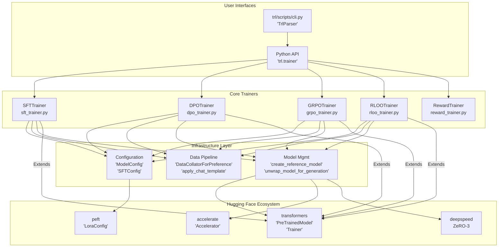
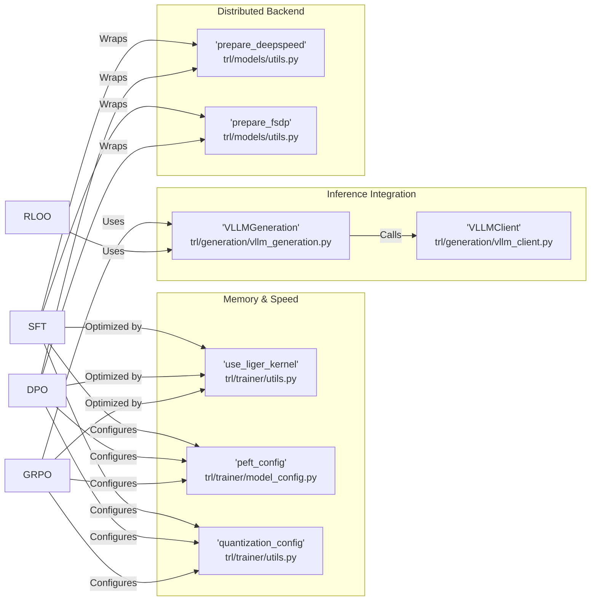

<!-- source: DeepWiki mcp.deepwiki.com · repo huggingface/trl · page 1 Overview · fetched 2026-10-26 -->

# Overview

Relevant source files

The following files were used as context for generating this wiki page:

- [.ai/AGENTS.md](.ai/AGENTS.md)
- [.cursor/BUGBOT.md](.cursor/BUGBOT.md)
- [.gitignore](.gitignore)
- [AGENTS.md](AGENTS.md)
- [CLAUDE.md](CLAUDE.md)
- [README.md](README.md)
- [docs/source/_toctree.yml](docs/source/_toctree.yml)
- [docs/source/dataset_formats.md](docs/source/dataset_formats.md)
- [docs/source/index.md](docs/source/index.md)
- [docs/source/minillm_trainer.md](docs/source/minillm_trainer.md)
- [docs/source/reducing_memory_usage.md](docs/source/reducing_memory_usage.md)
- [trl/__init__.py](trl/__init__.py)
- [trl/models/__init__.py](trl/models/__init__.py)
- [trl/models/utils.py](trl/models/utils.py)
- [trl/trainer/__init__.py](trl/trainer/__init__.py)

TRL (Transformer Reinforcement Learning) is a comprehensive library for post-training foundation models using methods such as Supervised Fine-Tuning (SFT), Group Relative Policy Optimization (GRPO), Direct Preference Optimization (DPO), and Reward Modeling. Built on top of the [Hugging Face Transformers](https://github.com/huggingface/transformers) ecosystem, TRL supports various model architectures and modalities while scaling across diverse hardware setups via [Accelerate](https://github.com/huggingface/accelerate).

The library is organized as a Python package at [trl/__init__.py:1-125]() with a primary subpackage [trl/trainer/__init__.py:1-82]() containing the core training algorithms. All trainers extend `transformers.Trainer` and inherit its integration with the Hugging Face ecosystem.

This page provides a high-level introduction to TRL's architecture, major components, and their relationships. For detailed information about specific components:
- [Package Structure and Lazy Loading](#1.1)
- [Built-in Reward Functions](#1.2)
- Shared Infrastructure: see page **2**
- Individual training methods: SFT (page **3**), DPO (page **4**), GRPO (page **5**), RLOO (page **6**), Additional Methods (page **7**)
- vLLM Integration: see page **8**
- Memory Optimization: see page **9**
- Command-Line Interface: see page **10**

**Sources:** [trl/__init__.py:1-125](), [trl/trainer/__init__.py:1-82](), [README.md:1-203]()

## Core System Architecture

TRL's architecture bridges the gap between high-level training algorithms and low-level infrastructure components. The library values simplicity and leanness, preferring straightforward inline code over deep abstractions [AGENTS.md:41-49]().

### Component Relationship Diagram
This diagram shows how user-facing Trainers interact with infrastructure components and external libraries.

**Sources:** [trl/__init__.py:28-74](), [trl/trainer/__init__.py:20-49](), [trl/models/utils.py:97-142](), [README.md:28-41]()

## Post-Training Methods

TRL categorizes its trainers into three primary post-training paradigms. Each trainer is designed to be self-contained, often duplicating logic for generation or reward computation to ensure individual trainers are readable and modifiable in isolation [AGENTS.md:22-25]().

### Method Taxonomy

| Paradigm | Trainer | Description |
| :--- | :--- | :--- |
| **Supervised** | `SFTTrainer` | Fine-tunes models on instruction-response pairs using standard NLL or DFT loss. Supports dataset packing and vision-language models. |
| **Preference** | `DPOTrainer` | Directly optimizes a policy to prefer "chosen" over "rejected" completions without a separate reward model. |
| **Online RL** | `GRPOTrainer` | Implements Group Relative Policy Optimization, normalizing rewards across a group of completions to calculate advantages. |
| **Online RL** | `RLOOTrainer` | Implements REINFORCE Leave-One-Out, using a baseline derived from other samples in the same batch. |
| **Scoring** | `RewardTrainer` | Trains reward models (ORMs) on preference data to score completions for RL trainers. |

**Sources:** [README.md:28-33](), [docs/source/index.md:17-56](), [docs/source/dataset_formats.md:1-92]()

## Infrastructure and Ecosystem

TRL acts as a glue layer for the post-training ecosystem, integrating specialized kernels and inference engines.

### Infrastructure Mapping
This diagram maps system-level requirements to specific code entities and external integrations.

**Sources:** [trl/trainer/utils.py:41-48](), [trl/models/utils.py:183-200](), [docs/source/reducing_memory_usage.md:101-166](), [README.md:35-38]()

## Child Pages

For deep technical details on specific TRL subsystems, refer to the following pages:

### 1.1 Package Structure and Lazy Loading
TRL uses a specialized two-tier lazy loading architecture to keep import times low while maintaining a clean public API. This page covers module organization under `trl/`, the trainer subpackage structure, and the experimental namespace design pattern.
For details, see [Package Structure and Lazy Loading](#1.1).

### 1.2 Built-in Reward Functions
The `trl/rewards/` module provides a suite of pre-defined reward functions used primarily with `GRPOTrainer` and `RLOOTrainer`. This includes `accuracy_reward` for math verification, `think_format_reward` for reasoning models, and various punishment functions for length control.
For details, see [Built-in Reward Functions](#1.2).

**Sources:** [trl/__init__.py:15-132](), [trl/trainer/__init__.py:15-84](), [README.md:177-186]()

---

