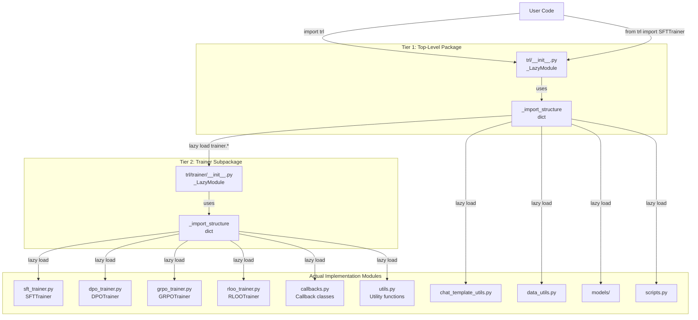
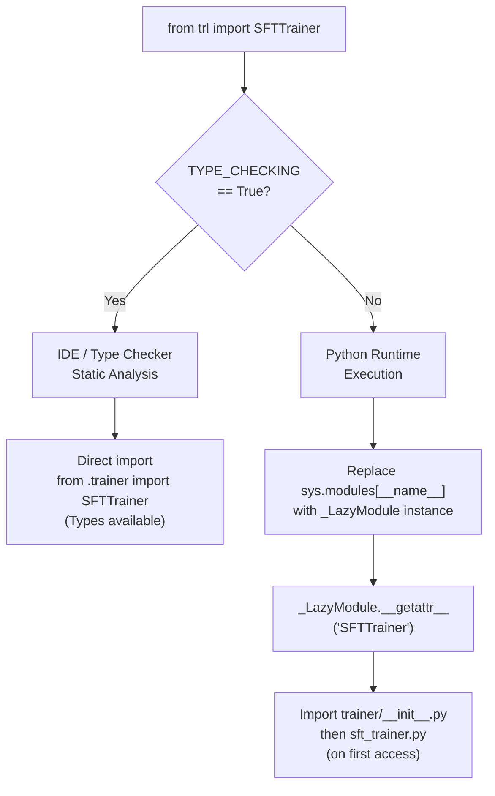
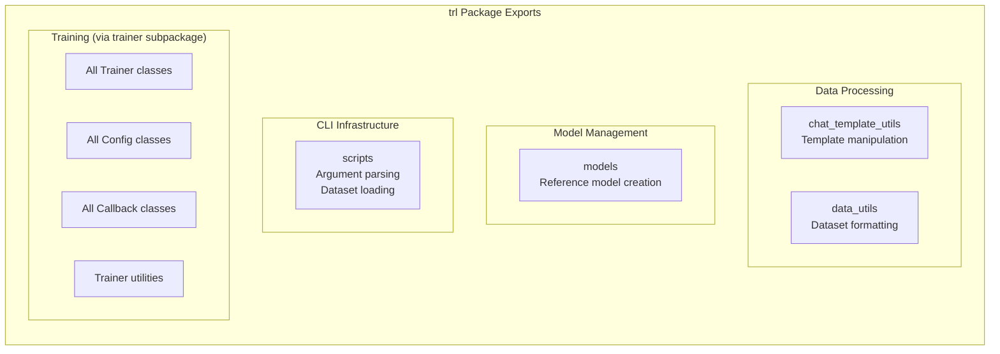
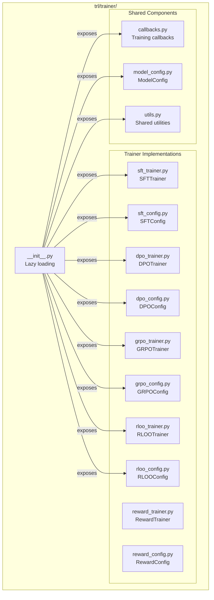

<!-- source: DeepWiki mcp.deepwiki.com · repo huggingface/trl · page 1.1 Package Structure and Lazy Loading · fetched 2026-10-26 -->

# Package Structure and Lazy Loading

<details>
<summary>Relevant source files</summary>

The following files were used as context for generating this wiki page:

- [docs/source/_toctree.yml](docs/source/_toctree.yml)
- [docs/source/speeding_up_training.md](docs/source/speeding_up_training.md)
- [docs/source/vllm_integration.md](docs/source/vllm_integration.md)
- [pyproject.toml](pyproject.toml)
- [trl/__init__.py](trl/__init__.py)
- [trl/_compat.py](trl/_compat.py)
- [trl/import_utils.py](trl/import_utils.py)
- [trl/models/__init__.py](trl/models/__init__.py)
- [trl/models/utils.py](trl/models/utils.py)
- [trl/trainer/__init__.py](trl/trainer/__init__.py)

</details>


## Purpose and Scope

This document explains the package structure and lazy loading architecture of the TRL library. It covers the two-tier `_LazyModule` implementation that optimizes import performance, the organization of modules under the `trl/` namespace, the trainer subpackage structure, and the experimental namespace pattern. TRL is designed to facilitate post-training foundation models through various algorithms like SFT, DPO, and GRPO, while maintaining a lightweight footprint at import time.

## Two-Tier Lazy Loading Architecture

TRL implements a two-tier lazy loading system to minimize import time and reduce memory footprint. The architecture defers module imports until they are actually accessed by user code.

### Architecture Overview



**Diagram: Two-tier lazy loading architecture showing deferred imports**

Sources: [trl/__init__.py:28-74](), [trl/trainer/__init__.py:20-49]()

### Import Structure Pattern

Each lazy module level defines an `_import_structure` dictionary that maps module names to their exported symbols:

**Top-Level Import Structure (`trl/__init__.py`)**

| Module | Exported Symbols | Purpose |
|--------|------------------|---------|
| `chat_template_utils` | `add_response_schema`, `clone_chat_template`, `get_training_chat_template`, `supports_tool_calling` | Chat template manipulation [trl/__init__.py:29-34]() |
| `data_utils` | `apply_chat_template`, `extract_prompt`, `is_conversational`, `pack_dataset`, `prepare_multimodal_messages`, etc. | Dataset processing utilities [trl/__init__.py:35-48]() |
| `models` | `create_reference_model` | Model management and reference model creation [trl/__init__.py:49]() |
| `scripts` | `DatasetMixtureConfig`, `ScriptArguments`, `TrlParser`, `get_dataset`, `init_zero_verbose` | CLI and script utilities [trl/__init__.py:50]() |
| `trainer` | All trainer classes, configs, and callbacks | Training algorithms (re-exports from trainer subpackage) [trl/__init__.py:51-73]() |

**Trainer Subpackage Import Structure (`trl/trainer/__init__.py`)**

| Module | Exported Symbols | Purpose |
|--------|------------------|---------|
| `callbacks` | `BEMACallback`, `LogCompletionsCallback`, `RichProgressCallback`, `SyncRefModelCallback`, `WeaveCallback` | Training callbacks [trl/trainer/__init__.py:21-27]() |
| `dpo_config` | `DPOConfig` | DPO configuration [trl/trainer/__init__.py:28]() |
| `dpo_trainer` | `DPOTrainer` | DPO trainer implementation [trl/trainer/__init__.py:29]() |
| `grpo_config` | `GRPOConfig` | GRPO configuration [trl/trainer/__init__.py:30]() |
| `grpo_trainer` | `GRPOTrainer` | GRPO trainer implementation [trl/trainer/__init__.py:31]() |
| `kto_config` | `KTOConfig` | KTO configuration [trl/trainer/__init__.py:32]() |
| `kto_trainer` | `KTOTrainer` | KTO trainer implementation [trl/trainer/__init__.py:33]() |
| `model_config` | `ModelConfig` | Model initialization configuration [trl/trainer/__init__.py:34]() |
| `reward_config` | `RewardConfig` | Reward model configuration [trl/trainer/__init__.py:35]() |
| `reward_trainer` | `RewardTrainer` | Reward model trainer [trl/trainer/__init__.py:36]() |
| `rloo_config` | `RLOOConfig` | RLOO configuration [trl/trainer/__init__.py:37]() |
| `rloo_trainer` | `RLOOTrainer` | RLOO trainer implementation [trl/trainer/__init__.py:38]() |
| `sft_config` | `SFTConfig` | SFT configuration [trl/trainer/__init__.py:39]() |
| `sft_trainer` | `SFTTrainer` | SFT trainer implementation [trl/trainer/__init__.py:40]() |
| `utils` | `disable_dropout_in_model`, `get_kbit_device_map`, `get_peft_config`, `get_quantization_config` | Trainer utilities [trl/trainer/__init__.py:41-48]() |

Sources: [trl/__init__.py:28-74](), [trl/trainer/__init__.py:20-49]()

## Lazy Module Implementation

### TYPE_CHECKING Pattern

The lazy loading implementation uses the `TYPE_CHECKING` constant from Python's `typing` module to provide IDE support without triggering actual imports at runtime:



**Diagram: TYPE_CHECKING pattern flow for IDE support and lazy loading**

When `TYPE_CHECKING` is `True` (during static analysis), the actual imports are executed:
[trl/__init__.py:76-121]()

When `TYPE_CHECKING` is `False` (at runtime), the module replaces itself with a `_LazyModule` instance:
[trl/__init__.py:123-132]()

The same pattern is used in the trainer subpackage:
[trl/trainer/__init__.py:51-83]()

Sources: [trl/__init__.py:76-132](), [trl/trainer/__init__.py:51-83]()

### _LazyModule Behavior

The `_LazyModule` class (defined in `trl/_lazy_module.py`) intercepts attribute access and performs just-in-time imports. When a user accesses an attribute like `trl.SFTTrainer`:

1. `_LazyModule.__getattr__("SFTTrainer")` is called.
2. The module checks `_import_structure` to find that `SFTTrainer` comes from the `"trainer"` module [trl/__init__.py:67]().
3. The trainer subpackage is imported (which itself is a `_LazyModule` [trl/trainer/__init__.py:83]()).
4. The trainer's `_LazyModule` then imports `sft_trainer.py` [trl/trainer/__init__.py:40]().
5. The `SFTTrainer` class is returned to the caller.
6. Subsequent accesses use the cached import.

Sources: [trl/__init__.py:126-132](), [trl/trainer/__init__.py:83]()

## Top-Level Package Organization

### Module Categories

The top-level `trl` package exposes five categories of functionality:



**Diagram: Top-level package organization by functional category**

Sources: [trl/__init__.py:28-74]()

### Namespace Design

All symbols exposed at the top level can be imported directly:

```python
from trl import SFTTrainer, SFTConfig
from trl import apply_chat_template
from trl import create_reference_model
```

This flat namespace design simplifies the user API while maintaining internal organization through the subpackage structure. The `trainer` subpackage is not directly visible to users; its contents are re-exported at the top level [trl/__init__.py:51-73]().

## Trainer Subpackage Structure

### File Organization

The trainer subpackage follows a consistent pattern where each trainer has paired files:



**Diagram: Trainer subpackage structure showing paired trainer/config files and shared components**

### Naming Convention

Each training algorithm follows this naming pattern:
- **Trainer file**: `{algorithm}_trainer.py` containing the `{Algorithm}Trainer` class.
- **Config file**: `{algorithm}_config.py` containing the `{Algorithm}Config` class.

The only exception is `model_config.py`, which contains `ModelConfig` used across all trainers for model initialization parameters [trl/trainer/__init__.py:34]().

Sources: [trl/trainer/__init__.py:20-49]()

### Callback System

The `callbacks.py` module contains all training callbacks, such as `BEMACallback`, `LogCompletionsCallback`, and `SyncRefModelCallback` [trl/trainer/__init__.py:22-25](). These are exposed at the top level [trl/__init__.py:52-69]().

### Utility Functions

The `utils.py` module provides shared utilities for trainers, including `get_kbit_device_map`, `get_peft_config`, and `get_quantization_config` [trl/trainer/__init__.py:44-46]().

## Experimental Namespace

The TRL library maintains an `experimental/` namespace for unstable or research-stage features. These features are excluded from stable CI testing but available for advanced users.

Experimental features include:
- **Algorithms**: BCO, CPO, GKD, GOLD, Nash-MD, Online DPO, ORPO, PPO, etc. [docs/source/_toctree.yml:96-141]()
- **Specialized Trainers**: `MiniLLMTrainer` (distillation), `PRMTrainer` (step-level reward modeling) [docs/source/_toctree.yml:117, 131]()
- **Research Implementations**: BEMA for reference models, GRPO with replay buffer, and self-distillation methods (SDFT, SDPO, SSD) [docs/source/_toctree.yml:94, 108, 132-137]()

These features are intentionally kept separate to allow rapid iteration. Using them may trigger a `TRLExperimentalWarning` [trl/import_utils.py:127-130]().

Sources: [docs/source/_toctree.yml:90-142](), [trl/import_utils.py:127-142]()

## Compatibility and Dependencies

TRL manages version incompatibilities through `trl/_compat.py`. This module applies temporary patches for:
- **vLLM**: Setting logging levels to reduce noise [_patch_vllm_logging] [trl/_compat.py:78-84]().
- **Transformers/PEFT**: Fixing `HybridCache` imports for transformers v5 compatibility [_patch_transformers_hybrid_cache] [trl/_compat.py:86-128]().
- **Accelerate**: Ensuring `ParallelismConfig` is defined for `typing.get_type_hints` compatibility [_patch_transformers_parallelism_config] [trl/_compat.py:130-157]().

Optional dependencies like `vllm`, `deepspeed`, and `peft` are managed through feature flags in `trl/import_utils.py` [trl/import_utils.py:60-125]().

Sources: [trl/_compat.py:15-157](), [trl/import_utils.py:60-125](), [pyproject.toml:46-96]()

---

