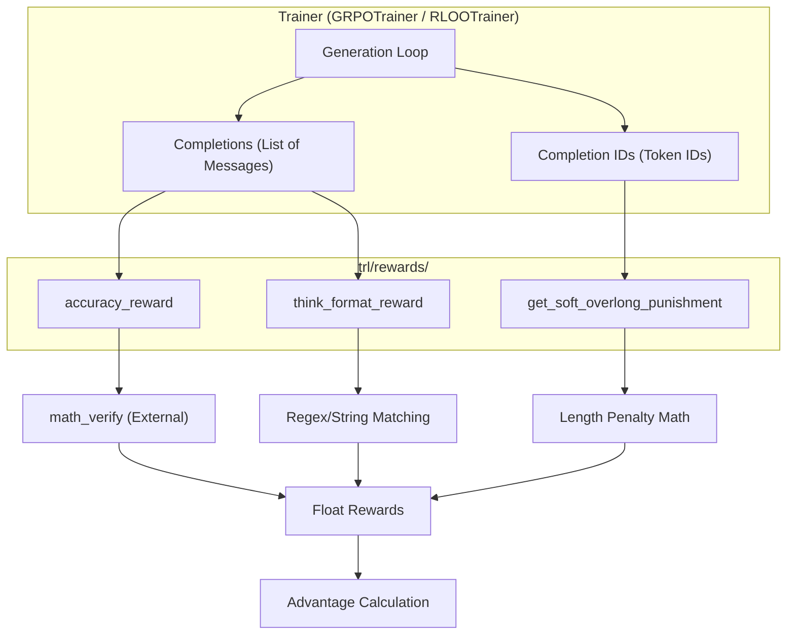
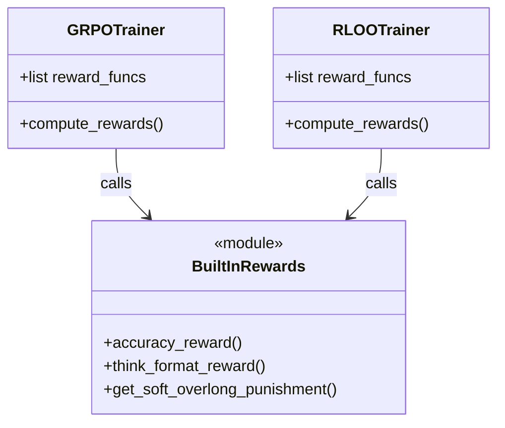

<!-- source: DeepWiki mcp.deepwiki.com · repo huggingface/trl · page 1.2 Built-in Reward Functions · fetched 2026-10-26 -->

# Built-in Reward Functions

Relevant source files

The following files were used as context for generating this wiki page:

- [docs/source/rewards.md](docs/source/rewards.md)
- [tests/test_rewards.py](tests/test_rewards.py)
- [trl/rewards/__init__.py](trl/rewards/__init__.py)
- [trl/rewards/accuracy_rewards.py](trl/rewards/accuracy_rewards.py)
- [trl/rewards/other_rewards.py](trl/rewards/other_rewards.py)
- [trl/trainer/grpo_trainer.py](trl/trainer/grpo_trainer.py)
- [trl/trainer/rloo_trainer.py](trl/trainer/rloo_trainer.py)

The `trl/rewards/` module provides a suite of built-in reward callables designed for use with reinforcement learning trainers, specifically `GRPOTrainer` and `RLOOTrainer`. These functions allow for verifiable reasoning, format enforcement, and length control without requiring a separate reward model.

## Overview

In TRL, a `RewardFunc` can be a string (model ID), a `PreTrainedModel` (sequence classifier), or a custom `Callable` [trl/trainer/grpo_trainer.py:118](). The built-in functions in this module are specialized callables that process completions and return a list of floating-point rewards.

### Reward Function Data Flow

The following diagram illustrates how reward functions interact with the trainer's generation output.

**Reward Processing Pipeline**

Sources: [trl/trainer/grpo_trainer.py:118-123](), [trl/rewards/accuracy_rewards.py:27-32](), [trl/rewards/other_rewards.py:49-60]()

---

## Accuracy and Reasoning Rewards

These functions are designed for mathematical and logical tasks where a ground-truth solution is available. They utilize the `math_verify` library for robust verification of mathematical expressions, including LaTeX.

### `accuracy_reward`
This function compares the model's generated content against a provided solution [trl/rewards/accuracy_rewards.py:27-32](). 

- **Mechanism**: It extracts the answer from the completion (prioritizing `\boxed{}` tags) and uses `math_verify.verify` to check equivalence with the gold solution [trl/rewards/accuracy_rewards.py:86-99]().
- **Thread Safety**: It detects if it is running in a non-main thread (common in distributed training) and disables `signal.alarm()` timeouts to prevent `ValueError` [trl/rewards/accuracy_rewards.py:71-76]().
- **Handling Failures**: If the gold solution cannot be parsed, it returns `None`, signaling the trainer to skip that specific example [trl/rewards/accuracy_rewards.py:103-107]().

### `reasoning_accuracy_reward`
A variant of the accuracy reward specifically for "Chain-of-Thought" models that use delimiters like ``. It strips the reasoning section before attempting to parse the final answer [trl/rewards/accuracy_rewards.py:117-123]().

Sources: [trl/rewards/accuracy_rewards.py:27-114](), [trl/rewards/accuracy_rewards.py:117-140]()

---

## Format Enforcement

### `think_format_reward`
Used primarily for models trained to perform internal reasoning. It validates that the model output follows a strict XML-like structure for thinking [trl/rewards/format_rewards.py]().

- **Validation Criteria**:
    - Must start with `` tag [tests/test_rewards.py:38]().
    - Does not allow nested `<think>` tags [tests/test_rewards.py:45]().
- **Reward**: Returns `1.0` for valid format and `0.0` otherwise [tests/test_rewards.py:32-49]().

Sources: [trl/rewards/format_rewards.py](), [tests/test_rewards.py:22-64]()

---

## Length Control

### `get_soft_overlong_punishment`
This is a factory function that returns a reward callable based on Equation 13 from the DAPO paper [trl/rewards/other_rewards.py:18-30](). It implements a "soft" penalty that gradually increases as the completion approaches the maximum length.

**Reward Calculation Logic**
| Condition | Reward Formula |
| :--- | :--- |
| $|y| \le L_{max} - L_{cache}$ | `0.0` (No penalty) |
| $L_{max} - L_{cache} < |y| \le L_{max}$ | $\frac{(L_{max} - L_{cache}) - |y|}{L_{cache}}$ |
| $|y| > L_{max}$ | `-1.0` (Maximum penalty) |

This function uses `completion_ids` (token counts) rather than raw text to ensure precision relative to the model's context window [trl/rewards/other_rewards.py:52-53]().

Sources: [trl/rewards/other_rewards.py:18-62](), [tests/test_rewards.py:66-89]()

---

## Integration with Trainers

Built-in rewards are passed to the `reward_funcs` argument of `GRPOTrainer` or `RLOOTrainer`. The trainers automatically handle the distribution of prompts and completions to these functions.

**Entity Association: Reward Callables to Trainers**

### Multi-Task Reward Handling
If a reward function returns `None` for a specific sample, the trainer excludes that function's contribution for that sample. This allows mixing different types of tasks (e.g., math and creative writing) in the same batch, where `accuracy_reward` only applies to the math samples [trl/trainer/grpo_trainer.py:180-182](), [trl/trainer/rloo_trainer.py:153-157]().

Sources: [trl/trainer/grpo_trainer.py:133-154](), [trl/trainer/rloo_trainer.py:105-126](), [trl/rewards/__init__.py:21-25]()

---

