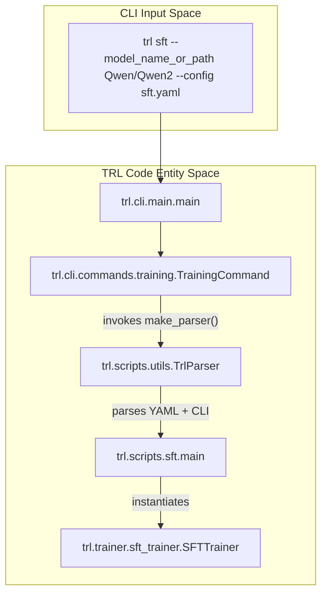
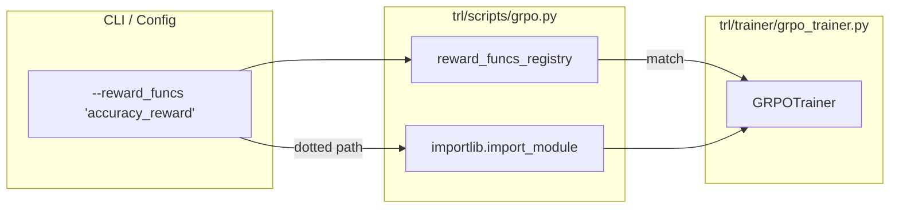

<!-- source: DeepWiki mcp.deepwiki.com · repo huggingface/trl · page 10.1 CLI Training Commands · fetched 2026-10-26 -->

# CLI Training Commands

<details>
<summary>Relevant source files</summary>

The following files were used as context for generating this wiki page:

- [docs/source/clis.md](docs/source/clis.md)
- [docs/source/script_utils.md](docs/source/script_utils.md)
- [examples/scripts/prm.py](examples/scripts/prm.py)
- [examples/scripts/sft_gemma3.py](examples/scripts/sft_gemma3.py)
- [tests/test_cli_utils.py](tests/test_cli_utils.py)
- [trl/cli/commands/base.py](trl/cli/commands/base.py)
- [trl/cli/commands/training.py](trl/cli/commands/training.py)
- [trl/cli/commands/vllm_serve.py](trl/cli/commands/vllm_serve.py)
- [trl/cli/main.py](trl/cli/main.py)
- [trl/scripts/dpo.py](trl/scripts/dpo.py)
- [trl/scripts/grpo.py](trl/scripts/grpo.py)
- [trl/scripts/kto.py](trl/scripts/kto.py)
- [trl/scripts/reward.py](trl/scripts/reward.py)
- [trl/scripts/rloo.py](trl/scripts/rloo.py)
- [trl/scripts/sft.py](trl/scripts/sft.py)
- [trl/scripts/utils.py](trl/scripts/utils.py)

</details>


The TRL library provides a robust Command Line Interface (CLI) designed to streamline the fine-tuning of Large Language Models (LLMs). The CLI abstracts boilerplate code, enabling researchers and engineers to launch training jobs for various alignment algorithms (SFT, DPO, GRPO, etc.) using simple commands or YAML configuration files.

## Overview of CLI Commands

The TRL CLI is organized into several subcommands, each corresponding to a specific training methodology or utility. These commands are entry points that invoke underlying training scripts located in `trl/scripts/` [trl/cli/commands/training.py:55-55]().

### Training Commands
| Command | Algorithm | Description |
| :--- | :--- | :--- |
| `trl sft` | Supervised Fine-Tuning | Fine-tunes a model on a target dataset using standard cross-entropy loss. |
| `trl dpo` | Direct Preference Optimization | Aligns models with human preferences without a separate reward model. |
| `trl grpo` | Group Relative Policy Optimization | RL-based alignment using group-relative advantages, optimized for reasoning. |
| `trl kto` | Kahneman-Tversky Optimization | Binary preference alignment based on prospect theory. |
| `trl rloo` | REINFORCE Leave-One-Out | An RL alignment method using a leave-one-out baseline for variance reduction. |
| `trl reward` | Reward Modeling | Trains a reward model (scalar scorer) from preference data. |

### Utility Commands
- `trl env`: Displays system information and dependency versions [docs/source/clis.md:20-20]().
- `trl vllm-serve`: Serves a model using the vLLM engine for high-throughput inference [trl/cli/commands/vllm_serve.py:24-24]().

**Sources:** [docs/source/clis.md:7-21](), [trl/cli/commands/training.py:34-46]()

---

## Technical Architecture and Data Flow

The CLI operates by bridging the user's command-line arguments to the `Trainer` classes via a specialized parsing layer.

### TrlParser and Argument Merging
The `TrlParser` class (extending `HfArgumentParser`) is the core engine for argument handling [trl/scripts/utils.py:29-29](). It supports merging three sources of configuration:
1.  **Hardcoded Defaults**: Defined in the dataclasses (e.g., `SFTConfig`).
2.  **YAML Config Files**: Loaded via the `--config` flag [docs/source/clis.md:104-104]().
3.  **CLI Overrides**: Arguments passed directly in the terminal, which take the highest priority [tests/test_cli_utils.py:81-86]().

### Natural Language to Code Entity Mapping

The following diagram illustrates how a CLI command string is decomposed into internal Python objects.

**Diagram: CLI to Code Entity Mapping**

**Sources:** [trl/cli/commands/training.py:51-72](), [trl/scripts/sft.py:153-156](), [trl/scripts/utils.py:149-150]()

---

## ScriptArguments and Configuration Hierarchy

Each training script utilizes a set of dataclasses to organize parameters. The `TrlParser` typically processes four main types:

1.  **ScriptArguments**: Common arguments like `dataset_name`, `dataset_train_split`, and `dataset_test_split` [trl/scripts/utils.py:138-160]().
2.  **TrainerConfig**: Algorithm-specific settings (e.g., `SFTConfig`, `DPOConfig`, `GRPOConfig`). These inherit from `transformers.TrainingArguments`.
3.  **ModelConfig**: Handles model loading parameters like `trust_remote_code`, `attn_implementation`, and quantization settings [trl/scripts/sft.py:145-145]().
4.  **DatasetMixtureConfig**: (Optional) Used for complex data loading involving multiple sources [trl/scripts/utils.py:74-90]().

### Implementation Detail: The `make_parser` Pattern
Every CLI-compatible script in `trl/scripts/` must implement a `make_parser` function. This allows the `TrainingCommand` class to dynamically generate the correct CLI interface for each subcommand [trl/cli/commands/training.py:38-43]().

```python
# Example from trl/scripts/sft.py
def make_parser(subparsers=None, prog=None):
    from trl import ScriptArguments, SFTConfig, ModelConfig, TrlParser
    dataclass_types = (ScriptArguments, SFTConfig, ModelConfig)
    return TrlParser(dataclass_types, prog=prog)
```
**Sources:** [trl/scripts/sft.py:142-150](), [trl/cli/commands/training.py:55-57]()

---

## Detailed Command Specifications

### trl sft
Used for Supervised Fine-Tuning. It supports dataset packing, which concatenates multiple short sequences into a single block to maximize GPU utilization [trl/scripts/sft.py:32-32]().
- **Key Args**: `--packing`, `--max_seq_length`, `--dataset_text_field`.
- **Logic**: It initializes an `SFTTrainer` and calls `.train()` [trl/scripts/sft.py:119-128]().

### trl dpo
Implements Direct Preference Optimization. It requires a dataset with "chosen" and "rejected" responses [trl/scripts/dpo.py:28-28]().
- **Key Args**: `--beta` (KL penalty), `--loss_type` (sigmoid, ipo, etc.), `--max_prompt_length`.
- **Logic**: Handles reference model management and log-probability calculation [trl/scripts/dpo.py:116-125]().

### trl grpo
Designed for Group Relative Policy Optimization. Unlike other trainers, it often uses reward functions (callables) rather than a fixed reward model [trl/scripts/grpo.py:42-49]().
- **Key Args**: `--reward_funcs` (e.g., `accuracy_reward`, `think_format_reward`), `--num_generations`.
- **Reward Registry**: The script maintains a `reward_funcs_registry` to map string names to Python functions [trl/scripts/grpo.py:83-88]().

**Diagram: GRPO Reward Function Flow**

**Sources:** [trl/scripts/grpo.py:83-109](), [trl/scripts/grpo.py:143-150]()

---

## YAML Configuration Support

The CLI allows users to move complex argument lists into structured YAML files. The `TrlParser` also supports an `env` section within the YAML to set environment variables (e.g., `WANDB_PROJECT`) before training starts [tests/test_cli_utils.py:55-70]().

**Example YAML (`config.yaml`):**
```yaml
model_name_or_path: "Qwen/Qwen2-0.5B"
dataset_name: "trl-lib/Capybara"
learning_rate: 2.0e-5
packing: true
env:
  WANDB_PROJECT: "trl-sft-demo"
```

**Execution:**
```bash
trl sft --config config.yaml --learning_rate 3.0e-5
```
In this case, the `learning_rate` in the CLI (`3.0e-5`) overrides the value in the YAML file [tests/test_cli_utils.py:81-94]().

**Sources:** [docs/source/clis.md:95-105](), [tests/test_cli_utils.py:53-63](), [trl/scripts/utils.py:91-111]()

---

## Integration with Accelerate

The TRL CLI natively wraps `accelerate launch`. Any arguments not recognized by the `TrlParser` (like `--num_processes` or `--multi_gpu`) are passed through to the `accelerate` launcher [trl/cli/commands/training.py:64-71]().

**Execution Logic:**
1.  `TrainingCommand.run` is called [trl/cli/commands/training.py:51-51]().
2.  `parser.parse_args_and_config` separates training arguments from infrastructure arguments [trl/cli/commands/training.py:61-63]().
3.  `launch_training_script` is invoked with the split arguments, spawning the training process across the specified hardware [trl/cli/commands/training.py:67-71]().

**Sources:** [trl/cli/commands/training.py:51-72](), [docs/source/clis.md:189-194]()

---

