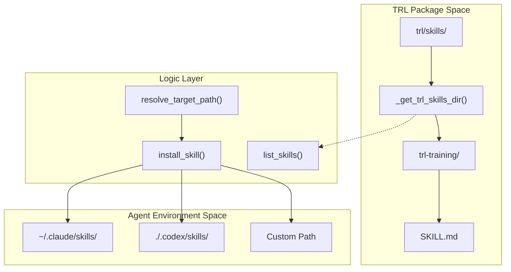
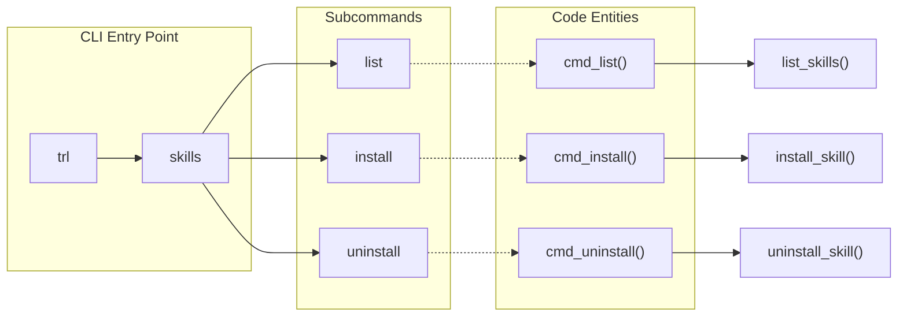

<!-- source: DeepWiki mcp.deepwiki.com · repo huggingface/trl · page 10.2 Agent Skills System · fetched 2026-10-26 -->

# Agent Skills System

<details>
<summary>Relevant source files</summary>

The following files were used as context for generating this wiki page:

- [tests/test_skills.py](tests/test_skills.py)
- [tests/test_skills_cli.py](tests/test_skills_cli.py)
- [trl/cli/__init__.py](trl/cli/__init__.py)
- [trl/cli/accelerate_config.py](trl/cli/accelerate_config.py)
- [trl/cli/accelerate_launcher.py](trl/cli/accelerate_launcher.py)
- [trl/cli/commands/__init__.py](trl/cli/commands/__init__.py)
- [trl/cli/commands/env.py](trl/cli/commands/env.py)
- [trl/cli/commands/skills.py](trl/cli/commands/skills.py)
- [trl/skills/__init__.py](trl/skills/__init__.py)
- [trl/skills/cli.py](trl/skills/cli.py)
- [trl/skills/skills.py](trl/skills/skills.py)

</details>


The Agent Skills system in TRL provides a mechanism for AI agents (such as Claude, Codex, or OpenCode) to discover and install specialized instructions and scripts that help them use the TRL CLI more effectively [trl/skills/skills.py:18-27](). These "skills" are structured as directories containing a mandatory `SKILL.md` file [trl/skills/skills.py:121-135]().

## Architecture and Discovery

The system is centered around the `trl/skills/` module, which manages the lifecycle of agent-specific resources. Skills are discovered by scanning directories for the presence of a `SKILL.md` file, which serves as the entry point and instruction set for the AI agent [trl/skills/skills.py:121-135]().

### Predefined Agent Paths
TRL includes a registry of standard installation paths for common AI coding agents, supporting both `global` (user-level) and `project` (local) scopes [trl/skills/skills.py:34-47]().

| Agent | Scope | Path |
| :--- | :--- | :--- |
| **Claude** | global | `~/.claude/skills` |
| | project | `./.claude/skills` |
| **Codex** | global | `~/.codex/skills` |
| | project | `./.codex/skills` |
| **OpenCode** | global | `~/.config/opencode/skills` |
| | project | `.opencode/skills` |

**Sources:** [trl/skills/skills.py:34-47]()

### Core Components Diagram
This diagram illustrates the relationship between the TRL package, the skills management logic, and the target agent environments.

**Agent Skills Data Flow**

**Sources:** [trl/skills/skills.py:34-114](), [trl/skills/skills.py:178-202]()

## Key Functions

### Path Resolution
The `resolve_target_path` function converts semantic agent names into concrete filesystem paths based on the provided scope [trl/skills/skills.py:72-115]().

*   **`target`**: Can be a predefined agent name (e.g., `"claude"`) or a raw `Path` [trl/skills/skills.py:79-80]().
*   **`scope`**: Determines if the installation is `global` or `project`-specific [trl/skills/skills.py:80-81]().

### Skill Management
*   **`list_skills(target, scope)`**: Scans a directory for subdirectories containing `SKILL.md`. If no target is provided, it lists TRL's built-in skills [trl/skills/skills.py:138-176]().
*   **`install_skill(skill_name, target, scope, force)`**: Copies a skill from the TRL package to the resolved target path. If `force=True`, it overwrites existing installations [trl/skills/skills.py:228-264]().
*   **`uninstall_skill(skill_name, target, scope)`**: Removes a specific skill directory from the agent's environment [trl/skills/skills.py:267-302]().

**Sources:** [trl/skills/skills.py:72-302]()

## CLI Integration

The skills system is exposed via the `trl skills` command group, which is registered in the main TRL CLI [trl/cli/commands/__init__.py:17-32]().

### CLI Command Mapping

**Sources:** [trl/cli/commands/skills.py:21-32](), [trl/skills/cli.py:26-88]()

### Command Usage

#### Listing Skills
To see available skills in TRL:
```bash
trl skills list
```
To see installed skills for an agent:
```bash
trl skills list --target claude --scope global
```
[trl/skills/cli.py:162-190]()

#### Installing Skills
Install the `trl-training` skill to the local project for Claude:
```bash
trl skills install trl-training --target claude --scope project
```
Use the `--all` flag to install every available skill provided by the package [trl/skills/cli.py:75-77]().

#### Uninstalling Skills
```bash
trl skills uninstall trl-training --target claude
```
[trl/skills/cli.py:147-159]()

## Skill Contents and TRL CLI
The primary built-in skill is `trl-training`. This skill contains documentation and prompts that allow agents to:
1.  Understand the structure of `trl sft`, `trl dpo`, and `trl grpo` commands [trl/cli/commands/__init__.py:25-31]().
2.  Learn how to resolve `accelerate` configurations using the `--accelerate_config` argument [trl/cli/accelerate_config.py:19-25]().
3.  Utilize `TrlParser` to merge CLI arguments with YAML configuration files [trl/cli/commands/training.py]().

**Sources:** [trl/skills/skills.py:15-27](), [trl/cli/commands/__init__.py:22-34]()

---

