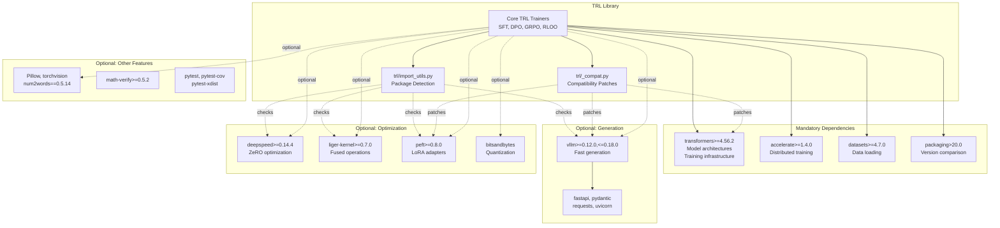
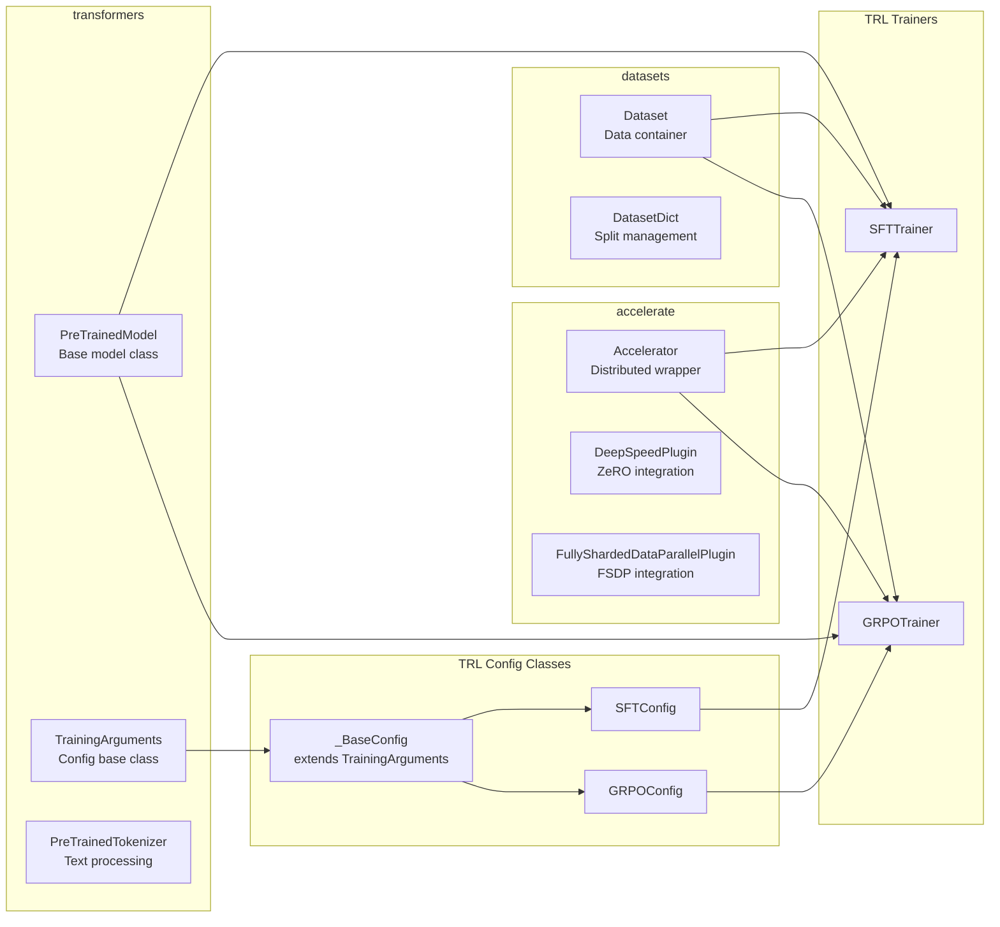
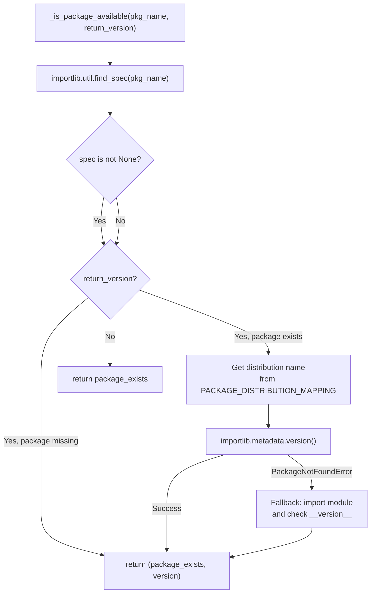

<!-- source: DeepWiki mcp.deepwiki.com · repo huggingface/trl · page 11 Dependencies and Compatibility · fetched 2026-10-26 -->

# Dependencies and Compatibility

<details>
<summary>Relevant source files</summary>

The following files were used as context for generating this wiki page:

- [docs/source/speeding_up_training.md](docs/source/speeding_up_training.md)
- [docs/source/vllm_integration.md](docs/source/vllm_integration.md)
- [pyproject.toml](pyproject.toml)
- [trl/_compat.py](trl/_compat.py)
- [trl/import_utils.py](trl/import_utils.py)

</details>


This document describes TRL's dependency management system, including mandatory and optional dependencies, version requirements, package availability checking, and compatibility patching for third-party library version conflicts.

For information about specific training algorithms and their requirements, see the individual trainer pages (e.g., [Group Relative Policy Optimization (GRPO)](#5) for vLLM requirements, [PEFT and Quantization](#9.1) for adapter dependencies). For CI/CD testing strategies across dependency configurations, see [Testing and CI/CD](#12).

## Dependency Architecture Overview

TRL employs a tiered dependency system with a small set of mandatory packages and a comprehensive collection of optional dependencies activated on-demand. The library detects package availability at runtime and patches version incompatibilities to ensure broad compatibility.



**Sources:** [pyproject.toml:31-37](), [pyproject.toml:46-128](), [trl/import_utils.py:1-142](), [trl/_compat.py:1-165]()

## Core Dependencies

TRL requires four mandatory packages that must be installed for any functionality:

| Package | Version Requirement | Purpose |
|---------|-------------------|---------|
| `transformers` | `>=4.56.2` | Model architectures, tokenizers, training infrastructure via `TrainingArguments` |
| `accelerate` | `>=1.4.0` | Distributed training support (DDP, DeepSpeed, FSDP) |
| `datasets` | `>=4.7.0` | Dataset loading, processing, and JSON type support |
| `packaging` | `>20.0` | Version comparison utilities |

These dependencies are specified in [pyproject.toml:31-37]() and are automatically installed when TRL is installed via `pip install trl`.

**Dependency Roles:**



**Sources:** [pyproject.toml:31-37]()

## Python Version Support

TRL supports Python versions 3.10 through 3.14 as declared in [pyproject.toml:30]() and the classifiers in [pyproject.toml:23-28](). The minimum version requirement is enforced via `requires-python = ">=3.10"`.

The CI/CD pipeline tests against this full version matrix to ensure compatibility. See [CI/CD Pipeline](#12.2) for testing details.

**Sources:** [pyproject.toml:23-30]()

## Optional Dependencies

TRL provides numerous optional dependency groups that can be installed via `pip install trl[<group>]`. Multiple groups can be combined: `pip install trl[vllm,peft,deepspeed]`. For a deep dive into feature flags and extras, see [Optional Dependencies and Feature Flags](#11.1).

### Optional Dependency Groups

| Group | Packages | Purpose | Used By |
|-------|----------|---------|---------|
| `vllm` | `vllm>=0.12.0,<=0.18.0`, `fastapi`, `pydantic`, `requests`, `uvicorn` | Fast generation via vLLM server | GRPOTrainer, RLOOTrainer, OnlineDPOTrainer |
| `peft` | `peft>=0.8.0` | Parameter-efficient fine-tuning (LoRA, QLoRA) | All trainers when using adapters |
| `deepspeed` | `deepspeed>=0.14.4` | ZeRO optimization for memory efficiency | All trainers with `deepspeed` config |
| `liger` | `liger-kernel>=0.7.0` | Fused kernel operations for speed | DPOTrainer, SFTTrainer with `use_liger_kernel=True` |
| `quantization` | `bitsandbytes` | 4-bit and 8-bit quantization | All trainers when using quantized models |
| `vlm` | `Pillow`, `torchvision`, `num2words==0.5.14` | Vision-language model support | SFTTrainer, DPOTrainer with VLM data |
| `math_verify` | `math-verify>=0.5.2` | Math answer verification | Math reasoning tasks / accuracy rewards |
| `bco` | `scikit-learn`, `joblib` | Best-of-N optimization | BCOTrainer |
| `test` | `pytest`, `pytest-cov`, `pytest-xdist`, `pytest-rerunfailures` | Testing infrastructure | Development |
| `dev` | Combination of most groups | Full development environment | Development |

**Sources:** [pyproject.toml:46-128]()

### vLLM Version Requirements

The vLLM integration has specific version constraints defined in [pyproject.toml:82]():

```toml
vllm = ["vllm>=0.12.0,<=0.18.0", "fastapi", "pydantic", "aiohttp>=3.13.3", "requests", "uvicorn"]
```

These constraints are enforced at runtime by `is_vllm_available()` in [trl/import_utils.py:105-116](), which checks the installed version and emits a warning if outside the supported range:

```python
def is_vllm_available(min_version: str | None = None) -> bool:
    _vllm_available, _vllm_version = _is_package_available("vllm", return_version=True)
    if _vllm_available:
        if not (Version("0.12.0") <= Version(_vllm_version) <= Version("0.18.0")):
            warnings.warn(
                f"TRL currently supports vLLM versions from 0.12.0 to 0.18.0. You have version {_vllm_version} installed...",
                stacklevel=2,
            )
    return _vllm_available
```

**Sources:** [pyproject.toml:81-88](), [trl/import_utils.py:105-116](), [docs/source/vllm_integration.md:5-6]()

## Package Availability Checking System

TRL uses a runtime detection system in [trl/import_utils.py]() to check for optional dependencies without importing them unnecessarily. This enables lazy loading and graceful feature degradation.

### Core Detection Mechanism

The `_is_package_available()` function in [trl/import_utils.py:29-57]() checks package existence and optionally retrieves version information:



**Sources:** [trl/import_utils.py:29-57]()

## Compatibility Patching System

TRL implements a proactive compatibility layer in [trl/_compat.py]() that automatically patches third-party library incompatibilities at import time. For detailed technical explanations of these patches, see [Compatibility Patches and Ecosystem Integration](#11.2).

### Individual Patches

#### vLLM Logging Suppression
[trl/_compat.py:78-83]() sets vLLM's logging level to ERROR by default to reduce console noise.

#### Transformers HybridCache Compatibility
For `transformers>=5.0.0` with `peft<0.18.0`, [trl/_compat.py:86-128]() restores the removed `HybridCache` class to prevent import errors in PEFT and Liger Kernel.

#### Transformers ParallelismConfig Fix
For `transformers<4.57.0` with `accelerate<1.10.1`, [trl/_compat.py:130-157]() ensures `ParallelismConfig` is defined so that `typing.get_type_hints` can resolve annotations on `TrainingArguments`.

### Patch Application Order
All patches are applied automatically when `trl/_compat.py` is imported. The order of application in [trl/_compat.py:160-164]() is:
1. `_patch_vllm_logging()`
2. `_patch_transformers_hybrid_cache()`
3. `_patch_transformers_parallelism_config()` (must run before creating `HfArgumentParser`)

**Sources:** [trl/_compat.py:78-164]()

## Testing Configuration

The pytest configuration in [pyproject.toml:166-193]() defines test markers and warning filters:

### Test Markers
```toml
markers = [
    "slow: marks tests as slow (deselect with '-m \"not slow\"')",
    "low_priority: marks tests as low priority (deselect with '-m \"not low_priority\"')"
]
```

### Warning Filters
The configuration filters expected warnings from dependencies, such as SWIG deprecations from `sentencepiece` and PyTorch JIT deprecations from older DeepSpeed versions [pyproject.toml:174-193]().

**Sources:** [pyproject.toml:166-193]()

---

