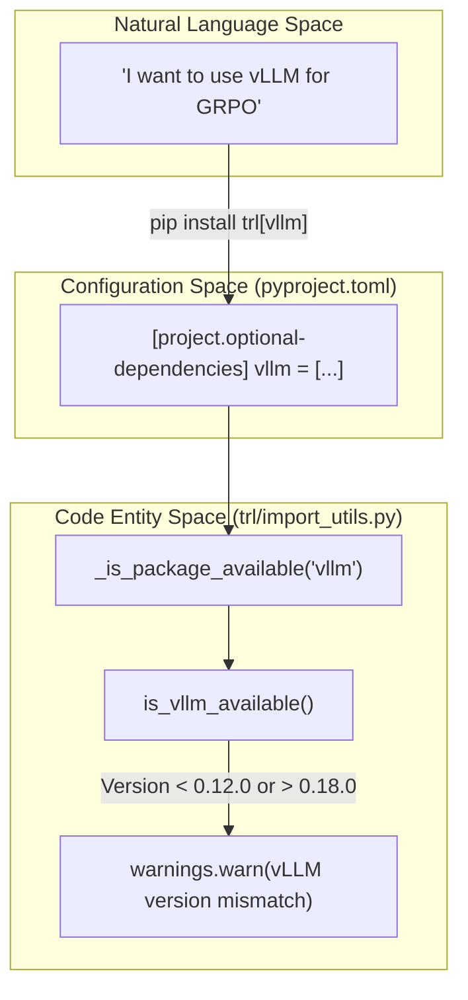
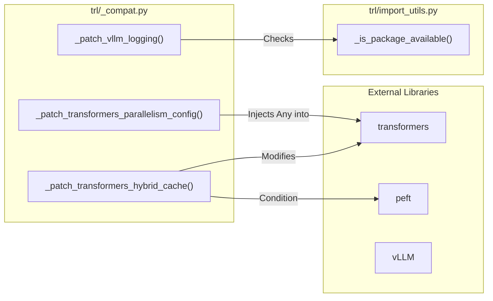

<!-- source: DeepWiki mcp.deepwiki.com · repo huggingface/trl · page 11.1 Optional Dependencies and Feature Flags · fetched 2026-10-26 -->

# Optional Dependencies and Feature Flags

Relevant source files

The following files were used as context for generating this wiki page:

- [docs/source/speeding_up_training.md](docs/source/speeding_up_training.md)
- [docs/source/vllm_integration.md](docs/source/vllm_integration.md)
- [pyproject.toml](pyproject.toml)
- [trl/_compat.py](trl/_compat.py)
- [trl/import_utils.py](trl/import_utils.py)

TRL is designed with a modular architecture that relies on a variety of optional dependencies to enable specialized features such as fast generation (vLLM), memory-efficient kernels (Liger), and distributed training (DeepSpeed). This page documents the infrastructure used to manage these dependencies, the available feature flags, and how to install specific feature sets.

## Dependency Management Infrastructure

TRL utilizes a centralized utility module for checking the availability and versions of optional packages. This ensures that the library can fail gracefully or provide informative warnings when a requested feature is unavailable.

### Import Guards and Availability Checks

The core of TRL's dependency management resides in `trl/import_utils.py`. It provides a set of `is_X_available()` functions that use `importlib` to verify the presence of a package without necessarily importing it into the namespace.

| Function | Package | Purpose |
| :--- | :--- | :--- |
| `is_vllm_available` | `vllm` | Enables high-throughput generation for online trainers (GRPO, RLOO) [trl/import_utils.py:105-116](). |
| `is_deepspeed_available` | `deepspeed` | Enables ZeRO optimization and distributed training features [trl/import_utils.py:60-61](). |
| `is_liger_kernel_available`| `liger-kernel`| Enables fused Triton kernels for memory savings [trl/import_utils.py:76-79](). |
| `is_peft_available` | `peft` | (Via `transformers`) Enables Parameter-Efficient Fine-Tuning (LoRA, etc.) [pyproject.toml:61-63](). |
| `is_unsloth_available` | `unsloth` | Enables optimized training backends [trl/import_utils.py:97-98](). |
| `is_math_verify_available`| `math_verify` | Required for `accuracy_reward` in math-based training [trl/import_utils.py:81-82](). |

### Version Requirements and Warnings

TRL enforces minimum versions for certain critical dependencies. For example, `liger-kernel` requires at least version `0.7.0` [trl/import_utils.py:24]().

The `is_vllm_available` function includes specific logic to warn users if their installed version falls outside the supported range of `0.12.0` to `0.18.0` [trl/import_utils.py:108-113]().

**Sources:** [trl/import_utils.py:24-126](), [docs/source/vllm_integration.md:5-6]()

---

## Installation Extras

TRL defines several "extras" in its `pyproject.toml` to allow users to install only the dependencies required for their specific use cases.

### Feature Set Mapping

The following table maps installation commands to the features they enable:

| Extra | Command | Included Dependencies |
| :--- | :--- | :--- |
| **vLLM** | `pip install "trl[vllm]"` | `vllm`, `fastapi`, `pydantic`, `uvicorn`, `requests`, `aiohttp` [pyproject.toml:81-88](). |
| **Liger** | `pip install "trl[liger]"` | `liger-kernel>=0.7.0` [pyproject.toml:58-60](). |
| **DeepSpeed** | `pip install "trl[deepspeed]"` | `deepspeed>=0.14.4` [pyproject.toml:51-54](). |
| **PEFT** | `pip install "trl[peft]"` | `peft>=0.8.0` [pyproject.toml:61-63](). |
| **VLM** | `pip install "trl[vlm]"` | `Pillow`, `torchvision`, `num2words` [pyproject.toml:89-93](). |
| **BCO** | `pip install "trl[bco]"` | `scikit-learn`, `joblib` [pyproject.toml:47-50](). |

### Natural Language to Code Entity Space: Installation Flow

The following diagram illustrates how a user's installation choice propagates from the `pyproject.toml` definition to the internal availability checks.

**Dependency Availability Flow**

**Sources:** [pyproject.toml:46-96](), [trl/import_utils.py:29-57](), [trl/import_utils.py:105-116]()

---

## Compatibility Patches

Because TRL sits at the intersection of several rapidly evolving libraries, it includes a `trl/_compat.py` module to handle edge cases and breaking changes in upstream dependencies.

### Key Compatibility Shims

1.  **vLLM Logging**: Automatically sets `VLLM_LOGGING_LEVEL` to `ERROR` to reduce console noise unless otherwise specified by the user [trl/_compat.py:78-85]().
2.  **Transformers HybridCache**: Patches `transformers.cache_utils` for compatibility with `transformers>=5.0.0` when using older versions of `peft` (< 0.18.0). This involves dynamically modifying the `_LazyModule` structure of the `transformers` library [trl/_compat.py:86-128]().
3.  **ParallelismConfig**: Ensures `ParallelismConfig` is defined in `transformers.training_args` to prevent `NameError` during type hint resolution when using `accelerate<1.10.1` [trl/_compat.py:130-157]().

### Patching Architecture

The patching mechanism uses `_is_package_version_below` and `_is_package_version_at_least` to target specific version ranges.

**System Component Interaction: Compatibility Patching**

**Sources:** [trl/_compat.py:30-75](), [trl/_compat.py:159-165]()

---

## Usage in Trainers

Optional dependencies are typically activated via boolean flags in the Trainer configuration classes (e.g., `SFTConfig`, `GRPOConfig`).

### Example: Enabling Liger Kernels
When `use_liger_kernel=True` is passed to a config, the trainer checks `is_liger_kernel_available()` before attempting to apply the optimizations [docs/source/speeding_up_training.md:140-192]().

### Example: vLLM Integration
For online methods, the trainer checks `is_vllm_available()` and `vllm_mode`. If `vllm_mode="server"`, it communicates with a separate process via `VLLMClient` [docs/source/vllm_integration.md:53-61]().

**Sources:** [docs/source/speeding_up_training.md:5-50](), [docs/source/vllm_integration.md:1-41]()

---

