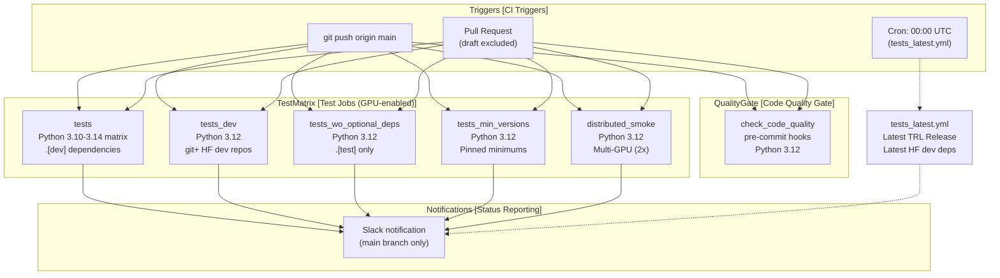
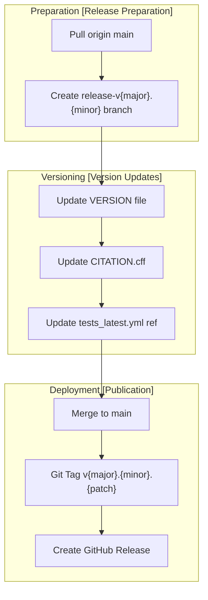
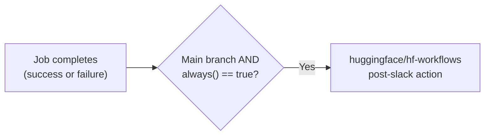
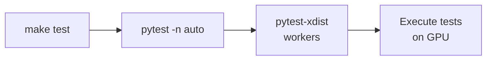

<!-- source: DeepWiki mcp.deepwiki.com · repo huggingface/trl · page 12 Testing and CI/CD · fetched 2026-10-26 -->

# Testing and CI/CD

Relevant source files

The following files were used as context for generating this wiki page:

- [.github/workflows/slow-tests.yml](.github/workflows/slow-tests.yml)
- [.github/workflows/tests-experimental.yml](.github/workflows/tests-experimental.yml)
- [.github/workflows/tests.yml](.github/workflows/tests.yml)
- [.github/workflows/tests_latest.yml](.github/workflows/tests_latest.yml)
- [.github/workflows/tests_transformers_branch.yml](.github/workflows/tests_transformers_branch.yml)
- [CITATION.cff](CITATION.cff)
- [RELEASE.md](RELEASE.md)
- [VERSION](VERSION)
- [trl/templates/lm_model_card.md](trl/templates/lm_model_card.md)
- [trl/templates/rm_model_card.md](trl/templates/rm_model_card.md)
- [trl/trainer/base_trainer.py](trl/trainer/base_trainer.py)

This page provides an overview of the TRL testing infrastructure and continuous integration pipeline. The testing system ensures TRL maintains compatibility across Python versions (3.10-3.14), dependency configurations, and distributed training environments.

Detailed reference is split into two child pages:

- **Test Suite Organization** (page [Test Suite Organization](#12.1)): Test structure, fixtures, `MODEL_REVISIONS` system, and pytest execution patterns.
- **CI/CD Pipeline** (page [CI/CD Pipeline](#12.2)): Six parallel test jobs, Python version matrix, dependency testing strategies, and Slack notifications.

---

## Testing Infrastructure Overview

The TRL test suite uses `pytest` and executes on GPU-enabled AWS instances within Docker containers. Tests validate trainer implementations, data processing pipelines, model loading utilities, and distributed training capabilities.

**Test Execution Environment**

| Component | Specification |
|---|---|
| Standard runner | `aws-g4dn-2xlarge` (1 GPU) |
| Distributed runner | `aws-g5-12xlarge-cache` (2 GPUs) |
| Container image | `pytorch/pytorch:2.8.0-cuda12.8-cudnn9-devel` |
| CUDA version | 12.8 with cuDNN 9 |
| Python versions | 3.10, 3.11, 3.12, 3.13, 3.14 |
| Package manager | `uv` (fast Python package installer) |
| Test command | `make test` → `pytest -n auto ...` |

Tests run in parallel using `pytest-xdist` to optimize execution time. The test suite excludes experimental code (`trl/experimental/**`, `tests/experimental/**`) from standard CI workflows to maintain stability, using a dedicated experimental workflow instead.

Sources: [.github/workflows/tests.yml:45-53](), [.github/workflows/tests.yml:85-88](), [.github/workflows/tests-experimental.yml:1-8]()

---

## CI/CD Pipeline Architecture

**CI/CD Workflow: Six Parallel Jobs**

The CI pipeline runs six parallel test jobs on every push to `main` and on pull requests. Each job validates a different aspect of TRL's compatibility matrix:

1. **check_code_quality**: Enforces code style via pre-commit hooks (ruff, formatting) [.github/workflows/tests.yml:29-41]().
2. **tests**: Matrix across Python 3.10-3.14 with standard dependencies [.github/workflows/tests.yml:43-48]().
3. **tests_dev**: Bleeding-edge Hugging Face ecosystem (accelerate, datasets, transformers, peft from `main`) [.github/workflows/tests.yml:99-140]().
4. **tests_wo_optional_deps**: Minimal dependencies (`.[test]` extras only) [.github/workflows/tests.yml:156-192]().
5. **tests_min_versions**: Pinned minimum versions for core libraries [.github/workflows/tests.yml:208-245]().
6. **distributed_smoke**: Multi-GPU tests on 2 GPUs (DDP, DeepSpeed, FSDP validation) [.github/workflows/tests.yml:258-304]().

A seventh workflow, `tests_latest.yml`, runs daily to test the latest release branch against development dependencies [.github/workflows/tests_latest.yml:1-56]().

Sources: [.github/workflows/tests.yml:29-304](), [.github/workflows/tests_latest.yml:1-56]()

---

## Dependency Testing Strategy

TRL validates four dependency configurations to ensure broad compatibility:

**Dependency Configuration Matrix**

| Configuration | Python | Dependencies | Purpose |
|---|---|---|---|
| **Standard** | 3.10-3.14 | `.[dev]` | Primary validation across Python versions |
| **Development** | 3.12 | `git+https://github.com/huggingface/{repo}.git` | Early detection of breaking changes in HF ecosystem |
| **Minimal** | 3.12 | `.[test]` only | Verify core functionality without optional dependencies |
| **Minimum Versions** | 3.12 | `accelerate==1.4.0`, `datasets==3.0.0`, `transformers==4.56.2` | Backward compatibility with oldest supported versions |

This matrix ensures TRL works across the full compatibility range. The development configuration catches incompatibilities before upstream releases, while minimum versions prevent accidental dependency on newer APIs.

Sources: [.github/workflows/tests.yml:83](), [.github/workflows/tests.yml:135-140](), [.github/workflows/tests.yml:192](), [.github/workflows/tests.yml:241-245]()

---

## Release Process and Versioning

TRL follows a structured release process for major/minor and patch versions. The `VERSION` file identifies the current state (e.g., `1.3.0.dev0`).

**Release Workflow**

The release process requires updating `CITATION.cff` and `.github/workflows/tests_latest.yml` to point to the new release branch to ensure daily compatibility tests track the correct version.

Sources: [RELEASE.md:6-87](), [VERSION:1](), [CITATION.cff:40]()

---

## Environment Configuration

CI workflows set environment variables to optimize test execution and provide consistent behavior across jobs:

**Global Environment Variables**

| Variable | Value | Purpose |
|---|---|---|
| `TQDM_DISABLE` | `1` | Suppress progress bars in CI output |
| `CI_SLACK_CHANNEL` | `${{ secrets.CI_PUSH_MAIN_CHANNEL }}` | Slack notification channel |
| `PYTORCH_CUDA_ALLOC_CONF` | `"expandable_segments:True"` | Enable CUDA memory expansion |
| `TRL_EXPERIMENTAL_SILENCE` | `1` | Suppress experimental feature warnings |

The `PYTORCH_CUDA_ALLOC_CONF` setting enables expandable memory segments, preventing CUDA out-of-memory errors during training tests.

Sources: [.github/workflows/tests.yml:21-26](), [.github/workflows/tests_latest.yml:9-13](), [.github/workflows/slow-tests.yml:10-15]()

---

## Slack Notification System

**Notification Flow**

All test jobs post results to a Slack channel when running on the `main` branch. The notification uses the `always()` condition to report both successes and failures.

Sources: [.github/workflows/tests.yml:90-97](), [.github/workflows/tests.yml:147-154]()

---

## Test Execution Flow

**pytest Invocation Pipeline**

The `make test` command in CI executes `pytest` with parallel execution enabled via `pytest-xdist`. Distributed smoke tests specifically target `tests/distributed/test_distributed.py`.

Sources: [.github/workflows/tests.yml:88](), [.github/workflows/tests.yml:304](), [.github/workflows/tests_transformers_branch.yml:116]()

For more detailed information, please refer to the child pages:
- [Test Suite Organization](#12.1)
- [CI/CD Pipeline](#12.2)

---

