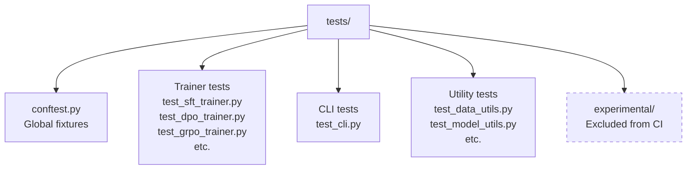
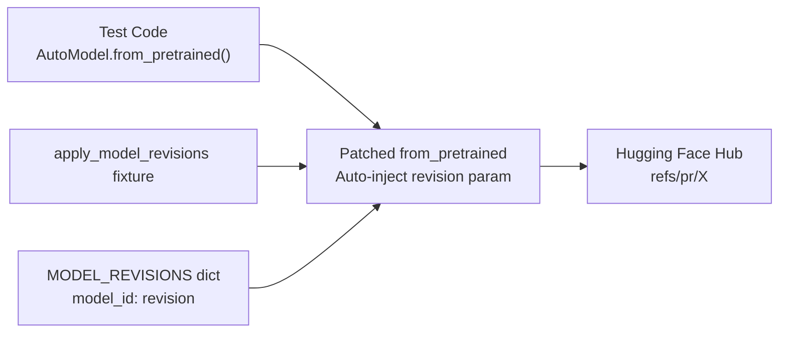
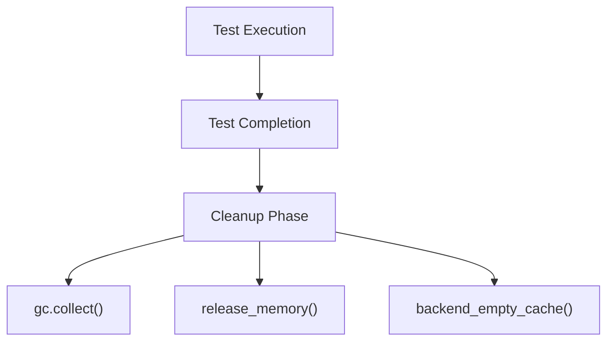
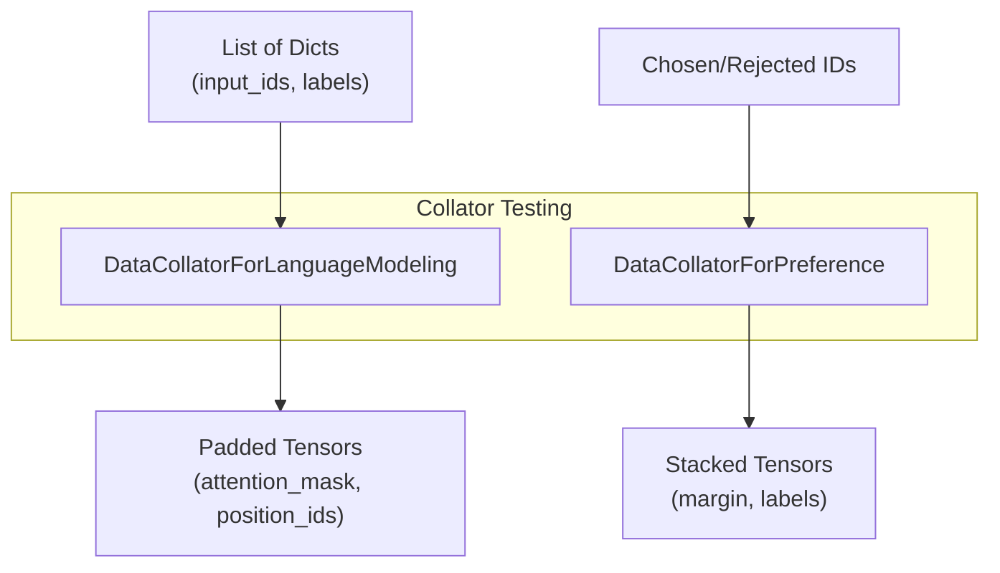

<!-- source: DeepWiki mcp.deepwiki.com · repo huggingface/trl · page 12.1 Test Suite Organization · fetched 2026-10-26 -->

# Test Suite Organization

Relevant source files

The following files were used as context for generating this wiki page:

- [.github/workflows/tests_latest.yml](.github/workflows/tests_latest.yml)
- [CITATION.cff](CITATION.cff)
- [RELEASE.md](RELEASE.md)
- [VERSION](VERSION)
- [tests/test_cli.py](tests/test_cli.py)
- [tests/test_reward_trainer.py](tests/test_reward_trainer.py)
- [tests/test_sft_trainer.py](tests/test_sft_trainer.py)
- [trl/templates/lm_model_card.md](trl/templates/lm_model_card.md)
- [trl/templates/rm_model_card.md](trl/templates/rm_model_card.md)
- [trl/trainer/base_trainer.py](trl/trainer/base_trainer.py)
- [trl/trainer/sft_trainer.py](trl/trainer/sft_trainer.py)

This page documents the structure and organization of the TRL test suite, including test fixtures, model revision overrides for testing pull requests, and GPU memory management patterns. For information about the CI/CD pipeline that executes these tests, see [CI/CD Pipeline](#12.2).

The TRL test suite is designed to validate trainer implementations, utility functions, and integration points across multiple Python versions and dependency configurations. Tests are located in the `tests/` directory and executed using `pytest`.

## Test Directory Structure

The test suite follows a structured organization that mirrors the main codebase:

**Sources:** [tests/test_sft_trainer.py:1-45](), [tests/test_reward_trainer.py:1-28](), [tests/test_cli.py:1-23]()

Tests are organized by component type:
- **Trainer tests**: Validate individual trainer classes like `SFTTrainer` [tests/test_sft_trainer.py:31]() and `RewardTrainer` [tests/test_reward_trainer.py:110]().
- **CLI tests**: Validate the `trl` command-line interface, ensuring commands like `trl sft` or `trl dpo` execute correctly with various arguments [tests/test_cli.py:37-141]().
- **Utility tests**: Cover shared components like `DataCollatorForLanguageModeling` [tests/test_sft_trainer.py:84]() and `DataCollatorForPreference` [tests/test_reward_trainer.py:34]().
- **Experimental tests**: Located in `tests/experimental/`, these are typically excluded from standard CI runs to allow for unstable research features.

## Test Fixtures and Utils

TRL utilizes a specialized `TrlTestCase` and custom decorators to manage test environments and hardware requirements.

### Hardware and Dependency Guards
Tests use specific decorators in `testing_utils.py` to skip tests when necessary hardware or libraries are missing:
- `require_peft`: Skips if PEFT is not installed [tests/test_sft_trainer.py:41]().
- `require_torch_accelerator`: Ensures a GPU/XPU is available [tests/test_sft_trainer.py:42]().
- `require_liger_kernel`: Skips if Liger kernels are unavailable [tests/test_sft_trainer.py:40]().
- `require_vision`: Used for VLM testing [tests/test_sft_trainer.py:44]().

### Model Revision Override System

The `apply_model_revisions` fixture (typically found in `conftest.py`) enables testing of model pull requests before they are merged to the main branch on Hugging Face Hub. This is critical for TRL as it often tests against "tiny" models stored in `trl-internal-testing`.

**Sources:** [tests/test_sft_trainer.py:127-135](), [tests/test_reward_trainer.py:127-135]()

The system works by patching `from_pretrained` methods. When a test requests a model ID present in a `MODEL_REVISIONS` map, the fixture automatically injects the `revision="refs/pr/..."` argument. This allows the CI to validate that TRL remains compatible with upcoming model changes or specific testing branches.

### GPU Memory Cleanup

To prevent CUDA Out-of-Memory (OOM) errors during large test suites, TRL employs a `cleanup_gpu` pattern. In individual tests, this is often handled manually or via fixtures:

**Sources:** [tests/test_sft_trainer.py:15-28](), [tests/test_sft_trainer.py:821-825]()

The cleanup process involves:
1. **Garbage Collection**: Calling `gc.collect()` to remove stale Python objects [tests/test_sft_trainer.py:15]().
2. **Memory Release**: Using `accelerate.utils.memory.release_memory` to clear model tensors [tests/test_sft_trainer.py:23]().
3. **Cache Clearing**: Executing `backend_empty_cache()` (aliased from `torch.cuda.empty_cache`) to return memory to the OS [tests/test_sft_trainer.py:28]().

## Test Execution and CI Integration

### Local Execution
Tests can be executed using `pytest`. TRL supports parallel execution with `pytest-xdist`, provided the GPU cleanup fixtures are active.

| Command | Description |
|---------|-------------|
| `pytest tests/test_sft_trainer.py` | Run SFT specific tests |
| `make test` | Runs the suite as defined in the Makefile [ .github/workflows/tests_latest.yml:61]() |

### CI Environment Variables
The CI environment is configured via `.github/workflows/tests_latest.yml` to ensure stable runs:
- `TQDM_DISABLE=1`: Prevents log pollution from progress bars [.github/workflows/tests_latest.yml:10]().
- `TRL_EXPERIMENTAL_SILENCE=1`: Silences warnings from experimental modules [.github/workflows/tests_latest.yml:13]().

### Versioning and Compatibility Matrix
The test suite is responsible for ensuring TRL works across different versions of the Hugging Face ecosystem. The CI job `tests_latest.yml` specifically installs the `main` branches of `transformers`, `accelerate`, and `datasets` to detect breaking changes early [.github/workflows/tests_latest.yml:54-56]().

## Data Collator Testing

A significant portion of the test suite is dedicated to data collators, which are the bridge between raw datasets and model inputs.

**Sources:** [tests/test_sft_trainer.py:84-170](), [tests/test_reward_trainer.py:34-108]()

Collator tests verify:
- **Padding**: Correct application of `pad_token_id` [tests/test_sft_trainer.py:85-96]().
- **Masking**: Proper generation of `completion_mask` and `labels` (setting non-completion tokens to -100) [tests/test_sft_trainer.py:97-111]().
- **Padding-free Mode**: Verification that sequences are concatenated and `position_ids` are correctly reset [tests/test_sft_trainer.py:128-139]().
- **Preference Handling**: Ensuring `chosen` and `rejected` sequences are correctly stacked for Reward models [tests/test_reward_trainer.py:35-49]().

**Sources:**
- `tests/test_sft_trainer.py`
- `tests/test_reward_trainer.py`
- `tests/test_cli.py`
- `.github/workflows/tests_latest.yml`
- `trl/trainer/sft_trainer.py`

---

