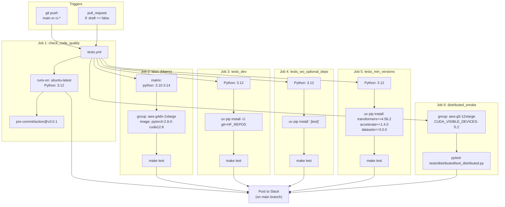

<!-- source: DeepWiki mcp.deepwiki.com · repo huggingface/trl · page 12.2 CI/CD Pipeline · fetched 2026-10-26 -->

# CI/CD Pipeline

Relevant source files

The following files were used as context for generating this wiki page:

- [.github/codeql/custom-queries.qls](.github/codeql/custom-queries.qls)
- [.github/workflows/build_documentation.yml](.github/workflows/build_documentation.yml)
- [.github/workflows/build_pr_documentation.yml](.github/workflows/build_pr_documentation.yml)
- [.github/workflows/clear_cache.yml](.github/workflows/clear_cache.yml)
- [.github/workflows/codeQL.yml](.github/workflows/codeQL.yml)
- [.github/workflows/docker-build.yml](.github/workflows/docker-build.yml)
- [.github/workflows/pr_style_bot.yml](.github/workflows/pr_style_bot.yml)
- [.github/workflows/slow-tests.yml](.github/workflows/slow-tests.yml)
- [.github/workflows/tests-experimental.yml](.github/workflows/tests-experimental.yml)
- [.github/workflows/tests.yml](.github/workflows/tests.yml)
- [.github/workflows/tests_transformers_branch.yml](.github/workflows/tests_transformers_branch.yml)
- [.github/workflows/upload_pr_documentation.yml](.github/workflows/upload_pr_documentation.yml)

This document details TRL's continuous integration and deployment infrastructure. The pipeline automates code quality enforcement, multi-environment testing across five Python versions, dependency validation strategies, and automated release processes via GitHub Actions.

## Overview

TRL utilizes a multi-layered CI strategy to ensure compatibility across the Hugging Face ecosystem. The pipeline validates code against Python 3.10 through 3.14, checks for regressions in core trainers without optional dependencies, and performs multi-GPU distributed smoke tests.

### Primary CI Workflow: `tests.yml`

The main CI workflow [.github/workflows/tests.yml:1-314]() is triggered on pushes to `main` or `ci-*` branches, and on pull requests that modify relevant code paths [.github/workflows/tests.yml:3-20](). It excludes changes only affecting the `trl/experimental/` or `tests/experimental/` namespaces [.github/workflows/tests.yml:18-19]().

**Workflow Architecture: Six Parallel Jobs**

Sources: [.github/workflows/tests.yml:1-314]()

## Detailed Job Implementation

### 1. Code Quality (`check_code_quality`)
This job [.github/workflows/tests.yml:29-42]() runs on `ubuntu-latest` and uses the `pre-commit/action` to enforce linting and formatting standards (Ruff, black, etc.) across all files. It serves as the first gate in the CI pipeline.

### 2. Standard Test Matrix (`tests`)
The core testing job [.github/workflows/tests.yml:43-98]() executes the full suite across a matrix of Python versions: `['3.10', '3.11', '3.12', '3.13', '3.14']` [.github/workflows/tests.yml:47]().
- **Environment**: AWS G4dn instances with NVIDIA T4 GPUs [.github/workflows/tests.yml:50-53]().
- **Package Manager**: Uses `uv` for high-speed dependency resolution and virtual environment creation [.github/workflows/tests.yml:71-78]().
- **Installation**: Installs development extras via `uv pip install ".[dev]"` [.github/workflows/tests.yml:83]().

### 3. Upstream Compatibility (`tests_dev`)
This job [.github/workflows/tests.yml:99-155]() validates TRL against the latest development (main branch) versions of core Hugging Face libraries.
- **Dependencies**: Explicitly installs `accelerate`, `datasets`, `transformers`, and `peft` from their respective GitHub `main` branches [.github/workflows/tests.yml:135-140]().
- **Purpose**: Detects breaking changes in upstream libraries before they are released to PyPI.

### 4. Minimal Dependency Validation (`tests_wo_optional_deps`)
Ensures TRL remains functional for users who only install core requirements [.github/workflows/tests.yml:156-207]().
- **Installation**: Uses `uv pip install ".[test]"` [.github/workflows/tests.yml:192](), which excludes optional integrations like `vllm`, `deepspeed`, `liger-kernel`, or `bitsandbytes`.

### 5. Minimum Version Testing (`tests_min_versions`)
Validates that TRL respects the lower bounds of its dependency constraints [.github/workflows/tests.yml:208-259]().
- **Installation**: Forces installation of minimum versions, such as `transformers==4.56.2`, `accelerate==1.4.0`, and `datasets==3.0.0` [.github/workflows/tests.yml:243-246]().

### 6. Distributed Smoke Tests (`distributed_smoke`)
Performs multi-GPU validation for trainers that support distributed backends [.github/workflows/tests.yml:261-314]().
- **Runner**: Uses `aws-g5-12xlarge-cache` for high-performance A10G GPUs [.github/workflows/tests.yml:263]().
- **Visibility**: Restricts execution to 2 GPUs via `CUDA_VISIBLE_DEVICES: "0,1"` [.github/workflows/tests.yml:283]().
- **Execution**: Specifically runs `tests/distributed/test_distributed.py` [.github/workflows/tests.yml:304]().

Sources: [.github/workflows/tests.yml:29-314]()

## Supplemental Workflows

### Slow Tests
For intensive training runs that exceed standard CI timeouts, the `slow-tests.yml` workflow [.github/workflows/slow-tests.yml:1-113]() is triggered on pushes to `main`.
- **Configuration**: Sets `RUN_SLOW: "yes"` [.github/workflows/slow-tests.yml:11]().
- **Hardware**: Runs on `aws-g4dn-2xlarge` in both single-GPU (`CUDA_VISIBLE_DEVICES: "0"`) and multi-GPU (`CUDA_VISIBLE_DEVICES: "0,1"`) configurations [.github/workflows/slow-tests.yml:22, 70]().
- **Command**: Executes `make slow_tests` [.github/workflows/slow-tests.yml:57]().

### Experimental Tests
Tests for the `trl/experimental/` directory are decoupled into `tests-experimental.yml` [.github/workflows/tests-experimental.yml:1-73](). This workflow only triggers when files in `trl/experimental/` or `tests/experimental/` are modified [.github/workflows/tests-experimental.yml:4-8](). It executes `make test_experimental` [.github/workflows/tests-experimental.yml:72]().

### Upstream Branch Testing
The `tests_transformers_branch.yml` workflow [.github/workflows/tests_transformers_branch.yml:1-126]() allows manual triggering (`workflow_dispatch`) to test TRL against a specific git ref (branch/tag/SHA) of the `transformers` library [.github/workflows/tests_transformers_branch.yml:4-9]().

Sources: [.github/workflows/slow-tests.yml:1-113](), [.github/workflows/tests-experimental.yml:1-73](), [.github/workflows/tests_transformers_branch.yml:1-126]()

## Notification and Reporting

### Slack Integration
All major CI jobs post status updates to Slack when running on the `main` branch [.github/workflows/tests.yml:91-97]().
- **Action**: Uses `huggingface/hf-workflows/.github/actions/post-slack@main`.
- **Channel**: Configured via `CI_SLACK_CHANNEL` environment variable [.github/workflows/tests.yml:23]().

### GitHub Step Summaries
Slow tests generate a summary report using `scripts/log_reports.py` [.github/workflows/slow-tests.yml:64](), which uses `slack_sdk` and `tabulate` to format test results directly into the GitHub Actions UI.

Sources: [.github/workflows/tests.yml:91-97](), [.github/workflows/slow-tests.yml:64]()

## Release and Documentation Automation

### Docker Image Builds
On every push to `main`, TRL builds and pushes two Docker images to DockerHub [.github/workflows/docker-build.yml:1-87]():
1. `huggingface/trl:{VERSION}`: The stable release version [.github/workflows/docker-build.yml:42]().
2. `huggingface/trl:dev`: The latest development version from the main branch [.github/workflows/docker-build.yml:77]().

### Documentation
Documentation is automatically built and deployed using the `hf-doc-builder`:
- **Main Docs**: Built on pushes to `main` or release branches [.github/workflows/build_documentation.yml:1-22]().
- **PR Previews**: Built for every pull request [.github/workflows/build_pr_documentation.yml:1-22]() and uploaded to a preview environment [.github/workflows/upload_pr_documentation.yml:1-16]().

### Style Bot
Maintainers can trigger automatic style fixes on a PR by commenting `@bot /style` [.github/workflows/pr_style_bot.yml:14](). The bot runs `make precommit` and pushes the resulting fixes back to the contributor's branch [.github/workflows/pr_style_bot.yml:82, 105]().

Sources: [.github/workflows/docker-build.yml:1-87](), [.github/workflows/build_documentation.yml:1-22](), [.github/workflows/build_pr_documentation.yml:1-22](), [.github/workflows/pr_style_bot.yml:1-128]()

---

