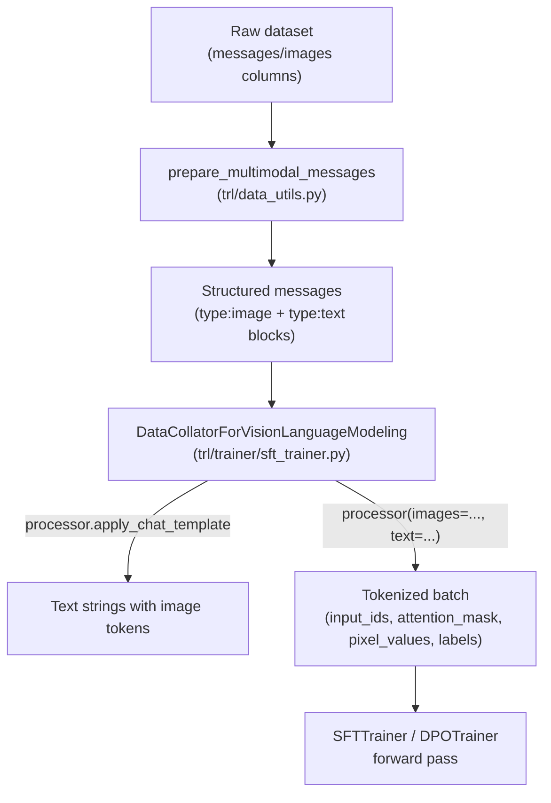
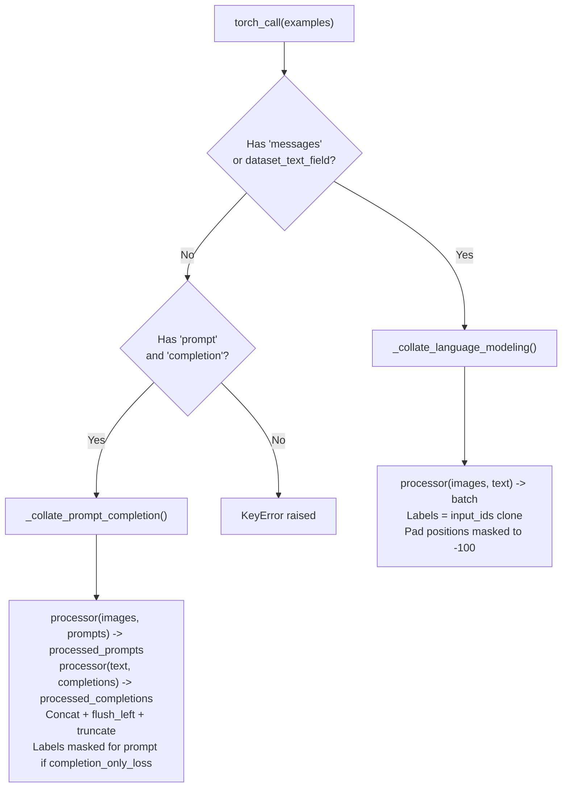
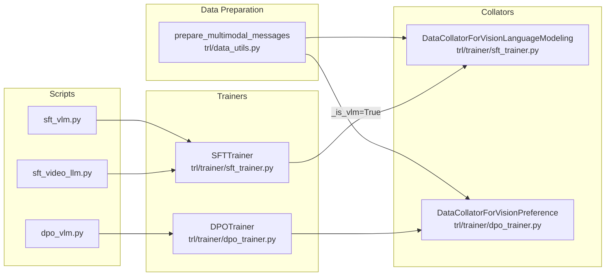

<!-- source: DeepWiki mcp.deepwiki.com · repo huggingface/trl · page 13 Vision-Language Model Training · fetched 2026-10-26 -->

# Vision-Language Model Training

<details>
<summary>Relevant source files</summary>

The following files were used as context for generating this wiki page:

- [examples/scripts/dpo_vlm.py](examples/scripts/dpo_vlm.py)
- [examples/scripts/mpo_vlm.py](examples/scripts/mpo_vlm.py)
- [examples/scripts/sft_gpt_oss.py](examples/scripts/sft_gpt_oss.py)
- [examples/scripts/sft_video_llm.py](examples/scripts/sft_video_llm.py)
- [examples/scripts/sft_vlm.py](examples/scripts/sft_vlm.py)
- [examples/scripts/sft_vlm_gemma3.py](examples/scripts/sft_vlm_gemma3.py)
- [tests/test_cli.py](tests/test_cli.py)
- [tests/test_dpo_trainer.py](tests/test_dpo_trainer.py)
- [tests/test_reward_trainer.py](tests/test_reward_trainer.py)
- [tests/test_sft_trainer.py](tests/test_sft_trainer.py)
- [trl/trainer/dpo_trainer.py](trl/trainer/dpo_trainer.py)
- [trl/trainer/kto_trainer.py](trl/trainer/kto_trainer.py)
- [trl/trainer/reward_trainer.py](trl/trainer/reward_trainer.py)
- [trl/trainer/sft_trainer.py](trl/trainer/sft_trainer.py)

</details>


This page documents the VLM-specific infrastructure in TRL: the `DataCollatorForVisionLanguageModeling` collator, the `prepare_multimodal_messages` preprocessing utility, how `SFTTrainer` and `DPOTrainer` detect and handle VLMs, and the ready-to-run example scripts. For details on data processing, see [VLM Data Processing](#13.1). For details on example scripts, see [VLM Training Examples](#13.2).

---

## Overview of the VLM Training Pipeline

Training a VLM differs from text-only training in two principal ways:

1. **On-the-fly image processing.** Converting images to pixel tensors is I/O-intensive; pre-tokenizing an entire dataset upfront is impractical. The data collator therefore performs tokenization and image processing at batch construction time.
2. **Multimodal message format.** Conversation messages must be restructured to interleave image placeholders with text before a processor's chat template is applied.

**VLM training data flow:**



Sources: [trl/data_utils.py:32-109](), [trl/trainer/sft_trainer.py:258-473]()

---

## Multimodal Message Preparation

### `prepare_multimodal_messages`

Located in [trl/data_utils.py:32-109](), this function converts a list of role/content messages into the structured multimodal format that processors expect.

**Input:** messages with plain string `"content"` fields plus a list of image objects.

**Output:** messages where every `"content"` is a list of typed blocks (`{"type": "image", "image": <PIL>}` or `{"type": "text", "text": "..."}`).

**Behaviour:**

| Input content type | Transformation |
|---|---|
| String `"content"`, first user message | Inserts one `{"type": "image"}` block per image, then wraps text |
| String `"content"`, subsequent user messages | Wraps text only, no image blocks added |
| String `"content"`, system/assistant message | Wraps in `{"type": "text", ...}` |
| List `"content"` (already structured) | Only fills in actual image objects into existing `{"type": "image"}` placeholders |

If the number of image placeholders in the messages does not match the number of provided images, a `ValueError` is raised.

Sources: [trl/data_utils.py:32-109]()

---

## DataCollatorForVisionLanguageModeling

**Class:** `DataCollatorForVisionLanguageModeling` — defined in [trl/trainer/sft_trainer.py:258-473]()

This collator performs tokenization and image processing at batch time. It handles two dataset types: language modeling and prompt-completion. For details on image grid handling and model-specific adaptations, see [VLM Data Processing](#13.1).

**Constructor parameters:**

| Parameter | Type | Default | Description |
|---|---|---|---|
| `processor` | `ProcessorMixin` | required | Tokenizer + image processor (e.g. from `AutoProcessor`) |
| `max_length` | `int \| None` | `None` | Truncation length; `None` means no truncation |
| `completion_only_loss` | `bool` | `False` | Mask prompt labels; requires prompt-completion dataset type |
| `dataset_text_field` | `str` | `"text"` | Column name for plain text in standard datasets |

**Dispatch logic in `torch_call`:**



Sources: [trl/trainer/sft_trainer.py:344-473]()

---

## Model Loading

VLM architectures use `AutoModelForImageTextToText` rather than `AutoModelForCausalLM`. This is the Transformers class for encoder–decoder and decoder-only vision-language models (LLaVA, Qwen2-VL, Gemma3, SmolVLM, etc.).

```python
# From examples/scripts/sft_vlm.py
from transformers import AutoModelForImageTextToText

model = AutoModelForImageTextToText.from_pretrained(
    model_args.model_name_or_path,
    dtype=dtype,
    attn_implementation=model_args.attn_implementation,
)
```

Sources: [examples/scripts/sft_vlm.py:92-94](), [examples/scripts/dpo_vlm.py:95-99]()

---

## SFTTrainer VLM Detection

`SFTTrainer.__init__` inspects the `processing_class` argument to determine whether VLM mode is active. If `processing_class` is an instance of `ProcessorMixin`, `self._is_vlm` is set to `True` [trl/trainer/sft_trainer.py:645-661]().

### VLM Restrictions in SFTTrainer

The following features are currently restricted when training VLMs:

| Feature | Status | Reason |
|---|---|---|
| `packing` | ❌ Not supported | Sequence packing requires homogeneous token streams [trl/trainer/sft_trainer.py:682-684]() |
| `padding_free` | ❌ Not supported | Not yet implemented for multimodal batches [trl/trainer/sft_trainer.py:686-688]() |
| `assistant_only_loss` | ❌ Not supported | Not yet implemented for multimodal batches [trl/trainer/sft_trainer.py:690-692]() |
| `completion_only_loss` | ✅ Limited | Supported in prompt-completion mode; raises error in language modeling mode [trl/trainer/sft_trainer.py:694-696]() |

---

## DPO for VLMs

`DPOTrainer` handles VLMs via `DataCollatorForVisionPreference`. The trainer auto-detects VLM mode if the `processing_class` is a `ProcessorMixin` [trl/trainer/dpo_trainer.py:37-42]().

For details on the DPO VLM implementation and `DataCollatorForVisionPreference`, see [VLM Data Processing](#13.1).

---

## Example Scripts

TRL provides several canonical scripts for VLM training:

- **SFT VLM (`sft_vlm.py`):** General purpose supervised fine-tuning for image-text models like LLaVA and SmolVLM [examples/scripts/sft_vlm.py:1-118]().
- **SFT VLM Gemma3 (`sft_vlm_gemma3.py`):** Support for the Gemma 3 architecture, including multi-image handling [examples/scripts/sft_vlm_gemma3.py:1-189]().
- **SFT Video LLM (`sft_video_llm.py`):** Fine-tuning Qwen2-VL on video datasets using `qwen-vl-utils` [examples/scripts/sft_video_llm.py:1-213]().
- **DPO VLM (`dpo_vlm.py`):** Direct Preference Optimization for vision models [examples/scripts/dpo_vlm.py:1-138]().

For a full guide on running these examples, see [VLM Training Examples](#13.2).

---

## Component Relationships

The following diagram maps high-level concepts to specific code entities:



Sources: [trl/trainer/sft_trainer.py:258-473](), [trl/data_utils.py:32-109](), [trl/trainer/dpo_trainer.py:25-26](), [examples/scripts/sft_vlm.py](), [examples/scripts/dpo_vlm.py]()

---

