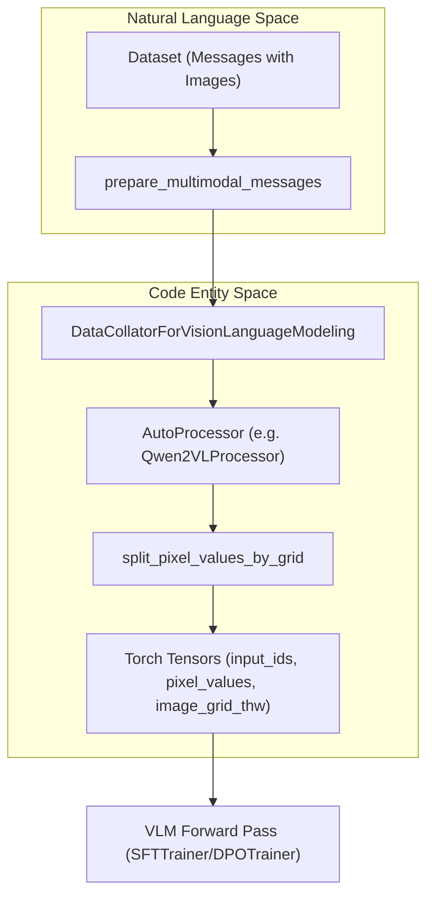
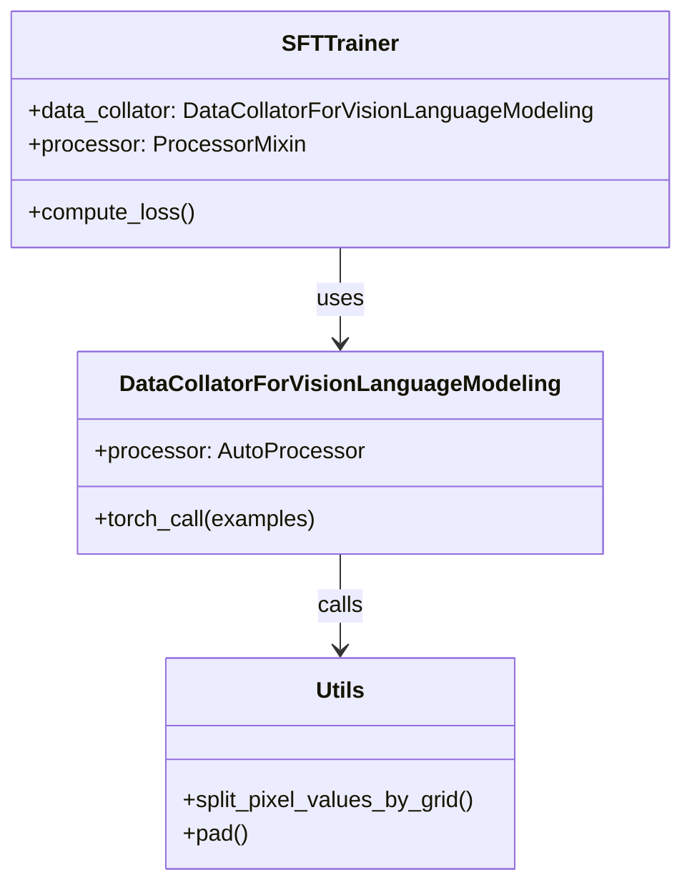

<!-- source: DeepWiki mcp.deepwiki.com · repo huggingface/trl · page 13.1 VLM Data Processing · fetched 2026-10-26 -->

# VLM Data Processing

Relevant source files

The following files were used as context for generating this wiki page:

- [tests/test_cli.py](tests/test_cli.py)
- [tests/test_reward_trainer.py](tests/test_reward_trainer.py)
- [tests/test_sft_trainer.py](tests/test_sft_trainer.py)
- [tests/test_utils.py](tests/test_utils.py)
- [trl/trainer/sft_trainer.py](trl/trainer/sft_trainer.py)
- [trl/trainer/utils.py](trl/trainer/utils.py)

Vision-Language Model (VLM) data processing in TRL is designed to handle multimodal inputs (images and text) dynamically during training. Unlike standard language models, VLMs require specialized data collators that can process pixel values, handle image grid structures (e.g., for Qwen2-VL or Gemma 3), and manage image placeholders within token sequences.

## Data Collators for VLMs

TRL provides two primary data collators for multimodal training: `DataCollatorForVisionLanguageModeling` for Supervised Fine-Tuning (SFT) and `DataCollatorForVisionPreference` for preference alignment (DPO).

### DataCollatorForVisionLanguageModeling
This collator is used in `SFTTrainer` when training VLMs. It handles the dynamic processing of images using a `processor` (typically an `AutoProcessor`) and manages padding for both text tokens and image features.

Key responsibilities:
- **On-the-fly Image Processing**: It extracts images from the dataset and processes them using the provided `processor` during the collation step [trl/trainer/sft_trainer.py:218-228]().
- **Padding and Truncation**: It pads `input_ids` and `labels` to the maximum length in the batch [trl/trainer/sft_trainer.py:230-244]().
- **Label Masking**: It automatically masks non-completion tokens (e.g., prompts and image placeholders) in the labels using `-100` if `completion_only_loss` is enabled [trl/trainer/sft_trainer.py:236-240]().

### DataCollatorForPreference
Used in preference-based trainers (like `DPOTrainer` or `RewardTrainer`), this collator handles pairs of "chosen" and "rejected" sequences that may contain images [trl/trainer/reward_trainer.py:25-33](). It ensures that multimodal inputs for both versions of the response are correctly padded and formatted for the reward model or policy model.

### VLM Data Flow
The following diagram illustrates how raw multimodal messages are transformed into tensors suitable for VLM training.

**VLM Data Processing Pipeline**

Sources: [trl/trainer/sft_trainer.py:218-244](), [trl/data_utils.py:53](), [trl/trainer/utils.py:45-47]()

## Specialized Image Processing

Modern VLMs like Qwen2-VL and Gemma 3 use sophisticated image encoding strategies that require TRL to perform specific tensor manipulations.

### Grid-Based Splitting
Functions like `split_pixel_values_by_grid` are used to handle models that represent images as a sequence of patches organized in a grid [trl/trainer/utils.py:45](). This is crucial for models that use `image_grid_thw` (Temporal, Height, Width) to describe the dimensions of the flattened image feature sequence.

- **`split_pixel_values_by_grid`**: Splits a single tensor of pixel values into a list of tensors based on the grid dimensions provided in `image_grid_thw` [trl/trainer/utils.py:45]().
- **`unsplit_pixel_values_by_grid`**: Reverses the process, typically used when gathering features across distributed processes [trl/trainer/utils.py:47]().

### Image Grid THW Handling
For models like Qwen2-VL, the collator must ensure that `image_grid_thw` tensors are correctly batched. Since different images in a batch might have different aspect ratios, these grid descriptors are essential for the model's vision encoder to reconstruct the spatial structure of the patches.

## Why VLMs Skip Pre-processing

In TRL, VLM training typically sets `skip_prepare_dataset=True` in the `SFTConfig`. This behavior is distinct from pure text models for several reasons:

1.  **Memory Efficiency**: Images are large. Pre-processing the entire dataset and storing pixel values in memory or on disk is often prohibitive.
2.  **Dynamic Aspect Ratios**: Many modern VLMs support dynamic resolutions. Processing images at collation time allows for flexible resizing or patch-splitting based on the specific batch requirements.
3.  **Processor Complexity**: VLM processors often perform complex token-image alignment (e.g., injecting `<|image_pad|>` tokens) that is easier to manage at the batch level than during initial dataset loading.

## Implementation Details

The association between the high-level VLM training logic and the underlying TRL entities is shown below.

**VLM Training Entity Mapping**

Sources: [trl/trainer/sft_trainer.py:89-170](), [trl/trainer/utils.py:112-175](), [trl/trainer/utils.py:45-47]()

### Restrictions and Limitations
When training VLMs in TRL, certain features available for LLMs are restricted:
- **No Packing**: Dataset packing is currently not supported for VLMs because image features require contiguous sequences that are difficult to align when multiple examples are packed into one [trl/trainer/sft_trainer.py:52-54]().
- **No `padding_free`**: The `padding_free` (Flash Attention 2 optimization) mode is generally disabled for VLMs due to the complexity of managing image position IDs alongside text position IDs.
- **No `assistant_only_loss`**: Standard VLM collators in TRL prioritize `completion_only_loss` via masking labels to `-100` [trl/trainer/sft_trainer.py:98-102]().

Sources: [trl/trainer/sft_trainer.py:218-244](), [trl/trainer/utils.py:45-47](), [trl/trainer/reward_trainer.py:34-49](), [trl/trainer/sft_trainer.py:89-160]().

---

