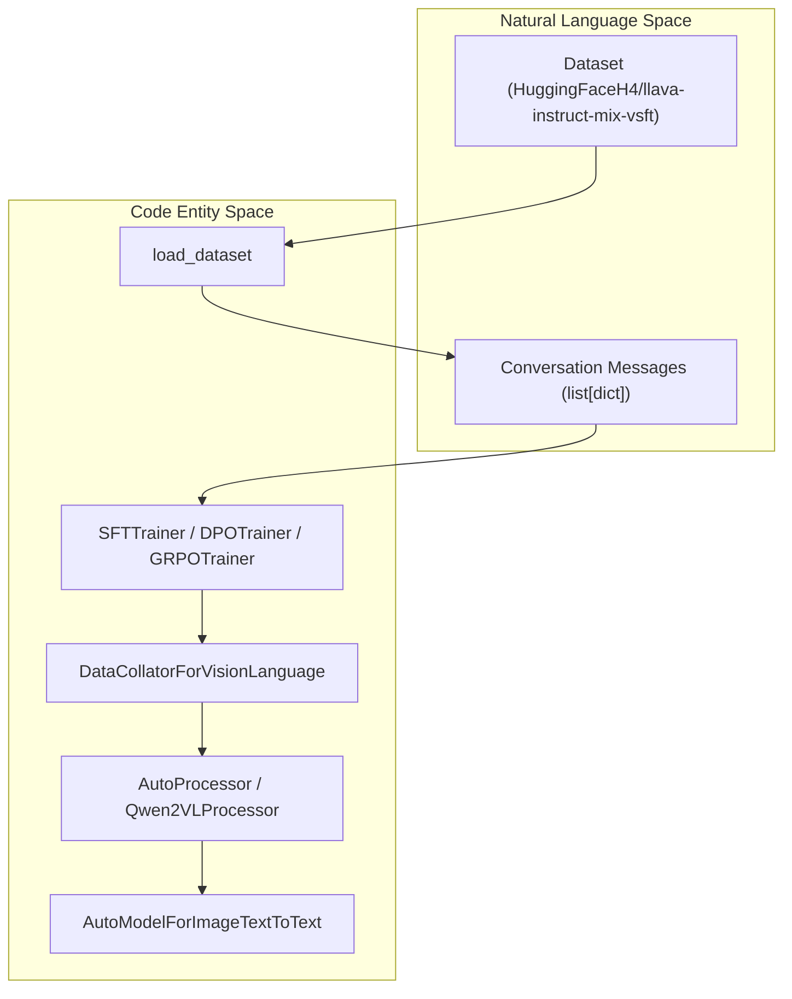
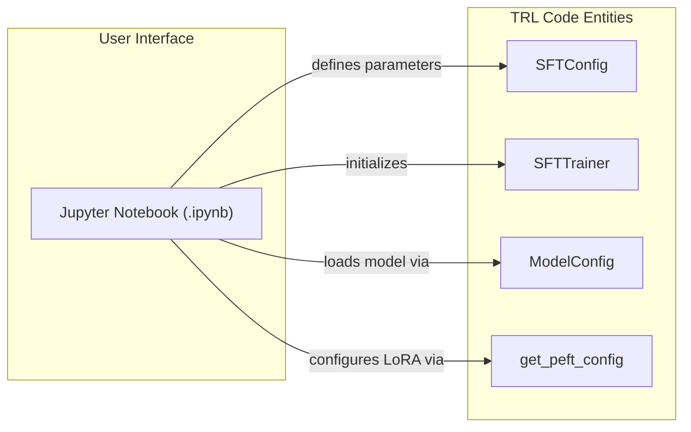

<!-- source: DeepWiki mcp.deepwiki.com · repo huggingface/trl · page 13.2 VLM Training Examples · fetched 2026-10-26 -->

# VLM Training Examples

Relevant source files

The following files were used as context for generating this wiki page:

- [examples/notebooks/grpo_ministral3_vl.ipynb](examples/notebooks/grpo_ministral3_vl.ipynb)
- [examples/notebooks/grpo_qwen3_vl.ipynb](examples/notebooks/grpo_qwen3_vl.ipynb)
- [examples/notebooks/grpo_rnj_1_instruct.ipynb](examples/notebooks/grpo_rnj_1_instruct.ipynb)
- [examples/notebooks/grpo_trl_lora_qlora.ipynb](examples/notebooks/grpo_trl_lora_qlora.ipynb)
- [examples/notebooks/sft_ministral3_vl.ipynb](examples/notebooks/sft_ministral3_vl.ipynb)
- [examples/notebooks/sft_qwen_vl.ipynb](examples/notebooks/sft_qwen_vl.ipynb)
- [examples/notebooks/sft_trl_lora_qlora.ipynb](examples/notebooks/sft_trl_lora_qlora.ipynb)
- [examples/scripts/dpo_vlm.py](examples/scripts/dpo_vlm.py)
- [examples/scripts/grpo_vlm.py](examples/scripts/grpo_vlm.py)
- [examples/scripts/gspo.py](examples/scripts/gspo.py)
- [examples/scripts/gspo_vlm.py](examples/scripts/gspo_vlm.py)
- [examples/scripts/mpo_vlm.py](examples/scripts/mpo_vlm.py)
- [examples/scripts/online_dpo_vlm.py](examples/scripts/online_dpo_vlm.py)
- [examples/scripts/rloo.py](examples/scripts/rloo.py)
- [examples/scripts/rloo_vlm.py](examples/scripts/rloo_vlm.py)
- [examples/scripts/sft_gpt_oss.py](examples/scripts/sft_gpt_oss.py)
- [examples/scripts/sft_video_llm.py](examples/scripts/sft_video_llm.py)
- [examples/scripts/sft_vlm.py](examples/scripts/sft_vlm.py)
- [examples/scripts/sft_vlm_gemma3.py](examples/scripts/sft_vlm_gemma3.py)

This page provides a technical overview of the example scripts and notebooks available in TRL for training Vision-Language Models (VLMs). These examples cover Supervised Fine-Tuning (SFT), Direct Preference Optimization (DPO), and Group Relative Policy Optimization (GRPO) specifically adapted for multimodal inputs.

## High-Level Architecture for VLM Training

The VLM training pipeline in TRL typically follows a flow where raw multimodal datasets (containing text and images/videos) are processed through model-specific processors before being passed to the respective trainers.

### Data Flow for VLM Training

The following diagram illustrates how multimodal data flows from the dataset to the model during training.

**Diagram: VLM Training Data Flow**

Sources: [examples/scripts/sft_vlm.py:99-110](), [examples/scripts/dpo_vlm.py:102-130](), [examples/scripts/sft_video_llm.py:119-156]()

## Supervised Fine-Tuning (SFT) Examples

SFT is the foundational step for aligning VLMs. TRL provides several scripts for different VLM architectures.

### Standard VLM SFT
The `sft_vlm.py` script demonstrates how to fine-tune models like LLaVA or SmolVLM using the `SFTTrainer`. It uses `AutoModelForImageTextToText` to load the model and relies on the trainer's internal handling of multimodal data collators [examples/scripts/sft_vlm.py:92-110]().

### Gemma 3 and Multi-Image SFT
The `sft_vlm_gemma3.py` script specifically handles the newer Gemma 3 architecture and includes logic for multi-image processing. It features a `process_vision_info` function to extract images from conversation messages and a `format_data` helper to structure the `MMIU-Benchmark` dataset into the expected message format [examples/scripts/sft_vlm_gemma3.py:78-118]().

### Video-LLM SFT
The `sft_video_llm.py` script targets models like Qwen2-VL for video understanding. It includes a custom `collate_fn` that uses the `Qwen2VLProcessor` to handle video inputs [examples/scripts/sft_video_llm.py:119-156]().

**Key implementation details for Video SFT:**
*   **Video Downloading:** Includes a `download_video` utility to fetch assets from URLs [examples/scripts/sft_video_llm.py:68-87]().
*   **Visual Token Handling:** Manually masks visual tokens in the labels by setting them to `-100` to avoid calculating loss on image/video embeddings [examples/scripts/sft_video_llm.py:146-155]().

Sources: [examples/scripts/sft_vlm.py](), [examples/scripts/sft_vlm_gemma3.py](), [examples/scripts/sft_video_llm.py]()

## Preference Optimization Examples

TRL supports DPO and GRPO for VLMs, enabling reinforcement learning from human feedback (RLHF) or verifiable rewards.

### Direct Preference Optimization (DPO)
The `dpo_vlm.py` script allows preference tuning on datasets like `rlaif-v`. A notable configuration in this script is the use of `do_image_splitting=False` in the processor to maintain consistent image tokenization between the policy and reference models [examples/scripts/dpo_vlm.py:102-104]().

### Group Relative Policy Optimization (GRPO)
The `grpo_vlm.py` script implements the GRPO algorithm for VLMs, which is particularly effective for reasoning tasks. It utilizes the `GRPOTrainer` and integrates reward functions like `accuracy_reward` and `think_format_reward` [examples/scripts/grpo_vlm.py:143-150]().

**GRPO VLM Specifics:**
*   **System Prompt:** Uses a specific prompt to encourage chain-of-thought reasoning within `<think>` tags [examples/scripts/grpo_vlm.py:105-110]().
*   **Image Filtering:** Often includes a filter step to remove samples with excessively large images to manage VRAM usage during the generation phase of GRPO [examples/scripts/grpo_vlm.py:122-126]().

### Multi-Objective Preference Optimization (MPO)
The `mpo_vlm.py` script demonstrates a hybrid approach, combining multiple loss types (e.g., `sigmoid`, `bco_pair`, and `sft`) with specific `loss_weights` to balance different optimization objectives [examples/scripts/mpo_vlm.py:38-39]().

Sources: [examples/scripts/dpo_vlm.py](), [examples/scripts/grpo_vlm.py](), [examples/scripts/mpo_vlm.py]()

## Notebook Examples

TRL provides interactive Jupyter notebooks for training VLMs on consumer-grade hardware or free environments like Google Colab.

| Notebook | Focus | Key Features |
| :--- | :--- | :--- |
| `sft_trl_lora_qlora.ipynb` | SFT Basics | LoRA/QLoRA on T4 GPU [examples/notebooks/sft_trl_lora_qlora.ipynb:29-49]() |
| `grpo_qwen3_vl.ipynb` | Reasoning | Qwen3-VL with QLoRA and verifiable rewards [examples/notebooks/grpo_qwen3_vl.ipynb:9-16]() |
| `sft_qwen_vl.ipynb` | Qwen-VL | Specific optimizations for Qwen-VL architecture |
| `sft_ministral3_vl.ipynb` | Ministral-VL | Fine-tuning the Ministral vision-language model |

### Code Mapping: Notebook to Trainer

The notebooks bridge high-level concepts to TRL code entities as shown below:

**Diagram: Notebook to Code Mapping**

Sources: [examples/notebooks/sft_trl_lora_qlora.ipynb](), [examples/notebooks/grpo_qwen3_vl.ipynb]()

## Common Configuration Patterns

Across all VLM examples, several configuration patterns are consistently used to manage the high memory requirements of multimodal training:

1.  **PEFT/LoRA:** Most examples use `get_peft_config` and `use_peft=True` to reduce the number of trainable parameters [examples/scripts/sft_vlm.py:109](), [examples/scripts/dpo_vlm.py:129]().
2.  **Quantization:** Integration with `bitsandbytes` via `get_quantization_config` allows 4-bit or 8-bit loading [examples/scripts/sft_vlm.py:86-90](), [examples/scripts/sft_video_llm.py:187-201]().
3.  **Distributed Training:** Scripts are designed to be launched with `accelerate launch`, often utilizing DeepSpeed ZeRO-3 for parameter sharding [examples/scripts/sft_vlm.py:28-35](), [examples/scripts/grpo_vlm.py:31-43]().

Sources: [examples/scripts/sft_vlm.py](), [examples/scripts/dpo_vlm.py](), [examples/scripts/sft_video_llm.py](), [examples/scripts/grpo_vlm.py]()

---

