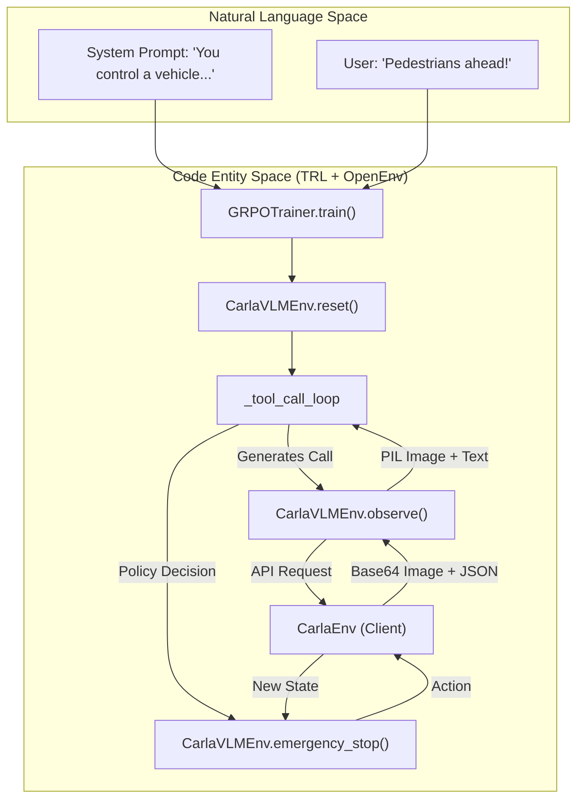
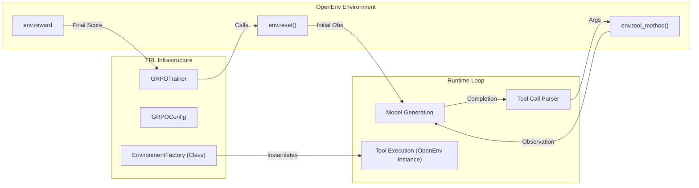

<!-- source: DeepWiki mcp.deepwiki.com · repo huggingface/trl · page 14.1 OpenEnv Interface and Examples · fetched 2026-10-26 -->

# OpenEnv Interface and Examples

Relevant source files

The following files were used as context for generating this wiki page:

- [docs/source/openenv.md](docs/source/openenv.md)
- [examples/notebooks/grpo_functiongemma_browsergym_openenv.ipynb](examples/notebooks/grpo_functiongemma_browsergym_openenv.ipynb)
- [examples/notebooks/openenv_sudoku_grpo.ipynb](examples/notebooks/openenv_sudoku_grpo.ipynb)
- [examples/notebooks/openenv_wordle_grpo.ipynb](examples/notebooks/openenv_wordle_grpo.ipynb)
- [examples/scripts/openenv/browsergym.py](examples/scripts/openenv/browsergym.py)
- [examples/scripts/openenv/browsergym_llm.py](examples/scripts/openenv/browsergym_llm.py)
- [examples/scripts/openenv/carla_vlm.py](examples/scripts/openenv/carla_vlm.py)
- [examples/scripts/openenv/carla_vlm_gemma.py](examples/scripts/openenv/carla_vlm_gemma.py)
- [examples/scripts/openenv/catch.py](examples/scripts/openenv/catch.py)
- [examples/scripts/openenv/echo.py](examples/scripts/openenv/echo.py)
- [examples/scripts/openenv/sudoku.py](examples/scripts/openenv/sudoku.py)
- [examples/scripts/openenv/wordle.py](examples/scripts/openenv/wordle.py)

[OpenEnv](https://github.com/meta-pytorch/OpenEnv) is an open-source framework for defining and interacting with environments in reinforcement learning and agentic workflows. TRL integrates with OpenEnv to enable training agents that maintain state across multi-turn interactions, such as navigating a web browser or playing games.

## OpenEnv Environment Interface

The integration relies on the `environment_factory` argument in `GRPOTrainer`. This pattern allows the trainer to automatically handle the multi-turn tool-calling loop, parsing model outputs into tool calls and feeding environment observations back as new turns [docs/source/openenv.md:133-135]().

### Key Interface Methods

To be compatible with TRL, an environment class must implement the following interface:

| Method | Role | Details |
| :--- | :--- | :--- |
| `__init__` | Initialization | Must take no arguments. Used to setup clients or internal state [docs/source/openenv.md:141-141](). |
| `reset` | Episode Start | Called at the start of each rollout. Receives dataset columns as `**kwargs`. Returns an initial string observation or `None` [docs/source/openenv.md:142-142](). |
| **Tool Methods** | Interaction | Any public method (not starting with `_`) is exposed as a tool. Must have a docstring for schema generation [docs/source/openenv.md:143-143](). |

### Tool Execution and `_tool_call_loop`

The `GRPOTrainer` manages the interaction between the model and the environment through a tool-calling loop.

1.  **Discovery**: The trainer inspects the environment instance created by the `environment_factory` and builds a tool schema from its public methods [docs/source/openenv.md:112-113]().
2.  **Generation**: The model generates a completion containing potential tool calls.
3.  **Execution**: The trainer parses these calls and executes the corresponding methods on the environment instance.
4.  **Feedback**: The return values of these methods are appended to the conversation as `tool` role messages, and the model generates again until it stops calling tools or hits `max_completion_length` [docs/source/openenv.md:114-115]().

### Tool Mask for Loss Calculation

During training, TRL uses a `tool_mask` to ensure that the loss is only calculated on the model's generated tokens and not on the environment's observations or tool outputs. This ensures the policy is optimized for the agent's decisions rather than predicting the environment's responses.

Sources: [docs/source/openenv.md:58-108](), [docs/source/openenv.md:133-143]()

## Example Environments

TRL provides several example scripts demonstrating integration with various OpenEnv environments.

### 1. Echo Environment
A simple environment used for testing where the agent sends a message and the environment "echoes" it back.
*   **Goal**: The reward is typically based on the length of the echoed text [docs/source/openenv.md:56-56]().
*   **Tool**: `echo(message: str)` [examples/scripts/openenv/echo.py:103-115]().

### 2. Catch (OpenSpiel)
A classic RL task where the agent controls a paddle to catch a falling ball on a 10x5 grid [examples/scripts/openenv/catch.py:171-180]().
*   **Tools**: `move(direction)` ("left" or "right") and `stay()` [examples/scripts/openenv/catch.py:186-188]().
*   **Reward**: +1 for catching, -1 for missing [examples/scripts/openenv/catch.py:194-202]().

### 3. Wordle (TextArena)
The agent attempts to guess a secret 5-letter word within six tries [examples/scripts/openenv/wordle.py:182-195]().
*   **Tool**: `guess(word: str)` [examples/scripts/openenv/wordle.py:220-229]().
*   **Feedback**: Color-coded strings (Green/Yellow/Gray) representing letter accuracy [examples/scripts/openenv/wordle.py:188-191]().

### 4. Sudoku
The agent fills a 9x9 grid following standard Sudoku rules [examples/notebooks/openenv_sudoku_grpo.ipynb:89-98]().
*   **Tool**: `place(row, col, number)` [examples/notebooks/openenv_sudoku_grpo.ipynb:102-105]().

### 5. BrowserGym
A complex environment where the agent interacts with a web browser.
*   **VLM Mode**: Tools return screenshots (PIL Images) alongside accessibility tree text [examples/scripts/openenv/browsergym.py:27-29]().
*   **LLM Mode**: Uses only the accessibility tree text for efficiency [examples/scripts/openenv/browsergym_llm.py:27-28]().
*   **Tools**: `click(bid)`, `fill(bid, text)`, `scroll(direction)`, etc [examples/scripts/openenv/browsergym.py:145-196]().

Sources: [examples/scripts/openenv/echo.py:94-115](), [examples/scripts/openenv/catch.py:171-202](), [examples/scripts/openenv/wordle.py:207-235](), [examples/scripts/openenv/browsergym.py:130-196](), [examples/notebooks/openenv_sudoku_grpo.ipynb:154-165]()

## CARLA VLM Driving Examples

The CARLA integration demonstrates training Vision Language Models (VLMs) for autonomous driving in emergency scenarios [examples/scripts/openenv/carla_vlm.py:115-126]().

### Implementation Details
*   **Multimodal Observations**: The environment's `observe` tool returns a dictionary containing both a `PIL.Image` (camera view) and a text description of nearby actors and vehicle speed [examples/scripts/openenv/carla_vlm.py:185-194]().
*   **Emergency Scenario**: The agent is placed in a "trolley micro escape" scenario where it must decide between braking or changing lanes to avoid pedestrians [examples/scripts/openenv/carla_vlm.py:181-183]().
*   **LoRA Support**: A specific variant for Gemma models (`carla_vlm_gemma.py`) uses LoRA to target only the LLM components, skipping the vision encoder to save memory [examples/scripts/openenv/carla_vlm_gemma.py:24-28]().

### Interaction Flow Diagram

**Agent-Environment Interaction Loop (CARLA VLM)**

Sources: [examples/scripts/openenv/carla_vlm.py:132-208](), [examples/scripts/openenv/carla_vlm_gemma.py:111-170]()

## Architecture and Data Flow

The following diagram illustrates how `GRPOTrainer` bridges the LLM generation with the OpenEnv tool execution.

**TRL OpenEnv Data Flow**

Sources: [docs/source/openenv.md:110-117](), [docs/source/openenv.md:133-143](), [examples/scripts/openenv/echo.py:117-128]()

---

