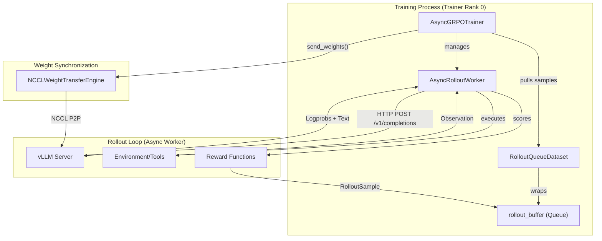

<!-- source: DeepWiki mcp.deepwiki.com · repo huggingface/trl · page 14.2 Async GRPO for Agentic Workflows · fetched 2026-10-26 -->

# Async GRPO for Agentic Workflows

<details>
<summary>Relevant source files</summary>

The following files were used as context for generating this wiki page:

- [docs/source/async_grpo_trainer.md](docs/source/async_grpo_trainer.md)
- [examples/notebooks/grpo_agent.ipynb](examples/notebooks/grpo_agent.ipynb)
- [examples/scripts/async_grpo.py](examples/scripts/async_grpo.py)
- [tests/experimental/test_async_grpo_trainer.py](tests/experimental/test_async_grpo_trainer.py)
- [tests/test_chat_template_utils.py](tests/test_chat_template_utils.py)
- [trl/chat_template_utils.py](trl/chat_template_utils.py)
- [trl/chat_templates/README.md](trl/chat_templates/README.md)
- [trl/chat_templates/phi3.jinja](trl/chat_templates/phi3.jinja)
- [trl/chat_templates/phi3_training.jinja](trl/chat_templates/phi3_training.jinja)
- [trl/experimental/async_grpo/__init__.py](trl/experimental/async_grpo/__init__.py)
- [trl/experimental/async_grpo/async_grpo_config.py](trl/experimental/async_grpo/async_grpo_config.py)
- [trl/experimental/async_grpo/async_grpo_trainer.py](trl/experimental/async_grpo/async_grpo_trainer.py)
- [trl/experimental/async_grpo/async_rollout_worker.py](trl/experimental/async_grpo/async_rollout_worker.py)

</details>


The `AsyncGRPOTrainer` is an experimental trainer designed to decouple the generation (rollout) phase from the gradient update (training) phase. By offloading generation to an external vLLM server that runs asynchronously, TRL enables efficient training for long-horizon agentic tasks where tool-calling loops and environment interactions can create significant bottlenecks in a synchronous loop.

## Overview and Architecture

In standard GRPO, the trainer waits for the model to generate a group of completions, scores them, and then performs an optimization step. `AsyncGRPOTrainer` breaks this dependency by using a producer-consumer model:
1.  **Producer (`AsyncRolloutWorker`)**: Continuously requests generations from a vLLM server, executes tool calls in environments, calculates rewards, and pushes finished samples into a queue.
2.  **Consumer (`AsyncGRPOTrainer`)**: Pulls samples from the queue and performs gradient updates.

### System Data Flow

The following diagram illustrates the interaction between the trainer, the rollout worker, and the external vLLM engine.

**Async GRPO Component Interaction**

Sources: [trl/experimental/async_grpo/async_grpo_trainer.py:169-176](), [trl/experimental/async_grpo/async_rollout_worker.py:80-86]()

---

## The AsyncRolloutWorker Lifecycle

The `AsyncRolloutWorker` (defined in `trl/experimental/async_grpo/async_rollout_worker.py`) is the core engine for generating data. It runs its own asyncio event loop to handle concurrent requests to the vLLM server.

### Key Responsibilities:
- **Generation**: Requests completions using the vLLM API. It specifically requires `logprobs-mode=processed_logprobs` to receive the log-probabilities needed for the GRPO loss [trl/experimental/async_grpo/async_rollout_worker.py:440-450]().
- **Tool-Calling Loop**: If tools or environments are provided, the worker enters a loop where it parses the model's response, executes the requested tool, and appends the result back to the prompt for another generation turn [trl/experimental/async_grpo/async_rollout_worker.py:530-560]().
- **Advantage Calculation**: It groups completions by prompt, calculates rewards using the provided `reward_funcs`, and computes group-relative advantages (normalizing rewards within the group) [trl/experimental/async_grpo/async_rollout_worker.py:650-670]().
- **Staleness Tracking**: Every `RolloutSample` is tagged with a `model_version` indicating which weight snapshot was used for generation [trl/experimental/async_grpo/async_rollout_worker.py:69-76]().

Sources: [trl/experimental/async_grpo/async_rollout_worker.py:80-180](), [trl/experimental/async_grpo/async_rollout_worker.py:440-450]()

---

## Decoupled Training with RolloutQueueDataset

The trainer consumes data through the `RolloutQueueDataset`, which transforms the asynchronous queue into a standard PyTorch `IterableDataset`.

### Staleness Filtering
Because generation and training happen at different speeds, the queue might contain samples generated with older weights. The `RolloutQueueDataset` implements staleness filtering:
- It compares the sample's `model_version` with the current trainer version.
- If `staleness > max_staleness`, the sample is discarded [trl/experimental/async_grpo/async_grpo_trainer.py:102-106]().
- This ensures the importance sampling correction in GRPO remains valid.

### Data Flow to Code Entities
The following diagram maps the logical data flow to the specific classes and methods.

**Natural Language Space to Code Entity Space**
```mermaid
graph LR
    subgraph "Code Entities"
        Trainer["AsyncGRPOTrainer"]
        Worker["AsyncRolloutWorker"]
        Queue["RolloutQueueDataset"]
        Collator["DataCollatorForRollout"]
        Config["AsyncGRPOConfig"]
    end

    "Training Loop" -- "iterates" --> Queue
    Queue -- "get()" --> Trainer
    Trainer -- "train_batch_size" --> Collator
    Collator -- "pad()" --> Trainer
    Trainer -- "update_model_version()" --> Worker
    Config -- "max_staleness" --> Queue
```
Sources: [trl/experimental/async_grpo/async_grpo_trainer.py:80-114](), [trl/experimental/async_grpo/async_grpo_trainer.py:124-166]()

---

## Weight Synchronization and NCCL Transfer

To keep the vLLM server updated with the latest trained weights without the overhead of saving checkpoints to disk, TRL utilizes the `NCCLWeightTransferEngine`.

### NCCLWeightTransferEngine
This engine enables direct GPU-to-GPU weight transfer over the NCCL backend. 
- The trainer identifies trainable parameters (often LoRA adapters or the full model).
- It calls `send_weights()` at intervals defined by `weight_sync_steps` in `AsyncGRPOConfig` [trl/experimental/async_grpo/async_grpo_config.py:74-75]().
- The `AsyncRolloutWorker` coordinates with the vLLM server to receive these weights and apply them to the inference engine dynamically [trl/experimental/async_grpo/async_rollout_worker.py:123-129]().

Sources: [trl/experimental/async_grpo/async_rollout_worker.py:41-43](), [trl/experimental/async_grpo/async_grpo_trainer.py:62-63]()

---

## Configuration and Usage

The `AsyncGRPOConfig` inherits from `_BaseConfig` and introduces parameters specific to the async pipeline.

| Parameter | Default | Description |
| :--- | :--- | :--- |
| `max_staleness` | `4` | Max steps a sample can lag before being discarded. |
| `weight_sync_steps` | `1` | Frequency of weight updates to the vLLM server. |
| `max_inflight_tasks` | `-1` | Concurrent tasks sent to vLLM (auto-calculated if -1). |
| `vllm_server_base_url` | `http://localhost:8000` | Endpoint for the generation server. |
| `max_tool_calling_iterations` | `None` | Limit for agentic tool-calling loops. |

Sources: [trl/experimental/async_grpo/async_grpo_config.py:21-84]()

### Example Initialization

```python
from trl.experimental.async_grpo import AsyncGRPOConfig, AsyncGRPOTrainer

config = AsyncGRPOConfig(
    output_dir="output",
    vllm_server_base_url="http://localhost:8000",
    max_staleness=3,
    weight_sync_steps=5,
)

trainer = AsyncGRPOTrainer(
    model="Qwen/Qwen2-7B",
    args=config,
    train_dataset=dataset,
    reward_funcs=[accuracy_reward, format_reward],
)
trainer.train()
```
Sources: [examples/scripts/async_grpo.py:52-72]()

---

