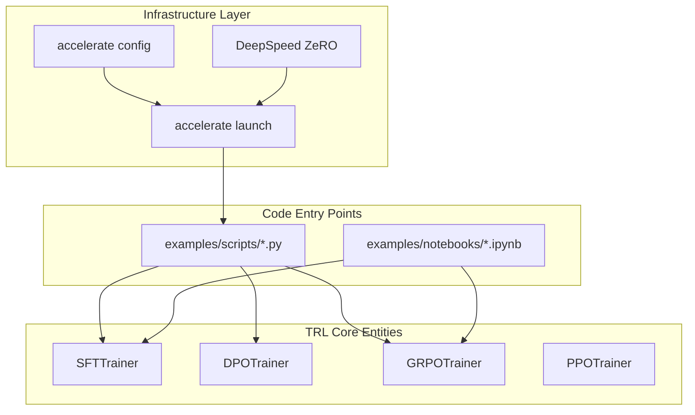
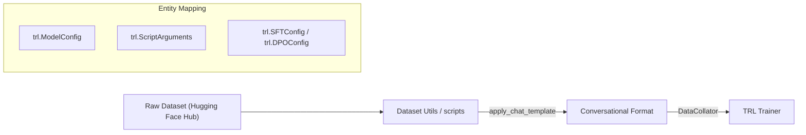

<!-- source: DeepWiki mcp.deepwiki.com · repo huggingface/trl · page 15 Examples and Tutorials · fetched 2026-10-26 -->

# Examples and Tutorials

Relevant source files

The following files were used as context for generating this wiki page:

- [docs/source/example_overview.md](docs/source/example_overview.md)
- [examples/notebooks/README.md](examples/notebooks/README.md)
- [examples/notebooks/sft_nemotron_3.ipynb](examples/notebooks/sft_nemotron_3.ipynb)
- [examples/scripts/bco.py](examples/scripts/bco.py)
- [examples/scripts/cpo.py](examples/scripts/cpo.py)
- [examples/scripts/dpo.py](examples/scripts/dpo.py)
- [examples/scripts/kto.py](examples/scripts/kto.py)
- [examples/scripts/orpo.py](examples/scripts/orpo.py)
- [examples/scripts/ppo/ppo.py](examples/scripts/ppo/ppo.py)
- [examples/scripts/ppo/ppo_tldr.py](examples/scripts/ppo/ppo_tldr.py)
- [examples/scripts/reward_modeling.py](examples/scripts/reward_modeling.py)
- [examples/scripts/sft.py](examples/scripts/sft.py)
- [examples/scripts/sft_nemotron_3.py](examples/scripts/sft_nemotron_3.py)

The TRL library provides a comprehensive set of examples designed to guide users from initial experimentation to production-scale training. These resources are divided into interactive **Jupyter Notebooks** for quick starts and robust **Python Scripts** for distributed training environments.

## Overview of Resources

TRL examples are organized to support different stages of the model post-training lifecycle. Notebooks typically focus on single-GPU or free-tier environments like Google Colab, while scripts are optimized for `accelerate` and `deepspeed` configurations [docs/source/example_overview.md:3-5]().

### Resource Types

| Type | Location | Target Environment |
| :--- | :--- | :--- |
| **Notebooks** | `examples/notebooks/` | Google Colab, single GPU, interactive |
| **Training Scripts** | `examples/scripts/` | Multi-GPU, DeepSpeed, Slurm clusters |
| **Dataset Utils** | `examples/datasets/` | Data preprocessing and formatting |

The relationship between the training infrastructure and the provided examples is illustrated below:

### Training Workflow Architecture

Sources: [docs/source/example_overview.md:17-23](), [docs/source/example_overview.md:53-55]()

## Training Script Examples

Canonical scripts for all major alignment algorithms are maintained in `examples/scripts/`. These scripts serve as templates for full-parameter fine-tuning or PEFT-based (LoRA/QLoRA) training [docs/source/example_overview.md:53-55]().

*   **SFT & Reward Modeling**: Scripts like `sft.py` and `reward_modeling.py` handle the initial stages of alignment [examples/scripts/reward_modeling.py:109-115]().
*   **Preference Optimization**: Includes `dpo.py`, `kto.py`, and `orpo.py` for direct preference learning without or with a reference model [examples/scripts/kto.py:89-97](), [examples/scripts/orpo.py:91-98]().
*   **Reinforcement Learning**: `ppo.py` and `grpo.py` demonstrate online RL training loops [examples/scripts/ppo/ppo.py:154-164]().

For detailed documentation on specific training scripts and their configuration, see [Training Script Examples](#15.1).

Sources: [examples/scripts/reward_modeling.py:109-115](), [examples/scripts/kto.py:89-97](), [examples/scripts/orpo.py:91-98](), [examples/scripts/ppo/ppo.py:154-164]()

## Dataset Preparation Utilities

TRL includes utilities to bridge the gap between raw datasets and the formats required by trainers. These include scripts for specific datasets like `tldr_preference.py` and general utilities for chat template application [docs/source/example_overview.md:104-106]().

### Data Transformation Flow

Sources: [examples/scripts/reward_modeling.py:73-74](), [examples/scripts/sft_nemotron_3.py:114-115]()

For details on data processing and helper scripts, see [Dataset Preparation Utilities](#15.2).

## Interactive Tutorials (Notebooks)

Notebooks are provided for users who prefer an interactive environment. They often demonstrate specialized features such as:
*   **Reasoning Capabilities**: Using `GRPOTrainer` to add reasoning to models [docs/source/example_overview.md:34]().
*   **Vision-Language Models (VLM)**: Fine-tuning VLMs like Qwen-VL or Ministral [docs/source/example_overview.md:35-36]().
*   **Tool Calling**: Teaching models to use external tools [docs/source/example_overview.md:40]().
*   **OpenEnv Integration**: Training agents in interactive environments like Wordle or Sudoku [docs/source/example_overview.md:43-51]().

Sources: [docs/source/example_overview.md:32-41](), [examples/notebooks/README.md:1-27]()

---

