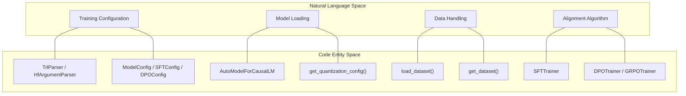
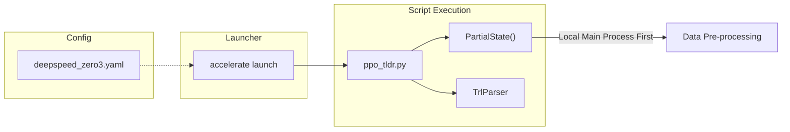

<!-- source: DeepWiki mcp.deepwiki.com · repo huggingface/trl · page 15.1 Training Script Examples · fetched 2026-10-26 -->

# Training Script Examples

<details>
<summary>Relevant source files</summary>

The following files were used as context for generating this wiki page:

- [examples/accelerate_configs/deepspeed_zero1.yaml](examples/accelerate_configs/deepspeed_zero1.yaml)
- [examples/accelerate_configs/deepspeed_zero2.yaml](examples/accelerate_configs/deepspeed_zero2.yaml)
- [examples/accelerate_configs/deepspeed_zero3.yaml](examples/accelerate_configs/deepspeed_zero3.yaml)
- [examples/accelerate_configs/multi_gpu.yaml](examples/accelerate_configs/multi_gpu.yaml)
- [examples/scripts/bco.py](examples/scripts/bco.py)
- [examples/scripts/cpo.py](examples/scripts/cpo.py)
- [examples/scripts/dpo.py](examples/scripts/dpo.py)
- [examples/scripts/kto.py](examples/scripts/kto.py)
- [examples/scripts/orpo.py](examples/scripts/orpo.py)
- [examples/scripts/ppo/ppo.py](examples/scripts/ppo/ppo.py)
- [examples/scripts/ppo/ppo_tldr.py](examples/scripts/ppo/ppo_tldr.py)
- [examples/scripts/prm.py](examples/scripts/prm.py)
- [examples/scripts/reward_modeling.py](examples/scripts/reward_modeling.py)
- [examples/scripts/sft.py](examples/scripts/sft.py)
- [examples/scripts/sft_gemma3.py](examples/scripts/sft_gemma3.py)
- [trl/scripts/dpo.py](trl/scripts/dpo.py)
- [trl/scripts/grpo.py](trl/scripts/grpo.py)
- [trl/scripts/kto.py](trl/scripts/kto.py)
- [trl/scripts/reward.py](trl/scripts/reward.py)
- [trl/scripts/rloo.py](trl/scripts/rloo.py)
- [trl/scripts/sft.py](trl/scripts/sft.py)

</details>


This page documents the canonical training scripts provided in the TRL repository. These scripts serve as the primary entry points for users to fine-tune models using various alignment techniques such as SFT, DPO, PPO, and others. They are designed to be used both as standalone Python scripts and via the `trl` CLI.

## Overview

The scripts located in `examples/scripts/` (and their moved counterparts in `trl/scripts/`) provide a standardized interface for post-training foundation models. They leverage `TrlParser` to handle configuration from CLI arguments and YAML files, integrating seamlessly with the Hugging Face ecosystem (Transformers, Accelerate, Datasets, and PEFT).

### Execution Flow and Infrastructure

The typical execution flow for a TRL training script involves:
1.  **Argument Parsing**: Using `HfArgumentParser` or `TrlParser` to load `ScriptArguments`, `ModelConfig`, and trainer-specific configurations (e.g., `SFTConfig`, `DPOConfig`).
2.  **Model & Tokenizer Initialization**: Loading models with support for quantization (4-bit/8-bit) and device mapping.
3.  **Dataset Loading**: Fetching datasets via `datasets.load_dataset` or TRL's `get_dataset` utility for mixtures.
4.  **Trainer Initialization**: Instantiating the specialized TRL trainer (e.g., `SFTTrainer`, `DPOTrainer`).
5.  **Training & Export**: Running the training loop and saving the resulting model or adapters to disk or the Hugging Face Hub.

### Code to Natural Language Mapping: Script Structure

The following diagram illustrates how natural language training concepts map to specific code entities within the example scripts.

**Script Component Architecture**

**Sources:** [trl/scripts/sft.py:143-150](), [trl/scripts/dpo.py:145-152](), [trl/scripts/grpo.py:168-175]()

---

## Supervised Fine-Tuning (SFT)

The `sft.py` script is the entry point for Supervised Fine-Tuning. It supports both standard Causal Language Models and Vision-Language Models (VLMs).

### Implementation Details
- **VLM Detection**: The script checks `MODEL_FOR_IMAGE_TEXT_TO_TEXT_MAPPING_NAMES` to determine if it should load an `AutoModelForImageTextToText` instead of a standard `AutoModelForCausalLM` [trl/scripts/sft.py:93-100]().
- **Packing Support**: Users can enable sequence packing via the `--packing` flag, which is handled by the `SFTTrainer` to increase training throughput [trl/scripts/sft.py:32]().
- **PEFT Integration**: Supports LoRA/QLoRA by passing `--use_peft` and configuring `lora_r` and `lora_alpha` [trl/scripts/sft.py:55-57]().

**Sources:** [trl/scripts/sft.py:1-158]()

---

## Preference Optimization (DPO, KTO, BCO)

These scripts implement offline preference optimization where the model learns from a static dataset of preferred and rejected responses.

### Direct Preference Optimization (DPO)
The `dpo.py` script facilitates training with the DPO algorithm. It supports various loss functions and reference model management.
- **Reference Model**: If PEFT is not used, the script typically loads a separate reference model. If PEFT is used, the trainer manages the reference model by disabling adapters [trl/scripts/dpo.py:116-122]().
- **DDP Optimization**: Includes a "torch distributed hack" to ignore bias buffers that can cause issues in DDP when they are boolean types [trl/scripts/dpo.py:93-97]().

### Binary Classifier Optimization (BCO)
The `bco.py` script is experimental and requires an embedding function to represent prompts.
- **Embedding Logic**: It uses a `nomic-embed-text-v1.5` model to generate prompt embeddings [examples/scripts/bco.py:130-144]().
- **Layer Norm & Matryoshka**: The embeddings are normalized and truncated to a `matryoshka_dim` of 512 [examples/scripts/bco.py:98-102]().

### Kahneman-Tversky Optimization (KTO)
The `kto.py` script implements KTO, which unlike DPO, does not require paired preferences but rather binary "good/bad" labels [examples/scripts/kto.py:24-28]().

**Sources:** [trl/scripts/dpo.py:1-158](), [examples/scripts/bco.py:1-166](), [trl/scripts/kto.py:1-151]()

---

## Reward Modeling

The `reward_modeling.py` script is used to train a Reward Model (RM) using sequence classification.

### Implementation
- **Model Class**: Uses `AutoModelForSequenceClassification` with `num_labels=1` [examples/scripts/reward_modeling.py:91-93]().
- **Task Type**: When using PEFT, it strictly enforces `lora_task_type="SEQ_CLS"` to ensure the classification head is properly handled [examples/scripts/reward_modeling.py:95-99]().
- **Trainer**: Uses `RewardTrainer`, which expects a dataset with `chosen` and `rejected` columns [examples/scripts/reward_modeling.py:109-115]().

**Sources:** [examples/scripts/reward_modeling.py:1-132]()

---

## Reinforcement Learning (PPO & GRPO)

### Proximal Policy Optimization (PPO)
The `ppo.py` script (and `ppo_tldr.py`) implements the PPO algorithm.
- **Multi-Model Setup**: PPO requires four models: the Policy (to be trained), a Reference Model, a Reward Model, and a Value Model [examples/scripts/ppo/ppo.py:93-115]().
- **Tokenization**: Requires `padding_side="left"` for generation during the rollout phase [examples/scripts/ppo/ppo.py:90]().

### Group Relative Policy Optimization (GRPO)
The `grpo.py` script implements the GRPO algorithm, primarily used for reasoning tasks.
- **Reward Function Registry**: The script allows users to specify reward functions by name (e.g., `accuracy_reward`, `think_format_reward`) or via dotted import paths [trl/scripts/grpo.py:83-109]().
- **Configuration**: Uses `GRPOScriptArguments` which extends `ScriptArguments` to include `reward_funcs` and `reward_model_name_or_path` [trl/scripts/grpo.py:34-65]().

**Sources:** [examples/scripts/ppo/ppo.py:1-173](), [trl/scripts/grpo.py:1-180]()

---

## Distributed Training with Accelerate

All example scripts are designed to be launched using `accelerate launch`. This allows for seamless transition from single-GPU to multi-GPU and DeepSpeed environments.

### Accelerate Configurations
TRL provides canonical configuration files in `examples/accelerate_configs/`:
- `deepspeed_zero1.yaml`
- `deepspeed_zero2.yaml`
- `deepspeed_zero3.yaml`
- `multi_gpu.yaml`

### Example Usage
To run PPO with DeepSpeed ZeRO-2:
```bash
accelerate launch --config_file examples/accelerate_configs/deepspeed_zero2.yaml \
    examples/scripts/ppo/ppo_tldr.py \
    --model_name_or_path EleutherAI/pythia-1b-deduped \
    --reward_model_path cleanrl/EleutherAI_pythia-1b-deduped__reward__tldr \
    --sft_model_path cleanrl/EleutherAI_pythia-1b-deduped__sft__tldr
```

**Data Flow in Distributed Training**

**Sources:** [examples/scripts/ppo/ppo_tldr.py:56-72](), [examples/scripts/ppo/ppo_tldr.py:146-147]()

---

