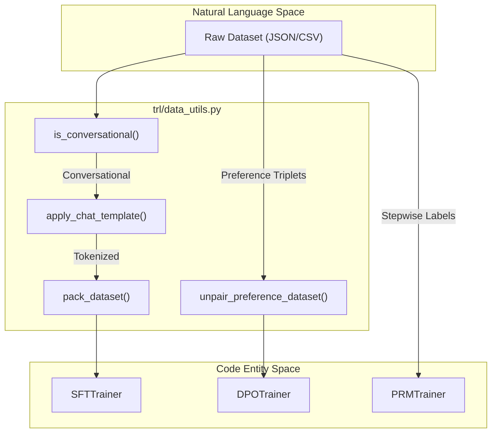
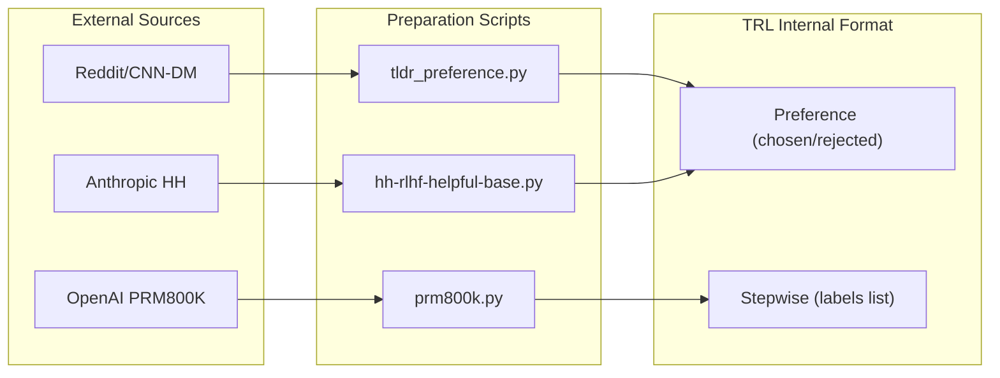

<!-- source: DeepWiki mcp.deepwiki.com · repo huggingface/trl · page 15.2 Dataset Preparation Utilities · fetched 2026-10-26 -->

# Dataset Preparation Utilities

Relevant source files

The following files were used as context for generating this wiki page:

- [MIGRATION.md](MIGRATION.md)
- [docs/source/data_utils.md](docs/source/data_utils.md)
- [examples/datasets/hh-rlhf-helpful-base.py](examples/datasets/hh-rlhf-helpful-base.py)
- [examples/datasets/lm-human-preferences-descriptiveness.py](examples/datasets/lm-human-preferences-descriptiveness.py)
- [examples/datasets/lm-human-preferences-sentiment.py](examples/datasets/lm-human-preferences-sentiment.py)
- [examples/datasets/math_shepherd.py](examples/datasets/math_shepherd.py)
- [examples/datasets/prm800k.py](examples/datasets/prm800k.py)
- [examples/datasets/rlaif-v.py](examples/datasets/rlaif-v.py)
- [examples/datasets/tldr.py](examples/datasets/tldr.py)
- [examples/datasets/tldr_preference.py](examples/datasets/tldr_preference.py)
- [examples/datasets/ultrafeedback-prompt.py](examples/datasets/ultrafeedback-prompt.py)
- [examples/datasets/ultrafeedback.py](examples/datasets/ultrafeedback.py)
- [scripts/generate_harmony_dataset.py](scripts/generate_harmony_dataset.py)
- [scripts/generate_tiny_models.py](scripts/generate_tiny_models.py)
- [scripts/generate_toolcall_dataset.py](scripts/generate_toolcall_dataset.py)
- [tests/experimental/test_ppo_trainer.py](tests/experimental/test_ppo_trainer.py)
- [tests/test_data_utils.py](tests/test_data_utils.py)
- [trl/data_utils.py](trl/data_utils.py)

TRL provides a comprehensive suite of utilities for preparing datasets across various post-training paradigms, including Supervised Fine-Tuning (SFT), Direct Preference Optimization (DPO), and Process Reward Modeling (PRM). These utilities bridge the gap between raw data sources (like Reddit or MATH datasets) and the structured formats required by TRL trainers.

## Core Data Utilities (`data_utils`)

The `trl/data_utils.py` module contains high-level functions for transforming, packing, and validating datasets. These functions are used internally by trainers but are also available for manual preprocessing.

### Key Functions and Implementation

| Function | Role | Implementation Detail |
| :--- | :--- | :--- |
| `apply_chat_template` | Formats conversational data | Uses the tokenizer's `chat_template` to convert list-of-dicts to strings [trl/data_utils.py:1510-1530](). |
| `pack_dataset` | Concatenates sequences | Groups multiple examples into a single block of `max_seq_length` to maximize GPU efficiency [trl/data_utils.py:1050-1070](). |
| `unpair_preference_dataset` | Flattens preference data | Converts `(prompt, chosen, rejected)` triplets into individual examples with binary labels [trl/data_utils.py:550-570](). |
| `is_conversational` | Format detection | Checks if a dataset entry follows the `{"role": ..., "content": ...}` schema [trl/data_utils.py:410-430](). |
| `prepare_multimodal_messages` | VLM Preparation | Injects image objects into message content blocks for Vision-Language models [trl/data_utils.py:33-74](). |

### Data Flow: Raw to Trainer-Ready
This diagram shows how `data_utils` transforms raw input into the internal structures used by `SFTTrainer` or `DPOTrainer`.

**Data Transformation Pipeline**

**Sources:** [trl/data_utils.py:33-124](), [trl/data_utils.py:1050-1070](), [trl/data_utils.py:550-570]()

---

## Example Dataset Scripts

TRL includes specialized scripts in `examples/datasets/` to convert popular research datasets into TRL-compatible formats.

### Preference Learning Datasets
These scripts prepare data for `DPOTrainer`, `ORPOTrainer`, or `RewardTrainer`.

*   **`tldr_preference.py`**: Processes the OpenAI `summarize_from_feedback` dataset. It extracts Reddit posts and pairs the human-chosen summary against a rejected one [examples/datasets/tldr_preference.py:50-65]().
*   **`ultrafeedback.py`**: Filters the `openbmb/UltraFeedback` dataset by model (e.g., `gpt-3.5-turbo`) and aspect (e.g., `helpfulness`). It converts ratings into binary labels for unpaired preference learning [examples/datasets/ultrafeedback.py:87-94]().
*   **`hh-rlhf-helpful-base.py`**: Cleans Anthropic's RLHF data by identifying the common prompt prefix and splitting the "Human/Assistant" dialogue into structured lists [examples/datasets/hh-rlhf-helpful-base.py:61-92]().

### Stepwise Supervision (PRM) Datasets
Used for training Process Reward Models that evaluate reasoning steps rather than just final outcomes.

*   **`prm800k.py`**: Formats OpenAI's PRM800K dataset. It iterates through reasoning steps, assigning labels to each intermediate completion [examples/datasets/prm800k.py:50-86]().
*   **`math_shepherd.py`**: A complex processor for the Math-Shepherd dataset. It uses regex to align "input" strings with "label" strings, splitting solutions into discrete steps for stepwise verification [examples/datasets/math_shepherd.py:52-123]().

**Dataset Preparation Logic**

**Sources:** [examples/datasets/tldr_preference.py:50-65](), [examples/datasets/prm800k.py:50-86](), [examples/datasets/math_shepherd.py:52-123]()

---

## Testing and Tool-Calling Utilities

### Tiny Model Generation
For CI/CD and local unit testing, TRL provides `scripts/generate_tiny_models.py`. This script creates minimal versions of popular architectures (Llama, Gemma, Qwen, etc.) with randomized, initialized weights to prevent NaNs during test forward passes [scripts/generate_tiny_models.py:128-163](). These models are typically pushed to the `trl-internal-testing` organization on the Hugging Face Hub [scripts/generate_tiny_models.py:90-113]().

### Tool-Calling Datasets
`scripts/generate_toolcall_dataset.py` generates synthetic conversational data involving tool use.
*   It defines fictitious functions (e.g., `get_current_time`, `control_light`) [scripts/generate_toolcall_dataset.py:51-125]().
*   It uses `transformers.utils.get_json_schema` to generate tool definitions [scripts/generate_toolcall_dataset.py:153-160]().
*   It outputs a dataset where the `assistant` role includes `tool_calls` and the `tool` role provides results [scripts/generate_toolcall_dataset.py:164-182]().

**Tiny Model Registry (Partial)**
| Model Class | Source Config | Suffix |
| :--- | :--- | :--- |
| `LlamaForCausalLM` | `LlamaConfig` | `3.1` |
| `Gemma2ForCausalLM` | `Gemma2Config` | `None` |
| `Qwen2ForCausalLM` | `Qwen2Config` | `2.5` |

**Sources:** [scripts/generate_tiny_models.py:165-188](), [scripts/generate_toolcall_dataset.py:164-182]()

---

## Multimodal Preparation

The `prepare_multimodal_messages` function in `data_utils.py` is critical for Vision-Language Models (VLMs). It handles the conversion of raw image-text pairs into the structured format expected by processors.

1.  **Role Validation**: Ensures roles are restricted to `system`, `user`, `assistant`, or `tool` [trl/data_utils.py:93-95]().
2.  **Placeholder Injection**: If string content is provided for a user message, it prepends `{"type": "image"}` blocks for every image in the input list [trl/data_utils.py:84-86]().
3.  **vLLM Compatibility**: `prepare_multimodal_messages_vllm` further transforms these blocks into `image_pil` types to satisfy vLLM requirements [trl/data_utils.py:127-149]().

**Sources:** [trl/data_utils.py:33-124](), [tests/test_data_utils.py:48-70]()

---

