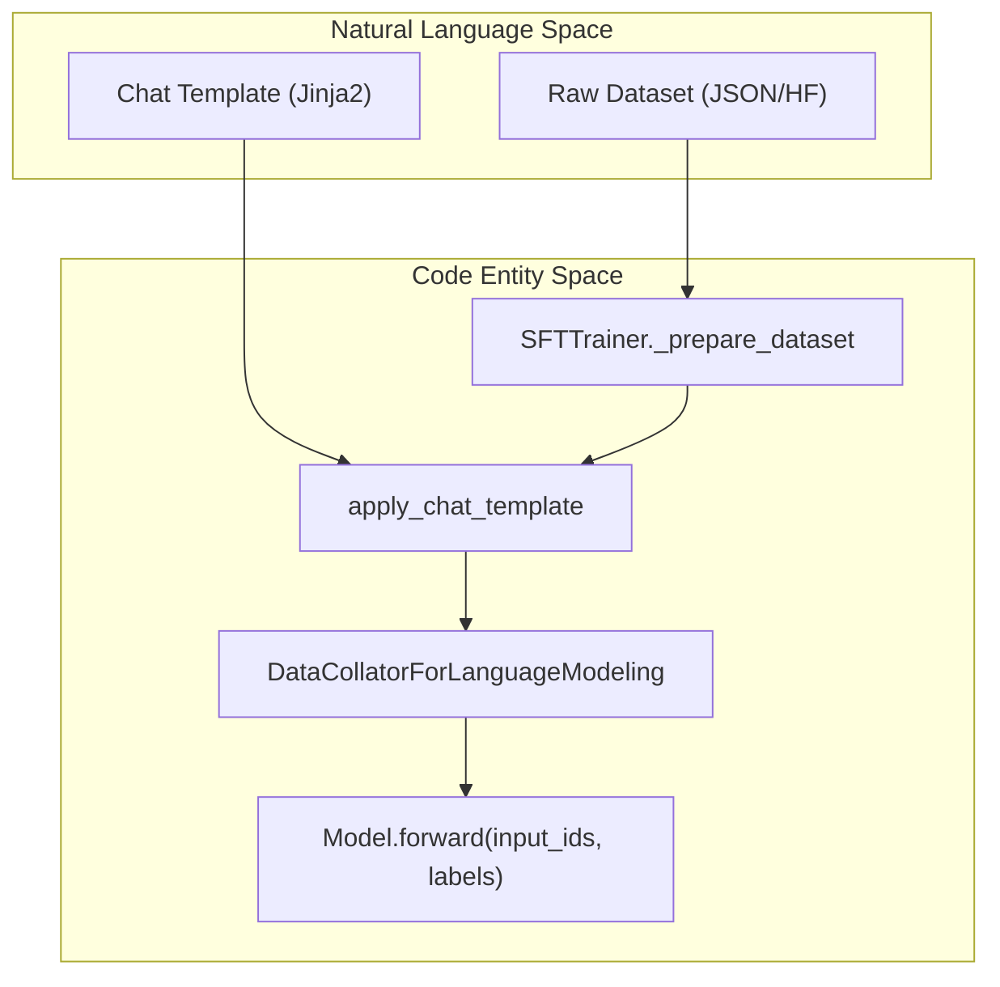
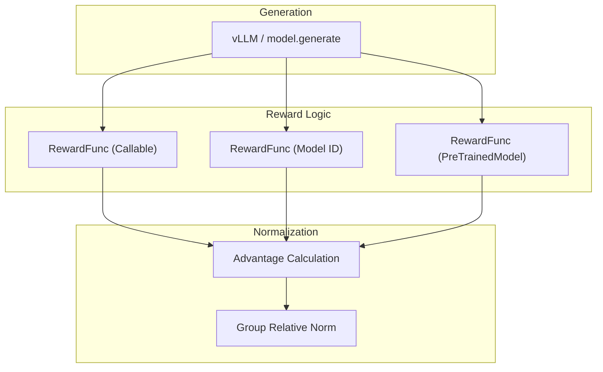

<!-- source: DeepWiki mcp.deepwiki.com · repo huggingface/trl · page 16 Glossary · fetched 2026-10-26 -->

# Glossary

Relevant source files

The following files were used as context for generating this wiki page:

- [README.md](README.md)
- [docs/source/_toctree.yml](docs/source/_toctree.yml)
- [docs/source/dataset_formats.md](docs/source/dataset_formats.md)
- [docs/source/index.md](docs/source/index.md)
- [docs/source/minillm_trainer.md](docs/source/minillm_trainer.md)
- [docs/source/reducing_memory_usage.md](docs/source/reducing_memory_usage.md)
- [tests/test_cli.py](tests/test_cli.py)
- [tests/test_dpo_trainer.py](tests/test_dpo_trainer.py)
- [tests/test_reward_trainer.py](tests/test_reward_trainer.py)
- [tests/test_sft_trainer.py](tests/test_sft_trainer.py)
- [trl/__init__.py](trl/__init__.py)
- [trl/models/__init__.py](trl/models/__init__.py)
- [trl/models/utils.py](trl/models/utils.py)
- [trl/trainer/__init__.py](trl/trainer/__init__.py)
- [trl/trainer/dpo_trainer.py](trl/trainer/dpo_trainer.py)
- [trl/trainer/grpo_trainer.py](trl/trainer/grpo_trainer.py)
- [trl/trainer/kto_trainer.py](trl/trainer/kto_trainer.py)
- [trl/trainer/reward_trainer.py](trl/trainer/reward_trainer.py)
- [trl/trainer/rloo_trainer.py](trl/trainer/rloo_trainer.py)
- [trl/trainer/sft_trainer.py](trl/trainer/sft_trainer.py)

This page provides definitions and technical implementation details for core concepts, domain-specific jargon, and architectural components within the TRL codebase.

## Core Training Concepts

### SFT (Supervised Fine-Tuning)
The process of fine-tuning a pre-trained model on a specific dataset of instructions and responses using a standard cross-entropy loss. In TRL, this is implemented via the `SFTTrainer` [trl/trainer/sft_trainer.py:73]().

### DPO (Direct Preference Optimization)
A method for aligning LLMs to human preferences without an explicit reward model or RL. It optimizes the policy directly using a dataset of (prompt, chosen, rejected) triplets.
*   **Loss Variants**: Supports `sigmoid`, `hinge`, `ipo`, `exo`, and more [trl/trainer/dpo_trainer.py:53]().
*   **Reference Model**: Requires a frozen copy of the model (or a PEFT adapter) to calculate the log-probability ratio [trl/trainer/dpo_trainer.py:52]().

### GRPO (Group Relative Policy Optimization)
An RL-based optimization method that eliminates the need for a separate critic model by using group-relative advantage estimation. It is highly memory-efficient for reasoning tasks [trl/trainer/grpo_trainer.py:133-137]().
*   **Group Normalization**: Advantages are computed by normalizing rewards within a group of generations for the same prompt [trl/trainer/grpo_trainer.py:135]().

### RLOO (REINFORCE Leave-One-Out)
An online RL algorithm that uses a "leave-one-out" baseline to reduce variance in the REINFORCE gradient estimator [trl/trainer/rloo_trainer.py:105-109]().

---

## Technical Infrastructure

### Lazy Loading
TRL uses a two-tier lazy loading architecture to minimize import overhead and avoid unnecessary dependency checks.
*   **Implementation**: Controlled by `_LazyModule` in the root `__init__.py` [trl/__init__.py:126-132]().
*   **Import Structure**: Defined in `_import_structure` to map strings to module attributes [trl/__init__.py:28-74]().

### Data Collators
Classes responsible for batching and padding heterogeneous data into tensors suitable for model training.

| Collator Name | Purpose | File Pointer |
| :--- | :--- | :--- |
| `DataCollatorForLanguageModeling` | Standard SFT batching with optional completion-only masking. | [trl/trainer/sft_trainer.py:89]() |
| `DataCollatorForPreference` | Pairs chosen/rejected sequences for DPO or Reward Modeling. | [trl/trainer/dpo_trainer.py:92]() |
| `DataCollatorForVisionPreference` | Specialized preference collator for Multimodal models. | [trl/trainer/dpo_trainer.py:25]() |

### Reference Model Management
Many preference-based trainers (DPO, KTO, RLOO) require a "Reference Model" to anchor the policy.
*   **SyncRefModelCallback**: A callback used in `DPOTrainer` to synchronize the reference model with the active model (used in TR-DPO) [trl/trainer/callbacks.py:73]().
*   **Reference PEFT**: If using LoRA, TRL often disables the adapter to treat the base model as the reference, saving VRAM [trl/trainer/dpo_trainer.py:63]().

---

## Data Flow Diagrams

### From Dataset to Model Input
The following diagram illustrates how natural language data is transformed into tensors via the TRL infrastructure.

**Natural Language to Code Entity Space**

Sources: [trl/data_utils.py:48](), [trl/trainer/sft_trainer.py:89](), [trl/trainer/sft_trainer.py:46]()

### GRPO Reward Calculation Loop
GRPO's unique architecture involves generating a group of completions and scoring them using diverse reward functions.

**GRPO Reward Execution Logic**

Sources: [trl/trainer/grpo_trainer.py:118-124](), [trl/trainer/grpo_trainer.py:167-182]()

---

## Domain Jargon

### Completion-only Loss
A training strategy where the loss is only calculated on the assistant's response tokens, ignoring the user prompt tokens. This is managed by setting prompt token labels to `-100` [trl/trainer/sft_trainer.py:98-100]().

### Dataset Packing
The process of concatenating multiple short sequences into a single fixed-length block (separated by EOS tokens) to maximize GPU utilization and avoid excessive padding [trl/data_utils.py:52]().

### Padding-free Mode
An optimization (often used with Flash Attention 2) that flattens sequences and uses `position_ids` instead of an attention mask to handle variable-length sequences within a batch [trl/trainer/sft_trainer.py:118-120]().

### Reference Logprobs Caching
An optimization for `DPOTrainer` where log-probabilities from the reference model are precomputed once at the start of training (if the dataset is static) to save computation during the training loop [trl/trainer/dpo_trainer.py:53]().

### Model Unwrapping
The process of accessing the base `PreTrainedModel` from within distributed wrappers like `DeepSpeedEngine` or `FullyShardedDataParallel` (FSDP). This is critical for generation during RL loops [trl/models/utils.py:98-123]().

---
**Sources:**
*   Lazy Loading: [trl/__init__.py:15-132]()
*   SFT Logic: [trl/trainer/sft_trainer.py:1-160]()
*   DPO/Preference Logic: [trl/trainer/dpo_trainer.py:1-170]()
*   GRPO Logic: [trl/trainer/grpo_trainer.py:1-182]()
*   RLOO Logic: [trl/trainer/rloo_trainer.py:1-109]()
*   Model Utilities: [trl/models/utils.py:1-170]()