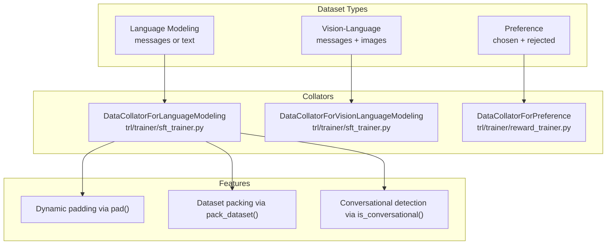
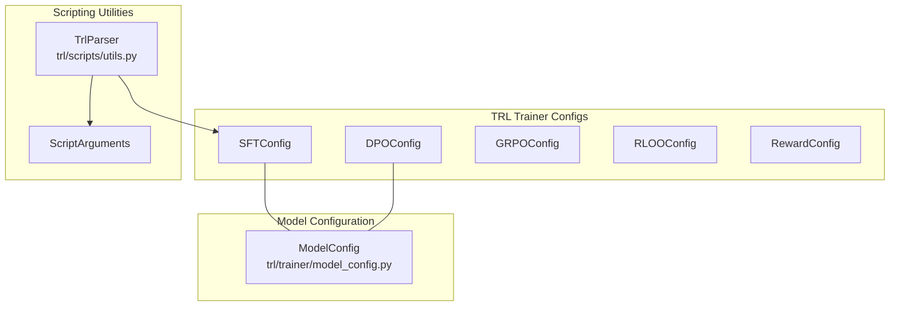

<!-- source: DeepWiki mcp.deepwiki.com · repo huggingface/trl · page 2 Core Infrastructure · fetched 2026-10-26 -->

# Core Infrastructure

Relevant source files

The following files were used as context for generating this wiki page:

- [docs/source/_toctree.yml](docs/source/_toctree.yml)
- [tests/test_utils.py](tests/test_utils.py)
- [trl/__init__.py](trl/__init__.py)
- [trl/models/__init__.py](trl/models/__init__.py)
- [trl/models/utils.py](trl/models/utils.py)
- [trl/trainer/__init__.py](trl/trainer/__init__.py)
- [trl/trainer/utils.py](trl/trainer/utils.py)

This page provides an overview of the shared infrastructure components used across all trainers in TRL. These components enable consistent model management, data processing, configuration, and training utilities across different training paradigms including supervised fine-tuning, preference optimization, and reinforcement learning.

The core infrastructure is organized into five main subsystems:
- **Model Loading and Management** (see [Model Loading and Management](#2.1)): Functions for loading models, creating reference models, managing distributed training wrappers, and handling gradient checkpointing.
- **Data Processing Pipeline** (see [Data Processing Pipeline](#2.2)): Data collators, dataset format detection, tokenization, packing/truncation, and multimodal data handling.
- **Configuration System** (see [Configuration System](#2.3)): Configuration class hierarchy extending `TrainingArguments`, `ModelConfig` dataclass for PEFT/quantization settings.
- **Training Callbacks** (see [Training Callbacks](#2.4)): Callback implementations for BEMA, reference model synchronization, completion logging, and progress tracking.
- **Chat Templates and Dataset Formatting** (see [Chat Templates and Dataset Formatting](#2.5)): Utilities for conversational data, chat template application, and dataset format conversion.

## Architecture Overview

The core infrastructure provides a layered architecture that separates concerns into functional domains. Each layer provides abstractions used by multiple trainers to avoid code duplication.

### Infrastructure Layers and Trainer Integration

```mermaid
graph TB
    subgraph "Trainer Layer"
        SFTTrainer["SFTTrainer"]
        DPOTrainer["DPOTrainer"]
        GRPOTrainer["GRPOTrainer"]
        RLOOTrainer["RLOOTrainer"]
        RewardTrainer["RewardTrainer"]
    end

    subgraph "Configuration Layer"
        SFTConfig["SFTConfig"]
        DPOConfig["DPOConfig"]
        GRPOConfig["GRPOConfig"]
        RLOOConfig["RLOOConfig"]
        RewardConfig["RewardConfig"]
        ModelConfig["ModelConfig"]
    end

    subgraph "Model Management Layer"
        UnwrapGen["unwrap_model_for_generation()"]
        CreateRef["create_reference_model()"]
        PrepareDS["prepare_deepspeed()"]
        PrepareFSDP["prepare_fsdp()"]
    end

    subgraph "Data Processing Layer"
        IsConv["is_conversational()"]
        ApplyChat["apply_chat_template()"]
        PackData["pack_dataset()"]
        LMCollator["DataCollatorForLanguageModeling"]
        VLMCollator["DataCollatorForVisionLanguageModeling"]
        PrefCollator["DataCollatorForPreference"]
    end

    subgraph "Training Utilities Layer"
        Pad["pad()"]
        GetPeft["get_peft_config()"]
        GetQuant["get_quantization_config()"]
        RepeatSampler["RepeatSampler"]
    end

    subgraph "Callbacks Layer"
        BEMACallback["BEMACallback"]
        SyncRefCallback["SyncRefModelCallback"]
        LogCompletions["LogCompletionsCallback"]
        RichProgress["RichProgressCallback"]
    end

    SFTTrainer --> SFTConfig
    DPOTrainer --> DPOConfig
    GRPOTrainer --> GRPOConfig
    RLOOTrainer --> RLOOConfig
    RewardTrainer --> RewardConfig
    
    SFTTrainer --> ModelConfig
    DPOTrainer --> ModelConfig
    GRPOTrainer --> ModelConfig
    
    SFTTrainer --> CreateRef
    DPOTrainer --> CreateRef
    GRPOTrainer --> UnwrapGen
    RLOOTrainer --> UnwrapGen
    RewardTrainer --> PrepareDS
    
    SFTTrainer --> IsConv
    SFTTrainer --> ApplyChat
    SFTTrainer --> PackData
    SFTTrainer --> LMCollator
    SFTTrainer --> VLMCollator
    DPOTrainer --> PrefCollator
    RewardTrainer --> PrefCollator
    
    SFTTrainer --> Pad
    SFTTrainer --> GetPeft
    RLOOTrainer --> RepeatSampler
    
    GRPOTrainer --> BEMACallback
    DPOTrainer --> SyncRefCallback
    GRPOTrainer --> LogCompletions
    SFTTrainer --> RichProgress
```

**Sources:** [trl/trainer/__init__.py:20-49](), [trl/trainer/utils.py:112-175](), [trl/models/utils.py:97-142](), [trl/__init__.py:28-74](), [trl/trainer/model_config.py:18-189]()

## Model Loading and Management (Page 2.1)

The model management layer provides utilities for loading models with various configurations, creating reference models for preference optimization, and managing distributed training wrappers. These functions are used during trainer initialization and generation phases.

### Key Model Management Functions

| Function | Purpose | Used By |
|----------|---------|---------|
| `get_quantization_config()` | Build `BitsAndBytesConfig` from `ModelConfig` | Trainer initialization |
| `unwrap_model_for_generation()` | Context manager for generation from distributed models | `GRPOTrainer`, `RLOOTrainer` |
| `create_reference_model()` | Create frozen reference model with optional layer sharing | `DPOTrainer`, offline preference methods |
| `prepare_deepspeed()` | Initialize model for DeepSpeed ZeRO-2/3 | Trainers with DeepSpeed |
| `prepare_fsdp()` | Initialize model for FSDP v1/v2 | Trainers with FSDP |
| `disable_dropout_in_model()` | Set all dropout layers to `p=0` | Reference models |

The `get_quantization_config()` function in [trl/trainer/utils.py:184-200]() handles 4-bit and 8-bit quantization settings via `BitsAndBytesConfig`. The `unwrap_model_for_generation()` function in [trl/models/utils.py:97-142]() manages gradient checkpointing state and DeepSpeed ZeRO-3 parameter gathering. Reference models are typically created via `create_reference_model` in [trl/models/utils.py:34-35](), which is a re-export of experimental utilities.

For detailed documentation, see [Model Loading and Management](#2.1).

**Sources:** [trl/trainer/utils.py:184-200](), [trl/models/utils.py:97-142](), [trl/models/utils.py:34-35](), [trl/trainer/utils.py:178-182]()

## Data Processing Pipeline (Page 2.2)

The data processing layer handles dataset format detection, tokenization, sequence optimization, and batch collation. It supports language modeling, preference, and multimodal datasets.

### Data Collators by Use Case

The infrastructure provides standardized padding via `pad()` in [trl/trainer/utils.py:112-175](), which supports left/right padding and `pad_to_multiple_of`. Dataset packing is handled by `pack_dataset()` in [trl/__init__.py:44](). Conversational data is detected using `is_conversational()` in [trl/data_utils.py:159-197](), which validates the structure of messages.

For detailed documentation including packing strategies and multimodal preparation, see [Data Processing Pipeline](#2.2).

**Sources:** [trl/trainer/utils.py:112-175](), [trl/data_utils.py:159-197](), [trl/__init__.py:28-48]()

## Configuration System (Page 2.3)

The configuration system extends `transformers.TrainingArguments` with trainer-specific parameters and provides the `ModelConfig` dataclass for PEFT and quantization settings.

### Configuration Class Hierarchy

Trainer configs like `SFTConfig`, `DPOConfig`, and `GRPOConfig` are exported in [trl/trainer/__init__.py:28-40](). The `ModelConfig` dataclass in [trl/trainer/model_config.py:18-189]() centralizes PEFT settings (e.g., `use_peft`, `lora_r`) and quantization parameters. Command-line parsing is facilitated by `TrlParser` in [trl/scripts/utils.py](), which merges CLI arguments with configuration files.

For detailed parameter documentation and validation logic, see [Configuration System](#2.3).

**Sources:** [trl/trainer/__init__.py:28-40](), [trl/trainer/model_config.py:18-189](), [trl/__init__.py:50]()

## Training Callbacks (Page 2.4)

The callback system provides hooks for custom behavior during training. TRL includes several specialized callbacks for online RL methods and logging.

### Available Callbacks

| Callback | Purpose | Key File |
|----------|---------|----------|
| `BEMACallback` | Exponential moving average of reference model | [trl/trainer/callbacks.py]() |
| `SyncRefModelCallback` | Synchronize reference model from policy | [trl/trainer/callbacks.py]() |
| `LogCompletionsCallback` | Log sample completions to console | [trl/trainer/callbacks.py]() |
| `RichProgressCallback` | Enhanced progress bar with `rich` | [trl/trainer/callbacks.py]() |
| `WeaveCallback` | Log metrics to Weights & Biases Weave | [trl/trainer/callbacks.py]() |

These callbacks are integrated into the trainers via the standard `transformers` callback mechanism. For example, `BEMACallback` is used in reinforcement learning trainers to maintain a stable reference point.

For callback implementation details and custom callback creation, see [Training Callbacks](#2.4).

**Sources:** [trl/trainer/__init__.py:21-27](), [trl/trainer/callbacks.py:1-150]()

## Chat Templates and Dataset Formatting (Page 2.5)

The chat template utilities handle conversational data detection, format conversion, and tokenizer chat template application.

### Chat Template Utilities

The library provides high-level utilities for managing templates:
- `apply_chat_template()`: Applies a chat template to a dataset [trl/data_utils.py:200-316]().
- `get_training_chat_template()`: Retrieves a template optimized for training [trl/chat_template_utils.py:32]().
- `clone_chat_template()`: Copies a template from one tokenizer to another [trl/chat_template_utils.py:31]().
- `is_conversational()`: Detects if a dataset follows the conversational format [trl/data_utils.py:159-197]().

For detailed documentation including `FORMAT_MAPPING` and response schema handling, see [Chat Templates and Dataset Formatting](#2.5).

**Sources:** [trl/__init__.py:29-48](), [trl/data_utils.py:159-316](), [trl/chat_template_utils.py:1-200]()

## Integration with Training Framework

The core components integrate with all TRL trainers through standardized interfaces and lazy loading in `trl/__init__.py` [trl/__init__.py:126-132](). This architecture ensures that shared logic for model loading, data collation, and distributed training is maintained in a single place while remaining accessible to all training algorithms.

**Sources:** [trl/__init__.py:126-132](), [trl/trainer/__init__.py:1-84]()

---

