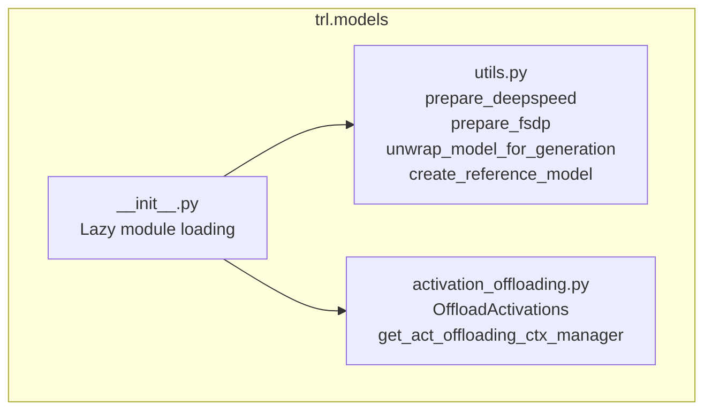
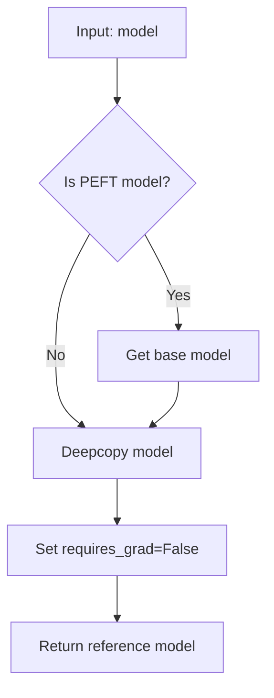
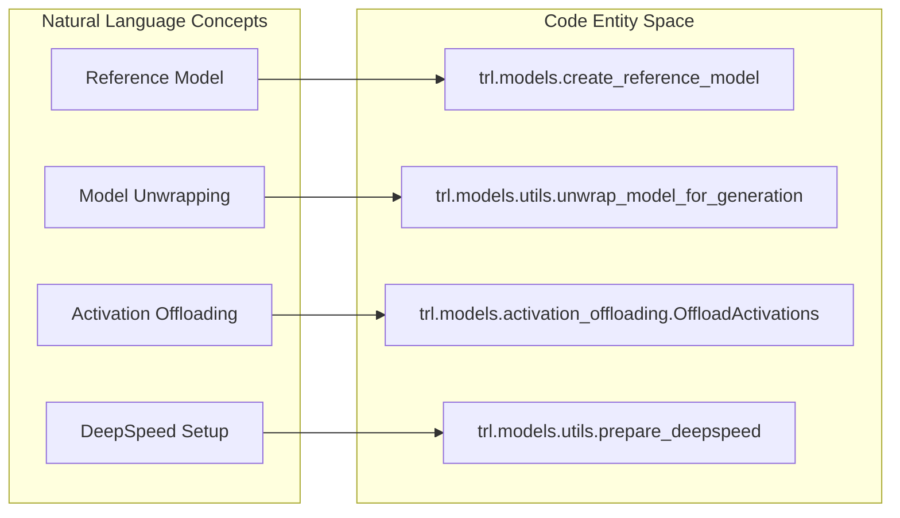

<!-- source: DeepWiki mcp.deepwiki.com · repo huggingface/trl · page 2.1 Model Loading and Management · fetched 2026-10-26 -->

# Model Loading and Management

<details>
<summary>Relevant source files</summary>

The following files were used as context for generating this wiki page:

- [docs/source/_toctree.yml](docs/source/_toctree.yml)
- [tests/test_activation_offloading.py](tests/test_activation_offloading.py)
- [trl/__init__.py](trl/__init__.py)
- [trl/models/__init__.py](trl/models/__init__.py)
- [trl/models/activation_offloading.py](trl/models/activation_offloading.py)
- [trl/models/utils.py](trl/models/utils.py)
- [trl/trainer/__init__.py](trl/trainer/__init__.py)

</details>


This document covers TRL's model infrastructure layer, which provides wrapper classes and utilities for managing transformer models in post-training scenarios. The core components include `PreTrainedModelWrapper` (base wrapper), `AutoModelForCausalLMWithValueHead` (models with value heads for RL), `create_reference_model` (frozen reference copies), and utilities for distributed training setup including DeepSpeed and FSDP.

## Overview

TRL wraps `transformers.PreTrainedModel` instances to support reinforcement learning training paradigms. The wrapper infrastructure handles value head attachment for computing scalar values (PPO, RLOO), reference model management for KL-divergence penalties (DPO, PPO), and distributed training compatibility.

### Module Organization



**Sources:** [trl/models/__init__.py:20-23](), [trl/models/utils.py:1-150](), [trl/models/activation_offloading.py:79-118]()

## Model Generation Utilities

TRL provides specialized context managers to handle model state transitions during generation phases, particularly in distributed environments.

### unwrap_model_for_generation

This context manager is used to temporarily unwrap a model from distributed containers (DDP or DeepSpeed) and disable gradient checkpointing to allow for efficient generation.

```python
with _unwrap_model_for_generation(model, accelerator) as unwrapped_model:
    generated_outputs = unwrapped_model.generate(input_ids)
```

**Key behaviors:**
- **Gradient Checkpointing:** Automatically disables it if active and re-enables it upon exit [trl/models/utils.py:125-142]().
- **DeepSpeed ZeRO-3:** If stage 3 is detected, it handles parameter gathering using `deepspeed.zero.GatheredParameters` [trl/models/utils.py:128-137]().
- **Hook Management:** Temporarily removes DeepSpeed optimizer hooks during generation to prevent unnecessary overhead [trl/models/utils.py:135-137]().

**Sources:** [trl/models/utils.py:98-143]()

### override_model_generation_config

A utility to temporarily override a model's `generation_config` with training-specific parameters. This circumvents issues in `transformers < 5.0.0` where merging logic might overwrite specific values with global defaults [trl/models/utils.py:145-161]().

**Sources:** [trl/models/utils.py:145-184]()

## Distributed Training Preparation

TRL includes utilities to prepare models for distributed training or inference, specifically targeting DeepSpeed and FSDP.

### DeepSpeed Preparation

The `prepare_deepspeed` utility configures a model for DeepSpeed inference, with specific optimizations for ZeRO-3 stage.

| Optimization Parameter | Logic |
|-----------------------|-------|
| `reduce_bucket_size` | `hidden_size * hidden_size` [trl/models/utils.py:377]() |
| `stage3_param_persistence_threshold` | `10 * hidden_size` [trl/models/utils.py:378]() |
| `stage3_prefetch_bucket_size` | `0.9 * hidden_size * hidden_size` [trl/models/utils.py:379]() |

If the DeepSpeed stage is not 3, ZeRO optimization is disabled for the model to save resources [trl/models/utils.py:383-384]().

**Sources:** [trl/models/utils.py:355-392]()

### FSDP Preparation

The `prepare_fsdp` utility wraps models in PyTorch's `FullyShardedDataParallel`. It supports both FSDP v1 and v2, using `get_parameters_from_modules` for newer `accelerate` versions to handle sharded parameters correctly [trl/models/utils.py:403-415]().

**Sources:** [trl/models/utils.py:395-416]()

## Reference Model Management

Many TRL trainers (DPO, PPO) require a reference model to compute KL-divergence penalties.

### create_reference_model

Creates a frozen copy of a model. If the input model is a PEFT model, it uses the base model as the reference [trl/models/utils.py:35]().



**Sources:** [trl/models/utils.py:35](), [trl/__init__.py:49]()

## Memory Optimization: Activation Offloading

TRL provides an `OffloadActivations` context manager to reduce VRAM usage by offloading activation tensors to CPU during the forward pass and bringing them back for the backward pass.

### Implementation Details

- **Deduplication:** Uses storage pointers and dtypes to avoid offloading the same underlying storage multiple times [trl/models/activation_offloading.py:49-76]().
- **Streaming:** Supports asynchronous communication between GPU and CPU using dedicated CUDA streams to overlap compute and transfer [trl/models/activation_offloading.py:158-166]().
- **Thresholding:** Only offloads tensors larger than `min_offload_size` (default 1024 bytes) to avoid overhead for small tensors [trl/models/activation_offloading.py:98-100]().

### Usage

```python
from trl.models.activation_offloading import OffloadActivations

with OffloadActivations(min_offload_size=1024):
    outputs = model(inputs)
    loss = outputs.loss
loss.backward()
```

**Sources:** [trl/models/activation_offloading.py:79-118](), [tests/test_activation_offloading.py:66-68]()

## Model Infrastructure Entity Mapping

This diagram maps natural language concepts to the specific code entities in the `trl.models` subpackage.



**Sources:** [trl/models/__init__.py:20-23](), [trl/models/activation_offloading.py:79](), [trl/models/utils.py:98]()

## Class Summary

| Class/Function | Purpose | File |
|----------------|---------|------|
| `unwrap_model_for_generation` | Disables GC and unwraps distributed models for inference. | [trl/models/utils.py:98]() |
| `prepare_deepspeed` | Configures DeepSpeed ZeRO-3 parameters based on model hidden size. | [trl/models/utils.py:355]() |
| `OffloadActivations` | Context manager for CPU offloading of forward activations. | [trl/models/activation_offloading.py:79]() |
| `create_reference_model` | Utility to create a frozen copy of a model for KL penalties. | [trl/models/utils.py:35]() |
| `remove_hooks` / `add_hooks` | Manages DeepSpeed ZeRO-3 optimizer hooks during unwrapping. | [trl/models/utils.py:47-95]() |

**Sources:** [trl/models/utils.py:1-416](), [trl/models/activation_offloading.py:1-118]()

---

