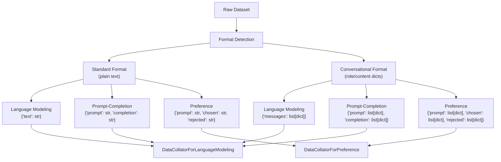
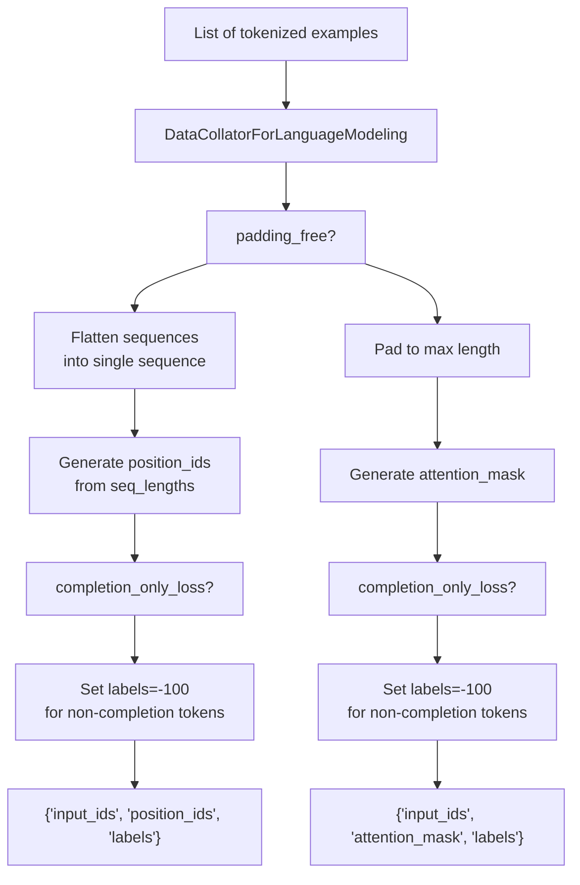
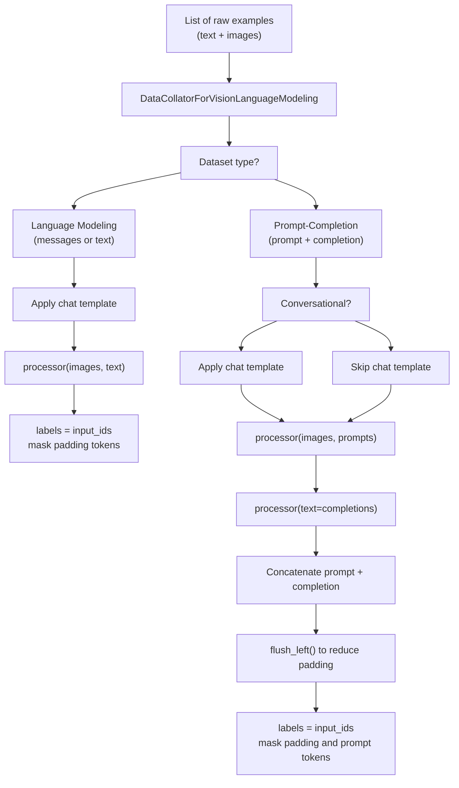
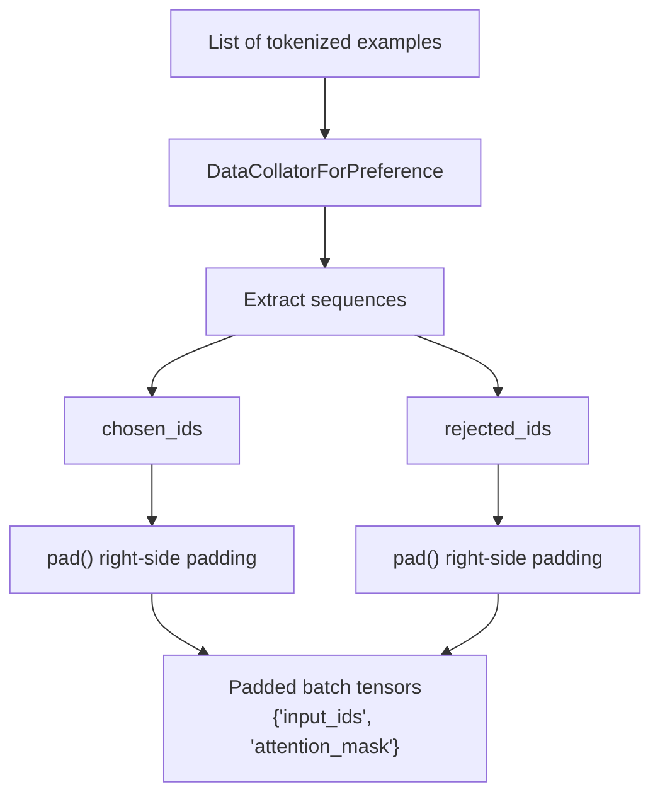
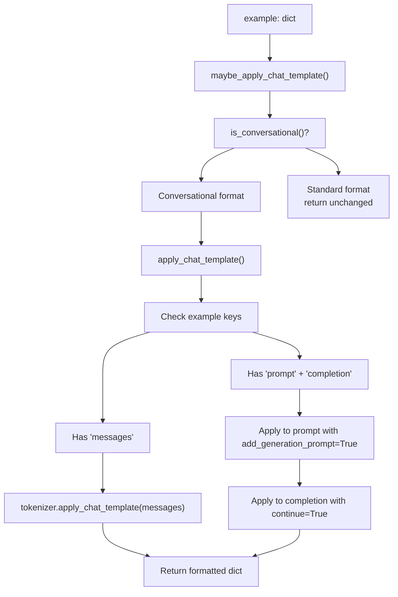
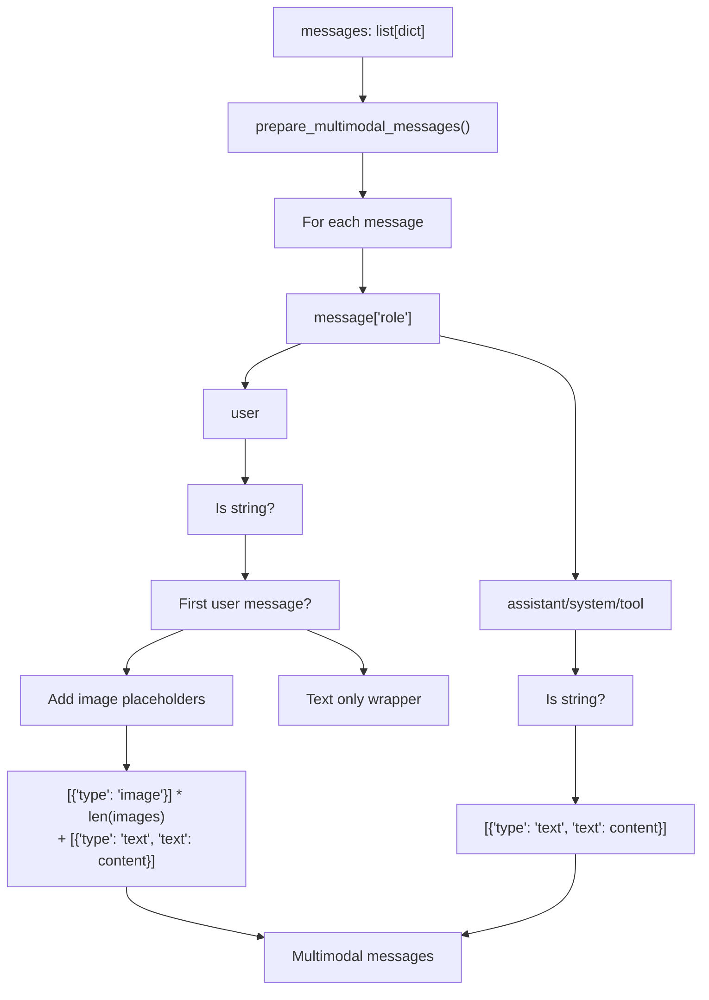
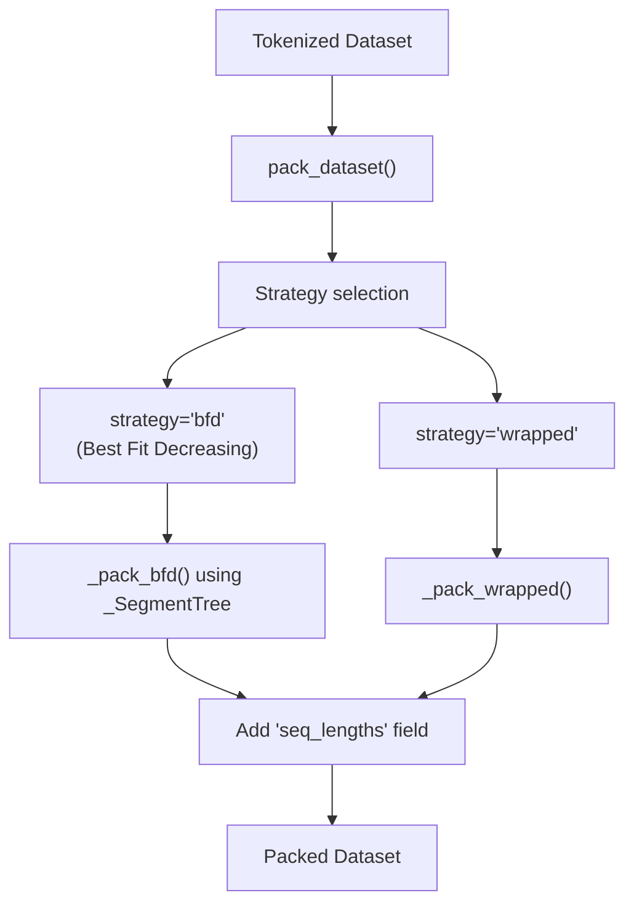
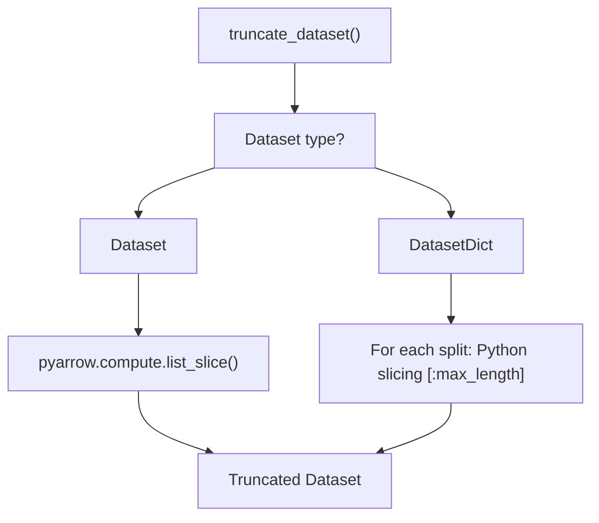

<!-- source: DeepWiki mcp.deepwiki.com · repo huggingface/trl · page 2.2 Data Processing Pipeline · fetched 2026-10-26 -->

# Data Processing Pipeline

Relevant source files

The following files were used as context for generating this wiki page:

- [docs/source/data_utils.md](docs/source/data_utils.md)
- [scripts/generate_tiny_models.py](scripts/generate_tiny_models.py)
- [tests/experimental/test_ppo_trainer.py](tests/experimental/test_ppo_trainer.py)
- [tests/test_cli.py](tests/test_cli.py)
- [tests/test_data_utils.py](tests/test_data_utils.py)
- [tests/test_reward_trainer.py](tests/test_reward_trainer.py)
- [tests/test_sft_trainer.py](tests/test_sft_trainer.py)
- [trl/data_utils.py](trl/data_utils.py)
- [trl/trainer/sft_trainer.py](trl/trainer/sft_trainer.py)

TRL's data processing system transforms raw datasets into trainer-ready batched inputs through data collators and preprocessing utilities. The system consists of three main components:

1.  **Data Collators**: Batch preparation classes that handle padding, masking, and tensor creation.
2.  **Dataset Preprocessing**: Utilities for chat template application, format detection, and sequence transformations.
3.  **Advanced Processing**: Packing, truncation, and multimodal data handling.

The core collators are implemented in trainer modules ([trl/trainer/sft_trainer.py:89-463](), [trl/trainer/reward_trainer.py:25-108](), [trl/trainer/utils.py:79-211]()), while preprocessing utilities are primarily in [trl/data_utils.py:1-747]().

## Dataset Formats and Types

TRL supports multiple dataset formats that feed into trainer-specific data collators. Understanding these formats is essential for proper dataset preparation.

### Dataset Type Taxonomy

Title: Dataset Format to Collator Mapping

Sources: [trl/trainer/sft_trainer.py:89-251](), [trl/trainer/reward_trainer.py:25-108](), [trl/data_utils.py:103-117]()

### Format Detection

The `is_conversational` function at [trl/data_utils.py:103-117]() detects conversational format by checking for lists of dictionaries with `role` and `content` keys in supported fields: `messages`, `prompt`, `chosen`, `rejected`, `completion`.

| Dataset Type | Standard Format | Conversational Format | Trainer Usage |
|--------------|-----------------|----------------------|---------------|
| Language modeling | `{"text": "The sky is blue."}` | `{"messages": [{"role": "user", "content": "Hi"}, {"role": "assistant", "content": "Hello"}]}` | `SFTTrainer` |
| Prompt-completion | `{"prompt": "The sky is", "completion": " blue."}` | `{"prompt": [{"role": "user", "content": "What color?"}], "completion": [{"role": "assistant", "content": "Blue"}]}` | `SFTTrainer` |
| Preference | `{"prompt": "The sky is", "chosen": " blue.", "rejected": " green."}` | `{"prompt": [{"role": "user", "content": "What color?"}], "chosen": [{"role": "assistant", "content": "Blue"}], "rejected": [{"role": "assistant", "content": "Green"}]}` | `DPOTrainer`, `RewardTrainer` |

Sources: [trl/data_utils.py:103-117](), [tests/test_data_utils.py:151-257]()

## Data Collators

Data collators are the final step in data processing, transforming tokenized examples into batched tensors ready for model input.

### DataCollatorForLanguageModeling

The `DataCollatorForLanguageModeling` class at [trl/trainer/sft_trainer.py:89-251]() handles SFT training data batching with support for completion-only loss, padding-free training, and sequence packing.

Title: DataCollatorForLanguageModeling Processing Flow

Sources: [trl/trainer/sft_trainer.py:89-251](), [tests/test_sft_trainer.py:85-265]()

#### Padding-Free Mode
When `padding_free=True`, the collator flattens sequences into a single sequence and generates `position_ids` that reset at sequence boundaries [trl/trainer/sft_trainer.py:118-120](). This eliminates padding overhead but requires FlashAttention. The static method `get_position_ids_from_packed_seq_lengths` at [trl/trainer/sft_trainer.py:225-250]() generates these IDs.

#### Completion-Only Loss
When `completion_only_loss=True` and examples contain a `completion_mask`, labels are set to `-100` for prompt tokens [trl/trainer/sft_trainer.py:94-95](). It also supports `assistant_masks` to mask non-assistant parts of conversational sequences [trl/trainer/sft_trainer.py:95-96]().

### DataCollatorForVisionLanguageModeling

The `DataCollatorForVisionLanguageModeling` class at [trl/trainer/sft_trainer.py:254-463]() handles vision-language model training by tokenizing text and processing images on-the-fly.

Title: DataCollatorForVisionLanguageModeling Processing Paths

Sources: [trl/trainer/sft_trainer.py:254-463](), [trl/trainer/sft_trainer.py:351-462]()

### DataCollatorForPreference

The `DataCollatorForPreference` class at [trl/trainer/reward_trainer.py:25-108]() (and similar logic in `DPOTrainer`) batches preference data, handling chosen and rejected sequences.

Title: DataCollatorForPreference Batching Logic

Sources: [trl/trainer/reward_trainer.py:25-108](), [tests/test_reward_trainer.py:34-108]()

## Dataset Preprocessing

### Chat Template Application

The `apply_chat_template` and `maybe_apply_chat_template` functions at [trl/data_utils.py:120-279]() convert conversational datasets to text format.

Title: Chat Template Application Logic

Sources: [trl/data_utils.py:120-279](), [tests/test_data_utils.py:400-430]()

### Multimodal Message Preparation

The `prepare_multimodal_messages` function at [trl/data_utils.py:33-124]() converts string content in conversational messages to structured multimodal format.

Title: Multimodal Message Structure Creation

Sources: [trl/data_utils.py:33-124](), [tests/test_data_utils.py:48-148]()

## Advanced Processing Features

### Sequence Packing

The `pack_dataset` function at [trl/data_utils.py:629-682]() groups multiple sequences into fixed-length blocks to reduce padding.

Title: Packing Strategy Implementations

Sources: [trl/data_utils.py:629-682](), [trl/data_utils.py:543-608](), [trl/data_utils.py:498-541]()

#### _SegmentTree for BFD Packing
The `_SegmentTree` class at [trl/data_utils.py:498-541]() provides efficient bin space tracking with O(log n) search, allowing the Best Fit Decreasing (`bfd`) algorithm to maintain sequence boundaries effectively.

### Dataset Truncation

The `truncate_dataset` function at [trl/data_utils.py:685-747]() limits sequence lengths using efficient PyArrow operations (`pc.list_slice`) for `Dataset` objects or standard Python slicing for `DatasetDict`.

Title: Truncation Implementation Paths

Sources: [trl/data_utils.py:685-747]()

---

