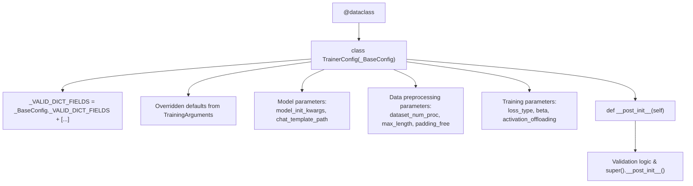

<!-- source: DeepWiki mcp.deepwiki.com · repo huggingface/trl · page 2.3 Configuration System · fetched 2026-10-26 -->

# Configuration System

<details>
<summary>Relevant source files</summary>

The following files were used as context for generating this wiki page:

- [tests/conftest.py](tests/conftest.py)
- [trl/extras/dataset_formatting.py](trl/extras/dataset_formatting.py)
- [trl/trainer/base_config.py](trl/trainer/base_config.py)
- [trl/trainer/dpo_config.py](trl/trainer/dpo_config.py)
- [trl/trainer/kto_config.py](trl/trainer/kto_config.py)
- [trl/trainer/model_config.py](trl/trainer/model_config.py)
- [trl/trainer/reward_config.py](trl/trainer/reward_config.py)
- [trl/trainer/sft_config.py](trl/trainer/sft_config.py)

</details>


The TRL configuration system provides a declarative interface for customizing training behavior across all trainer classes. All trainer configurations extend `_BaseConfig`, which inherits from `transformers.TrainingArguments`, ensuring full compatibility with the Hugging Face training ecosystem. `ModelConfig` is a separate dataclass that encapsulates model loading and PEFT configuration, allowing clean separation between training hyperparameters and model initialization parameters.

This page documents the configuration class hierarchy, parameter inheritance patterns, default value overrides, validation logic, and the integration with `transformers.TrainingArguments`. For trainer-specific parameters, see the individual trainer pages: [SFT (3)], [DPO (4)], [GRPO (5)], [RLOO (6)], [Reward (7)].

---

## Configuration Class Hierarchy

All TRL trainer configurations extend `_BaseConfig` from [trl/trainer/base_config.py](), which itself extends `transformers.TrainingArguments`. This inheritance ensures that all transformers training arguments (learning rate, batch size, gradient accumulation, etc.) are available in TRL configs. `ModelConfig` is independent and does not inherit from `TrainingArguments`.

**Configuration class inheritance hierarchy**

```mermaid
classDiagram
    class TrainingArguments {
        <<transformers>>
        +learning_rate: 5e-5
        +per_device_train_batch_size: 8
        +gradient_accumulation_steps: 1
        +logging_steps: 500
        +gradient_checkpointing: False
        +bf16: False
        +_VALID_DICT_FIELDS: list
        +__post_init__()
    }
    class "_BaseConfig" {
        <<trl/trainer/base_config.py>>
        +logging_steps: 10
        +gradient_checkpointing: True
        +bf16: True if not fp16
        +use_liger_kernel: False
        +__post_init__()
    }
    class "SFTConfig" {
        <<trl/trainer/sft_config.py>>
        +learning_rate: 2e-5
        +model_init_kwargs: dict
        +max_length: 1024
        +packing: False
        +completion_only_loss: None
        +assistant_only_loss: False
        +loss_type: "nll"
    }
    class "DPOConfig" {
        <<trl/trainer/dpo_config.py>>
        +learning_rate: 1e-6
        +model_init_kwargs: dict
        +beta: 0.1
        +loss_type: "sigmoid"
        +precompute_ref_log_probs: False
    }
    class "RewardConfig" {
        <<trl/trainer/reward_config.py>>
        +learning_rate: 1e-4
        +model_init_kwargs: dict
        +center_rewards_coefficient: None
        +disable_dropout: True
    }
    class "ModelConfig" {
        <<trl/trainer/model_config.py>>
        +model_name_or_path: str
        +dtype: "float32"
        +use_peft: False
        +lora_r: 16
        +lora_alpha: 32
        +load_in_4bit: False
        +load_in_8bit: False
    }

    TrainingArguments <|-- "_BaseConfig"
    "_BaseConfig" <|-- "SFTConfig"
    "_BaseConfig" <|-- "DPOConfig"
    "_BaseConfig" <|-- "RewardConfig"
```

Sources: [trl/trainer/base_config.py:21](), [trl/trainer/sft_config.py:23](), [trl/trainer/dpo_config.py:23](), [trl/trainer/reward_config.py:23](), [trl/trainer/model_config.py:19]()

---

## `_BaseConfig` Class

**File:** [trl/trainer/base_config.py]()

`_BaseConfig` is a subclass of `transformers.TrainingArguments` that serves as the parent class for all TRL trainer configurations. It provides three key functions:

1. **Default override mechanism**: Changes default values of `TrainingArguments` parameters to TRL-preferred defaults (e.g., `logging_steps=10` [trl/trainer/base_config.py:54-60](), `gradient_checkpointing=True` [trl/trainer/base_config.py:61-66](), `bf16=True` if `fp16` is not set [trl/trainer/base_config.py:67-74]()).
2. **Compatibility Patching**: Overrides fields like `use_liger_kernel` [trl/trainer/base_config.py:90-95]() and `torch_empty_cache_steps` [trl/trainer/base_config.py:97-102]() to escape "%" characters in help strings, which would otherwise cause `argparse` errors in older `transformers` versions [trl/trainer/base_config.py:86-89]().
3. **Initialization chain**: Its `__post_init__` method handles the logic for defaulting `bf16` based on `fp16` status before calling `super().__post_init__()` [trl/trainer/base_config.py:104-107]().

Sources: [trl/trainer/base_config.py:21-108]()

---

## `ModelConfig` Dataclass

**File:** [trl/trainer/model_config.py]()

`ModelConfig` is an independent `@dataclass` that encapsulates all model loading and PEFT configuration parameters. It provides clean separation between model initialization and training hyperparameters.

**ModelConfig parameter organization**

| Parameter Group | Parameters | Default Values | Purpose |
|---|---|---|---|
| **Model Identity** | `model_name_or_path`<br>`model_revision` | `None`<br>`"main"` | Hub model ID or local path [trl/trainer/model_config.py:83-90]() |
| **Dtype & Attention** | `dtype`<br>`attn_implementation` | `"float32"`<br>`None` | Precision override [trl/trainer/model_config.py:91-97]() and Attention implementation (e.g., `flash_attention_2`) [trl/trainer/model_config.py:106-112]() |
| **LoRA / PEFT** | `use_peft`<br>`lora_r`<br>`lora_alpha`<br>`lora_target_modules` | `False`<br>`16`<br>`32`<br>`None` | Enable PEFT and configure rank, alpha, and targets [trl/trainer/model_config.py:113-132]() |
| **Quantization** | `load_in_8bit`<br>`load_in_4bit`<br>`bnb_4bit_quant_type` | `False`<br>`False`<br>`"nf4"` | BitsAndBytes quantization settings [trl/trainer/model_config.py:164-173]() |

Sources: [trl/trainer/model_config.py:19-182]()

### Usage Pattern with HfArgumentParser

Training scripts typically parse `ModelConfig` alongside a trainer config using `transformers.HfArgumentParser`:

```python
from transformers import HfArgumentParser
from trl import SFTConfig, ModelConfig

parser = HfArgumentParser((SFTConfig, ModelConfig))
sft_config, model_config = parser.parse_args_into_dataclasses()
```

This allows CLI users to specify both training and model parameters in a single command.

---

## Trainer Configuration Pattern

All trainer configs follow a consistent structural pattern, organizing parameters into logical groups and providing validation logic in `__post_init__()`.

**Standard trainer config structure**



Sources: [trl/trainer/sft_config.py:23-115](), [trl/trainer/dpo_config.py:23-92](), [trl/trainer/reward_config.py:23-92]()

### `_VALID_DICT_FIELDS` Class Variable

Trainer configs use the `_VALID_DICT_FIELDS` class variable to identify which parameters are dictionary-typed. This is crucial for `HfArgumentParser` to correctly parse JSON strings from the CLI into Python dictionaries.

- **`SFTConfig`**: Includes `model_init_kwargs`, `dataset_kwargs` [trl/trainer/sft_config.py:115]().
- **`DPOConfig`**: Includes `model_init_kwargs`, `ref_model_init_kwargs` [trl/trainer/dpo_config.py:126]().
- **`RewardConfig`**: Includes `model_init_kwargs` [trl/trainer/reward_config.py:92]().

### Default Value Overrides

Each trainer config overrides specific `TrainingArguments` or `_BaseConfig` defaults to better match the requirements of its specific training algorithm.

| Trainer Config | Parameter | Override Value | Original Default |
|---|---|---|---|
| `SFTConfig` | `learning_rate` | `2e-5` [trl/trainer/sft_config.py:118-121]() | `5e-5` |
| `RewardConfig` | `learning_rate` | `1e-4` [trl/trainer/reward_config.py:95-98]() | `5e-5` |
| `DPOConfig` | `learning_rate` | `1e-6` [trl/trainer/dpo_config.py:129-132]() | `5e-5` |

---

## Configuration Validation in `__post_init__`

Trainer configs implement `__post_init__()` to perform cross-parameter validation.

### SFTConfig Validation
In `SFTConfig`, the logic checks for valid `packing_strategy` [trl/trainer/sft_config.py:239-245]() and ensures that `dataset_text_field` is provided if the dataset is not in a standard format [trl/trainer/sft_config.py:247-252](). It also automatically enables `padding_free` if the "bfd" packing strategy is used [trl/trainer/sft_config.py:254-257]().

### ModelConfig Validation
`ModelConfig` ensures that `load_in_8bit` and `load_in_4bit` are not used simultaneously [trl/trainer/model_config.py:184-185](). It also normalizes `lora_target_modules` if a single string is passed in a list [trl/trainer/model_config.py:187-188]().

Sources: [trl/trainer/sft_config.py:236-258](), [trl/trainer/model_config.py:183-189]()

---

## Experimental and Deprecated Parameters

TRL maintains compatibility through shims and warnings. For example, `KTOConfig` is now located in `trl.experimental`, and the version in `trl.trainer` acts as a proxy that issues a `FutureWarning` [trl/trainer/kto_config.py:25-36]().

Dataset formatting is also centralized; `trl/extras/dataset_formatting.py` defines `FORMAT_MAPPING` to standardize how "chatml" and "instruction" formats are recognized across different `datasets` library versions [trl/extras/dataset_formatting.py:24-32]().

Sources: [trl/trainer/kto_config.py:25-36](), [trl/extras/dataset_formatting.py:24-32]()

---

