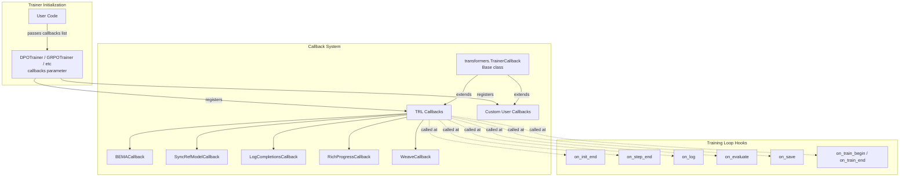
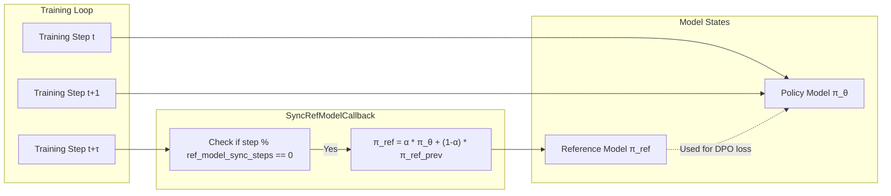
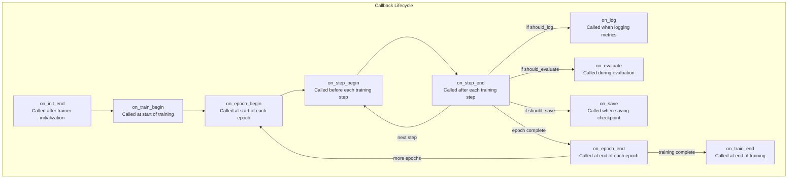

<!-- source: DeepWiki mcp.deepwiki.com · repo huggingface/trl · page 2.4 Training Callbacks · fetched 2026-10-26 -->

# Training Callbacks

<details>
<summary>Relevant source files</summary>

The following files were used as context for generating this wiki page:

- [docs/source/callbacks.md](docs/source/callbacks.md)
- [tests/test_callbacks.py](tests/test_callbacks.py)
- [tests/test_rich_progress_callback.py](tests/test_rich_progress_callback.py)
- [trl/trainer/callbacks.py](trl/trainer/callbacks.py)

</details>


Training callbacks in TRL provide hooks into the training loop to enable custom behavior at specific points during training. TRL includes several built-in callbacks for common tasks like reference model synchronization, logging completions, and progress visualization. All TRL callbacks extend `transformers.TrainerCallback` and are compatible with the Hugging Face Transformers training infrastructure.

## Overview

The callback system allows developers to inject logic into the training lifecycle without modifying the core trainer classes.



Sources: [trl/trainer/callbacks.py:102]() [trl/trainer/callbacks.py:143]() [trl/trainer/callbacks.py:228]() [trl/trainer/callbacks.py:284]()

## Available Callbacks

TRL provides several built-in callbacks, each serving a specific purpose in the training workflow.

| Callback | Primary Use Case | Key Configuration |
|----------|------------------|-------------------|
| `BEMACallback` | Bootstrapped Exponential Moving Average for reference models | `update_freq`, `ema_alpha` |
| `SyncRefModelCallback` | Reference model synchronization (TR-DPO) | `ref_model_sync_steps`, `ref_model_mixup_alpha` |
| `LogCompletionsCallback` | Log generated completions during training | `num_prompts`, `generation_config` |
| `RichProgressCallback` | Enhanced progress bars with rich formatting | None |
| `WeaveCallback` | Weights & Biases Weave integration | W&B configuration |

### SyncRefModelCallback

The `SyncRefModelCallback` implements the TR-DPO (Trust Region DPO) reference model synchronization strategy, which periodically updates the reference model to be a mixture of the current policy and the previous reference policy.



**Implementation Details**:
- It uses `SyncRefModelCallback.sync_target_model` to handle weight updates [trl/trainer/callbacks.py:121-132]().
- Supports DeepSpeed ZeRO-3 by using `deepspeed.zero.GatheredParameters` to sync weights across ranks [trl/trainer/callbacks.py:122-130]().
- Updates are applied in `on_step_end` based on the `ref_model_sync_steps` frequency [trl/trainer/callbacks.py:134-141]().

Sources: [trl/trainer/callbacks.py:102-141]()

### BEMACallback

`BEMACallback` implements Bootstrapped Exponential Moving Average for reference models. It maintains a separate model instance that tracks the moving average of the training model's weights.

**Key Features**:
- **Weight Updates**: Parameters are updated using the formula: `target = (1 - alpha) * target + alpha * source` [trl/trainer/callbacks.py:321-322]().
- **Frequency**: Controlled by `update_freq` [trl/trainer/callbacks.py:328]().
- **Persistence**: Automatically saves the BEMA model to a `bema` subdirectory within the output directory during `on_train_end` [trl/trainer/callbacks.py:343-349]().

Sources: [trl/trainer/callbacks.py:284-353]() [tests/test_callbacks.py:136-152]()

### LogCompletionsCallback

`LogCompletionsCallback` generates and logs completions from the model during the evaluation phase. This is critical for visual inspection of model performance beyond scalar metrics.

**Data Flow**:
1. In `on_evaluate`, it selects a subset of prompts from the evaluation dataset [trl/trainer/callbacks.py:255-257]().
2. It uses `_generate_completions` to produce text using the current model state [trl/trainer/callbacks.py:263-270]().
3. It removes the prompt from the generated sequence to isolate the completion [trl/trainer/callbacks.py:94-98]().
4. Results are logged as a table to supported backends like Weights & Biases (WandB), Comet, or MLflow [trl/trainer/callbacks.py:272-281]().

Sources: [trl/trainer/callbacks.py:62-100]() [trl/trainer/callbacks.py:228-281]() [tests/test_callbacks.py:45-80]()

### RichProgressCallback

`RichProgressCallback` replaces standard TQDM progress bars with high-fidelity `rich` dashboards.

**Features**:
- Displays separate progress bars for training and evaluation [trl/trainer/callbacks.py:165-171]().
- Includes a status area for logging the latest metrics [trl/trainer/callbacks.py:168-169]().
- Automatically updates in `on_step_end` and `on_prediction_step` [trl/trainer/callbacks.py:174-183]().

Sources: [trl/trainer/callbacks.py:143-225]() [tests/test_rich_progress_callback.py:35-65]()

### WeaveCallback

`WeaveCallback` integrates with Weights & Biases Weave for advanced trace logging and evaluation. It captures model inputs and outputs during the evaluation step and logs them to the Weave platform [trl/trainer/callbacks.py:356-383]().

Sources: [trl/trainer/callbacks.py:356-383]()

## Implementing Custom Callbacks

Custom callbacks must extend `transformers.TrainerCallback`. The callback lifecycle provides hooks at key points in the training process.



### Custom Callback Template

```python
from transformers import TrainerCallback, TrainerState, TrainerControl

class MyCustomCallback(TrainerCallback):
    def on_step_end(self, args, state, control, **kwargs):
        # Access training state via 'state'
        if state.global_step % 100 == 0:
            print(f"Reached step {state.global_step}")
        
        # Access model via kwargs
        model = kwargs.get("model")
        
        # Modify training flow via 'control'
        if some_condition:
            control.should_training_stop = True
            
        return control
```

Sources: [trl/trainer/callbacks.py:134-141]() [trl/trainer/callbacks.py:174-179]()

---

