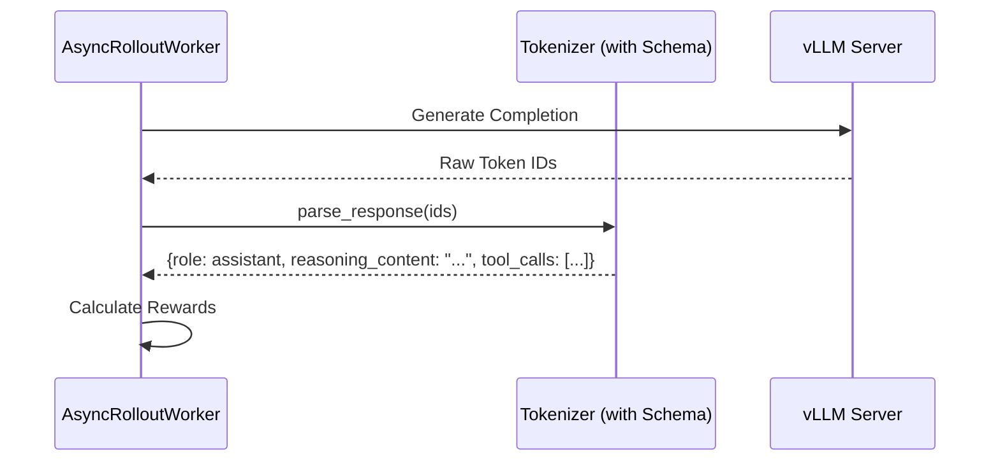

<!-- source: DeepWiki mcp.deepwiki.com · repo huggingface/trl · page 2.5 Chat Templates and Dataset Formatting · fetched 2026-10-26 -->

# Chat Templates and Dataset Formatting

<details>
<summary>Relevant source files</summary>

The following files were used as context for generating this wiki page:

- [MANIFEST.in](MANIFEST.in)
- [docs/source/chat_template_utils.md](docs/source/chat_template_utils.md)
- [docs/source/chat_templates.md](docs/source/chat_templates.md)
- [tests/test_chat_template_utils.py](tests/test_chat_template_utils.py)
- [trl/chat_template_utils.py](trl/chat_template_utils.py)
- [trl/chat_templates/README.md](trl/chat_templates/README.md)
- [trl/chat_templates/gemma.jinja](trl/chat_templates/gemma.jinja)
- [trl/chat_templates/gemma_training.jinja](trl/chat_templates/gemma_training.jinja)
- [trl/chat_templates/phi3.jinja](trl/chat_templates/phi3.jinja)
- [trl/chat_templates/phi3_training.jinja](trl/chat_templates/phi3_training.jinja)
- [trl/chat_templates/qwen3.jinja](trl/chat_templates/qwen3.jinja)
- [trl/chat_templates/qwen3_5_2b_and_below.jinja](trl/chat_templates/qwen3_5_2b_and_below.jinja)
- [trl/chat_templates/qwen3_5_4b_and_above.jinja](trl/chat_templates/qwen3_5_4b_and_above.jinja)
- [trl/chat_templates/qwen3_training.jinja](trl/chat_templates/qwen3_training.jinja)
- [trl/experimental/async_grpo/async_grpo_trainer.py](trl/experimental/async_grpo/async_grpo_trainer.py)
- [trl/experimental/async_grpo/async_rollout_worker.py](trl/experimental/async_grpo/async_rollout_worker.py)
- [trl/skills/trl-training/SKILL.md](trl/skills/trl-training/SKILL.md)

</details>


This page covers TRL's infrastructure for managing chat templates and detecting dataset formats. It explains how TRL adapts standard model templates for training-specific needs, such as assistant-only loss masking and prefix preservation for reinforcement learning.

## Overview of Chat Templates in TRL

A chat template is a Jinja2 snippet that formats a list of message dictionaries into the specific string format a model was trained on. While most models ship with a template, TRL provides utilities to adapt these templates for specialized post-training tasks.

### Key Training Requirements
1.  **Assistant-Only Loss (SFT):** Requires `` and `` markers around assistant outputs so that the trainer can compute loss only on the model's responses [trl/chat_templates/README.md:10-11]().
2.  **Prefix Preservation (GRPO):** Essential for the tool-call loop. Appending a new message (like a tool response) must not change the rendering of earlier messages in the sequence [trl/chat_templates/README.md:8-9]().

---

## Chat Template Utilities

**File:** `trl/chat_template_utils.py`

### `clone_chat_template`
This function allows transferring a chat template from a source tokenizer (e.g., a well-configured instruct model) to a target model/tokenizer pair (e.g., a base model being fine-tuned) [trl/chat_template_utils.py:27-32]().

**Implementation Details:**
- **Token Synchronization:** Copies the template and ensures all special tokens (like `<|im_end|>`) are added to the target tokenizer [trl/chat_template_utils.py:77-83]().
- **Embedding Resizing:** Resizes the model's token embeddings to match the new vocabulary size. It can pad the vocabulary to a multiple (default 64) for hardware efficiency [trl/chat_template_utils.py:91-98]().
- **Dummy Tokens:** If the embedding matrix is larger than the vocabulary after padding, it adds `<extra_id_N>` tokens to maintain alignment [trl/chat_template_utils.py:100-109]().

### Template Analysis and Patching
- **`is_chat_template_prefix_preserving`**: Tests if a template is safe for multi-turn RL by checking if `template(m)` is a prefix of `template(m + next_msg)` [trl/chat_template_utils.py:31-35]().
- **`get_training_chat_template`**: Automatically selects a patched version of a known template (e.g., Qwen, Llama, DeepSeek) that includes training markers and fixes prefix-preservation issues [trl/chat_template_utils.py:31-35](), [trl/chat_templates/README.md:56-59]().

**Template Logic Flow:**

```mermaid
graph TD
    "Input Tokenizer" --> "is_chat_template_prefix_preserving()"
    "is_chat_template_prefix_preserving()" -- "False" --> "get_training_chat_template()"
    "get_training_chat_template()" --> "Match against trl/chat_templates/*.jinja"
    "Match against trl/chat_templates/*.jinja" --> "Return Patched Template"
    "Patched Template" --> "Apply  markers"
    "Patched Template" --> "Remove conditional thinking blocks"
```
Sources: [trl/chat_template_utils.py:1-118](), [trl/chat_templates/README.md:1-11]()

---

## Training Templates (Jinja2 Patches)

TRL bundles several patched templates in `trl/chat_templates/` to support specific model families.

| Template | Primary Modification | Rationale |
| :--- | :--- | :--- |
| `deepseekv3_training.jinja` | `| tojson` for tool arguments | Fixes crashes when passing `dict` objects instead of raw strings [trl/chat_templates/README.md:64-65](). |
| `gemma_training.jinja` | Split role-specific branches | Ensures `<start_of_turn>model\n` is outside the generation block [trl/chat_templates/README.md:69-71](). |
| `qwen3_training.jinja` | Unconditional `` to prevent incorrect splitting on partial generations [trl/chat_templates/README.md:75-82](). |

Sources: [trl/chat_templates/README.md:56-138](), [trl/chat_templates/qwen3_training.jinja:1-93](), [trl/chat_templates/phi3_training.jinja:1-26]()

---

## Dataset Format Detection and Mapping

TRL uses internal logic to determine if a dataset is in a "Standard" (Prompt/Completion) or "Conversational" (List of Messages) format.

### Conversational vs. Standard
- **Conversational:** Data contains a column (usually `messages`) where each entry is a list of dicts with `role` and `content` keys.
- **Standard:** Data contains explicit `prompt` and `completion` (or `chosen`/`rejected`) columns as strings.

### `FORMAT_MAPPING`
The library maintains a mapping of expected column names for different training tasks. This allows the trainers to automatically identify which columns contain the input text and which contain the target labels or preferences.

**Natural Language to Code Mapping:**

```mermaid
graph LR
    subgraph "Natural Language Space"
        "User Messages"
        "Assistant Response"
        "Preferred Choice"
        "Rejected Choice"
    end

    subgraph "Code Entity Space (trl/trainer/utils.py)"
        "FORMAT_MAPPING"
        "messages"
        "prompt"
        "chosen"
        "rejected"
    end

    "User Messages" --> "messages"
    "Assistant Response" --> "messages"
    "Preferred Choice" --> "chosen"
    "Rejected Choice" --> "rejected"
    "messages" --> "FORMAT_MAPPING"
    "prompt" --> "FORMAT_MAPPING"
```
Sources: [trl/chat_template_utils.py:121-154](), [trl/experimental/async_grpo/async_rollout_worker.py:51-78]()

---

## Structured Response Parsing

For models that support tool calling or "thinking" (reasoning) steps, TRL provides utilities to parse raw generated strings back into structured formats.

### `add_response_schema`
This utility attaches a `response_schema` to a tokenizer [trl/chat_template_utils.py:170](). This schema defines regex-based patterns for extracting reasoning content and tool calls from the model's output.

### `parse_response`
Used primarily in RL loops (like `GRPOTrainer` or `AsyncRolloutWorker`), this function takes model output IDs and uses the tokenizer's schema to extract:
1.  **`reasoning_content`**: Text found inside `<think>` tags.
2.  **`content`**: The actual response text.
3.  **`tool_calls`**: Structured JSON objects representing function calls [trl/chat_template_utils.py:122-154]().

**Data Flow in Async GRPO:**


Sources: [trl/experimental/async_grpo/async_rollout_worker.py:112-180](), [trl/chat_template_utils.py:121-154]()

---

