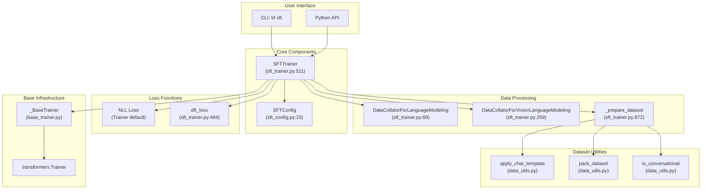

<!-- source: DeepWiki mcp.deepwiki.com · repo huggingface/trl · page 3 Supervised Fine-Tuning (SFT) · fetched 2026-10-26 -->

# Supervised Fine-Tuning (SFT)

Relevant source files

The following files were used as context for generating this wiki page:

- [docs/source/dpo_trainer.md](docs/source/dpo_trainer.md)
- [docs/source/reward_trainer.md](docs/source/reward_trainer.md)
- [docs/source/sft_trainer.md](docs/source/sft_trainer.md)
- [tests/test_cli.py](tests/test_cli.py)
- [tests/test_reward_trainer.py](tests/test_reward_trainer.py)
- [tests/test_sft_trainer.py](tests/test_sft_trainer.py)
- [trl/trainer/dpo_config.py](trl/trainer/dpo_config.py)
- [trl/trainer/kto_config.py](trl/trainer/kto_config.py)
- [trl/trainer/reward_config.py](trl/trainer/reward_config.py)
- [trl/trainer/sft_config.py](trl/trainer/sft_config.py)
- [trl/trainer/sft_trainer.py](trl/trainer/sft_trainer.py)

This document covers the Supervised Fine-Tuning (SFT) system in TRL, which provides the [`SFTTrainer`][trl/trainer/sft_trainer.py:511-1366]() class for training language models and vision-language models on supervised datasets. SFT is the foundational training method that adapts a pretrained model to a specific dataset by minimizing the negative log-likelihood of target sequences.

For details on configuration and data formats, see [SFT Configuration and Dataset Formats](#3.1). For command-line usage and examples, see [SFT Examples and Scripts](#3.2).

## Architecture Overview

The SFT system consists of three primary components: the trainer, configuration, and data collators. The trainer orchestrates the entire training process, while data collators handle batching and padding for different data modalities.

Sources: [trl/trainer/sft_trainer.py:1-1366](), [trl/trainer/sft_config.py:1-246]()

## Trainer Initialization

The `SFTTrainer` initialization process handles model loading, processing class setup, PEFT integration, and dataset preparation. The trainer accepts both string model IDs and pre-instantiated model objects.

```mermaid
graph TB
    Init["SFTTrainer.__init__<br/>(sft_trainer.py:609)"]
    
    subgraph "Configuration"
        ArgsCheck["Validate args<br/>(sft_trainer.py:627-636)"]
        DefaultConfig["Create default SFTConfig<br/>(sft_trainer.py:628-630)"]
    end
    
    subgraph "Model Loading"
        ModelStr{"model is str?"}
        LoadModel["create_model_from_path<br/>(sft_trainer.py:657)"]
        UseModel["Use provided model"]
    end
    
    subgraph "Processing Class"
        ProcClassNone{"processing_class<br/>is None?"}
        LoadProc["AutoProcessor.from_pretrained<br/>(sft_trainer.py:667)"]
        UseProc["Use provided processor"]
        CheckType{"ProcessorMixin or<br/>Tokenizer?"}
        SetVLMFlag["Set _is_vlm flag<br/>(sft_trainer.py:672-675)"]
    end
    
    subgraph "Chat Template"
        ChatPath{"chat_template_path<br/>provided?"}
        CloneTemplate["clone_chat_template<br/>(sft_trainer.py:696-698)"]
        AddedTokens["Track added_tokens"]
    end
    
    subgraph "PEFT Integration"
        PEFTConfig{"peft_config<br/>provided?"}
        SetTrainableTokens["Set trainable_token_indices<br/>(sft_trainer.py:722-725)"]
        WrapModel["get_peft_model<br/>(sft_trainer.py:737)"]
    end
    
    subgraph "Dataset Preparation"
        PrepTrain["_prepare_dataset(train)<br/>(sft_trainer.py:759)"]
        PrepEval["_prepare_dataset(eval)<br/>(sft_trainer.py:764)"]
    end
    
    Init --> ArgsCheck
    ArgsCheck --> DefaultConfig
    DefaultConfig --> ModelStr
    
    ModelStr -->|Yes| LoadModel
    ModelStr -->|No| UseModel
    
    LoadModel --> ProcClassNone
    UseModel --> ProcClassNone
    
    ProcClassNone -->|Yes| LoadProc
    ProcClassNone -->|No| UseProc
    LoadProc --> CheckType
    UseProc --> CheckType
    CheckType --> SetVLMFlag
    
    SetVLMFlag --> ChatPath
    ChatPath -->|Yes| CloneTemplate
    ChatPath -->|No| PEFTConfig
    CloneTemplate --> AddedTokens
    AddedTokens --> PEFTConfig
    
    PEFTConfig -->|Yes| SetTrainableTokens
    PEFTConfig -->|No| PrepTrain
    SetTrainableTokens --> WrapModel
    WrapModel --> PrepTrain
    
    PrepTrain --> PrepEval
```

Sources: [trl/trainer/sft_trainer.py:609-791](), [trl/trainer/utils.py:1052-1089]()

### Model and Processing Class Setup

The trainer supports both language models and vision-language models. When initialized with a string model ID, it uses `create_model_from_path` [trl/trainer/utils.py:1052-1089]() to load the model. The processing class determines whether the model is a VLM or text-only model:
- If `processing_class` is a `ProcessorMixin`, `_is_vlm = True` [trl/trainer/sft_trainer.py:672]().
- If `processing_class` is a `PreTrainedTokenizerBase`, `_is_vlm = False` [trl/trainer/sft_trainer.py:674]().

This flag controls which data collator is used and enables VLM-specific validations [trl/trainer/sft_trainer.py:702-716]().

Sources: [trl/trainer/sft_trainer.py:652-677]()

## Dataset Processing Pipeline

The `_prepare_dataset` method transforms raw datasets into tokenized, ready-to-train formats. The trainer supports standard language modeling and prompt-completion formats, in both standard and conversational layouts [docs/source/sft_trainer.md:28-47]().

Conversational datasets are automatically processed with `apply_chat_template` [trl/trainer/sft_trainer.py:907-910]() to convert messages into tokenizable strings. For more details on the processing flow, see [SFT Configuration and Dataset Formats](#3.1).

Sources: [trl/trainer/sft_trainer.py:872-962](), [docs/source/sft_trainer.md:28-47]()

## Data Collation

Data collators transform lists of examples into batched tensors. SFT provides two specialized collators:

1.  **`DataCollatorForLanguageModeling`**: Handles text-only data with support for padding, completion masking, and `padding_free` mode [trl/trainer/sft_trainer.py:89-256]().
2.  **`DataCollatorForVisionLanguageModeling`**: Handles on-the-fly tokenization and image processing for VLMs [trl/trainer/sft_trainer.py:259-492]().

For a deep dive into padding-free mode and VLM support, see [SFT Configuration and Dataset Formats](#3.1).

Sources: [trl/trainer/sft_trainer.py:89-492]()

## Loss Computation

SFT supports two primary loss types:

### Standard NLL Loss
The default loss is the negative log-likelihood computed by the base `transformers.Trainer` [trl/trainer/sft_trainer.py:1326-1344](). It uses token-level cross-entropy with a one-token shift [docs/source/sft_trainer.md:111-114]().

### DFT Loss
Dynamic Fine-Tuning (DFT) loss scales the NLL loss by the probability of each token to improve generalization [trl/trainer/sft_trainer.py:494-508]().
- Implementation: `dft_loss` [trl/trainer/sft_trainer.py:494]().
- To enable: set `loss_type="dft"` in `SFTConfig` [trl/trainer/sft_config.py:101-103]().

Sources: [trl/trainer/sft_trainer.py:494-508](), [trl/trainer/sft_config.py:101-103](), [docs/source/sft_trainer.md:100-114]()

## Advanced Features

- **Dataset Packing**: Combines multiple sequences into fixed-length blocks using strategies like `"bfd"` (best-fit decreasing) or `"wrapped"` [trl/trainer/sft_config.py:72-77]().
- **Completion-Only Loss**: Masks prompt tokens so the model only learns from the completion part [trl/trainer/sft_config.py:91-96]().
- **Assistant-Only Loss**: Specifically for conversational data, masks user/system messages to focus training on assistant turns [trl/trainer/sft_config.py:97-100]().
- **Vision-Language Model Support**: Specialized handling for multimodal inputs, though features like packing and `assistant_only_loss` are currently restricted for VLMs [trl/trainer/sft_trainer.py:702-716]().

For detailed configuration of these features, see [SFT Configuration and Dataset Formats](#3.1).

Sources: [trl/trainer/sft_config.py:72-100](), [trl/trainer/sft_trainer.py:702-716]()

---

