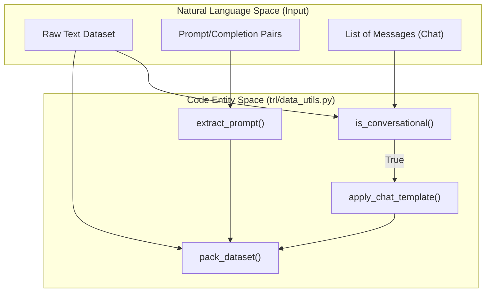
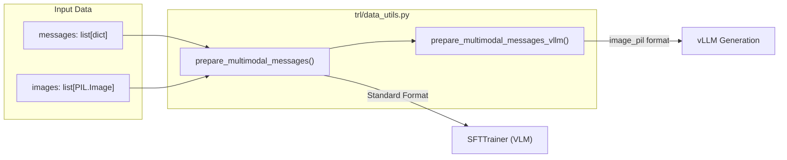

<!-- source: DeepWiki mcp.deepwiki.com · repo huggingface/trl · page 3.1 SFT Configuration and Dataset Formats · fetched 2026-10-26 -->

# SFT Configuration and Dataset Formats

Relevant source files

The following files were used as context for generating this wiki page:

- [docs/source/data_utils.md](docs/source/data_utils.md)
- [scripts/generate_tiny_models.py](scripts/generate_tiny_models.py)
- [tests/experimental/test_ppo_trainer.py](tests/experimental/test_ppo_trainer.py)
- [tests/test_data_utils.py](tests/test_data_utils.py)
- [trl/data_utils.py](trl/data_utils.py)
- [trl/trainer/dpo_config.py](trl/trainer/dpo_config.py)
- [trl/trainer/kto_config.py](trl/trainer/kto_config.py)
- [trl/trainer/reward_config.py](trl/trainer/reward_config.py)
- [trl/trainer/sft_config.py](trl/trainer/sft_config.py)

Supervised Fine-Tuning (SFT) is a critical step in the post-training pipeline where a foundation model is adapted to follow instructions or specific styles using labeled datasets. The `SFTTrainer` in TRL supports diverse dataset formats and advanced packing strategies to optimize training efficiency and memory usage.

## SFT Configuration (SFTConfig)

The `SFTConfig` class extends the standard Hugging Face `TrainingArguments` to include parameters specific to the SFT workflow. It manages how data is processed, how sequences are packed, and how the loss is calculated.

### Key Configuration Parameters

| Parameter | Type | Default | Description |
| :--- | :--- | :--- | :--- |
| `dataset_text_field` | `str` | `"text"` | Column name containing raw text for [Language Modeling](#language-modeling). [trl/trainer/sft_config.py:52-53]() |
| `packing` | `bool` | `False` | Enables grouping multiple sequences into fixed-length blocks of `max_length`. [trl/trainer/sft_config.py:72-74]() |
| `packing_strategy` | `str` | `"bfd"` | Defines the algorithm for packing: `"bfd"`, `"bfd_split"`, or `"wrapped"`. [trl/trainer/sft_config.py:75-77]() |
| `padding_free` | `bool` | `False` | Flattens batches into a single sequence to eliminate padding (requires FlashAttention). [trl/trainer/sft_config.py:78-83]() |
| `completion_only_loss` | `bool` | `None` | Computes loss only on the completion part of [Prompt-Completion](#prompt-completion) datasets. [trl/trainer/sft_config.py:91-96]() |
| `assistant_only_loss` | `bool` | `False` | Computes loss only on assistant turns in [Conversational](#conversational) datasets. [trl/trainer/sft_config.py:97-100]() |
| `loss_type` | `str` | `"nll"` | Supports standard `"nll"` or Dynamic Fine-Tuning (`"dft"`). [trl/trainer/sft_config.py:101-103]() |

**Sources:** [trl/trainer/sft_config.py:23-103]()

---

## Dataset Formats and Processing

TRL automatically detects the dataset format to apply the correct preprocessing logic. The primary detection utility is `is_conversational`. [trl/data_utils.py:28-29]()

### 1. Language Modeling
Standard text datasets where the model is trained to predict the next token across the entire sequence. The `dataset_text_field` (default `"text"`) is used to extract strings. [trl/trainer/sft_config.py:52-53]()

### 2. Prompt-Completion
Datasets containing separate `prompt` and `completion` fields. If `completion_only_loss` is enabled, the trainer masks the prompt tokens so that the loss is only calculated on the generated completion. [trl/trainer/sft_config.py:91-96]()

### 3. Conversational
Datasets consisting of a list of messages (e.g., `{"role": "user", "content": "..."}`). TRL uses `apply_chat_template` to format these into a single string. [trl/data_utils.py:26]()
*   **Assistant Only Loss:** When `assistant_only_loss=True`, TRL masks all tokens except those belonging to the `"assistant"` role. [trl/trainer/sft_config.py:97-100]()

### Data Flow Diagram: Natural Language to Code Entities

The following diagram illustrates how raw dataset structures are mapped to internal processing functions within `trl/data_utils.py`.

**Sources:** [trl/data_utils.py:26-38](), [trl/trainer/sft_config.py:52-100]()

---

## Packing Strategies

Packing improves throughput by concatenating multiple short sequences into a single `max_length` block, reducing the number of padding tokens.

### Supported Strategies
1.  **BFD (Best-Fit Decreasing):** Attempts to fit sequences into blocks to minimize wasted space. It truncates sequences that cannot fit. [trl/trainer/sft_config.py:76]()
2.  **bfd_split:** Similar to BFD, but instead of truncating, it splits overflow sequences across multiple blocks. [trl/trainer/sft_config.py:76-77]()
3.  **wrapped:** A simple, aggressive strategy that fills blocks to `max_length` by cutting sequences mid-stream and continuing them in the next block. [trl/trainer/sft_config.py:77]()

### Padding-Free Mode
When `padding_free=True`, TRL flattens the entire batch into a single sequence of shape `(1, total_tokens)`. This mode requires FlashAttention 2 or 3. If `packing="bfd"` is used, `padding_free` is automatically enabled. [trl/trainer/sft_config.py:78-83]()

---

## Multimodal Message Preparation

For Vision-Language Models (VLMs), TRL provides `prepare_multimodal_messages` to inject image placeholders and structured content into conversational data.

### Implementation Details:
*   **Placeholder Injection:** If content is a string, the function wraps it in a `{"type": "text"}` block and inserts `{"type": "image"}` placeholders before the first user message. [trl/data_utils.py:83-86]()
*   **vLLM Compatibility:** `prepare_multimodal_messages_vllm` deep-copies messages and converts `"type": "image"` to `"type": "image_pil"` for compatibility with vLLM's inference engine. [trl/data_utils.py:127-150]()

**Sources:** [trl/data_utils.py:33-124](), [trl/data_utils.py:127-150](), [tests/test_data_utils.py:48-175]()

---

