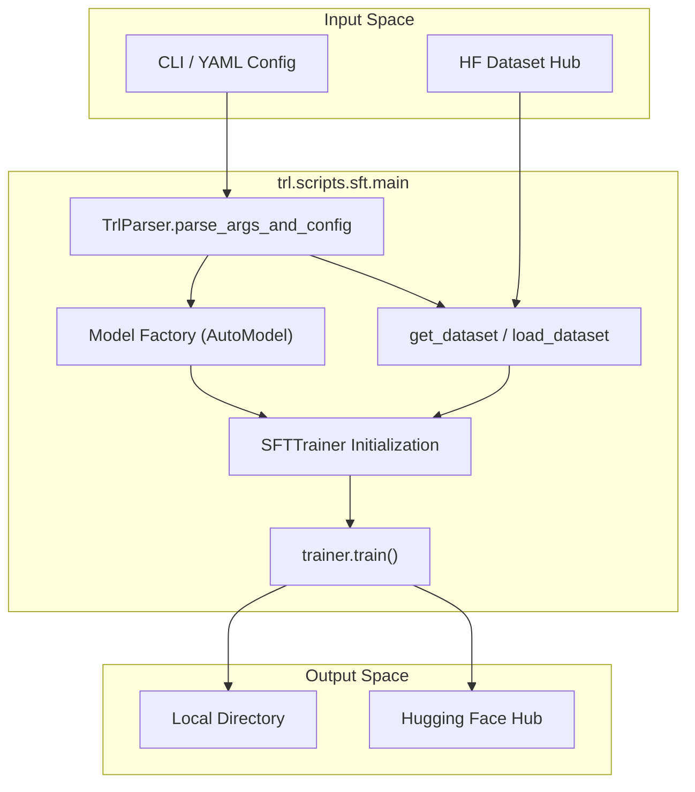

<!-- source: DeepWiki mcp.deepwiki.com · repo huggingface/trl · page 3.2 SFT Examples and Scripts · fetched 2026-10-26 -->

# SFT Examples and Scripts

Relevant source files

The following files were used as context for generating this wiki page:

- [examples/notebooks/grpo_ministral3_vl.ipynb](examples/notebooks/grpo_ministral3_vl.ipynb)
- [examples/notebooks/grpo_qwen3_vl.ipynb](examples/notebooks/grpo_qwen3_vl.ipynb)
- [examples/notebooks/grpo_rnj_1_instruct.ipynb](examples/notebooks/grpo_rnj_1_instruct.ipynb)
- [examples/notebooks/grpo_trl_lora_qlora.ipynb](examples/notebooks/grpo_trl_lora_qlora.ipynb)
- [examples/notebooks/sft_ministral3_vl.ipynb](examples/notebooks/sft_ministral3_vl.ipynb)
- [examples/notebooks/sft_qwen_vl.ipynb](examples/notebooks/sft_qwen_vl.ipynb)
- [examples/notebooks/sft_trl_lora_qlora.ipynb](examples/notebooks/sft_trl_lora_qlora.ipynb)
- [examples/scripts/dpo_vlm.py](examples/scripts/dpo_vlm.py)
- [examples/scripts/mpo_vlm.py](examples/scripts/mpo_vlm.py)
- [examples/scripts/prm.py](examples/scripts/prm.py)
- [examples/scripts/sft_gemma3.py](examples/scripts/sft_gemma3.py)
- [examples/scripts/sft_gpt_oss.py](examples/scripts/sft_gpt_oss.py)
- [examples/scripts/sft_video_llm.py](examples/scripts/sft_video_llm.py)
- [examples/scripts/sft_vlm.py](examples/scripts/sft_vlm.py)
- [examples/scripts/sft_vlm_gemma3.py](examples/scripts/sft_vlm_gemma3.py)
- [trl/scripts/dpo.py](trl/scripts/dpo.py)
- [trl/scripts/grpo.py](trl/scripts/grpo.py)
- [trl/scripts/kto.py](trl/scripts/kto.py)
- [trl/scripts/reward.py](trl/scripts/reward.py)
- [trl/scripts/rloo.py](trl/scripts/rloo.py)
- [trl/scripts/sft.py](trl/scripts/sft.py)

Supervised Fine-Tuning (SFT) is a fundamental step in post-training foundation models. TRL provides a robust suite of entry points for SFT, ranging from a unified Command Line Interface (CLI) to specialized scripts for Vision-Language Models (VLMs) and interactive Jupyter notebooks for parameter-efficient fine-tuning (PEFT).

## TRL SFT CLI

The primary entry point for training is the `trl sft` command. This CLI is powered by `TrlParser`, which automatically handles argument parsing for model configurations, training hyperparameters, and dataset mixtures [trl/scripts/sft.py:143-150]().

### Configuration Hierarchy
The CLI utilizes a multi-dataclass structure to organize parameters:
*   **`ScriptArguments`**: Basic metadata like `dataset_name` and `dataset_config` [trl/scripts/sft.py:103-116]().
*   **`SFTConfig`**: Trainer-specific settings including packing strategies and max sequence length [trl/scripts/sft.py:145]().
*   **`ModelConfig`**: Hardware and loading settings such as `attn_implementation`, `dtype`, and quantization flags [trl/scripts/sft.py:79-84]().
*   **`DatasetMixtureConfig`**: Advanced dataset loading for combining multiple sources [trl/scripts/sft.py:145]().

### CLI Usage Examples
Users can execute full fine-tuning or LoRA-based training directly from the terminal:

| Method | Command Snippet |
| :--- | :--- |
| **Full Training** | `python trl/scripts/sft.py --model_name_or_path Qwen/Qwen2-0.5B --packing --dataset_name trl-lib/Capybara` |
| **LoRA** | `python trl/scripts/sft.py --use_peft --lora_r 32 --lora_alpha 16 --model_name_or_path Qwen/Qwen2-0.5B` |

*Sources: [trl/scripts/sft.py:27-40](), [trl/scripts/sft.py:44-60]()*

---

## Canonical Script: `sft.py`

The `trl/scripts/sft.py` script serves as the reference implementation for the `SFTTrainer`. It demonstrates the lifecycle of a training run from model instantiation to Hub uploading.

### Implementation Logic
1.  **Model Loading**: It dynamically selects between `AutoModelForCausalLM` and `AutoModelForImageTextToText` based on the model's architecture [trl/scripts/sft.py:91-100]().
2.  **Quantization**: Integrates `get_quantization_config` to support 4-bit/8-bit loading via `bitsandbytes` [trl/scripts/sft.py:85-90]().
3.  **Trainer Initialization**: Configures the `SFTTrainer` with `peft_config` if requested [trl/scripts/sft.py:119-125]().
4.  **Persistence**: Automatically saves the model and pushes to the Hugging Face Hub if `push_to_hub` is enabled [trl/scripts/sft.py:134-139]().

### Data Flow Diagram
The following diagram illustrates the data flow within `sft.py`:

**SFT Script Data Flow**

*Sources: [trl/scripts/sft.py:66-140](), [trl/scripts/sft.py:155-156]()*

---

## Vision-Language Model (VLM) Scripts

TRL provides specialized scripts for multimodal training, supporting images and videos.

### `sft_vlm.py` and `sft_vlm_gemma3.py`
These scripts focus on `AutoModelForImageTextToText` architectures like LLaVA, SmolVLM, and Gemma 3.
*   **Multimodal Processing**: `sft_vlm_gemma3.py` includes custom logic to handle multi-image inputs by extracting image bytes and converting them to `PIL.Image` objects [examples/scripts/sft_vlm_gemma3.py:78-94]().
*   **Data Formatting**: Samples are converted into a `messages` format compatible with multimodal chat templates [examples/scripts/sft_vlm_gemma3.py:97-118]().
*   **Memory Efficiency**: These scripts typically use `bfloat16` and PEFT to fit large VLMs on consumer or enterprise GPUs [examples/scripts/sft_vlm.py:43-54]().

### `sft_video_llm.py`
Designed for Video-LLMs like Qwen2-VL, this script introduces:
*   **Video Caching**: A `download_video` utility to manage local copies of remote video assets [examples/scripts/sft_video_llm.py:68-87]().
*   **Temporal Collator**: A custom `collate_fn` that uses `qwen_vl_utils` to process vision info and handles visual token masking in labels (setting visual tokens to `-100`) [examples/scripts/sft_video_llm.py:119-156]().

*Sources: [examples/scripts/sft_vlm.py:28-54](), [examples/scripts/sft_vlm_gemma3.py:78-135](), [examples/scripts/sft_video_llm.py:68-156]()*

---

## LoRA and QLoRA Notebooks

For interactive environments like Google Colab, TRL provides notebooks demonstrating memory-optimized fine-tuning.

### SFT with LoRA/QLoRA
The `sft_trl_lora_qlora.ipynb` notebook demonstrates:
1.  **Quantization Setup**: Using `BitsAndBytesConfig` for 4-bit loading [examples/notebooks/sft_trl_lora_qlora.ipynb:46-60]().
2.  **PEFT Integration**: Applying `LoraConfig` to target specific modules (e.g., `q_proj`, `v_proj`) to reduce trainable parameters [examples/notebooks/sft_trl_lora_qlora.ipynb:42-49]().
3.  **Dataset Handling**: Loading datasets like `Multilingual-Thinking` and using the `messages` column for conversational SFT [examples/notebooks/sft_trl_lora_qlora.ipynb:113-134]().

### VLM Training in Notebooks
Specialized notebooks like `grpo_qwen3_vl.ipynb` show how to adapt multimodal models (e.g., Qwen3-VL) using QLoRA. They emphasize setting `padding_side="left"` in the processor, which is critical for generation-based training loops [examples/notebooks/grpo_qwen3_vl.ipynb:111-125]().

**Entity Mapping: Natural Language to Code**
| Concept | Code Entity | File Reference |
| :--- | :--- | :--- |
| CLI Entry Point | `make_parser` | [trl/scripts/sft.py:142]() |
| Argument Merger | `TrlParser` | [trl/scripts/sft.py:149]() |
| Multimodal Model | `AutoModelForImageTextToText` | [examples/scripts/sft_vlm.py:58]() |
| Video Processor | `qwen_vl_utils.process_vision_info` | [examples/scripts/sft_video_llm.py:62]() |
| LoRA Config | `peft.LoraConfig` | [examples/scripts/sft_video_llm.py:205]() |

*Sources: [examples/notebooks/sft_trl_lora_qlora.ipynb:1-134](), [examples/notebooks/grpo_qwen3_vl.ipynb:1-150]()*

---

## Experimental and Specialized Scripts

TRL includes scripts for emerging techniques and specialized data structures:
*   **PRM Training**: `examples/scripts/prm.py` trains Process Reward Models using `AutoModelForTokenClassification` and `PRMTrainer` [examples/scripts/prm.py:53-62]().
*   **KTO Alignment**: `trl/scripts/kto.py` implements Kahneman-Tversky Optimization, requiring both a `model` and a `ref_model` [trl/scripts/kto.py:81-86]().
*   **GRPO CLI**: `trl/scripts/grpo.py` provides a CLI for Group Relative Policy Optimization, featuring a `reward_funcs_registry` to handle diverse reward types like `accuracy_reward` and `think_format_reward` [trl/scripts/grpo.py:83-88]().

*Sources: [examples/scripts/prm.py:24-48](), [trl/scripts/kto.py:111-119](), [trl/scripts/grpo.py:83-88]()*

---

