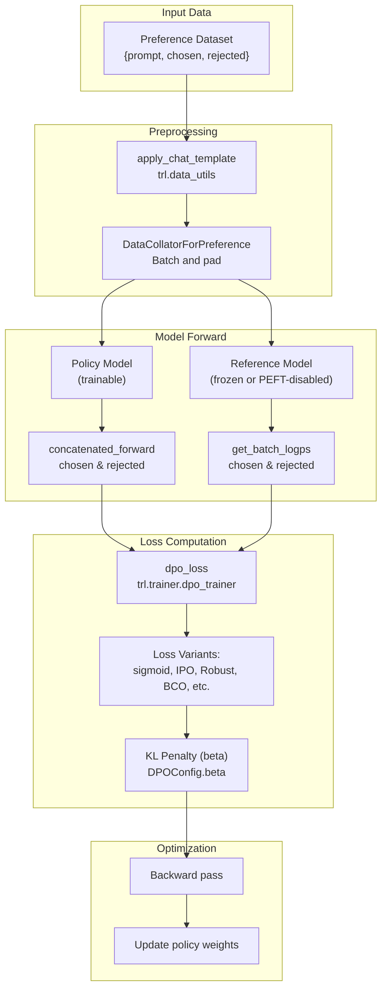

<!-- source: DeepWiki mcp.deepwiki.com · repo huggingface/trl · page 4 Direct Preference Optimization (DPO) · fetched 2026-10-26 -->

# Direct Preference Optimization (DPO)

Relevant source files

The following files were used as context for generating this wiki page:

- [docs/source/dpo_trainer.md](docs/source/dpo_trainer.md)
- [docs/source/reward_trainer.md](docs/source/reward_trainer.md)
- [docs/source/sft_trainer.md](docs/source/sft_trainer.md)
- [tests/test_dpo_trainer.py](tests/test_dpo_trainer.py)
- [trl/trainer/dpo_config.py](trl/trainer/dpo_config.py)
- [trl/trainer/dpo_trainer.py](trl/trainer/dpo_trainer.py)
- [trl/trainer/kto_config.py](trl/trainer/kto_config.py)
- [trl/trainer/kto_trainer.py](trl/trainer/kto_trainer.py)
- [trl/trainer/reward_config.py](trl/trainer/reward_config.py)
- [trl/trainer/reward_trainer.py](trl/trainer/reward_trainer.py)
- [trl/trainer/sft_config.py](trl/trainer/sft_config.py)

This page documents the Direct Preference Optimization (DPO) training method in TRL, including the `DPOTrainer`, `DPOConfig`, loss types, reference model handling, and advanced features like PEFT integration, Liger kernel optimization, and padding-free training.

For supervised fine-tuning without preference data, see [Supervised Fine-Tuning (SFT)](#3). For outcome-supervised reward modeling, see [Reward Modeling](#4.2).

---

## Overview

Direct Preference Optimization (DPO) is an offline preference learning method that directly optimizes a language model based on human preference data, without requiring a separate reward model or reinforcement learning loop. Unlike RLHF approaches that train a reward model then optimize a policy with RL (e.g., PPO), DPO reparameterizes the reward model as a function of the policy itself, enabling direct optimization from preference pairs.

**Key characteristics:**
- **Offline training**: Uses precomputed preference pairs (chosen vs. rejected completions).
- **No reward model**: Implicitly defines rewards through the policy and reference model.
- **Stable training**: Avoids instabilities common in RL-based methods.
- **Multiple loss variants**: Supports 12+ loss formulations including sigmoid, IPO, and robust variants.

**Original paper**: [Direct Preference Optimization: Your Language Model is Secretly a Reward Model](https://huggingface.co/papers/2305.18290)

Sources: [trl/trainer/dpo_trainer.py:189-269](), [docs/source/dpo_trainer.md:7-13]()

---

## Architecture Overview

### High-Level Training Flow

Sources: [trl/trainer/dpo_trainer.py:1215-1420](), [trl/trainer/dpo_trainer.py:1639-1934](), [trl/trainer/dpo_trainer.py:1422-1511]()

---

## Core Components

### DPOTrainer Class

The `DPOTrainer` handles preference data processing, reference model management, loss computation, and gradient updates. It is designed to be a drop-in replacement for the standard `Trainer` when working with preference data.

**Key methods:**

| Method | Purpose | File Reference |
|--------|---------|----------------|
| `__init__` | Initialize trainer with model, ref_model, config | [trl/trainer/dpo_trainer.py:271-560]() |
| `get_batch_loss_metrics` | Compute DPO loss and metrics for a batch | [trl/trainer/dpo_trainer.py:1215-1420]() |
| `concatenated_forward` | Forward pass for both chosen/rejected in one batch | [trl/trainer/dpo_trainer.py:1422-1511]() |
| `get_batch_logps` | Compute log probabilities for completions | [trl/trainer/dpo_trainer.py:1513-1637]() |
| `dpo_loss` | Central implementation of the various loss types | [trl/trainer/dpo_trainer.py:1639-1934]() |

Sources: [trl/trainer/dpo_trainer.py:189-252]()

### DPOConfig Class

`DPOConfig` extends `TrainingArguments` with parameters specific to preference optimization.

**Key Parameters:**
- `loss_type`: Type of loss (e.g., `"sigmoid"`, `"ipo"`, `"robust"`, `"discopop"`, `"sppo_hard"`) [trl/trainer/dpo_config.py:72-76]().
- `beta`: Parameter controlling deviation from the reference model (default `0.1`) [trl/trainer/dpo_config.py:95-98]().
- `precompute_ref_log_probs`: Whether to pre-calculate reference logprobs to save memory [trl/trainer/dpo_config.py:61-64]().
- `sync_ref_model`: Whether to use TR-DPO style reference model synchronization [trl/trainer/dpo_config.py:107-111]().
- `padding_free`: Enables padding-free training with FlashAttention [trl/trainer/dpo_config.py:55-58]().

Sources: [trl/trainer/dpo_config.py:23-236]()

---

## Loss Variants and Reference Models

DPO in TRL supports a wide variety of loss functions and reference model strategies.

### Loss Variants
- **Sigmoid**: The standard DPO loss.
- **IPO**: Regularized DPO that avoids overfitting to preference pairs.
- **Robust DPO**: Incorporates label smoothing for noisy preference data.
- **DiscoPOP**: Log-ratio modulated loss using `discopop_tau`.
- **SPPO**: Self-Play Preference Optimization variants.
- **LD-DPO**: Weighted verbose token log-probabilities via `ld_alpha`.

For a deep dive into these variants, including `f-divergence` regularizers and TR-DPO synchronization, see **[DPO Loss Variants and Reference Model](#4.1)**.

Sources: [trl/trainer/dpo_config.py:72-104](), [trl/trainer/dpo_trainer.py:1639-1934]()

---

## Data and Preprocessing

### DataCollatorForPreference
The `DataCollatorForPreference` handles batching and padding. It expects dictionaries containing `"prompt_ids"`, `"chosen_ids"`, and `"rejected_ids"` [trl/trainer/dpo_trainer.py:92-106](). It also supports vision-language data through `DataCollatorForVisionPreference` [trl/trainer/dpo_trainer.py:906-918]().

### Vision-Language Models (VLM)
`DPOTrainer` supports multimodal preference alignment. It utilizes `prepare_multimodal_messages` to process images and text turns [trl/trainer/dpo_trainer.py:846-904]().

Sources: [trl/trainer/dpo_trainer.py:108-187](), [trl/trainer/dpo_trainer.py:920-1014]()

---

## Memory and Performance Optimization

TRL includes several features to optimize the training of large models with DPO:

- **Precompute Reference Log Probs**: By setting `precompute_ref_log_probs=True`, the reference model is only loaded once at the start of training to cache logprobs, then removed from memory [trl/trainer/dpo_config.py:61-64]().
- **Liger Kernel Integration**: DPO can use `LigerFusedLinearDPOLoss` to reduce memory usage by fusing the linear layer and loss computation [trl/trainer/dpo_trainer.py:71-72]().
- **Padding-Free Training**: Eliminates padding overhead by flattening sequences, supported with FlashAttention [trl/trainer/dpo_config.py:55-58]().
- **Activation Offloading**: Allows offloading activations to the CPU to save GPU VRAM [trl/trainer/dpo_config.py:105-106]().

Sources: [trl/trainer/dpo_trainer.py:391-409](), [trl/trainer/dpo_trainer.py:1297-1397]()

---

## Child Pages

- **[DPO Loss Variants and Reference Model](#4.1)**: Detailed documentation on loss functions (sigmoid, IPO, EXO, SPPO, etc.), f-divergence regularizers, WPO weighting, LD-DPO, reference model caching, and TR-DPO.
- **[Reward Modeling](#4.2)**: Guide to training explicit reward models (ORM) using `RewardTrainer`, including dataset formats and centering rewards.

Sources: [trl/trainer/dpo_trainer.py:1-50](), [trl/trainer/reward_trainer.py:1-50]()

---

