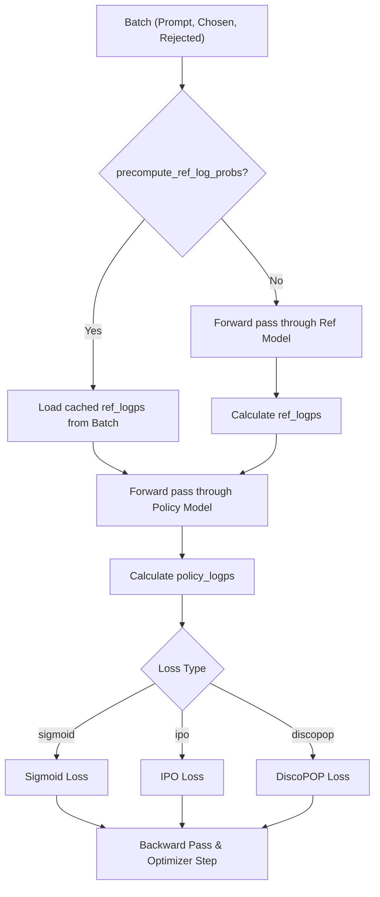
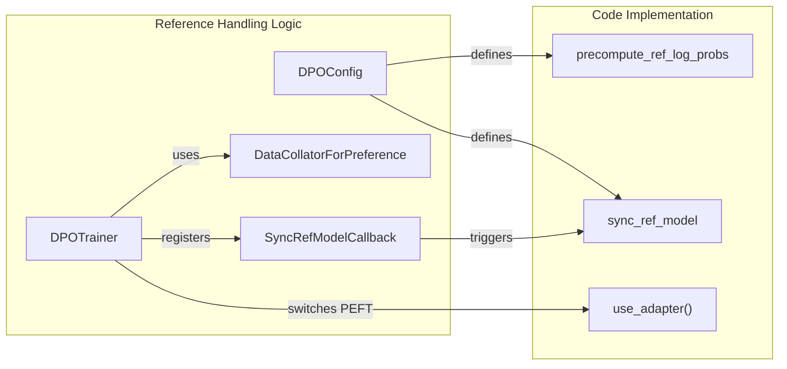

<!-- source: DeepWiki mcp.deepwiki.com · repo huggingface/trl · page 4.1 DPO Loss Variants and Reference Model · fetched 2026-10-26 -->

# DPO Loss Variants and Reference Model

Relevant source files

The following files were used as context for generating this wiki page:

- [tests/test_dpo_trainer.py](tests/test_dpo_trainer.py)
- [trl/trainer/dpo_config.py](trl/trainer/dpo_config.py)
- [trl/trainer/dpo_trainer.py](trl/trainer/dpo_trainer.py)
- [trl/trainer/kto_config.py](trl/trainer/kto_config.py)
- [trl/trainer/kto_trainer.py](trl/trainer/kto_trainer.py)
- [trl/trainer/reward_config.py](trl/trainer/reward_config.py)
- [trl/trainer/reward_trainer.py](trl/trainer/reward_trainer.py)
- [trl/trainer/sft_config.py](trl/trainer/sft_config.py)

The `DPOTrainer` in TRL implements Direct Preference Optimization (DPO) and its numerous derivatives. This implementation supports a wide array of loss functions, regularization techniques, and memory optimization strategies like reference log-probability caching and PEFT adapter switching.

## DPO Loss Variants

The `DPOTrainer` supports multiple loss functions via the `loss_type` parameter in `DPOConfig` [trl/trainer/dpo_config.py:72-76](). While the standard DPO uses a sigmoid-based Bradley-Terry model, TRL includes several research-driven variants.

### Core Loss Types

| Loss Type | Description | Reference |
| :--- | :--- | :--- |
| `sigmoid` | The standard DPO loss using a sigmoid cross-entropy. | [trl/trainer/dpo_config.py:72]() |
| `ipo` | Identity Preference Optimization; adds a regularizer to prevent overfitting. | [trl/trainer/dpo_config.py:73]() |
| `hinge` | Uses a hinge loss on the log-probability differences. | [trl/trainer/dpo_config.py:73]() |
| `exo_pair` | Essential Cross-Entropy Optimization for paired data. | [trl/trainer/dpo_config.py:73]() |
| `discopop` | Modulates the loss shape using a temperature parameter `discopop_tau`. | [trl/trainer/dpo_config.py:102]() |
| `sppo_hard` | Soft Preference Optimization variant. | [trl/trainer/dpo_config.py:74]() |
| `aot` / `aot_unpaired` | All-Odds-Teaming loss variants. | [trl/trainer/dpo_config.py:74]() |
| `apo_zero` / `apo_down` | Adversarial Preference Optimization variants. | [trl/trainer/dpo_config.py:74]() |

### Multi-Loss Combinations
TRL allows combining multiple loss types by passing a list to `loss_type` and corresponding weights to `loss_weights` [trl/trainer/dpo_config.py:72-80]().

### Regularization and Weighting
*   **f-divergence:** Users can choose different f-divergence regularizers (e.g., `reverse_kl`, `forward_kl`, `js_divergence`, `alpha_divergence`) via `f_divergence_type` [trl/trainer/dpo_config.py:85-87]().
*   **WPO Weighting:** Enabling `use_weighting` applies WPO-style weighting to preference pairs using length-normalized sequence probabilities [trl/trainer/dpo_config.py:99-101]().
*   **LD-DPO:** The `ld_alpha` parameter controls the weighting of verbose token log-probabilities, masking tokens beyond shared lengths if set to `0.0` [trl/trainer/dpo_config.py:80-84]().

## Reference Model Management

DPO requires a reference model (typically the SFT model) to calculate log-probability ratios. TRL provides several ways to handle this model to optimize memory and compute.

### Precomputing Log Probabilities
To save GPU memory, `DPOTrainer` can precompute the reference model's log probabilities for the entire dataset before training begins [trl/trainer/dpo_config.py:61-64]().
*   **Mechanism:** When `precompute_ref_log_probs=True`, the trainer iterates through the dataset using `precompute_ref_batch_size`, stores the log-probs, and then deletes the reference model from memory [trl/trainer/dpo_config.py:65-68]().
*   **Data Flow:** The `DataCollatorForPreference` detects these precomputed values (`ref_chosen_logps`, `ref_rejected_logps`) and includes them in the training batch [trl/trainer/dpo_trainer.py:104-105]().

### PEFT and Adapter Switching
When using PEFT (LoRA), TRL avoids loading two full models. Instead, it uses a single base model and switches adapters.
*   **Adapter Switching:** The active model uses the trained adapter, while the reference log-probs are calculated by disabling the adapter or using a specific "reference" adapter via the `use_adapter` utility [trl/trainer/utils.py:63]().

### TR-DPO: Synchronized Reference Model
TRL implements TR-DPO (Trust Region DPO), where the reference model is periodically updated to match the active model [trl/trainer/dpo_config.py:107-111]().
*   **Mechanism:** Controlled by `sync_ref_model=True` and `ref_model_sync_steps`.
*   **Mixing:** The update uses `ref_model_mixup_alpha` to perform a soft update (Polyak averaging) of the reference weights [trl/trainer/dpo_config.py:112-113]().
*   **Implementation:** Handled via the `SyncRefModelCallback` [trl/trainer/callbacks.py:52]().

## Data Flow and Logic

The following diagram illustrates how the `DPOTrainer` processes a batch and selects the loss calculation path based on configuration.

### DPO Training Logic Flow

**Sources:** [trl/trainer/dpo_trainer.py:92-143](), [trl/trainer/dpo_config.py:47-113]()

### Code Entity Relationship: Reference Model Handling
This diagram maps the natural language concept of "Reference Model Handling" to specific code entities within TRL.

**Sources:** [trl/trainer/dpo_trainer.py:51-64](), [trl/trainer/dpo_config.py:23-113](), [trl/trainer/callbacks.py:52]()

## Technical Implementation Details

### Data Collator
The `DataCollatorForPreference` handles the concatenation of prompt and completion for both chosen and rejected sequences. It returns a dictionary containing `input_ids`, `attention_mask`, and `completion_mask` [trl/trainer/dpo_trainer.py:92-102]().

### Memory Optimization: Liger Kernels
For supported architectures, TRL integrates `liger_kernel` to provide a fused linear DPO loss, significantly reducing memory overhead during the backward pass [trl/trainer/dpo_trainer.py:71-72]().

### LD-DPO Alpha Calculation
When `ld_alpha` is specified, the trainer calculates the length of the shared prefix between chosen and rejected responses. Tokens within the shared length are weighted normally, while tokens in the "verbose" or diverging part are scaled by `ld_alpha` [trl/trainer/dpo_config.py:80-84]().

**Sources:**
*   `trl/trainer/dpo_trainer.py` [lines 71-143]()
*   `trl/trainer/dpo_config.py` [lines 23-113]()
*   `trl/trainer/utils.py` [lines 62-64]()
*   `trl/trainer/callbacks.py` [line 52]()

---

