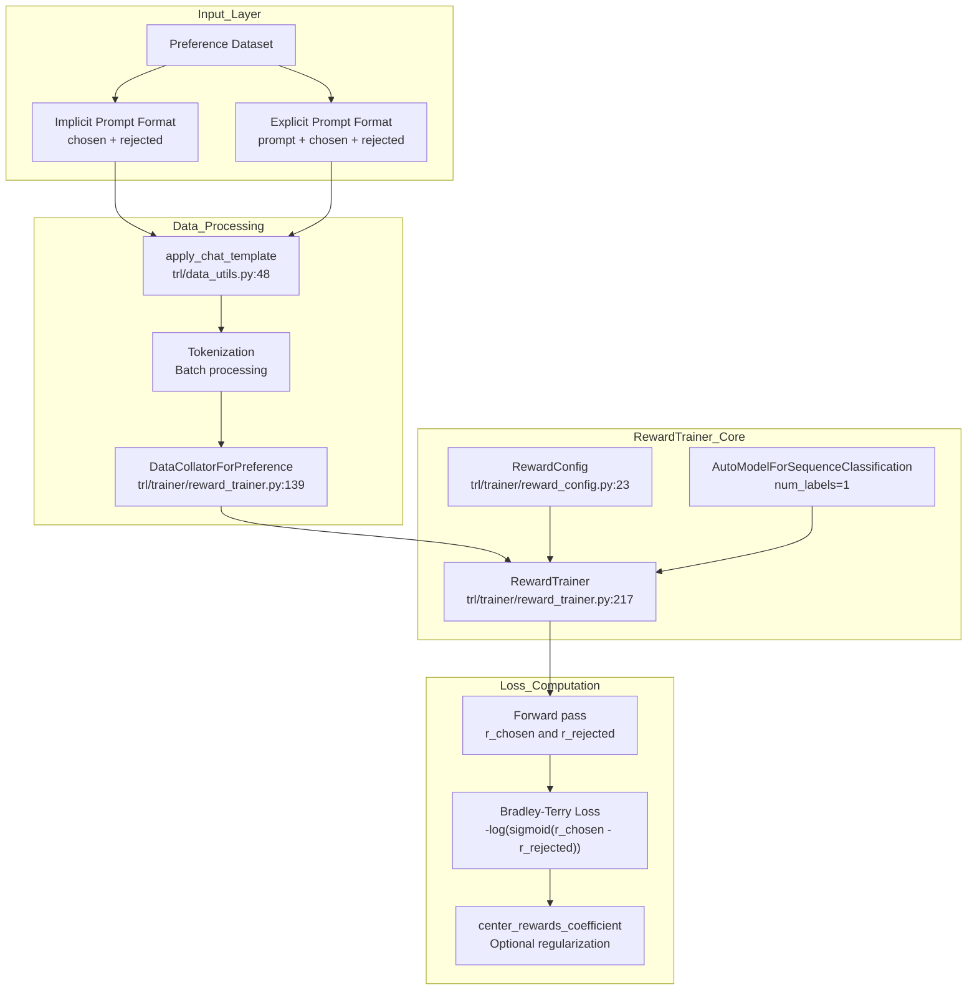
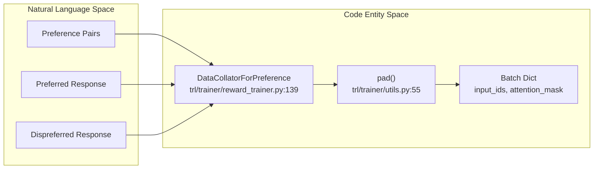
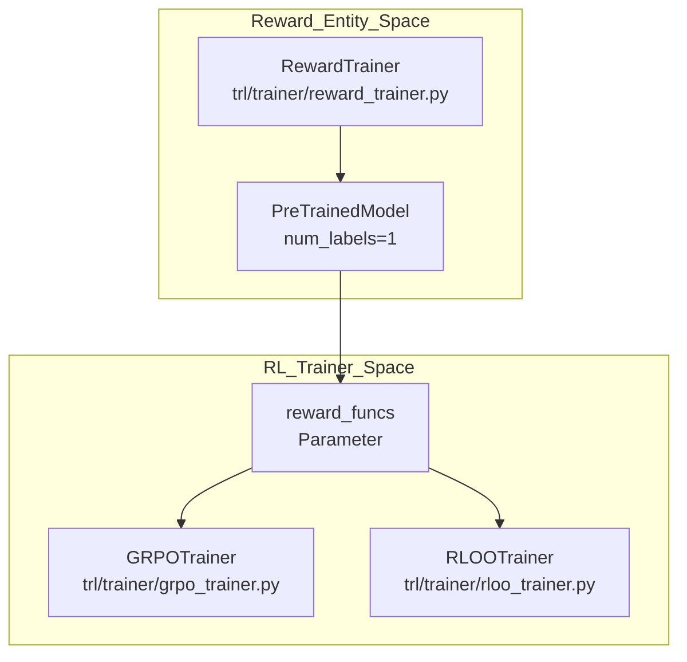

<!-- source: DeepWiki mcp.deepwiki.com · repo huggingface/trl · page 4.2 Reward Modeling · fetched 2026-10-26 -->

# Reward Modeling

Relevant source files

The following files were used as context for generating this wiki page:

- [docs/source/dpo_trainer.md](docs/source/dpo_trainer.md)
- [docs/source/reward_trainer.md](docs/source/reward_trainer.md)
- [docs/source/sft_trainer.md](docs/source/sft_trainer.md)
- [tests/test_dpo_trainer.py](tests/test_dpo_trainer.py)
- [trl/trainer/dpo_config.py](trl/trainer/dpo_config.py)
- [trl/trainer/dpo_trainer.py](trl/trainer/dpo_trainer.py)
- [trl/trainer/kto_config.py](trl/trainer/kto_config.py)
- [trl/trainer/kto_trainer.py](trl/trainer/kto_trainer.py)
- [trl/trainer/reward_config.py](trl/trainer/reward_config.py)
- [trl/trainer/reward_trainer.py](trl/trainer/reward_trainer.py)
- [trl/trainer/sft_config.py](trl/trainer/sft_config.py)

The `RewardTrainer` class trains outcome-supervised reward models (ORM) that score text outputs based on human preference data. These models output a single scalar reward score per sequence and serve as the foundation for reinforcement learning-based training methods like GRPO and RLOO.

## Overview

The reward trainer implements the Bradley-Terry preference model, training a sequence classification model to predict which of two responses is preferred. The model architecture typically uses `AutoModelForSequenceClassification` with `num_labels=1`, outputting a scalar reward score for each input sequence [trl/trainer/reward_trainer.py:37-40]().

### Core Components

**RewardTrainer Architecture**

Sources: [trl/trainer/reward_trainer.py:217-303](), [trl/trainer/reward_trainer.py:139-215](), [trl/trainer/reward_config.py:23-90]()

## Dataset Formats

The `RewardTrainer` supports preference datasets in two formats: implicit prompt and explicit prompt. Both formats work with standard (string-based) and conversational (message-based) data [docs/source/reward_trainer.md:28-52]().

### Implicit Prompt Format
The prompt is embedded within both `chosen` and `rejected` responses. The trainer automatically extracts the common prompt prefix using `maybe_extract_prompt` (inherited or internal logic) [trl/trainer/reward_trainer.py:51]().

### Explicit Prompt Format
The prompt is provided separately from the chosen and rejected completions. This is the recommended format to avoid extraction errors.

| Format | Detection Method | Processing Function |
|--------|-----------------|---------------------|
| Conversational | Checks if values are lists of dicts | `is_conversational` [trl/data_utils.py:48]() |
| Preference Pair | Checks for "chosen" and "rejected" keys | `DataCollatorForPreference` [trl/trainer/reward_trainer.py:139]() |

Sources: [trl/trainer/reward_trainer.py:139-215](), [docs/source/reward_trainer.md:28-52]()

## DataCollatorForPreference

The `DataCollatorForPreference` class handles batching and padding of preference data. It expects dictionaries containing `"chosen_ids"` and `"rejected_ids"` [trl/trainer/reward_trainer.py:143-144]().

**Natural Language to Code Entity Space**

### Collator Implementation
The `torch_call` method [trl/trainer/reward_trainer.py:188-214]() performs:
1. **Concatenation**: Combines chosen and rejected sequences into a single list.
2. **Padding**: Uses `pad` to create uniform-length sequences [trl/trainer/reward_trainer.py:55]().
3. **Margin Handling**: Includes an optional `"margin"` key if present in the dataset [trl/trainer/reward_trainer.py:149-150]().

Sources: [trl/trainer/reward_trainer.py:139-215](), [tests/test_dpo_trainer.py:42-80]()

## Loss Computation

The `RewardTrainer` computes the loss based on the Bradley-Terry model [docs/source/reward_trainer.md:122-128]().

### Bradley-Terry Loss
The model processes chosen and rejected responses. The loss is defined as:
`loss = -log(sigmoid(rewards_chosen - rewards_rejected - margin))` [docs/source/reward_trainer.md:127-128]().

### center_rewards_coefficient
Proposed by [Gao et al. (2023)](https://huggingface.co/papers/2312.09244), this adds an auxiliary loss to keep rewards mean-zero [trl/trainer/reward_config.py:67-69]().
- **Parameter**: `center_rewards_coefficient` in `RewardConfig` [trl/trainer/reward_config.py:148-154]().
- **Recommended Value**: `0.01` [trl/trainer/reward_config.py:69]().

Sources: [trl/trainer/reward_trainer.py:217-303](), [trl/trainer/reward_config.py:148-154](), [docs/source/reward_trainer.md:122-132]()

## Integration with RL Trainers

Trained reward models serve as external reward functions for trainers like `GRPOTrainer` and `RLOOTrainer`.

**RL Trainer Integration**

### Usage in GRPO/RLOO
RL trainers accept reward models in the `reward_funcs` list. The trainers handle the forward pass of these models to calculate advantages for policy updates.

Sources: [trl/trainer/reward_trainer.py:309-368](), [docs/source/reward_trainer.md:7-13]()

## Configuration

`RewardConfig` inherits from `_BaseConfig` and includes parameters for sequence classification [trl/trainer/reward_config.py:23]().

### Key Parameters
- `max_length`: Maximum sequence length; samples exceeding this are filtered [trl/trainer/reward_config.py:60-61]().
- `model_init_kwargs`: Arguments for `from_pretrained` when loading from a string [trl/trainer/reward_config.py:101-109]().
- `center_rewards_coefficient`: Scaling factor for reward centering [trl/trainer/reward_config.py:148-154]().

Sources: [trl/trainer/reward_config.py:23-160](), [trl/trainer/reward_trainer.py:54]()

---

