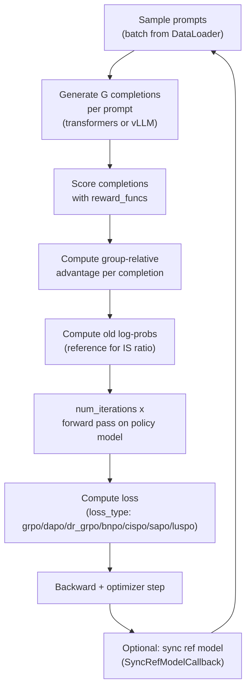
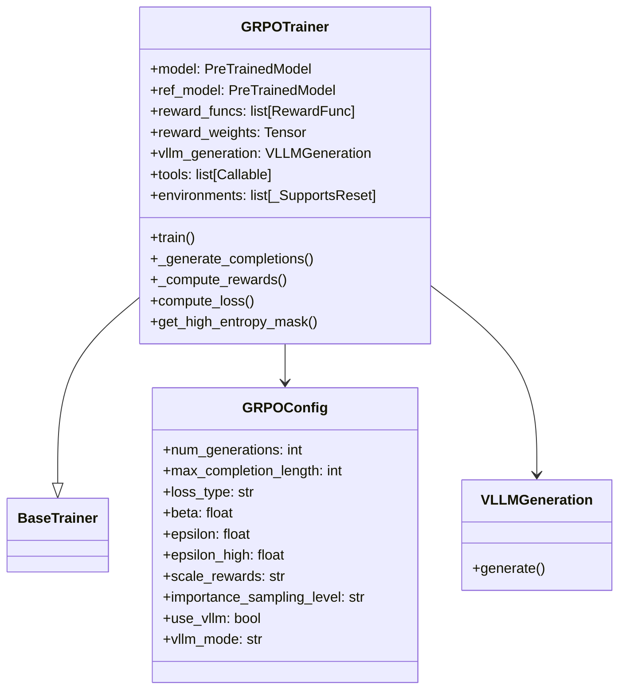

<!-- source: DeepWiki mcp.deepwiki.com · repo huggingface/trl · page 5 Group Relative Policy Optimization (GRPO) · fetched 2026-10-26 -->

# Group Relative Policy Optimization (GRPO)

<details>
<summary>Relevant source files</summary>

The following files were used as context for generating this wiki page:

- [docs/source/grpo_trainer.md](docs/source/grpo_trainer.md)
- [docs/source/paper_index.md](docs/source/paper_index.md)
- [docs/source/rloo_trainer.md](docs/source/rloo_trainer.md)
- [tests/test_grpo_trainer.py](tests/test_grpo_trainer.py)
- [tests/test_rloo_trainer.py](tests/test_rloo_trainer.py)
- [trl/trainer/grpo_config.py](trl/trainer/grpo_config.py)
- [trl/trainer/grpo_trainer.py](trl/trainer/grpo_trainer.py)
- [trl/trainer/rloo_config.py](trl/trainer/rloo_config.py)
- [trl/trainer/rloo_trainer.py](trl/trainer/rloo_trainer.py)

</details>


This page covers the `GRPOTrainer` and `GRPOConfig` classes: how the GRPO algorithm works, the supported loss variants, reward function types, advantage computation, KL penalty, vLLM integration, tool calling, and off-policy training.

For information about the REINFORCE Leave-One-Out trainer, which has a similar structure but different advantage estimation, see [REINFORCE Leave-One-Out (RLOO)](#6). For vLLM integration details shared across trainers, see [Distributed Training Strategies](#9.2).

---

## Overview

GRPO (Group Relative Policy Optimization) is an online RL fine-tuning algorithm introduced in [DeepSeekMath](https://huggingface.co/papers/2402.03300). At each step the model generates multiple completions per prompt, scores them with one or more reward functions, computes a group-relative advantage, and optimizes the policy with a clipped surrogate objective — optionally with a KL penalty against a reference model.

The core implementation lives in two files:

| File | Purpose |
|---|---|
| `trl/trainer/grpo_trainer.py` | `GRPOTrainer` class — training loop, generation, reward, loss |
| `trl/trainer/grpo_config.py` | `GRPOConfig` dataclass — all hyperparameters |

The trainer extends `BaseTrainer` (from `trl/trainer/base_trainer.py`) and is launched with `accelerate launch`.

---

## Training Loop Architecture

**Diagram: GRPOTrainer training loop**



Sources: `trl/trainer/grpo_trainer.py` [trl/trainer/grpo_trainer.py:129-155]()

---

## Key Classes

**Diagram: Class relationships**



Sources: `trl/trainer/grpo_trainer.py:129-246`(), `trl/trainer/grpo_config.py:22-314`()

---

## Dataset Format

The training dataset must contain a `"prompt"` column. Each sample can be in either:

- **Standard format**: plain text string in the `"prompt"` field
- **Conversational format**: a list of chat messages (role/content dicts)

Additional dataset columns are forwarded as keyword arguments to custom reward functions. The `remove_unused_columns` parameter defaults to `False` in `GRPOConfig` specifically to preserve these extra columns.

```
# Standard
{"prompt": "What is 2+2?"}

# Conversational
{"prompt": [{"role": "user", "content": "What is 2+2?"}]}
```

`IterableDataset` is not supported by `GRPOTrainer`.

Sources: `trl/trainer/grpo_trainer.py:555-568`(), `trl/trainer/grpo_config.py:349-388`()

---

## Reward Functions

The `RewardFunc` type alias is defined as:

```python
RewardFunc = str | PreTrainedModel | Callable[..., list[float | None]]
```
[trl/trainer/grpo_trainer.py:114-118]()

Three kinds of reward functions are supported, and they can be mixed in a list:

| Type | How it's specified | How it's loaded |
|---|---|---|
| Model ID string | `"org/model-id"` | Loaded via `AutoModelForSequenceClassification.from_pretrained` with `num_labels=1` |
| `PreTrainedModel` | An instantiated sequence classification model | Used directly |
| Python callable | Any function `(completions, **kwargs) -> list[float \| None]` | Called directly; supports `async` |

For details, see [GRPO Reward Functions](#5.1).

**Multi-reward aggregation** is controlled by `multi_objective_aggregation` in `GRPOConfig`:
- `"sum_then_normalize"` (default): rewards are summed, then normalized as a group.
- `"normalize_then_sum"`: each reward source is normalized within its group first, then summed.

**Reward weights** can be set with `reward_weights` in `GRPOConfig`. Defaults to equal weighting.

**`None` returns**: a reward function may return `None` for a sample. That function is excluded from the reward calculation for that sample — useful for multi-task training where not all reward functions apply to all samples.

Sources: `trl/trainer/grpo_trainer.py:366-419`(), `trl/trainer/grpo_config.py:193-205`()

---

## Advantage Calculation with Group Normalization

The advantage for each completion is computed relative to the group of `G` completions generated for the same prompt.

$$\hat{A}_{i,t} = \frac{r_i - \text{mean}(\mathbf{r})}{\text{std}(\mathbf{r})}$$

The `scale_rewards` parameter in `GRPOConfig` controls the denominator:

| `scale_rewards` value | Behavior |
|---|---|
| `True` or `"group"` (default) | std computed within each group of G completions |
| `"batch"` | std computed across the entire batch (PPO Lite approach) |
| `False` or `"none"` | no std scaling (Dr. GRPO recommendation to avoid difficulty bias) |

`importance_sampling_level` determines how the policy ratio is computed:
- `"token"` (default): per-token log-prob ratios.
- `"sequence"`: geometric-mean ratio across all tokens in a sequence (GSPO approach).

Sources: `trl/trainer/grpo_config.py:186-215`(), `docs/source/grpo_trainer.md:60-77`()

---

## KL Penalty

When `beta > 0.0`, a KL divergence term is added to the loss to penalize deviation from the reference policy. The estimator is from [Schulman et al. (2020)](http://joschu.net/blog/kl-approx.html):

$$\mathbb{D}_{\text{KL}}\left[\pi_\theta \|\pi_{\text{ref}}\right] = \frac{\pi_{\text{ref}}(o_{i,t})}{\pi_\theta(o_{i,t})} - \log \frac{\pi_{\text{ref}}(o_{i,t})}{\pi_\theta(o_{i,t})} - 1$$

**`beta = 0.0` (default)**: The reference model is not loaded at all, saving memory. This follows current practice from DeepSeek-R1 and DAPO.

**Reference model setup** depends on the model type:
- **PEFT / LoRA model**: `ref_model = None`; reference computed by disabling the adapter.
- **Full model, `beta > 0.0`**: `ref_model` loaded from the same checkpoint.

For PEFT models, a `"ref"` adapter is copied from the `"default"` adapter at init time so the original weights can be recovered without a separate model instance.

Sources: `trl/trainer/grpo_trainer.py:611-660`(), `trl/trainer/grpo_config.py:164-296`()

---

## Loss Variants and Clipping

GRPO supports seven loss variants that differ in how they normalize the surrogate objective and handle sequence lengths.

| `loss_type` | Normalization Strategy | Notes |
|---|---|---|
| `"grpo"` | Per-sequence, by `1/\|o_i\|` | Original DeepSeekMath formulation; has length bias |
| `"dr_grpo"` | Global constant `max_completion_length * G` | Dr. GRPO (2503.20783); eliminates length bias |
| `"dapo"` (default) | Total active tokens in accumulated batch | DAPO (2503.14476); eliminates length bias |
| `"bnpo"` | Active tokens in local batch only | Similar to DAPO, but local scope |
| `"cispo"` | Active tokens; clips IS weights | MiniMax-M1 (2506.13585); uses `epsilon_high` |
| `"sapo"` | Per-sequence | SAPO (2511.20347); uses sigmoid gating |
| `"luspo"` | Sequence-level, scaled by length | LUSPO (2602.05261); requires `importance_sampling_level="sequence"` |

For details, see [GRPO Loss Variants and Clipping](#5.2).

Sources: `trl/trainer/grpo_config.py:216-243`(), `docs/source/grpo_trainer.md:111-166`()

---

## vLLM Integration Modes

Generation is typically the bottleneck in online RL. `use_vllm=True` enables vLLM-accelerated generation. Two modes are supported via `vllm_mode`:

**Diagram: vLLM mode architectures**

```mermaid
flowchart LR
    subgraph "server mode (vllm_mode=\"server\")"
        T1["GRPOTrainer\n(training GPUs)"] -- "HTTP request\n(prompts)" --> V1["vLLM server\n(separate GPUs)\ntrl vllm-serve"]
        V1 -- "completions + logprobs" --> T1
        T1 -- "NCCL weight sync\n(WeightSyncWorkerExtension)" --> V1
    end
    subgraph "colocate mode (vllm_mode=\"colocate\")"
        T2["GRPOTrainer\n(training)"] -- "shared GPU memory" --> V2["VLLMGeneration\n(same process)"]
        V2 -- "completions + logprobs" --> T2
    end
```

### Importance Sampling Correction
Because vLLM and the training engine can produce different token probabilities for the same weights, `vllm_importance_sampling_correction=True` applies correction based on `vllm_importance_sampling_mode` (e.g., `"sequence_mask"`, `"token_truncate"`) capped by `vllm_importance_sampling_cap`.

Sources: `trl/trainer/grpo_config.py:110-161`(), `trl/trainer/grpo_trainer.py:702-711`(), `docs/source/grpo_trainer.md:266-294`()

---

## Memory Optimization Techniques

1. **`beta=0.0`**: Disables reference model loading, halving VRAM usage for full fine-tuning.
2. **PEFT Integration**: Use LoRA to train only a small fraction of parameters.
3. **vLLM Sleep Mode**: `vllm_enable_sleep_mode=True` offloads vLLM weights during the optimizer step to free VRAM.
4. **Liger Kernel**: `use_liger_kernel=True` uses `LigerFusedLinearGRPOLoss` for memory-efficient fused operations.
5. **Entropy-Based Masking**: `top_entropy_quantile` focuses updates on high-uncertainty tokens, though primarily a performance optimization, it interacts with loss calculation density.

Sources: `trl/trainer/grpo_trainer.py:535-553`(), `trl/trainer/grpo_config.py:261-266`()

---

## Off-Policy Training and num_iterations

By default, GRPO is on-policy. Two parameters enable off-policy training:
- **`num_iterations`**: μ parameter. How many gradient updates to apply to each generated batch. When > 1, the clipped surrogate objective prevents policy drift.
- **`steps_per_generation`**: Number of optimizer steps per generation round. Defaults to `gradient_accumulation_steps`.

Sources: `trl/trainer/grpo_trainer.py:577-584`(), `trl/trainer/grpo_config.py:392-408`()

---

## Minimal Usage Example

```python
from datasets import load_dataset
from trl import GRPOConfig, GRPOTrainer
from trl.rewards import accuracy_reward

dataset = load_dataset("trl-lib/DeepMath-103K", split="train")

training_args = GRPOConfig(
    output_dir="my-model-grpo",
    num_generations=8,
    max_completion_length=512,
    loss_type="dapo",
    beta=0.0,
)

trainer = GRPOTrainer(
    model="Qwen/Qwen2.5-0.5B-Instruct",
    reward_funcs=accuracy_reward,
    args=training_args,
    train_dataset=dataset,
)
trainer.train()
```

Sources: `trl/trainer/grpo_trainer.py:129-155`(), `docs/source/grpo_trainer.md:28-42`()

---

