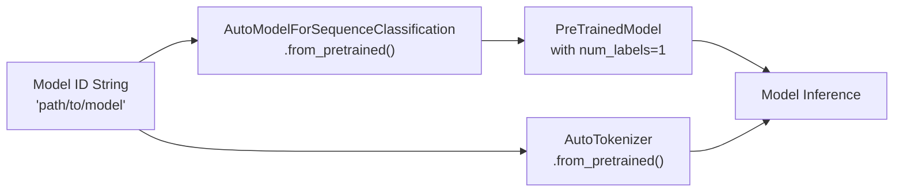
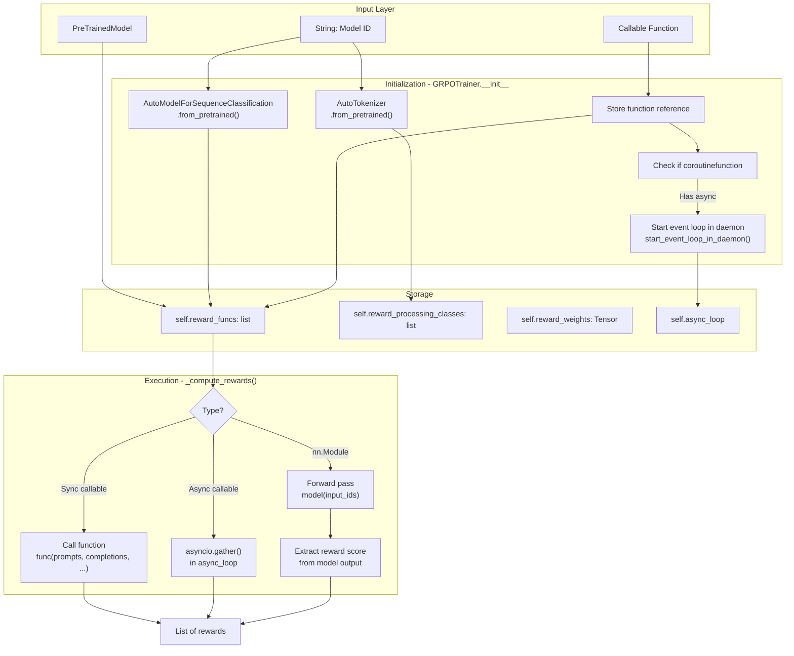
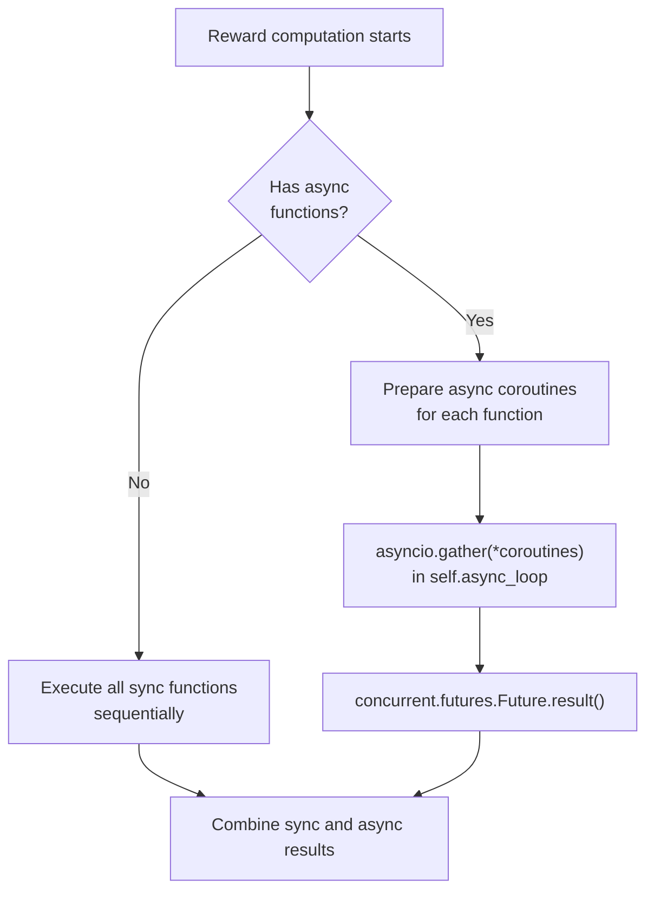
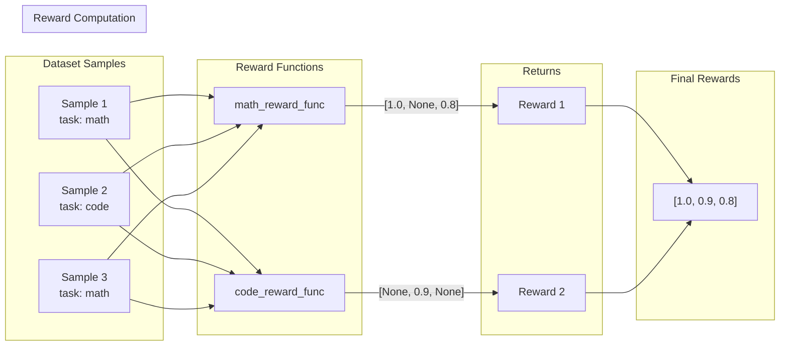

<!-- source: DeepWiki mcp.deepwiki.com · repo huggingface/trl · page 5.1 GRPO Reward Functions · fetched 2026-10-26 -->

# GRPO Reward Functions

<details>
<summary>Relevant source files</summary>

The following files were used as context for generating this wiki page:

- [docs/source/grpo_trainer.md](docs/source/grpo_trainer.md)
- [docs/source/paper_index.md](docs/source/paper_index.md)
- [docs/source/rewards.md](docs/source/rewards.md)
- [docs/source/rloo_trainer.md](docs/source/rloo_trainer.md)
- [tests/test_grpo_trainer.py](tests/test_grpo_trainer.py)
- [tests/test_rewards.py](tests/test_rewards.py)
- [tests/test_rloo_trainer.py](tests/test_rloo_trainer.py)
- [trl/rewards/__init__.py](trl/rewards/__init__.py)
- [trl/rewards/accuracy_rewards.py](trl/rewards/accuracy_rewards.py)
- [trl/rewards/other_rewards.py](trl/rewards/other_rewards.py)
- [trl/trainer/grpo_config.py](trl/trainer/grpo_config.py)
- [trl/trainer/grpo_trainer.py](trl/trainer/grpo_trainer.py)
- [trl/trainer/rloo_config.py](trl/trainer/rloo_config.py)
- [trl/trainer/rloo_trainer.py](trl/trainer/rloo_trainer.py)

</details>


## Purpose and Scope

This page documents the reward function system used by [`GRPOTrainer`](trl/trainer/grpo_trainer.py:133-155). Reward functions score generated completions to provide learning signals during training. This system supports three input types: model IDs (strings), pretrained models, and custom callable functions. For information about GRPO loss variants and clipping strategies, see [GRPO Loss Variants and Clipping](#5.2).

**Sources:** [trl/trainer/grpo_trainer.py:112-114](), [trl/trainer/grpo_trainer.py:163-187]()

## Reward Function Input Types

The GRPO trainer accepts reward functions in three forms, defined by the `RewardFunc` type alias at [trl/trainer/grpo_trainer.py:118]():

```python
RewardFunc = str | PreTrainedModel | Callable[..., list[float | None]]
```

### Type 1: Model ID Strings

When a string is provided, it is treated as a model identifier and loaded using `AutoModelForSequenceClassification.from_pretrained()` with `num_labels=1`. The model must be compatible with sequence classification.



**Initialization Logic:**

At [trl/trainer/grpo_trainer.py:372-379](), string reward functions are converted to model instances:

```python
if isinstance(reward_func, str):
    model_init_kwargs = args.model_init_kwargs or {}
    if args.distributed_state.distributed_type in ["MULTI_GPU", "DEEPSPEED"]:
        model_init_kwargs["device_map"] = None
    reward_funcs[i] = AutoModelForSequenceClassification.from_pretrained(
        reward_func, num_labels=1, **model_init_kwargs
    )
```

The corresponding tokenizer is automatically loaded at [trl/trainer/grpo_trainer.py:412-413]() if not explicitly provided via `reward_processing_classes`.

**Sources:** [trl/trainer/grpo_trainer.py:367-384](), [trl/trainer/grpo_trainer.py:397-421]()

### Type 2: PreTrainedModel Instances

You can pass an already-instantiated `PreTrainedModel` (specifically, a sequence classification model). This allows for custom model initialization or fine-grained control over model configuration.

The model's configuration must include a `pad_token_id`. At [trl/trainer/grpo_trainer.py:418](), the trainer sets this from the reward processing class:

```python
reward_func.config.pad_token_id = reward_processing_class.pad_token_id
```

This is crucial because the reward is computed from the last non-padded token in the sequence.

**Sources:** [trl/trainer/grpo_trainer.py:408-419]()

### Type 3: Custom Callable Functions

Custom reward functions provide maximum flexibility. They must accept keyword arguments for `prompts`, `completions`, and any additional dataset columns, and return a list of float rewards or `None`.

**Signature Requirements:**

The function should accept these parameters via `**kwargs` to ensure forward compatibility [trl/trainer/grpo_trainer.py:116-117]():
- `prompts`: List of prompts (strings or message lists depending on format)
- `completions`: List of completions (strings or message lists)
- `completion_ids`: List of tokenized completion sequences
- `trainer_state`: Current `TrainerState` instance
- All dataset column names except `"prompt"`

**Return Value:**

Must return `list[float | None]` where each value corresponds to the reward for one completion. For multi-task training, functions may return `None` for non-applicable samples [trl/trainer/grpo_trainer.py:180-185]().

**Sources:** [trl/trainer/grpo_trainer.py:118](), [trl/trainer/grpo_trainer.py:178-185](), [tests/test_grpo_trainer.py:544-576]()

## Reward Function Architecture

The following diagram shows how the three input types flow through the initialization and execution pipeline:



**Sources:** [trl/trainer/grpo_trainer.py:367-421](), [trl/trainer/grpo_trainer.py:494-503](), [trl/trainer/grpo_trainer.py:1293-1463]()

## Async Reward Functions

GRPO supports asynchronous reward functions through an event loop running on a daemon thread. When any reward function is async (detected via `inspect.iscoroutinefunction()`), the trainer initializes an event loop at [trl/trainer/grpo_trainer.py:497-503]():

```python
if self._has_async_funcs:
    self.async_loop_thread, self.async_loop, self.async_loop_ready_event = start_event_loop_in_daemon(
        name="GRPOTrainer-AsyncLoop"
    )
    self.async_loop_ready_event.wait()
    atexit.register(shutdown_event_loop_in_daemon, self.async_loop_thread, self.async_loop)
```

### Concurrent Execution

Multiple async reward functions are executed concurrently using `asyncio.gather()`. The execution flow at [trl/trainer/grpo_trainer.py:1398-1429]() shows:



The concurrent execution reduces total latency when multiple reward functions make I/O-bound calls (e.g., API requests, database queries).

**Sources:** [trl/trainer/grpo_trainer.py:494-503](), [trl/trainer/grpo_trainer.py:1398-1429](), [trl/trainer/utils.py:92-108]()

## Multi-Task Training with Conditional Rewards

Reward functions can return `None` for samples where the reward is not applicable. This enables multi-task training where different reward functions apply to different sample types [trl/trainer/grpo_trainer.py:180-185]().

### None Handling Logic

The reward computation at [trl/trainer/grpo_trainer.py:1449-1463]() handles `None` returns:

```python
# Identify which reward functions returned valid (non-None) rewards
applicable_reward_mask = [[r is not None for r in rewards_per_func] for rewards_per_func in all_rewards]

# Only include valid reward functions in the weighted sum
for i, (rewards_per_func, applicable_mask) in enumerate(zip(all_rewards, applicable_reward_mask)):
    valid_rewards = [r for r, is_valid in zip(rewards_per_func, applicable_mask) if is_valid]
    valid_weights = self.reward_weights[[j for j, is_valid in enumerate(applicable_mask) if is_valid]]
    
    if len(valid_rewards) > 0:
        final_rewards[i] = sum(r * w for r, w in zip(valid_rewards, valid_weights)) / valid_weights.sum()
```

### Example: Multi-Task Dataset



In this example, `math_reward_func` returns `None` for code tasks, and `code_reward_func` returns `None` for math tasks. The trainer computes final rewards using only applicable functions for each sample.

**Sources:** [trl/trainer/grpo_trainer.py:1449-1463](), [tests/test_grpo_trainer.py:691-731]()

## Reward Weights

When using multiple reward functions, you can assign different weights to each function via the `reward_weights` parameter in [`GRPOConfig`](trl/trainer/grpo_config.py:23-30). By default, all functions have equal weight (1.0).

### Configuration

At [trl/trainer/grpo_trainer.py:386-396](), weights are initialized:

```python
if args.reward_weights is not None:
    if len(args.reward_weights) != len(reward_funcs):
        raise ValueError(
            f"Number of reward weights ({len(args.reward_weights)}) must match number of reward "
            f"functions ({len(reward_funcs)})"
        )
    self.reward_weights = torch.tensor(args.reward_weights, dtype=torch.float32)
else:
    self.reward_weights = torch.ones(len(reward_funcs), dtype=torch.float32)
```

### Weighted Aggregation

Rewards are aggregated using weighted sum at [trl/trainer/grpo_trainer.py:1460-1462]():

```python
final_rewards[i] = sum(r * w for r, w in zip(valid_rewards, valid_weights)) / valid_weights.sum()
```

The division by `valid_weights.sum()` ensures that the final reward magnitude remains consistent regardless of how many functions are applicable.

**Sources:** [trl/trainer/grpo_trainer.py:386-396](), [trl/trainer/grpo_config.py:196-198]()

## Built-in Reward Functions

TRL provides several built-in reward functions in the `trl/rewards/` module that can be used directly with `GRPOTrainer`.

| Function | Description |
|----------|-------------|
| `accuracy_reward` | Verifies mathematical answers using `math_verify` [trl/rewards/accuracy_rewards.py:27-114]() |
| `reasoning_accuracy_reward` | Extracts final answer after reasoning delimiters (e.g. `</think>`) and verifies it [trl/rewards/accuracy_rewards.py:117-178]() |
| `think_format_reward` | Rewards completions that correctly use `` tags [trl/rewards/format_rewards.py:19-54]() |
| `get_soft_overlong_punishment` | Returns a callable that penalizes completions exceeding a length threshold [trl/rewards/other_rewards.py:19-48]() |

**Sources:** [trl/rewards/__init__.py:21-25]()

## Per-Function Metrics Logging

The trainer logs separate metrics for each reward function to help diagnose multi-reward training. At [trl/trainer/grpo_trainer.py:1433-1448](), metrics are computed:

| Metric | Description |
|--------|-------------|
| `reward/{func_name}/mean` | Mean reward from this function (excluding `None` values) |
| `reward/{func_name}/std` | Standard deviation of rewards from this function |
| `reward` | Overall mean after weighted aggregation |
| `reward_std` | Standard deviation of final aggregated rewards |

These metrics appear in training logs and can be tracked via TensorBoard, Weights & Biases, or other logging integrations.

**Sources:** [trl/trainer/grpo_trainer.py:1433-1448](), [trl/trainer/grpo_trainer.py:699]()

## Input Format Handling

Reward functions receive different input formats depending on the dataset type:

### Standard Format

For datasets using standard prompt format, `prompts` and `completions` are lists of strings.

### Conversational Format

For datasets using conversational format, `prompts` and `completions` are lists of message dictionaries [trl/trainer/grpo_trainer.py:66-67]().

```python
def reward_func(prompts, completions, **kwargs):
    # completions: [[{"role": "assistant", "content": "The answer is 4."}], ...]
    completion_contents = [completion[0]["content"] for completion in completions]
    return [float(len(c)) for c in completion_contents]
```

The format is automatically detected at [trl/trainer/grpo_trainer.py:1294-1295]() using `is_conversational()`.

**Sources:** [trl/trainer/grpo_trainer.py:1293-1295](), [tests/test_grpo_trainer.py:544-611]()

## Reward Processing Classes

Each reward function can have an associated processing class (tokenizer or processor) specified via `reward_processing_classes`. This is particularly important when:

1. The reward model uses a different tokenizer than the policy model.
2. The reward model requires specific padding or truncation settings.
3. Vision-language models require processors [trl/trainer/grpo_trainer.py:447-452]().

At [trl/trainer/grpo_trainer.py:407-419](), the trainer handles processing class initialization:

```python
for i, (reward_processing_class, reward_func) in enumerate(
    zip(reward_processing_classes, reward_funcs, strict=True)
):
    if isinstance(reward_func, PreTrainedModel):
        if reward_processing_class is None:
            reward_processing_class = AutoTokenizer.from_pretrained(get_config_model_id(reward_func.config))
        if reward_processing_class.pad_token_id is None:
            reward_processing_class.pad_token = reward_processing_class.eos_token
        reward_func.config.pad_token_id = reward_processing_class.pad_token_id
        reward_processing_classes[i] = reward_processing_class
```

**Sources:** [trl/trainer/grpo_trainer.py:204-213](), [trl/trainer/grpo_trainer.py:407-421]()

---

