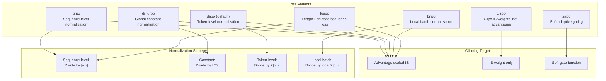
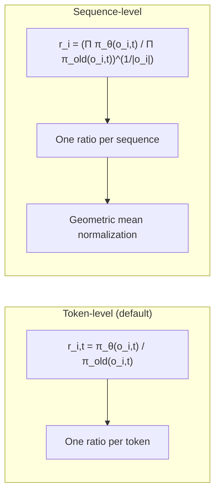
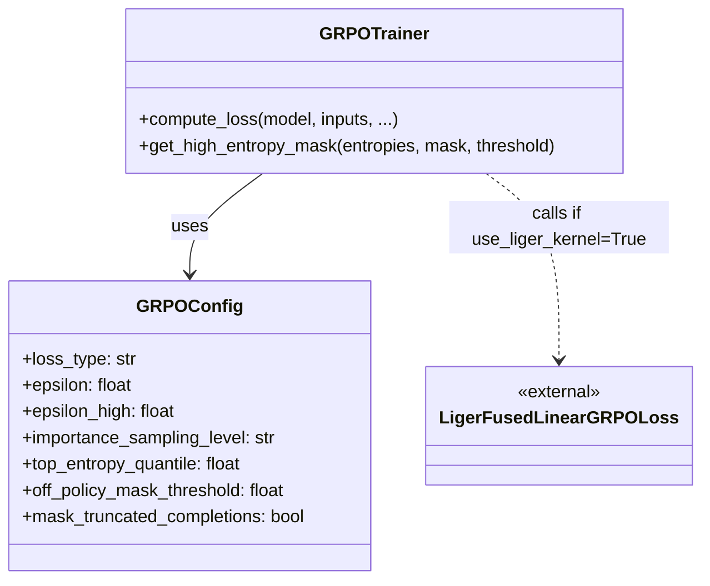

<!-- source: DeepWiki mcp.deepwiki.com · repo huggingface/trl · page 5.2 GRPO Loss Variants and Clipping · fetched 2026-10-26 -->

# GRPO Loss Variants and Clipping

Relevant source files

The following files were used as context for generating this wiki page:

- [docs/source/grpo_trainer.md](docs/source/grpo_trainer.md)
- [docs/source/paper_index.md](docs/source/paper_index.md)
- [docs/source/rloo_trainer.md](docs/source/rloo_trainer.md)
- [tests/test_grpo_trainer.py](tests/test_grpo_trainer.py)
- [tests/test_rloo_trainer.py](tests/test_rloo_trainer.py)
- [trl/trainer/grpo_config.py](trl/trainer/grpo_config.py)
- [trl/trainer/grpo_trainer.py](trl/trainer/grpo_trainer.py)
- [trl/trainer/rloo_config.py](trl/trainer/rloo_config.py)
- [trl/trainer/rloo_trainer.py](trl/trainer/rloo_trainer.py)

This page documents the seven loss formulations available in GRPO, their clipping mechanisms, normalization strategies, and guidance on when to use each variant. For information about GRPO's reward function system, see [GRPO Reward Functions](#5.1). For a comprehensive overview of the GRPO algorithm itself, see [Group Relative Policy Optimization (GRPO)](#5).

## Purpose and Scope

GRPO offers multiple loss variants that differ in how they aggregate token-level losses and apply clipping to policy updates. This flexibility allows practitioners to choose formulations that best suit their training objectives:

- **Length bias mitigation**: Different normalization strategies affect how sequence length impacts the loss.
- **Stability control**: Clipping mechanisms constrain policy updates to prevent excessive deviations.
- **Entropy-based filtering**: Optional masking of low-entropy tokens to focus learning on "forks" in reasoning.
- **Off-policy correction**: Mechanisms to handle distribution shift during training iterations.

Each loss variant is controlled via the `loss_type` parameter in `GRPOConfig` [trl/trainer/grpo_config.py:219-246](), with additional configuration options for clipping bounds (`epsilon`, `epsilon_high`), entropy masking (`top_entropy_quantile`), and off-policy handling (`off_policy_mask_threshold`).

**Sources**: [trl/trainer/grpo_config.py:219-246](), [docs/source/grpo_trainer.md:111-167]()

## Loss Variant Overview

The following diagram shows the relationship between the seven loss types and their key characteristics:

### Loss Type Details

| Loss Type | Normalization | Clipping Target | Paper | When to Use |
|-----------|--------------|-----------------|-------|-------------|
| `grpo` | Sequence-level (1/\|o_i\|) | Advantage-scaled IS | [DeepSeekMath](https://huggingface.co/papers/2402.03300) | Original formulation; not recommended due to length bias [docs/source/grpo_trainer.md:96-98]() |
| `dr_grpo` | Global constant (1/(L*G)) | Advantage-scaled IS | [Dr. GRPO](https://huggingface.co/papers/2503.20783) | Eliminates length bias with constant normalization [docs/source/grpo_trainer.md:133-139]() |
| `dapo` | Token-level (1/Σ\|o_i\|) | Advantage-scaled IS | [DAPO](https://huggingface.co/papers/2503.14476) | **Default**; mitigates length bias in long CoT scenarios [trl/trainer/grpo_config.py:228-231]() |
| `bnpo` | Local batch (1/local Σ\|o_i\|) | Advantage-scaled IS | TRL implementation | When `per_device_train_batch_size==1`, equivalent to GRPO [trl/trainer/grpo_config.py:232-235]() |
| `cispo` | Token-level (1/Σ\|o_i\|) | IS weight only | [MiniMax-M1](https://huggingface.co/papers/2506.13585) | Alternative clipping strategy; use with higher `epsilon_high` (5.0) [trl/trainer/grpo_config.py:236-239]() |
| `sapo` | Sequence-level (1/\|o_i\|) | Soft gate function | [SAPO](https://huggingface.co/papers/2511.20347) | Smooth trust region; preserves off-policy learning signals [trl/trainer/grpo_config.py:240-243]() |
| `luspo` | Sequence-level with length scaling | Advantage-scaled IS | [LUSPO](https://huggingface.co/papers/2602.05261) | Requires `importance_sampling_level="sequence"` [trl/trainer/grpo_config.py:244-246]() |

**Sources**: [trl/trainer/grpo_config.py:219-246](), [docs/source/grpo_trainer.md:113-167](), [tests/test_grpo_trainer.py:255-286]()

## Clipping Mechanisms

### Standard Clipping (epsilon)

The core clipping mechanism in GRPO constrains the importance sampling ratio to prevent excessive policy updates. The ratio between the current policy and the old policy is defined as:

$$
r_{i,t}(\theta) = \frac{\pi_\theta(o_{i,t} \mid q, o_{i,<t})}{\pi_{\theta_{\text{old}}}(o_{i,t} \mid q, o_{i,<t})}
$$

The clipped ratio is then applied to the advantage:

$$
\text{clip}(r_{i,t}(\theta), 1 - \epsilon, 1 + \epsilon) \hat{A}_{i,t}
$$

The `epsilon` parameter (default: 0.2) controls the clipping bounds. When `num_iterations > 1`, this prevents the policy from changing too quickly relative to the data-generating policy [trl/trainer/grpo_config.py:173-174]().

**Sources**: [trl/trainer/grpo_config.py:173-174](), [docs/source/grpo_trainer.md:102-109]()

### Two-Sided Clipping (epsilon_high)

The `epsilon_high` parameter enables asymmetric clipping bounds, providing independent control over the upper clipping threshold [trl/trainer/grpo_config.py:179-183]():

$$
\text{clip}(r_{i,t}(\theta), 1 - \epsilon, 1 + \epsilon_{\text{high}})
$$

This is particularly useful for loss types like `cispo` which recommend higher upper bounds (e.g., 5.0) [docs/source/paper_index.md:127-166](). If `epsilon_high` is not specified, it defaults to the same value as `epsilon`.

**Sources**: [trl/trainer/grpo_config.py:179-183](), [docs/source/paper_index.md:127-166]()

### Importance Sampling Level

The granularity at which importance sampling ratios are computed is controlled by `importance_sampling_level` [trl/trainer/grpo_config.py:190-195]():

**Sources**: [trl/trainer/grpo_config.py:190-195](), [docs/source/paper_index.md:77-126]()

## Normalization Strategies

GRPO implementation in TRL addresses length bias by offering different aggregation strategies for token-level losses.

### Sequence-Level Normalization (grpo, sapo, luspo)

Original GRPO normalization averages losses over sequences, then over the group [docs/source/grpo_trainer.md:113-123]():

$$
\mathcal{L}_{\text{GRPO}}(\theta) = - \frac{1}{G} \sum_{i=1}^G \frac{1}{|o_i|} \sum_{t=1}^{|o_i|} l_{i,t}
$$

This can introduce **length bias**, where shorter completions receive stronger gradients per token.

### Global Constant Normalization (dr_grpo)

Dr. GRPO eliminates length bias by dividing by a constant rather than sequence length [docs/source/grpo_trainer.md:133-139]():

$$
\mathcal{L}_{\text{Dr. GRPO}}(\theta) = - \frac{1}{LG} \sum_{i=1}^G \sum_{t=1}^{|o_i|} l_{i,t}
$$

where $L$ is `max_completion_length` and $G$ is `num_generations`.

### Token-Level Normalization (dapo, cispo)

DAPO (the default) normalizes over the total number of active tokens in the global accumulated batch [docs/source/grpo_trainer.md:125-131]():

$$
\mathcal{L}_{\text{DAPO}}(\theta) = - \frac{1}{\sum_{i=1}^G |o_i|} \sum_{i=1}^G \sum_{t=1}^{|o_i|} l_{i,t}
$$

**Sources**: [docs/source/grpo_trainer.md:111-139](), [trl/trainer/grpo_config.py:228-231]()

## Advanced Masking and Filtering

### Entropy-Based Token Masking

The `top_entropy_quantile` parameter (default: 1.0) enables filtering tokens based on their entropy. Setting this below 1.0 keeps only the highest-entropy (most uncertain) tokens in the loss computation [trl/trainer/grpo_config.py:264-269]().

The implementation logic in `GRPOTrainer.get_high_entropy_mask` computes entropy quantiles across the batch, excluding pad tokens [tests/test_grpo_trainer.py:90-107]().

### Off-Policy Sequence Masking

The `off_policy_mask_threshold` (default: `None`) enables masking of sequences that are too far off-policy [trl/trainer/grpo_config.py:291-295](). Sequences are masked when the advantage is negative AND the KL divergence exceeds the threshold [trl/trainer/grpo_trainer.py:543-546]().

### Truncated Completion Masking

`mask_truncated_completions` (default: `False`) excludes completions that reach `max_completion_length` without an EOS token [trl/trainer/grpo_config.py:247-250](). This prevents penalizing incomplete reasoning chains.

**Sources**: [trl/trainer/grpo_config.py:247-295](), [trl/trainer/grpo_trainer.py:543-546](), [tests/test_grpo_trainer.py:90-160]()

## Code Entity Mapping

The following diagram bridges the mathematical variants to the configuration and implementation entities:

**Sources**: [trl/trainer/grpo_config.py:23-310](), [trl/trainer/grpo_trainer.py:133-155](), [trl/trainer/grpo_trainer.py:668-686]()

## Choosing a Loss Variant

| Use Case | Recommended Loss | Additional Config |
|----------|------------------|-------------------|
| **General training** | `dapo` | Default settings |
| **Long chain-of-thought** | `dapo` or `dr_grpo` | `mask_truncated_completions=True` |
| **Eliminate length bias** | `dr_grpo` | Set `max_completion_length` |
| **GSPO replication** | `grpo` | `importance_sampling_level="sequence"` |
| **Smooth trust region** | `sapo` | `sapo_temperature_pos/neg` |
| **Alternative clipping** | `cispo` | `epsilon_high=5.0` |

**Sources**: [trl/trainer/grpo_config.py:219-246](), [docs/source/paper_index.md:77-166]()

---

