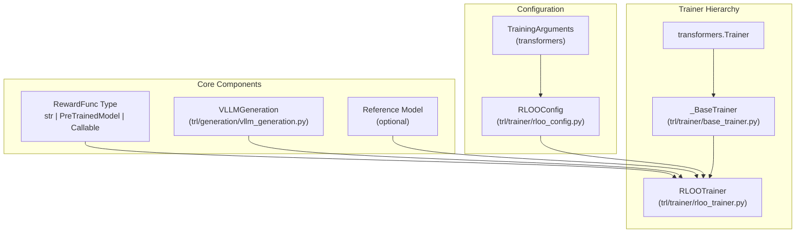
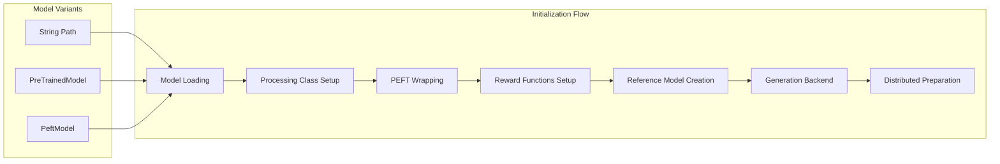
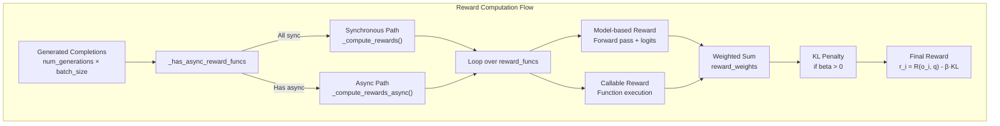
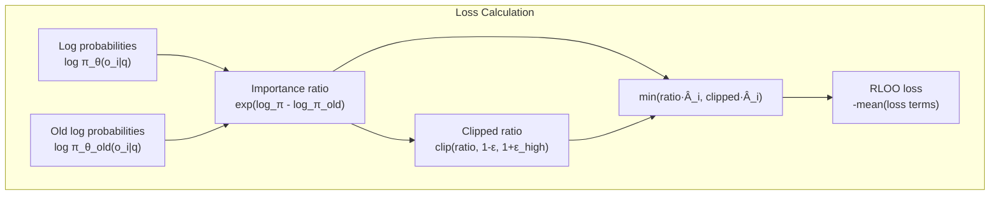

<!-- source: DeepWiki mcp.deepwiki.com · repo huggingface/trl · page 6 REINFORCE Leave-One-Out (RLOO) · fetched 2026-10-26 -->

# REINFORCE Leave-One-Out (RLOO)

Relevant source files

The following files were used as context for generating this wiki page:

- [docs/source/grpo_trainer.md](docs/source/grpo_trainer.md)
- [docs/source/paper_index.md](docs/source/paper_index.md)
- [docs/source/rloo_trainer.md](docs/source/rloo_trainer.md)
- [tests/test_grpo_trainer.py](tests/test_grpo_trainer.py)
- [tests/test_rloo_trainer.py](tests/test_rloo_trainer.py)
- [trl/trainer/grpo_config.py](trl/trainer/grpo_config.py)
- [trl/trainer/grpo_trainer.py](trl/trainer/grpo_trainer.py)
- [trl/trainer/rloo_config.py](trl/trainer/rloo_config.py)
- [trl/trainer/rloo_trainer.py](trl/trainer/rloo_trainer.py)

## Purpose and Scope

This page documents the REINFORCE Leave-One-Out (RLOO) training method in TRL, an online reinforcement learning algorithm for language model post-training. RLOO uses a leave-one-out baseline for variance reduction in the REINFORCE algorithm, as described in [Back to Basics: Revisiting REINFORCE Style Optimization for Learning from Human Feedback in LLMs](https://huggingface.co/papers/2402.14740).

For details on configuration and implementation examples, see [RLOO Configuration and Examples](#6.1).

**Scope**: This page covers the trainer architecture, reward function system, training loop mechanics, generation backends, and advanced features like multi-reward optimization and importance sampling.

---

## Core Architecture

### Trainer Class Hierarchy

The `RLOOTrainer` inherits from `_BaseTrainer`, which provides the standard TRL post-training infrastructure while adding RLOO-specific functionality.

**Sources**: [trl/trainer/rloo_trainer.py:105-106](), [trl/trainer/rloo_config.py:23-24](), [trl/trainer/base_trainer.py]()

### Key Attributes and Initialization

The `RLOOTrainer` handles several critical initialization steps, including setting up the processing class (tokenizer or processor), wrapping models with PEFT if configured, and preparing the generation backend.

The trainer accepts models as a string ID, a `PreTrainedModel`, or a `PeftModel`. If a `PeftModel` is provided, the trainer can create an additional "ref" adapter to handle reference model calculations without a full model copy [trl/trainer/rloo_trainer.py:284-298]().

**Sources**: [trl/trainer/rloo_trainer.py:222-437]()

---

## Reward Function System

### Reward Function Types

RLOO supports three types of reward functions, defined by the `RewardFunc` type alias [trl/trainer/rloo_trainer.py:102]():

1.  **String**: Interpreted as a model ID and loaded as an `AutoModelForSequenceClassification`.
2.  **PreTrainedModel**: A sequence classification model instance.
3.  **Callable**: A custom function that receives prompts, completions, and dataset columns, returning a list of rewards.

### Reward Computation Pipeline

The reward computation involves calculating the raw reward from models or callables and then applying a KL penalty if `beta > 0`.

**Sources**: [trl/trainer/rloo_trainer.py:1396-1478](), [trl/trainer/rloo_trainer.py:1480-1554]()

---

## Training Loop and Strategy

### Custom Sampler Strategy

RLOO uses a `RepeatSampler` to handle its batching requirements. Each prompt is repeated `num_generations` times to create a group of completions for the leave-one-out baseline calculation [trl/trainer/rloo_trainer.py:632-666]().

### Leave-One-Out Advantage Computation

The core innovation of RLOO is the leave-one-out baseline, which reduces variance by comparing each completion's reward against the average of other completions in its group.

**Mathematical formulation**:
- Baseline for completion $i$: $b_i = \frac{1}{G-1} \sum_{j \neq i} r_j$ [trl/trainer/rloo_trainer.md:100-102]()
- Advantage: $A_i = r_i - b_i$ [trl/trainer/rloo_trainer.md:107]()

**Sources**: [trl/trainer/rloo_trainer.py:1556-1602](), [trl/trainer/rloo_trainer.md:95-108]()

### Loss Computation

The trainer computes a REINFORCE loss, utilizing clipped importance sampling to allow for multiple gradient steps per generation batch (`num_iterations > 1`).

**Sources**: [trl/trainer/rloo_trainer.py:1604-1675](), [trl/trainer/rloo_trainer.md:110-124]()

---

## Configuration and Comparisons

### Key Configuration Parameters

The `RLOOConfig` class extends TRL's base configuration with RLOO-specific parameters:

| Parameter | Default | Purpose |
| :--- | :--- | :--- |
| `num_generations` | 2 | Number of completions per prompt [trl/trainer/rloo_config.py:51]() |
| `beta` | 0.05 | KL penalty coefficient [trl/trainer/rloo_config.py:160]() |
| `epsilon` | 0.2 | Clipping threshold for importance sampling [trl/trainer/rloo_config.py:165]() |
| `normalize_advantages` | False | Whether to normalize advantages across the batch [trl/trainer/rloo_config.py:173]() |

**Sources**: [trl/trainer/rloo_config.py:23-218]()

### Comparison with PPO and GRPO

While RLOO, PPO, and GRPO are all online RL methods, they differ in their baseline strategies:
*   **PPO**: Uses a learned value function (Critic) as a baseline.
*   **GRPO**: Uses the group mean reward as a baseline for all completions in a group.
*   **RLOO**: Uses a "leave-one-out" mean, where each completion has a unique baseline excluding itself.

For a deeper dive into choosing between these algorithms and detailed configuration examples, see [RLOO Configuration and Examples](#6.1).

**Sources**: [trl/trainer/rloo_trainer.md:7-12](), [trl/trainer/grpo_trainer.md:66-70]()

---

