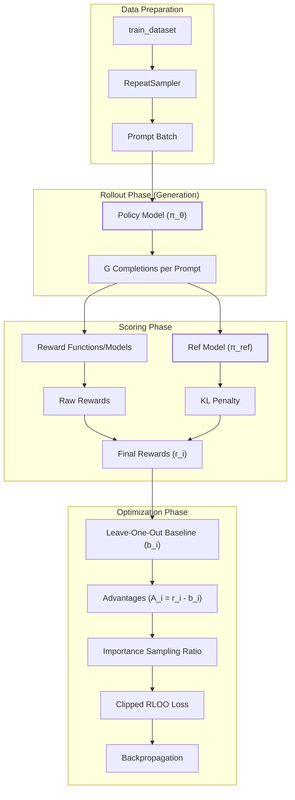
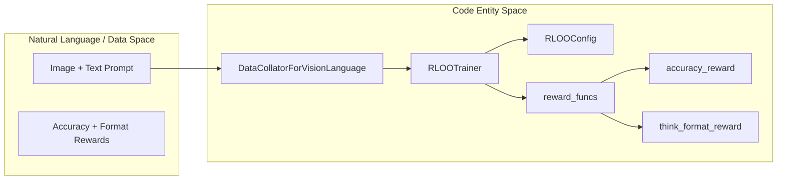

<!-- source: DeepWiki mcp.deepwiki.com · repo huggingface/trl · page 6.1 RLOO Configuration and Examples · fetched 2026-10-26 -->

# RLOO Configuration and Examples

<details>
<summary>Relevant source files</summary>

The following files were used as context for generating this wiki page:

- [docs/source/grpo_trainer.md](docs/source/grpo_trainer.md)
- [docs/source/paper_index.md](docs/source/paper_index.md)
- [docs/source/rloo_trainer.md](docs/source/rloo_trainer.md)
- [examples/scripts/grpo_vlm.py](examples/scripts/grpo_vlm.py)
- [examples/scripts/gspo.py](examples/scripts/gspo.py)
- [examples/scripts/gspo_vlm.py](examples/scripts/gspo_vlm.py)
- [examples/scripts/online_dpo_vlm.py](examples/scripts/online_dpo_vlm.py)
- [examples/scripts/rloo.py](examples/scripts/rloo.py)
- [examples/scripts/rloo_vlm.py](examples/scripts/rloo_vlm.py)
- [tests/test_grpo_trainer.py](tests/test_grpo_trainer.py)
- [tests/test_rloo_trainer.py](tests/test_rloo_trainer.py)
- [trl/trainer/grpo_config.py](trl/trainer/grpo_config.py)
- [trl/trainer/rloo_config.py](trl/trainer/rloo_config.py)

</details>


REINFORCE Leave-One-Out (RLOO) is an online reinforcement learning algorithm supported by the `RLOOTrainer`. It simplifies the alignment process by using a REINFORCE-style optimization with a variance-reduction baseline calculated from other completions in the same group. This approach provides a computationally efficient alternative to PPO while maintaining the benefits of online optimization.

## RLOO Configuration

The `RLOOConfig` class manages parameters specific to the RLOO training loop. It inherits from `trl.trainer.base_config._BaseConfig` and extends `transformers.TrainingArguments`.

### Key Parameters

| Parameter | Type | Default | Description |
| :--- | :--- | :--- | :--- |
| `num_generations` | `int` | `2` | Number of completions to sample per prompt. The effective batch size must be evenly divisible by this value. [trl/trainer/rloo_config.py:51-53]() |
| `num_generations_eval` | `int` | `None` | Number of completions to sample during evaluation. If `None`, defaults to `num_generations`. [trl/trainer/rloo_config.py:54-56]() |
| `max_completion_length` | `int` | `256` | Maximum token length for generated completions. [trl/trainer/rloo_config.py:57-58]() |
| `temperature` | `float` | `1.0` | Sampling temperature for generation. [trl/trainer/rloo_config.py:78-79]() |
| `use_vllm` | `bool` | `False` | Whether to use the vLLM engine for faster generation rollouts. [trl/trainer/rloo_config.py:110-112]() |
| `vllm_mode` | `str` | `"colocate"` | vLLM integration mode: `"server"` or `"colocate"`. [trl/trainer/rloo_config.py:113-115]() |

Sources: [trl/trainer/rloo_config.py:23-116]()

## Algorithm and Advantage Calculation

RLOO operates by generating a group of $G$ completions for each prompt. The reward for each completion $r_i$ is a combination of the external reward (from a model or function) and a KL penalty against a reference policy.

### Advantage Logic
The advantage $A_i$ for a completion is computed using a "leave-one-out" baseline $b_i$, which is the average reward of all other completions in the same group:
$$b_i = \frac{1}{G-1} \sum_{j \neq i} r_j$$
$$A_i = r_i - b_i$$

This mechanism reduces variance in the policy gradient estimate without requiring a separate value network (critic), which is a significant memory saving compared to PPO. [docs/source/rloo_trainer.md:95-108]()

### Implementation Flow

The following diagram illustrates the data flow within `RLOOTrainer` from generation to loss calculation.

**RLOO Training Loop Architecture**

Sources: [docs/source/rloo_trainer.md:51-124](), [trl/trainer/rloo_config.py:23-116]()

## Comparison: RLOO vs. GRPO

While both RLOO and GRPO are group-relative algorithms, they differ in their loss formulations and primary use cases.

| Feature | RLOO | GRPO |
| :--- | :--- | :--- |
| **Loss Type** | REINFORCE-style (Sequence-level) | PPO-style (Token-level) |
| **Baseline** | Leave-one-out mean of rewards | Mean and Std of group rewards |
| **KL Penalty** | Explicitly subtracted from reward | Part of the loss objective |
| **Constraint** | `num_generations` must be $\ge 2$ | `num_generations` must be $\ge 2$ |
| **Advantage Normalization** | Group-relative mean subtraction | Group-relative Z-score (Mean & Std) |

Sources: [docs/source/rloo_trainer.md:95-124](), [docs/source/grpo_trainer.md:54-94]()

## Example Scripts

### Standard RLOO (Text)
The script `examples/scripts/rloo.py` demonstrates training on mathematical reasoning tasks using the `RLOOTrainer`. It utilizes vLLM in `colocate` mode to accelerate generation.

```python
# examples/scripts/rloo.py
training_args = RLOOConfig(
    output_dir="Qwen3-0.6B-RLOO",
    use_vllm=True,
    vllm_mode="colocate",
    num_generations=8, # Group size for baseline
    steps_per_generation=8,
    ...
)

trainer = RLOOTrainer(
    model="Qwen/Qwen3-0.6B",
    reward_funcs=[think_format_reward, accuracy_reward],
    train_dataset=train_dataset,
    ...
)
```
Sources: [examples/scripts/rloo.py:67-89]()

### RLOO for Vision-Language Models (VLM)
For multimodal tasks, `examples/scripts/rloo_vlm.py` supports training VLMs. This script handles image processing and applies rewards based on both visual understanding and reasoning format.

**VLM Code Entity Mapping**

Sources: [examples/scripts/rloo_vlm.py](), [trl/trainer/rloo_config.py:23-116]()

## Constraints and Requirements

1.  **Group Size**: `num_generations` must be at least 2 to compute a leave-one-out baseline. [trl/trainer/rloo_config.py:51-53]()
2.  **Batch Divisibility**: The effective batch size (defined as `num_processes * per_device_batch_size * gradient_accumulation_steps`) must be evenly divisible by `num_generations`. [trl/trainer/rloo_config.py:51-53]()
3.  **Memory Optimization**: For large models, RLOO supports DeepSpeed ZeRO-3 via `ds3_gather_for_generation` and PEFT/LoRA integration. [trl/trainer/rloo_config.py:59-63](), [examples/scripts/rloo.py:88]()

Sources: [trl/trainer/rloo_config.py:23-116](), [examples/scripts/rloo.py:1-99]()

---

