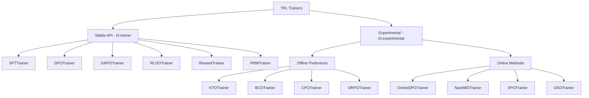
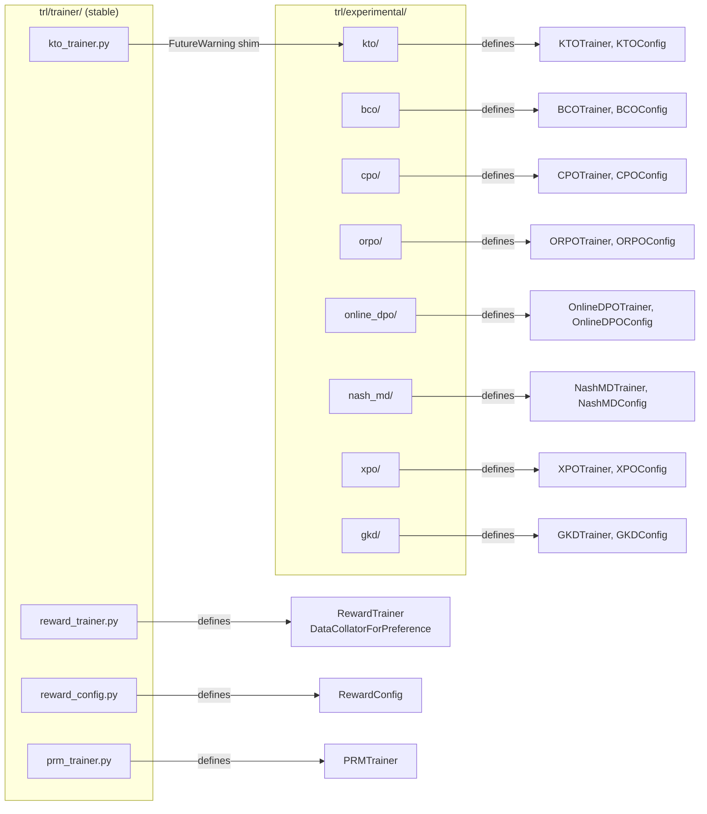
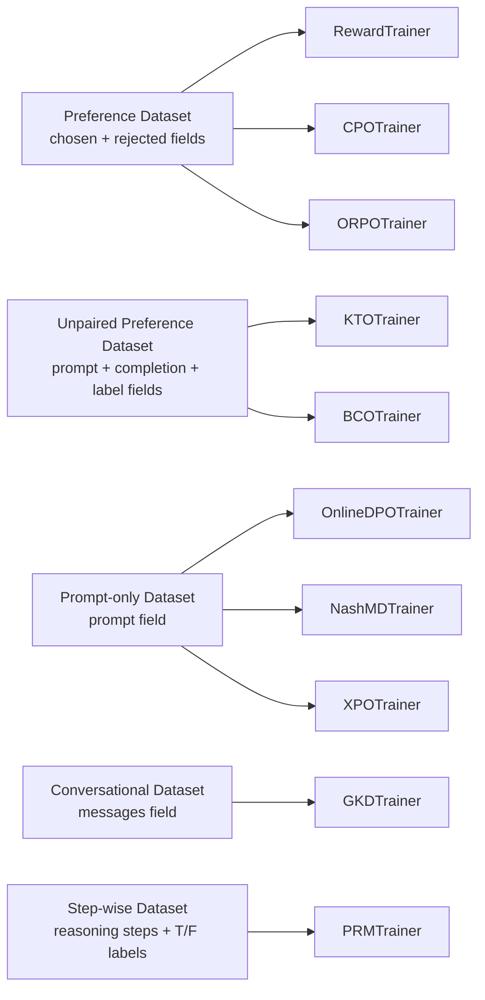

<!-- source: DeepWiki mcp.deepwiki.com · repo huggingface/trl · page 7 Additional Training Methods · fetched 2026-10-26 -->

# Additional Training Methods

Relevant source files

The following files were used as context for generating this wiki page:

- [docs/source/bco_trainer.md](docs/source/bco_trainer.md)
- [docs/source/cpo_trainer.md](docs/source/cpo_trainer.md)
- [docs/source/gkd_trainer.md](docs/source/gkd_trainer.md)
- [docs/source/kto_trainer.md](docs/source/kto_trainer.md)
- [docs/source/nash_md_trainer.md](docs/source/nash_md_trainer.md)
- [docs/source/online_dpo_trainer.md](docs/source/online_dpo_trainer.md)
- [docs/source/orpo_trainer.md](docs/source/orpo_trainer.md)
- [docs/source/xpo_trainer.md](docs/source/xpo_trainer.md)
- [examples/scripts/online_dpo.py](examples/scripts/online_dpo.py)
- [trl/experimental/bco/bco_trainer.py](trl/experimental/bco/bco_trainer.py)
- [trl/experimental/cpo/cpo_trainer.py](trl/experimental/cpo/cpo_trainer.py)
- [trl/experimental/orpo/orpo_trainer.py](trl/experimental/orpo/orpo_trainer.py)

This page provides an overview of reward modeling and the full set of experimental alignment trainers in TRL that extend beyond the four primary training methods. Detailed documentation for each category is in the child pages below.

For the four primary trainers (SFT, DPO, GRPO, RLOO), see pages [3](), [4](), [5](), and [6]().

---

## Trainer Landscape

TRL organizes trainers across two stability tiers:

| Tier | Module prefix | Policy on breaking changes |
|------|--------------|---------------------------|
| **Stable** | `trl.trainer` | Follows semantic versioning |
| **Experimental** | `trl.experimental` | May change without notice |

The trainers on this page are further divided by how feedback is sourced during training:

- **Offline** trainers consume pre-collected labeled or preference data.
- **Online** trainers generate completions at training time and score them with a judge or reward model.

**Diagram: Taxonomy of all TRL trainers**

Sources: [trl/trainer/reward_trainer.py:216-302](), [trl/trainer/kto_trainer.py:21-36](), [docs/source/kto_trainer.md:1-10](), [docs/source/bco_trainer.md:1-8](), [docs/source/cpo_trainer.md:1-10](), [docs/source/orpo_trainer.md:1-20](), [docs/source/online_dpo_trainer.md:1-14](), [docs/source/nash_md_trainer.md:1-13](), [docs/source/xpo_trainer.md:1-15](), [docs/source/gkd_trainer.md:1-18]()

---

## Complete Trainer Reference

| Trainer | Config | Import module | Dataset type | Feedback source | Page |
|---------|--------|---------------|--------------|-----------------|------|
| `RewardTrainer` | `RewardConfig` | `trl.trainer.reward_trainer` | Preference | Pre-labeled pairs | [KTO and Preference Optimization Variants](#7.1) |
| `PRMTrainer` | `PRMConfig` | `trl.trainer.prm_trainer` | Step-wise | Boolean step labels | [Process Reward Modeling (PRM)](#7.4) |
| `KTOTrainer` | `KTOConfig` | `trl.experimental.kto` | Unpaired preference | Binary label | [KTO and Preference Optimization Variants](#7.1) |
| `BCOTrainer` | `BCOConfig` | `trl.experimental.bco` | Unpaired preference | Binary label | [Online and Multi-Agent Methods](#7.2) |
| `CPOTrainer` | `CPOConfig` | `trl.experimental.cpo` | Preference | Pre-labeled pairs | [KTO and Preference Optimization Variants](#7.1) |
| `ORPOTrainer` | `ORPOConfig` | `trl.experimental.orpo` | Preference | Pre-labeled pairs | [KTO and Preference Optimization Variants](#7.1) |
| `OnlineDPOTrainer` | `OnlineDPOConfig` | `trl.experimental.online_dpo` | Prompt-only | Judge or reward model | [Online and Multi-Agent Methods](#7.2) |
| `NashMDTrainer` | `NashMDConfig` | `trl.experimental.nash_md` | Prompt-only | Judge or reward model | [Online and Multi-Agent Methods](#7.2) |
| `XPOTrainer` | `XPOConfig` | `trl.experimental.xpo` | Prompt-only | Judge or reward model | [Online and Multi-Agent Methods](#7.2) |
| `GKDTrainer` | `GKDConfig` | `trl.experimental.gkd` | Conversational | Teacher model logits | [Distillation and Experimental Trainers](#7.3) |

Sources: [docs/source/kto_trainer.md:36-46](), [docs/source/bco_trainer.md:24-38](), [docs/source/cpo_trainer.md:24-36](), [docs/source/orpo_trainer.md:35-47](), [docs/source/online_dpo_trainer.md:28-45](), [docs/source/nash_md_trainer.md:29-45](), [docs/source/xpo_trainer.md:31-47](), [docs/source/gkd_trainer.md:36-80]()

---

## Code Organization

**Diagram: File paths and primary classes**

Sources: [trl/trainer/reward_trainer.py:126-213](), [trl/trainer/kto_trainer.py:21-36](), [trl/experimental/bco/bco_trainer.py:74-110]()

---

## Dataset Formats

Each trainer requires specific dataset structures. All trainers that accept conversational datasets apply the chat template automatically via `maybe_apply_chat_template` [trl/experimental/bco/bco_trainer.py:58]().

**Diagram: Dataset type to trainer mapping**

Sources: [docs/source/kto_trainer.md:78-84](), [docs/source/bco_trainer.md:9-11](), [docs/source/cpo_trainer.md:46-47](), [docs/source/orpo_trainer.md:82-84](), [docs/source/online_dpo_trainer.md:67-69](), [docs/source/nash_md_trainer.md:65-67](), [docs/source/xpo_trainer.md:67-69](), [docs/source/gkd_trainer.md:83-89]()

---

## Preference Optimization Variants

This category includes methods that optimize model behavior using preference data without necessarily requiring a complex RL loop.

### KTO — Kahneman-Tversky Optimization
`KTOTrainer` (`trl.experimental.kto`) maximizes model utility directly from binary desirability labels. It matches or exceeds preference-based methods without requiring paired data [docs/source/kto_trainer.md:12-16]().
For details, see [KTO and Preference Optimization Variants](#7.1).

### ORPO — Odds Ratio Preference Optimization
`ORPOTrainer` (`trl.experimental.orpo`) integrates preference alignment directly into the SFT phase by appending a log odds ratio penalty term to the NLL loss [docs/source/orpo_trainer.md:11-13]().
For details, see [KTO and Preference Optimization Variants](#7.1).

### CPO — Contrastive Preference Optimization
`CPOTrainer` (`trl.experimental.cpo`) mitigates SFT shortcomings by training models to avoid "adequate but not perfect" generations, particularly useful in Machine Translation [docs/source/cpo_trainer.md:7-9](). It includes variants like **SimPO** and **AlphaPO** [docs/source/cpo_trainer.md:75-90]().
For details, see [KTO and Preference Optimization Variants](#7.1).

---

## Online and Multi-Agent Methods

Online methods generate completions during training, allowing for on-policy feedback and exploration.

### OnlineDPO, Nash-MD, and XPO
- **OnlineDPO**: Samples two responses and uses an LLM/RM judge for online feedback [docs/source/online_dpo_trainer.md:7-11]().
- **Nash-MD**: Learns a policy that converges to the Nash equilibrium of a preference model [docs/source/nash_md_trainer.md:7-11]().
- **XPO**: Augments DPO with an exploration bonus to explore outside the initial model support [docs/source/xpo_trainer.md:7-11]().

For details, see [Online and Multi-Agent Methods](#7.2).

### BCO — Binary Classifier Optimization
`BCOTrainer` (`trl.experimental.bco`) trains a binary classifier where the logit serves as a reward [docs/source/bco_trainer.md:5-7](). It features **Underlying Distribution Matching (UDM)** to handle divergent prompt distributions between positive and negative samples [docs/source/bco_trainer.md:46-51]().
For details, see [Online and Multi-Agent Methods](#7.2).

---

## Distillation and Experimental Trainers

### GKD — Generalized Knowledge Distillation
`GKDTrainer` (`trl.experimental.gkd`) compresses teacher models into students while addressing train-inference distribution mismatch by training on student-generated sequences [docs/source/gkd_trainer.md:7-11](). It uses parameters like `lmbda` (on-policy fraction) and `beta` (KL divergence interpolation) [docs/source/gkd_trainer.md:22-28]().

### MiniLLM and GOLD
TRL also includes research-stage trainers for reverse KLD distillation and offline RL methods.
For details, see [Distillation and Experimental Trainers](#7.3).

---

## Process Reward Modeling (PRM)

`PRMTrainer` facilitates step-level supervision for reasoning tasks. Unlike standard reward models that score an entire completion (ORM), PRMs score individual reasoning steps [docs/source/prm800k.py](). This is a critical component for training verifiable reasoning models and integrating with `GRPOTrainer`.

For details, see [Process Reward Modeling (PRM)](#7.4).

---

