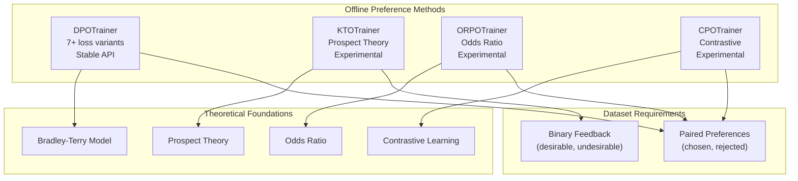
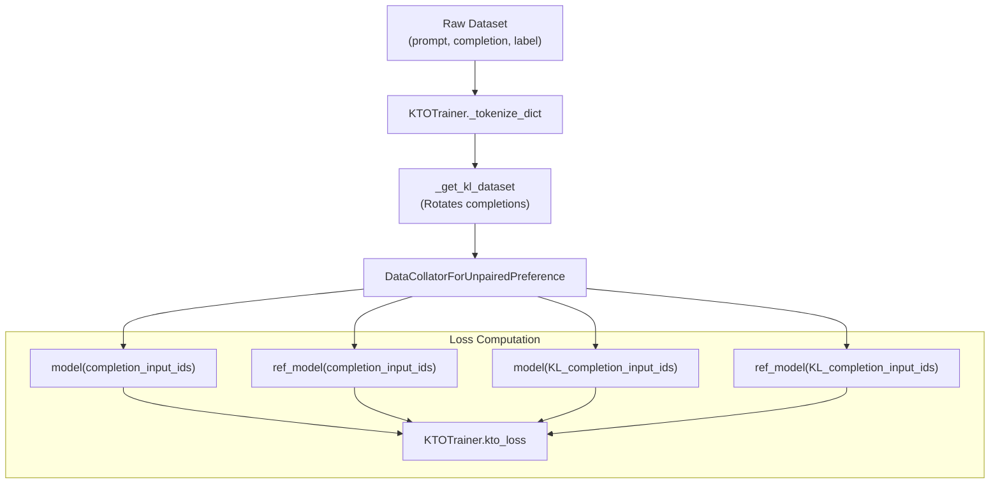
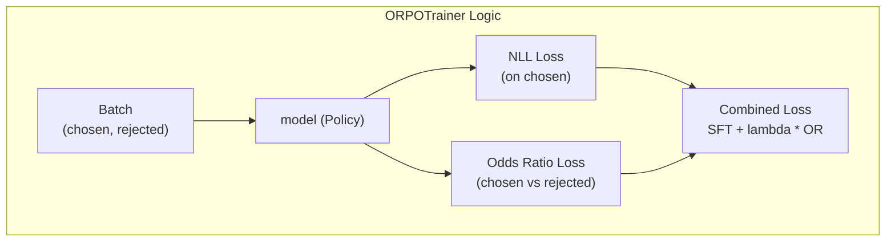

<!-- source: DeepWiki mcp.deepwiki.com · repo huggingface/trl · page 7.1 KTO and Preference Optimization Variants · fetched 2026-10-26 -->

# KTO and Preference Optimization Variants

Relevant source files

The following files were used as context for generating this wiki page:

- [docs/source/bco_trainer.md](docs/source/bco_trainer.md)
- [docs/source/cpo_trainer.md](docs/source/cpo_trainer.md)
- [docs/source/gkd_trainer.md](docs/source/gkd_trainer.md)
- [docs/source/kto_trainer.md](docs/source/kto_trainer.md)
- [docs/source/nash_md_trainer.md](docs/source/nash_md_trainer.md)
- [docs/source/online_dpo_trainer.md](docs/source/online_dpo_trainer.md)
- [docs/source/orpo_trainer.md](docs/source/orpo_trainer.md)
- [docs/source/xpo_trainer.md](docs/source/xpo_trainer.md)
- [examples/scripts/online_dpo.py](examples/scripts/online_dpo.py)
- [tests/experimental/test_kto_trainer.py](tests/experimental/test_kto_trainer.py)
- [trl/experimental/bco/bco_trainer.py](trl/experimental/bco/bco_trainer.py)
- [trl/experimental/cpo/cpo_trainer.py](trl/experimental/cpo/cpo_trainer.py)
- [trl/experimental/kto/kto_config.py](trl/experimental/kto/kto_config.py)
- [trl/experimental/kto/kto_trainer.py](trl/experimental/kto/kto_trainer.py)
- [trl/experimental/orpo/orpo_trainer.py](trl/experimental/orpo/orpo_trainer.py)

This page documents preference optimization methods beyond DPO that are available in TRL: KTO (Kahneman-Tversky Optimization), ORPO (Odds Ratio Preference Optimization), and CPO (Contrastive Preference Optimization). These methods provide alternative approaches to aligning language models with human preferences using different loss formulations and theoretical foundations.

## Overview

Preference optimization methods train models to align with human preferences without requiring an explicit reward model. While DPO is the most established approach in TRL, several variants offer different theoretical foundations and practical tradeoffs:

**Sources:** [trl/experimental/kto/kto_trainer.py:158-180](), [trl/experimental/orpo/orpo_trainer.py:85-137](), [trl/experimental/cpo/cpo_trainer.py:74-127]()

## KTO (Kahneman-Tversky Optimization)

KTO is based on Kahneman and Tversky's prospect theory from behavioral economics, which models how humans make decisions under uncertainty. Unlike DPO, which requires paired preference data (chosen vs rejected), KTO works with binary feedback indicating whether individual outputs are desirable or undesirable.

### Implementation and Data Flow

The `KTOTrainer` handles data processing through a specialized collator and a KL-divergence dataset generation step.

**Key Code Entities:**
- `KTOTrainer`: The main training class [trl/experimental/kto/kto_trainer.py:158]().
- `KTOConfig`: Configuration for hyperparameters like `beta`, `desirable_weight`, and `undesirable_weight` [trl/experimental/kto/kto_config.py:22]().
- `DataCollatorForUnpairedPreference`: Assembles prompts and completions, handling padding and label masking [trl/experimental/kto/kto_trainer.py:97]().
- `_get_kl_dataset`: Creates mismatched pairs of prompts and completions to estimate the KL term [trl/experimental/kto/kto_trainer.py:86]().

**Sources:** [trl/experimental/kto/kto_trainer.py:86-155](), [trl/experimental/kto/kto_config.py:135-160]()

### Loss Variants
The `KTOTrainer` supports two loss types defined in `KTOConfig`:
1. `"kto"`: The standard KTO loss from the original paper [trl/experimental/kto/kto_config.py:65]().
2. `"apo_zero_unpaired"`: An unpaired variant of the APO-zero loss [trl/experimental/kto/kto_config.py:66]().

## ORPO (Odds Ratio Preference Optimization)

ORPO combines supervised fine-tuning (SFT) and preference alignment into a single stage. It appends a log odds ratio term to the standard NLL loss.

### Architecture

**Key Code Entities:**
- `ORPOTrainer`: Implements the monolithic preference optimization [trl/experimental/orpo/orpo_trainer.py:85]().
- `ORPOConfig`: Controls the `lambda` (weight of OR loss) and other SFT parameters [trl/experimental/orpo/orpo_config.py:22]().
- `log1mexp`: A numerically stable utility for computing `log(1-exp(x))` used in the odds ratio calculation [trl/experimental/orpo/orpo_trainer.py:78]().

**Sources:** [trl/experimental/orpo/orpo_trainer.py:78-137](), [trl/experimental/orpo/orpo_config.py:22-61]()

## CPO (Contrastive Preference Optimization)

CPO applies contrastive learning to preference optimization, specifically targeting machine translation and tasks where maximizing the margin between positive (chosen) and negative (rejected) samples is critical.

### Implementation Detail
- `CPOTrainer`: Inherits from `_BaseTrainer` and uses `DPODataCollatorWithPadding` by default [trl/experimental/cpo/cpo_trainer.py:74-85]().
- It supports PEFT integration and can wrap models in `PeftModel` if a config is provided [trl/experimental/cpo/cpo_trainer.py:102-106]().

**Sources:** [trl/experimental/cpo/cpo_trainer.py:74-147]()

## Implementation Status Summary

| Trainer | Module Location | API Status | Import Recommendation |
|---------|----------------|------------|----------------------|
| `KTOTrainer` | `trl.experimental.kto` | Experimental | `from trl.experimental.kto import KTOTrainer` |
| `ORPOTrainer` | `trl.experimental.orpo` | Experimental | `from trl.experimental.orpo import ORPOTrainer` |
| `CPOTrainer` | `trl.experimental.cpo` | Experimental | `from trl.experimental.cpo import CPOTrainer` |
| `BCOTrainer` | `trl.experimental.bco` | Experimental | `from trl.experimental.bco import BCOTrainer` |

### Experimental Status
These trainers are located in the `trl/experimental/` directory. While they are functional and include full test suites (e.g., `tests/experimental/test_kto_trainer.py`), the APIs are subject to change as they are promoted to the stable namespace.

**Sources:** [trl/experimental/kto/kto_trainer.py:1-40](), [tests/experimental/test_kto_trainer.py:21-23]()

## When to Use Each Method

| Use Case | Recommended Method | Rationale |
|----------|-------------------|-----------|
| Binary feedback only (thumbs up/down) | KTO | Designed for unpaired desirable/undesirable labels [trl/experimental/kto/kto_config.py:72-75](). |
| Memory constraints (no reference model) | ORPO | Reference-free monolithic objective [trl/experimental/orpo/orpo_trainer.py:126-127](). |
| Machine Translation / Contrastive focus | CPO | Optimized for contrastive margins [trl/experimental/cpo/cpo_trainer.py:115-116](). |
| Binary Classifier Optimization | BCO | Uses running statistics and a logistic classifier to anchor rewards [trl/experimental/bco/bco_trainer.py:85-117](). |

**Sources:** [trl/experimental/kto/kto_config.py:62-75](), [trl/experimental/orpo/orpo_trainer.py:126-135](), [trl/experimental/bco/bco_trainer.py:107-117]()

---

